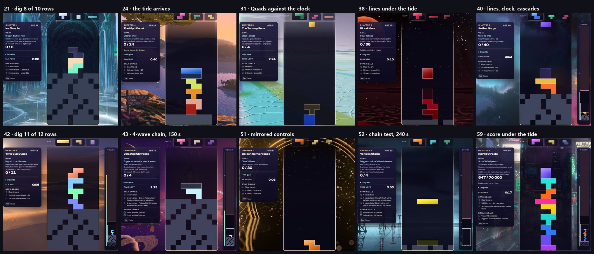

# Odyssey level design: pass 2, variety and level (2026-11-03)

**Status: built on branch `feature/odyssey-level-design-pass2` (from main `b6cf474b`), awaiting the owner's word to
merge.** The branch also carries the rising tide (`feature/odyssey-rising-tide`, orb 58), which pass 2 builds on, so
merging it lands both. The owner approved the plan on 2026-11-03 with every decision as recommended (D9–D13), and
asked for the rest of the rollout too. The plan, its audit of all 60 orbs and every measurement are in
[ODYSSEY_LEVEL_DESIGN_AUDIT_2026-11.md](ODYSSEY_LEVEL_DESIGN_AUDIT_2026-11.md) §8. Earlier phases:
[ODYSSEY_LEVEL_DESIGN_PHASE1_2026-11.md](ODYSSEY_LEVEL_DESIGN_PHASE1_2026-11.md) and
[ODYSSEY_LEVEL_DESIGN_PHASE3_2026-11.md](ODYSSEY_LEVEL_DESIGN_PHASE3_2026-11.md).

## What changed for players

Every idea the campaign teaches now comes back and grows:

- digging: 8 → 21 → 42;
- the rising tide: 24 → 38 → 58 → 59;
- chain goals: 14 → 43 → 52;
- Quads: 12, 29 → 44 → 31;
- mirrored controls: 51 → 53.

| Orb | Before | Now |
|---|---|---|
| 4 · The Living Grotto (chapter 1 boss) | Stars: 3 cascades, then 6 cascades and a 3-wave chain (they came on their own) | Two stars: 4 cascades. Three: **7 cascades and a 4-wave chain** |
| 17 · Halcyon Ascension (chapter 3 boss) | A calm 670 ms in a tall well | A hybrid well paced like the chapter's test: **350 ms, faster with lines**. Star times 180 and 140 s |
| 21 · Ice Temple (chapter 4 practice) | Score 21,000 with the multiplier | **Dig out 8 of 10 rubble rows** at a steady 300 ms. Stars within 50 and 35 s |
| 22 · Alpine Night (chapter 4, practice → rest) | 11 cascades | 9 cascades, with a 70-piece tidy-run star |
| 24 · The High Coast (chapter 4, rest → twist) | Score 17,500 | **Clear 24 lines under a gentle tide**: the first row at 15 s, then every 12 s, tightening to every 6 s. A steady 500 ms. Stars within 80 and 50 s |
| 31 · The Turning Suns (chapter 5 test) | 37 lines in 210 s | **4 Quads within 150 s** at a steady 240 ms. Stars within 70 and 50 s |
| 38 · Blood Moon (chapter 6 test) | Score 50,000 in 240 s in a cascade well | **Clear 36 lines under the tide**: the first row at 6 s, every 6 s tightening to every 3 s. A steady 190 ms. Stars within 80 and 60 s |
| 40 · Aether Surge (chapter 6 test) | 45 lines in 210 s | **40 lines in 180 s in a cascade well** (30 rows, 6 rubble rows) at a steady 190 ms. Stars within 90 and 65 s |
| 42 · Twin-Sun Dunes (chapter 6 test) | 45 lines | **Dig out 11 of 12 rubble rows** in a 24-row well at a steady 180 ms. Stars within 90 and 65 s |
| 43 · Celestial Chrysalis (chapter 6, rest → practice) | Score 30,000 | **A 4-wave chain within 150 s** in a deep rubble well (32 rows, 10 rubble rows, 600 ms). Stars within 60 and 40 pieces |
| 47 · The Singularity (chapter 6 boss) | 520 ms. Stars after the goal at 24 and 28 cascades | A steady **340 ms**. Stars after the goal: 26 cascades with a 4-wave chain, then 32 with a 5-wave chain |
| 50 · Star Cradle (chapter 7, twist → test) | Score 52,000 in 240 s in a cascade well | **The sprint**, moved here from 51: 50 lines in 180 s at 120 → 105 ms |
| 51 · Golden Convergence (chapter 7, test → twist) | The sprint | **30 lines with mirrored controls** at a steady 240 ms. Stars within 80 and 55 s |
| 52 · Voltage Storm (chapter 7 test) | 14 cascades | **A 4-wave chain within 240 s** from a one-row floor (27 rows, 550 ms). Stars within 140 and 100 pieces |
| 55 · Indra's Net (chapter 7 boss) | 500 ms | A steady **340 ms** (same goal, clock and stars) |
| 59 · Rainlit Streets (encore boss) | Score 70,000 in 300 s | **Score 70,000 under the rising tide**: the first row at 12 s, every 9 s tightening to every 3 s over 4 minutes. No clock; the play-on lap ends when the tide wins |

Across the campaign:

- **Copy.** Thirteen orbs get new descriptions and tips.
- **Roles.** The chapter arc beats follow the new roles: chapter 4 gets a rest and a twist, and in chapter 7 the sprint
  and the twist trade places.
- **Fastest-time boards** move to `OdysseyLevelTime_v6_` (D12). Earned stars keep their board.

## Results

- **Gates:** 9 of 9 over all 15 seeds. Seed set by seed set, one-seed swings show:
  - on the fresh seeds, 47's novice clears and its index step;
  - on the confirmation seeds, 52's three stars.
- **Design rules:** R1–R9 pass with the changed orbs' measured rows. The new variety tests pass too: V1 (no formula
  more than three times), V2 (no goal type three times in a row) and V4 (four goal types in chapters 3–7). On today's
  campaign V1 and V4 fail, so the tests do bite.
- **Variety:** distinct orb formulas rise from 16 to 22, and chapter 6 goes from 5 goal types to 7.
- **Human pace:** a regular player clears every solo orb on 8+ of 10 tries except the technique tests (29 and 44 at
  7 of 10, the chain test 52 at 6 of 10). Every chapter from 5 on now has an orb that beats a regular player sometimes;
  today chapters 7 and 8 have none. The full tables are in §8.5.
- **In game:** all ten new combinations load and play in the real game at 30 fps, with no console errors. Each HUD
  shows its goal, and the briefing names each rule. The tide orbs (24, 38, 59) count down to the next row, and a tide
  run that tops out ends on the normal results sheet.
- **Star-time floor (phase 3's follow-up):** checked on every orb. No time-only three-star time now falls under the
  1.10 pieces/s floor; the only gaps against the ladder are its rounding to 5 s, which R2 allows.

## Files

| Area | Files | What |
|---|---|---|
| Retune | `src/core/odyssey/data/level-design-2026-11.js` | Generated from the scratch `proposal.json` plus `pass2.json` (`artifacts/.../scripts/pass2/build.py`). Don't hand-edit it |
| Copy | `src/core/odyssey/data/orb-copy.js` | Words for orbs 4, 17, 21, 24, 31, 38, 40, 42, 43, 50, 51, 52 and 59 |
| Roles | `src/core/odyssey/data/chapters.js` | Arc beats for chapters 4, 6 and 7 |
| Time boards | `src/core/steam/steam-config.js`, `src/core/odyssey/odyssey-time-board.js` | `OdysseyLevelTime_v6_` (D12) |
| Tests | `odyssey-campaign-design-rules`, `odyssey-authored-speed-progression`, `odyssey-difficulty-balance`, `steam-odyssey-leaderboard-identity` | Measured rows, V1/V2/V4, the proportional list, the chapter 7 checks and the v6 boards |
| Tests that named a changed orb | `odyssey-benchmark-runtime`, `odyssey-benchmark-scenarios`, `odyssey-benchmark-cli`, `odyssey-gameplay-objectives`, `odyssey-retry-debrief`, `odyssey-campaign-config`, `odyssey-benchmark-authored-construction`, `odyssey-hud-objectives`, `odyssey-infinity-camera-spawn`, `odyssey-level-briefing`, `odyssey-unique-themes`, `sunbraid-rename-migration` | Follow the sprint to orb 50, the chain test on 52, the tide boss on 59 (no clock), the 30-row hybrid well to orb 40, Vesper's chain practice on 43 and the Quad test on 31 |
| Benchmark scenarios | `scripts/odyssey-benchmark/scenarios.mjs` | The `orb51-fall*` scenarios follow the sprint to orb 50 (eligibility follows the challenge; the ids stay for the historical runs) |
| Benchmark gate | `artifacts/.../scripts/pass2/gates_p2.py` | D9: a 4-wave chain goal is excepted from the novice gate, like a Quad goal |

## Decisions (approved 2026-11-03)

| # | Decision | As built |
|---|---|---|
| D9 | Chain goals of 4+ waves are technique goals | 43 and 52, each with a clock; the novice gate excepts them |
| D10 | Mirrored controls on a second orb | 51 (chapter 7's twist), with 53 |
| D11 | The rising tide on four orbs | 24, 38, 58, 59 |
| D12 | New fastest-time boards | `OdysseyLevelTime_v6_` for every orb |
| D13 | Keep the casual-pace wall from chapter 5 | Kept; pressure now also comes from the tide and from technique |

## Playtest questions (phase 7)

1. Do mirrored controls on two orbs of chapter 7 feel like "another dimension" or like a chore?
2. Can people who have earned chain stars build a 4-wave chain on orb 43 within 150 s?
3. Does the gentle tide on orb 24 read as a twist, and does orb 38's tide feel fair as a test?
4. Does the rising tide make the final boss (59) feel like a finale?
5. Do casual players hit chapter 5's boss (33) as a wall or as a goal to train for?
6. After the sprint (50) and the chain test (52), does the ten-minute capstone (55) still feel like chapter 7's peak?
7. Is the black hole's 5-wave chain (47's top star) a fair top mark for people?

## Re-measuring

The scripts and data are in `artifacts/odyssey-level-design-audit-2026-11/scripts/pass2/` and `.../pass2/`. Run them in
this order:

1. `pass2_v4.py` writes `pass2.json`.
2. `build.py` emits the retune into a worktree.
3. `bench.sh` and `bench_human.sh` run the changed orbs.
4. `eval_p2.py` joins the runs and applies the gates.
5. `assemble_p2.py` rebuilds §8.

Human-pace runs on the long orbs (47, 55) are slow; split them by orb.
