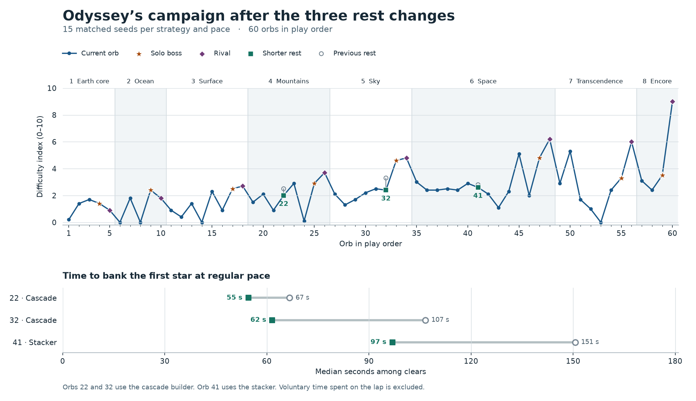
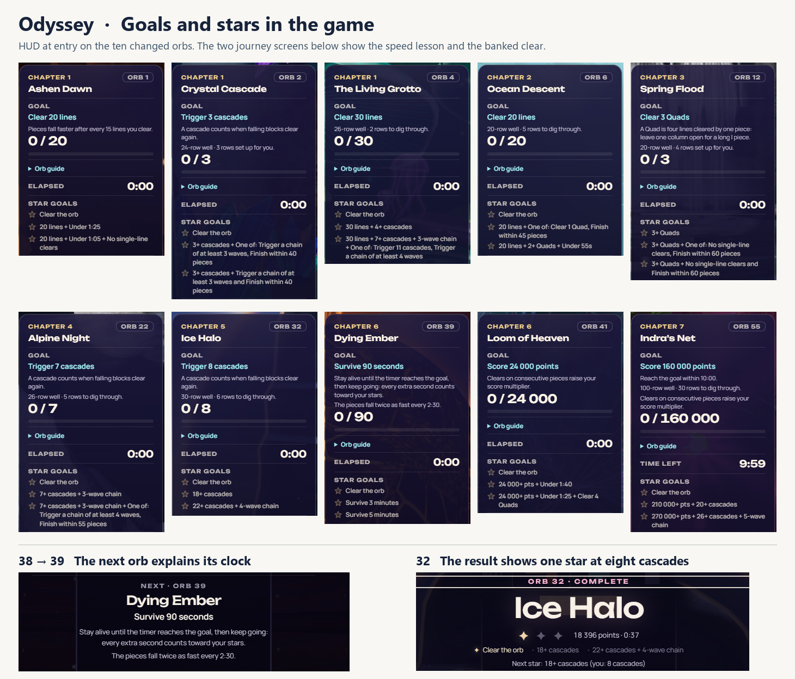

# Odyssey level design, pass 3 · 18 November 2026

Pass 3 gives players an earlier first star on three recovery orbs, a second way to earn silver on the first Quad practice orb, and six teaching cues. The feature branch is `feature/odyssey-level-design-pass3`, based on `3e70826ce`. The full campaign ran at `b543fe592`. Orb 41’s final gold rule is in `4bdb8635c`. [Per-orb audit, decisions and playtest route](ODYSSEY_LEVEL_DESIGN_AUDIT_2026-11.md#9-pass-3-on-the-60-orb-campaign-2026-11-18)

## What changed

| Decision | Orb | What the player can do |
|---|---|---|
| D14 | 1 · Ashen Dawn | Read the speed rule on the welcome and HUD before it first matters. Pieces fall faster after every 15 lines. |
| D14 | 2 · Crystal Cascade | Use the prepared gap to count the first clear as wave one. Each further clear from that piece adds a wave. |
| D14 | 4 · The Living Grotto | Clear 30 lines to win. For gold, the same run needs seven cascades and a three-wave chain, plus either 11 cascades in total or a fourth wave. |
| D15 | 6 · Ocean Descent | Clear 20 lines. One Quad **or** a finish within 45 pieces earns silver. Two Quads within 55 s earn gold. |
| D14 | 12 · Spring Flood | Use the prepared I, build four more rows beside the open column for the next Quad, and reopen an edge if the channel gets covered. |
| D16 | 22 · Alpine Night | Bank seven cascades. A three-wave chain earns silver. For gold, add a fourth wave or finish within 55 pieces. |
| D17 | 32 · Ice Halo | Bank eight cascades after the Quad race on 31. Stay on the optional lap to reach 18 for silver, or 22 plus a four-wave chain for gold. The chapter marks 32 as a release. |
| D14 | 39 · Dying Ember | The transition from 38 pairs the 90-second survival goal with its new clock rule. The pieces fall twice as fast every 2:30. |
| D18 and D22 | 41 · Loom of Heaven | Bank 24,000 points on the empty multiplier board. Finish within 100 s for silver, or within 85 s with four Quads for gold. |
| D14 | 55 · Indra’s Net | Stagger shelves in the starting rubble and score on consecutive clearing pieces. At the goal, choose whether to stay for a deeper chain. |

A player can return to 6 after learning to rebuild a Quad on 12. Earning the two-Quad gold can restock two charms when the bag has room. D20 moves new competitive finishes to `OdysseyLevelTime_v7_<orb>`. The total-stars board stays on v3. On integration with the Steam release, each new eligible completion records its time-board name. Older completions retain their history, progress and stars. The orb card, results screen and publisher compare times only within the current board. Queued legacy submissions keep their original names in the local archive. The partner setup manifest lists the 58 v7 boards in ascending milliseconds. [Steam release and provisioning](STEAM_ONLINE_RELEASE_PLAN_2026-11.md#1-leaderboards-and-records)

### D22 · Count the fourth Quad on the shorter score rest

The approved D18 estimate used checkpoints from the old 40,000-point board. Those runs predicted five Quads within 85 seconds on 8/15 native, 7/15 regular and 9/15 strong Quad builds. Starting the game with the new 24,000-point goal produced only **4, 3 and 5 golds** in those bands. Six native, four regular and five strong builds finished within 85 seconds with exactly four Quads. The score goal had already ended the opportunity to build the fifth.

| Gold rule tested on 41 | Native Quad | Casual Quad | Regular Quad | Strong Quad |
|---|---:|---:|---:|---:|
| Five Quads within 85 s (D18) | 4/15 | 0/15 | 3/15 | 5/15 |
| Five within 85 s or four within 70 s | 10/15 | 0/15 | 4/15 | 10/15 |
| **Four Quads within 85 s (D22)** | **10/15** | **0/15** | **7/15** | **10/15** |

With five Quads, the best gate strategy earned gold on 4/15 attempts (27%), below the 30% minimum. That version passed eight of nine pooled gates. With four Quads, regular gold splits **2, 3, 2** across the three seed blocks and strong gold splits **3, 4, 3**. All 60 matched Quad-builder runs recorded the same goal metrics and finish times under both rules. Every previously earned gold carried through. D22 is the one adjustment to the pass-3 plan. D1–D13 carry forward.

## Campaign results

**All nine gates pass on the pooled 15 seeds.** The five-seed blocks score **8/9, 6/9 and 6/9**, the same pattern as the baseline. The largest within-chapter upward step is **2.8 into 47**. The highest solo index is **5.3 on 50**. At least one gate strategy earned gold on at least five of 15 attempts on every solo orb. V1, V2 and V4 pass. The highest index in the campaign belongs to the final rival, Neon, at **9.0**.

| Orb at regular pace | Median time to first star, before → after | Clear / silver or better / gold, before → after | Median seconds saved on matched clears in each five-seed block |
|---|---:|---|---|
| 6 · Stacker | 43.3 → 43.3 s | 15/0/0 → **15/11/0** | 0.0, 0.0, 0.0 |
| 22 · Cascade builder | 66.7 → **54.6 s** | 15/15/14 → **15/13/9** | 12.6, 10.3, 14.3 |
| 32 · Cascade builder | 106.6 → **61.6 s** | 15/15/15 → **15/15/15** | 40.1, 42.0, 39.0 |
| 41 · Stacker | 150.6 → **96.9 s** | 14/10/0 → **14/11/0** | 60.5, 53.2, 52.7 |

Each row has 15 attempts. The time column measures when the first star can be banked. The last column compares the same winning seeds. On 6 the casual stacker also went from **0 to 8 silvers**, across 14 clears. On 32 the benchmark plays out the optional lap. The regular builder still earned gold on all 15 of those attempts. The browser check below shows what a player earns by banking immediately.



| Consecutive stretch | Previous orb | Rest before → after | Following orb |
|---|---:|---:|---:|
| 5 → 6 → 7 | 0.9 | 0.0 → 0.0 | 1.8 |
| 21 → 22 → 23 | 0.9 | 2.5 → 2.0 | 2.9 |
| 31 → 32 → 33 | 2.5 | 3.3 → 2.4 | 4.6 |
| 40 → 41 → 42 | 2.9 | 2.8 → 2.6 | 2.1 |

The native stacker cleared 32 on **13/15**, up from 12/15. At regular pace, median time to bank the three stretches is **77 → 55 → 86 s** on 21–23, **53 → 62 → 155 s** on 31–33, and **90 → 97 → 116 s** on 40–42. Orb 22’s index still exceeds 21’s, and 41’s exceeds 42’s. The shorter goals give these two rests relief through time spent on the board. Their neighbours are worth playing together.

The final comparison includes **12,600 matched attempts**, with 4,500 gate runs and 8,100 human-paced runs. On the 56 orbs with the same balance, all **11,760** pairs reproduced the baseline gameplay, including goal times, star awards and final metrics. The simulation limit censored 82 attempts before a clear and 70 optional laps. The full-rate table keeps all attempts in the denominator. [Final rates for all 840 strategy and pace combinations](benchmarks/odyssey-pass3-retuned-2026-11.csv) · [Baseline rates](benchmarks/odyssey-pass3-2026-11.csv)

<details>

<summary>All 60 orbs after implementation</summary>

The last three columns give clears / at least silver / gold at each human pace. Each solo column has 15 attempts. The policy stacks for ordinary goals, builds Quads for Quad goals and builds cascades for cascade and chain goals. Each rival column combines 15 stacker and 15 cascade matches. Fall speeds run from entry to the measured one-star finish in milliseconds per row.

| Ch | Orb and role | Goal | Fall ms/row | Well and rules | Index | Casual | Regular | Strong |
|---:|---|---|---:|---|---:|---:|---:|---:|
| 1 | 1 · Ashen Dawn · arrival | 20 lines | 720→461 | 20 rows | 0.2 | 14/7/0 | 14/14/0 | 14/14/0 |
| 1 | 2 · Crystal Cascade · teach | 3 cascades | 820 | 24 rows, 3 prepared, cascade well | 1.4 | 15/15/9 | 15/15/9 | 15/15/10 |
| 1 | 3 · Geode Heart · reinforce | 4 cascades | 810 | 25 rows, 1 rubble, cascade well | 1.7 | 15/15/3 | 15/15/5 | 15/15/6 |
| 1 | 4 · The Living Grotto · boss | 30 lines | 420→246 | 26 rows, 2 rubble, cascade well | 1.4 | 15/2/0 | 15/2/0 | 15/1/0 |
| 1 | 5 · Molten Flow · rival | Cinder · 3 KOs | 1000 | rival tier 1 | 0.9 | 30/30/26 | 30/30/29 | 30/30/29 |
| 2 | 6 · Ocean Descent · teach | 20 lines | 800→636 | 20 rows, 5 rubble | 0.0 | 14/8/0 | 15/11/0 | 15/10/0 |
| 2 | 7 · Night Surf · reinforce | 7 cascades | 800 | 28 rows, 8 rubble, cascade well | 1.8 | 15/12/7 | 15/14/8 | 15/14/9 |
| 2 | 8 · Koi Sanctuary · twist | Dig 6 rows | 450 | 20 rows, 6 rubble | 0.0 | 15/5/2 | 15/11/5 | 15/13/8 |
| 2 | 9 · Tarn of Wisps · boss | 8 cascades | 710 | 27 rows, 8 rubble, cascade well | 2.4 | 15/13/7 | 15/14/7 | 15/14/7 |
| 2 | 10 · Wave Runner · rival | Coral · 3 KOs | 950 | rival tier 2 | 1.8 | 30/29/27 | 30/28/26 | 30/30/27 |
| 3 | 11 · Grainfields · arrival | 26 lines | 450→331 | 20 rows | 0.9 | 14/0/0 | 14/14/0 | 14/14/0 |
| 3 | 12 · Spring Flood · teach | 3 Quads | 600 | 20 rows, 4 prepared | 0.4 | 12/11/10 | 11/10/10 | 12/11/9 |
| 3 | 13 · Golden Reflection · teach | 16,500 points | 450→263 | 20 rows, multiplier | 1.4 | 14/0/0 | 14/0/0 | 14/0/0 |
| 3 | 14 · Glasshouse Reverie · teach | 3-wave chain | 800 | 25 rows, 2 rubble, cascade well | 0.0 | 15/15/6 | 15/15/9 | 15/15/8 |
| 3 | 15 · Gathering Storm · test | 42 lines in 270 s | 330→216 | 20 rows | 2.3 | 14/0/0 | 14/14/0 | 14/14/14 |
| 3 | 16 · Amber Grove · release | 30 lines | 700→330 | 20 rows | 0.9 | 14/0/0 | 14/0/0 | 14/0/0 |
| 3 | 17 · Halcyon Ascension · boss | 30,000 points in 300 s | 350→195 | 27 rows, 4 rubble, cascade well, multiplier | 2.5 | 15/0/0 | 15/15/0 | 15/15/0 |
| 3 | 18 · Summer Glow · rival | Willow · 3 KOs | 900 | rival tier 3 | 2.7 | 24/16/8 | 30/25/21 | 29/29/21 |
| 4 | 19 · Blossom Foothills · arrival | 22,000 points | 330→231 | 24 rows, 2 rubble, multiplier | 1.5 | 14/6/0 | 15/4/0 | 15/4/0 |
| 4 | 20 · Verdant Rise · teach | 9 cascades | 700 | 36 rows, 8 rubble, cascade well | 2.1 | 15/14/3 | 15/13/4 | 15/11/4 |
| 4 | 21 · Ice Temple · reinforce | Dig 8 rows | 300 | 20 rows, 10 rubble | 0.9 | 12/2/0 | 15/5/1 | 14/9/5 |
| 4 | 22 · Alpine Night · release | 7 cascades | 680 | 26 rows, 5 rubble, cascade well | 2.0 | 15/14/10 | 15/13/9 | 15/13/9 |
| 4 | 23 · Everest Ascent · test | 34 lines in 200 s | 250→184 | 20 rows | 2.9 | 14/0/0 | 14/14/0 | 14/14/14 |
| 4 | 24 · The High Coast · twist | 24 lines | 500 | 20 rows, tide | 0.1 | 13/0/0 | 15/15/0 | 14/14/14 |
| 4 | 25 · Garden Under Stone · boss | 16 cascades | 600 | 29 rows, 6 rubble, cascade well | 2.9 | 15/14/8 | 15/15/8 | 15/15/8 |
| 4 | 26 · Winter Trial · rival | Frost · 3 KOs | 850 | rival tier 4 | 3.7 | 15/10/5 | 25/20/10 | 28/25/12 |
| 5 | 27 · Lantern Sky · arrival | 34,000 points | 260→180 | 26 rows, 1 rubble, cascade well, multiplier | 2.1 | 13/4/0 | 15/3/0 | 15/3/0 |
| 5 | 28 · Mirror of Stars · release | 32 lines | 600→283 | 20 rows | 1.3 | 14/0/0 | 14/14/0 | 14/14/0 |
| 5 | 29 · Aurora Passage · teach | 5 Quads | 280 | 20 rows | 1.7 | 9/7/1 | 12/10/10 | 11/9/9 |
| 5 | 30 · Nimbus Veil · reinforce | 10 cascades | 670 | 27 rows, 3 rubble, cascade well | 2.2 | 15/14/11 | 15/13/9 | 15/13/5 |
| 5 | 31 · The Turning Suns · test | 4 Quads in 150 s | 240 | 20 rows | 2.5 | 6/0/0 | 11/8/4 | 12/11/9 |
| 5 | 32 · Ice Halo · release | 8 cascades | 580 | 30 rows, 6 rubble, cascade well, lap | 2.4 | 15/15/15 | 15/15/15 | 15/15/15 |
| 5 | 33 · Atmosphere's End · boss | 55,000 points in 250 s | 150→122 | 31 rows, 7 rubble, cascade well, multiplier | 4.6 | 0/0/0 | 14/14/0 | 15/15/0 |
| 5 | 34 · Where Color Falls · rival | Zephyr · 3 KOs | 800 | rival tier 5 | 4.8 | 7/5/1 | 22/13/7 | 26/25/9 |
| 6 | 35 · Galaxy Core · arrival | 28,000 points | 240→134 | 20 rows, multiplier | 3.0 | 13/0/0 | 14/0/0 | 14/0/0 |
| 6 | 36 · Cosmic Nocturne · reinforce | 12 cascades | 670 | 27 rows, 3 rubble, cascade well | 2.4 | 15/15/8 | 15/14/6 | 15/14/4 |
| 6 | 37 · Stellar Flare · reinforce | 36 lines | 220→162 | 20 rows, 6 rubble | 2.4 | 13/0/0 | 15/13/0 | 15/15/15 |
| 6 | 38 · Blood Moon · test | 36 lines | 190 | 20 rows, tide | 2.5 | 5/0/0 | 12/9/0 | 14/14/10 |
| 6 | 39 · Dying Ember · twist | Survive 90 s | 170→112 | 20 rows, time ramp, lap | 2.4 | 14/12/3 | 14/14/13 | 14/13/10 |
| 6 | 40 · Aether Surge · test | 40 lines in 180 s | 190 | 30 rows, 6 rubble, cascade well | 2.9 | 14/0/0 | 15/7/0 | 15/15/13 |
| 6 | 41 · Loom of Heaven · release | 24,000 points | 200→159 | 20 rows, multiplier | 2.6 | 13/0/0 | 14/11/0 | 14/14/0 |
| 6 | 42 · Twin-Sun Dunes · test | Dig 11 rows | 180 | 24 rows, 12 rubble | 2.1 | 12/3/1 | 15/4/4 | 15/10/6 |
| 6 | 43 · Celestial Chrysalis · reinforce | 4-wave chain in 150 s | 600 | 32 rows, 10 rubble, cascade well | 1.1 | 6/5/3 | 10/7/5 | 12/7/6 |
| 6 | 44 · Silent Drift · reinforce | 6 Quads | 260 | 20 rows | 2.3 | 7/7/0 | 10/7/6 | 9/8/8 |
| 6 | 45 · Eclipse Horizon · test | 68,000 points in 240 s | 145→115 | 32 rows, 8 rubble, cascade well, multiplier | 5.1 | 1/0/0 | 14/12/0 | 15/15/0 |
| 6 | 46 · The Painted Giants · release | 32 lines | 260→207 | 20 rows | 2.0 | 14/0/0 | 14/11/0 | 14/14/0 |
| 6 | 47 · The Singularity · boss | 20 cascades | 340 | 32 rows, 10 rubble, cascade well, lap | 4.8 | 15/15/13 | 15/15/14 | 15/15/13 |
| 6 | 48 · Comet Chase · rival | Nova · 3 KOs | 750 | rival tier 6 | 6.2 | 6/2/0 | 14/9/5 | 25/21/10 |
| 7 | 49 · Fluid Dreams · arrival | 36,000 points | 200→138 | 20 rows, multiplier | 2.9 | 13/0/0 | 14/0/0 | 14/0/0 |
| 7 | 50 · Star Cradle · test | 50 lines in 180 s | 120→105 | 20 rows | 5.3 | 0/0/0 | 14/6/0 | 14/14/12 |
| 7 | 51 · Golden Convergence · twist | 30 lines | 240 | 20 rows, mirror | 1.7 | 14/0/0 | 14/12/0 | 14/14/13 |
| 7 | 52 · Voltage Storm · test | 4-wave chain in 240 s | 550 | 27 rows, 1 rubble, cascade well | 1.0 | 8/8/7 | 14/8/6 | 13/9/5 |
| 7 | 53 · Murmuration · release | 24 lines | 500 | 20 rows, 3 rubble, cascade well, mirror | 0.0 | 15/0/0 | 15/4/0 | 15/15/8 |
| 7 | 54 · Serenity Passage · reinforce | 10 cascades | 600 | 36 rows, 10 rubble, cascade well | 2.4 | 15/14/7 | 15/14/7 | 15/14/7 |
| 7 | 55 · Indra's Net · boss | 160,000 points in 600 s | 340 | 100 rows, 30 rubble, cascade well, multiplier, lap | 3.3 | 1/0/0 | 15/12/0 | 14/13/2 |
| 7 | 56 · Chromatic Impasto · rival | Prism · 3 KOs | 700 | rival tier 6 | 6.0 | 0/0/0 | 17/12/5 | 25/14/8 |
| 8 | 57 · Chromadelic Gateway · arrival | 30 lines | 180→126 | 20 rows | 3.1 | 14/0/0 | 14/3/0 | 14/14/0 |
| 8 | 58 · Neon Dusk · twist | Survive 60 s | 160 | 20 rows, tide, lap | 2.4 | 13/2/0 | 15/10/2 | 15/8/6 |
| 8 | 59 · Rainlit Streets · boss | 70,000 points | 150→117 | 30 rows, 5 rubble, cascade well, multiplier, tide, lap | 3.5 | 2/0/0 | 13/7/0 | 15/14/2 |
| 8 | 60 · Last Light · rival | Neon · 3 KOs | 650 | rival tier 8 | 9.0 | 0/0/0 | 5/4/1 | 16/10/4 |

</details>

## Real-game checks

Each of the ten orbs ran in a private 30 fps Chrome session. Orb 1 started with a fresh journey. Each of the other nine opened from its predecessor’s result via the game’s Continue action. For those nine, the test invoked the predecessor’s completion handler to reach the transition quickly. On each destination it read the map card, briefing, live HUD goal, all three star lines and the guide. All ten accepted gameplay input. There were zero console errors and zero uncaught page errors.

On **38 → 39**, the two transition cues were survival and the time-driven speed increase. On **31 → 32**, the HUD counted ordinary piece placements on a live board. At seven cascades the clear was still pending. Cascade eight settled on piece 57 and opened **Finish orb**. Pressing Enter awarded one star and opened the result for 32, with 18 cascades as the next target and orb 33 as the next destination.



## Owner playtest

Start with one new player on **5 → 6 → 12**. In the human-paced benchmark, Cinder awarded gold on **26/30 casual** and **29/30 regular** matches. Ask what sent rows in the first round, whether the player can explain the star they earned, and whether they can deliberately rebuild the second Quad on 12. **D21** calls for a five-minute flawless-gold trial on 5 only if new players repeatedly earn gold before understanding how to attack.

With a regular player, play **24 → 38 → 39** by chapter select. Watch for the first tide warning and recovery after a covered gap. Ask what makes the pieces speed up on 39. On **31 → 32 → 33**, record the time to the first star on 32 and whether the player wants the lap. End with **59 → 60**. The benchmark won **5/30** matches against Neon at regular pace and **16/30** at strong pace. Ask what attack the player could prepare and whether they want a rematch. **D19** calls for a wider Neon reaction window trial only if regular players repeatedly fail to mount an attack. The full script covers the slow openings, chain construction, mirrors, the two chapter 7 peaks and the encore. [Owner playtest in audit §9.7](ODYSSEY_LEVEL_DESIGN_AUDIT_2026-11.md#97-owner-playtest)

## Reproducing the pass

The pass-3 proposal and emitter include the earlier Quad-key rename and the approved alternate mastery routes on 4 and 30. Before applying the retune, a generator round trip reproduced all 60 resolved configurations from the feature base. The public IDs are campaign order. Edit the proposal, then run the emitter to regenerate the overrides. [Generator and proposal](../artifacts/odyssey-level-design-audit-2026-11/scripts/pass3/)

```sh
python artifacts/odyssey-level-design-audit-2026-11/scripts/pass3/emit_js.py
python artifacts/odyssey-level-design-audit-2026-11/scripts/pass3/emit_js.py --check
```

From the repository root, the command below runs the benchmark and produces the gate files, 60-orb indices and 840-row CSV. It can resume an interrupted run in the same output directory and validates the revision, resolved configurations, seed coverage and star scoring. Run it in the background. The default starts two benchmark processes with two workers each. Supplying an existing completed directory without `--run` just calculates the reports.

```sh
python artifacts/odyssey-level-design-audit-2026-11/scripts/pass3/measure.py artifacts/odyssey-pass3-rerun --run
```

The actual run used six background processes, each with two workers. The five-seed blocks started at 12001, 13001 and 16001. Gate profiles were deliberate and native stacker, steady cascade, native expert and native Quad. Human paces used stacker, cascade and Quad at casual, regular and strong cadence. Every cell kept the published 1,800-second and 3,000-piece limits. The longest human laps on 47 and 55 ran separately. Full attempt logs and the ten pairs of browser captures are in the feature worktree under `artifacts/odyssey-level-design-audit-2026-11/pass3-implementation/`.

For D22, each of the 14 strategy and pace combinations on orb 41 ran again on all 15 seeds. The final report takes those 210 attempts from `4bdb8635c` and 12,390 attempts on the other 59 orbs from `b543fe592`. The validator checks both application hashes against their committed source, the benchmark hash and Node version against each other, and every resolved orb against the final campaign. On 41 the Quad count and its label are the only resolved differences. Chapter 5’s design sketch also marks 32 at the same intended intensity as its other release. The exact inputs for D22 are in `pass3-implementation/final-41/`. To recheck these archived cohorts after the Steam integration, use a separate checkout of `3af2b7ac6`, which contains the measured application and validator. Set `capture` to the absolute path of the `pass3-implementation` directory in the original feature worktree.

```sh
python artifacts/odyssey-level-design-audit-2026-11/scripts/pass3/measure.py "$capture/final-41" --orb 41 --base "$capture"
```

The Odyssey suite passed **3,277 tests in 291 files**, including the campaign design rules, the new reward boundaries and the leaderboard migration. The production build passed its boot-closure check. To repeat the suite and build, run the following in the feature worktree.

```sh
node node_modules/vitest/vitest.mjs run odyssey level-registry bot-config-overrides steam-odyssey spring-rename --maxWorkers=2 --hookTimeout=60000
npm run build
```
