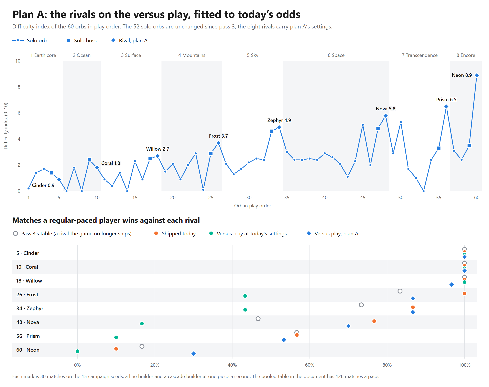
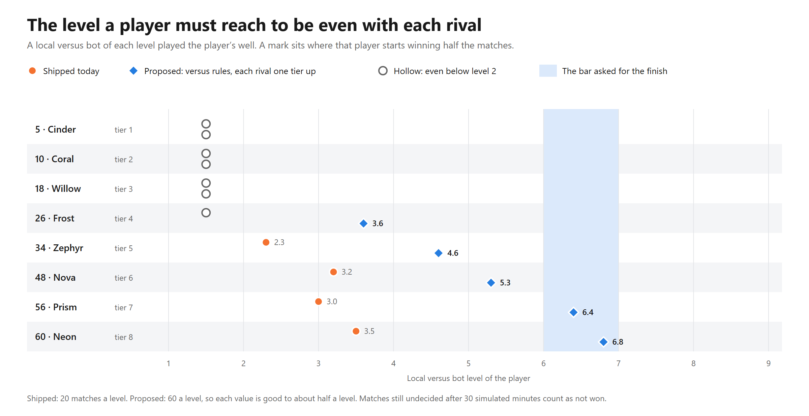
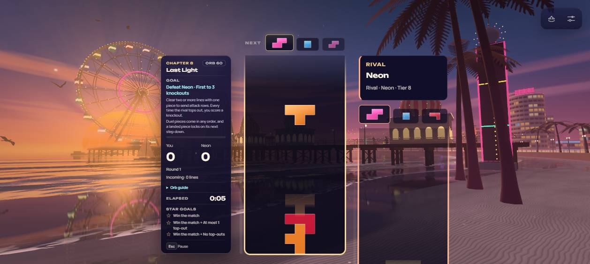

# Odyssey level design, pass 4 · 26 November 2026

**Audit, plan and handover.** The plan is built on the branch `feature/odyssey-level-design-pass4` and is not merged: [what was built and how it measured](#8-built--26-november-2026). Sections 1 to 7 are the audit and the plan as they stood before the build; their numbers come from a prototype at `e31421d3b`.

The eight rivals do not play the new versus play, and the benchmark has not been playing the rivals the game ships. Switched on as it is, the versus play makes the last five rivals far too strong and misreads how an Odyssey duel ends.

**The bar you set on 26 November: a player should need to be about a level 6 to 7 local bot to finish.** Measured with real local bots in the player's well, today's bar is level 3 to 4. Stronger rivals alone do not move it: under Odyssey's piece and lock rules a strong rival and a strong player stall for half an hour. With the versus rules in the duel the matches finish, and one tier a rival, 1 to 8, lands the finish at about level 7. That is the plan now recommended ([section 5](#5-the-bar-you-set-level-6-to-7-to-finish) and [section 7](#7-plan)).

The first fit, which keeps today's odds under Odyssey's own rules ([section 3](#3-the-rivals-fitted-to-todays-odds)), stays as the fallback. All 52 solo orbs measure exactly as in pass 3. They ask for less than level 6 to 7, which is one of the decisions.

Eleven decisions wait for you in [section 7.3](#73-decisions). The three that shape everything else are D23 (which rules a duel plays by), D31 (the bar and the gates that follow from it) and D25 (Neon).

## Contents

1. [What was out of line](#1-what-was-out-of-line)
2. [The versus play in an Odyssey duel](#2-the-versus-play-in-an-odyssey-duel)
3. [The rivals fitted to today's odds](#3-the-rivals-fitted-to-todays-odds)
4. [The solo orbs](#4-the-solo-orbs)
5. [The bar you set: level 6 to 7 to finish](#5-the-bar-you-set-level-6-to-7-to-finish)
6. [Ranked problems](#6-ranked-problems)
7. [Plan](#7-plan)
8. [Built](#8-built--26-november-2026)
9. [Reproduce](#9-reproduce)

## 1. What was out of line

**The game.** A rival is built in [OdysseyBotMatch.js](../src/core/odyssey/OdysseyBotMatch.js) as a `GravityBotController` with no `versusWeights` and no `versusOutlook`, so it plays the older play. Local versus builds the same controller in [local-bot-manager.js](../src/core/ai/local-bot-manager.js) with both. The three versus rounds kept Odyssey this way on purpose and held every rival game identical.

**The benchmark.** `scripts/odyssey-benchmark.mjs`, which pass 3's `measure.py` calls, never plays the shipped rival. [runtime.mjs](../scripts/odyssey-benchmark/runtime.mjs) defaults `liveRival` to false and the command line has no switch for it. It plays the pre-rebuild `PuzzleBotController` at tiers 1, 2, 3, 4, 5, 6, 6, 8. The game ships tiers 1, 2, 2, 4, 4, 5, 5, 6 with authored judgment. So every rival number in pass 3, and gates 8 and 9, describe an opponent no player meets.

How far apart the two are, on the same 15 campaign seeds, as player clears out of 30 (a line builder and a cascade builder pooled):

| Rival | Pass 3's table: casual / regular / strong | The shipped rival: casual / regular / strong |
|---|---:|---:|
| 5 · Cinder | 30 / 30 / 30 | 30 / 30 / 30 |
| 10 · Coral | 30 / 30 / 30 | 29 / 30 / 30 |
| 18 · Willow | 24 / 30 / 29 | 27 / 30 / 30 |
| 26 · Frost | 15 / 25 / 28 | 20 / 30 / 30 |
| 34 · Zephyr | 7 / 22 / 26 | 14 / 26 / 27 |
| 48 · Nova | 6 / 14 / 25 | 11 / 23 / 26 |
| 56 · Prism | 0 / 17 / 25 | 6 / 17 / 27 |
| 60 · Neon | 0 / 5 / 16 | 0 / 3 / 14 |

From Frost to Prism the shipped rivals are easier than pass 3 said, most of all for casual players and against Nova. Neon is slightly harder. Two of pass 3's open points rest on the old numbers: D19 quotes 14 of 30 regular wins against Nova (shipped: 23) and 5 of 30 against Neon (shipped: 3).

**The label and the index.** The index formula for a rival is `0.9 × tier + 3 × the stand-ins' loss share`, and it reads the tier from the level data. The bot rebuild changed those labels without changing the benchmark's rival. Pass 3's own tool, run today on identical gameplay, now reports Neon at 7.2 where pass 3 published 9.0. The same label is shown to players: "Rival · Neon · Tier 6".

## 2. The versus play in an Odyssey duel

"Stand-ins" below are the benchmark's five simulated players (novice, regular, skilled, expert, Quad builder), each 15 matches. The pace columns are a line builder and a cascade builder at 0.6, 1.0 and 1.6 pieces a second, 30 matches a pace, written as **clear / at least two stars / three stars**.

### 2.1 Switched on at today's settings

Built exactly as local versus builds a seat (versus weights, its kill test, twice the planning share) and left at today's tiers and hand speeds:

| Rival | Shipped today: casual / regular / strong clears | Versus play, today's settings |
|---|---:|---:|
| 5 · Cinder | 30 / 30 / 30 | 30 / 30 / 30 |
| 10 · Coral | 29 / 30 / 30 | 30 / 30 / 30 |
| 18 · Willow | 27 / 30 / 30 | 30 / 30 / 30 |
| 26 · Frost | 20 / 30 / 30 | 1 / 13 / 26 |
| 34 · Zephyr | 14 / 26 / 27 | 2 / 13 / 21 |
| 48 · Nova | 11 / 23 / 26 | 2 / 5 / 8 |
| 56 · Prism | 6 / 17 / 27 | 1 / 3 / 7 |
| 60 · Neon | 0 / 3 / 14 | 0 / 0 / 1 |

Gates 8 and 9 fail on it (section 3.3). It cannot be switched on without a re-fit.

### 2.2 Rules check

Each thing the versus play assumes, against what an Odyssey duel does.

| The versus play assumes | An Odyssey duel | What happens | Handling |
|---|---|---|---|
| Arriving rows always go in. Only a piece that cannot appear ends a well. Danger, calm and the opening are read off the four spawn columns, and towers on an edge column are paid for. | Rows that would lift any cell above the visible rows are refused, and that ends the well. | The rival stands a tower at the side and dies to a burst with room in the middle. Of Frost's 167 knockouts at human pace, 158 were refused rows, and 100 of those came with its tallest column four or more rows above the spawn columns. With today's play: 1 of 130. | Teach it the rule (prototype): danger also counts the tallest column, with six rows kept for a burst, and a move that leaves less room than the rows waiting is never chosen. Side-tower knockouts fall from 100 to 32. Or change the duel's rule: D23. |
| The kill test counts rows to block the opponent's spawn. | The player's well ends when rows exceed the room above their tallest column. | The test asks for more rows than a knockout needs. Measured effect on the odds at these tiers: none (within one win in 30). | Use Odyssey's own test, which the match already computes. |
| A knocked-out player returns on an empty well while the other keeps their board. | Both wells reset after every knockout. | The opening (hold small clears until a first big release, for up to 34 pieces) restarts every round. Tested for the three early rivals with the opening off: no change in rows sent. | None needed. |
| Each piece is drawn on its own; a resting piece locks at the next gravity step. | A bag of seven and a lock delay, as in every solo orb. | A straight for the open column is never more than 13 pieces away. Not isolated; it is part of the measured strength. | None. |
| Rows completed when garbage settles count as the player's clear. | They clear and pay nothing. | No term of the evaluation relies on it. | None. |
| One attack's rows enter as one solid. | One body per row. | The rival reads bodies off the real board, so nothing is assumed. | None. |
| At most 20 rows wait. | No limit. | Rows waiting are read as they are. | None. |
| Attack size is lines minus one, from two lines up, plus the clean bonus. | The same formula. | Nothing. | None. |
| Its own plan decides when to release. | Nova and Prism carry authored pressing habits (`pressAtRows`, a per-match variation). | The versus play never consults them. They become dead settings. | Remove them (D30). |
| A seat's hands come from the local ladder; tier 10 has a pace limit. | Authored hand speed and reaction window per rival (R8). | Odyssey's hands are kept. Rival pieces a minute are unchanged (Frost 43 to 41, Neon 64 to 61). | None. |

### 2.3 The rule and planning variants, measured

Player clears out of 30 at regular pace, campaign seeds:

| Rival plays | Frost | Zephyr | Nova | Prism | Neon |
|---|---:|---:|---:|---:|---:|
| Shipped today | 30 | 26 | 23 | 17 | 3 |
| Versus play as local versus builds it | 13 | 13 | 5 | 3 | 0 |
| … with Odyssey's kill test | 13 | 13 | 4 | 3 | 0 |
| … with Odyssey's planning share (half) | 13 | 13 | 8 | 4 | 0 |
| … taught Odyssey's rule for rising rows | 7 | 4 | 3 | 0 | 0 |
| … with the versus death rule in the duel instead | 4 | 1 | 0 | 1 | 0 |
| Today's play, with the versus death rule in the duel | 30 | 26 | 22 | 15 | 3 |

The kill test and the planning share move little. The death rule matters only once the versus play is in: with today's play, changing it moves nothing.

### 2.4 Frame cost

Planning time per 60 Hz duel tick, measured in Node on one thread on this machine (three matches each). This compares the plays; it is not the packaged game's frame budget, which belongs to step 3.

| Rival | Today: mean / 99% / longest, ms | Proposed |
|---|---:|---:|
| Cinder | 0.009 / 0.23 / 4.2 | 0.002 / 0.02 / 3.2 |
| Frost | 0.008 / 0.23 / 9.2 | 0.005 / 0.22 / 4.2 |
| Prism | 0.012 / 0.28 / 7.7 | 0.007 / 0.27 / 3.9 |
| Neon | 0.011 / 0.24 / 2.5 | 0.011 / 0.34 / 3.6 |

The proposed rivals sit at lower tiers than today's, so they search less. With the versus planning share they cost the same or less. Neon's 99% tick is 0.1 ms longer. The proposed column was measured with the rival reading every piece, which is the costly case.

### 2.5 Determinism, and local versus

- **Determinism.** 36 matches (Cinder, Frost, Nova, Neon) played twice, under different CPU load and worker counts, agree on every recorded field. The duel steps the rival on its own 60 Hz tick, so the display rate does not reach it; a 165 Hz run was not made and belongs to the existing replay test in step 3.
- **Garbage follows its rules in both wells.** An audit of every attack and every arrival in 120 matches against the shipped rivals (7,327 attacks, 12,082 rows) found no mismatch: attack size is lines minus one from two lines up plus the clean-board bonus; rows go only to the other well; all waiting rows arrive at the receiver's next piece, each with one to five holes; the well's cells add up after every arrival; rows are refused only when they would overflow; rows a settle completes pay nothing; and rows queued equal rows inserted, refused and dropped, to the row, for the player and the rival alike (`garbage-audit.mjs`). The one gap is in who gets the knockout: problem 12 in section 6.
- **Local versus is untouched by the prototype.** Its three edits to shared bot code are opt-in and off by default. With all three in place, all 16 seeded local rooms replay as recorded (`reports/bots-versus-2026-11/seeded-rooms.mjs check`).

## 3. The rivals fitted to today's odds

This is plan A: Odyssey's own rules, the versus play taught them, and each rival fitted back to the odds it gives today. It is the fallback if the duels keep Odyssey's rules (D23).

### 3.1 Method

- **Base.** The versus play, taught Odyssey's rule for rising rows, with Odyssey's kill test and the versus planning share. Hand speeds and reaction windows stay as authored (90 to 340 actions a minute).
- **Levers.** The tier, and how often the rival reads its next piece. Nova and Prism already carry that second setting at tier 5. Tiers alone are too coarse: at Frost's hands, tier 2 gives a casual player 29 of 32 and tier 3 gives 13 of 32, against 22 today. The reason is in the search: at tiers 1 and 2 it keeps one candidate, so a preview cannot change the move; from tier 3 it can. A rival that reads its preview only some of the time sits between.
- **Panels.** Fitted on 16 unused seeds (71001), checked on a second set (73001) and on the campaign's 15. Pooled over those three, the first choices for Frost, Zephyr and Nova were 7 to 12 points too hard at regular pace, which is what picking the best of several on one panel does. The settings were then chosen on all three pooled and played on a fourth set (75001). Frost, Zephyr, Prism and the three early rivals were fixed before that fourth set was played. Nova (65% to 60%) and Neon were adjusted once more after it, so for those two it is part of the choice, not a check.
- **Target.** Today's shipped rival on the same seeds, within 10 points pooled, the bot rebuild's rule for a larger panel. Its small-panel rule, two wins in 30, cannot be held on single panels here. The shipped rivals themselves vary that much between panels: today's Zephyr gives a casual player 15, 19, 11 and 14 wins on the four.
- **Noise.** One match moves a 30-match rate by 3 points. A 126-match rate has a standard error near 4 points, so differences under about 8 points between two such rates are not evidence.

In all: 22,629 rival matches, and 12,600 attempts for the solo re-measure.

### 3.2 Settings

| Rival | Today | Proposed | Hands (unchanged) |
|---|---|---|---|
| 5 · Cinder | tier 1 | tier 1 | 90 a minute, 500–900 ms |
| 10 · Coral | tier 2 | tier 2 | 120, 420–760 |
| 18 · Willow | tier 2 | tier 2 | 165, 320–620 |
| 26 · Frost | tier 4 | tier 3, reads its next piece 30% of the time | 230, 240–480 |
| 34 · Zephyr | tier 4 | tier 3, reads 40% | 270, 200–380 |
| 48 · Nova | tier 5, reads 60% (79% when digging), presses at 8 rows | tier 3, reads 60% | 300, 180–340 |
| 56 · Prism | tier 5, reads 76% (always when digging) | tier 3, reads always | 330, 160–320 |
| 60 · Neon | tier 6, reads a second piece 52% | tier 4, reads 50% (the Neon table in 3.3) | 340, 150–300 |

R8 still holds as the test states it: tiers never fall, hands get faster, nobody acts faster than 360 a minute or reacts under 140 ms. Its sentence about tiers 5, 6, 6 and 8 needs rewriting.

### 3.3 Results

**On the campaign seeds, with stand-ins.** The index uses the rung each rival was fitted to in passes 1 to 3 (1, 2, 3, 4, 5, 6, 6, 8), so it stays comparable with those passes.

| Rival | Rival plays | Casual | Regular | Strong | Stand-ins N/R/S/E/Q | Regular match, min | Rival rows a piece | Bursts of 4+ rows per 100 pieces | Index |
|---|---|---:|---:|---:|---|---:|---:|---:|---:|
| **5 · Cinder** | Shipped today | 30/30/27 | 30/29/28 | 30/30/26 | 15/15/15/15/15 | 4.5 | 0.09 | 0.3 | 0.9 |
|  | Versus play, today's settings | 30/30/27 | 30/30/27 | 30/30/28 | 15/15/15/15/15 | 3.8 | 0.07 | 0.5 | 0.9 |
|  | Versus play, proposed settings | 30/30/27 | 30/30/28 | 30/30/27 | 15/15/15/15/15 | 4.0 | 0.07 | 0.6 | 0.9 |
| **10 · Coral** | Shipped today | 29/28/20 | 30/30/27 | 30/30/25 | 15/15/15/15/15 | 5.2 | 0.15 | 0.6 | 1.8 |
|  | Versus play, today's settings | 30/30/25 | 30/30/25 | 30/30/27 | 15/15/15/15/15 | 4.0 | 0.10 | 0.7 | 1.8 |
|  | Versus play, proposed settings | 30/29/26 | 30/30/29 | 30/29/28 | 15/15/15/15/15 | 3.9 | 0.10 | 0.8 | 1.8 |
| **18 · Willow** | Shipped today | 27/24/16 | 30/30/21 | 30/30/25 | 15/15/15/15/15 | 5.0 | 0.17 | 0.8 | 2.7 |
|  | Versus play, today's settings | 30/28/17 | 30/30/25 | 30/30/27 | 15/15/15/15/15 | 4.1 | 0.13 | 1.0 | 2.7 |
|  | Versus play, proposed settings | 29/26/17 | 29/29/21 | 30/30/26 | 15/15/15/15/15 | 4.5 | 0.13 | 0.9 | 2.7 |
| **26 · Frost** | Shipped today | 20/15/7 | 30/27/15 | 30/25/18 | 15/15/15/15/11 | 6.9 | 0.17 | 0.4 | 3.6 |
|  | Versus play, today's settings | 1/0/0 | 13/8/3 | 26/20/11 | 5/10/15/15/10 | 6.5 | 0.23 | 1.6 | 4.6 |
|  | Versus play, proposed settings | 14/10/2 | 26/24/12 | 30/29/22 | 13/15/15/15/13 | 4.7 | 0.17 | 1.1 | 3.7 |
| **34 · Zephyr** | Shipped today | 14/11/6 | 26/19/9 | 27/25/20 | 10/14/14/15/13 | 6.5 | 0.17 | 0.4 | 5.0 |
|  | Versus play, today's settings | 2/1/0 | 13/8/3 | 21/14/7 | 4/6/13/15/8 | 6.5 | 0.23 | 1.5 | 6.0 |
|  | Versus play, proposed settings | 11/8/7 | 26/17/8 | 30/29/17 | 11/13/15/15/10 | 5.3 | 0.18 | 1.1 | 4.9 |
| **48 · Nova** | Shipped today | 11/5/1 | 23/15/9 | 26/20/11 | 9/14/12/15/10 | 7.2 | 0.18 | 0.5 | 6.1 |
|  | Versus play, today's settings | 2/1/0 | 5/2/1 | 8/4/2 | 1/5/11/15/6 | 6.7 | 0.22 | 1.4 | 7.3 |
|  | Versus play, proposed settings | 12/5/1 | 21/16/8 | 29/23/13 | 12/13/14/15/12 | 4.9 | 0.18 | 1.1 | 5.8 |
| **56 · Prism** | Shipped today | 6/3/0 | 17/11/4 | 27/20/11 | 5/9/14/15/10 | 6.9 | 0.18 | 0.5 | 6.5 |
|  | Versus play, today's settings | 1/1/1 | 3/2/0 | 7/5/2 | 2/2/6/15/3 | 5.0 | 0.22 | 1.4 | 7.7 |
|  | Versus play, proposed settings | 6/3/0 | 16/10/2 | 22/13/4 | 5/10/13/15/10 | 6.2 | 0.19 | 1.3 | 6.5 |
| **60 · Neon** | Shipped today | 0/0/0 | 3/2/1 | 14/9/1 | 1/4/9/15/1 | 6.1 | 0.21 | 0.7 | 9.3 |
|  | Versus play, today's settings | 0/0/0 | 0/0/0 | 1/1/0 | 0/0/2/15/1 | 5.6 | 0.23 | 1.4 | 10.0 |
|  | Versus play, proposed settings | 0/0/0 | 9/6/3 | 15/12/4 | 2/4/13/15/7 | 5.1 | 0.21 | 1.3 | 8.9 |

**Pooled over all four panels**, 126 matches a pace, player clears. This is the table to judge the fit by.

| Rival | Casual: today → proposed | Regular | Strong |
|---|---:|---:|---:|
| 5 · Cinder | 125 → 126 | 126 → 126 | 126 → 126 |
| 10 · Coral | 121 → 126 | 126 → 126 | 126 → 125 |
| 18 · Willow | 114 → 121 | 123 → 124 | 126 → 126 |
| 26 · Frost | 74 → 85 | 117 → 113 | 123 → 123 |
| 34 · Zephyr | 59 → 52 | 102 → 104 | 117 → 124 |
| 48 · Nova | 52 → 41 | 89 → 94 | 115 → 120 |
| 56 · Prism | 25 → 23 | 73 → 69 | 102 → 99 |
| 60 · Neon (reads 50%) | 3 → 3 | 15 → 33 | 56 → 82 |

Every rival but Neon is inside 10 points at every pace. The largest gaps are both at casual pace: Frost 9 points easier and Nova 9 points harder. Single panels swing further: on the fourth panel alone (32 a pace), Frost gave a casual player 24 wins against 16, and Prism gave a regular player 15 against 21.

**Gates 8 and 9 on the live rival**, campaign seeds, stand-in wins out of 15. The other seven gates look only at solo orbs and are unchanged (section 4).

| Gate | Old rival (pass 3) | Shipped today | Versus play, today's settings | Proposed |
|---|---|---|---|---|
| 8 · Neon: skilled at least 9, regular at least 3 | 11, 5 · pass | 9, 4 · pass | 2, 0 · **fail** | 13, 4 · pass |
| 9 · Zephyr, Nova, Prism: regular at least 6 | 15, 11, 13 · pass | 14, 14, 9 · pass | 6, 5, 2 · **fail** | 13, 13, 10 · pass |

**Neon.** One setting cannot give both a person and the regular stand-in today's odds. The stand-in (a line builder at its own unpaced speed) does worse against the versus play than a regular-paced person does.

| Neon | Regular person, of 126 | Strong person, of 126 | Regular stand-in, of 15 | Skilled stand-in | Gate 8 |
|---|---:|---:|---:|---:|---|
| Shipped today | 15 (12%) | 56 (44%) | 4 | 9 | pass |
| Tier 4, reads always | 15 (12%) | 45 (36%) | 1 | 10 | fail |
| Tier 4, reads 55% | 28 (22%) | 67 (53%) | 6 | 10 | pass, but 60% gives 0 and 65% gives 4 |
| **Tier 4, reads 50%** | 33 (26%) | 82 (65%) | 4 | 13 | pass; 45% gives 7 |
| Tier 3, reads always (94 matches) | 45 of 94 (48%) | 73 of 94 (78%) | 8 | 13 | pass |

### 3.4 How a rival plays differently

- **Bigger bursts.** From Frost on, the rival sends about the same rows a piece as today (0.17 to 0.21) but two to three times as many bursts of four rows or more (0.4–0.7 per 100 pieces today, 1.2–1.4 proposed, pooled). Its largest attack in 378 matches grows from 8–11 rows to 9–14.
- **More player knockouts by arriving rows.** Against Frost, 28% of a player's knockouts today are rows the well refused (112 of 401); proposed, 35% (130 of 371). Against Neon, 37% and 41%. Only a person can say whether that feels fair.
- **Shorter matches.** Median regular-pace match: Frost 6.6 to 5.0 minutes, Nova 6.4 to 5.2, Neon 6.0 to 5.4, Cinder 4.6 to 4.2. Matches of ten minutes or more fall from 303 to 186 of 3,024. No match reached the 30-minute limit (three did against today's rivals).
- **The early rivals attack less.** Pooled, Coral sends 0.10 rows a piece against 0.14 today, Willow 0.14 against 0.17. Clears are the same, and casual players earn gold more often: Coral 85 to 108 of 126, Willow 61 to 86. The opening rule is not the cause (tested).
- **The rival still falls to its own side column sometimes.** Even taught the rule, about a fifth of Frost's knockouts come with a tall side column (200 of 1,038, against 5 of 1,021 today).

## 4. The solo orbs

**Nothing moved.** Since the commit pass 3 measured, the level data changed on the eight rival orbs only. The engine did change (versus rules, bot code), so everything was measured again: 12,600 attempts at `e31421d3b` with pass 3's own tool. All 840 cells of its table (clears, stars, censoring, medians and each five-seed split) are identical to [pass 3's published table](benchmarks/odyssey-pass3-retuned-2026-11.csv). Gates are 9 of 9 pooled and 8, 6, 6 by block, as before. Section 9.3 of the audit stands for all 52 solo orbs.

**The steps into and out of each rival.** With the rivals of plan A the indices are 0.9, 1.8, 2.7, 3.7, 4.9, 5.8, 6.5 and 8.9, against 0.9, 1.8, 2.7, 3.7, 4.8, 6.2, 6.0 and 9.0 in pass 3. Every chapter still ends on its boss and then its rival, and every next opener is lower than both. Prism now sits above Nova (5.8, then 6.5) where pass 3 had them level (6.2, then 6.0). The step from 59 into Neon stays the largest in the campaign: 3.5 to 8.9.



**No playtest notes yet.** Pass 3's seven ranked problems all ended on a question for a person. None can be closed or acted on from measurements, so no solo orb is changed in this pass. Under plan B the index of a rival no longer means much: the stand-ins it is built from lose nearly every match from Zephyr on (section 5.6), so section 5 measures rivals in levels instead.

## 5. The bar you set: level 6 to 7 to finish

### 5.1 How it was measured

The benchmark's player well was handed to a real local versus bot of a chosen level, built by the game's own `LocalBotManager`: its hands, its chance to read two levels up for a match, and the versus play. Where the duel keeps Odyssey's rule for rising rows, that bot is taught it, as a person would know it. Each cell below is **wins–losses–undecided**. A match is undecided when it reaches 30 simulated minutes or 3,000 pieces, and counts as not won.

The local levels placed 37, 42, 52, 61, 67, 78, 104 and 123 pieces a minute at levels 2 to 9 in these duels.

### 5.2 Where the bar is today

Player wins out of 20 against the shipped rivals, by the player's level:

| Rival | Level 2 | 3 | 4 | 5 | 6 | 7 | 8 |
|---|---:|---:|---:|---:|---:|---:|---:|
| 5 · Cinder | 13 | 19 | 20 | 20 | 20 | 20 | 20 |
| 10 · Coral | 11 | 17 | 20 | 20 | 20 | 20 | 20 |
| 18 · Willow | 10 | 16 | 20 | 19 | 20 | 20 | 20 |
| 26 · Frost | 11 | 13 | 19 | 20 | 20 | 20 | 20 |
| 34 · Zephyr | 9 | 13 | 17 | 19 | 20 | 20 | 20 |
| 48 · Nova | 8 | 9 | 15 | 16 | 20 | 20 | 20 |
| 56 · Prism | 4 | 10 | 14 | 18 | 19 | 20 | 20 |
| 60 · Neon | 3 | 8 | 12 | 14 | 18 | 19 | 20 |

A level 3 to 4 player is even with Neon. A level 5 player wins 14 of 20 and a level 6 player 18. The fit of section 3 gives the same picture, as it was meant to.

**The benchmark's model players sit at about level 3 and level 4.** The one-piece-a-second player beats today's Neon in 12% of matches and Prism in 58%, which is where levels 2 and 3 land. The 1.6-pieces-a-second player wins 44% and 81%, where levels 3 and 4 to 5 land. So the bar you set is two to three levels above the players the campaign has been tuned against in all three passes.

### 5.3 A stronger Neon is not enough under Odyssey's rules

Neon with the versus play, taught Odyssey's rule, at today's hands (340 actions a minute):

| Neon's tier | Level 4 | 5 | 6 | 7 | 8 | Minutes a knockout at levels 5 to 7 |
|---|---:|---:|---:|---:|---:|---|
| 5 | 8–11–1 | 14–6–0 | 15–5–0 | 17–1–2 | 17–1–2 | 2.9 to 3.4 |
| 6 | 4–15–1 | 7–9–4 | 9–3–8 | 11–1–8 | 15–2–3 | 5.6 to 8.0 |
| 7 | 0–13–7 | 1–13–6 | 5–4–11 | 6–1–13 | 12–1–7 | 5.8 to 14.5 |
| 9 | 0–18–2 | 1–13–6 | 1–7–12 | 1–1–18 | 9–1–10 | 7.1 to 25.0 |

From tier 6 a level 6 or 7 player almost never loses, and most matches are still running after half an hour. Faster hands do not fix it. At tier 5, 550 actions a minute reaches about level 5.5 (level 5 wins 7 of 20, level 6 wins 14). At tier 6 and above Neon stays near 59 pieces a minute whatever its hands, because its planning sets its pace, and the matches stall the same way.

### 5.4 The versus rules in the duel end the stall

The same Neon at tier 6, 20 matches a level:

| The duel plays by | Level 4 | 5 | 6 | 7 | 8 | Minutes a knockout |
|---|---:|---:|---:|---:|---:|---|
| Odyssey's rules | 4–15–1 | 7–9–4 | 9–3–8 | 11–1–8 | 15–2–3 | 2.7 to 8.0 |
| The versus pieces and lock, Odyssey's rule for rising rows | 7–13–0 | 7–13–0 | 13–7–0 | 17–3–0 | 17–3–0 | 1.7 to 2.8 |
| The versus pieces, lock and rows | 3–16–1 | 9–11–0 | 13–7–0 | 16–4–0 | 16–4–0 | 2.0 to 3.2 |

The pieces and the lock do it: each piece drawn on its own with no bag of seven, and a resting piece locked at the next gravity step with no delay to slide in. With the bag and the lock delay, a rival that reads two pieces ahead can defend almost without end. Which rule ends a well matters less.

### 5.5 The climb: one tier a rival

Under the versus pieces, lock and rows, with the versus play exactly as local versus runs it and each rival's hands as authored today. Neon takes the fastest hands R8 allows (360 a minute, 140 to 280 ms). Player wins out of 60, by the player's level:

| Rival | Tier | Level 2 | 3 | 4 | 5 | 6 | 7 | 8 | Even at | Median minutes at levels 5 / 6 / 7 |
|---|---:|---:|---:|---:|---:|---:|---:|---:|---:|---|
| 5 · Cinder | 1 | 56 | 60 | 60 | 60 | 60 | 60 | 60 | below 2 | 4 / 4 / 3 |
| 10 · Coral | 2 | 48 | 57 | 60 | 60 | 60 | 60 | 60 | below 2 | 4 / 3 / 3 |
| 18 · Willow | 3 | 31 | 48 | 54 | 57 | 60 | 60 | 60 | about 2 | 4 / 4 / 4 |
| 26 · Frost | 4 | 20 | 26 | 33 | 47 | 59 | 60 | 60 | 3.6 | 6 / 5 / 4 |
| 34 · Zephyr | 5 | 4 | 16 | 25 | 33 | 46 | 54 | 56 | 4.6 | 6 / 7 / 6 |
| 48 · Nova | 6 | 0 | 5 | 17 | 28 | 35 | 40 | 50 | 5.3 | 8 / 8 / 11 |
| 56 · Prism | 7 | 0 | 0 | 10 | 16 | 28 | 33 | 42 | 6.4 | 10 / 10 / 15 |
| 60 · Neon | 8 | 0 of 40 | 0 of 40 | 4 | 11 | 26 | 31 | 43 | 6.8 | 7 / 11 / 16 |



What that means for finishing:

- **Level 7** beats Neon about half the time and Prism a little more.
- **Level 6** beats Neon in 43% of matches and Prism in 47%. It finishes after a few attempts at each.
- **Level 5** beats Neon in 18% and Prism in 27%. It can finish, with about five attempts at Neon.
- **Level 4** beats Neon in 7% and Prism in 17%.
- **Level 3** never beat Neon or Prism in 40 and 60 matches.

It is a bar, not a wall: below level 6, each level down more than halves the odds. For a harder finish, Neon has two stronger settings, each on 60 matches a level:

| Neon | Level 4 | 5 | 6 | 7 | 8 | Even at | Median minutes at levels 6 / 7 |
|---|---:|---:|---:|---:|---:|---:|---|
| Tier 8, 360 a minute (proposed) | 4–55–1 | 11–44–5 | 26–29–5 | 31–22–7 | 43–14–3 | 6.8 | 11 / 16 |
| Tier 8, 450 a minute | 3–57–0 | 7–47–6 | 18–36–6 | 27–26–7 | 41–16–3 | 7.2 | 10 / 14 |
| Tier 9, 340 a minute | 3–53–4 | 4–46–10 | 16–34–10 | 22–24–14 | 39–12–9 | 7.5 | 13 / 18 |

### 5.6 What this does to the benchmark's model players and to the gates

Against the climb, on the campaign seeds, player clears out of 30:

| Rival | Casual | Regular | Strong | Stand-ins N/R/S/E/Q of 15 |
|---|---:|---:|---:|---|
| 5 · Cinder | 30 | 30 | 30 | 15/15/15/15/15 |
| 10 · Coral | 30 | 30 | 30 | 15/15/15/15/14 |
| 18 · Willow | 19 | 24 | 28 | 12/12/15/15/13 |
| 26 · Frost | 5 | 14 | 24 | 4/5/11/15/7 |
| 34 · Zephyr | 1 | 1 | 6 | 0/1/12/15/3 |
| 48 · Nova | 0 | 1 | 4 | 0/0/5/14/0 |
| 56 · Prism | 0 | 0 | 1 | 0/0/0/15/0 |
| 60 · Neon | 0 | 0 | 0 | 0/0/0/13/1 |

The model players stop at Zephyr. Gates 8 and 9 fail outright, as they must: they ask that the regular stand-in beat Neon in 20% of matches and the chapter 5 to 7 rivals in 40%. A bar at level 6 to 7 and those two gates cannot both hold, so the gates need restating in levels (D31). These model players were also never built for pieces without a bag.

### 5.7 Cost and checks

- **Planning cost** per 60 Hz tick in Node, mean / 99% / longest in ms: Zephyr at tier 5, 0.007 / 0.21 / 2.8; Nova at 6, 0.009 / 0.24 / 2.8; Prism at 7, 0.012 / 0.28 / 2.8; Neon at 8, 0.015 / 0.35 / 3.0. Today's Neon: 0.010 / 0.21 / 2.3. This is the planning alone, which the duel's rules do not change. The packaged budget check belongs to step 3.
- **No change to shared bot code.** The versus play runs as fitted, so the three prototype edits of section 2 are not needed for this plan, and local versus cannot move.
- **Determinism.** 24 matches under these rules, with a local bot in the player's well, played twice and agree on every field.

### 5.8 What is not known

- **No person has played any of this.** A level 6 or 7 bot rarely blunders, which is why its matches against Prism and Neon run 10 to 16 minutes at the median. A person may end them sooner, either way.
- **Whether level 6 to 7 is the player you mean.** Ten minutes against a level 6 and a level 7 bot in local versus would tell you, and it is the first item of the playtest.
- **Each "even at" is good to about half a level.** On 20 seeds Nova at tier 6 came out at 4.6; on 60 it is 5.3.
- **Two versus rules were not in the test:** one attack's rows entering as one solid, and the limit of 20 waiting rows. Only the pieces, the lock and the rule for rising rows were.

## 6. Ranked problems

| # | Priority | Problem | Evidence |
|---:|---|---|---|
| 1 | P0 | The benchmark does not play the shipped rivals. Gates 8 and 9 and every rival row in the audit describe another opponent. | Section 1: Nova 14 of 30 in the table, 23 of 30 shipped. |
| 2 | P0 | The rivals do not use the versus play. | `versusWeights` is never passed in `OdysseyBotMatch`. |
| 3 | P0 | The campaign can be finished three levels below the bar you set. | Section 5.2: a level 3 to 4 player is even with Neon. |
| 4 | P0 | Under Odyssey's piece and lock rules a strong rival and a strong player stall. | Section 5.3: at tier 7, 13 of 20 matches against a level 7 player undecided after 30 minutes. |
| 5 | P0 | The versus play misreads how an Odyssey well ends, if the duel keeps Odyssey's rule. | Section 2.2: 100 of Frost's 158 refused-row knockouts with a side tower. |
| 6 | P1 | Gates 8 and 9 contradict the bar. | Section 5.6. |
| 7 | P1 | The solo orbs ask for less than the rivals will. | Their clocks need about one piece a second, which is level 5's hands; the model player that clears them sits at level 3. |
| 8 | P1 | The rival index reads a label that changed meaning. | Neon 9.0 in pass 3, 7.2 from the same tool today on identical play. |
| 9 | P1 | Nova's and Prism's pressing habits do nothing under the versus play. | `pressAtRows` is only read outside the versus plan. |
| 10 | P2 | Matches against Prism and Neon may run long at the player's own level. | Section 5.5: 10 to 16 minutes at the median for bots. Needs a person. |
| 11 | P2 | Pass 3's seven problems on the solo orbs are still open. | No playtest notes. |
| 12 | P1 | A well that ends before the other side has landed an attack in that round gives nobody a knockout. The round resets and the match runs a round longer. | The knockout goes to the last attacker, which is cleared every round. Today it is rare: 6 of about 15,000 wells, mostly a player topping out against Cinder or Coral. Under plan B's rules it is 369 of 12,216, most of them a rival's well ending with nothing for the player. |

## 7. Plan

Two plans were measured. **Plan B is the one that meets the bar you set, and is recommended.** Plan A keeps today's odds and Odyssey's rules; it is section 3, and it is what remains if you decide against the versus rules in duels.

### 7.1 What changes (plan B)

| Where | Change | Fixes |
|---|---|---|
| `src/core/odyssey/OdysseyBotMatch.js` | The live rival gets the versus weights, the same outlook a local seat has, and the versus planning share. Both wells of a duel draw each piece on its own and lock at the next gravity step (`applyVersusFeel`), and arriving rows spill. Rounds and three knockouts stay. | 2, 4, 5 |
| `src/core/odyssey/OdysseyBotMatch.js` | In a duel the other side gets the knockout whenever a well ends, attacked or not. | 12 |
| Shared bot code | Nothing. | — |
| `proposal.json` → `emit_js.py` → `level-design-2026-11.js` | Tiers 1 to 8. Hands as today, Neon at 360 a minute and 140 to 280 ms. Judgment settings removed. | 3, 9 |
| `scripts/odyssey-benchmark/`, `measure.py` | The live rival by default, with a `--frozen-rival` switch for the old run. A local-level player for the rival orbs, as in section 5.1. Gates 8 and 9 restated per D31. | 1, 6 |
| `pass3/analysis/final.py` | A rival's index comes from the level a player is even at, not from the tier label. | 8 |
| `orb-copy.js` | Each rival's briefing says what differs from the solo orbs: pieces come one at a time with no fixed rotation of seven, and a resting piece locks at once. | new |
| Tests | `odyssey-campaign-config`, `odyssey-campaign-design-rules` (R8), `odyssey-bot-match`, `odyssey-benchmark-runtime`; the stored rival outcomes recorded again; the time-board freeze re-pinned or the eight rival boards given a new generation (D28). | — |
| Docs | ADR-0024: Odyssey duels play by the versus rules, rounds kept. R8's text. The versus handover's line that Odyssey rivals keep the older play. A link here from the audit. | — |

### 7.2 Per-orb changes (plan B)

No solo orb changes. Measured effect is section 5.5.

| Orb | Priority | Change | Follow-ups |
|---|---|---|---|
| 5 · Cinder | P0 | Versus play and rules; tier 1 stays. | briefing, pinned tests |
| 10 · Coral | P0 | Versus play and rules; tier 2 stays. | briefing, pinned tests |
| 18 · Willow | P0 | Versus play and rules; tier 2 to 3. | briefing, pinned tests, card |
| 26 · Frost | P0 | Versus play and rules; tier 4 stays. | briefing, pinned tests |
| 34 · Zephyr | P0 | Versus play and rules; tier 4 to 5. | briefing, pinned tests, card |
| 48 · Nova | P0 | Versus play and rules; tier 5 to 6; pressing settings removed. | briefing, pinned tests, card |
| 56 · Prism | P0 | Versus play and rules; tier 5 to 7; variation removed. | briefing, pinned tests, card |
| 60 · Neon | P0 | Versus play and rules; tier 6 to 8; hands 340 to 360 a minute. | briefing, pinned tests, card |

### 7.3 Decisions

**D23 · Which rules a duel plays by.**
Context: sections 5.3 and 5.4. Odyssey's bag of seven and lock delay let a strong rival defend without end.
Options: (a) the versus pieces, lock and rule for rising rows in every duel, rounds and three knockouts kept; (b) Odyssey's rules.
Recommended: (a). It is what lets the bar pass level 5, and it makes a rival play the same game as a local versus bot.
Tradeoff: with (a) the eight duels handle differently from the 52 solo orbs, and each briefing has to say so. With (b) the finish cannot ask for more than about level 5 without half-hour stalemates, and plan A is the result.
Alters D1–D22: changes ADR-0024's exception for Odyssey duels.

**D24 · A rival's reading as a setting at every tier.**
Needed only for plan A (D23 b). Plan B fits with tiers alone. Recommended: leave it out under plan B.
Alters D1–D22: no.

**D25 · Neon (closes D19).**
Context: the second table in section 5.5.
Options: (a) tier 8 at 360 a minute: even at level 6.8; (b) tier 8 at 450: even at 7.2, and R8's cap of 360 has to rise; (c) tier 9 at today's 340: even at 7.5, with the longest matches and the most undecided.
Recommended: (a). It sits inside R8 and inside the bar.
Tradeoff: (a) lets a level 5 player through about one match in five.
Alters D1–D22: closes D19. (b) changes R8.

**D26 · Gold against the early rivals (D21 stays open).**
Context: against the climb the model players still earn three stars on most wins against Cinder (24, 28 and 27 of 30 by pace). Willow at tier 3 is no longer free: the casual model player clears 19 of 30.
Recommended: keep the uniform star ladder until a newcomer has played them.
Alters D1–D22: no.

**D27 · Judge the gates on the live rival.**
Options: (a) the benchmark plays the shipped rival by default and the frozen run stays as a replay of the old instrument; (b) keep both in the gates.
Recommended: (a).
Alters D1–D22: no gate changes by itself; D31 does that.

**D28 · Fastest-time boards.**
Context: every rival changes, so finish times on eight boards change. Main settled the mechanics on 26 November (`7628422b6`, after this pass was measured): each orb can carry its own board generation, and a freeze test fingerprints every timed orb, for rivals including the bot's data and a played digest of the duel. Until the App ID is set a change is re-pinned; after that it needs a new board for that orb.
Options: (a) re-pin the eight rival orbs if the App ID is not set when step 3 lands; (b) a new board generation for each of the eight if it is.
Recommended: whichever the App ID's state calls for at that time. The 50 solo boards are untouched either way.
Alters D1–D22: replaces D20's all-orb rename with the per-orb rule now on main.

**D29 · "Tier N" on a rival's card.**
Under plan B the tiers are 1 to 8 in order and each is the versus ladder's own tier, so the label becomes true. Recommended: keep it. (Under plan A the tiers would be 1, 2, 2, 3, 3, 3, 3, 4, and I would replace the label with "Rival 6 of 8".)
Alters D1–D22: no.

**D30 · Nova's and Prism's pressing habits.**
They do nothing under the versus play. Recommended: remove them. Giving the late rivals styles of their own through the versus weights is a later pass, if a playtest finds them too alike.
Alters D1–D22: no.

**D31 · The bar, and gates 8 and 9.**
Context: you asked for level 6 to 7 to finish. Gates 8 and 9 ask the opposite of the late rivals (section 5.6).
Options: (a) restate both in levels, measured with a local bot in the player's well on 60 seeds: Neon is even between levels 6 and 7.5, a level 5 player wins no more than 25%, and no match in ten is undecided at level 6; each of Zephyr, Nova and Prism is even at least half a level above the rival before it and below Neon; (b) keep the gates and drop the bar, which is plan A.
Recommended: (a), after you have played a level 6 and a level 7 bot yourself.
Tradeoff: the model players of passes 1 to 3 stop finishing the campaign. They sit at about level 3 and 4.
Alters D1–D22: replaces gates 8 and 9, sets aside D13's and D19's framing in regular and casual pace, and R8's sentence about tiers.

**D32 · The climb before Neon, and D8.**
Context: one tier a rival puts Prism at tier 7 and even at 6.4, close under Neon's 6.8. D8 moved Prism down a tier for that reason in pass 1.
Options: (a) the climb as measured, 1 to 8; (b) hold Prism at tier 6 (even at about 5 on 20 seeds), which leaves a larger last step; (c) only Neon moves and the rest keep today's odds, a cliff of three levels at the last orb.
Recommended: (a).
Tradeoff: (a) asks for about level 4.5 at Zephyr and 5.5 at Nova, where today asks for 2 to 3. The second half of the campaign gets harder, not only the finish.
Alters D1–D22: reverses D8.

**D33 · The solo orbs.**
Context: the solo clocks ask for about one piece a second. The rivals will ask for much more from chapter 5 on.
Options: (a) leave the 52 solo orbs as they are and let the rivals carry the bar; (b) tighten the late clocks toward levels 6 and 7, which rewrites R2 and reopens orbs that just measured clean.
Recommended: (a) for this pass. Decide (b) after the playtest, with a way to measure a solo orb in levels, which does not exist yet: the versus bots do not play for solo goals.
Alters D1–D22: (b) would change R2.

### 7.4 Playtest

Three sittings. The first two need nothing built.

| Sitting | What | Feel for | Answer back |
|---|---|---|---|
| 1 · local versus, today | A level 6 bot, then a level 7 bot, first to three, standard well | Whether this is the player you want the finish to ask for. | Could you beat level 6? Level 7? Is that the bar you mean? |
| 2 · main, today | 24 | The first tide warning (the index cannot see the tide). | Did you act on the warning before a row arrived? |
| 2 | 43 | Building a four-wave chain on purpose (the index cannot see chains). | Did you call the chain before it happened? |
| 2 | 31 → 32 → 33 | Whether 32 now rests between the race and the boss. | Did you bank 32 early or stay for the lap, and why? |
| 2 | 50 → 51 → 53 | The mirrored pair after the sprint (the index cannot see mirroring). | Was the second mirror welcome or a chore? |
| 3 · pass 4 branch | 5 · Cinder (a newcomer if possible) | Whether the changed pieces and lock are clear from the briefing. | Did the duel feel like the same game as orbs 1 to 4? |
| 3 | 34 · Zephyr | The first rival that asks for real versus play. | Did you win by attacking, and how many tries did it take? |
| 3 | 56 · Prism, then 60 · Neon | Match length, and whether a loss teaches anything. | How long was each match? After a loss, do you know what to try next? |

Sitting 1 is the one to do before answering D31.

### 7.5 After your answers

Done on 26 November, up to the playtest and the merge: section 8.

1. A feature branch in a worktree from main, with only what you approve.
2. The changes of 7.1, then the settings through `proposal.json` and `emit_js.py`.
3. The climb again on 60 seeds a level with the benchmark's new local-level player, the restated gates, the solo gates 7 of 7, and the seeded local rooms identical.
4. Each rival in the real game in headless Chrome: HUD goal, briefing, star lines and the card's label, zero console errors. The packaged planning budgets and the 60 and 165 Hz replay.
5. Tests and docs of 7.1, and the handover in this document.
6. Your third playtest sitting, on the branch.
7. No merge until you say "sync with main and merge".

## 8. Built · 26 November 2026

Branch `feature/odyssey-level-design-pass4`, from main at `c7c616650`. Not merged. On "implement this plan" the recommended option was taken on every decision: D23 the versus rules in duels, D24 left out, D25 Neon at tier 8 and 360 a minute, D26 the star ladder kept, D27 the live rival, D28 a re-pin (the App ID is not set), D29 the tier label kept, D30 the pressing settings removed, D31 the bar and the restated gates, D32 one tier a rival, D33 the solo orbs left alone.

### 8.1 What changed

| Where | Change |
|---|---|
| `src/core/odyssey/OdysseyBotMatch.js` | A live duel: the rival gets the versus weights, a versus seat's outlook and planning share; both wells draw each piece on its own and lock at the next gravity step; arriving rows spill; the other player takes the knockout whenever a well ends. The frozen rival keeps the earlier rules. |
| `src/core/game-modes/OdysseyMode.js` | The player's first pieces follow the duel's rule for pieces. |
| `src/core/odyssey/data/level-design-2026-11.js` | Generated from `scripts/pass4/proposal.json`: rivals at tiers 1 to 8, Neon at 360 a minute and 140 to 280 ms, no judgment settings. The other 51 entries are byte for byte pass 3's. |
| `src/ui/odyssey/odyssey-level-briefing.js`, `OdysseyHUD.js` | The duel's rule for pieces and locking, in the briefing and the guide; the knockout sentence corrected; a third cue before a duel. |
| `scripts/odyssey-benchmark/runtime.mjs`, `scripts/odyssey-benchmark.mjs` | The shipped rival by default; `--frozen-rival` for the old instrument; `localLevel` seats a local versus bot in the player's well. |
| `scripts/odyssey-time-board-freeze.mjs`, `tests/fixtures/odyssey-time-board-pins.json` | Re-pinned. Only the eight rival orbs moved; the 50 solo boards are as they were. |
| Tests | `odyssey-bot-match`, `odyssey-bot-round-attribution`, `odyssey-benchmark-runtime`, `odyssey-campaign-config`, `odyssey-campaign-design-rules` (R8: one tier a rival), `odyssey-level-briefing`, `odyssey-gameplay-objectives`. The frozen rival's behaviour stays pinned beside the new one. |
| Docs | ADR-0024 amended; the versus handover; the audit's section 10; the architecture index. |
| `artifacts/odyssey-level-design-audit-2026-11/scripts/pass4/` | The generator, the measuring scripts, the real-game check, and the audit's scripts as they ran at `e31421d3b`. |

No shared bot code changed. `orb-copy.js` did not need to: the rivals' descriptions still hold.

### 8.2 The rivals as built, in levels

The game's own duel, a local versus bot of each level in the player's well, 60 seeds a cell, 3,840 matches. Each cell is wins–losses–undecided. [Every cell as a table](benchmarks/odyssey-pass4-rival-levels-2026-11.csv)

| Rival | Level 2 | Level 3 | Level 4 | Level 5 | Level 6 | Level 7 | Level 8 | Level 9 | Even at | Median minutes at levels 5 / 6 / 7 |
|---|---:|---:|---:|---:|---:|---:|---:|---:|---:|---|
| 5 · Cinder | 54–6–0 | 57–3–0 | 60–0–0 | 60–0–0 | 60–0–0 | 60–0–0 | 60–0–0 | 60–0–0 | below 2 | 4 / 4 / 3 |
| 10 · Coral | 53–7–0 | 58–2–0 | 60–0–0 | 60–0–0 | 60–0–0 | 60–0–0 | 60–0–0 | 60–0–0 | below 2 | 4 / 4 / 3 |
| 18 · Willow | 40–20–0 | 50–10–0 | 55–5–0 | 59–1–0 | 58–2–0 | 60–0–0 | 60–0–0 | 60–0–0 | below 2 | 4 / 4 / 4 |
| 26 · Frost | 14–46–0 | 29–31–0 | 42–18–0 | 44–16–0 | 55–5–0 | 59–1–0 | 60–0–0 | 60–0–0 | 3.1 | 6 / 5 / 4 |
| 34 · Zephyr | 4–56–0 | 16–44–0 | 28–31–1 | 33–27–0 | 45–15–0 | 54–6–0 | 56–1–3 | 58–2–0 | 4.4 | 6 / 8 / 7 |
| 48 · Nova | 0–60–0 | 5–55–0 | 15–44–1 | 27–33–0 | 32–27–1 | 38–12–10 | 50–7–3 | 55–0–5 | 5.6 | 7 / 10 / 11 |
| 56 · Prism | 0–60–0 | 1–59–0 | 6–53–1 | 18–41–1 | 27–28–5 | 33–20–7 | 44–8–8 | 48–3–9 | 6.5 | 9 / 10 / 14 |
| 60 · Neon | 0–60–0 | 0–60–0 | 4–53–3 | 14–45–1 | 25–31–4 | 33–20–7 | 42–14–4 | 49–3–8 | 6.6 | 6 / 11 / 13 |

- **The finish asks for about level 6.5.** Against Neon a level 7 player wins 55% of matches, level 6 wins 42%, level 5 wins 23%, level 4 wins 7%, and level 3 won none in 60.
- **Prism and Neon are level** (6.5 and 6.6). The prototype had them 0.4 apart; D32 named the risk. Both sit inside the bar.
- **No well ended without a knockout** in the 3,840 matches. In the prototype, under the old crediting, it was 3 in 100.
- **Matches are a little shorter than the prototype's.** At level 7 the median against Neon is 13 minutes, against Prism 14.

### 8.3 Gates and the solo orbs

The full 15-seed run on the branch: 12,600 attempts, all validated. [All 840 cells](benchmarks/odyssey-pass4-2026-11.csv)

- **Nine of nine gates pass.** The seven solo gates pass pooled and split 7, 4 and 4 by block, the same solo misses as pass 3. The two rival gates as D31 restates them: Neon is even at 6.6, a level 5 player wins 23%, and 7% of level 6 matches are undecided; from chapter 4 the rivals are even at 3.1, 4.4, 5.6, 6.5 and 6.6.
- **All 728 solo cells equal pass 3's published table**, cell for cell. The 104 cells that differ are rival cells.
- **The model players of passes 1 to 3 stop at Frost and Zephyr**, as section 5.6 said they would. Clears out of 30 at casual, regular and strong pace: Cinder 30 / 30 / 30, Coral 30 / 29 / 30, Willow 27 / 29 / 29, Frost 7 / 10 / 20, Zephyr 2 / 1 / 5, Nova 0 / 0 / 2, Prism and Neon 0 / 0 / 0. The expert stand-in still beats Prism and Neon in 11 of 15.

The level 5 share against Neon, 23%, is close to the gate's limit of 25%. On 60 matches that share is good to about five points, so a later change to the bots can tip it either way.

### 8.4 The real game

All eight rivals in a private headless Chrome at 30 fps, each opened from a fresh load. For each: the map card, the HUD goal, the three star lines, the guide's new sentences and the label ("Rival · Neon · Tier 8") match the level data; both wells draw pieces one by one and lock at the next step; the rival plays the versus play at its tier and hands; the player's real key presses and the rival both place pieces; and the console stayed free of errors.



### 8.5 Tests and checks

- **Unit suites:** 3,741 of 3,743 tests pass across the Odyssey, versus, garbage and local multiplayer suites. The other two read three.js's source from a `node_modules` folder beside the checkout, which a worktree under `.claude/worktrees/` does not have; they pass from the main checkout.
- **Type check, lint ratchet (at its baseline) and module boundaries** pass.
- **The 60 and 165 Hz replay** of the live rival (`odyssey-bot-match`) passes with the new play.
- **Local versus:** all 16 seeded rooms replay as recorded.
- **Time-board freeze:** re-pinned, eight rival orbs moved, 50 solo orbs untouched.

### 8.6 Open

- **Your playtest.** Sitting 1 of section 7.4 (a level 6 and a level 7 bot in local versus) still decides whether this is the bar you mean, and sitting 3 is these rivals on the branch. Nobody has played them.
- **Match length at the top.** Bot against bot, the last two duels run 10 to 14 minutes at the median for a level 6 or 7 player, and against Nova, Prism and Neon between 3 and 10 matches in 60 are still undecided after 30 simulated minutes at levels 7 to 9.
- **The packaged planning budget** was not run: this machine blocks the development Electron. In Node the tier 7 and 8 rivals cost 0.012 and 0.015 ms a tick on average (section 5.7).
- **D26 and D21** (gold against the early rivals) are unchanged and still wait for a newcomer.
- **Two versus rules stay out of the duel:** one attack's rows as one solid, and the 20-row limit on waiting rows.
- **Pass 3's rival rows and passes 1 to 3's gates 8 and 9** describe the old instrument. `--frozen-rival` still replays it.

## 9. Reproduce

On the branch, from the repository root:

```sh
S=artifacts/odyssey-level-design-audit-2026-11/scripts/pass4
python $S/emit_js.py --check                      # the level data matches proposal.json
node $S/rival-levels.mjs <dir>/rival-levels.jsonl  # every rival against local levels 2 to 9, 60 seeds
node $S/level-gates.mjs <dir>/rival-levels.jsonl <dir>/rival-levels.json
python $S/measure.py <dir> --run --jobs 4 --workers 4   # the 15-seed campaign and all nine gates
node $S/real-game-check.mjs http://127.0.0.1:<port of a private dev server> <out dir>
node scripts/odyssey-time-board-freeze.mjs --check
node reports/bots-versus-2026-11/seeded-rooms.mjs check
```

`measure.py` plays the shipped rival; the old instrument is `node scripts/odyssey-benchmark.mjs --frozen-rival …`. The campaign run took about 45 minutes with 16 workers, the level run 8 minutes with 14.

The audit and both plans (sections 1 to 5) were measured before anything was built, at `e31421d3b`, with the scripts in `$S/audit-e31421d3b/`. Its README says how to run them there. In all, the audit played about 24,000 rival matches with the model players, about 20,700 with local levels, and 12,600 attempts for the solo re-measure.
