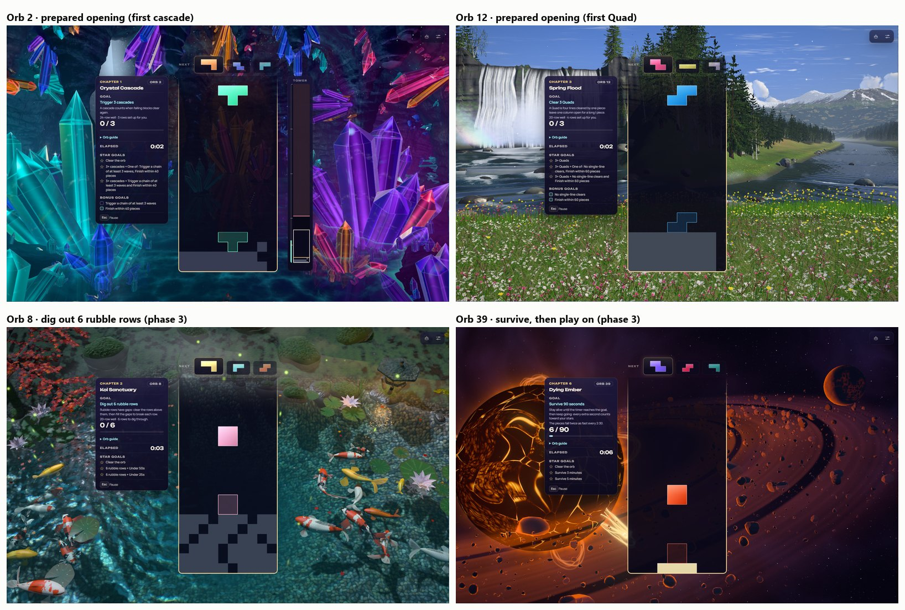

# Odyssey level design: phase 3 and the opening screenshots (2026-11-03)

**Status: merged (70888fc8); the rising tide on orb 58 lands with pass 2 of the audit on
`feature/odyssey-level-design-pass2` ([ODYSSEY_LEVEL_DESIGN_PASS2_2026-11.md](ODYSSEY_LEVEL_DESIGN_PASS2_2026-11.md)).** It carries the next
steps of the approved plan, [ODYSSEY_LEVEL_DESIGN_AUDIT_2026-11.md](ODYSSEY_LEVEL_DESIGN_AUDIT_2026-11.md) (§5.10):
phase 3's two new goal types, each on its first orb, and in-game screenshots of phase 2's prepared openings. Phases
1–2 are in [ODYSSEY_LEVEL_DESIGN_PHASE1_2026-11.md](ODYSSEY_LEVEL_DESIGN_PHASE1_2026-11.md).

## What changed for players

| Orb | Before | Now |
|---|---|---|
| 8 · Koi Sanctuary (chapter 2 twist) | Clear 28 lines over 6 rubble rows | **Dig out 6 rubble rows.** Two stars within 50 s, three within 25 s |
| 39 · Dying Ember (chapter 6, practise → twist) | Score 45,000 with the multiplier | **Survive 90 seconds**, then play on. The pieces fall twice as fast every 2:30. Two stars at 3 minutes, three at 5 |
| 58 · Neon Dusk (encore, practise → twist) | Score 34,000 with the multiplier | **Survive the rising tide** for a minute, then play on: rubble rows rise from below, every 6 s tightening to every 2 s. Two stars at 2 minutes, three at 3 |

Both goals have their own briefing rule, HUD progress, star lines, retry debrief and orb copy. A survival orb stays off
the fastest-first "Orb time" board (Steam upload and results sheet), since lasting longer is better there.

## Results

- **Gates:** 9 of 9 over all 15 seeds, and on the tuning, fresh and combined sets. The confirmation set alone still
  misses only orb 52's three stars, as before.
- **Orb 8:** every stacking and cascade proxy digs out (novice 15 of 15). At human pace, casual 9 of 10, regular and
  strong 10 of 10. Three stars come at strong pace on 5 of 10, at regular pace on 1 of 10. The Quad builder never
  digs and never clears; it is gated on Quad goals only.
- **Orb 39:** the novice proxy reaches the 90-second goal on 14 of 15 seeds, and every human-pace stacker on 10 of 10.
  The extra stars come from a person model (see below), because the bots outlast any ramp.
- **Orb 58, the rising tide:** the tide ends every run, so the bots can judge it. The novice proxy survives the minute
  on 15 of 15 seeds; three stars come to the novice on 2 of 15, the expert on 12. At human pace the stacker survives
  the minute on 8 of 10 (casual) to 10 of 10, and earns three stars on 2 of 10 at regular and strong pace. The orb
  runs at a steady 160 ms: at 190 ms the difficulty index (which can't see the tide) jumped 3.2 to the boss.
- **Screenshots:** orbs 2, 12, 8 and 39 in the real game at 30 fps, captured in Chrome with its own profile against a
  private dev server. There were no console errors, and the openings render as designed: orb 2's lone block hangs over
  its gap, and orb 12's four rows leave the right-hand column open.
- **Tests:** the Odyssey set passes (2,770, three new files). Lint finds nothing on the added lines.

## Decisions taken while building

- **A `survived` star key instead of flipping `time`.** The plan said survival needs star time read as "at least".
  A separate key does that without changing what `time` means on the dozens of finish-within stars.
- **Survival plays on (a showcase lap).** The goal is a first milestone; the stars are for lasting longer.
- **A time ramp, not line-based speed-ups.** Measured, line-based speed never ended survival (the stacker lasted the
  15-minute cap at every pace). The ramp halves the drop every 2:30 on the simulation clock and is the orb's only
  speed driver (validated). At the goal the pieces fall at 112 ms, inside chapter 6's floor.
- **Survival stars from a person model.** At fast drops the bots slide pieces along the stack during the lock delay,
  so they outlast any ramp. Classic block-stacking speeds put most players' limit near 67 ms a row, regular players near 50
  and strong ones near 33. On the ramp, 3:00 is 74 ms and 5:00 is 43 ms. The gates and the rules checker set the bots'
  free-stars verdict aside for survival orbs only.
- **Rubble counted by cell type.** Physics rebuilds pieces from the grid after every clear and drops `isGarbage`; the
  GARBAGE cell type survives, so the counter reads that.
- **Orb 39 becomes chapter 6's twist** (R3: a new goal type debuts on a gentle orb) and drops the multiplier (R9).
- **Orb 8's three-star time rounds down** (25 s, not 30 s) to keep the ladder's 1.10 pieces/s floor.

## Playtest questions

1. Does three minutes on the rising tide (orb 58) feel like a fair top mark?
2. Do regular players reach 3 minutes on orb 39, and only strong players 5?
3. Does digging out orb 8 feel like the chapter's twist, or too short (a regular player needs about 50 s)?

## Follow-ups

- **Star-time rounding.** The ladder rounds time-only three-star times to the nearest 5 s, which can land just under
  the 1.10 pieces/s floor on other orbs too. Orb 8 rounds down; the rest are worth a pass.
- **Survival in the benchmark.** A human-pace bot that loses control above a speed limit would let the gates judge
  survival stars directly instead of through the person model.
