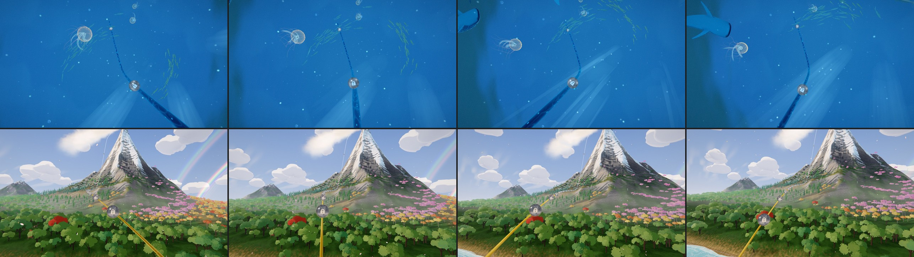

# Odyssey: looking around with the mouse (2026-11-01)

The owner: "When we move the mouse cursor to the sides in odyssey mode, can the camera also move so
that we can look around a bit, it feels so static now drifting in the odyssey mode. We have this for
almost all the themes also."

## What the player sees

Moving the mouse over the map swings the camera a little toward that side, as the themes do. The
camera moves on a small arc round what it is looking at:
- the orb or the stretch of rail in the middle stays in the middle;
- near things (the rail, trees, fish) slide past;
- far things (the mountain, the sky) barely move.

So the scene shows its depth. At the screen's edge the view has swung about 8 degrees sideways or 5
degrees up or down. It eases in over about a second and eases back the same way.

**When it doesn't look around:**
- **The cursor over the map's panels** (the orb card, the header) leaves the view where it was, so
  reaching for Play does not swing it.
- **Touch and pen input** don't move it.
- **With reduced motion on**, it stays still.

## How

`LOOK_AROUND` and `applyLookAround` in `OdysseyCameraController.js`; the board passes the cursor in
its `onMouseMove` (`setLookPointer`).
- **The unit is the themes' rig's** (`themes/shared/camera-rig.js`): a fraction of the screen's
  height at the look target. So the swing looks the same at every distance and lens: 0.12
  sideways, 0.07 up and down. The themes use 0.185 and 0.112; the map is busier, so it moves less.
- **When it is applied:** it is added after the follow, every animation and the breathing, and
  taken out again at the start of the next frame, as the breathing is.
- **No jumps:** animations start from the pose without it (`_restingPosition`), so a glide or a
  focus never jumps by the offset. A camera placed outright between frames forgets it
  (`_forgetAppliedOffsets`).

## Tests

`tests/unit/odyssey-look-around.test.js` covers:
- it swings toward the cursor, eased, by the rig's share, with the look target kept in the middle;
- it comes back and never adds up;
- a trip starts from the resting pose;
- a camera placed outright isn't pulled back;
- it stays still with reduced motion.

Every camera test still passes (80).
