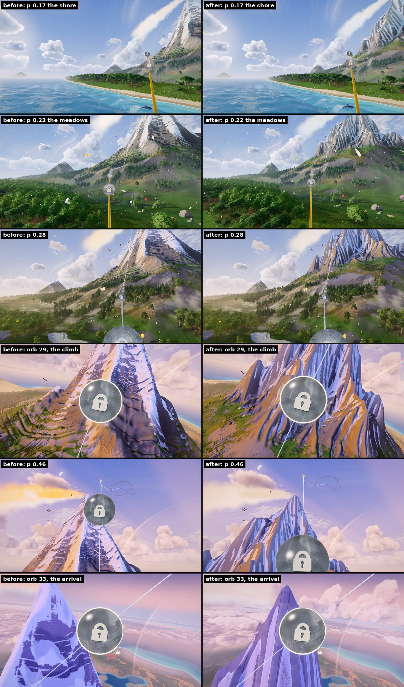
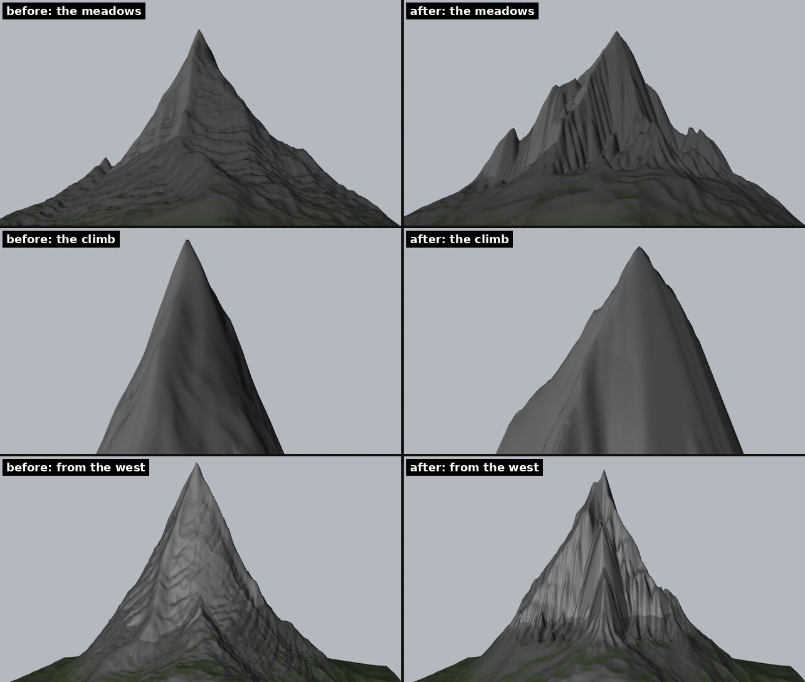

# Odyssey — the mountain, from a clean slate (2026-11-25)

Olov, after the audit (docs/ODYSSEY_MOUNTAIN_AUDIT_2026-11.md): *"Do a full rebuild and make it stunning and
everything you recommend we should do!"*, and *"Can we have blender 5.3 installed instead of 4.0?"*

The hero massif was a radial cone, `(1 - d/603)^1.7 x 720`, with a procedural top (a horn, four aretes,
couloirs, a rock step every 22 u) and a stack of painted terms on it: snow tongues from two sines of the bearing
round the summit, flutes that only tilted the light, a snow line every 7.5 u of height, a stratum every 24 u.
All of that is gone. The mountain is grown as a landform in Blender, its snow and rock are read off that form,
and the audit's smaller findings are fixed with it.

## The form (`scripts/blender/odyssey/odyssey_massif.py`, package `massif/`)

Blender 5.3 (`blender -b --factory-startup -P scripts/blender/odyssey/odyssey_massif.py -- [form] [preview] [pack]`).
The script asks the world for what it may not move (`scripts/odyssey-massif-export.mjs`, run by the script:
the island's ground under the summit plate, its smooth cone, the rail across Act II and the summit's vultures'
flight), then:

- **Designs it from its ridges** (`massif/design.py`), each a LIFT over the island's own cone, falling to
  nothing `width` u from its spine, so the mountain keeps the cone's volume and meets its meadows where it did:
  - the summit block, broader than the cone's needle: the main top (1069 u) ~40 u east of the old apex, a
    notch and a lower western top, an eastern shoulder;
  - a long, gentle west arete with a gendarme, a col and the left shoulder's top; a shorter east arete with a
    buttress step to the right shoulder;
  - two ribs down the south face the climb rides past, three ridges at the back;
  - faces hollowed between the ridges above the treeline, and a cirque hung on the south-east face.
- **Lets rain and frost work on it** (`massif/erode.py`): 390,000 droplets in two passes (gullies that join into
  couloirs, then rills between them) carry sediment down and drop it where they slow; five hard beds at their own
  heights, thicknesses and dips, present in patches, resist them and stand as broken cliff bands tens of metres
  apart; loose ground lies at its angle of rest; an unsharp mask on the bare mountain, rock texture at the scale
  the plate holds. Below the treeline the forest holds the soil: the island's relief and the design stand there.
- **Keeps out of the way** (`massif/constrain.py`): the ground stays 46 u under the rail (opening at 65 degrees
  past 60 u) and 40 u under every vulture of the summit's column; it fades out across the massif's foot, so the
  meadows, the tarn, the forest's floor and the animals' ground keep their height; and no face is steeper than
  73 degrees (the world's lattice carries 76).
- **Ships it** as the height it adds over the island's ground (macro + relief) on the summit plate's square, and
  where the rain's water gathered: `src/rendering/odyssey/world/odyssey-massif-form.js` (200 KB; a 400 x 400 grid,
  2.95 u, a predictor and zlib), decoded by `world/odyssey-massif-form-decode.js` (bicubic on the CPU, 27 ms) for
  the main thread, the bake worker and the tests alike. `odysseySummitSculpt` returns it: the drawn height, the
  sculpt plate the ground binds (no new texture: the ground's fragment shader already binds 16 of 16) and
  everything that seats on either take it as they took the old sculpt.

## The paint (`odyssey-world-renderer.js`, the massif's block)

- **Snow from the form** (`MASSIF_SNOW`). Lower in the couloirs (the plate's curvature plus the rain's flow, baked
  into the plate's A as `MASSIF_GULLY_GAIN` x the flow), higher on convex ribs, higher on faces square to the low
  western sun and lower in their lee, held up to a steeper cliff on the massif than elsewhere; a mantle over the
  summit; its edge broken at ~40 u by one detail read (`snowBreak`), the per-pixel grain kept to a trace.
- **Rock patches** on the lower massif break at the same ~40 u and run down the gullies (`patchBreak`), not in a
  field of 6-15 px flecks.
- **Stone up close** (`MASSIF_ROCK`): joints standing in the rock (two sets of upright planes, gotcha #1603), a
  tone per block, only where a cell is several pixels wide. No bedding lines: a line every few units of height is
  the striped snow again.
- **No strata on the massif**, no height bands of any kind there.
- **Snow in shade** stands lower (`ODYSSEY_GROUND_SHADE.snow`: ambient 0.45 -> 0.34, deep 0.30 -> 0.24), and its
  ice-blue thins with distance (the far peaks' cyan, `iceFar`).

## The light and the small findings

- **The summit's banner and spindrift** are lit as the snow is (the sun's value, a third of its hue, a cool slate
  owning more of each billow, the sky's colour downwind), not in the sun's own gold (M6).
- **The wall's gusts** at L27 the same, and their sparkle at 0.5 (M16: "a road with lane markings").
- **The sea's plates** melt into a wash past ~1 km (`waterRampBody`'s `soft`), so the coast from the summit is
  not a contour map (N1); up close the painted plates are as they were.
- **The far peak** is an older mountain (`ridgedMassifRise`): a ridge, a rounder top, a shoulder down the ridge;
  its crown where it was (M8's second half).
- **The valley mist** keeps to the valleys (`ODYSSEY_VALLEY_MIST.ceiling`): the new mountain has hollows of its own
  high up, and the feather carried their mist onto the summit.
- **The rainbow** is unchanged (M18): it is drawn round the true antisolar point (the rays the critic read as the
  sun's converge there: they are anticrepuscular), and it stands the whole act at the owner's word (2026-10-31).
- **The climb's views** (M7) are unchanged: each orb holds its own view since 2026-11-02 (the owner's), and the
  repetition the critics saw was the rail BETWEEN orbs, sampled at 0.46, 0.52 and 0.56.

## What moved with it

- The summit's vultures stay where they were staged; the mountain keeps under them (the export's `air`).
- The plume finds the new top (`findHeroSummit` searches 100 u round the apex, not 60).
- Outcrop anchor 3 moved 30 u up its slope (-56, -700 -> -730): the new ground there buried its slabs.
- Regenerated from the new height field: the forest's rock keep-outs (`FOREST_ROCKS`), its rail visibility stamp
  (`scripts/bake-forest-visibility.mjs`), the bakes' goldens.
- The treeline: 619 trees stand above 470 u (455 before): the forest climbs the new mountain as it did the old.

## Checks and cost

To be completed with the final captures.

## Changing it

- The ridges: `CREST` and `RIDGES` in `massif/design.py`; the beds: `BEDS` in `massif/erode.py`; what it keeps
  clear of: `massif/constrain.py`. Then `blender -b --factory-startup -P scripts/blender/odyssey/odyssey_massif.py`
  (about 40 s for the form, a minute for the pictures; `ODYSSEY_MASSIF_VIEWS=meadows,west` picks the views,
  `ODYSSEY_MASSIF_SCRATCH` where the scratch goes), then regenerate what is pinned to the height field: the forest's
  rock keep-outs (`FOREST_ROCKS`, from `buildBoulderSites(odysseyWorldHeight, { trees: [] })`), the visibility stamp
  (`node scripts/bake-forest-visibility.mjs`) and the goldens in `tests/unit/odyssey-world-bakes-golden.test.js`.
- The snow: `MASSIF_SNOW`; the stone: `MASSIF_ROCK`.
