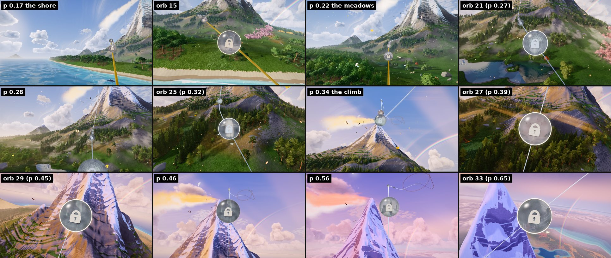
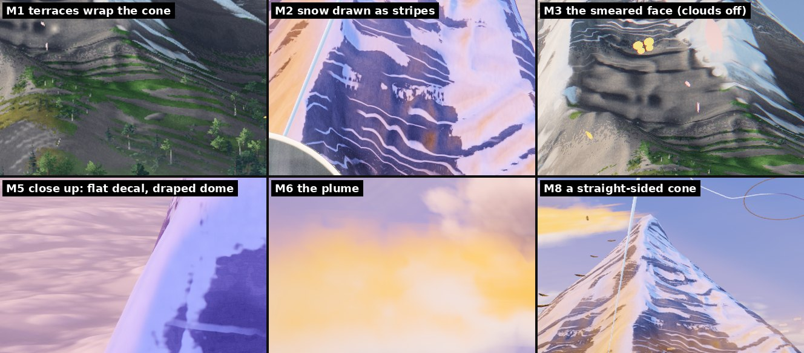

# Odyssey — the mountain, judged from the pixels (2026-11-25)

Olov: *"start with a fresh look at the mountain from real screenshots"*. This came after the forest and the sky were
rebuilt from a clean slate (2026-11-24), which left the hero massif as the weakest thing in nearly every frame of
chapters 3 to 5.

This is an audit only. No code changed. The land pass (2026-11-22) listed the massif as open in F6-F8 and F13; this
judges it again, on its own, from the whole journey.

## How it was judged

- **The pictures.** The real game in a headless browser on a software GPU, run headed under a virtual display with the
  dev server's reload socket stubbed (gotchas #1208, #1209). Settings: 1920 x 1080, WebGPU at High, board clock pinned at
  `t = 40`. That gave 22 frames with the mountain in them:
  - 12 orb close-ups, the odd orbs from 11 to 33, each reached with
    `travelToLevel(id, { travelDuration: 0, focusDuration: 0 })`;
  - 10 rail views from p 0.17 to 0.64, each with the camera handed back to the rail and parked at `p`.
  
  None of the consoles showed a WebGPU validation error or a TSL warning.
- **Three critics** judged the frames only, with no code and no docs: the landform, the surface (rock, snow, grass on
  the slopes) and a painter's eye (light, value, depth, composition). **A sceptic** then tried to refute each merged
  finding from the same frames, plus two frames the critics had not seen (p 0.17, orb 33). Only after that were the
  causes traced in code.
- **One A/B.** The meadow views (p 0.22, 0.28) were captured again with `?odysseyWorldNoClouds=1`, to test whether the
  smear on the summit face was a cloud's shadow. It was not (M3).

## The audit

Merged from the three critics. Sev is the highest a critic gave; the verdict and its severity are the sceptic's.
Frames are named by their place on the journey.

| # | Finding | Sev | Verdict |
|---|---|---|---|
| M1 | The mid-slopes are stepped terraces at constant height that wrap the whole cone, each with a dark lip and a green tread: rice paddies, a layer cake | 4 | CONFIRMED (4): 7-9 bands a transect, pitch 11-23 px at orb 15, in about 12 frames from orb 11 to p 0.34 |
| M2 | The upper snow is drawn as evenly spaced wavy horizontal stripes over violet rock: contour lines, zebra | 4 | CONFIRMED (4): white runs 2-6 px thick at a 12-30 px pitch on orb 29's right face; worst at orb 29 and p 0.40-0.46, larger patches from p 0.52 |
| M3 | In the meadow views, the hero's best view of the summit, its central face is a smeared dark blotch of blurred horizontal ripples and round pits: wax, a thumbprint | 4 | CONFIRMED (4): p 0.17, 0.22 and 0.28; edge gradient 4.1-5.4 against 6.3-11.1 on the rock above it; **not a cloud shadow** (unchanged with the clouds off) |
| M4 | The snow does not model the form: the shaded face's snow is as bright as the lit face's, and at dusk the mountain's value equals the clouds behind it, a cut-out | 4 | WEAKENED (3): the faces part by hue only (309-346 against 275 deg); snow L* within 0.6-4.2 between faces, inverted at p 0.46; snow L* 79-86 against clouds 78-83 |
| M5 | Up close, rock and snow have no surface: a flat two-tone decal on a smooth, draped, cloth-like dome; the near flank is softer than the island 2 km below | 4 | CONFIRMED (4): fine detail 1.5-2.2 on the near flank against 2.3-3.3 on the island (p 0.60, 0.64, orb 33) |
| M6 | The summit plume is a flat gold-orange smear brighter and warmer than the sunlit snow, with no lit or shaded side: fire, a comet's tail | 4 | CONFIRMED (3): core L* 85-91, b* +15-25 against the snow's L* 84-87, b* ~0; flame-like from p 0.34 to 0.46, cloud-like by 0.52; at p 0.17 a straight white contrail |
| M7 | The climb does not build to the summit: three near-identical centred cones (p 0.46, 0.52, 0.56), and the arrival is a cropped flank at the frame's edge | 4 | WEAKENED (3): the tip is in frame in every climb view; the repetition and the cropped arrival stand |
| M8 | The summit is a straight-sided cone, and the second peak and an islet are the same template | 3 | CONFIRMED (3): p 0.40's right flank within ±3.8 px of a straight line over 290 rows; close up (orb 33) the apex is a blunt dome |
| M9 | At dusk the rock is a saturated ultramarine of the snow's own hue: paint, not stone in shade | 3 | WEAKENED (2): a defensible painterly shade; the paint look is M5's flat fills |
| M10 | The lower slopes show no erosion: the grey "scree" is a bald patch with no crag above and no grain, under an even leopard fleck of 6-15 px | 3 | CONFIRMED (3): orb 23 and 25, the right half of the frame |
| M11 | Lavender-grey smudges on the meadow at the mountain's foot: bruises | 3 | CONFIRMED (3) for the smudges (L* 24-27, sat 0.08 against the meadow's 29-35, 0.43-0.69); the hillside mist itself lifts value and reads well |
| M12 | Depth runs backwards: the far summit holds more contrast and detail than the foreground | 3 | WEAKENED (2): snow on rock is contrast by nature; what stands is that the summit's darks are not lifted (5th percentile L* 24-27) where the farther second peak's are (43-50) |
| M13 | Regular bright scallops ~20 px apart inside the shaded shoulders | 3 | CONFIRMED (2): orb 19, orb 25; subtle, reads as a CG artefact |
| M14 | Every material edge (rock, snow, grass) is a 1-3 px stipple | 2 | CONFIRMED (2): p 0.34, 0.46, orb 33 |
| M15 | The second peak's snow is cyan, bluer than the sky beside it: holes in the mesh | 2 | CONFIRMED (2): b* -16.6 against the sky's -7 to -11.5; the main summit has small patches of it too |
| M16 | A golden band of constant width with regular pale dashes crosses the slope: a road with lane markings | 2 | CONFIRMED (2), one frame (orb 27): a light shaft with motes |
| M17 | From the climb, the land below turns to beige dunes: the green island disappears | 2 | CONFIRMED (2): orb 29's left slope; from p 0.64 the island is pink-beige (hue 337, sat 0.16) |
| M18 | The rainbow stands on the sun's side of the sky and persists into dusk | 2 | CONFIRMED (2): p 0.64, rays converge near x 1200, the bow's foot at 700-800 |
| N1 | From altitude the coastal shallows are 3-4 flat turquoise bands with hard 2 px steps: a contour map | 2 | NEW (sceptic): p 0.60, 0.64, orb 31, orb 33 |

What all three said must not be lost:

- the warm/cool split at golden hour (orb 27, orb 29, p 0.46), the only frames where the mountain is a solid form, and
  the template for the rest;
- the massing from the meadows: one dominant mountain with one main ridge parting a lit face from a shaded one;
- the altitude zones (meadow, forest tongues up the gullies, thinning trees, rock, snow);
- the concave skirt seen from afar;
- the second peak's haze (a textbook far mountain; only its shape is wrong);
- the height and depth of the arrival above the sea of clouds;
- the crisp cut-paper look of a snow edge, as a style.

## Where it comes from

Traced only after the verdicts. Each cause is marked as **measured** (shown by a number or an A/B here) or **likely**
(read from the code, not yet proven by a capture).

**One root under M1, M2 and M3: the mountain is drawn by height, not by form.** Three horizontal band systems of
similar spacing are laid on a smooth cone:

- **The summit sculpt's ledges** (`ODYSSEY_SUMMIT_SCULPT.ledgeSpacing 22`, `ledgeStrength 0.42` in `odysseySummitSculpt`,
  `world/odyssey-world-height.js`). They are real steps in the height field. The sculpt reaches 470 u from the apex
  with a 603 u cone, so it covers almost all of the visible mountain, not just the top. **Measured:** along three
  bearings from 60 to 460 u out, the summit's height has 7, 10 and 14 treads (a run where the drop is under a third of
  the face's median), and some fall *uphill* (negative drop, -1.4 to -2.0 u per 2 u). The ground paints its
  materials by slope, so each tread takes grass: the green bands of M1 (**likely**).
- **The summit's snow ledges** (`SUMMIT_LEDGES`, `world/odyssey-world-renderer.js`): a snow line every 7.5 u of height
  above 600-690 u, with snow on the top 16 % of each layer. These are the stripes of M2 (**likely**: the pitch on screen
  matches).
- **The strata** (`ODYSSEY_GROUND_STRATA`, `world/odyssey-ground-palette.js`): a value step of ±0.25 every 24 u of
  height on rock faces. They add the dark lips of M1 (**likely**).

The smear of M3 sits where these steps meet a texture too coarse to draw them. The sun's visibility over the island is
one 512 px plate across 9 km on High (17.6 u a texel, `shadowRes`). The shading of 22 u ledges and their couloirs read
through it, and through the lattice's 12.8-51 u rings on the massif, comes out as blurred ripples and pits
(**likely**). The clouds are ruled out (**measured**: the A/B frame is unchanged).

**The cone (M8).** The hero is `massifTerm`: a radial cone, `(1 - d/603)^1.7 x 720`. The sculpt's horn (34 u), aretes
(24 u) and couloirs (9 u) are small against 720 u, so the silhouette stays a cone. The second peak (`far-left`) and the
isles are the same cone plus the ridged relief. Since the October passes, the rest of the mountain's structure has
been *painted* over that form, not modelled: snow fingers from two sines of azimuth (11 and 17 around the cone), flutes
from two more (13 and 29) that tilt only the lighting normal, the crest strip and the strata. Each of those was a
good answer to the audit of its day. Together they are what the critics call a draped cloth with a decal on it (M5).
The paint has no form under it to follow.

**The snow's value (M4).** The snow's shade takes 45 % of full sun as its ambient (`ODYSSEY_GROUND_SHADE.snow`), with a
sky-blue chroma. Near-white snow in full sun then also sits on the tone curve's shoulder, where the lit and shaded faces
come out close in value (**likely**; to be measured with the sun's term alone on a frozen frame). The same ice-blue
shade on a far, hazed peak is M15's cyan.

**The plume (M6)** is the summit's spindrift and banner (`composition/odyssey-summit-spindrift.js`). It was made
bigger in round three (2026-10-31) on the owner's words: *"that must be possible to make more impressive? the wind at
the top of the mountain"*. Its sheets are front-lit white tinted by the hour, with no lit or shaded side of their own.

**Not traced** (no cause claimed): M10's flecks, M11's meadow smudges, M13's scallops, M14's stipple. The atlas edge
break-up read through the crisp snow and rock thresholds is a candidate for M10 and M14. M16 is a light shaft. M18 is
`world/odyssey-sky-optics.js`. M7 is the rail and the camera's director, not the mountain.

## What it would take

From the frames, three fixes would change the most:

1. **A mountain with a form (M1, M3, M8; it also gives M2 and M5 something to follow).** Sculpt the hero massif in
   Blender as a landform: an asymmetric summit block with a notch and a secondary top, buttresses and aretes, couloirs
   that converge on the top, scree fans at their feet, a few broken strata ledges tens of metres apart instead of
   steps every 22 u, and a concave apron. Then bake it into the summit plate, which already holds a height delta over
   the top at ~2 u (`bakeSculptPlateData`). Widened to the whole cone, it replaces the procedural sculpt in the same
   texture slot, so the ground does not need a 17th binding.

   Constraints the bake must hold, each with a test:
   - the rail clears the ground by more than 20 u (`odyssey-world-height.test.js`);
   - the orbs' seats, the forest's planting and the tarn stay where they are;
   - the sun plate is fine enough to shade the new forms, or the ledges are drawn large enough for it.

   The second peak is the same work, smaller and older: a rounded ridge, a shoulder, two gullies.
2. **Paint that follows the form (M2, M4, M5, M9, M10, M14).**
   - Retire the height bands (the 7.5 u snow ledges, the 24 u strata, the sine fingers and flutes).
   - Let snow lie by what the form says: in couloirs and on ledges, scoured off the ribs, deeper on the lee. Bake that
     from the Blender form as a field in the plate's spare channels, the way the forest floor reads its own plate.
   - Give the rock fracture planes and lit edges, and the snow ripples, at close range. The climb's last third is spent
     100-300 u from the summit.
   - Give the snow a real shade, 15-25 L* below its lit side.
3. **The summit's light and moment (M4 at dusk, M6, M7, M12).**
   - Keep 15 L* or more between the mountain and the sky behind it at dusk.
   - Lift the summit's darks with distance, as the second peak already does.
   - Light the plume from the same sun as the snow: dense and white at the crest, thinning and taking the sky's colour
     downwind.
   - Give the arrival a frame that holds the lit tip over a sea of clouds already in shadow (the rail's director).

Cheap and independent: M15 (the far snow's shade), M18 (the bow opposite the sun, gone by evening), M16 (the shaft's
dashes), N1 (the shallows' steps).

## Owner's calls

- **How big a first step.** (a) The whole of fix 1 and 2: the mountain rebuilt from a clean slate, as the forest and the
  sky were. (b) Only retire the height bands and the sculpt's ledges first. This is cheap, and on its own it removes the
  layer cake and the stripes. But it leaves the smooth cone with nothing on it, which is what the paint was added to
  hide.
- **The plume.** It was made bigger at the owner's word. Keep the banner and light it like the snow, or make it
  smaller?
- **The climb's framing** (M7) belongs to the rail's director, not the mountain. In this pass or its own?

## Tools

Scratch tools of this session (recipes, not files in the repo):

- **The capture** follows the land pass's recipe (gotchas #1208, #1209), with two changes:
  - A rail view hands the camera back to the rail first: when `cameraController.mode === 'focus'`, cancel its animation
    and set `mode = 'follow'`, as a wheel does. Then set `setCurrentPosition(p)` and `targetPosition = p`.
  - Three frames a station (two, then the clock pinned, then one).
  
  On this container a frame took 2-25 s (much slower than the land pass's 0.5 s, now that the clouds are traced and the
  forest is 315,000 cards). A screenshot took 20-140 s, and three stations needed a second take (a run's time limit,
  a black frame, a screenshot time-out).
- **The critics and the sceptic**: the land pass's brief, with three lenses (landform, surface, painter) and the sceptic
  over the merged list, given two frames the critics had not seen.
- **The terrace count**: `odysseyWorldMacro + odysseySummitSculpt` sampled every 2 u along three bearings from the apex,
  counting runs whose drop is under 35 % of the face's median.
