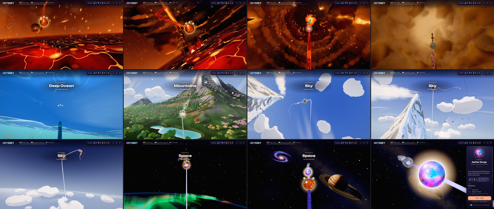

# Odyssey: the opening sweep (2026-11-01)

The owner: "I think that when Odyssey Mode starts, it should always begin at the start of the path in
Chapter 1, and then pan a bit faster to the current unfinished orb. Right now, it jumps straight to
the last orb, and I think a transition would look much better."

## What the player sees

1. The map appears at orb 1, on the lava floor of chapter 1.
2. It holds there for about a second.
3. It glides along the rail through every chapter played so far: the shaft, the golden steam, the
   ocean, the island and mountain, the sky, space, the black hole and the city. Each chapter's title
   shows as it passes.
4. It ends on the orb to play next, framed as a click frames it, and that orb's panel opens.

**When it doesn't sweep:**
- A brand-new journey keeps its welcome.
- With orb 1 as the next orb there is nowhere to fly.
- With reduced motion on, the map opens framed on the orb at once, as before.
- `?odysseyOpeningSweep=0` gives the old opening, for comparisons.

**What the player can do:**
- Any scroll or orb choice during the hold or the flight takes over at once.

**Sound:**
- The music is the next orb's chapter's track from the start. The sweep doesn't change tracks at
  each chapter it crosses.
- The seams' stingers stay quiet during the sweep.

## How

**The mode** (`src/ui/odyssey/odyssey-opening-sweep.js`: `prepareOdysseyOpening`,
`odysseyOpeningBoardOptions`, `startOdysseyOpeningSweep`; OdysseyMode.js only calls them, which keeps it
inside its line budget):
- It builds the board at orb 1. The board is built and warmed around chapter 1 (the eager window is
  chapters 1-2 and the focus chapter is 1), with the next orb's music.
- Once the map is on screen, it asks the board to sweep.

**The board** (`OdysseyBoardController.playOpeningSweep`, `OPENING_SWEEP`):
1. It asks for every chapter on the way to be built (urgently) and compiled and warmed (the drain,
   nearest first).
2. It holds at orb 1 for at least 0.9 s. It sets out once each of those chapters is built, compiled
   and render-warmed, or once One World's compile has landed for chapters 2-5. It never waits more
   than 9 s.
3. It flies with the ordinary orb travel: 1.5 s plus 4.6 s per whole journey, slower than a click's
   glide (0.9 s plus 2.6 s per journey). It adds the plunge's own time as a click's glide does.

**Why the hold:** an ordinary long glide only gives its destination a quarter second to compile.
The chapters in between keep compiling under the flight. An opening seen on every launch should
never meet a cold chapter.

## Measured

Electron on the RTX, 1600x900, uncapped. A save was made through the game (orbs 1 to N-1 done),
then Odyssey was started again with the start event a click sends. The timing columns are seconds.

| next orb | launch | hold (s) | flight (s) | frames over 20 ms in flight | after arrival |
|---|---|---|---|---|---|
| 12 (chapter 3) | shaders cached | 0.93 | 2.2 | 0 | one 95 ms frame |
| 40 (chapter 6) | shaders cached | 0.93 | 5.2 | 0 | one 102-114 ms frame |
| 57 (chapter 8) | shaders cached | 1.24 | 6.0 | 0 | one 77 ms frame |
| 57 (chapter 8) | cold (Odyssey's shaders never compiled) | 1.0-1.4 | 6.0 | one of 21 ms | one 82 ms frame |

Every chapter on the way was ready when the sweep set out, even cold. For example, at orb 57 cold:
chapters 2-5 were the world, compiled, and chapters 6, 7 and 8 were warm.

**The one long frame after arrival:**
- It isn't the sweep's. Clicking another orb on the map gives the same kind of frame (53 ms).
- Switching off the panel's theme prefetch didn't remove it.
- The frame has almost no script time. Most likely it is the GPU process catching up with the
  background compiles: they wait while the camera moves and all resume when it stops.
- In the old opening the same moment happened behind the loading cover.

## Tests

`tests/unit/odyssey-opening-sweep.test.js` covers:
- when the mode sweeps (not for orb 1, no orb, reduced motion or the lever);
- chapters 1-2 built before the reveal;
- the flight time;
- each chapter's state on the way;
- the hold (its minimum, waiting for a compiling chapter, its cap);
- a scroll or an orb choice ending it;
- the held music and quiet seams.
