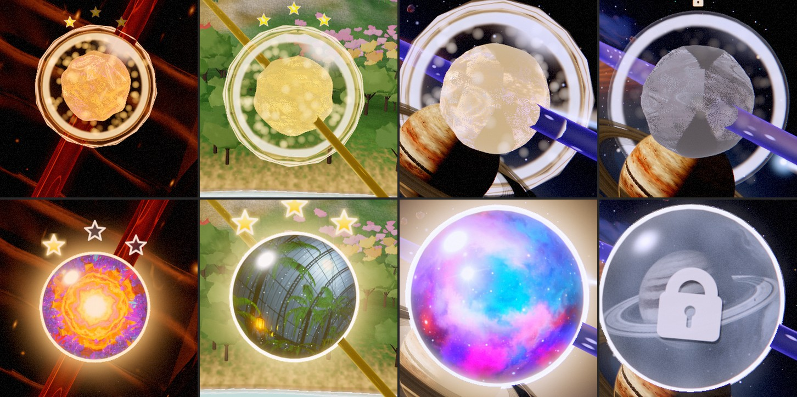
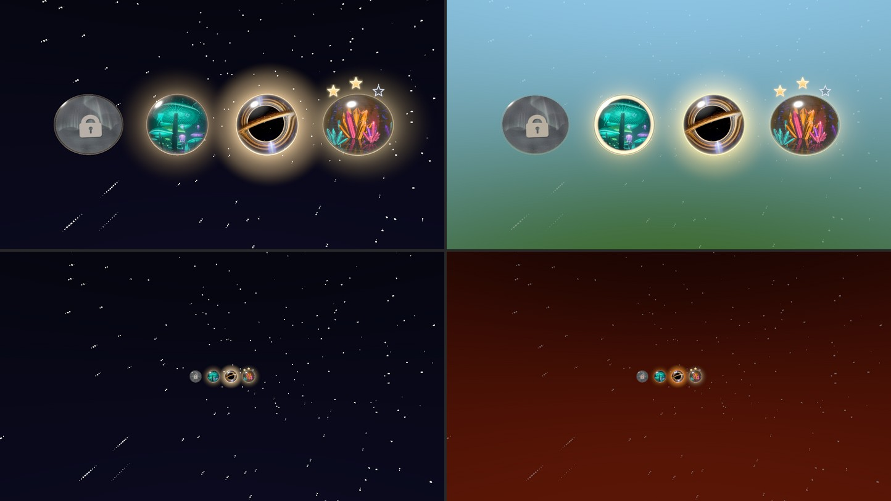
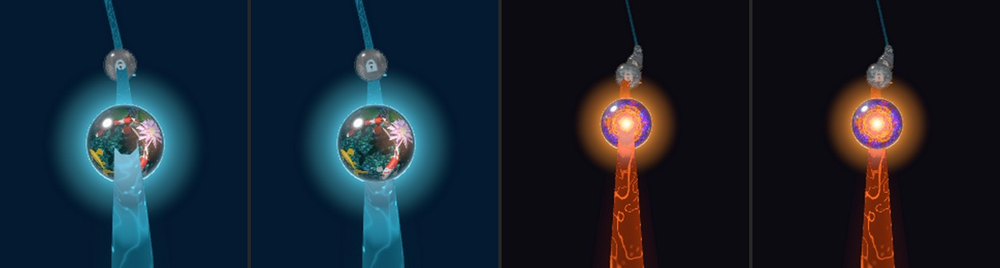

# Odyssey orbs: a world in a glass marble (2026-10-23)

**A record.** The level orbs on the Odyssey path were redesigned after an audit asked whether
they look good. They did not: at the size you see them, every orb was a beige, gold or grey
lump, and you could not tell the mushroom forest from the black hole. Each orb now shows its
level's world as a picture inside a clear glass marble, and the rail passes behind it.

*Top: as shipped. Bottom: the redesign. The same four orbs (L3 one star, L14 three stars,
L40 current, L44 locked) with the same progress (1–39 completed), from the shipping
`travelToLevel` close-up.*

## 1. What was wrong

| Part | What it did | How it read |
|---|---|---|
| Core | The theme icon UV-wrapped round a wobbling sphere at 0.66 of the shell, swirled, then re-graded 80 % toward the chapter hue | A mottled blob in the chapter's colour; the theme's own art lost |
| Core layer pick | `texture(atlas).depth(layerF.toInt())` on an interpolated layer index | **A bug:** the index arrives as 4.9999 on some pixels and `toInt()` truncates it, so those pixels sampled the *neighbouring* icon. Two worlds speckled together in one orb (the patchy cores in the top row) |
| Halo | A back-face `IcosahedronGeometry(r, 2)` | Visible facets round the silhouette |
| Glass | A clear shell plus per-world vertex displacement (ribs, steps, ripples) | A wavy outline and two flat white rings |
| Sparkles | 96 billboards per orb (5,760 instances for the 60 orbs) between core and glass | A grainy cloud competing with the core |
| Stars | A canvas-gradient star at 0.36 u; unearned slots tinted (0.20, 0.19, 0.24) | Tiny; unearned stars a muddy olive |
| Padlock | A 0.45 u glyph billboard above the orb | About 16 % of the orb, unreadable on the path |

## 2. The design

The builders are in `src/rendering/odyssey/level-node-manager.tsl.js`; the manager writes their
instance data in `LevelNodeManager.update()`. The bench
`?effect=odyssey-orb-design` (`src/playground/effects/odyssey-orb-design.effect.js`) draws the
same builders for one orb per state.

- **The world window** (`createOrbWindowTSL`): the level's theme icon in its own colours on a
  camera-facing disc at 0.92 of the glass radius, set 0.35 of the radius toward the eye (still
  inside the sphere). A ball lens magnifies the middle and draws the edge in, the world drifts
  slowly, caustic glints cross it, and it darkens and cools into the glass's rim. Opaque and
  depth-writing, alpha-tested to its circle, one instanced draw for every orb. A level without
  an icon keeps the procedural magma core. Glints and frost grain fade out once the orb is a few
  pixels wide (`fwidth`), so nothing shimmers on the far path. The atlas starts as dark glass
  (it was white, which flashed every window once the icon was no longer re-graded).
- **The layer pick is rounded:** `.depth(layer.add(0.5).toInt())`. A unit test keeps every
  atlas sample rounded.
- **The glass** (`createGlassShellTSL`): a perfect sphere. It has a fresnel rim in the chapter's
  light, one sharp glint and a soft highlight up and to the left (kept inside the rim), and
  light gathered at the lower edge. The selection ring is a thin line between the window and the
  silhouette; hover draws a faint one. The per-world displacements and the shell-style mapping
  that fed them are gone.
- **The halo** (`createOrbHaloTSL`): instanced camera-facing quads, a smooth corona that fades
  to nothing inside the quad. Locked orbs have none, and no quad to fill.
- **The stars** (`createOrbStarsTSL`): a five-point star SDF, crisp at any size, 0.42 glass
  radii wide on an arc over the crown (`ORB_STAR_SLOTS`). An earned star is gold with a
  warm-white rim and a soft glow. A slot still to earn is a pale outline round dark glass. The
  earned/unearned flag is a per-instance `aStar` attribute (no instance colour).
- **The padlock** is etched into the locked window's frost: a rounded body, shackle and keyhole
  as one SDF with an engraved shadow, tinted toward the chapter light. The billboard padlock,
  its canvas textures and its mesh are gone.

State is still told by brightness and shape, never by hue:

| State | Window | Glass rim | Halo |
|---|---|---|---|
| Locked | Asleep behind frost: a faint grey silhouette of the world and the etched padlock, no drift | 0.40 | none |
| Open | Awake at 0.86 | 0.75 | 0.20 |
| Current | Breathing light from inside, 0.5 Hz | 1.00–1.25 breathing | 0.40 + 0.22 breath + 0.20 beat |
| Completed | Warm-lit | warm | 0.24, warm |

## 3. The rail passes behind the orbs

The orbs are threaded on the rail and the follow camera looks down it, so the rail's last reach
before every orb runs toward the eye and was drawn across the lower half of the window. The
blurry core had hidden this, but a picture does not.

Each frame the board hands the ribbon the nearest six drawn windows
(`LevelNodeManager.getWindowOccluders()` → `OdysseyPathRenderer.setOrbOccluders()`, packed
centre + glass radius, read from the window buffer). Where a ribbon fragment lies in front of
one of them, inside 0.97 of its glass radius across the view ray and within 8–12 glass radii of
it, the opaque body is cut (alpha test) and the additive haze fades. Rail nearer the eye than
that stays in front, as it should. See `ODYSSEY_PATH_ORB_OCCLUSION` in
`odyssey-path-renderer.tsl.js`. The legacy core (`?odysseyCoreInstanced=0`) hands over no
occluders, since its sphere is smaller than the glass.

## 4. Tuned in-game, not in the playground

The playground draws without tone mapping; the game runs manual ACES, then a film grade and
bloom. Three values were set against in-game frames:

- the selection ring started as a band over the window's rim and the post stack whitened it into
  a flat bezel, so it is now a thin line;
- the gold of the stars was deepened (ACES lifted the first gold to cream);
- the current orb's halo was taken down about 20 % (bloom doubled its reach over the scene).

## 5. Cost

- Gone: the 5,760-instance sparkle draw and its per-dirty-frame attribute writes (96 per orb),
  the 1,104-triangle core sphere per orb, and the lock mesh and its canvas textures.
- New: one window quad and one halo quad per orb, one star SDF pass, and a six-sphere test per
  ribbon fragment. The ribbon body now alpha-tests, so it gives up early-z.
- The halo quad covers more pixels than the old icosahedron (a 4.2 × 4.2 glass-radius square).
  Locked orbs skip it.
- **Not measured.** GPU time on the perf lane and the integrated GPU is still to be read (the
  `no-level-nodes` split of `scripts/odyssey-gpu-split.mjs` prices the whole group).

## 6. Verification

- `?effect=odyssey-orb-design`: all four states at 11 u and 55 u on space, sky/forest and lava
  backdrops; selection ring; WebGL2 (`&forceWebGL=1`) identical; no console errors.
- `?effect=odyssey-path-beacons` (the shipping manager and ribbon on the real curve and camera):
  chapters 1, 2, 3 and 6 before and after the rail occlusion.
- The live game (Electron, off-screen): stations in chapters 1, 2, 5 and 6 and close-ups of
  L3, L12, L14, L40 and L44 with mixed progress. No WebGPU validation errors.
- Unit: `LevelNodeManager.test.js` (rounded layer pick, window inside the glass, stars not
  overlapping), the level-node A/B (`odyssey-gpu-profile-sampling.test.js`), and the TSL
  graph-construction suite.

Still open: hover was not captured; the legacy `?odysseyCoreInstanced=0` path keeps the
pre-window sphere core.
