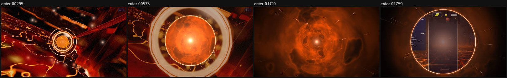

# Odyssey portal gate: entering and leaving an orb — 2026-10-21

Status: implemented and verified in the running game on 2026-10-21. It replaces the portal
tunnel of the [flow and ceremony pass](ODYSSEY_FLOW_CEREMONY_2026-10.md) on both the entry
(world → orb → board) and the return (board → orb → world). The owner asked for a
visually stunning transition here, because it plays many times in every campaign.

Readiness gates, budgets, abort paths, the reduced-motion veil and the board's
preparation are unchanged. Only what is drawn, and when the gate lets the world be
covered, are new.

## What it looked like before

The old portal laid a pale haze over the world, which grew into a milky disc. It then held
on thin concentric rings over near-black while the board prepared, and faded milkily onto the
board. The return did the same in reverse.

Three things were wrong:

- The orb the player clicked played no part. The haze grew in the middle of the screen, and
  nothing tied it to the orb.
- The hold was a dark screen with a few lines on it, so it read as loading.
- The washes in and out flattened both the world and the board into grey.

## What the player sees now

**Entering an orb.**

1. **Gathering (about 0–0.35 s).** Motes of the destination's colours spiral in onto the orb
   the player chose, and a ring of light closes on it. The gate stays on the orb while the
   camera moves, because it tracks the orb's position every frame.
2. **The gate opens from the orb (about 0.4–0.75 s).** The orb opens into a round gate with a
   bright rim that splits slightly into colour. Short arcs of energy run around the rim. The
   gate swells over the whole screen and glides to the middle as the world darkens around it.
   Inside is the passage.
3. **The passage (for as long as the board prepares).** Clouds of the destination's colours,
   deepened rather than washed pale, rush toward the player. Streaks of light pass by, and the
   destination's own light glows ahead. The board is prepared only once the gate covers the
   whole frame, so nothing the board does can show through early. The passage keeps flowing
   for the whole hold, however long it lasts.
4. **Arrival (about 0.25 s once the board is ready).** The light ahead swells, and a second
   gate opens from it onto the board with a rim and a soft bloom. The passage rushes faster
   as it opens. Ready → Go follows with its usual timings.

**Leaving an orb.** The board closes into a shrinking gate (about 0.3 s), and the passage
streams the other way in the finished theme's colours. The world then opens through a gate
at the orb the player just finished, which tracks the orb as the camera settles on it. The
whole return takes about a second, plus however long the world takes to be ready.

*Entering orb 1 (Ashen Dawn) in the running game, at 0.3, 0.57, 1.12 and 1.76 s after the click.*

*Leaving it, at 0.36, 0.49, 0.85 and 1.05 s.*

## How it works

- `src/rendering/transitions/portal-gate.js` draws the gate on a plain 2D canvas, with no
  WebGPU pipeline of its own. Nothing here has to compile while the level's theme compiles,
  which is the work the hold covers.
  - The nebula texture is baked once per page on the CPU. Its tints are made once per palette,
    with each palette colour taken to a deep, saturated hue.
  - Each frame is a few dozen scaled sprite draws and ring strokes, blended additively.
  - The frame description is pure data: the centre, the region (the whole frame, a disc, or a
    hole), the rim, the dimming, the bloom and the gathering. The transitions own timing and
    the DOM.
  - The amount drawn scales with the quality preset (`PORTAL_GATE_COUNTS`: 3–8 nebula layers,
    22–96 streaks, 12–34 motes).
- `JourneyEntryTransition` and `JourneyReturnTransition` keep their state machines: blackout,
  readiness hold, reveal, playable, complete or abort. They now describe a gate for each
  frame, and each uses one canvas instead of a veil plus a tunnel canvas.
  - **Readiness waits for the gate to cover the frame:** 86% of the entry's opening, 88% of
    the return's closing.
  - **The gate runs on its own clock, which advances at most 50 ms per frame.** Clicking an orb
    sets off seconds of work. A dropped frame now slows the gathering instead of skipping it:
    one real-game capture had lost the whole gathering to a single 300 ms stall. The hold
    timeouts still use real time.
  - **Live anchors.** `trackAnchor` (entry, until readiness) and `trackArrivalAnchor` (the
    return's reveal) read the orb's screen position each frame. A reader that throws or
    returns nothing is dropped, and the last known position is kept.
- `OdysseyMode` warms the gate when Odyssey starts (`scheduleWarmPortalGate`). When the page
  is idle, it draws three frames on the page at 1% opacity. That way the first portal of a session doesn't pay for the
  bake and the first canvas composite.
- Removed: `portal-tunnel.js` and its test. `_buildJourneyReturnTimings` now passes through
  only the hold budget, because the gate sets its own pace.

## Accessibility and comfort

- Reduced motion (game setting or OS) keeps the plain opaque veil: no gate, motes or motion.
  Its timing uses real time, as before.
- The arrival bloom is scaled by the photosensitivity setting (`flashScale()`). With Reduce
  flashing it is under a tenth of its normal strength.
- The gate never goes fully white. The brightest moment is the bloom inside the opening hole,
  which fades within about 0.3 s.

## Validation

**Unit tests.** `tests/unit/odyssey-portal-gate.test.js` (14 tests) checks:

- the counts for each quality preset;
- the colour deepening and the nebula bake;
- skipping contexts that cannot draw;
- disc and hole drawing, with balanced save/restore and nothing drawn beyond the reach;
- the bloom under Reduce flashing;
- the gathering;
- that the warm-up runs once, waits for an idle moment (or a timer) and never throws;
- readiness only once the frame is covered and the gate is centred;
- the clock's cap under dropped frames;
- anchor tracking, including hidden and failing readers, and no tracking for an orb that was
  off screen at the click;
- the return's shut gate and its arrival hole at the orb.

The entry and return transition suites were updated for the single gate canvas and for a
hold that keeps travelling.

**The running game.** Electron at 1600×900, High quality, on the development machine (RTX,
busy with other work at the time). The capture entered orb 1 from the map with the camera on
it and returned to the world, filming frames about 75 ms apart.

- **Entry.** The gathering ran over about 0.08–0.36 s, and the gate opened from inside the
  orb's ring over 0.43–0.78 s. The passage held while the board prepared. The arrival gate
  opened onto the board over 1.68–1.9 s, and Ready showed at about 2.3 s. The board's
  preparation sets that total, which varied between runs (Ready at 1.85 s in an earlier run of
  the same code).
- **Return.** The board's gate shut over 0.29–0.49 s, and the world opened through the gate at
  the finished orb over 0.71–1.05 s.
- **Long tasks.** None during the entry in the final run. An earlier run recorded one task of
  about 60 ms during board preparation.
- **Errors.** No page errors. The one console error was Chromium blocking
  `navigator.vibrate`, because the harness's click is not a user gesture.
- **Gates.** Type check, ratchets, architecture fitness, import boundaries, lint ratchet, build,
  perf budgets and release gates all pass. Three suites that format numbers fail on this
  machine, because its locale is sv-SE (`250 000` for `250,000`). They fail the same way on
  `main` without this change.

**Not verified here:**

- the gate's cost on an integrated GPU or a phone, beyond the quality scaling;
- a portrait screen in the running game (the gate's reach is the screen's corner distance,
  so the frame is covered at any aspect);
- a human judgement of how it feels after many orbs in a row.

## Open questions for a player session

- Does the passage feel like travel on a slow machine, where the hold can last several
  seconds?
- Is the arrival bloom pleasant or too bright on a dark board?
- Should the gathering be shorter once a player has seen it many times?
