# Odyssey chapter 2: the sea's animals, natural and smooth (2026-11-03)

Olov (2026-11-03): *"I want us to keep improving the design, movement and animations of all animals
in odyssey mode, i want them to feel natural and move in a smooth and natural way!!! Use Blender
MCP!!!"*

This pass covers every animal in chapter 2's sea (p 0.0649-0.1427): the humpback mother and calf,
the fish schools, the whale shark and the manta, and the jellyfish. Where they live, their routes,
their clocks, the 1->2 steam rule and the zero-hitch load are unchanged.

## The audit, worst first

| # | what looked least natural | done |
|---|---|---|
| 1 | **The whales swam backwards.** The photo-to-3D `whale-glide.glb` had an auto-rig with its "tail" bones in the head: the swim nodded the head up and down by ~11 % of the body length and left the flukes still. It was also a slender rorqual, not the humpback the docs name, drew at half the size the code said, banked *out* of its turns, never bent, and both whales stroked at one fixed rate. | rebuilt |
| 2 | **The fish swam sideways and through each other.** Each fish swayed its heading ±14 degrees on its own clock while its body kept sliding along the school's path, so it pointed up to 50 degrees off the way it went. The rest places were random, and 91 of the 150 fish passed through a neighbour at some point. | fixed |
| 3 | **The manta never glided.** Its wingbeat only grew and shrank over 30 s; it flapped all the time. Its bank stopped on a hard clamp (a corner in the motion). | fixed |
| 4 | **The hero manta (`manta-glide.glb`) is malformed** (wings curl down, two long lumps hang below). It is never loaded in the One World. It shows only on the ADR-0015 recovery path, where it is seen big. | reported, owner decision below |
| 5 | **The whale shark beat at one rate** whatever its pace. | fixed |
| 6 | **The jellies' glide stepped at each beat:** the coast had not stopped when the next stroke began, so the bell's speed jumped (a corner in its path). | fixed |

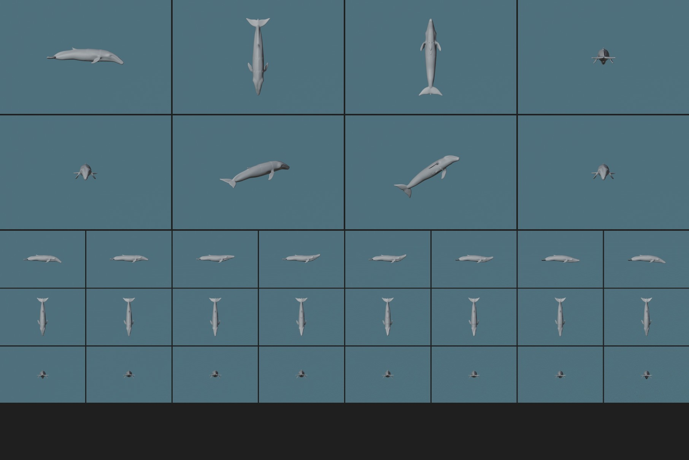

## 1. The humpbacks, built in Blender

`scripts/blender/odyssey/odyssey_whales.py` (headless Blender, re-runnable, same file every run)
writes `assets/chapter-02/creatures/humpback-swim.glb`:

- **The body** is a signed distance field of smooth masses and fins, drawn to the marks a humpback
  is known by (redrawn the same day; see "The design" below): flippers a third of the body long,
  white, their leading edge scalloped with nine knobs; a broad head, flat on top and rounded at the
  tip seen from above, the lower jaw broad and just past the upper; a stocky body deepest just
  behind the flippers, the tail stock tall and narrow; a small fin on a low hump two thirds of the
  way back; broad flukes with a serrated trailing edge and a clear notch. It uses the generic SDF
  library of the Ocean theme's authoring scripts with its own design numbers, so a change to the
  theme never moves Odyssey's whale. Meshed by Blender's openvdb, decimated mirror-symmetric to
  6,000 triangles, normals from the field.
- **The rig**: 13 bones. A chain from the centre of mass back to the flukes (root, three spine
  bones, two tail-stock bones, the flukes), the chest and head forward, two bones in each flipper.
  Weights are a smooth partition along the body; the flippers along their span.
- **The swim**: one keyed action, "Swim", one stroke of 4 s. A wave of heave runs back along the
  body: nearly still in front (the head recoils by 0.6 % of the length), the least just behind the
  flippers, growing as the cube of the way back to the flukes, which sweep 14 % of the length.
  Each bone follows the wave between its two ends, so the wave visibly runs back. The flukes pitch
  front-up on the upstroke and front-down on the downstroke (the wave does that by itself, about 20
  degrees, and they feather a little more). The flippers flex with the chest, their tips lagging.
  16 keys a stroke, automatic Bezier handles, a Cycles modifier: no corner anywhere, the loop seam
  included.
- **Marks** baked per vertex (COLOR_0): the white of the flippers and the flukes' underside, the
  belly's white, and ambient occlusion.

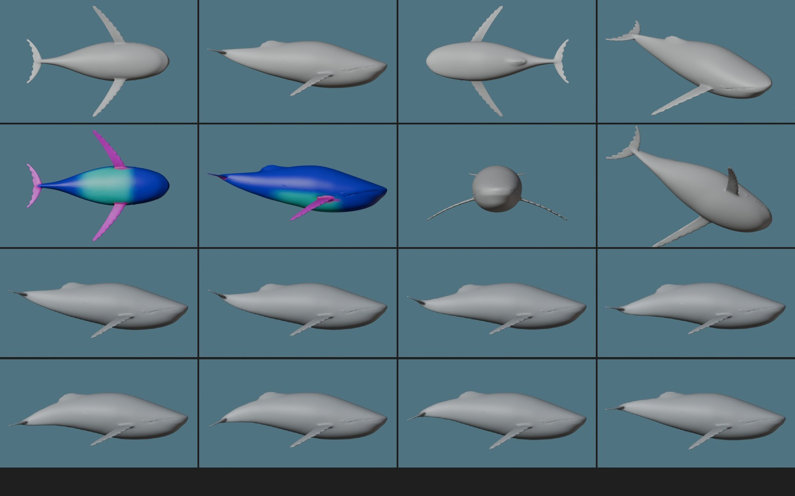

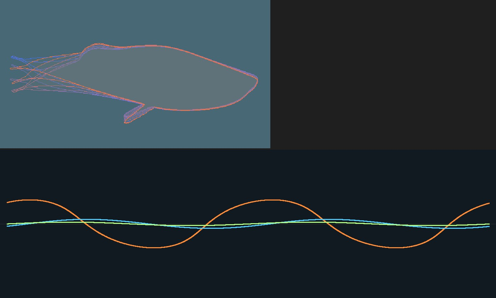

**The design (redrawn, 2026-11-03).** The first humpback copied the Ocean pack's numbers, and the
lead saw a slender rorqual in it: flippers about a fifth of the length, the head narrowing to a
point from above, a slim body, a fin too small to show, flukes with barely a serration. Redrawn:

| | first | now |
|---|---|---|
| flipper (span / length) | 0.30, swept down | 0.40, out and back, nine knobs on the leading edge |
| head seen from above (half width) | narrows to a point (0.008 at the tip) | a round cap (0.03 at the tip, 0.10 a tenth of the way back) |
| greatest depth / width | 0.22 / 0.25 of the length | 0.24 / 0.28, just behind the flippers |
| dorsal fin | 0.04 tall, lost in the hump | 0.05 on a larger hump at 0.64 |
| flukes' trailing edge | 15 small ripples across the pair, a shallow notch | 9 clear serrations across the pair, a notch twice as deep |

Judged at the game's size (the calf ~110 px long, the mother ~250 px at 1280 x 720) from below,
the side and above: the long white flippers, the round head and the serrated flukes all show. The
tubercles (the knobs along the jaw) would be under two pixels there, so they are left out. The
"dark spike" at one end of the side views is the flukes seen exactly edge-on (the tail end; the
snout is the other end, with the mouth line). The rig, the keyed stroke, the 6,000 triangles, the
sizes, routes and timing are unchanged.

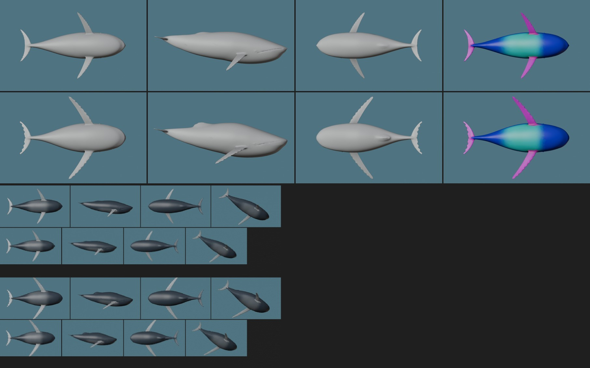

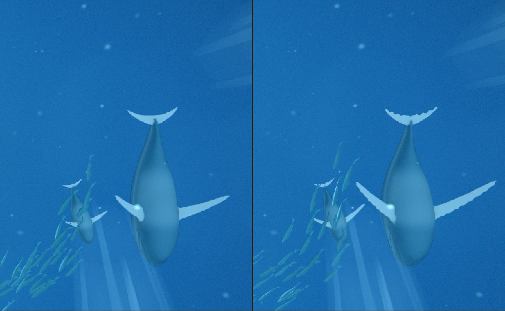

**In the game** (`composition/odyssey-whale-pass.js` with `composition/odyssey-whale-swim.js`):

- **The beat follows the pace.** The routes' pace swells and slackens; the mixer plays the stroke
  at a rate that follows the speed (the mother 3.7-7.1 s a stroke, 5 s at her mean pace; the calf
  2.3-3.9 s). The mixer integrates the rate, so a change of pace never jumps the stroke.
- **The calf beats faster** than its mother: a smaller body keeping her pace.
- **Turns bend the body into a C** (head and flukes toward the inside), as much as the turn is
  tight, easing into a limit of 0.5 rad. The head leads: the bend is about the centre of mass, which
  rides the route. The flippers roll together into the turn (the inside one dips).
- **It banks into the turn.** The old code leaned the whales out of their turns (a sign error).
- The material reads the white marks: the long white flippers show; the belly keeps a hint of its
  white so the pair still reads as silhouettes against the light. One closed skin, so it is drawn
  front faces only (it was two-sided).
- **Size.** The old GLB drew at half its bounds: its positions were quantized to [-1, 1] and the
  dequantizing half sat in its skin's inverse bind matrices, so `MOTHER_LENGTH = 58` drew a 29 u
  whale. The journey has shown a ~29 u mother and ~13 u calf since 2026-10-22, so those are the
  lengths now (`MOTHER_LENGTH = 29`, `CALF_LENGTH = 13`). The routes' eye clearances were set for
  58 / 26, so they hold with room.

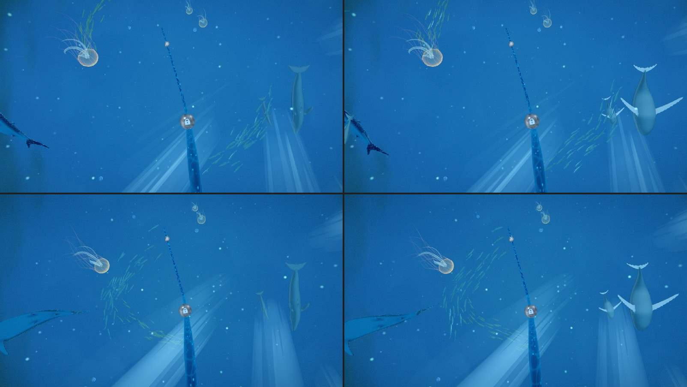

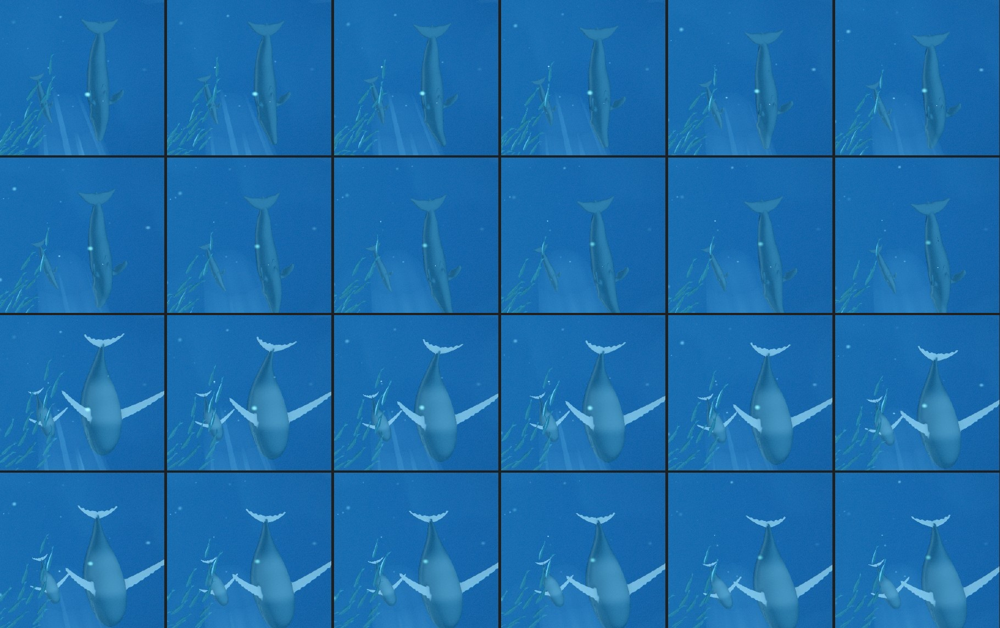

## 2. The fish: a school that follows its leaders

`world/odyssey-fish.js`. Still one instanced draw; `fishPoseAt` is the CPU twin of the vertex stage.

- **A fish points where it goes.** Its heading is now the true direction of its motion: the
  analytic velocity of its path, including how the across offset turns with the ring.
- **The school follows its leaders.** Its meander (the heading's swing, ±0.22 rad for the jacks,
  ±0.12 for the tuna), its rise and fall and its surge of pace (±12 %) are laid out along the ring:
  each is read at the moment the school's head was where the fish is. So every fish behind swims
  the path the one ahead swam. A turn runs back through the school as a wave, and the flank flash
  ripples through it with the meander. Each fish adds a small swerve of its own (±0.06 rad), so
  neighbours are never in lock-step.
- **No fish swims through another.** The rest places are spread apart at build time (a
  deterministic relaxation inside the school's spread): 1.75 body lengths along the ring (at its
  tightest radius), 0.62 across, 0.5 up, for each pair's own lengths.
- **The tail beat follows the pace.** The beat's phase is the distance swum (per body length, plus
  the idle beat), so it quickens and slows with the surge and never jumps.
- **The body bends into the curve it swims** (a C toward the inside), and the fish leans into it by
  its sideways acceleration, capped.

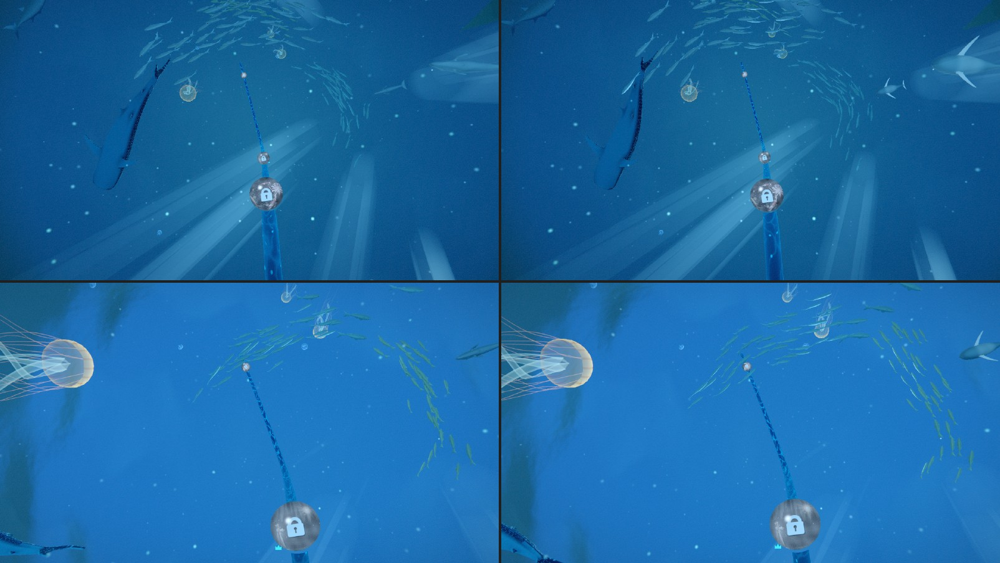

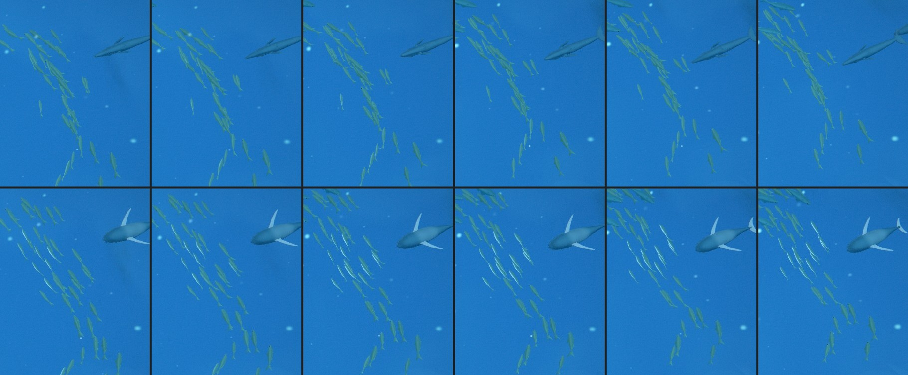

## 3. The visitors: the manta glides, the whale shark beats with its pace

`composition/odyssey-ocean-visitors.js`, `composition/odyssey-ocean-roam.js` (`roamPace`,
`softLimit`).

- **The manta flaps while it speeds up and glides while it slows** (its route's pace sets it, so
  the stroke and the speed agree): about 14 s of wingbeats, an easing of ~3 s, about 14 s of glide.
  Gliding, its wings are held out with a slight lift toward the tips and only a slow ripple (12 % of
  a stroke) runs along them. The wave still runs out along each wing and back across its chord, the
  tips lagging.
- **The whale shark's tail beats with its pace**: faster and a little wider as it speeds up.
- **Leans ease into their limits** (`softLimit`, a tanh) instead of stopping on a clamp. The
  manta's bank used to stop on its clamp every turn.
- No per-frame allocation (the heading was a new object every frame).

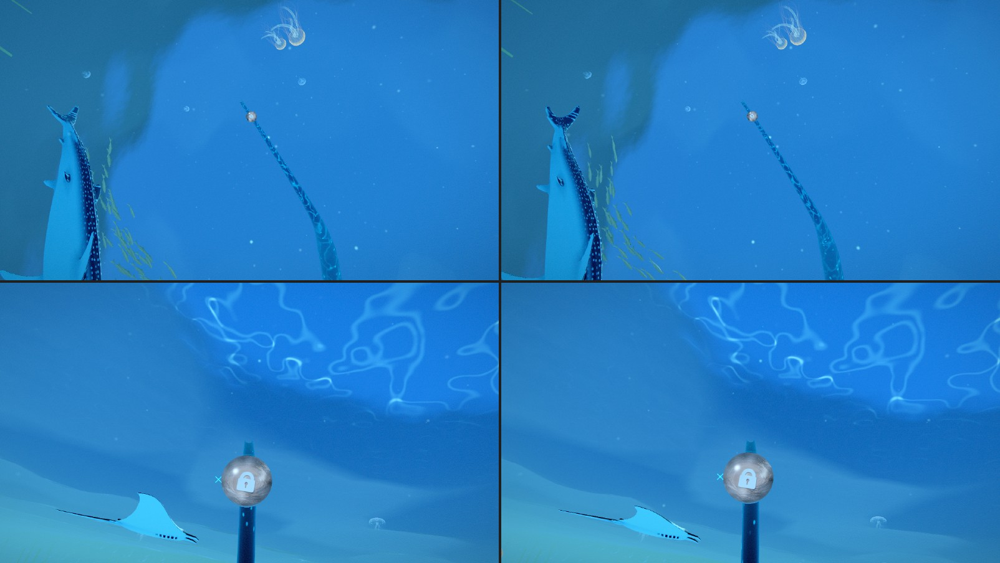

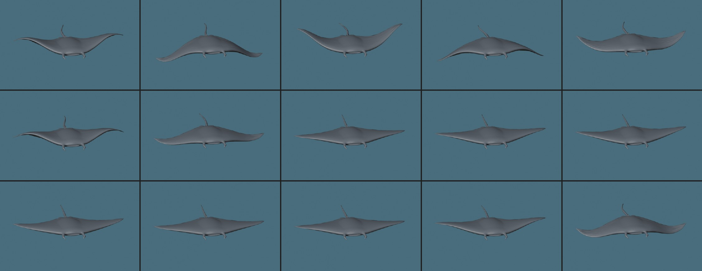

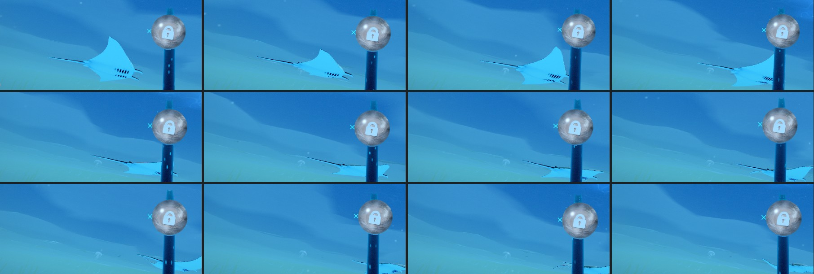

## 4. The jellies

`composition/odyssey-jellyfish-drift.js` (`jellySurge`, `JELLY_SURGE_END`) and its shader twin. The
contraction stays quick and the relaxation slow; the glide surges on the stroke and coasts. A small
cubic term now brings the coast to rest exactly as the next stroke begins, so beat follows beat
without a step in the bell's speed. Its places and look are unchanged.

## The numbers, before and after

Sampled at 60 Hz in node from the game's own motion code (three-free), over 60-400 s of clock.

| | before | after |
|---|---|---|
| whale: what the stroke moves | snout ±11 % of the length, fluke tips still | fluke tips 14 % p-p, snout 1.3 % p-p |
| whale: worst joint acceleration | 17.6 rad/s² (tail_tip, which sat in the head) | 1.0 rad/s² at the clip's rate (flukes; 0.65 at the mother's mean pace) |
| whale: loop seam | 0.87 degrees | 0 |
| whale: stroke | 2.5 s, both, always | mother 3.7-7.1 s, calf 2.3-3.9 s, with the pace |
| whale: bank in a turn | 7.6 degrees, outward | 7.1 degrees, inward |
| whale: bend into a turn | none | up to 26 degrees (mother) / 16 (calf), acceleration ≤ 0.006 rad/s² |
| fish: angle between heading and motion | mean 11.1, max 50.3 degrees | mean 0.04, max 0.2 degrees |
| fish: fish that pass through a neighbour | 91 of 150 (worst overlap 0.16 body lengths) | 0 (closest 0.11 body lengths apart) |
| fish: heading's worst angular acceleration | 0.30 rad/s² | 0.16 rad/s² |
| manta: time gliding (wingtips nearly still) | 4 % | 26 % |
| manta: bank's worst angular acceleration | 2.46 rad/s² (the clamp's corner) | 0.01 rad/s² |
| whale shark: beat | 4.7 s, always | 3.5-7 s with its pace |
| jelly: step in the bell's speed at a new beat | 0.10 bell radii/s | 0.0004 (rounding) |

## Review in Blender

The lead's review file (not checked in): `sea-review.blend` in the session scratch folder. The
humpbacks with their rig and keyed stroke on NLA strips at the game's mean rates; one jack and one
tuna with the tail beat baked to shape keys; two schools posed frame by frame from `fishPoseAt`;
the manta over one flap-glide cycle and the whale shark's beat, baked to shape keys.

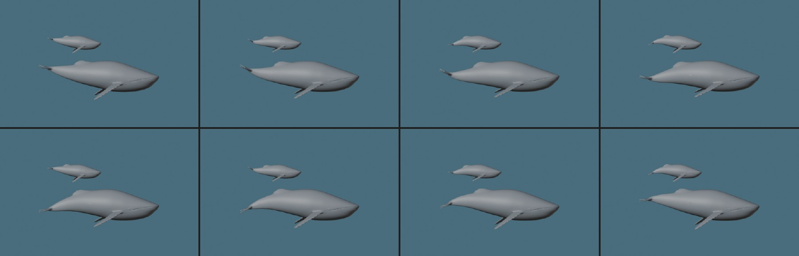

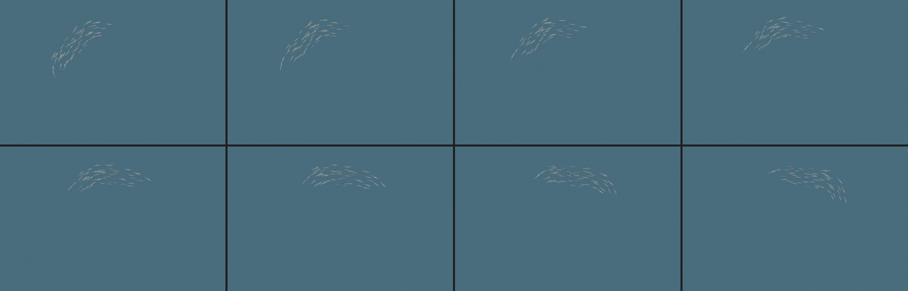

## Left as it is, and why

- **The hero manta on the recovery path** (`manta-glide.glb`, below): an owner decision.
- **The jellies' strands** already trail with a delay line and sway; nothing read wrong there.
- **The calf is the mother's model, smaller.** A real calf has a rounder head and shorter flippers
  for its size. At 13 u, ~90 px on screen, it does not show; offered if wanted.
- **The fish C-bend is small at these turn rates** (the schools wheel on rings of 22-62 u), so it
  mostly keeps the body on its curve rather than showing as a bend.

## Owner decisions

1. **The whales' size.** Kept at what the journey has shown (29 u mother, 13 u calf). The code said
   58 / 26 but drew half that. Options: keep (recommended: it is what was approved on screen), or
   go to 58 / 26 (twice the size, a bigger hero beat; the eye clearances still hold).
2. **The recovery path's hero manta** (`?odysseyOneWorld=0` or a failed world build). The One World
   never builds chapter 2's diorama (chapter 2 is in `suppressedChapters`), so the default game
   never loads it. On the recovery path it swims 14-66 u from the eye and reads malformed (picture
   below). Options: (a) delete `manta-glide.glb` and let the diorama's billboard mantas carry it,
   as they do when the GLB is missing (recommended: cheapest, -860 KB); (b) swim the visitors'
   Blender manta there instead (more code on a path that is rarely seen); (c) leave it.
3. **The belly's white.** Kept to a hint, so the pair reads as silhouettes from below. North Atlantic
   humpbacks have white bellies; one number (`marks.y` in the whale material) raises it.

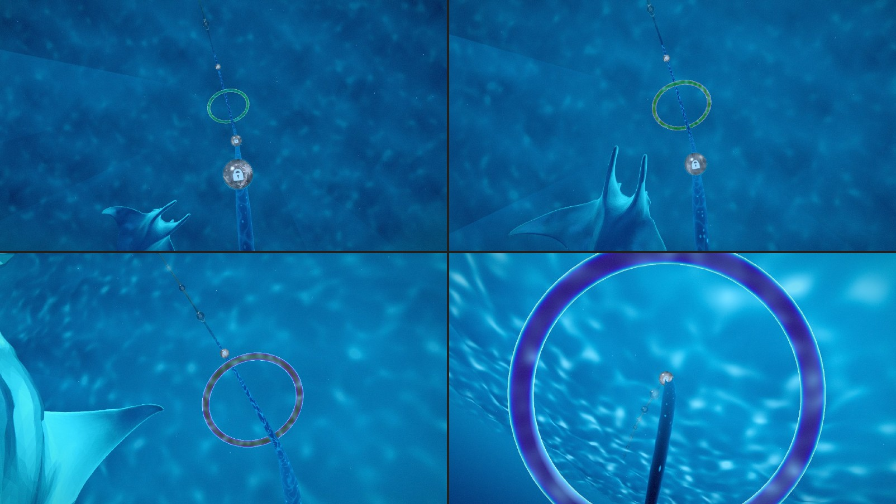

## Cost

- Whales: 2 draws as before. 6,000 triangles each instead of 25,000, drawn front faces only (it
  was two-sided). The GLB is 228 KB instead of 806 KB. Same zero-hitch load (fetch and parse,
  compiled through the live loop, `?odysseyNoWhales=1`). The bend is 9 quaternion multiplies per
  whale per frame, no allocation.
- Fish: one draw as before, a few more sines per vertex (the meander, the rise, the surge, the
  curve). No new attribute (7 vertex buffers).
- Visitors, jellies: no new draws; the visitors' per-frame allocation is gone.

## Tests

`tests/unit/odyssey-ch2-sea-motion.test.js` (new): the humpback GLB (one skinned mesh, 13 bones,
under eight vertex buffers, drawn at its bounds, -Z forward, every bent bone keyed so the bend never
piles up, the flukes move and the snout stays nearly still, a seamless loop), the size kept, the
beat with the pace (the calf quicker, never jumping), the C-bend (soft cap, no corner); the fish
(heading within 1 degree of the motion, no two bodies meet over 60 s, the beat follows the pace, no
jerk, follow-the-leader, leaning and bending toward the inside); the manta (flaps while speeding up,
glides while slowing, eases between); `softLimit` without a corner; the jellies' seam. The existing
fish, jellyfish, roam, visitors, arrivals and world tests pass unchanged.
