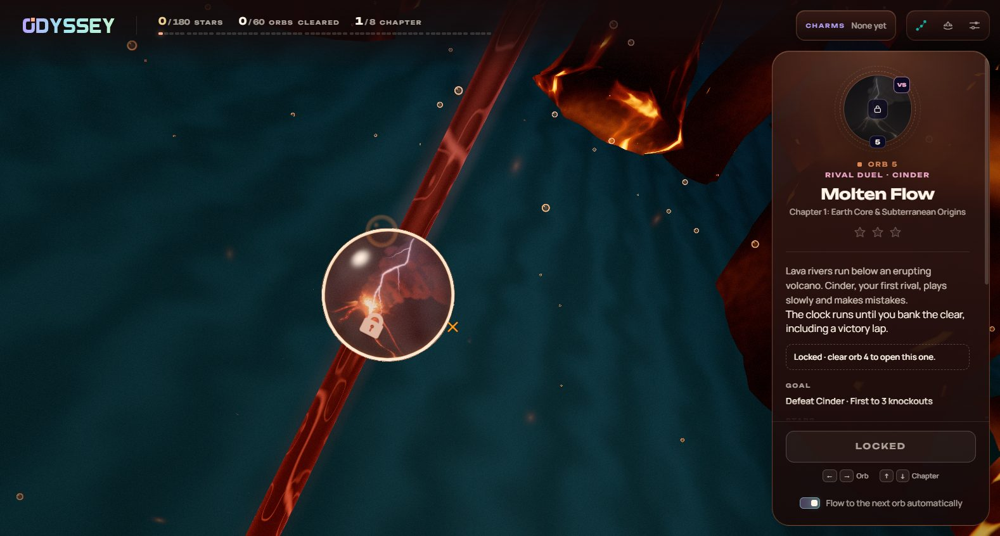
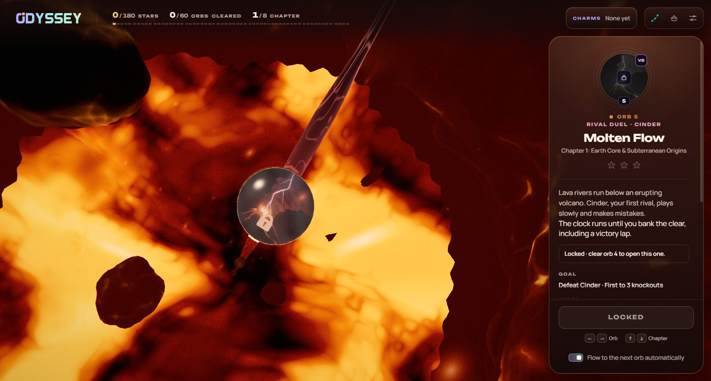

# Odyssey — the journey's weakest pictures, and how it moves between orbs (2026-11-25)

The owner, after a walk through the map: "Where are the orb transitions, the mouse cursor to look around
little and the smoothness, now when clicking an orb it snaps very fast." Then, on a list of seven things
the frames showed: "Do whatever you think we should improve. So do 1 to 7 in the order that makes sense!"

This is the record of that round: what the frames showed, what was changed, how it was checked, and what
is left for the owner to judge.

## How it was judged

36 frames of the running game on that day's main (WebGPU, High, 30 fps, every orb locked as a new player
sees it): the view on arriving at an orb and some close-ups in every chapter, with the map's UI on. The
orb moves were measured with a real mouse and real keys, the camera read every frame.

| # | What the frames showed |
|---|---|
| 1 | The city (chapter 8): box towers with flat window grids; the journey's last picture a look down on box roofs |
| 2 | Every locked orb one grey ball under a padlock (59 of 60 for a new player); a wire scribbled on the sky from the mountain |
| 3 | The orb's card over the right 19 to 28 % of the screen, and the picture's subject under it (the black hole at orb 47, the ringed planet, the city's sun) |
| 4 | Early space: orbs 35 to 37 park at one place, and 35 and 36 shared one close-up |
| 5 | The ocean (chapter 2): one blue from the floor to the surface; orb 10's arrival almost empty |
| 6 | Earth core: every close-up but the first looked at the shaft's dark wall |
| 7 | The mountain at dusk (chapter 5): stripes of purple, orange and lilac |
| — | Moving between orbs: 33 u in a fixed 0.8 s inside a chapter (100 u/s through the middle); 254 u of rail in 1.2 s to another chapter, the view turning 120 degrees |

## What changed

### The free frame (3)

The lens is shifted so the picture's centre is the middle of the part of the screen the UI leaves open:
`FRAME_SHIFT`, `setFrameCentre` and `applyFrameShift` in `OdysseyCameraController.js`.

- **A shift of the lens, never a turn of the camera.** The eye, the aim and every pose the camera works
  out are as they were; the whole picture slides over (a view offset on the projection). Nothing that
  seats itself on the camera's basis had to change: the heroes of chapters 6 and 7, the helper cameras
  and the post chain all read the projection matrix or the camera's basis.
- **The UI measures, the mode wires, the board asks.** `src/ui/odyssey/odyssey-free-frame.js` finds the
  middle of what the header and the orb's card leave open (the card on the right of a wide window, a
  sheet across the bottom of a narrow one, nothing while the UI is away). `OdysseyMode` hands the board
  the reader (`getFrameFree`); the board asks it eight times a second.
- **It eases** when the UI comes and goes (3/s), is taken at once on the first frame and with reduced
  motion, and never goes further than 16 % of the screen.
- **The look around** is measured from the free frame's middle, as far to either side: with the card
  over the right of the screen the cursor reached all of the look to the left and 40 % of it to the
  right. Off the map (onto the card or the header, out of the window) it comes back to rest
  (`restLook`): the card's edge is a full turn now, and the view would have stayed turned 16 degrees
  off the orb for as long as the cursor sat on the card.

At 1920 x 1080 the picture's centre is 180 px left of the screen's and 38 px lower. The black hole at
orb 47, the ringed planet at orbs 35 to 41 and the avenue with the sun at orb 60 stand in the open.

**The trap:** `camera.setViewOffset(fullWidth, fullHeight, ...)` sets the camera's aspect to
`fullWidth / fullHeight`. Given as 1 x 1 it squared the lens and every orb became an ellipse. The frame
is given as aspect x 1 (gotcha #710).

**What it cost:** the far left tenth of the old frame is off screen now. Every orb from the shore to the
summit still shows a bird all the time but three: 89 % of the time at orb 26 (90 before), 80 % at orb 27
(90), 49 % at orb 33 (60); the vultures' column shows 93 % of the time at orb 32 (95). Their limits in
`tests/unit/odyssey-bird-staging.test.js` say so. Those birds want a place nearer the rail.

### The orbs and the rail (2)

- **A locked orb shows its world when it is close.** Far along the path it is as it was: frosted, a
  faint grey silhouette, the padlock filling the window, so a small orb reads as locked. Close to (the
  window tens of pixels wide) the frost thins, the world shows in its own colours, dim and still, and
  the padlock draws down to a seal at the window's foot (`ORB_LOCKED_NEAR` in
  `level-node-manager.tsl.js`). State is still told by brightness, stillness and shape: an open orb is
  half again as bright, drifts, glints and has a halo.
- **Nothing past the black hole is drawn before the dive, from the first orb on**
  (`odyssey-path-horizon.js`). The rail of the fold and the city was drawn through chapters 1 to 5 and
  taken in across the 5->6 seam; from the mountain the fold's spiral, far out in space, was a loop of
  wire beside the summit's orb.
- **Not changed:** the rail's own look (each world's recipe in `odyssey-path-renderer.tsl.js`), and the
  rail's end under the sea's surface at orb 10: it is the rail going up through the surface, seen from
  below.

### Close-ups with something behind the orb (6, 4)

- **Chapter 1** looks down across the shaft onto the lava lake, from a different side at each of its
  first four orbs (`odyssey-ch1-close-ups.js`): the lake's crust, the falls of lava, the glowing depth.
  The shared view (from the south, a little down) met the shaft's wall. The fifth orb, at the sea's
  floor, kept the shared view until 2026-11-27; it looks back down the throat now (see "The sea
  begins with its own chapter" at the end).
- **Chapter 6's second orb looks back at the Earth** (`CH6_EARTH_CLOSE_UP` in
  `odyssey-ch6-close-ups.js`): the limb with the sunrise along it. Orbs 35 to 37 park at one place (they
  lie inside the 5->6 seam, where the eye cannot stand), and 35 and 36 shared the rail's view. The four
  planetrise orbs are now four close-ups: the giant on the left, the Earth, the giant over the aurora,
  the giant.
- **Not changed:** the view on arriving at orbs 35 to 38 is still one picture (one park). With the
  lens shifted the giant is in it whole.

### The mountain at dusk (7)

The summit's shaded stone takes 35 % of the hue the hour adds to the land's shade, and loses 30 % of its
sky fill by the day's end (`SUMMIT_ROCK.hourChroma`, `hourDeep` in `odyssey-world-renderer.js`). At dusk
it stood at about 0.8 of the sky's violet and nearly as bright as the lit faces beside it; a shadow reads
by its value first. It is slate-blue now and darker than the alpenglow. The snow's own dusk colour and
the afternoon of chapter 4 are untouched.

### From one orb to the next

`ODYSSEY_ORB_GLIDE` in `OdysseyBoardController.js`.

| Move | Before | Now |
|---|---|---|
| To an orb of the same chapter (33 u) | 0.8 s whatever the way, 100 u/s through the middle | 0.9 s plus 26 ms a unit, up to 2.4 s: 1.8 s, 34 to 42 u/s through the middle |
| To another chapter (orb 14 to 19, 254 u of rail) | 1.2 s of rail, then 0.5 s; the view turning up to 195 to 219 degrees a second | 2.5 s of rail, then 0.9 s; 132 degrees a second at most |

- A glide into a close-up eases with a smootherstep (the cubic ran at three times its mean speed through
  the middle).
- A trip leaves the close-up over up to 0.9 s (`TRAVEL_BLEND_IN_MS`, 0.45 s before).
- The rides with a measure of their own keep it: the fold, the city, the dive, the breach, the journey's
  flow from an orb to the next, the opening sweep. Reduced motion still cuts.

### The city (1)

Built by a helper in its own worktree, then judged and merged by the lead. The helper ran out of model
quota before its report, so this part is written from its code and from the lead's own frames.

- **The walls have depth without a triangle more** (`shared/odyssey-neon-facade.tsl.js`, one material
  for every tower box, tier, ledge and drum). A whole number of bays fits between two solid corners on
  every face. Every window sits back in its wall: the eye's ray is carried from the face to the glass,
  and where it leaves the opening first it meets a jamb, the sill or the head, each lit its own way.
  Behind the glass is a room with a frame, a mullion, blinds and curtains. A building has a lit
  shopfront at the street, plant floors up the shaft, spandrels, stains under the sills, a coping.
- **Real things on the two walls the arrival stands between** (`shared/odyssey-neon-wall-kit.js`, boxes
  in the rooftops' one instanced draw): balconies, air units, drain pipes, fire escapes, awnings over
  the shopfronts, the brackets the blade signs hang from (they floated off the wall), street lamps and
  signals.
- **Towers with form**: setbacks, round drums, crowns, varied silhouettes against the sky
  (`odyssey-neon-architecture.js`, `odyssey-neon-city-plan.js`), and roofs with plant on them.
- **The wheel at the end of the line** (`shared/odyssey-neon-wheel.tsl.js`): the last orb's own text
  is "the sun sets behind a lit ferris wheel". The city had the sun and no wheel. It stands on a low
  roof past the end of the rail, the sun at its shoulder: one quad and one small shader, lamps round
  the rim that chase.
- **Kept**: the avenue to the gridded spire on the sun, the puzzle's own billboards, the wet street.

**Cost**: the city builds in 22 ms on the CPU on High (18 before; Medium 14 from 10, Low 8 from 5);
2 draws more (47), 110,000 triangles (80,000), and the tower shader's fragment stage 45 KB of WGSL
(25 KB). Its GPU time was not measured.

### The ocean (5)

Built by a helper in its own worktree, then judged and merged by the lead (the same quota stop).

- **The light falls off with depth** (`odyssey-ocean-depth.js`): the bed and the reef's rock keep
  `exp(-depth / depth)` of the surface's light per channel, red first, over a floor of what the water
  scatters down there. The bed was lit as the beach is all the way down to the plain 190 u under the
  surface, so the abyss looked at a bright teal floor. Only for an eye under the water: the sea seen
  from above is unchanged.
- **A well of light overhead** (`odyssey-ocean-window.js`): looking up from the deep, a tight core at
  the zenith and a wider halo round it, so the frame runs from a lit middle to dark edges instead of
  one even blue.
- **Places beside the first orbs' close-ups** (`odyssey-ocean-reef.js`, `odyssey-ocean-scenery.js`): a
  rock arch with a lit garden under it beside orb 6 and 7; a needle of rock 70 to 80 u off the close-ups
  of orbs 7 to 9, its crown garden lit by one shaft of the surface's light; warm lights (amber, rose)
  among the cold ones, so a garden in the dark is not blue on blue; the gardens' light baked onto the
  rock round them and laid on the sand as pools.
- **Not changed**: the animals, their models and their motion.

## Checks

- Unit tests on the merged worktree: every Odyssey, city, ocean and skill test file (332 files, 4,066
  tests) passes.
  New: `tests/unit/odyssey-free-frame.test.js`, `tests/unit/odyssey-ch1-close-ups.test.js`, and cases in
  `odyssey-board-controller.test.js`, `odyssey-path-horizon.test.js`, `odyssey-ch6-close-ups.test.js`.
- `tsc --noEmit` clean; the type-check, lint and architecture ratchets and the boundary check pass
  (`ts-ratchet.json` takes the 4 new `@ts-check` files).
- Frames of the merged build in the real game, every chapter, UI on: WebGPU at 1920 x 1080 on High;
  the WebGL2 backend (`forceWebGL=1`, the same pictures); the lowest tier (Minimal); a 390 x 844
  window (the lens lifts the orb over the sheet as far as its limit allows: it is still half under it
  there). The console was clean in every run. The orb's window also on WebGL2 and at journey distance
  in the playground (`?effect=odyssey-orb-design`).
- Playing an orb from its close-up with the real Enter key: the gate opens on the orb where the
  shifted lens draws it, and the level comes up.

## For the owner to judge

- **How much of a locked orb's world shows** (`ORB_LOCKED_NEAR.colour`, `light`), and the padlock's size
  as a seal (`seal`).
- **The glide's pace** (`ODYSSEY_ORB_GLIDE`): `perUnit` and `most` inside a chapter, `tripBase` and
  `tripPerJourney` between chapters.
- **The dusk on the mountain**: `SUMMIT_ROCK.hourChroma` 1 and `hourDeep` 0 give the violet back.
- **The birds at orbs 26, 27 and 33** (see "What it cost").
- **The city's cost on the integrated GPU**, and whether the walls' kit is too busy from the close-ups.
- **The ocean's depth**: how dark the floor goes (`OCEAN_BED_LIGHT` and `OCEAN_WELL` in `odyssey-ocean-depth.js`).
- Not verified: the integrated GPU, a real-game run on the WebGL2 backend, a physical gamepad, a touch
  screen.

## The sea begins with its own chapter (2026-11-27)

The owner: "In odyssey mode are the chapter starts aligned with the orbs for the chapters?" and, on
the answer, "We need to fix this!"

### What was found

- **A chapter starts exactly on its first orb.** The boundaries are read from the first orb of each
  chapter (`deriveOdysseyChapterPositions`), so the offset is 0 for all eight.
- **The fade between two worlds is centred on that boundary.** An opening orb sits at its middle, and
  since the audit of 2026-10-18 its scenery parks just past the fade (`resolveOrbParkProgress`).
- **A closing orb parked on itself.** Eight of them stand inside the next chapter's fade.

Frames of the running game at every chapter's last and first orbs (23 orbs; WebGPU, High, 30 fps, the
map's UI on and off) showed what that looks like:

| Closing orb | Chapter | The next world's fade weight there | What the frame showed |
|---|---|---|---|
| 5 (rival) | 1 Earth Core | 22 % | **The orb in chapter 2's water**, over the sea's floor |
| 18 (rival) | 3 Surface | 10 % | Its own meadow |
| 24, 25, 26 (rival) | 4 Mountains | 1, 10, 28 % | Their own forested slope |
| 47, 48 (rival) | 6 Space | 2, 21 % | Space, the hole ahead |
| 56 (rival) | 7 Black hole | 4 % | Its own room of the fold |

Orbs 10 and 34 stand outside their fades. So one orb of sixty stood in another chapter's world: the
sea began one orb before its chapter.

| Before | After |
|---|---|
|  |  |

### What changed

- **Chapter 1's closing orb parks before its fade** (`CLOSING_ORBS_PARK_BEFORE_SEAM` in
  `odyssey-chapter-arrival.js`): the scenery stands at progress 0.0417, and the sea draws from 0.0427.
  The orb is where it was, at the vent's lip.
- **Its close-up looks back down the throat** (a fifth key in `odyssey-ch1-close-ups.js`: north, 70
  degrees down), onto the whole lake ringed by the throat. The shared view met the lip's flat rock
  once the water was gone. Chosen from eleven frames of the running game.
- **The sea arrives on the glide to orb 6**, its first orb: the eye drops into the throat, rides up
  through the vent (the smokers, the bubbles, the sea's eye) and the "Deep Ocean" title comes up as the
  lava gives way to water. Going back, "Earth Core" comes up as the lava returns.

### Tried and not kept

Parking every closing orb before its fade. On screen the other seven looked the same as before, and
six tests failed, five of them for a picture composed on where those orbs park today: the day's turn
between orb 18 and orb 19, the ibex at orb 24, the bow at orb 26, the plunge's pace from orb 48, the
fold's way out just past orb 56. The rule is for chapter 1 alone, and the reason is written beside it.

### How the moves measure (real game, 30 fps, the eye read every frame)

| Move | Before | Now |
|---|---|---|
| Orb 4 to orb 5 | 1.6 s; the sea drawn from the first frame | 1.6 s; the sea never drawn |
| Orb 5 to orb 6 | 3.0 s; the eye dips 11 u; the sea drawn throughout | 3.1 s; the eye drops 45 u into the throat, then climbs; the sea drawn from 0.4 s in |
| Orb 6 to orb 5 | 3.0 s; the eye comes down to 22 u under the orb, then rises | 3.1 s; to 56 u under the orb, then rises |

### Checks

- New: `tests/unit/odyssey-chapter-starts.test.js` (every chapter starts on its first orb; orb 5 parks
  before the sea; the other closing orbs park on themselves; the parks keep the orbs' order). Updated:
  `odyssey-ch1-close-ups.test.js`, a case in `odyssey-board-controller.test.js`, and
  `earth-core-sea-vent.test.js` (it reads orb 5's station on the rail, no longer its park).
- Frames of the real game before and after, the console clean in every run.

### For the owner to judge

- **The drop at the start of the glide from orb 5 to orb 6** (45 u in 0.7 s, then the climb). It is
  the cost of the orb standing above where its scenery parks.
- **Orb 5's view** (`CH1_CLOSE_UPS`, the last key).
- **Not changed: where the island's chapters turn.** Chapter 4's first orb (19) stands on the meadow at
  the mountain's foot, in the same view as chapter 3's last orbs, and chapter 5's first orb (27) stands
  on the forested slope where chapter 4's last orbs stand. The island is one continuous world, so
  nothing is drawn wrong there, but the names (Mountains, Sky) run ahead of the ground. Changing it
  means re-spacing the orbs along the island.
