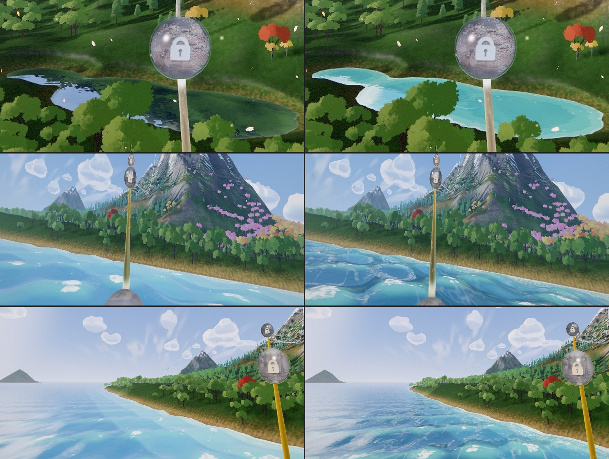
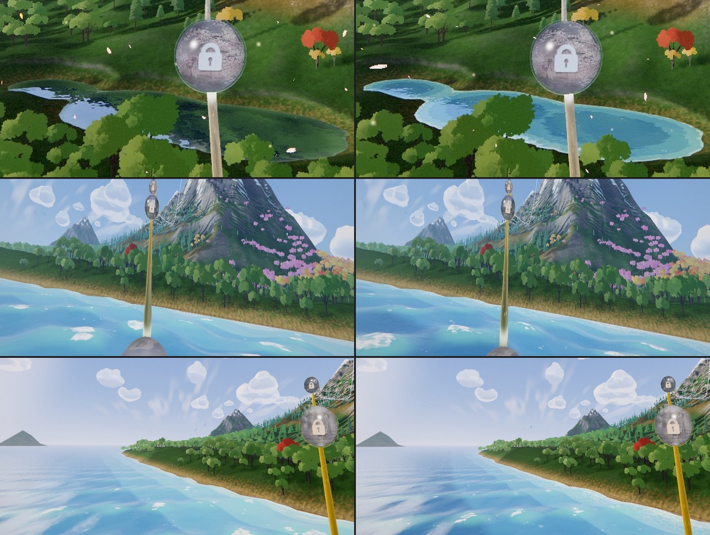

# Odyssey Act II — the sea and the tarn made one water, then stunning (2026-10-31)

Olov, after the Act II passes: *"the water in the pond looks totally different than the water in
the ocean!"*, then *"I think we can improve the water in the pond and in the sea to become a
visually stunning masterpiece ... reflective and alive and that really fits into the atmosphere
with the correct colors, reflectiveness and movement and waves and foam and everything."*

Earlier water work this builds on: the painted-water waves (the painted sea, the swell, the shore
foam, the underside) in `world/odyssey-world-renderer.js`, and the tarn of
[ODYSSEY_ACT2_STUNNING_2026-10.md](ODYSSEY_ACT2_STUNNING_2026-10.md) §6.

## The audit

Live stations on the rail at 30 fps: the shore (p 0.15-0.19) and the tarn (p 0.246-0.30).

1. **Two waters.** The sea wore the colour script's pigment ramp (viridian, cerulean, cobalt,
   Prussian), a stepped wash of sky and sun glints. The tarn had a palette of its own, murky green
   over near-black, under a grey mirror: from the rail it read as a dark puddle beside a bright sea.
2. **A milky sea.** From every Act II station the visible sea sat in the ramp's pale upper plates
   (the measured 0.02 a metre absorption needs ~50 m to reach cerulean), so it read as pale aqua.
3. **Paper foam.** The whitecaps were flat white blobs, the size of a boat, laid on the sea.
4. **Nothing in the water.** Neither water reflects a cloud, an island or the massif: the sea shows
   a gradient of sky, the tarn the sky and the hillside under it.
5. **Still.** No wind moves over either water: the swell rolls under a fixed ripple, the tarn
   shivers in place, and the surf never breaks.

## The plan

1. **One water.** The tarn painted from the sea's own terms; the sea bluer, the foam lacier,
   light on the shallows. *Done (§1).*
2. **Clouds in the water.** Both waters mirror the cloud field. *Done (§2).*
3. **The world in the sea.** The shore, the hills and the massif mirrored in the sea. *Done (§3).*
4. **Wind and life.** Gusts that sweep both waters, rings on the tarn. *Done (§4); breaking sets
   left for later (the beach shelves too steeply for a surf zone that reads).*
5. **Foam.** Streaks along the wind. *Done (§5).*

## §1. One water (2026-10-31)

**Shared terms.** The sea's pigment ramp, its stepped sky wash, its fresnel, its sun (a hairline
core and a broad road), its glitter and its two scrolling ripple fetches are now functions
(`waterRampBody`, `waterSkyWash`, `waterFresnel`, `waterSunCore`, `waterSunRoad`, `waterSparkle`,
`waterRippleTex`), and both waters call them. The sea renders exactly as before through them
(checked by a same-station capture).

**The tarn** takes them with three pond settings (`TARN_MIRROR`): `absorb` drives the ramp by the
pond's own 3 u of depth (viridian over the bank to cobalt in the middle), `calm` takes a third of
the sea's ripple slope, and `fresnel` keeps the sea's gain with a higher floor (0.38), because a
sheltered pond mirrors more than a sea under wind. Its land mirror (the march over the height
plates) is kept; where a ray runs into open sky it takes the sea's sky wash. The pale lip is the
sea's shore band scaled to a pond.

**The sea:**

- **Bluer** (`SEA_ABSORB_GAIN` 1.6 on the script's absorption): the same depths now reach
  cerulean and cobalt.
- **Sunlit shallows.** The underside's caustic net (two crossing iso-lines of the ripple fetches)
  seen from above through the body, out to ~24 m of depth and 320 u of range. The beach shelves
  steeply, so it shows as a lit band along the shore.
- **Lacier caps.** The break-up leans on the finer ripple field, the threshold sits higher and
  the lace cuts deeper holes, so a cap is broken foam rather than a white blob.

## §2. Clouds in the water (2026-10-31)

`world/odyssey-water-clouds.js`. A planar `reflector()` mirrors one plane (the sea and the tarn
stand 293 u apart) and adds a pass whose pipelines must be warmed before the reveal, so instead
each water traces its own reflected ray against proxies of the cloud field:

- **The proxies.** An ellipsoid per mass, fitted to its lobes from the sculptor's own layout
  (`buildCloudLobes`) and grown until every lobe centre lies inside, with the base in its unit
  frame. Each drifts on the field's own Lissajous (the vertex stage's `cfDrift`, same seed and
  constants; the banner holds to the summit), so a reflection moves with its cloud.
- **The pick.** Each frame the CPU keeps the masses whose mirror image (over the sea's plane or the
  tarn's) is in the camera's frustum, largest on screen first, up to `WATER_CLOUD_SLOTS` (12),
  three `vec4` rows each in a `uniformArray`.
- **The trace** (`waterCloudsAlong`). The ray's closest approach to each centre, in the mass's unit
  frame, says how far inside the outline it passes. The outline is broken into lobes by three sines,
  cut flat at the base, lit from the crown (sunlit white) to the base (a cool under tone), and hazed
  by the run like the field. A ray that misses every mass keeps the water's own sky.
- **High tier only** (`ODYSSEY_WORLD_QUALITY.waterReflections`): the low tier builds the sky wash
  alone.

## §3. The world in the sea (2026-10-31)

The tarn's land mirror became shared helpers (`waterMarchLand`, `waterLandLit`), and the sea
marches too (`SEA_MIRROR`): macro and relief plates (two fetches a step), 18 steps that grow
faster than the tarn's, stopped once a ray has climbed over every summit, only within 1000 u of
the eye. The land's colour gained a beach band just over the sea.

**Mirrored by the swell, not the chop.** Marched along the full rippled normal, neighbouring rays
went to the far shore and to the sky by turns: rows of dark dashes across the sea. The land is now
marched along a smoother normal (the swell and a third of the ripple), so the shore stands in the
water as wavy, coherent reflections that follow the swell, which also gives the near sea its form.

## §4. Wind on the water (2026-10-31)

- **Gusts** (`waterGust`). The water rides the land's own wind (`gustFront`, ONE WIND): where the
  front is up, drifting patches of rougher water sweep downwind over both waters (one fetch of the
  detail bake, ~400 u a tile, scrolling along +x/+z). A gust roughens the chop (sea 0.70-1.45x, tarn
  0.35-2.6x), lifts the glitter and lowers the mirror share, so cat's paws read darker, as they do.
- **Rings on the tarn** (`tarnRings`). Three slots, each on its own clock, born at a hashed point in
  one of the lobes, spreading at ~3.6 u/s and gone in ~6 s, drawn large because the eye is ~200 u
  off. A ring is a travelling ripple in the slope, so it lives in the reflection and the glints.
  At these ranges it is a quiet touch, not a feature.

## §5. Windrows (2026-10-31)

The foam a wind leaves on open water lies in long thin streaks along it: the detail bake's value
noise read in the wind's frame, drawn out 4:1 along it (the TSL notes: further, and it reads as
brushed metal), cut thin and soft, in water deeper than ~8 m only, stronger in a gust, gone by
~520 u. The first cut was a hairline and read as scratches; it is wider and fainter now.

## §6. Each water its own pigment (2026-10-31)

Olov: *"and is the color of the water and the type of water right for this scene and atmosphere?"*,
then *"Do what you think will be most beautiful water for this scene!"*

This is a cool northern island: a snowy horn, conifers, meadows. Its sea should be turquoise only
in the thin band over the sand and turn a deep teal-blue within a few metres, clear and cold, as
on the Lofoten or Fiordland coasts. The colour script's ramp (Act I's, unchanged) leaned tropical:
a wide band of bright aqua, the most saturated thing in every frame, a swimming pool beside a
snowfield. And the tarn under the horn is fed by its snow, so its colour is the vivid
turquoise of glacial flour (Moraine Lake), not the sea's.

- **`SEA_RAMP`**: the script's turquoise kept for the sand, then teal (0.10, 0.41, 0.50), a
  blue-green open sea and deep. `SEA_ABSORB_GAIN` 2.6, so the turquoise is the first few metres.
- **`TARN_RAMP`**: glacial turquoise from a pale jade over the bank to a deep teal-cyan in the
  middle, brighter and greener than the sea; the tarn's mirror floor eases to 0.30 so its colour
  shows. A first, milkier cut read as frosted mint: glacial lakes are vivid, not pale.
- Both keep the script's four plates and every other water term in common: the light, the
  reflections, the glints, the wind.

## Cost and checks

- Not yet timed at full speed: the owner keeps the GPU on capped 30 fps captures unless asked. The
  new work per sea pixel on the high tier: the cloud trace (up to 12 ellipsoids), the land march
  (up to 18 steps, two fetches each, near water only) and two fetches (gust, windrows). The tarn's
  pixels add the cloud trace and the rings to its existing march.
- The low tier keeps the sea's sky wash (no traces), with the gust and windrow fetches.
- Tests: `odyssey-water-clouds.test.js` (the fit covers every lobe, the drift is the field's, the
  pick is in view and largest first), the clipmap source test follows the shared ripple fetch.

## Still open

- **Breaking sets.** The beach shelves at ~0.6, so a surf zone is a few pixels from the rail.
  Sets of waves that break would need a wider shelf (a terrain change, with its golden re-pins).
- **The far sea** still dissolves into a pale horizon: the colour script's horizon convergence, an
  owner-approved rule.
- **The cloud looks** (`?odysseyCloudLook=light|banks`) are built and switchable; the first `light`
  paint was too subtle to choose from and wants another round before the owner sees them.
