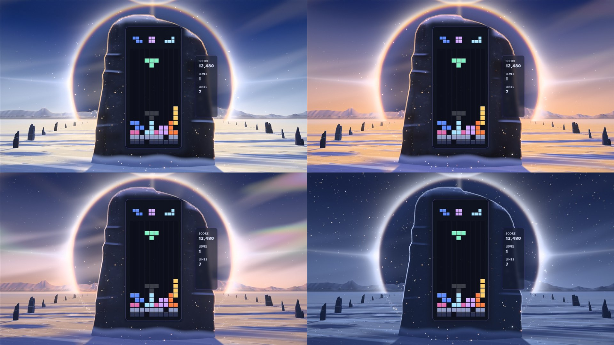
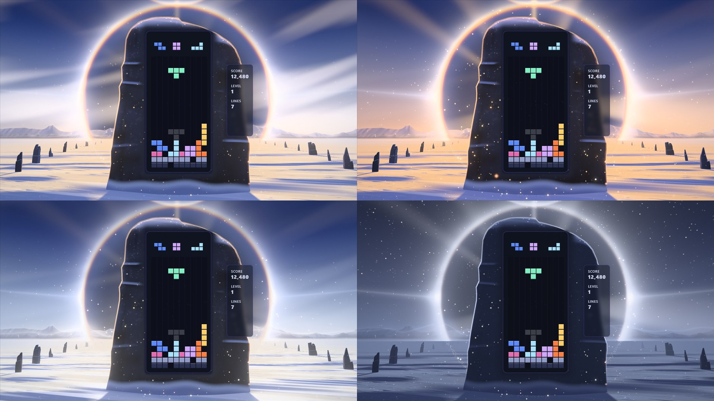
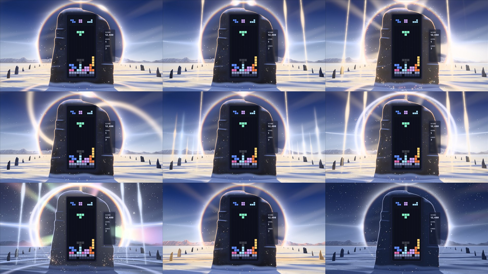
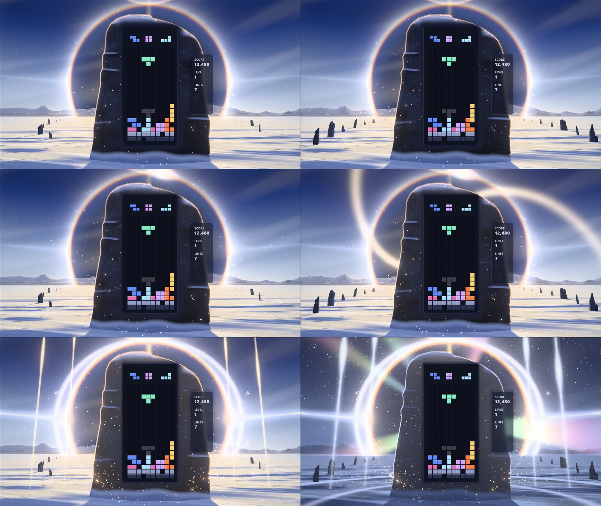

# Parhelion — the living halo (2026-11-20)

**Status: implemented on branch `feature/parhelion-masterpiece`. A record of what was found,
what was built and how it was checked — not a backlog.** The theme's second pass, after the
visual pass of 2026-10-20 (in the header of `src/playground/effects/parhelion.effect.js`) and
the Lower Sun's walk ([THEME_MOOD_CLOCKS_2026-10.md](THEME_MOOD_CLOCKS_2026-10.md)).

The ask (the owner, 2026-11-20): audit everything that makes up the theme (the great halo ring
and the sun dogs, the towering monolith with the starfield inside it, the rows of smaller
standing stones leading to the horizon, the frozen plain and its long shadows, the distant
mountains, the ice crystals in the air, the twilight sky, colours, light, glow, animation, UI and
every event effect), find what is weak, generic or missing, and raise it to one of the most
striking themes in the game, keeping what works; it should change as you play so it never looks
the same for long; every event should have an effect of its own, the biggest moments the most
spectacular; smooth and readable throughout.

## The audit

Captured before any change (24 frames: rest at three times, every event, Minimal, Low, WebGL2,
portrait, 1080p, the icon framing; playground, stand-in board card).

**Strong, and left as they were:** the composition (the stone behind the card, the ring round
it, a hound in each side window); the ring's own colour (red inside, gold, white, lavender); the
snow (sastrugi, backlit drifts, the stone's long shadow, glitter, the lower halo glinting in
it); the stone's silhouette and its solver; the diamond dust; the chain's build-up (Warm Hounds,
Crowning, the Parhelic Line, the Sun Cross); the piece colours and the board's readability; the
whole deterministic, allocation-free optics state and its shader gate.

**Weak:**

| What | Why it was weak |
| --- | --- |
| Change over time | One axis only: the Lower Sun's warmth, noon to a golden sun and back. Nothing else ever changed: no weather, no night, the same veil, the same plain at minute nine as at second one. |
| The sky | An empty cobalt gradient with a few faint fibres. The brief calls it a twilight sky; it was a plain day, and the two upper corners held nothing at any time. |
| The standing stones | Ten small stones in two loose rows that ran straight away from the eye, so on screen each row was one short column of stubs at the frame's edge: no line, no depth. |
| The far range | Pale blue cut-outs with a vertical fold down every peak (the lit side changed at the peak's own bearing, and the ribs ran upright). |
| The hound pillars | A hairline core: they read as scratches on the lens, not as columns of light. |
| The starfield in the stone | An accident: the diamond dust drifting in front of the dark face. The brief names it as a feature, so it should be one. |
| The events | One vocabulary (beads on the ring, hound flares, thin pillars), more of it for bigger moments. A twist was nearly invisible, a perfect clear and the Sun Cross were the same picture, a back-to-back was a fainter repeat, a hard drop a stronger lock, a level-up changed nothing at the moment it happened and a run's end did nothing at all. |

## What was built

### The night: a paraselene

The Lower Sun's walk (0 noon, 1 the golden sun, back to noon at 2) is numerically unchanged. On
the way back the sun now goes under: `nightOf()` in
`src/themes/parhelion/sim/parhelion-weather.js` rises after the golden stop, rests on the stop
half way back and lifts before noon, so by the clock alone about a quarter of every 400 s is a
moonlit night, with a dusk before it and a dawn after, and a level (a step along the same walk)
reaches it too (from about level 18). The display is then a **paraselene**: the same 22° ring
and its two dogs round a hidden moon, silver, over blue snow and under stars.

- `phNight` (`parhelion-optics.js`) is the night's light on anything: the surface's own
  luminance carried on a duotone from deep navy to silver-blue, with a quarter of the day's
  colour kept under it. Every material ends with it, so the night is one call a material and a
  uniform (`uNight`); light that adds (the ring, the hounds, rims, pillars, glitter) is turned
  silver instead.
- While the night falls or lifts the sunward horizon keeps its **afterglow** (`uDusk`): a
  narrow warm band under the blue (the dome spares it from the night's grade), the far range in
  alpenglow, and, in the cirrus air most of all, **mother-of-pearl cloud** high in the corners
  that used to be empty (`uNacre`; the veil's own two noise reads, no new one).
- `phStars`: stars on a 3D lattice (no pole, no seam), a pixel wide at any lens, dealt steeply
  (a handful of bright ones over a dust), hidden by the ranges and the fog, thinned by the
  cirrus and drowned by a bright sky.

### The stone holds the night

The Vigil Stone is now a window on the night: the same `phStars`, read along the line of sight,
stand in its dark face by day too (`uStoneStars`), so they slide behind its edge as the eye
moves and line up with the sky's own when night comes. Only on the face turned to the eye, never
on its snow, and never behind the card (the board's backdrop is untouched).

### The airs

A second wheel beside the walk: five airs of 84 s (2 h 20 min before a pair of hour and air
repeats in phase), each a row of numbers in `AIRS` that the optics state multiplies into what the
hour already shows, and a lean of the whole grade. Neighbours are opposites; phase 0 is the old
look exactly.

| Air | Only it has |
| --- | --- |
| clear | the display as designed |
| cirrus | mares' tails streaming over the whole sky, the brightest ring, the most mother-of-pearl at dusk |
| crystal | the air full of diamond dust, shafts of light round the stone, a tall sun pillar, a golden lean |
| drift | a ground blizzard: spindrift racing, the far stones veiled, a blue-grey cold |
| fog | ice fog lifted over the ranges' feet, the ring soft in a wide glow, a pale frame |

Every 37 s one small thing also happens by itself (`happeningAt`): a gust over the plain, a
glint running round the ring, a hound flaring, a shimmer falling through the dust, the far
range flushing. Each is armed on its own start, so a seek into one and a replay at any frame
rate land on the same picture.

### The avenue

The far stones are sixteen, in two rows that cross the plain as diagonals from the frame's
lower corners to the horizon on either side of the Vigil Stone (`avenueRow` in
`parhelion-composition.js`), each hound standing over its row.

### An effect of its own for every event

| Event | Before | Now |
| --- | --- | --- |
| Lock | a station lights on the ring | as before (the smallest beat) |
| Hard drop | frost in the lane | **the plain rings**: a thin gold ring of lifted snow leaves the stone's foot and crosses the plain (by e-folds: one pace on screen at every range) |
| 1 to 3 lines | hounds flare, hairline pillars | the hounds wake, rise and run as before, their pillars now soft columns |
| Four lines | beads meet, the tangent arc flares | as the halo closes **the hidden sun breaks out round the stone in shafts of light**, and a ring crosses the plain |
| Twist | an orbiting bead, hard to see | **the wheel**: three curved shafts of light turn once round the stone, the way the piece turned |
| Back-to-back | a fainter repeat | **the avenue answers**: a pillar of light over stone after stone, the wave running out to the horizon |
| Combo of ten (Sun Cross) | the cross and a second ring | the same, golden, with standing shafts while the chain lives |
| Perfect clear | the same picture as the Sun Cross | **the sky clears to the stars**: night opens through the hush, the whole display blazes against it with its shafts in every colour, two rings cross the plain |
| Level up | the light warmed over 3 s | **a band of gold crosses the plain** from the horizon to the eye, lighting each stone as it passes, while the far range flushes rose |
| Run's end | nothing | **the sun goes under**: the moonlit night stands behind the result screen, gives the light back by itself after a while, and at once when a new run starts |

**Reduced motion and Reduce flashing.** Under reduced motion nothing new moves across the
frame: no rings on the plain, no wheel (a twist keeps its soft whole-ring light), no band for a
level (the range still flushes), no glint running round the ring, and the avenue's pillars
light together instead of in a wave. Reduce flashing (ADR-0021) scales the burst of shafts, the
night a perfect clear opens and the rings where the optics state writes them
(`tests/unit/reduce-flashing.test.js` holds the three lines).

**The icon** was baked again from the new world and compared with the shipped one at 384 px and
at the picker's 88 px: at rest the two are the same picture (the avenue's stones are a few
pixels each), and the shipped icon's stronger double ring reads better small. It stays.

## How it was checked

- Captures at fixed times on WebGPU and the WebGL2 backend, at High, Low and Minimal, at
  1280 × 720, 1920 × 1080 and a 390 × 844 phone frame; every hour, every air, every event (and a
  hard drop every 0.45 s for six seconds, which is where a ring that veiled the plain was found
  and thinned); console clean throughout.
- The real game in headless Chrome on WebGPU: a run with drops by key, the events, a real game
  over (the night stands behind "The cycle ends.") and a new run (day breaks).
- GPU time a frame at 1080p High on the RTX, capped at 30 fps, old and new interleaved: 0.41 ms
  before, 0.41 ms at rest now, 0.41 to 0.52 ms with stars or shafts live. Everything new in the
  dome sits behind a branch on a uniform, so a clear noon runs none of it.
- Shader budgets re-pinned on purpose in `tests/unit/parhelion-shader-size.test.js`: the dome
  22 → 32 KB (it measures 28.7), the snow 15.5 → 19.5 KB, the stone 10.5 → 14.5 KB. Still no new
  noise read anywhere, one function a helper.

## Open calls

Mine, not the owner's words:

- Nobody has watched it move: every judgement above is from stills and strips.
- The night is a quarter of the cycle. If the theme should stay a daylight theme, `NIGHT_WALK`
  shortens it without touching anything else.
- The mother-of-pearl cloud is drawn from the veil's own noise, so it follows its streaks.
- No integrated-GPU run.
