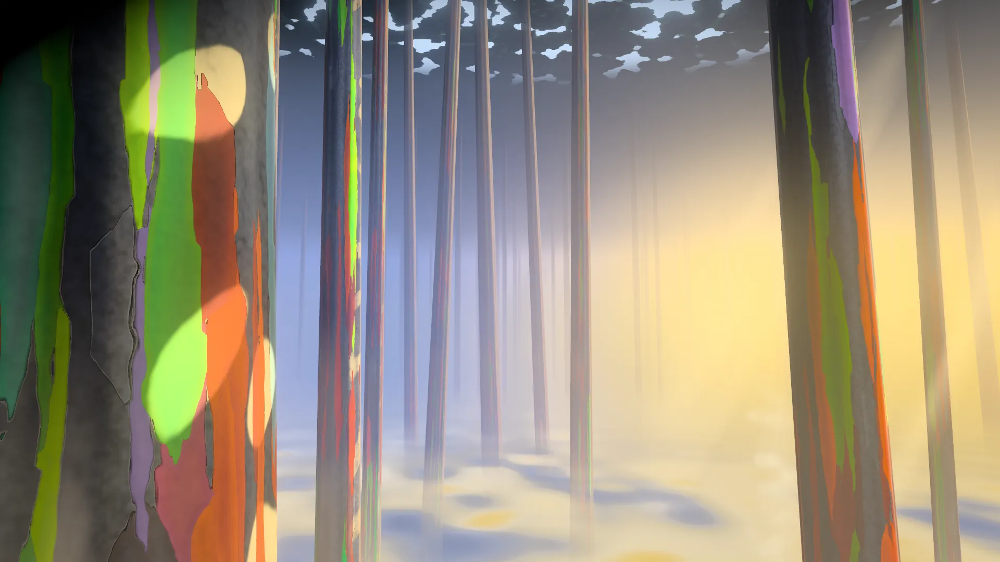
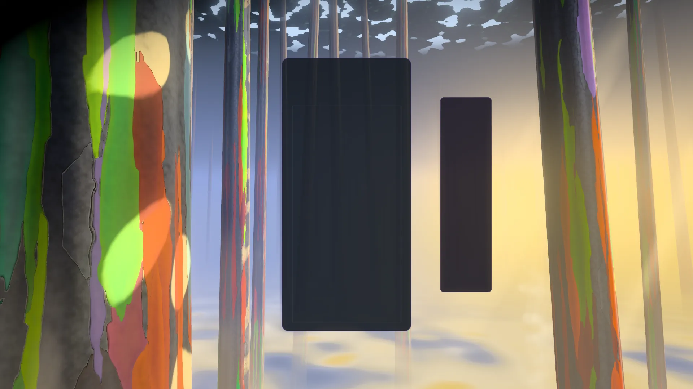
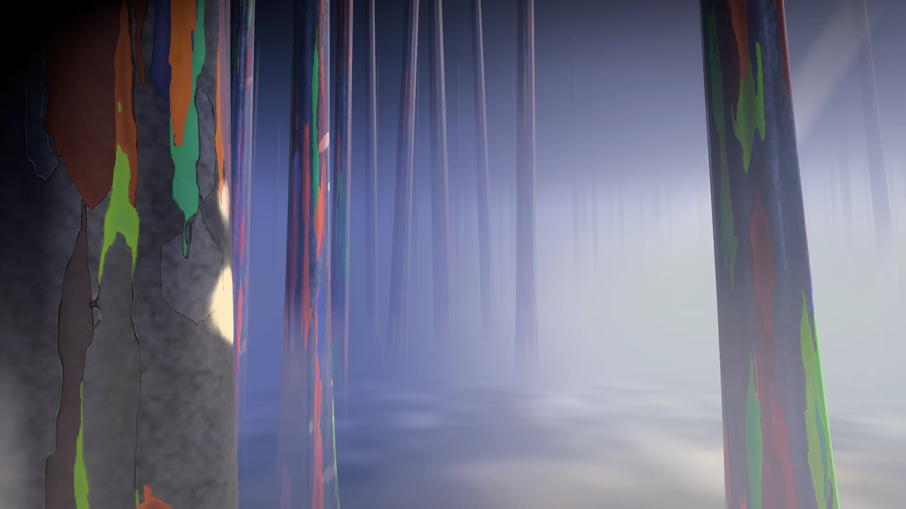
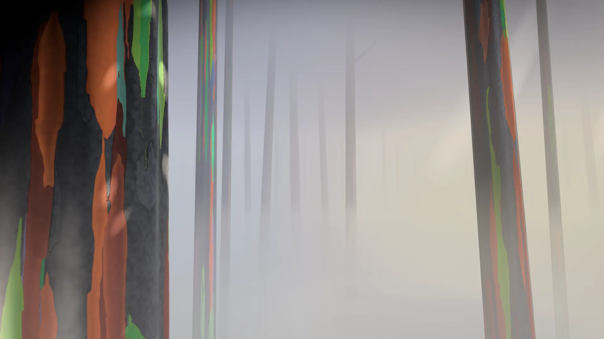
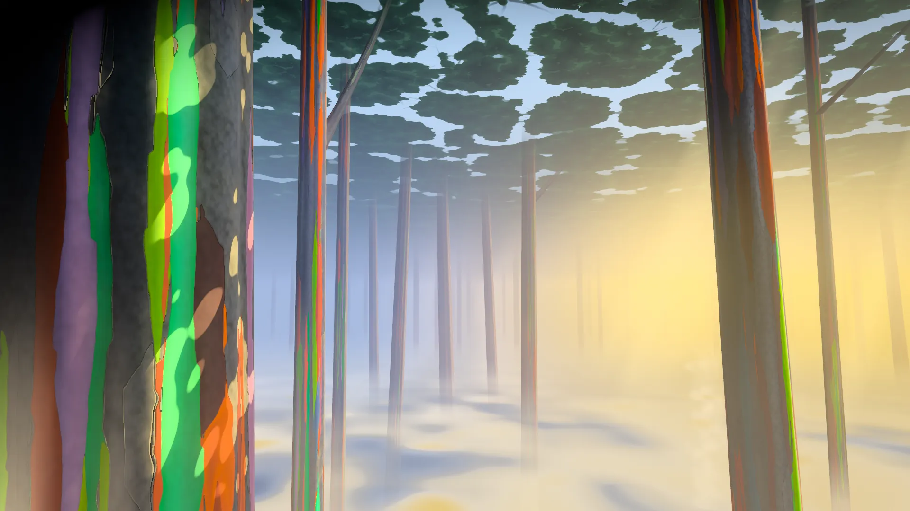
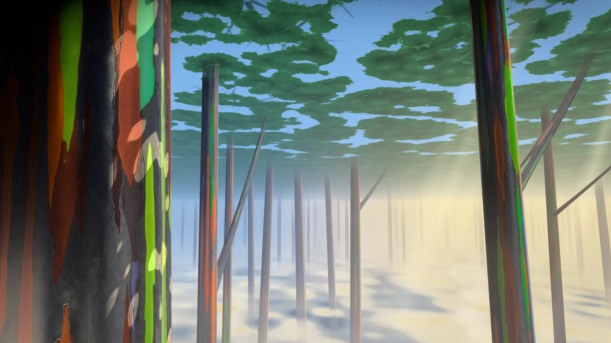
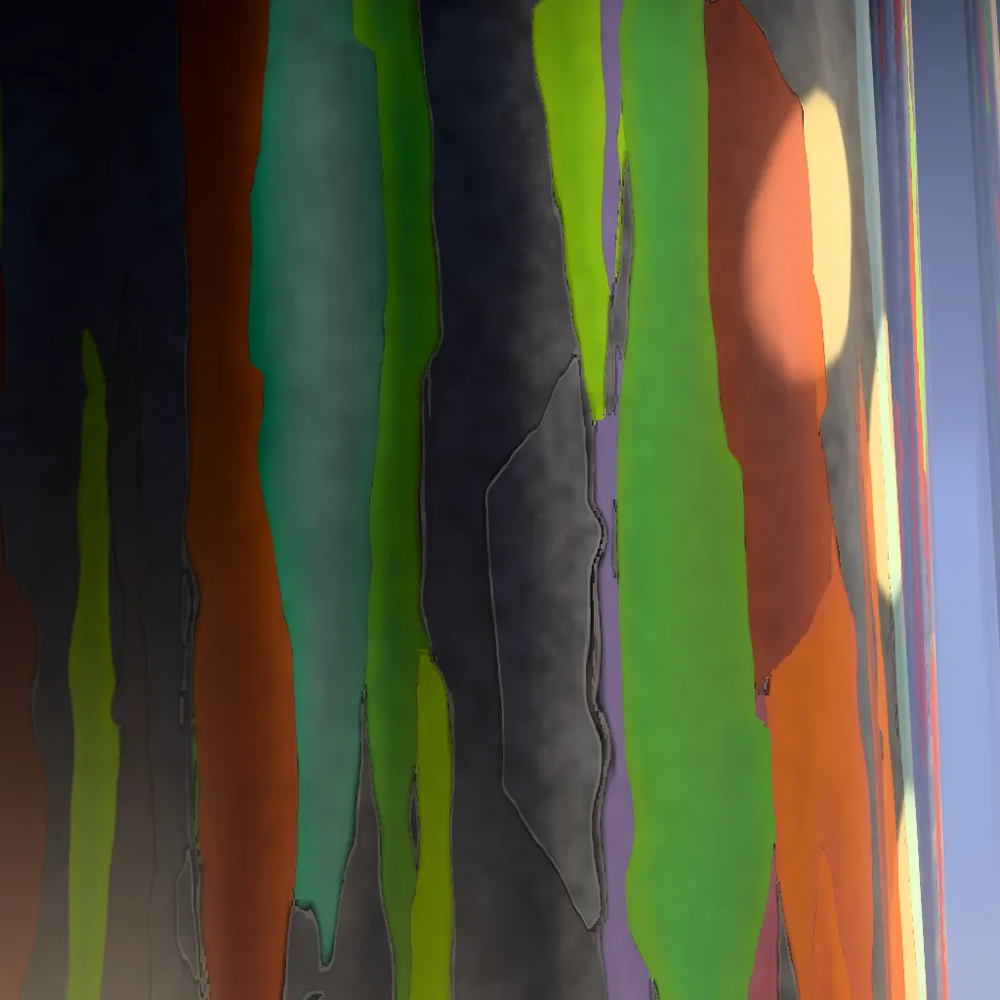
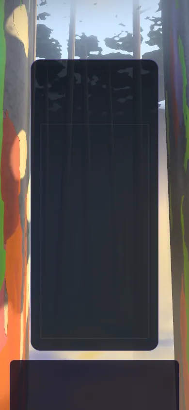
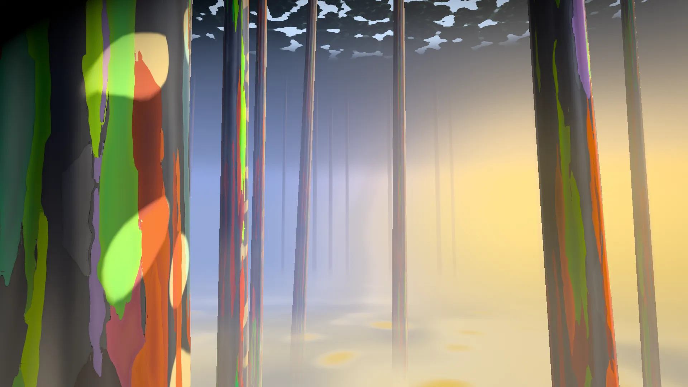

# Rainbark — handover (2026-10-13)

Where the Rainbark theme stands, what is left, and how to finish it in a new session. Rainbark
replaces Cosmic Chimes: colossal painted rainbow-eucalyptus giants in blue air over a floor of
luminous mist. This document was written on the branch `ccr-b2364ce7-64kjge` at its merge
commit `3855f11` ("Merge main into the Rainbark branch"), just before that branch was merged into
`main`. It assumes a reader with a fresh clone of `main` and no access to the session that built
the theme: everything that session kept in its scratch space (the spec's later build notes, the
critics' open-issue lists, the bark lab's notes, the capture tools) is restated here.

Read with it:

- the definitive spec, [theme-concepts/rainbark.md](theme-concepts/rainbark.md) (§0–§9 the spec,
  §10 the bark lesson; "SPEC §n" below means a section of that file). **Its §7.1 "Build status"
  note and its "A2 build" notes are out of date: §4 of this handover lists every place the code
  departs from the spec, and the code wins;**
- the shared build method, [theme-concepts/PLAYBOOK.md](theme-concepts/PLAYBOOK.md) (stages, capture
  tools printed in full in §5, gates in §6, house rules and gotchas in §7);
- the code, which is the source of truth: `src/themes/rainbark/` and
  `src/playground/effects/rainbark.effect.js`, with `tests/unit/rainbark-*.test.js`.

Two other docs still describe Rainbark as work in progress on the branch:
`docs/theme-concepts/README.md` ("To continue Rainbark": check out the branch, continue from
rainbark.md §7.3) and the concept table at the top of `docs/theme-concepts/PLAYBOOK.md` ("Being
built on branch …"). This handover supersedes both; their status lines are updated in C4 (§5d),
or in the first commit of the next session.

**Contents**

1. [Status at a glance](#1-status-at-a-glance)
2. [The branch's history and the rename](#2-the-branchs-history-and-the-rename)
3. [Architecture](#3-architecture)
4. [Deviations from the spec already made](#4-deviations-from-the-spec-already-made)
5. [Remaining work](#5-remaining-work)
6. [How to verify](#6-how-to-verify)
7. [Pitfalls met here](#7-pitfalls-met-here)
8. [A ready-to-paste prompt for the next session](#8-a-ready-to-paste-prompt-for-the-next-session)

---

## 1. Status at a glance

### What `main` has once this branch is merged

- **Rainbark replaces Cosmic Chimes for players.** Registry id `rainbark` (group `biomes`, in
  `HEAVY_GPU_THEME_IDS`), in Cosmic Chimes' slot in `src/themes/theme-registry.js`;
  `RETIRED_THEME_IDS` maps `cosmic-chimes` → `rainbark`, so saves, earned entries and Odyssey
  completions that name the old theme now mean Rainbark. Odyssey orb 47 is **"The Painted
  Giants"** (chapter 6, `transitionIn: 'crossfade'`). The old DOM theme, its 460 lines of CSS and
  its icon are gone.
- **The environment is built and complete enough to ship as a backdrop** (SPEC stage A, steps
  A1–A4 plus a sky pass "A4b"): the painted bark on instanced trunks, the grove and its
  composition solver, the air and the mist floor with its tide, the canopy, sunflecks, three
  ambient shafts, five storeys (zones) over the twelve levels, the post stack, six quality tiers,
  both backends (WebGPU and the WebGL2 backend of `WebGPURenderer`).
- **The gameplay effects (SPEC §6, stage B) are not built.** The director delivers every event
  and the world records every one of them, but nothing is drawn for a lock, a clear, four lines, a
  chain, its release, a back-to-back, a T-spin or a perfect clear. The only events with a picture
  today are **the Climb** (a new level raises the camera one storey and crossfades the zone) and
  **Mistfall / morning** (game over raises the mist past the camera; the next run drains it).
- **Not built either:** ambient life (step A5: falling curls, the liana, drips, vapour, birds,
  branched limbs) and stage C (post tuning against events, perf budgets, the phone and 21:9
  passes, the rendered icon — the current icon is a placeholder — the record doc, the final
  review).

### Honest quality assessment

Every environment step was judged by an independent art critic (fresh context, screenshots on
both backends, measurable gates). Only A1 passed. Each later step fixed most of the previous
step's majors, then the critic found new ones; the environment was committed with the last list
open (§5a).

| Step | What it covers | Final critic verdict | Score |
|---|---|---|---|
| A1 | The bark on one trunk | **PASS** | 7.5 / 10 |
| A2 | Grove plan, composition solver, backdrop (impostor ranks, canopy) | FAIL | 6.2 |
| A3 | Air, mist floor, sheets, wisps, underglow, zones | FAIL | 6.5 |
| A4 | Light: sunflecks, sun, shafts, value structure, post | FAIL | 6.5 (wow 5.5) |
| A4b | Sky pass: canopy as foliage, warm/cool split, Fog Line breakout, upright composition | FAIL | 6.4 (wow 6) |

In the A4b critic's words: the round "genuinely closes the 'washed out, no warmth' gap": there is
a real warm-on-cool split (Terpene blue on the left, gold air on the right), and "the painted
giants and the warm/cool split are original" (the A2 montage against the fleet's forest themes
confirmed it does not read as another forest). What keeps it below the house bar (the
critics compared against golden-forest, sakura-twilight, sunset and solar-eclipse): the Bole's
canopy band reads as blue camouflage, the mist's sun pools read as yellow stains, the canopy is
darker on Low and Minimal than on High, the flecks still read partly as decals because their
light depends on the bark's age, and up close the bark reads as flat vector fills next to the
reference photographs. WebGPU and WebGL2 agree to a mean difference of 0.01–0.03/255; every
acceptance capture has a clean console.

### Captures (current code)

All at `quality=High`, 1920×1080 unless stated, from `src/playground/effects/rainbark.effect.js`
(the same world and post the theme ships). They were taken on the code of `1f7c49e`, which the
merge did not change (`git diff 1f7c49e 3855f11 -- src/themes/rainbark` is empty); the bark
close-up was taken at `3855f11`. Software rendering (SwiftShader) in a container without a GPU.


*The reference frame: `t=55&level=4`, WebGPU. The Elder's painted wall on the left with
sunflecks; the receding ranks, paler and bluer; gold air toward the sun on the right; the mist
floor below; the canopy band along the top. Open issues visible here: the canopy band reads as
blue camouflage (§5a E1), the mist's pools as mustard spots (E2), and the cream ellipse on the
slate beside the lime one is a fleck behaving like paint (E4).*


*`t=55&level=4&board=1`: the mock card and stats bar. The card sits on calm, blue air (the post's
calm zone); Sister One stands right of the HUD; the right of the frame stays open.*


*`t=55&level=1`: Buttress Deep, the cool, intimate storey just over the mist (no gold air here
by design).*


*`t=75&level=8`: the Fog Line at high tide, the eye at the mist's top: pearly and high-key, no
open sea of cloud (A3's major, fixed in A4b).*


*`t=55&level=10`: the Limb Storey. The canopy reads as foliage seen from below (the crown field
of A4b); flecks small and crisp; limbs are still straight sticks (§5b).*


*`t=55&level=12`: Crown Light. The canopy fills the top third; the crowns read as rounded
broccoli pads (E16) and the long limbs as leaning poles (E17).*


*`t=55&level=4&icon=1&iconFov=30&iconYaw=24&iconPitch=8` at 1024×1024: the bark up close, ribbon
splats over the cool slate matrix with lips and hairline seams. On the right a fleck lands as a
cream disc on the slate but only peach on the ember patch (E4). This is the icon framing (SPEC
§8); the real icon adds a peeling strip (§5d).*


*`t=55&level=4&board=1` at 390×844: the Elder a painted band down the left edge, Sister One's
band down the right, the canopy above; under 820 CSS px the stats bar is a full-width row under
the card (the stylesheet's rule, which the solver and the mock follow).*


*`quality=Minimal&forceWebGL=1&t=55&level=4`: the lowest tier on the WebGL2 backend keeps the
whole picture, but its canopy band is darker than High's (E3) and its mist pools read as yolk
spots on a flat floor (E2).*

---

## 2. The branch's history and the rename

Branch `ccr-b2364ce7-64kjge`, on top of `main` at `5d3478d`:

| Commit | What it did |
|---|---|
| `0c747dd` | **Palette and core.** `rainbark-tetrominos.js` (every piece is one age of the bark, palette gate 0/7, satin solid tiles) and the first `rainbark-core.js` (piece codes and ages, the age ramp, `cellsFromMatrix`, `approach`, `smooth`, `mulberry32`). |
| `585ab55` | **The theme's frame and the full rename.** Adapter (`rainbark-theme.js`, cloned from Serenity Warp's), director (shadow well, combo break on the breaking lock, live back-to-back level, multiplayer cascade stash, hard-drop distance), world with the camera rig (Climb, breath, parallax), zones, tide, Mistfall and morning, a placeholder sky, the post, six tiers, the playground effect with every parameter catalogued. Rename: registry entry in place, `RETIRED_THEME_IDS` `cosmic-chimes → rainbark`, song retitled, Odyssey orb 47, container/CSS/icon removed, ThemesTab, phone validator lists, CREDITS, living docs, tests (theme, world, core, director, composition, rename migration). 822 files / 15,679 tests green. |
| `11b2aba` | **Docs**: `docs/theme-concepts/` (the six concepts of the design competition, PLAYBOOK, reference snapshots). The same docs reached `main` through PR #349 and were edited there; the merge took `main`'s version. |
| `6dec9ef` | **Steps A1–A3**: the bark (`rainbark-bake.js` ribbon-splat atlas, `rainbark-trunks.js`, `rbBark`), the grove (`planGrove`, `trunkBand`), impostor ranks and canopy lace, `rbAir`, the mist floor (`rainbark-mist.js` sheets and wisps), tide, zones. |
| `1f7c49e` | **Step A4 and the sky pass A4b**: sunflecks (gap mask, analytic gobo, wind and gusts, the CPU mirror `fleckAt`), the sun, value structure and bark richness, three ambient shafts (`rainbark-fx.js`), post retune; the canopy as a baked crown field, blue mist hollows, the L8 breakout, Sister One never behind the HUD on upright frames. |
| `3855f11` | **Merge of `main`** (153 commits). Conflicts in 11 files; rename sweep over what `main` added (orb 47 and the catalog check in `odyssey-unique-themes.test.js`, the alias check in `painted-ages-theme.test.js`, `ODYSSEY_60_ORB_CAMPAIGN_2026-10.md`). Every gate green: 875 files / 17,027 tests (§6.1). |

### The rename (done; do not redo)

- **Retired and aliased:** theme id `cosmic-chimes` → `rainbark` (`RETIRED_THEME_IDS`), track key
  `CosmicChimes` → `Rainbark` (`RETIRED_TRACK_KEYS` in
  `src/core/progression/theme-music-catalog.js`). The frozen V2 save table keeps the old id on
  purpose (indices 43 and 47); `tests/unit/rainbark-rename-migration.test.js` pins the migration.
- **Retitled:** `public/assets/music/cosmic-chimes.mp3` → `rainbark.mp3`, ID3 title "Rainbark"
  (file length unchanged), catalog `rainbark: ['Rainbark', 'rainbark.mp3']`, `songs.json`
  regenerated (63 songs), CREDITS: `Rainbark (titled "Cosmic Chimes" until October 2026)`.
- **Odyssey:** orb 47 "The Painted Giants", crossfade in; its description reads "Colossal painted
  trees stand in blue air above a floor of mist, a rare pocket of quiet. Re-center before the final
  pull." (`src/core/odyssey/data/levels.js`); key colour `#c2f23d` in `theme-presentation.js`; ThemesTab fallback glyph `bamboo`.
- **Kept as history:** dated records, `docs/archive`, `docs/validation`, reports, the screenshot
  results, the frozen V2 table and its test, the two aliases. The worked checklist is
  `docs/theme-concepts/reference/rename.md`.

**What to tell players about the song:** the Rainbark track is the Cosmic Chimes recording,
retitled. The audio is unchanged; only the title and file name changed.

---

## 3. Architecture

### 3.1 Files (`src/themes/rainbark/`, about 11,000 lines)

| File | Lines | Role | Key exports |
|---|---|---|---|
| `rainbark-theme.js` | 770 | The adapter (`BaseTheme`): renderer (WebGPU, else the WebGL2 backend; 5.5 s init timeout; one-shot WebGL2 retry on device loss), post or pass-through, director wiring and the sink, layout reads on frame time (0, +0.5, +1.5 s after a trigger), calm zones, pointer, reduced motion, settings and quality rebuilds, capture flags. The clock survives rebuilds; `stop()` clears it. | `default RainbarkTheme` |
| `rainbark-director.js` | 817 | Renderer-free gameplay director: five player slots, events staged inside the tick and resolved once per frame in `flush()`. Shadow well (which piece filled which cell; a clear knows its rows' codes), combo break inferred on the breaking lock, live back-to-back level with break inference, the multiplayer cascade stash, hard-drop distance, Infinity `viewportOrigin`, Odyssey's empty-row fallback (rows 19 − k), meditation click positions. | `RainbarkDirector`, `RAINBARK_EVENT_HANDLERS`, `themePieceColor`, `resolvePieceColor` |
| `rainbark-world.js` | 940 | The world shared by theme and playground: builds the parts, owns `u`, the camera rig, the Climb, Mistfall, zones, the tide clock, group clocks and the age drift; records every event; writes the uniforms each frame. | `RainbarkWorld`, `REST_RIG`, `RAINBARK_PARTS`, `fovForAspect`, `pitchForAspect` |
| `rainbark-core.js` | 2,354 | Three-free constants and maths: piece codes/ages, `RAMP_STOPS`, bark ageing (`AGE_PHASE_STOPS`, `GROUP_CYCLE`, `ribbonPhases`, `warpAge`, `groupMean`), `ZONES`, `MISTFALL`, the tide clock, mist planners, the rest lens (`restLens`, `lensRow`, `eyeRow`, `projectRest`), the gobo's CPU twin (`fleckAt`, `storeyFleck`, `canopyWind`), shafts, trunk records (`trunkRecord`, `limbRecord`, `trunkSpan`, `HERO_TRUNKS`, `TWIN_TRUNKS`), `planGrove`, `fallbackCard`/`fallbackHud`, `PALETTE_ROWS`, `EVENT_SLOTS`/`EVENT_ROWS`. | (many; see the file) |
| `rainbark-bake.js` | 1,509 | Three-free deterministic CPU bakes (typed arrays). | `bakePatchAtlas`, `ATLAS_PHASES_21`, `atlasPhases`, `bakeCrownField`, `bakeLeafLace`, `bakeGapMask`, `bakeRamp`, `bakeFbm`, `bakeLattice`, `planRibbons`, `planIslands`, `decodeEdge` |
| `rainbark-tsl.js` | 2,452 | The uniform bag and every shared TSL builder: laid-out pure helpers (`rbHash21/31`, `rbQuatRotate`, `rbRoundBoxSdf`, `rbFilmic`, `rbSchlick`, `rbHgMix`, `rbWarpAge`, `rbAgeOfPhase`, `rbPatchAge`, `rbBand`), inline builders (`rbViewRay`, `rbInscatter`, `rbAir`, `rbAirTransmittance2`, `rbMistField`, `rbMistTop`, `rbMistAir`, `rbVapour`, `rbCanopy`, `rbFleck`, `rbBark`, `rbBounce`, `rbGlaze`, `rbDrown`), materials (`rbFxMaterial`, `rbPart`). Re-exports the core. | `createRainbarkUniforms`, `createBarkTextures`, the constant blocks named in §4 |
| `rainbark-sky.js` | 266 | The backdrop: one far-plane triangle (order 50) painting the haze, the canopy (above), the mist top (below) and up to three impostor ranks. | `createSky`, `rbBackdrop`, `IMPOSTOR_RANKS`, `IMPOSTOR_GAPS`, `IMPOSTOR_FEET`, `IMPOSTOR_TOPS` |
| `rainbark-trunks.js` | 382 | One unit tube, two instanced draws (near ≤ 8 slots, order 10; far: grove + 21:9 Twin + limbs, order 11), one interleaved stride-16 instance buffer each; the vertex stage bends, tapers, flutes and buttresses; `rbBark` in the fragment. | `createTrunks`, `createTubeGeometry`, `trunkSurface`, `NEAR_SLOTS`, `BARK_STRETCH` |
| `rainbark-mist.js` | 440 | Parallax for the analytic mist: horizontal sheets (order 60) and wisps (order 61). | `createMist` |
| `rainbark-fx.js` | 189 | The effects layer, so far only the shafts (order 72): 3 ambient slabs (Medium+) and 7 dormant combo slabs that read the gap rows. | `createFx`, `shaftRecords`, `SHAFT_STRIDE` |
| `rainbark-composition.js` | 652 | Layout reading (card, board, HUD rects) and the composition solver `trunkBand`. | `readLayoutRects`, `fallbackLayout`, `fallbackFor`, `cardUnion`, `boardFor`, `boardPoint`, `trunkBand`, `createBand`, `hudBeside`, `BOARD_GRID`, `PLAYER_SLOTS`, lane/margin constants |
| `rainbark-post.js` | 334 | One scene pass, bloom, one output pass. | `RainbarkPost`, `POST_LOOK`, `createPassThroughPipeline`, `BLOOM_*`, `VIGNETTE`, `GRADE` |
| `rainbark-quality.js` | 167 | The six content tiers. | `QUALITY`, `QUALITY_NAMES`, `tierFor` |
| `rainbark-tetrominos.js` | 45 | Piece colours (SPEC §3.5; file name per the repo's convention). | `RAINBARK_TETROMINOS` |
| `rainbark-theme-icon.png` | — | **Placeholder** (capsule pills on brown: the rejected lozenge look). Same file in `public/assets/themes/`. | — |

Not yet written (SPEC §7.1): `rainbark-curls.js` (part `curls`) and `rainbark-life.js` (part
`life`). `RAINBARK_PARTS` already names all six parts; `PART_BUILDERS` in the world has builders
for `sky`, `trunks`, `mist` and `fx` only, and a part with no builder is simply absent.

Tests: `tests/unit/rainbark-{bake,composition,core,director,grove,light,rename-migration,theme,trunks,world}.test.js`,
10 files, **279 tests** (`npx vitest run tests/unit/rainbark-`, about 8 s).

### 3.2 Data flow

```
eventBus: PIECE_LOCK, HARD_DROP, LINE_CLEAR, COMBO, TSPIN, B2B, PERFECT_CLEAR, LEVEL_UP
   │  RainbarkTheme.setupEvents → director.on*()   (stages numbers into 5 player slots, nothing else)
   ▼
RainbarkTheme.stepFrame(now)
   1 processLayoutReads()            live card / board / HUD rects → world.setLayout(rects)
   2 world.updateCamera(camera, sim) the rig: (breath + parallax, camY + breath, 0), pitched up
   3 director.flush()                → sink.lock / sink.clear / sink.combo / sink.b2b / sink.levelUp
   4 world.update(sim, camera)       clocks, Climb, zone mix, tide clock, sun, wind, palette, bark rows
   5 easeCalmZones(), post.update(world.getPostState()), post.update({ time }), post.render()

sink (in the theme):  lock → world.onLock      clear → world.onClear
                      combo(n, p) → world.onCombo(max over players)
                      b2b(level, p) → world.onB2B(max over players)
                      levelUp(level) → world.levelUp(level)   (theme keeps this.level for rebuilds)
window 'gameOver' / modeStopped → world.onGameOver() + resetSession()
modeStarted → world.onSessionStart()

RainbarkWorld  ──writes──►  u (plain uniforms)   u.palette (28 vec4 rows)   u.events (112 vec4 rows: unwritten)
               ──writes──►  instance buffers (trunk records via placeGrove/commit; shafts' records once)
                                │
materials: RainbarkSky · RainbarkTrunksNear / RainbarkTrunksFar (rbBark) · RainbarkMistSheets ·
           RainbarkMistWisps · RainbarkShafts           (MeshBasicNodeMaterial, scene-linear HDR)
                                │
RainbarkPost: scene pass (MSAA ×4 on High+) → bloom (Medium+) → output pass:
              calm zones → + bloom → exposure·iris → rbFilmic → grade (toe, chroma-weighted lift,
              shade/light tints, saturation) → vignette → sRGB → grain + dither → FXAA (Low, Medium)
```

What the world records today (and nothing else): `lastLock` (time, player, u, rows, piece code,
colour, hard drop, distance), `lastClear` (lines, combo, cascade, tspin, perfect, b2b, rows, up to
40 row codes), `counts`, `combo`/`peak`/`lastRelease`, `b2b`, `sheds` (a lock adds 1, a cleared
line 4: the Floor's carpet), the Climb (`climb`), `mistfall`, `sessionAge`. Settings already act
in the director: `pieceLockRipple` off drops locks and hard drops; `backgroundComboEffects` off
disables and resets it.

### 3.3 The uniform bag `u` and the two uniform arrays

`createRainbarkUniforms(textures)` in `rainbark-tsl.js`. The world writes `.value`; materials only
read. Plain uniforms:

| Group | Fields |
|---|---|
| Frame and camera | `time`, `viewport`, `pixelAngle`, `camPos`, `camRight`, `camUp`, `camFwd`, `tanHalf`, `cardRect` (the cards' union, screen fractions) |
| Climb and air | `camY`, `tide`, `canopyY` (172), `hazeY` (the zone's tide top), `sigmaA`, `scaleHeight`, `sigmaM`, `airGain`, `mistOnset`, `tideHigh`, `tideRise`, `mistDrift`, `mistGrain`, `billowK` |
| Light | `sunDir`, `sunCol`, `sheenK`, `wind`, `fleckThr`, `fleckMean`, `fleckLight`, `fleckLod`, `exposure`, `iris` (the inverse of the post's iris, for event lights) |
| Bark | `groupClock` (vec4: Elder, Sisters + right R1, left R1, far), `ageBias` (vec4, today the same value in all four) |
| Event counts (int) | `peelCount`, `girdleCount`, `helixCount`, `knockCount`, `gapCount` — declared, never written |
| Derived nodes | `u.col.<zoneKey>` (palette rows as vec3), `u.pearl` (hazeShade row's w), and with textures `u.ramp(age)`, `u.fbm`, `u.fbmLod`, `u.atlasIds`, `u.atlasEdge`, `u.lace`, `u.crowns`, `u.gap`, `u.noise3` (the 2D-lattice 3D noise) |

**`u.palette`** (`PALETTE_ROWS`, 28 rows, **all used**: adding a row means raising
`PALETTE_ROWS.total`):

| Rows | Content |
|---|---|
| 0–9 | Zone colours, linear rgb, w = 1: `hazeShade` (w = pearl), `hazeSun`, `sky`, `zenith`, `mistTop`, `underglow`, `fleck`, `crown`, `gradeShadow`, `gradeLight`; crossfaded over the Climb and under the Mistfall look (`writePalette`) |
| 10–13 | The four group mean bark colours (rgb, mean age), recomputed when the age bias moves; the far bark fades to them by footprint |
| 14–21 | Piece-age rows in `PIECE_CODE` order (I0 T1 Z2 L3 S4 J5 O6 G7): the full-chroma ramp colour at that age, and the age. Written once; for the girdles' row colours (B2) |
| 22–27 | The 22 ribbons' places in their tile's cycle, four to a row (`ATLAS_PHASES_21`) |

**`u.events`** (`EVENT_ROWS`, 112 rows, 108 laid out). SPEC §4.11's six blocks **all exist in the
core's tables today**, with their first rows: peels 0 (16 × 3), girdles 48 (12 × 3), helices 84
(6 × 2), knocks 96 (4 × 1), gaps 100 (7 × 1), moult 107 (1 × 1); rows 108–111 spare. **Nothing
writes the table yet.** Two readers already exist, both of the gap rows: `rbFleck(…, { pools: true
})` in the near trunk draw loops `0 … u.gapCount` (each pool max-combined at `FLECK.pools`), and the
seven combo shafts in `rainbark-fx.js` read gap row `slot` directly (`open` = w). So keep gap rows
in station order (row i = station i; a chain opens them in order and the Set closes them in
reverse, so the open ones are always a prefix) and set `gapCount` to one past the last open one.
The near material has no `rbEvents` overlay yet; the far material reads no moult record yet.

### 3.4 Parts and render order

| Part (`RAINBARK_PARTS`) | Built | Meshes and `renderOrder` |
|---|---|---|
| `sky` | yes | `RainbarkSky` 50 (far plane, `THREE.LessEqualDepth`, no depth write) |
| `trunks` | yes | `RainbarkTrunksNear` 10, `RainbarkTrunksFar` 11 (opaque, depth write) |
| `mist` | yes | `RainbarkMistSheets` 60, `RainbarkMistWisps` 61 (premultiplied over; no wisp draw on Minimal) |
| `curls` | **no** | planned 65 (premultiplied over, double-sided) |
| `fx` | shafts only | `RainbarkShafts` 72 (additive `vec4(rgb, 0)`); no fx part on Minimal (no shafts there) |
| `life` | **no** | planned liana 20 (opaque), birds 66 |

Every pool is always drawn with dormant slots collapsed, so the first frame compiles every
pipeline and the scene's child count never changes after `build()` (a world test pins this).

### 3.5 Tiers (`rainbark-quality.js`) and `POST_LOOK`

| Key | Minimal | Low | Medium | High | Ultra | Extreme |
|---|---|---|---|---|---|---|
| `trunks` (the 7 `HERO_TRUNKS` + far ranks) | 12 | 16 | 24 | 32 | 42 | 54 |
| `limbs` asked | 0 | 6 | 12 | 20 | 28 | 36 |
| far-draw trunks the plan stands (R1c, R1d + ranks) / limbs it keeps | 7 / 0 | 11 / 6 | 19 / 8 | 27 / 9 | 37 / 9 | 49 / 9 |
| `grids` near / far (θ × h) | 24×48 / 12×24 | 32×64 / 16×32 | 40×88 / 20×48 | 48×112 / 24×64 | 56×136 / 28×80 | 64×160 / 32×96 |
| `atlas` | 256 | 512 | 512 | 512 | 512 | 512 |
| `striation` (detail terms, relief, the near draw's `fine` torn edge and specular) | off | off | on | on | on | on |
| `fleckLod` | fixed | fixed | pixel | pixel | penumbra | penumbra |
| `impostors` / `billows` / `canopy` | 1 / 1 / lite | 2 / 1 / lite | 3 / 2 / full | 3 / 2 / full | 3 / 2 / full | 3 / 2 / full |
| `mistSheets` / `wisps` | 1 / 0 | 2 / 1 | 3 / 2 | 4 / 4 | 5 / 6 | 6 / 8 |
| `shaftsAmbient` / `shaftsCombo` (built) | 0 / 0 | 0 / 7 | 3 / 7 | 3 / 7 | 3 / 7 | 3 / 7 |
| `curlsAmbient` / `curlsEvent`, `flakes` / `drops`, `vapour` / `beads`, `lorikeets` (declared, not built) | 40/48, 32/64, 0/0, 0 | 80/64, 48/96, 0/18, 0 | 160/96, 64/160, 4/36, 2 | 260/128, 96/240, 6/54, 5 | 360/192, 128/320, 8/72, 5 | 480/256, 160/400, 10/84, 5 |
| `POST_LOOK` msaa / fxaa / bloom (strength @ resolution) | – / – / – | – / on / – | – / on / 0.45 @ 0.33 | 4× / – / 0.48 @ 0.45 | 4× / – / 0.52 @ 0.5 | 4× / – / 0.52 @ 0.5 |
| pixel-ratio cap (theme) | 0.7 | 0.85 | 1.0 | 1.15 | 1.35 | 1.6 |

Post constants: `BLOOM_THRESHOLD` 1.0 divided by max(0.2, exposure·iris), `BLOOM_KNEE` 0.25,
`BLOOM_RADIUS` 0.75, a hue-preserving clamp at 7 in the high pass; calm zones over up to five
rects (desaturate 40% toward luma, soft clip, bloom ×(1 − 0.85·calm), grain ×(1 − 0.7·calm));
`rbFilmic` (shoulder at 0.48, `FILMIC_WHITE` from a peak of 2.0); `GRADE` (toe under luma 0.14 to
0.2× at black, highlight lift 3.4 weighted by chroma 0.03–0.12, shade tint 0.1, light tint 0.06);
`VIGNETTE` (k 0.28, shade-side lean 1.0, light side 0.32, a shade-corner term 0.95 fading out
from 55% to 85% of the height). `falseColor=1` bands the exposed pre-tone-map max channel (< 0.1,
< 0.6, < 1.0, < 2.5, above).

### 3.6 The CPU bakes and their cost

All synchronous at `world.build()`, memoized per page (`BAKES` by atlas size, `CANOPY` once,
`FLECK_STOREYS` once, `planGrove` per seed and tier). Measured in Node on this container
(2026-10-13); a second run the same day came out up to ~50% slower on a loaded container, so read
them as orders of magnitude:

| Bake | Output | Cold | Note |
|---|---|---|---|
| `bakePatchAtlas(21, 512)` | 512² RGBA8 (R region id, G signed edge distance, B region across, A wrap codes + agreement bit) | 238 ms (148 warm; 98 at 256²) | ribbon phases come from the frozen `ATLAS_PHASES_21`, no search at load |
| `bakeCrownField()` | 512² RGBA8 + mips over a 72 m tile | 180 ms (102 warm) | the canopy |
| `bakeGapMask()` | 256² R8, 2-level oversampled Gaussian pyramid, 9 m tile | 72 ms | the sunflecks' gobo |
| `bakeLeafLace()` | 256² R8 + mips, 12 m tile | 72 ms | spec asked 512² (§4) |
| `bakeFbm` / `bakeLattice` / `bakeRamp` | 256² RGBA8 + mips / 256² / 256×1 | 16 / 10 / 1 ms | |
| `storeyFleck` ×12 | the gobo's threshold and mean per storey | 21 ms | |
| `planGrove(0x6364, tier)` | heroes, far grove, limbs | 20–40 ms per tier (up to ~80 ms on the first call of a process) | |

About 0.6–0.9 s of main-thread work on the first build at High, against SPEC §4.0's ~66 ms for all
bakes. A phone could stall 1–2 s on the first switch to the theme (§5d).

### 3.7 The camera rig: the Climb, zones, the tide

- **Rig** (`pose`): camera at `(breathX + parallax, camY + breathY, 0)`, looking down −z, pitched
  up `9° − 3°k − 1°w`, vFov `64° − 14°k − 6°w` (k: portrait → landscape over aspect 0.62–1.5; w:
  landscape → ultrawide over 1.78–2.4), near 0.3, far 3000. Breath ±0.15 m / ±0.10 m at
  0.05 / 0.037 Hz; mouse parallax ±0.25 m (never touch); both off under reduced motion.
- **Storeys:** `camY = 20 + 12·c`, `c = (level − 1) mod 12` (L1 20 m … L12 152 m).
- **The Climb** (`levelUp`): waits until 1.2 s after the latest clear, then rises over 3.5 s
  (smootherstep) while the zone's colours, air, sun elevation and tide crossfade; the billows'
  grain snaps at the midpoint while their contrast dips to 0 (`billowContrast`). Silent level-up
  (a rebuild) jumps. Under reduced motion the camera jumps and the zone crossfades over 1.2 s
  (**no mist veil yet**). A wrap down (L13 → L1) **jumps** today (the veil is B6). The grove is
  re-stood every frame of a Climb, pivoted at the eye's storey (`placeGrove`, allocation-free).
- **Zones** (`ZONES` in core; Mistfall is an overlay, not a zone):

  | Zone | c | camY (m) | Tide (m) | Sun el. | Fleck target | Sat | Exposure | σA / Hs / σM | Pearl |
  |---|---|---|---|---|---|---|---|---|---|
  | Buttress Deep | 0–1 | 20, 32 | 10 ± 8 | 50° | 0.06 | 0.85 | 1.05 | 0.016 / 30 / 0.06 | 0 |
  | Bole | 2–4 | 44, 56, 68 | 26 ± 8 | 55° | 0.18 | 1.00 | 1.00 | 0.0102 / 40 / 0.05 | 0 |
  | Fog Line | 5–7 | 80, 92, 104 | 100 ± 4 | 58° | 0.10 | 0.78 | 0.80 | 0.012 / 40 / 0.035 | 1 |
  | Limb Storey | 8–10 | 116, 128, 140 | 104 ± 8 | 61° | 0.30 (gets ≈ 0.20) | 1.08 | 0.98 | 0.0075 / 45 / 0.045 | 0 |
  | Crown Light | 11 | 152 | 108 ± 8 | 64° | 0.42 (gets ≈ 0.20) | 1.00 | 0.95 | 0.006 / 50 / 0.04 | 0 |
  | *Mistfall overlay* | — | — | camY + 15 | — | 0 | 0.60 | 0.95 | — | 1 |

- **The tide** (`tideClock`, 150 s, low at t = 0, high at t = 75): phases clearing / rising /
  immersion / draining; from low to high water the flecks' gain 1.15 → 0.6, the sheen 0.6 → 1.0,
  the haze 1.0 → 1.3 (rays at and above the horizon only), the vapour's onset 1 → 6 m over the tide
  (kept 3.5 m under the eye), the sheets 0.55 → 1.0; wisps show and grow while it rises. The sun's
  azimuth (70° right of the view axis) drifts ±3° with the same cycle.
- **Mistfall** (`onGameOver`): the tide rises to camY + 15 over 4 s with the Mistfall colours and
  saturation 0.6; the next run's first lock, `modeStarted` or `onSessionStart` brings the morning
  (drains over 3 s); `resetSession` sends the walkway back to L1 under the mist (after 2.5 s).
- **The grove's age** (§3.4 of the spec): bias 0.3 at a session's start, +0.05 a minute, cap 1.2.
  Group clocks run at rate 1 and wrap at 65,536 s (quickening is B4; the Moult's reset is B3).

### 3.8 The composition solver (`trunkBand`)

`trunkBand(layout, aspect, { camY, seeds, css }, out)` in `rainbark-composition.js` places the seven
named trunks (Elder, Sister One, Sister Two, R1a, R1b, Twin A, Twin B) from the **live** card and
HUD rects (or the stylesheet's fallback layout before a card exists), measured through the rest
lens at the eye's storey, and allocates nothing when handed `out` (0.05–0.33 ms a solve):

- **Elder** (code 1): right silhouette at `card.x0 − card.x0·(0.08 + 0.26k)`, depth `9 − w`,
  cropped on the left.
- **Sister One** (code 2): left silhouette at `max(card.x1, hud.x1) + 0.012 + 0.063k`, depth 24.
  The HUD counts only when it stands beside the card (`hudBeside`: ≥ 50% of it on screen, right of
  and level with the cards), which follows the stylesheet's `@media (max-width: 820px)` rule (the
  stats bar becomes a row under the card; `fallbackHud` and the playground mock do the same).
  Hidden when less than `SISTER_BAND` (0.04) of the frame is left for her.
- **Sister Two** (code 3): deep (z −62) and slim, `SISTER_GAP` (0.035) of air beyond Sister One on
  every row; never upright or off the right edge.
- **R1a** (code 4): centred in the left air lane at depth 45, hidden when the lane cannot hold
  her. **R1b** (code 5): `HUD_AIR` right of the card/HUD at depth 48, shown only with `R1B_GAP` of
  air before Sister One (never at the fallback layouts).
- **Twin** (far draw): one fused silhouette beyond Sister Two, only when ultrawide (w ≥ 0.5).
- Every silhouette is tested on the top, middle and bottom rows of each card and the HUD and
  pushed outward while it touches one (`TOUCH_MARGIN` 0.01).
- It also returns the two **peel lanes** (θ ranges: the Elder's card-facing side, 30° wide, 6°
  inside the silhouette; Sister One's sunlit side, 50°, or her card-facing side when her outer side
  is off screen) and the **keep-out rects** (cards and HUD widened by `LANE_MARGIN` 0.02). Nothing
  uses the lanes or keep-outs yet; they are for B1. SPEC §7.1's "station screen points" are not in
  it yet (B4).

Tests (`rainbark-composition.test.js`, 22): never stands the Elder, a Sister or an R1 on a card or
the HUD from a 388×844 phone to 21:9 on any storey (frames include 768×1024, 821×1180, 834×1194,
900×1200, 960×1280, 1024×1366, 1080×1920); the 16:9 placements; a live moved layout; the open
right; the upright band; the 820 px rule; Sister One never behind a HUD on upright frames
820–1100 px wide; lanes; keep-outs; no allocation. The grove plan's own keep-outs are in
`rainbark-grove.test.js`.

### 3.9 Capture flags and playground parameters

**Theme capture flags** (all work): `?rainbarkTime=<s>` (seek and freeze), `?rainbarkFixedDt=<ms
or s>` (fixed step; values over 1 are milliseconds), `?rainbarkParts=a,b`, `?rainbarkFalseColor=1`,
`?rainbarkForceWebGL=1` (or the global `?forceWebGL=1`).

**Playground** (`/playground.html?effect=rainbark&…`; all catalogued in
`src/ui/url-parameters/playground-parameters.js`). Host parameters: `t`, `forceWebGL`, `profile`,
`trackTimestamp`, `ref`, `refMode`, `seed`, `paused`.

| Draws something today | Parsed and delivered (director → world records it), nothing drawn yet |
|---|---|
| `quality`, `level` (storey and zone), `board` / `statsHud` (mock card and HUD: composition, calm zones), `parts`, `falseColor`, `noPost`, `bloom`, `px` / `py` (parallax), `reduce` (breath and parallax off; level-up crossfade), `icon` / `iconFov` / `iconYaw` / `iconPitch`, `session` (the age drift: bark colours), `event=levelUp` with `eventLevel` (the Climb), `event=gameOver` (Mistfall), `eventAge` for those two | `locks`, `event=lock / drop / clear / quad / tspin / perfect / release / b2b`, `lines`, `row`, `u`, `piece`, `turns`, `color`, `dist`, `cascade`, `combo`, `peak`, `b2b`, `sheds`, `demo` |

The effect fakes the game's bus payloads (`boardPiece`, `clearedRows`) and drives a real
`RainbarkDirector`, so a playground event exercises the same code as the game. `seek(t)` replays
the lead-up (locks, the chain before a release) at fixed steps.

---

## 4. Deviations from the spec already made

Every row is a constant or a function in the code; most revert in one line. The spec file on
`main` records only the first rows (the bark lesson in §10 and the Bole tide note); the rest were
build notes in a scratch copy of the spec and live **here** now. Fold them into the record doc
(§5d) and get the owner's sign-off where marked.

| Area | Spec | Code (where) | Why |
|---|---|---|---|
| Bark model | §4.3 anisotropic Voronoi atlas | **Ribbon splats** over a cool slate matrix: 22 ribbons (0.25–1.1 m × 3–12 m, gentle width breathing 0.68–1.06, 1–3 torn jogs, two-scale ragged edges) and 10 pale old-skin islands per 4.8 × 14 m tile, matrix 45.6% (`bakePatchAtlas`, `planRibbons`) | The Voronoi read as stained glass; contours as topographic outlines; lozenges as candy (§10 of the spec; §7 here) |
| Atlas channels | §10.6: A = lift side / lip sharpness | A = wrap code of the region × 9 + wrap code of the region across, plus bit 128 when the texel's neighbours agree on the edge (`ATLAS_CONSISTENT`); slivers of 1–2 texels closed in the bake | The shader decides which side of an edge a pixel is on from the linear distance only where that is trustworthy; tiles wrap round the trunk |
| Age per patch | §4.2 step 3: every patch cycles, life 240 + 360·h s, phase by hash | Ribbons placed round their tile's cycle **by area** (`ribbonPhases`, frozen as `ATLAS_PHASES_21`); `GROUP_CYCLE`: only share 1 / 0.36 / 0.3 / 0.02 of each group's patches cycle, lives ×1 / 2.5 / 2.5 / 3, the Elder's ribbons turned 0.9; `AGE_PHASE_STOPS` shapes the mix (26% fresh, 10% mid, 2% ruby, 40.5% ember/rust, 20% maroon/slate at the resting bias) | A steady jewel share whatever the clock (A1 review: 0.43–0.50 swings); one visible wrap every 6–10 s, not every second |
| Old end of the ramp | §3.1: 0.91 `#5E2430`, 0.98–1 `#3E2A26` | 0.84 Rust `#B04C2E`, 0.885 Husk Maroon `#7A3A3C`, 0.93 Weathered Slate `#5E6573`, 1.0 Old Slate `#56616F`; matrix age 0.965 (`RAMP_STOPS`, `MATRIX_AGE`) | Real trees are blue-grey pillars streaked with jewels (§10.5 of the spec); brown read as ordinary trees |
| Ambient colour | §3.1: albedo ramp·0.82 ± 6% | `BARK_CHROMA` 0.78 (mixed toward luma), `BARK_ACCENT` (the rare teal/cobalt/violet/ruby muted −0.32 and ×0.85), `BARK_FRESH_DIM` (fresh bark ×0.68 in value, chroma 0.92) | Jewels instead of candy; lime never mint (A1 review). Gameplay bands should use the full piece colour (palette piece-age rows) |
| Bole tide | §2.3: 38 ± 8 m (the spec file's note says 26 ± 6) | **26 ± 8 m** (`ZONES[1]`) | At 38 m the mist read as a near floor or lake and L3 could sink into it at high tide; the ±8 swing keeps the tide readable (A3) |
| Zone values | §3.2 | Buttress Deep exposure 1.05 (spec 1.15); Fog Line exposure 0.80 (0.92) and σM 0.035 (0.05); a `zenith` colour per zone (Limb Storey `#9CCBF0`, Crown Light `#4F93D6`); `pearl` = 1 in the Fog Line and under Mistfall | Blown whites in the mist; the first rank must stay a ghost at 45 m inside it; azure overhead openings |
| Sun | §4.2: (4.2, 3.7, 2.9)·fleck tint | `SUN_BOLE` (13, 10.29, 5.41), 10% white (`SUN_WHITE`), the rest the zone's fleck colour; `FLECK_SHOULDER` rolls a fleck's light off under 1.3/exposure, hue kept; low-chroma bark takes up to half of Fleck Gold's hue | With the spec's sun a fleck on slate reached only L* 50 |
| Fleck gain by age | — | `BARK_LIGHT.fleck` 1.6 (young) → 3.4 (slate) on a fleck's body at the low storeys | Added so flecks on slate land gold and bright. **The A4 critic's main major: it makes light behave like paint. Undo it (E4).** |
| Gobo | §4.5: 9 m pinhole mask, `fl = smoothstep(thr, thr + 0.25, …)`, lod 3 fixed on Low/Minimal, gust 0.15 tile, pools ×1.6 | `GAP_MASK`: 17 thin crown patches × 5–9 pinholes, 8 mediums, 520 fine pinholes, seed 152, a 2-level oversampled Gaussian pyramid; `FLECK.sharpen` [3, 3.5] levels finer; rim `soft` 0.22 relative; cut never under 0.3 of the level's brightest (`floor`); dapple 0.08; Low/Minimal read the eye's level (`fleckLodAt`); gust reach 0.05 tile; `windScaleAt` shrinks the wind as flecks shrink; `FLECK.pools` 1.15 | Round soft discs, never polygons or diagonal bars; WCAG flicker test at L9/L12; at this sun a 1.6 pool reaches 21 scene-linear (bloom clamp is 7). **Coverage at L9–L12 is ≈ 0.20, not 0.30 / 0.42: owner sign-off or fix (E14)** |
| Air | §4.4 closed form | `AIR_CLEAR` 12 m clear near air; `AIR_UPWARD` (steep upward rays thin to 0.75); `HAZE_UPWARD_DIM` 0.6; `HAZE_SUN_SIDE` (cream toward the sun via a lavender-rose, never grey); `HAZE_UNDERGLOW` (the mist's glow only on rays that meet it near, scaled with the eye's height) instead of `underglow·0.35·smoothstep(…)`; `HAZE_PEAK` roll-off 0.54 → 0.74; `AIR_PASTEL` (far colours keep 0.8 of their chroma, violet tint). Transmittance at the Bole ≈ 0.82 / 0.55 / 0.22 at 45 / 110 / 260 m (spec 0.77 / 0.49 / 0.18) | The near trunks keep their darks; the band from the horizon down stays blue air, never a cloud sea; pastels, not grey |
| **Gold air and a light source** | §3.1 Sunlit Vapour `#F6EBCB` (low chroma) | `HAZE_GOLD`: toward the sun's azimuth the haze turns to the zone's fleck hue at 1.3× chroma (about `#F4D9A0` at the Bole), most near the horizon, only in zones whose sunlit haze is warm; `HAZE_CORE`: one luminous core 24° right and 8° up, up to 2.45× the haze, cap 1.7 so the bloom catches it; `HAZE_SHADE`: the shade side darkens upward toward Understory Indigo; the mist's pools and fronts turn gold (`MIST_GOLD`) | A4b measured the open right at C\* 12 against Sunset's 38: an overcast pastel. A deliberate departure; owner sign-off. The core's position is an open minor (E5) |
| Mist floor | §4.4 item 4, §4.6 | Slope-shaded billows (`MIST_BILLOWS`: two octaves, one on Low/Minimal), sun pools from the gap mask on a 126 m tile (`MIST_POOLS`), blue lees (`MIST_HOLLOW`), `MIST_WARM`, `MIST_LIFT`/`MIST_PEAK` caps, a density ramp from `mistOnset` over the tide to `MIST_DEPTH` (13 m) under it, the vapour painted `MIST_SEEN_DEPTH` into the mist; the billows' grain per storey as a whole number (`mistGrainAt`); `MIST_BREAKOUT` (eye within 8–18 m of the top: the far top melts into the haze); `MIST_INTERIOR` (the pearly inside); sheets held thin seen steeply (`SHEET_STEEP`); wisps as ragged threads sized to the gap (`MIST_WISPS`) | No sea of cloud (risk 4), feet melt into the very pixel painted round them, no slices, warm on cool |
| Bounce | §2.4: fades over 25 m | `BOUNCE_HEIGHT` 35 m, `BOUNCE` (warmer colour, ×1.6 below the eye, dimmer over it), `rbGlaze` (added, not multiplied) | The lower tide top; the Elder's shade half must read lit from below |
| Canopy | §4.4 item 3: lace at 12 m, 512²; §4.0 a 9 m pinhole `gapMask` | `bakeCrownField` (512² over a 72 m tile: R signed distance to the leaves' edge, G limbs, B each opening's half-width, A tone) read in bombed cells (8-way turned/mirrored, 6 m seams, three lattices); `CANOPY` thresholds, lighting and distances; `CROWN_GAP` above the card on upright screens; `bakeLeafLace` stays **256²** (`CANOPY_LACE.size`); no openings in pearly zones; Low/Minimal `lite` path (no lace, leaves ×1.6 light) | fBm-threshold openings read as snow or clouds (A2); 512² lace would cost ~4× at load for detail only seen at Crown Light |
| Limbs | §2.3: 12–30 m, 35–55° up | Tips clamped at the canopy plane (`LIMB_TIP_OVER`), melt into the leaves over the last 35% (`LIMB_INTO`), darken in the crowns' shade; still straight tapering tubes with a gentle bow; the plan keeps 9 at most (Ultra/Extreme ask 28/36) | Tusks and wires in A2; branching is A5 |
| Composition | §2.3 | Sister Two at (43.5, −62), R 1.0 (spec (+26, −40), R 1.2); R1b and R1d never in a landscape rest frame (`REST_HIDDEN`); the Twin at z −52; `hudBeside` and the 820 px rule; `SISTER_BAND`; heroes keep 0.3 of their lean upright (`HERO_LEAN_UPRIGHT`) | The right must stay open, sunlit air (never a colonnade or an arch); the HUD stays on air on upright tablets |
| Grove | §2.3: R2 in group 2 | Every far rank in group 3; an R5 rank (205–250 m) for tiers with more than 30 far trunks | R2's bark would wrap every few seconds at the near groups' pace |
| Post | §4.12 | Bloom threshold 1.0 (spec 1.25), knee 0.25 (0.5), strength 0.45 / 0.48 / 0.52 (0.45 / 0.5 / 0.55); a toe and a chroma-weighted highlight lift instead of a mid-tone S; filmic whitening from 2.0; a vignette leaning to the shade corner with an extra corner term | Flecks and the core bloom, the pale air does not; darks reach the bottom of the range |

---

## 5. Remaining work

In order: (a) environment polish, (b) step A5, (c) stage B, (d) stage C. Each item is one small
effect per step (CLAUDE.md), built in the playground, captured on both backends, judged by an
independent critic against the gates, fixed, at most three rounds. Gates in L\*, C\* and b\* are
CIELAB (D65) of the captured PNG (the measuring snippet is in §6.4); "parts=sky,mist" captures add
`&parts=sky,mist` to the query.

### 5a. Environment polish

Deduplicated against the code: what A4 and A4b fixed is listed at the end of this section, not
here. "Source" names the critic round that raised it; the fixes and gates are the critics' own.

**Majors**

| ID | Issue (source) | Fix | Gate |
|---|---|---|---|
| **E1** | **The Bole's canopy band reads as blue camouflage** (A4b major 1): in the top 8%, x .3–.75 of `t=55&level=4`, 15.1% of pixels at L\* 60–85 and only 2.3% ≥ 85; band median 40.2; leaves neutral slate (a\* +0.7); hard-edged gaps, no halation; the right-hand shafts link to no gap. | In `rbCanopy`, when `under` is 0 (far below the canopy) close most openings (raise `CANOPY.layers` for low `under`, e.g. mix(0.34, 0.16, under), or drop the cut ~0.5 m) so openings survive only near the top edge and toward the sun's azimuth; drive the survivors' `through` to at least the bloom knee (whiten toward `gradeLight` ~0.8 when under < 0.3, so they read L\* ≥ 88 and bloom halates them); add an analytic halo on the leaf side from the SDF: `leafCol = mix(leafCol, through, 0.35·exp(−inLeaves/(4·foot)))`; keep crown green through the haze (leaf a\* ≤ −3). | Band top 8%, x .3–.75 at L4 t55: median ≤ 36; L\* 60–85 ≤ 5%; L\* ≥ 85 3–6%; leaves a\* ≤ −3. No "snow", "clouds" or "paper" at 1×. |
| **E2** | **Mist pools are lemon stains, not light** (A4b major 2): pool pixels (b\* > 24) vs the cream: L4 t55 hue 90°, C\* 25.4 vs 11.8 but only +4.8 L\*; upright 1000×1300 +2.1 L\*; L10 −1.5 L\* (darker than the floor, C\* 33.7); on Minimal fried-egg yolks; mustard spots under the board on upright and phone frames. | Turn `MIST_GOLD` from a hue mix into light: pools add luminance (ΔL\* ≥ +8) at about half the current `MIST_GOLD` chroma, hue 78–85°; widen the pool falloff (smoothstep from `MIST_POOLS.mean` to `MIST_GOLD.full` over ~2× the span) and enlarge the pool scale 1.5–2×; move most warmth onto the lit fronts (`MIST_GOLD.front`) so the sunward floor is cream-gold at C\* 16–22; on Low and Minimal (no slope tap) halve `MIST_GOLD.pool`. | At L4 t55, L10, upright 1000×1300 and Minimal: pool ΔL\* ≥ +8 and pool C\* ≤ cream C\* + 10; warm-side floor median C\* ≥ 16; no closed ellipse with C\* > 24 on Minimal. |
| **E3** | **Canopy tier parity and the phone crown gap** (A4b major 3): Bole band leaves L\* 24.7 on Minimal vs 38.7 on High; on the Low phone (WebGL2) the crown gap over the board is near-black ink splatter (leaves median 21.5 vs 47.1 on High) with 15 detached dark islands (largest 265, 247, 89 px). | (a) Replace the scalar `CANOPY.liteLift` with what High gets from bloom: on the lite path lift leaves by proximity to sky from the SDF, `leafCol = mix(leafCol, sky·0.8, 0.5·exp(−inLeaves/(6·foot)))`, base lift ~2.4. (b) Clear the gap's heart: `open = max(open, smoothstep(0.55, 0.85, heart))`, or bake the masses' inradius into a spare channel and drop masses under ~12 px in the heart. | Phone Low gap leaves median within 8 L\* of High's; Minimal Bole band median within 6 of High's; no isolated dark island over 30 px in the gap above the card on either tier. |
| **E4** | **Flecks on bark change with the bark's age, so they look painted on** (A4 major 1, still open: `BARK_LIGHT.fleck` [1.6, 3.4]). Close-up t55: in one fleck the orange patch L\* 70.5, the slate beside it 96.2, clipped at (255, 246, 179): a +25 L\* step at the patch edge; in linear terms the slate gains 5.8× and the orange 3.4×. t60: lime lit to L\* 82–94 while the slate across its edge stays 41–48; a cream lip follows the patch contour. | One fleck gain for every age (`BARK_LIGHT.fleck` a single value, ~2.2–2.4). Get the slate's gold from colour (keep `slateSun` as a chroma push normalised to the same luminance), not from more light. Make every direct-light term continuous across patch edges: blend `worn` (which drives ridge and ripple) across the edge, e.g. `wornE = mix(wornOther, worn, smoothstep(0, 0.03, dEdge))`; check that `ndlSun`, `square` and `body` do not depend on age. | Close-up t55 and t60, both backends: (1) at every patch edge inside a fleck the L\* step is at most 6 more than at the same edge outside it; (2) the lit/unlit linear-luminance ratio of neighbouring patches agrees within ±25%; (3) no slate pixel in a fleck above L\* 94 (max channel ≤ 250). Keep: Elder lit-half p95 − p25 ≥ 40, fleck patches L\* 75–95, falseColor share on trunks ≥ 45%. |
| **E5** | **The light source and the open right** (A4 major 2, mostly addressed by `HAZE_GOLD`/`HAZE_CORE` in A4b; A4b minor "light source and Elder shade"): the core (24° right, 8° up, ≈ x 1476, y 500 at 16:9) sits behind Sister One (x 1480–1650), so the right half reads as a broad yellow wash with no focal source; the Elder's shade side is neutral (x 0–.13: L\* 25, a\* −0.8, b\* +3.0), not "cool blue shade". | Move `HAZE_CORE.azimuth` to ~20–21° (between the HUD's right edge and Sister One, outside the calm rects) and let the bloom catch it; lean the bark's skylight fill toward `hazeShade` where N·L < 0 so the Elder's left third reaches b\* ≤ −6, keeping the warm underglow at the foot. Then re-measure A4's open-right gates; if the shaft gate fails, raise `SHAFT_LIGHT.k` (0.32) 1.5–2× so a slab stands +4–6 L\* over its surroundings, and give the R3/R4 ghost ranks 6–10 L\* of contrast inside the aisle (A4's own fix). | Elder left third b\* ≤ −6. A4's gates at L4 t55: on parts=sky,mist L\* at y .55 rises ≥ +6 from x .62 to .95; box x .6–.98, y .4–.85 p95 − p5 ≥ 10 with p95 ≤ 90; a shaft +4 L\* over its neighbours across ≥ 150 px; lower-right median ≤ 88; share of frame above L\* 90 ≤ 5%; falseColor mist ≤ 2%. (A4b moved the aisle to L\* 88.1 / C\* 27.1; A4's band was 80–87 — decide which stands.) |
| **E6** | **Mist hollows blue** (A3 and A4 major; A4b says met: hollows b\* −8.9). Re-measure only. | — | parts=sky,mist, darkest 5% of y .86–1, x .3–.8: L4 t55 B−R ≥ +6, L3 t75 ≥ +4, L10 ≥ +4; L1 no bluer than before (+42); brightest 5% at L4 t55 R−B ≥ +30. |

**Minors**

| ID | Issue (source) | Fix | Gate |
|---|---|---|---|
| E7 | Post vignette goes negative (A4b): `T *= 1 − vig·lean·k − corner`, corner up to 0.95: the 16:9 top-left corner is clamped to black (0.74% of the frame at L4, 1.47% at L12). | `T *= max((1 − vig·lean·k)·(1 − corner), 0.04)`; re-measure the darkest 5% honestly (a deeper toe or a darker Elder shade should carry it). | No flat zero plateau; darkest 5% re-measured. |
| E8 | Value range (A4): L4 t55 p99 92.1 (gate 93); L10 p1 2.7 (Elder's far-left shade crushed by toe + corner); slate flecks burn to near white. | After E4: `FILMIC_WHITE.from` 2.0 → 1.6 so lime and ember cores reach L\* 93–95 still coloured; turn the vignette's corner down where the zone's shade is already deep (L10–L12) or raise `GRADE.floor` there. | L4 t55 p99 ≥ 93 with ≤ 5% above L\* 90; L10 p1 ≥ 8; no bark pixel above L\* 96. |
| E9 | Atlas stair-steps at the focal point; reveal ends in a block; junction stair-steps (A1 minor, A4 minor): a rectangular 8×25 px notch inside the brightest fleck (x ≈ 380–392, y ≈ 140–170 of rest L4 t55); stray red dots at 3×; the last of a reveal closes as a texel-stepped hole. | Draw the region boundary from the distance channel (G) with an `fwidth`-wide smoothstep instead of stepping on the nearest id, or re-bake so no sliver tip is narrower than 3 texels; base the reveal front on `phiL` only with a 3–4 cm soft end, then an organic shrinking hole (threshold on `coarseN.b`/`fineN.b`); extend `closeSlivers` to diagonal and vertical one-texel notches, or a 2×2 id vote off the agreement flag. | 4× crops of the rest frame's Elder and the close-up: no axis-aligned run of 4 px or more along any patch edge; the reveal strip (t=63–68) never ends in a rectangle. |
| E10 | Minimal atlas stair-steps (A1 minor): at 256² a texel is 1.9 × 5.5 cm; thin orange and maroon slivers step at 1:1 on Minimal. | In the 256² bake close slivers up to 3 texels, drop or merge ribbon tips narrower than 3 texels (raise the pinch threshold with atlas size), or widen ribbons so nothing on Minimal is under 3 texels. | 2× crop of the Minimal Elder matches the High crop's edge quality. |
| E11 | Fleck outlines still polygons (A4 minor): a straight-edged bite on the Elder's top fleck at t60. | At the Bole read the gap mask half a level finer (`FLECK.sharpen` [3.5, 3.5]) and raise the oversample; or on High+ average two bilinear taps offset half a texel diagonally before the cut. | Across t55, t57, t60 no fleck outline on the Elder has a straight run longer than 0.3 of the fleck's width. |
| E12 | A crisp fleck inside the mist at L7 (A4 minor; partly eased by `FLECK.pearlSoft` and the pearly zones' veiled sun, which keeps 0.4 of its direct light: `FLECK_SHOULDER.pearl` 0.6): at L7 t90 a blade-shaped fleck reaches L\* 97.8 on the Elder against pearly air at 89. The Fog Line's coverage target 0.10 applies to c = 5–7 (spec: 0 inside the mist, 0.10 at c = 7). | Fade a fleck's contrast toward its mean by the vapour along the sun ray: `fl = mix(fleckMean, fl, 1 − rbDrown(u, P.y))`; scale `u.fleckLight` by (1 − `rbMistInside`) in `writeFlecks`; coverage 0 for c = 5–6 in `storeyFleck`. | At L7 t60 and t90 no bark pixel brighter than the median air L\* + 3. |
| E13 | Mid-ground grey poles; a regular row behind the card (A4 minor, A2 minor): the 12–15 R1–R3 trunks across x .32–.75 are uniform mauve-grey poles with no sun side; five far trunks in the card band (R4.6, R3.4, R4.1, R4.10, R3.2) at near-uniform gaps of 0.025–0.032. | A soft warm rim on the sun side of trunks 30–120 m off: the haze term as a Fresnel-shaped rim, `max(dot(N.xz, L.xz), 0)²·hazeSun·T`, fading where R1 gets flecks. In `planGrove` cap R4 at 2 in the card band and reject a candidate whose gaps to both neighbours are within ±30% of the rank's median gap (or pair trunks). | L4 t55: on three R2/R3 trunks the right third ≥ +5 L\* over the left third, far ranks still pastel (C\* ≤ 15); R3 behind the card at contrast ≤ 0.35 against the haze. |
| E14 | Upper-storey fleck coverage ≈ 0.20 at L9–L12 against 0.30 / 0.42 (A4 minor; recorded deviation). | Owner sign-off, or raise `FLECK.floor`'s coverage on the Limb Storey and Crown Light once the cut no longer draws bars. | CPU sweep: coverage ≥ 0.28 at L10 and ≥ 0.36 at L12, and the WCAG flicker test still passes. |
| E15 | Canopy limbs are blurred translucent smudges at L10–12 (A4b): a mipped coverage channel mixed at `limbs[0]·(1 − limbFoot)`; 6 m bombing seams double-expose limbs. | Bake a limb distance and threshold it with the leaves' `w = foot·aa`, crisp or absent; fade by on-screen width; in seam bands take G from the dominant lattice. | 2× crops at L10 and L12: no translucent limb smudges, no doubled limbs. |
| E16 | L10–12 crowns read as broccoli or moss pads (A4b): opaque masses, scalloped rims; no lanceolate leaf even at L12. | Around L12 (the `nearK` band) raise `CANOPY.rag` 0.22 → ~0.4, stretch the lace ~2:1 along the sun's azimuth (pendulous), let 8–15% of sky through mass interiors (lace pinholes where `inLeaves < core[1]`). | L12 crowns show single-leaf points along ≥ 30% of edge length. |
| E17 | Limbs are leaning poles and straight sticks (A2 minor, A4b minor). | In A5 (§5b, "limbs"). | — |
| E18 | Up close the bark reads as flat vector fills next to the photographs (A4b, carry-over; not gating): wide uniform lozenges of lime and orange, far less blue-grey matrix and streaky variation than the references. | A dedicated bark pass: grade value and hue along each patch's length (±10 L\*), streak the edges into the matrix (rag along v with the fine grain), narrow the young ribbons to 0.2–0.6 m, raise the matrix share toward 55–65%, keep jewels rare. Compare against the photographs at <https://toptropicals.com/catalog/uid/eucalyptus_deglupta.htm> in a scratch montage (never copy them into the repo). | A critic beside the references no longer says "vector" or "construction paper"; matrix share 55–65% in the close-up. |
| E19 | Elder underglow balance (A3 minor, carried): its shade side is 1.26× brighter at the bottom than at mid-height (target 1.10–1.15), from the cream air glow in front rather than bounce. | Scale the `HAZE_UNDERGLOW` share on rays that end on geometry within ~15 m by `1 − exp(−d/15)`; let `rbGlaze` carry the warmth. | Ratio 1.10–1.15, bottom R−B ≥ +10. |
| E20 | Far ranks drift to mauve low down (A3 minor, carried): R2/R3 lower halves at hue 286°, saturation 0.09 (229–237° higher up). | Scale `rbBounceColor`'s ember lean by `detailK` on far trunks, or pull `AIR_PASTEL.violet`'s red gain toward 1.15 below the eye. | Far-trunk hue 225–260° at every height in the L4 rest shot. |
| E21 | Impostors use the eye-relative bounce (A3 minor, carried): `rbBounce` applies `rbBelowEye` at 300–600 m too, a brightness change across every stripe at the eye's height. | Fade the eye term with distance for impostors (a `far` flag, or `mix(eyeTerm, 1, smoothstep(60, 200, d))`). | No horizontal luminance step at the horizon in parts=sky at L4 and Mistfall. |
| E22 | Mistfall: a line at the horizon (A3 minor; half fixed: the pastel term is now × T.y): at `t=55&level=4&event=gameOver&eventAge=4.5` impostor stripes step 7 levels at the horizon. | In `rbAirTransmittance2`, apply the inside-the-mist clearing to the whole haze (`tauA·mix(1, clear, inside)`) and in the `level` branch; recapture full frame and parts=sky; if a step remains, see E21. | No column with a > 4-level 4-row step within ±10 rows of the horizon. |
| E23 | Low-tier fill (A3 minor): the one-octave billows still read the slope tap; trunk feet use the tier's full billows. Low phone on WebGL2 went ~242 → 282 ms a frame on SwiftShader. | On `billows ≤ 1` build `rbMistField` without the toSun tap (light from the crest only); for trunk feet (`rbBark → rbAir`) always use one octave with no slope tap. | Re-profile Low phone WebGL2 (`profile=1&trackTimestamp=1`) within +5% of the 242 ms baseline (SwiftShader numbers compare runs only; ADR-0016). |
| E24 | Code style (A4b): three doc lines run past the files' wrap (the `rainbark-sky.js` header line "…(MIST_SKIM). A pale, neutral top leans to the sun's cream…", the `MIST_BREAKOUT` doc, the `CANOPY` doc); the theme header still says "most of it old maroon husk" (the matrix is slate now). | Re-wrap; update the header sentence. | Lint clean; no line in those blocks past the files' ~100-character wrap (the `CANOPY` line is 109, the other two over 120). |
| E25 | The light step was never profiled (A4 minor): every near-trunk pixel runs `rbFleck` (one or two gap reads, plus the combo-gap `Loop` over `u.gapCount`), and Medium and up add two fbm reads (`BARK_ISO` and the ridge tap). | Run `profile=1&trackTimestamp=1` on 1080p Medium and High (WebGPU) and the Low phone (WebGL2) against the pre-A4 commit `6dec9ef`; if High grows by more than 15%, skip the ridge tap where `worn` < 0.05 or N·L < `BARK_RELIEF.lit[0]` (an `If` on a coherent condition). Fold into C2. | Numbers recorded against `6dec9ef` with their instrument (ADR-0016). |

**Fixed since the critics raised them (do not redo; re-check where marked):** the jewel share
swinging with time and seed (A1; ribbons placed by area, a unit test pins 0.33–0.43 over 50
moments); mint greens (A1; `BARK_FRESH_DIM`, `AGE_PHASE_STOPS`; re-check green hue 115–125°, C\*
40–45 in the close-up); bottle-shaped ribbons (A1; breathing 0.68–1.06 plus torn jogs); soft
maroon smudges in the matrix (A1; removed); the faint sheen strip (A1; `BARK_SHEEN`); the dull
grey Sisters (A1; sun-side light in A4; re-check Sister One jewel C\* p90 ≥ 25); the near draw's
`fine` on Low (now `tier.striation`); Sister One behind the HUD on upright frames (A2;
`hudBeside`, `SISTER_BAND`, the 820 px rule, tests); the fBm canopy (A2; the crown field); the
playground mock's HUD under 820 px; `placeGrove` allocating (`_bandOpts`); the Fog Line's sea of
cloud (A3; `MIST_BREAKOUT`); the Climb's swimming billows (A3; whole grain, contrast dip, test);
faint wisps (A3; `MIST_WISPS.lift` 0.14); trunk tops ending mid-air at L7 (A3;
`CANOPY_FADE_NEAR.mist`; re-check); the L10–L12 canopy as a flat ceiling (A3/A4; the crown
field).

### 5b. Step A5: life and motion

SPEC §7.3 step A5, §4.7, §4.8, §4.9, §5. Shafts are done (three ambient, seven dormant combo
slabs). Order: curls first (stage B's peel, shed, moult and Set all ride the event curl slots),
then drips and vapour (they share fx pools with the sunshower and the Moult), then limbs, the
liana, the doze, and birds last (optional cut).

| Item | What to build | Acceptance |
|---|---|---|
| **Curls** (`rainbark-curls.js`, part `curls`, order 65) | SPEC §4.7: one instanced strip (14 × 1) draw holding the ambient slots `[0, A)` and the event slots `[A, A + E)` (`aKind`), one interleaved 16-float buffer (`aP0` spawn xyz + t0, `aDir` out x/z + back z + lane, `aDim` length/width/roll ρ0/rollAmt, `aLook` outer age/seed (integer)/kind/spin); closed-form roll, precessing tumble, eased fall, outward pop, flutter (formula in §4.7; every `exp` bounded); `frontFacing` picks the old-bark outer face or the Curl Underside inner face; backlit translucency only where a curl crosses a fleck (`rbFleck`, CPU twin `fleckAt`); then `rbAir`. Ambient: a closed-form periodic schedule per slot (period 6–12 s by hash), spawned on near and mid trunk surfaces above the frame, 1–3/s in menus, spin 0.6–1.4 rev/s, terminal 1.2 m/s, 0.3 Hz flutter; slots with hash > `u.ambientRate` collapse (new uniform: 1.0 in menus, 0.35 while a session is live, 0.2 under Mistfall). Keep-out: fade to 0 where the projection falls in the card rect + 0.02 (add the HUD: `u.cardRect` holds only the cards). Tier counts from `QUALITY.curlsAmbient` / `curlsEvent`. Reduced motion: fall speed ×0.5. | `t=55&level=4&parts=sky,trunks,curls` and the full frame at t=55 and t=55.5 (temporal pair: no popping, nothing crosses the card); `board=1`; the phone (curls tumble in the bottom band); `quality=Minimal`; `reduce=1`. |
| **Drips** (`rainbark-fx.js`, drops pool) | SPEC §4.8: instanced 0.5 m streaks at 7 m/s, desynchronised, about 2 a second, vertex-collapsed where the CPU mirror `fleckAt` (core; it takes the gap rows too) or GPU `rbFleck` is under 0.05, so they glint only in light; keep-out band. The same pool later carries the ×6 gust veil (B4) and the sunshower (B5): size it to `QUALITY.drops`. | Full frame t=55 and a 2× crop of the Elder's lit side; nothing in shade, nothing over the card. |
| **Vapour** (fx) | SPEC §4.8: additive noise wisps rising 0.4 m/s, life 2–4 s, `QUALITY.vapour` (0/0/4/6/8/10), spawned at `fleckAt`-lit points on near trunks; off on Low and Minimal (gate in JS, never ×0). The Moult (B3) and the ×5 chain (B4) raise it. | t=55 close-up (icon framing) and full frame; `quality=Low` shows none. |
| **Limbs** (`planGrove` / `limbRecord` in core) | Crook: two segments with a 12–25° kink at 40–60% of the length; one fork at 60–75% (0.6× radius, 20–35° off); reject a limb whose on-screen angle to its parent is under 25°; raise the far-parent cull from 1.5 px to ~3 px at mid-length; at L12 bow in proportion to length and taper to the tip, and cull or shorten limbs whose base is more than ~25 m below the eye when seen against the mist; let Ultra and Extreme keep the extra limbs that pass (today High, Ultra and Extreme all keep 9). The record has no spare slot for a second segment: a fork is its own limb record. | L10 and L12 at t=55, 2× crops: no limb reads as a second trunk, a spear or a pole; `rainbark-grove.test.js` extended for the angle rule. |
| **Liana** (`rainbark-life.js`, part `life`, order 20) | SPEC §4.9: an instanced catenary ribbon with a tube look, 24 segments, from Sister One (camY + 9) to Sister Two (camY + 4), sag 3.5 m, 0.12 m thick, swaying ±0.4 m at 0.15 Hz; every tier. Sister Two now stands at z −62 (spec −40) and is hidden upright: check the span still reads as a scale cue, hide the liana with her. | `t=55&level=4` 16:9 and 21:9 (2560×1080); upright: none. |
| **Doze** (world) | SPEC §5: after 60 s with no events the tide rises 5 m, shafts drop 30% and gust frequency halves; any event wakes it over 3 s. Closed form in the clock and the last event's time (seek-safe). | A world test; `t=200` with no events vs a fresh lock. |
| **Lorikeets** (life, Medium+) | SPEC §4.9: 2 birds (rarely 5), low-poly body and two wing quads at 9 Hz, a closed-form spline across a gap at 30–80 m every 40–70 s, 1.5 s; green body, blue head, orange breast. The first optional cut (SPEC §9 risk 17). | A `t` inside a crossing; Low shows none. |

SPEC §5's table, today: built — bark ripening (one visible wrap every 6–10 s), group clocks (rate
1), the age drift, sunflecks with wind and gusts, the mist's tide and drift, wisps, shafts
following the tide, sheen on the tide, the sun's drift, camera breath and parallax. Not built —
ambient curls, vapour, drips, the liana, lorikeets, the doze.

### 5c. Stage B: the gameplay effects

SPEC §6.0–§6.13 and §7.3 stage B, one beat per step (PLAYBOOK §3.4: an `eventAge` sequence such
as 0.25, 0.75, 1.8, 4 s with `board=1` on both backends, one Low and one phone shot, the
mode quirks). The director already provides the whole sink contract (SPEC §7.2): `lock({ player,
rows, u, hardDrop, distance, color, shape, cells, screen })`, `clear({ player, rows, lines, combo,
cascade, tspin, perfect, b2b, rowCodes, screen })` with `rows` visible rows lowest first and
`rowCodes` ten bark codes per row (7 = garbage or unknown; Infinity, Odyssey's empty rows and the
meditation click already resolved), `combo(n, player)` with the break inferred on the breaking
lock and idempotent against the tracker's late 0, `b2b(level, player)` 0–3 with the break inferred
from a non-difficult wave-1 clear, `levelUp(level)`. A clear reaches the sink **before** the
combo it raised: read its chain from `clear.combo`.

**B0 — shared plumbing (do first, inside B1):**

- Core: `screenToTrunk(trunk, cam, sx, sy)` (cast the rest camera's ray through a screen row onto a
  lane surface; `restLens`, `lensRow`, `recordAxis` and `projectRest` are the pieces) and
  `pickTrunkFace(layout, player, u, rows)` → `{ trunkCode, θc, yTop, yBot }` (columns 0–4 the
  Elder's lane, 5–9 Sister One's, the column nearest the card at the lane's card-side edge; the
  board from `boardFor`/`boardPoint`; MP: the trunk lane nearest that card, else the nearest R1
  near code outside every card); `packCodes`/`unpackCodes` (five 3-bit codes per float, exact in
  float32); `solveComboGaps(...)` (B4).
- World: an event writer run in `update()` that keeps each block's live slots, recycles the
  oldest (fading it out over 1.0 s via its `tKill`), writes rows into `u.tables.events` (mutate the
  `Vector4`s in place, as `writePalette` does) and **compacts** live rows to the front of each block
  with the count in `u.peelCount`… (gotcha #110). Pass the lane θ bounds from `this.band.lanes` to
  new plain uniforms (one vec2 per lane code) whenever `placeGrove` runs.
- TSL: an `rbEvents` overlay inside `rbBark`, enabled by a new option only on the near draw (pass
  it from `createTrunks`' near `trunkDraw`), run after step 3 (ages: `aLoc`/`aSkin`) and before
  colour (SPEC §4.11): root-pin shared nodes with `.toVar()` before any `If` (#68); one `Loop` per
  block with distinct names `pl`, `gl`, `hl`, `kl` (#110, #155), each starting with
  `If(row.trunkCode == vCode && |y − band| < half + 0.5, …)`; every texture read inside a branch
  with `.level()`; integer codes decoded with `floor(x + 0.5)` (#87/#88); never nest `select`
  round `Fn` calls (#89). The overlay exists on every tier; tier-gated extras are built in JS,
  never multiplied by zero (#72).
- New plain uniforms as the beats need them: `wet`, `creak`, `drain`, `clearAir`, `carpet`,
  `ambientRate`, the lane bounds, a HUD rect for keep-outs. Plain uniforms keep the count of
  uniform arrays at two (#102). The palette array is full (28/28); the event table has 4 spare rows.
- Photosensitivity (SPEC §6.0): event lights times `u.iris`, combined with `max()`, never summed;
  only the Moult (≤ +0.25 stop, rise ≥ 400 ms, decay τ ≥ 800 ms) and the Floor (≤ +0.2 stop, rise
  1.2 s) lift measured mean frame luminance; hairline splits ≤ +0.2 on < 0.3% of the frame; no
  large area modulating at 3 Hz or more. Add a capture-measured test for the two lifts.
- Reduced motion (SPEC §6.0), for each beat as it is built: curl and sheet fall ×0.5, the moult
  front at half speed, quickening capped at the ×4 behaviour, the helix as a 0.6 s reveal, rain
  streaks ×0.5, the Climb as a 1.2 s mist-veil crossfade (B6); the world already gets the flag
  (`setReducedMotion`).
- Core tests with the plumbing (SPEC §7.1's `rainbark-core` list): `packCodes`/`unpackCodes`
  round-trip, `screenToTrunk` against `projectRest`, `pickTrunkFace` column-to-lane mapping.

| Step | Beat (SPEC) | World methods to fill in | Event-table blocks and pools | Acceptance (SPEC §8) |
|---|---|---|---|---|
| **B1** | **The Peel and the Knock** (§6.1, §6.2), the peel lane (§4.2 step 4), lanes and keep-out (§6.0) | `onLock` (today it records `lastLock`, sheds, the morning): `pickTrunkFace`; a peel slot (unzip 0.04–0.40 s, 0.12 s on a hard drop; band in the piece's colour = its bark age, ripening at 1/240 per s; +12% luminance τ 3 s; gloss decays 20 s; torn rim + 1 cm Cambium Cream edge; Fleck Gold hairline for 60 ms; erosion over 90–150 s or 1.0 s on recycle; ≤ 3 strips animating per lane); a knock slot on hard drops (gloss band ±0.5 m running up at 22 m/s for 450 ms, strength `0.4 + 0.6·min(1, distance/18)`, one per trunk per 250 ms). The peel lane: inside the lane's θ arc `aLoc = max(aLoc, 0.86 + 0.13·h3)`. **Design check:** with the slate old end that lane is rust → maroon → slate, not dark husk; check every piece colour pops on it (Cobalt L\* 37 is darker than the slate), and darken or narrow the lane's age range if not. | **peels** (16 × 3: trunkCode, yTop, yBot, t0 / θc, θHalf, pieceAge, hard / tKill, glossBoost, distance01), **knocks** (4 × 1); event curl kind 1 (lock curl: rides the front, detaches at 400–550 ms, pops 0.35 m outward, tumbles 0.8 rev/s, falls 1.4 m/s, drifts back 0.4 m/s); fx **flakes** (4 + round(10k) on a knock, spin ≤ 1.5 rev/s) and 3–6 beaded **drops** glinting only in flecks | #3 `t=55&level=4&board=1&event=lock&piece=L&u=0.15&row=12&eventAge=0.3`; #4 `t=55&level=4&board=1&locks=10&event=lock&piece=I&u=0.85&row=15&eventAge=1.4`; #5 `t=55&level=4&board=1&event=drop&piece=O&u=0.3&row=17&dist=18&eventAge=0.25`; #14 (phone) `t=55&level=4&board=1&event=lock&piece=T&u=0.2&row=10&eventAge=0.5` at 390×844; Low on WebGL2 at 390×844 |
| **B2** | **The Shed** (§6.3) | `onClear` (today: records `lastClear`, counts, sheds): per cleared row, lowest first, 120 ms apart, one girdle on each near trunk (Elder, Sister One) over the visible arc, 1.25 rows tall cast to the trunk; hairline 0–100 ms; the sheet peels 100–420 ms; the ring blazes First Skin 420–600 ms (capped 1.1·iris); 600–1600 ms segment i of 10 ripens to cell i's age (40 ms stagger) from `rowCodes` via `packCodes` and the palette's piece-age rows; erosion after 60–120 s. ×2: R1 (codes 4, 5) +150 ms, fainter. ×3: R2 drop sheets only (far draw: no overlay) and a cascade of sheets in the bottom band. Cascade waves k ≥ 2: an aftershed 600 ms later (a second smaller sheet, +20% curls, no ring). | **girdles** (12 × 3: trunkCode, yC, halfH, t0 / codesLo, codesHi, θL, θR / strength, tKill, aftershedT); `rbDecodeCode` (laid-out pure helper); event curl kind 2 (two wide sheet strips per trunk per row) | #6 `t=55&level=4&board=1&locks=10&event=clear&lines=3&row=16&eventAge=0.75`; #7 the same at `eventAge=1.8`; sweep `quality=Low&forceWebGL=1&board=1&t=55&level=4&event=clear&lines=2&eventAge=0.8` at 390×844; `cascade=2` |
| **B3** | **The Great Moult** (§6.5) | `onClear` with `lines ≥ 4`: the creak (`u.creak` 0 → 1 → 0.3 over 300 ms; every old rim lifts, ≤ +0.08 a lip, frame mean ≤ +3%); the front sweeping down every trunk in screen elevation 35° → −35° over 0.9 s, +50 ms a rank; naked First Skin 0.6–2.0 s with `wet` 1; flame-shaped ripening 2–8 s, +0.25 s a rank; the near groups' age bias to −0.6, relaxing to the drift line over 360 s (`ageBias` becomes per group: today all four get one value); the post's iris `exposure·2^(−0.25·env)` (today `post.iris` is fixed at 1); vapour from lit near trunks; mist sheets brighten. No flash of our own (the board flashes). | **moult** (1 × 1: t0, active, rankDelay, frontDur), read by the near **and the far** material (a single record, no loop); event curl kind 4 (64–200 moult sheets by tier, ember/ruby/violet/maroon); fx vapour | #8 `t=55&level=4&event=quad&row=16&eventAge=1.3`; #9 the same at `eventAge=4.2`; the mean-luminance measurement |
| **B4** | **Opening the canopy, Quickening, the Set** (§6.6, §6.7, §4.10) | `onCombo` (today: chainSteps, peak, `lastRelease`): link n ≥ 2 opens gap n − 1 (max 7) at fixed stations — `solveComboGaps(layout, sunDir, camera)`: station world points on the lanes at screen y 0.24 (Elder high), 0.30 (Sister One high), 0.50, 0.55, 0.76, 0.80, then Sister Two mid / R1b 0.50; on the phone 0.20/0.25/0.45/0.50/0.68/0.72 with #7 brightening the crown gap; gap centre `q = P.xz + L.xz·(yC − P.y)/L.y`, radius 0.35 m (Bole; pools ≈ 2 m), 0.25 m from the Limb Storey up; `open` eased over 0.5 s with a puff of 12 leaf bits; quickening: integrate the group clocks at `1 + 1.6·(n − 1)` (Elder from ×2, Sisters ×3, R1/R2 ×0.6 from ×5, far ×0.4 from ×7, cap n = 8, eased τ 0.8 s) instead of `+= dt`; escalation ×3 ambient wraps double, ×4 fleck wind ×1.5, ×5 vapour, ×6 a 3 s gust veil of drops, ×7+ near patch UVs scroll up 0.12 m/s. The Set on `combo(0)` after a peak ≥ 2: rates back (τ 0.25 s), sheen −30% for 4 s, gaps close in reverse 120 ms apart with leaf bits, a curtain of `min(4·(p − 1), tierCap)` curls from both near trunks over 1.2 s, a vapour roll; a rise within 0.6 s reopens without restarting the curtain. MP: the theme already passes the longest chain on any board. Re-check `FLECK.pools` (1.15) against the spec's ×1.6 once pools show. | **gaps** (7 × 1: qx, qz, radius, open), in station order, `gapCount` = last open + 1: the near draw's pools (`rbFleck` `pools: true`) and the 7 combo shafts already read them; fx leaf bits (12 per opening, 1.2 s); event curl curtain | #10 `t=55&level=4&board=1&combo=6` ("five counted pools with beams"); #11 `t=55&level=4&board=1&event=release&peak=7&eventAge=1.2`; phone `combo=7` |
| **B5** | **The Unwinding and the Sunshower** (§6.9, §6.8) | `onClear` with `tspin`: on the T's side (u < 0.5 the Elder, else Sister One) from its top row, a helix 0.30 m wide on the Elder (0.6 m on Sister One), 1/2/3 turns, pitch 0.9 m (2.2 m), unwinding over 150–1550 ms (0.6 s reveal under reduced motion), ripening First Skin → Young Emerald over 3 s; 6/10/14 amber beads welling up 0.9–2.5 s, persistent for the level; oldest of 6 heals over 4 s. `onB2B(level)`: `120·level` drops (tier-scaled) of 0.5 m at 7 m/s, full only inside flecks and shafts, 15% against shade; `u.wet` → 0.5 + 0.2·level (albedo ×(1 − 0.2·wet), chroma ×(1 + 0.3·wet), gloss and sheen up; SPEC §4.2 step 7); slow runnels in the Elder's sheen (0.4 m/s); on 0: rain stops over 2 s, wet decays τ 8 s with faint vapour. | **helices** (6 × 2: trunkCode, yTop, turns, t0 / pitch, θ0, width, tKill); event curl kind 3 (corkscrew ribbon); fx **beads** (sphere impostors, core `#B8661C` → rim `#E7A43A`, glint `#FFE9B0` in flecks; `QUALITY.beads`); fx **drops** (sunshower) | #12 `t=55&level=4&board=1&event=tspin&lines=2&u=0.2&row=13&eventAge=2.0`; sweep `t=55&level=4&b2b=2`; `event=b2b` |
| **B6** | **The Floor, the Climb's veil, Mistfall, meditation, MP** (§6.10–§6.13) | Perfect clear (`onClear` with `perfect`, a later frame with no rows): `u.drain` (tide → −40 m over 1.2 s, σA ×0.35 via `u.clearAir`, sheets fade), the backdrop's floor branch (ray–plane at y = 0: gravel, a braided stream with glints in flecks, a curl carpet `u.carpet = 1 − exp(−sheds/400)` from `this.sheds`, broad fleck pools; the spec's buttress roots are the trunks themselves, whose records already run from y = 0 with their fins: check they read once the mist drains), exposure ≤ +0.2 stop over 1.2 s, back over 9–15 s. `levelUp`: the L13 → L1 wrap as a mist veil (tide past the camera 1.5 s, camera to 20 m inside it, drain 2.5 s) instead of a jump; under reduced motion a 1.2 s mist-veil crossfade (today: jump + zone fade); modes without LEVEL_UP climb every 15 cleared lines (count `counts.lines`). `onGameOver`: ambient rate → 0.2 and the last curls settle (the rest exists). Meditation: a click (the director's `clear.screen`) peels at the nearest lane point to its screen y, cycling the 7 ages, ≤ 4 peels/s; click combos open gaps. Local MP: per-card lanes (`pickTrunkFace`). Odyssey: the goal flourish (comboCount 6) opens 5 gaps. | backdrop floor branch (no new geometry, SPEC §6.10); uses the curls, gaps and peels above | #13 `t=55&level=4&event=perfect&eventAge=5&sheds=700`; sweep `reduce=1&event=levelUp&eventAge=0.6`; `level=12&event=levelUp&eventLevel=13&eventAge=1.0` (the veil); `event=gameOver&eventAge=4.5` |

Tests for each beat: extend the world test (slot counts, ring order, compaction, bounds, seek
determinism with events in flight), the director test for anything new in the sink, and the mode
quirks (PLAYBOOK §2.3): Infinity (no level-ups, `viewportOrigin`), local MP (players 1–4, no
T-spin, B2B, level or perfect on the bus), online (slot 0), meditation (`position`, rapid bursts),
Odyssey's synthetic clears (empty rows), `pieceLockRipple` and `backgroundComboEffects` off.
SPEC §7.1 also asks for `tests/unit/rainbark-playground.test.js` (the URL parameters the effect
reads equal its catalogue rows in `playground-parameters.js`), which does not exist yet; the
precedent is `tests/unit/painted-ages-playground.test.js`. Add it with B1, since every beat adds
or changes effect parameters.

### 5d. Stage C: post, tiers, phone, icon, ship

| Step | Work | Done when |
|---|---|---|
| **C1** post | Calm zones tuned with `board=1` against the events; bloom knee and the iris (B3 drives it); grade per zone; FXAA/MSAA; `falseColor=1` shows only flecks, sheen, the haze core and backlit curls above the knee; E7 and E8 if not done. | `falseColor=1&t=55&level=4` and the starred events; no event light reads through the card. |
| **C2** tiers and perf | Minimal and Low captures of rest and every starred event; the WebGL2 leg on every event shot. Budgets (SPEC §4.13) with `profile=1&trackTimestamp=1` (`window.__PLAYGROUND__.profile.reset()` / `.snapshot()`): High ≤ 6 ms GPU on an iGPU at 1080p × 1.15, Medium ≤ 4.5, Low on a phone (WebGL2) ≤ 9, Minimal ≤ 6; first-frame compile about 10 pipelines plus the post. SwiftShader timings are not evidence (ADR-0016): measure on real hardware or record that it was not. Cuts if over (SPEC §9 risk 9): wisps, then limbs, then impostor rank 3. Add `tests/unit/rainbark-shaders.test.js` like `thermal-bloom-shaders.test.js` (every material to WGSL on the CPU at Minimal and Ultra: no MaterialX noise, ≤ 12 uniform buffers a stage, ≤ 8 vertex buffers, each stage under 128 KiB). Bring the bakes toward the ~66 ms budget (§3.6): per-row splat lists in `bakePatchAtlas` (the A1 critic's target ≤ 60 ms at 512²), the crown field, lace and gap mask cached, precomputed or baked off the first frame's path. | Budgets recorded with their instrument; the shader test green; first build under ~0.2 s on desktop. |
| **C3** layouts | 390×844 phone (lanes, stations, the crown gap's station #7, curls swinging into the bottom band), 2560×1080 (lanes, stations, the Twin, R1c), 1280×720, upright tablets 834×1194 and 1024×1366. | Every starred event at P and W on both backends; nothing crosses card or HUD. |
| **C4** ship | **The icon**: capture the icon frame (SPEC §8: `t=55&level=4&icon=1&iconFov=30&iconYaw=24&iconPitch=8&event=lock&piece=I&u=0.2&row=8&eventAge=0.35`, square 512×512, then a circular crop): the Elder's painted face filling the circle, one chartreuse strip peeling into a curl inside a sunfleck, a wedge of blue air and a ghost trunk, a hint of glowing mist; replace **both** `src/themes/rainbark/rainbark-theme-icon.png` and `public/assets/themes/rainbark-theme-icon.png` (the theme test checks the icon exists). **The record** `docs/RAINBARK_VISUAL_OVERHAUL_2026-10.md` (precedent `docs/SERENITY_WARP_VISUAL_OVERHAUL_2026-10.md`), absorbing §3 and §4 of this handover; curated captures added to `docs/rainbark-captures/` (webp, small); a row in `docs/ARCHITECTURE_INDEX.md`; update the status lines in `docs/theme-concepts/rainbark.md` (its header, its "Authoritative record" row and the §7.1 "Build status" note), `docs/theme-concepts/README.md` ("To continue Rainbark") and `docs/theme-concepts/PLAYBOOK.md` (the Rainbark row of the concept table at its top). **Gotcha rows** for what this build learned (candidates: a gobo cut on a box-filtered mip draws polygons and bars, an oversampled Gaussian pyramid draws discs; threshold openings of an fBm read as clouds or snow, a baked SDF of clumps reads as foliage; a light gain keyed to material age reads as a decal; a soft clip of a broad field flattens it to a plateau) in **both** `.claude/skills/webgpu-threejs-tsl/SKILL.md` and `.agents/skills/webgpu-threejs-tsl/SKILL.md` (byte-identical; `agent-skill-mirror.test.js`). **Final adversarial review** (PLAYBOOK §3.6). **Real game** on both backends (`game.mjs`), switch-away on both (`switch-away.mjs`), the phone validator at Low and Minimal (PLAYBOOK §5.8). | PLAYBOOK §6.2 all green; the critic signs off the starred shots. |

---

## 6. How to verify

### 6.1 Gates

PLAYBOOK §6.1 before every commit (with `tests/unit/rainbark-` as the theme prefix) and §6.2
before asking to merge. The numbers on the merged tree (`3855f11`), all exit 0:

| Gate | Command | Result at `3855f11` |
|---|---|---|
| Typecheck | `npm run typecheck` | clean |
| TS ratchet | `node scripts/ts-ratchet-check.mjs` | 73, at baseline |
| Lint ratchet | `npm run lint:ci` | 612 errors, under the 807 baseline (it suggests `--update`; leave the baseline alone) |
| Architecture fitness | `node scripts/architecture-fitness-check.mjs` | OK; `lines:main` 5642 and `lines:OdysseyMode` 4391 are **at their ceilings** (add no line to `src/main.js` or `OdysseyMode.js`); resize listeners 26 of 40 |
| Theme lifecycle | `npm run audit:theme-lifecycle` | passed |
| Palette | `npm run check:palette` | 64 palettes, 0 matches, 1 warning (luminous-tides, already on `main`) |
| Boundaries | `npm run check:boundaries` | no violations (1604 modules) |
| Unit suite | `npm test` | **875 files / 17,027 tests**, all passing |
| Rainbark only | `npx vitest run tests/unit/rainbark-` | 10 files / 279 tests (~8 s) |
| Build | `npm run build` | OK, boot closure OK |
| IP strings | `npm run check:ip-strings` (after build) | OK, including `dist` |
| Pages artifact | `npm run check:pages-artifact` | OK |
| Release gates / perf budgets | `npm run check:release-gates`, `npm run perf:budgets:gate` | passed / PASS |

Run the unit gates with no captures going: `url-parameter-catalog.test.js` (~3 s alone) has timed
out at the 5 s default while headless renders loaded the CPU.

### 6.2 Headless capture tools

In a cloud container there is no GPU and the `chrome-devtools` MCP does not connect. Use the three
Playwright scripts printed in full in **PLAYBOOK §5** (`shot.mjs` for the playground, `game.mjs`
for the real game, `switch-away.mjs`), saved in your scratchpad, never in the repo. Notes from
this build:

- The dev server: `curl -s -o /dev/null -w '%{http_code}' http://127.0.0.1:5173/playground.html`
  → 200. If it is down: `(npx vite --port 5173 --strictPort --host 127.0.0.1 > <scratch>/vite.log
  2>&1 &)`. **Never start a second Vite on the shared `node_modules/.vite` cache**; any extra server
  needs its own `VITE_CACHE_DIR`.
- `shot.mjs` usage: `node shot.mjs [--backend=webgl2] --w=1920 --h=1080 --out=<dir> name='effect=rainbark&t=55&level=4'`.
  One JSON line per shot; a shot is clean only with `ok: true` and `problems: []`. A 1920×1080
  Rainbark shot takes 30–90 s on SwiftShader (iterate at 960×540). Then look at every PNG.
- **Raise the screenshot timeouts in all three scripts**: as printed in PLAYBOOK §5, every
  `page.screenshot` call keeps Playwright's default 30 s. In `shot.mjs` a 1920×1080 Rainbark
  capture can outlast it (the A3 critic lost a shot to it while vitest loaded the CPU); this
  build's working copy passed `timeout: 180000` to both of its `page.screenshot` calls. In
  `game.mjs` and `switch-away.mjs` the real game runs at about 1 fps on SwiftShader, so they time
  out (before and after the merge); pass `timeout: 120000` to each of their `page.screenshot`
  calls.
- `game.mjs --theme=rainbark [--backend=webgl2] --quality=High --settle=15000 --out=<dir>`: read
  the tier back from the theme's log line `[Rainbark] Scene ready (<backend>, <quality>)` before
  judging a capture.
- The phone validator needs the port shim in PLAYBOOK §5.8; Rainbark's frame passed at Low and
  Minimal at `585ab55`; repeat after stage B.

### 6.3 Key playground queries

`/playground.html?effect=rainbark&…` (add `&forceWebGL=1`, or `--backend=webgl2`, for the WebGL2
leg):

| What | Query | Viewport |
|---|---|---|
| Reference frame | `t=55&level=4` | 1920×1080 |
| Board readability | `t=55&level=4&board=1` | 1920×1080, 2560×1080, 390×844 |
| Zones | `t=55&level=1`, `level=7`, `t=0&level=8`, `t=75&level=8`, `level=10`, `level=12` | 1920×1080 |
| Tide | `t=0&level=4` (low), `t=75&level=4` (high) | 1920×1080 |
| Air and mist alone | `t=55&level=4&parts=sky,mist` | 1920×1080 |
| Bark close-up | `t=55&level=4&icon=1&iconFov=30&iconYaw=24&iconPitch=8` | 1024×1024 |
| Tiers | `quality=Minimal&t=55&level=4&board=1`; `quality=Low&forceWebGL=1&t=55&level=4&board=1` | 1920×1080; 390×844 |
| False colour | `falseColor=1&t=55&level=4` | 1920×1080 |
| Mistfall | `t=55&level=4&event=gameOver&eventAge=4.5` (and `&parts=sky`) | 1920×1080 |
| Climb | `t=55&level=4&event=levelUp&eventAge=1.75` (mid-rise); `reduce=1&event=levelUp&eventAge=0.6` | 1920×1080 |
| Upright tablet | `t=55&level=4&board=1&statsHud=1` | 1000×1300, 1024×1366 |
| Temporal pair | the same query at `t=55` and `t=55.25` (flicker, popping) | 960×540 |
| Profile | `quality=Low&forceWebGL=1&profile=1&trackTimestamp=1&t=55&level=4`, then `window.__PLAYGROUND__.profile.snapshot()` | 390×844 |

### 6.4 Measuring a capture (CIELAB)

The critics' gates are CIELAB statistics of screen regions. A minimal tool (Python 3 with PIL and
numpy, both available in the container):

```python
import sys, numpy as np
from PIL import Image

def lab(rgb):                       # sRGB 0..255 → L*, a*, b* (D65)
    c = rgb / 255.0
    lin = np.where(c <= 0.04045, c / 12.92, ((c + 0.055) / 1.055) ** 2.4)
    M = np.array([[0.4124, 0.3576, 0.1805], [0.2126, 0.7152, 0.0722], [0.0193, 0.1192, 0.9505]])
    xyz = (lin @ M.T) / np.array([0.95047, 1.0, 1.08883])
    f = np.where(xyz > 0.008856, np.cbrt(xyz), 7.787 * xyz + 16 / 116)
    return 116 * f[..., 1] - 16, 500 * (f[..., 0] - f[..., 1]), 200 * (f[..., 1] - f[..., 2])

def region(path, x0, y0, x1, y1):   # fractions of the frame, y down
    img = np.asarray(Image.open(path).convert('RGB')).astype(np.float64)
    H, W = img.shape[:2]
    px = img[int(y0 * H):int(y1 * H), int(x0 * W):int(x1 * W)].reshape(-1, 3)
    L, a, b = lab(px)
    C = np.hypot(a, b)
    q = lambda v, p: float(np.percentile(v, p))
    return dict(L5=q(L, 5), L50=q(L, 50), L95=q(L, 95), C50=q(C, 50), b50=q(b, 50))

if __name__ == '__main__':
    p = sys.argv[1]
    for name, r in [('Elder shade', (0.02, 0.15, 0.10, 0.80)), ('Elder lit', (0.19, 0.15, 0.26, 0.80)),
                    ('aisle', (0.61, 0.30, 0.72, 0.70)), ('card air', (0.42, 0.25, 0.58, 0.70)),
                    ('mist band', (0.30, 0.88, 0.80, 1.0)), ('top band', (0.30, 0.0, 0.75, 0.08))]:
        print(name, {k: round(v, 1) for k, v in region(p, *r).items()})
```

At `t=55&level=4` (A4b r3): darkest 5% L\* 18.1, median 57.6, brightest 5% 90.2; aisle L\* 88.1 /
C\* 27.1; sun side 81.3 / 31.1; upper left L\* 41.4; card zone 67.1 with b\* −9.3.

### 6.5 The process that worked

- **Build → independent critic with measurable gates → fix, at most three rounds**, one small
  effect per step (PLAYBOOK §3.3 has the critic prompt skeleton). The critic gets the spec
  sections, the shots on both backends, montages against the nearest fleet themes, and is asked
  for ranked defects (blocking / major / minor) with crops, the spec line, a concrete fix and a
  **numeric gate**. Gates made the rounds converge; "looks better" did not.
- Split a long fix list by disjoint files, one agent per area, then one verify agent (tests, lint,
  every shot on both backends).
- Before any hero material: prototype it on the CPU (numpy/PIL) beside reference photographs
  (SPEC §10). The bark lab saved a wrong shader.
- Every capture on both backends; read the diagnostics line back; look at every image.

---

## 7. Pitfalls met here

1. **3D textures fail WebGPU validation on SwiftShader.** No `Data3DTexture`, `texture3D` or
   `lut3D`: 3D noise is the 2D-lattice trick (`u.noise3`), everything else 2D CPU bakes with CPU
   mips.
2. **The OdysseyMode and `main.js` line ceilings.** Architecture fitness pins both files at their
   current line counts. Rainbark took orb 47 in place and left the `heavyThemes` sets alone; add
   no line to either file.
3. **`game.mjs` and the quality pin.** The first real-game probe hard-coded `effectQuality: 'Low'`
   in the seeded settings, so "High" captures were Low; the script now takes `--quality`. Always
   read the tier back. Its screenshots, like those of the other two scripts, need a longer
   timeout (§6.2).
4. **The theme clock runs slow under software rendering.** Each frame's delta is clamped to
   0.05 s and SwiftShader manages 1–5 fps, so theme time runs at 5–25% of wall time in real-game
   captures. For timed moments use the playground's `t=` and `eventAge=`, or `?rainbarkTime=` /
   `?rainbarkFixedDt=`.
5. **The Voronoi bark was rejected** (stained glass), then thresholded fBm contours (topographic
   outlines) and pointed lozenge splats (candy feathers); ribbon splats over a slate matrix matched
   the photographs. The placeholder icon is exactly the rejected lozenge look: replace it.
6. **Light that depends on the bark's age reads as paint.** `BARK_LIGHT.fleck` (1.6 young → 3.4
   slate) made flecks follow patch outlines and burn the slate: a fleck must be the same light on
   every patch (E4).
7. **Soft-clipping the haze flattens it.** Meeting a "lower right ≤ 88" gate with a roll-off made
   the whole lit half one value (the "flat cream plateau"). Use a gain, a wide roll-off and one
   luminous core instead (`HAZE_CORE`).
8. **Threshold openings of an fBm read as clouds, snow or paper.** Three canopy rounds failed on
   that model; a baked signed distance field of clumps (`bakeCrownField`) reads as foliage, crisp
   at any distance.
9. **A box-filtered mip cut at a threshold draws polygons and diagonal bars.** The gap mask's
   pyramid is an oversampled Gaussian (each level holds the blur of the one two further down), so a
   cut fleck is a round soft disc; the cut never drops below 0.3 of the level's brightest.
10. **A fractional noise scale zooms the whole field** round the world origin: the billows' grain
    is a whole number per storey, swapped at the Climb's midpoint while their contrast is 0.
11. **Hand-picked seeds and frozen tables.** World seed `0x6364` (the Elder's face shows the
    grove's mean jewel share at the reference frames), atlas seed 21 with its ribbon phases frozen
    in `ATLAS_PHASES_21` (a test recomputes them: change the atlas plan and you must re-run
    `atlasPhases(21, …, { search: true })` and update the table), gap-mask seed 152 (a fleck on the
    Elder's lit face at t = 55).
12. **The palette uniform array is full** (28/28 rows). New per-frame data goes into plain
    uniforms or the event table's 4 spare rows; never a third uniform array without counting the
    stage's uniform buffers (#102).
13. **The stats bar's 820 px rule.** Under 820 CSS px the stylesheet moves the HUD into a row
    under the card; the solver, `fallbackHud` and the playground mock all follow it. Test upright
    tablets, not only the phone.
14. **The spec file on `main` lacks the A3, A4 and A4b build notes** (they lived in a scratch copy
    of the spec). §4 of this handover is now their record; code comments that say a change is
    "recorded in the spec" (for example `HAZE_GOLD`'s) point at that copy.
15. **Two Vite servers on one cache** look like a hung playground (504s), not an error.
16. **Chromium 141 in the container rejects three r186's `swizzle: 'rgba'`**: the capture scripts
    carry a harness-only `createView` shim (PLAYBOOK §5.6); never put it in game code.
17. **Seen in real-game runs, not caused by Rainbark** (they also happen before the merge and on
    `main`): on a cold dev server a heavy theme's first WebGPU init can hit the 5.5 s timeout and
    fall back to WebGL2 (the second run is fine); after switching away from Rainbark, Forest's
    WebGPU init timed out and fell back to WebGL2; one WebGL2 switch-away run logged "Mode single is
    already running" (the rerun was clean); the "stale/superseded forest completion" warnings.
    Worth a look in C4, not a blocker.
18. **SwiftShader timings are not performance evidence** (ADR-0016): use them only to compare two
    runs of the same capture.

---

## 8. A ready-to-paste prompt for the next session

```text
Finish the Rainbark theme of Serenity Blocks. It is on main (it replaced Cosmic Chimes; built on
branch ccr-b2364ce7-64kjge, whose last merge of main is 3855f11). The environment is built; the
gameplay effects, ambient life and the ship stage are not.

Read, in this order, before writing any code:
1. CLAUDE.md, docs/ARCHITECTURE_INDEX.md and docs/adr/ (ADR-0007, 0011, 0016, 0018, 0019 and
   0020 bind theme work).
2. docs/RAINBARK_HANDOVER_2026-10.md — the state, the architecture, the deviations from the spec
   (its §4 wins over the spec), the ordered remaining work with gates (§5) and the pitfalls (§7).
3. docs/theme-concepts/rainbark.md, the definitive spec (§0–§9; §10 the bark lesson). Its §7.1
   "Build status" note is stale; the code and the handover win.
4. docs/theme-concepts/PLAYBOOK.md: §3 (staged build and the critic loop), §5 (headless capture
   tools, printed in full), §6 (gates), §7 (house rules, gotchas, pitfalls).
5. .claude/skills/webgpu-threejs-tsl/SKILL.md, especially the gotcha table ("#NN" in these docs is
   a line number there).
6. The code: src/themes/rainbark/, src/playground/effects/rainbark.effect.js and
   tests/unit/rainbark-*.test.js.

Then work through the handover's §5 in order: 5a environment polish (majors E1–E5 first), 5b step
A5 (curls first), 5c stage B (B0 plumbing inside B1, then B1…B6, one beat per step), 5d stage C.
Before starting, show me the plan for the first three steps and ask whether I want the
environment polish first or the gameplay beats first, and whether I sign off the recorded
deviations (handover §4: the gold air and light source, the fleck coverage at L9–L12, the 256² leaf
lace).

Working rules:
- Work on a new branch from main. Commit after each step with the attribution lines this session
  gives you. Do not push to main.
- Playground first. No WebGPU/TSL step is done without screenshots on both backends (WebGPU and
  forceWebGL=1), a clean console, the effect's diagnostics read back, a low-tier shot and a phone
  shot. Look at every image yourself. In a cloud container use the PLAYBOOK §5 scripts from your
  scratchpad (raise the page.screenshot timeouts: 180 s in shot.mjs, 120 s in game.mjs and
  switch-away.mjs); never start a second Vite on the shared cache.
- Each step goes through an independent art critic with numeric gates and at most three fix
  rounds. Copy the handover's gates; add your own for new beats (an eventAge sequence, board=1,
  Low on WebGL2, the phone).
- House rules: MeshBasicNodeMaterial, scene-linear HDR, exactly two uniform arrays (the palette is
  full: use plain uniforms or the event table's spare rows), laid-out pure helpers, compacted event
  rows with int counts and named Loops, every pool always drawn, nothing created at event time, no
  3D textures, no ShaderMaterial, no mx_noise, no downloads, tier features gated in JS, event
  lights combined with max() and multiplied by the iris, the WCAG 2.3.1 limits in SPEC §6.0.
- No net new lines in src/main.js or src/core/game-modes/OdysseyMode.js; no window resize
  listeners.
- Run PLAYBOOK §6.1 before every commit and §6.2 before asking to merge (baselines in the
  handover §6.1).
- Never write the trademarked name of the original falling-block game or its piece name anywhere.
  Never commit copyrighted reference photos; cite their URL.
- If a step needs new audio or any asset you cannot make in code, stop and ask me.
- After each step report: what was drawn, the screenshot paths, the gate results, the next step.
- At the end (stage C4): replace the placeholder icon in both places, write
  docs/RAINBARK_VISUAL_OVERHAUL_2026-10.md with captures, add the gotcha rows to both SKILL.md
  copies, run the final adversarial review, verify the real game on both backends and the phone
  validator at Low and Minimal, and update this handover's status.
```
