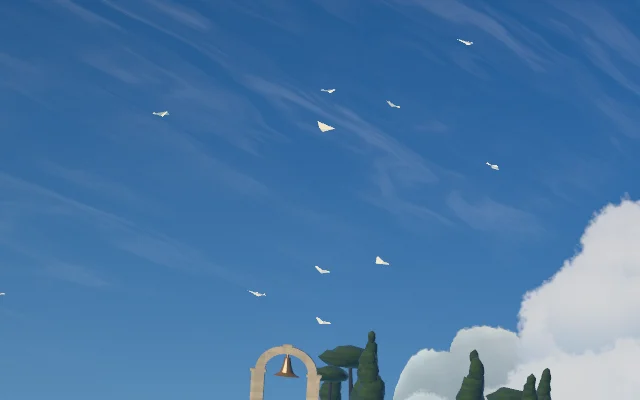
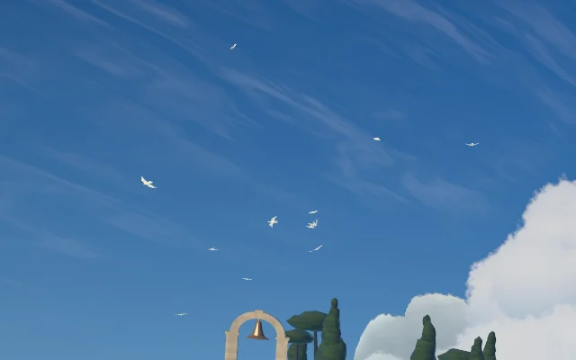
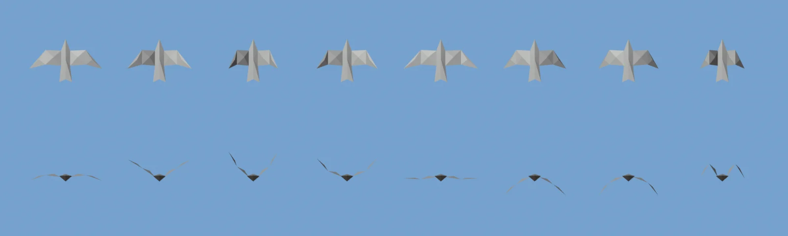
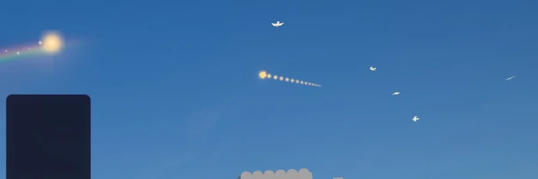
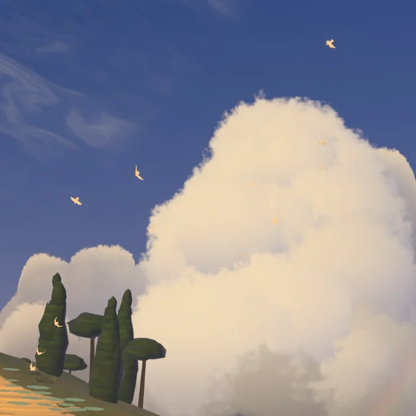

# Rainbow Terraces: the paper birds (2026-10)

**2026-10-25/26 — a record.** The owner: "In rainbow terraces theme, is there any ways we can improve
the birds flying around? we have access to Blender MCP if needed for design and animation", then
"Do what you recommend next!" The recommendation was two steps: fix the flight, then give the
gliders flapping paper wings, designed in Blender. Both are done.

| Before | After |
| --- | --- |
|  |  |

## What held them back

- **A stiff dart.** Each glider was six triangles of white paper with no moving part. At 300–420 m
  it read as a drifting white triangle, not as something alive.
- **Turntable flight.** Each one flew a perfect circle at a constant speed and lean, forever, round
  one of five fixed points. Gliders sharing a thermal circled both ways. None ever left. The lean
  also pointed the wrong way: the lift tilted out of the turn.
- **One size.** At that distance a 1 m glider is a few pixels, so a 12-pixel minimum drew every
  glider at exactly 12 pixels. Nothing read as nearer or further.
- **Jumps.** A glider called to an event (painting a stroke of the bow, the T-spin helix, the
  level-up flight, the long-wing) left its circle in one frame and appeared at the event, then
  jumped back afterwards. When the hour sent gliders home they vanished in one frame.

## What changed

**The flight** (`rainbow-terraces-flock.js`, still closed form: any frame is a function of the
flight clock and the event times, so seeking reproduces it).

- Each thermal belongs to a flock: three over the Spring Isle and two over the Far Gate (the plan's
  fourth number per thermal). A glider soars only between the thermals of its own flock.
- Each thermal wanders slowly on the wind. Everyone in it circles the same way, quicker downwind
  and slower into the wind.
- Each glider has legs of 38–70 s. It climbs while it circles. When its next leg is another
  thermal, it leaves on a sinking 11–17 s glide that leaves and joins the two circles on their own
  headings, pushing off with a few wingbeats.
- The lean is a coordinated turn: the heading's turn rate times the ground speed, averaged as an
  angle over the last half second. It leans into its circles, rolls level on the glide, and a hard
  reversal rolls through level instead of flipping.
- Events join and leave on a settling offset. A glider flies the event's own path, offset at first
  by where it was, how it was moving and how it was turning; the offset dies out over the join on
  a quintic with no acceleration at either end. Going home is the mirror of that. Position,
  velocity and turn stay continuous at both ends.
- Each event draws on the flock nearest it. A join lasts as long as its distance needs at about a
  stoop's speed (0.55–1.8 s), so the glider streaks across rather than jumping.
- **Painters.** The world records each stroke's start, end and end progress on the flight clock
  (`paintFrom` / `paintTo` / `paintEnd`, passed in `bowInfo`). A painter dives in with folded
  wings, glides the stroke, and flies on and home beating its wings, its colour and trail fading.
  A stroke laid before its painter arrives still gets the dive to its end, then the flight home.
- **Long-wing.** It now has times (`setLongWing(on, at)`), so it flies to its station and home.
- **Leaving with the hour.** When the hour's `aloft` share sends gliders home, the last one climbs
  away and shrinks (`presence`) instead of vanishing.

**The bird** (`rainbow-terraces-gliders.js`), designed in Blender:

- The bird is 30 flat facets: a creased body with a pointed head and a notched fan of a tail, and
  on each side a broad inner wing and a swept, pointed hand. Its span is about twice its length.
  It was checked from above, from below behind (the game's view) and at 14 px, where it still
  reads as a bird.
- The wing hinges at the shoulder and the hand at the wrist. Both hinges run nose to tail, along
  the creases, and every facet belongs to one part, so the vertex stage beats the wings by turning
  each part about its hinge. No skinning and no texture; `beatPoint` is its CPU twin for the tests.
- The flock sends the two angles per bird in the instance buffer, now 16 floats (`aWing`: shoulder,
  wrist, presence).
- A beat swings the shoulder ±0.62 rad with the wrist lagging 0.95 rad behind, at 2.7–3.6 beats a
  second. When the bird glides, its wings stay a little raised and flex in gusts.
- The dive tuck raises the wings in a steep V and folds the hands down: a compact dart from below.
- **Size by distance.** The pixel floor is `clamp(4800 / distance, 10.5, 18)` px instead of a flat
  12, so the flock over the gate reads smaller than the one over the isle. Birds beyond ~300 m take
  up to 22 % of the air's colour.

## Cost

- **Draws:** still one instanced draw (the theme's 15 draws are unchanged).
- **Triangles:** 30 a bird instead of 6, at most 26 birds: 780 triangles at Extreme, far inside
  the budgets.
- **Vertex stage:** two more `sin`/`cos` pairs and a few `mix`es.
- **CPU:** the flock costs about 0.04 ms a frame at rest and about 0.1 ms with events running (18
  gliders, Node). No GPU timing: the laptop's GPUs are shared with other sessions.

## Verification

- **Tests.** `rainbow-terraces-flock.test.js` was rewritten for the new flight:
  - soaring stays within the glider's own flock and the lean points into the turn;
  - every event joins and flies home with no frame-to-frame step over 2° of view and no lean step
    over 0.35 rad;
  - the dive tuck, the presence fade, the long-wing times, and determinism.

  The new `rainbow-terraces-gliders.test.js` covers the bird: its folds stay joined at any beat,
  it is symmetric, has bird proportions, and the instance layout is right. All 18 Rainbow
  Terraces test files pass.
- **A Node probe** flew 140 s of back-to-back events (chains, a 12-stroke burst, a T-spin, a level
  up, a back-to-back, the hour sending birds home). It found no jumps. The fastest motion is the
  brush itself during a burst and the T-spin's own designed rise. It found two lean steps over
  0.35 rad, down from about a hundred before the settling offsets.
- **Playground captures (WebGPU, RTX):**
  - at rest at the Jade, Rose and Moonbow hours;
  - a motion strip over 4 s;
  - zoomed lenses on the flock;
  - a chain at 0.35, 0.9 and 2.5 s after the link (dive, ride, home);
  - a T-spin;
  - a level up, with 0.08 s steps showing the wingbeat.

  The console was clean (no WebGPU validation errors).

## Notes

- During a burst of strokes (the dial running ahead at up to 15 strokes a second), the brush and
  the painter riding it move as fast as the dial; that speed is the dial's, not the flock's.
- The Blender scene (`PaperBird`) was a design aid only. The facets' points live in
  `birdFacets()`, and a change to the bird is made there; the tests keep the hinges honest.
