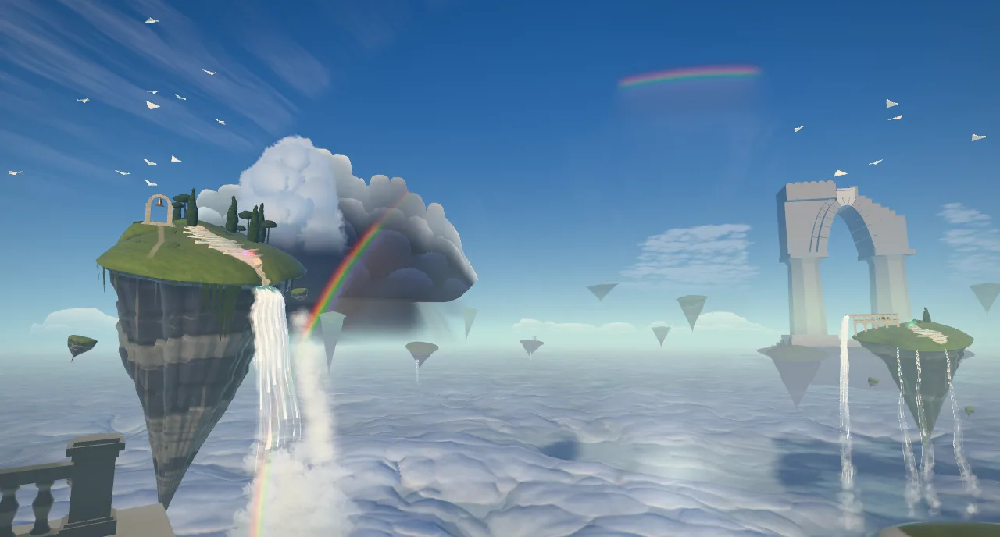
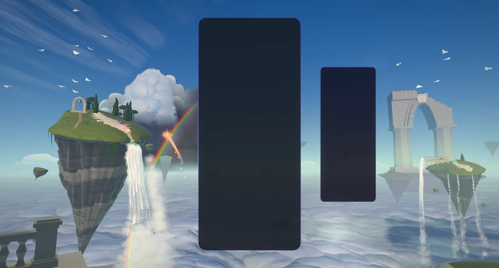
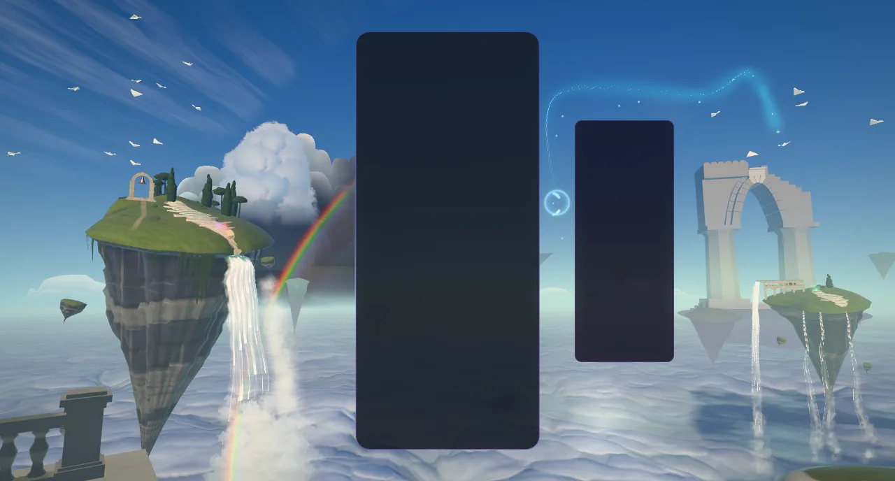
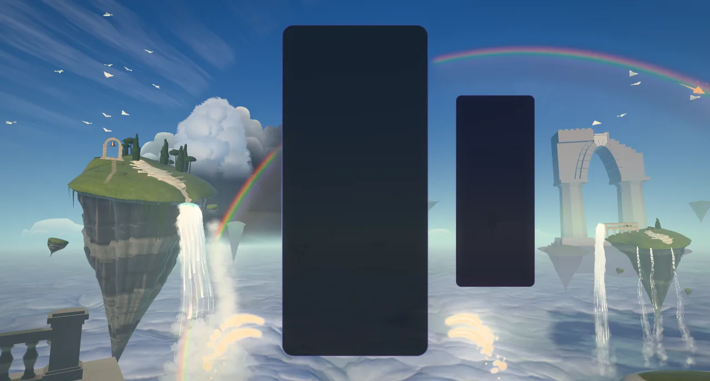
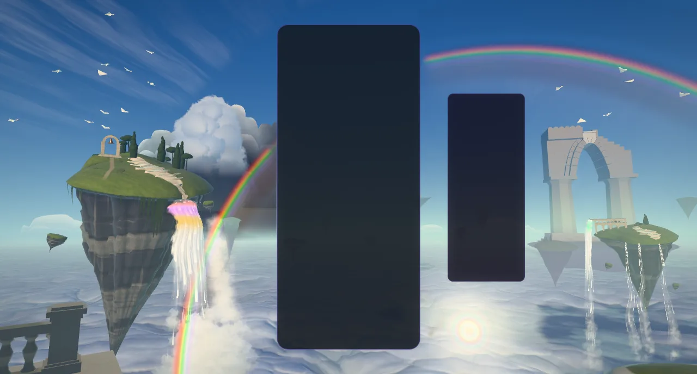
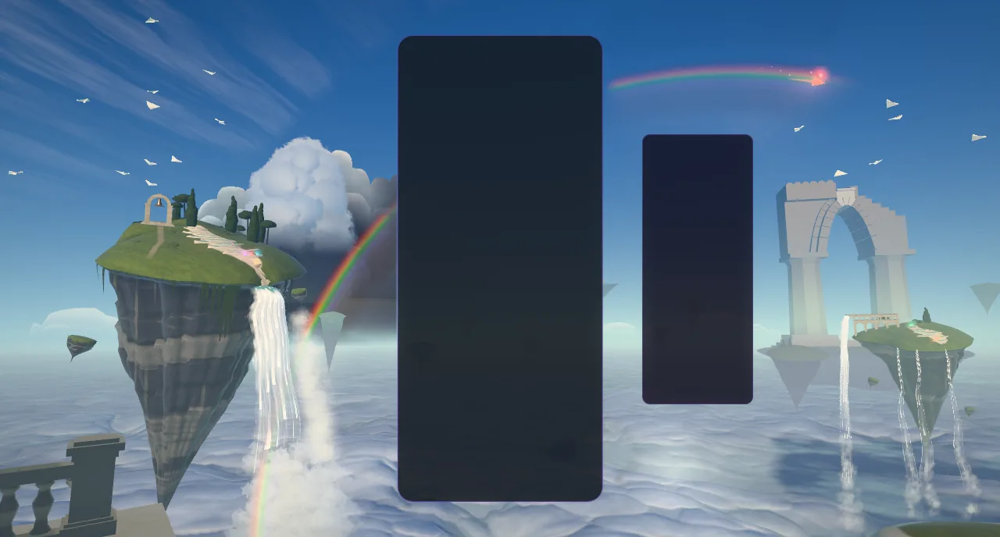
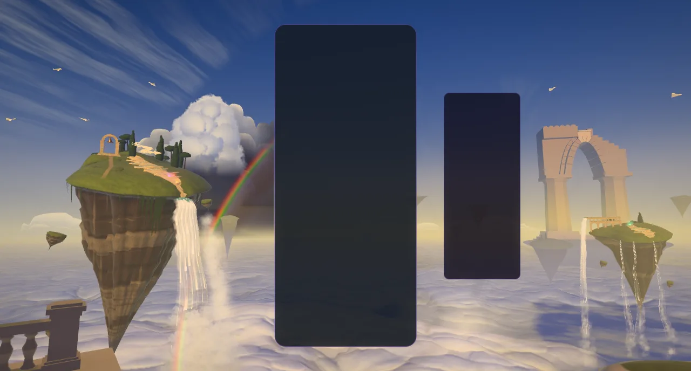
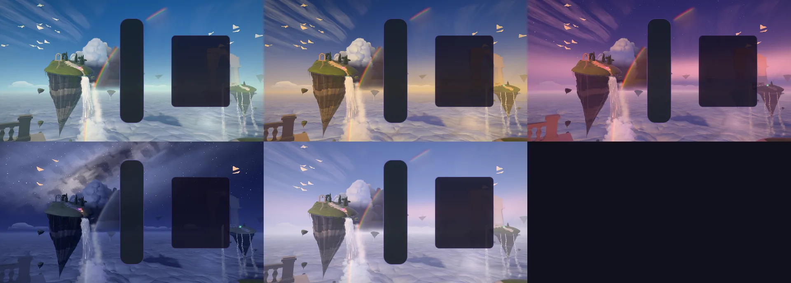
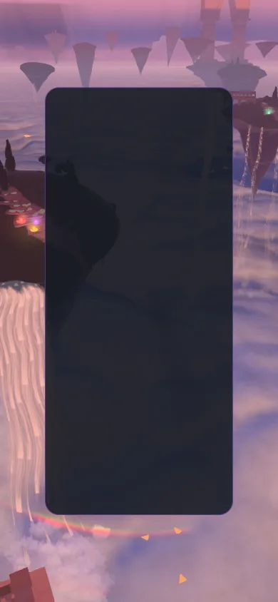

# Rainbow Terraces: the high country with the sun behind you

> **Renamed 2026-10-18.** This theme was called Sky Children (with the working subtitle
> "Irisfall") until 2026-10-18. Both names belong to other games, so it became **Rainbow Terraces**
> (id `rainbow-terraces`, Odyssey orb 34 "Where Color Falls"); the old ids `sky-children` and
> `sky-children-v2` resolve to it for old saves.

Implemented 2026-10-11/12 on `ccr-10c88c36-tbdwqd`, with Three.js 0.186.1 (`WebGPURenderer`, TSL,
the WebGL2 backend as the fallback). A from-scratch rebuild in `src/themes/rainbow-terraces/`
(registry id `rainbow-terraces`): it replaces the V2 module (the valley terrain, floating islands and
cloud sea, the MoodDirector, the compute/MRT post, the Poly Haven detail maps and the `skyV2*` URL
flags). Nothing is loaded from disk: every mesh is grown in code and every texture (the noise
fields, the spray puff, the droplet-optics table) is baked on the CPU at build time. This document
records the shipped design and what was verified. It is a reference, not a backlog.

## The picture

The eye stands on an overlook at the edge of the high country with the sun low **behind** it.
Ahead is the other half of the sky: cobalt overhead, a pale haze on the far horizon, banks of
cumulus lit full-face by the sun at your back, and a slate shower standing behind the Spring Isle.
There is no ground. Below the horizon lies the Deep: a wall of luminous mist that swallows the
isles' roots, falling away to blue-violet dark, with ragged mist shelves kilometres down and the
isles' shadows lying across them as wedges that converge on the antisolar point.

Left of the card, high, the **Spring Isle**: an upturned mountain with a crown of moss, a stand of
trees and a bronze bell in its arch, and a cascade of white travertine terraces holding jade pools
that runs on a diagonal down its front to the right shoulder, where the **Mother Fall** pours off
the lowest lip, frays into horsetails and mist, and drops the whole height of the frame into the
Deep. Right of the HUD, lower and further, the **Twin Isle** with the broken span of its aqueduct
and its threads of falls. Far off on the right horizon a colossal arch, the **Far Gate**, only a few
shades off the air. Paper gliders (the gliders) circle on thermals.

Every optic the droplets make is there, seen away from the sun: the rainbow, its secondary,
Alexander's dark band between them, supernumerary fringes, the white fogbow on the mist, the
opposition glow at the antisolar point and, when the board earns it, the **glory**.

## The one idea

> **The board is the spring of the high country. Each piece pours its colour into a terraced pool,
> each clear lets the pools fall down the white falls, and while the chain holds, the gliders
> paint the rainbow, one stroke per link, until from this height it closes into a full circle.**

The sun stands behind the eye, so the whole frame is composed round the antisolar point A, which
the frame solver places from the live layout: the bow is a circle of radius R1 round A, its leg
standing in the free zone left of the card and plunging through the Mother Fall's spray into the
Deep. Every optic reads ONE table baked on the CPU (`bakeOpticsLut`): Airy theory across 16
wavelengths (400–700 nm, the CIE observer turned into linear sRGB), summed over a spread of drop
sizes and smeared by the sun's disc; six rows — the primary, the secondary, the fogbow, the glory
with the opposition glow, the primary in the low sun's reddened light (the sunset bow), and the
primary of smaller, matched drops (its supernumeraries).

## Event language

| Gameplay | What the high country does |
|---|---|
| Lock | A light-copy of the piece appears at the card's edge on its side, at its rows, white-hot at the heart of each cell under one soft halo of its colour, inside a ring of its light running out with drops of its light-water (and a few glints) thrown off it; it melts into beads and springs out as a **ribbon of light-water** (one smooth hot core in an even halo, a teardrop head with a glint, drops let go of its tail falling away) that arcs to the pool on that side nearest its height. Beside the HUD it goes round it on one smooth curve and its sparks keep off it. It lands with a crown of drops and glints, a slim pillar of its colour standing up out of the pool and a ring across the water; the pool **holds** the colour (18 s, then fading) and glows as a jewel on the terraces, a soft halo round a hot heart, breathing. |
| Hard drop | No melt: the light fires at once as a jet (0.2 s) toward a pool below the row, a bigger ring and twice the sparks, the eye dips. A drop of 12 rows or more bursts the Mother Fall's spray. |
| Line clear | Each cleared row's light **pours off both sides of the card**: a stream leaping out of the edge like a fountain's jet (it rises before it falls, so even the bottom rows are seen), fraying into drops past its crest and falling into the Deep (straight down the card–HUD gap beside the HUD). One surge runs down every fall per line in the hour's accent; the oldest held colours (3 per line) run down the terraces and ride down the white falls as coloured bands. Two lines bank the gliders and run the broken span; three raise a tower of spray with a bow standing in it. |
| Four lines | **The hush** (0.33 s): the falls thin to threads, the spray hangs, the gliders stop dead. Then the light behind you flares, the opposition glow blooms, the shadow wedges deepen and the **glory** opens round the antisolar point, one ring per line; the **great pour** sends every held colour down the Mother Fall at once as stripes, and the light **draws the bow**: it kindles at the leg's foot in the falls' spray and runs round the primary both ways, up over the crest and down into the Deep, a white thread opening into the spectrum behind it; whole after 2.4 s, it swells, holds, and fades away (never switched on or off in a frame). |
| Perfect clear | The same with eight rings, and the Far Gate's spillway runs for the only time. |
| T-spin | The falls are wrung (a half-turn travelling down every sheet at water speed), two gliders rise in a double helix, the bell swings. |
| Back-to-back | The clear releases only half its count; the long-wing glider keeps station on the bow. A plain clear ends it. |
| Combo | The gliders paint the bow, one stroke per link (7 primary strokes cut along the visible arc in reading-order groups 2 / 3 / 2: leg up, crest, leg down through the Deep; then 5 on the secondary, 3 / 2). Supernumeraries from 3, Alexander's band from 3 (deeper from 7), the bow burning brighter from 7, a band of light running round both bows from 10, faster at the cap. Each stroke is laid by a comet of its link's colour on the bow as a thread of white light that opens into its colours behind the brush, glitters as it is laid, and each bow, as it closes (7, 13), is swept end to end by a run of light. A break withdraws the strokes newest-first. |
| Level up | The bell tolls the hour: a gold pulse at the bell, rings of light sweeping out across the cloud sea from under the Spring Isle, every pool ringing, a flight of gliders launching; the light turns one hour round the wheel over 3.6 s. |
| The clock | The light walks round the wheel by itself (110 s an hour, resting 15 % at each end), in every mode. |

### The hours

Five hours on a wheel: **Jade Morning** (cobalt and aqua), **Gilded Afternoon** (a gold haze and
gold-lit cloud over a blue zenith), **Rose Hour** (the Belt of Venus over the Earth's shadow, the
cloud banks lit rose), **Moonbow Night** (sparse stars, the Milky Way, a pale moonbow, the grotto
behind the Mother Fall breathing warm light), **Pearl Dawn** (opal). Every colour is a row of one
`uniformArray` and every number a uniform, so the wheel never rebuilds a shader.

## The frame

`rainbow-terraces-frame.js` (three-free) solves the camera and the bow from the live layout rects:
one lens up to a 100° horizontal field, then Hor+; the **leg plan** in landscape (A low right of
the HUD, R1 in [38°, 46°] so the leg's foot lands in the free zone left of the card, the crest
inside the top edge), and the **smile plan** on a phone or beside a row of boards (A under the
cards, the bow hanging under them as a smile), taken whenever the leg cannot clear the cards.
`rainbow-terraces-plan.js` places every set piece from screen anchors through the solved camera, so
the composition holds in every layout. The post stack keeps calm zones over the card and the HUD.

## How it is built

| Module | What it holds |
|---|---|
| `rainbow-terraces-core.js` | Three-free numbers: colour (OKLab/OKLCh), falls' ballistics, the spectral droplet-optics bake, the noise bakes. |
| `rainbow-terraces-hours.js` | The five hours and the wheel. |
| `rainbow-terraces-frame.js`, `rainbow-terraces-plan.js` | The frame solver (camera, A, the bows, the strokes) and the placement of the realm. |
| `rainbow-terraces-tsl.js` | The sky as one function of a direction: the air, cumulus banks, the shower, the Deep with its shelves and wedges, the optics (strokes, bows, fogbow, glory, the toll's rings). Loops over strokes and casters are real shader loops (the dome's fragment is about 55 KB of WGSL at High, under its 64 KB gate); the spray runs the stroke loops once per corner of a puff, not per pixel. |
| `rainbow-terraces-isles.js` | All the stone, grown in code: the body (crown, asymmetric outline, root with strata, drip grooves and pinnacles), the terrace cascade, crags, trees, ruins; one stone material (key from behind, cool fill, moss, travertine, iron-stone, bronze, air). |
| `rainbow-terraces-water.js` | The pools: one instanced draw; a Fresnel mirror of the sky, a milky body, the held colour glowing from within. |
| `rainbow-terraces-falls.js` | Every fall in one draw: ballistic ribbons, rope streaks in travel time, fraying into horsetails and mist, coloured packets. |
| `rainbow-terraces-fx.js`, `rainbow-terraces-events.js` | The glow layer (glow, disc, cell, glint, streak, ring, soft shapes) and the spray; the event records evaluated in closed form each frame. |
| `rainbow-terraces-flock.js`, `rainbow-terraces-gliders.js` | The children: a closed-form flock and paper darts drawn instanced. |
| `rainbow-terraces-world.js` | The choreography, shared by the theme and the playground effect. |
| `rainbow-terraces-post.js` | Bloom with calm zones over the card and HUD, a hue-preserving filmic, split-tone grade, grain, dither, FXAA. |
| `rainbow-terraces-director.js`, `rainbow-terraces-composition.js`, `rainbow-terraces-quality.js`, `rainbow-terraces-theme.js` | The gameplay director (per-player chains), the layout reader, the tiers, the lifecycle adapter. |

Everything is a function of the world clock and event timestamps; the clocks whose rate changes
(water, spray, flight, mist) are integrated, so `seek(t)` plus a fixed-step replay reproduces any
frame.

## Lifecycle and safety

- **Flashes are governed** (WCAG 2.3.1): every flare the world raises asks the flash governor first,
  so at most three flash onsets reach the screen in any second, however many boards clear at once.
- **The run outlives its runtime.** The clock, the level and the run's turn of the wheel of hours
  are carried over a rebuild in place (a quality change on screen, a lost WebGPU device) and over
  the restarts that replace a runtime of the same sitting: a tier chosen behind the menu (resume()
  hands the theme back to the manager for one full restart under its loading mask, never a resume
  followed by a rebuild) and a restored WebGL2 context. Only a real stop forgets them. A tier saved
  while a build is under way is built next.

## The second pass: an audit, and nothing left floating (2026-10-12)

The first build was put to a visual audit: seven critics (the isles, the waterfall, the clouds, the
rainbow, the gate and the far field, composition, atmosphere) scored it against the repo's most
loved themes, a skeptic per dimension tried to refute every finding (a few were, many were
amended), and an art director wrote one brief and a file-partitioned plan from what survived. Four
packages were then built in parallel, each reviewed by a code reviewer and an art reviewer and
fixed, and merged: the isles, the gate and the composition; the sky and the clouds; the falls and
the spray; the bow and the optics.

**The isles and the gates.**
- The isles are mountains turned over, not carrots: a convex crown with knolls under a rounded turf
  lip that overhangs a set-back cap rock, a cliff of seeded beds (hard caps standing out over undercut
  soft beds, buttresses, ravines), and a root that hangs as fused lobes with saddles between them,
  ending well above the sea with air under it. They are larger than in the first build (the Spring
  Isle's radius 72 m, about 140 m across its crown; the Twin's 46 m), so their works stand well
  inside their rims.
- One stone material without seams: the stone kinds never interpolate (the crown is the iron's kind
  with a continuous crown weight beside it), bedded iron and lime, white drips, a meadow on the crown
  (dry drifts, lush hollows, tussock grain) and a worn ochre path from the rim past the gateway to the
  spring, the lip's cast shadow on the cliff under it, a cool sky rim on the shade side, the Deep's
  bounce under every overhang, a per-hour albedo saturation (the moss goes grey by moonlight).
- The cascade is rimstone terraces: crescent dams across the flow, each pool brimming over the turf
  its dam's middle stands on, its curtain falling to the slope below, the terraces gathering into the
  spillway notch cut in the right shoulder, from which the Mother Fall leaves (the cliff under it runs
  dark and wet). A terrace's pools spread over the stretch of its crest that holds water.
- Rocks adrift beside and under the isles, faceted outcrops bedded in the crown, moss curtains (not
  sticks) hanging from the lip, cypress and pine groves with each tree on its own ground.
- Masonry is laid in ashlar (courses sized to stay a few pixels tall at each piece's distance), a mid
  value so the travertine and the falls stay whiter; bronze carries verdigris in streaks.
- The gateway stands on a terrace the builders levelled into its knoll, its footing sunk into it; the
  bell hangs from the keystone by its stem.
- The Twin Isle grows a promontory carrying a two-tier aqueduct along its axis, each bay a wall
  pierced by its arch, every pier sunk below the lowest turf under it; its broken end lets the span's
  water go.
- The Far Gate is a colossal ruin in three planes (turned off square so a pier's reveal and the
  soffit take the key, its right shoulder sheared away, a scalloped attic, a notch at its centre with
  a travertine drape under the weir, fallen blocks bedded in the mesa's turf in front of it), veiled
  by the sky behind it a few shades darker.
- The far archipelago floats at many heights in three bands, each isle leaning its crown toward the
  eye with its own build (squat or tall, tilted), with height-dependent air.
- The overlook's parapet frames the bottom corners (two small coulisses on a phone).

**The sky.** A storm wall of billows behind the cumulus tower, with the storm's dark under the bow;
an anticrepuscular fan of rays converging on the antisolar point and laid on the cloud sea; a
composed altocumulus deck; cirrus; far banks as round-headed low cloud walls along the horizon; one
wind and one cloud light shared by every layer; a grained Milky Way.

**The falls.** The Mother Fall pours as a curtain that breaks into streamers, with a billowing, lit
plume where the frame cuts it (the tower of spray stands a third of the frame on a three-line
clear, governed by the flash budget); the Twin's falls fray into horsetails; thin falls end in a
breath of spray; the grotto behind the Mother Fall glimmers through her water at night; far water
takes the far stone's air; the Far Gate's spillway hangs as a curtain.

**The bow.** A pale rest bow standing in the rain (its leg's rain going on below the horizon), one
band mask for the whole bow with its ends fanning out on the bright side, brush-stroke ends, quieter
supernumeraries, the fogbow a few L* lift of the far mist, a brighter glory, and a fast, continuous
frame search (rows of boards smile; room kept for the glory and the Far Gate). The strokes are cut
round the isle, its tower and the parapet where they stand in front of the bow.

**Nothing left floating.** The owner, looking at a close-up, saw the arches standing on air. Every
work now stands on the crown exactly as `buildMassif` lays it (`crownHeight`: the outline's stretch,
the promontory, the dome and knolls, the turf's lumps, the spillway's notch, the levelled pads), its
footing sunk deep enough for the coarsest tier's facets. Two adversarial grounding audits followed
(inspectors per structure ray-casting the built meshes on every tier, a skeptic per finding), and
what they confirmed is fixed and pinned by tests: piers that overhung the gateway's top course, a
bell hanging free, open joints; dams wound face-down (only their pools showed, as decals), the
lowest terraces hanging metres over the rim, pools overlapping by two thirds; boulders resting on a
point with air under them; open spandrels under the aqueduct's courses; the Far Gate's 5 m attic
slab over a void, a notch that did not exist, fallen blocks inside a pier and over air; summit caps,
the mesa's pinnacles, the bell and the aqueduct's stub wound inside out. A test now checks that
every closed piece of every stone builder is wound one way, outward.

## The third pass: on a real GPU (2026-10-12)

The first two passes were judged on SwiftShader's WebGL2. This pass rendered the theme on the dev
machine's RTX 3070 (WebGPU, and WebGL2 for the fallback) for the first time, took a baseline of the
round-3 frame set, and worked down the round-3 critique
([the handover's appendix](rainbow-terraces-handover/CRITIQUE_ROUND3.md)) by visual impact, each change
judged on before/after captures and pixel probes (finding ids in brackets).

**The antisolar point and the cloud sea** (clouds-1, bow-1, atmosphere-antisolar-dark, clouds-4,
clouds-6).
- The deck closes round A (no hole within about nine degrees), the isles' wedges dissolve into its
  glow over its last seven degrees (through the quad too, where they smudged the rings), and the
  opposition effect brightens the cloud tops round it. At A the sea went from a dark lane to the
  brightest patch of the lower half: L* 59 → 73 at Jade, 46 → 57 at Rose, 27 → 37 at Night.
- A hole's rim thins into exactly the dome's mist, so the two sides of its edge match; holes are
  rarer (the threshold 0.14 → 0.1) and their depth falls to a blue, never a navy pond.
- The cloud heads meet in rounded saddles (a polynomial smooth maximum in the bake, narrowing to
  nothing at a cap's rim), the creases and the fine relief fade where a pixel spans more than a
  texel or two, and the valleys hold a little of the mist's glow: the middle distance no longer
  hatches like crumpled foil. On the sea the rays are broad bands, never hairlines.

**The glory** reads as a glory, not a target: the cloud drops' size spread 0.07 → 0.1 and the outer
rings' lift 0.75 → 0.45 give a white heart, one coloured ring and a fainter second.

**The overlook** (composition-2, gates-6, atmosphere-parapet-black). The left is a dressed newel
(base, collar, stepped cap) and a close-set balustrade (15 balusters at 0.46 m under a moulded
handrail) running in from the frame's edge; the right is no masonry at all, only the overlook's own
mossy travertine outcrop. Every face turned up to the sky catches the low sun, and the shade takes a
warm bounce, the bright sky behind the eye and a per-hour lift (the `coulisse` row), so the corners
read as weathered stone a clear step above the card (the newel L* 30 at Jade against the card's 17),
never navy or black. The gateway's two upright column stubs are gone.

**The falls and the spray.** The Mother's plume sits lower and smaller, its billows lit against
their own light (falls-plume, the skeptic's amended fix), so her streamers run most of the drop.
The Twin's thread feet are breaths of spray that sink, soft and never darker than the air, not
stacks of cotton balls (falls-thread-feet). At night the grotto's sprites no longer sit on the face
of the curtain; her own glimmer through the water is brighter instead.

**The far field and the Far Gate** (atmosphere-far-ghosts, gates-1, gates-3, gates-4, gates-5,
composition-3).
- Far stone below the horizon veils toward the cloud sea's own far tone (`seaTone`), never brighter
  than what lies behind it, and keeps a trace of its own value, so the archipelago's bands stack.
- The Far Gate's mist is measured from its own mesa (`grounded`), so its plinth and the mesa's crown
  read while the cliff below melts into the Deep. The gate is not moved: lifting its mesa (gates-1)
  is an owner decision.
- Its piers are faceted (three or four bands of value each) on a square base under a flared capital;
  its broken shoulder steps down in ragged courses behind a real lip to the weir's notch.
- The Twin Isle stands further right and higher (x 0.915, y −5 m): its aqueduct crosses the gate's
  right pier as an arcade in front of the colossus, never framed in its opening.

**The sky** (clouds-2, clouds-3, composition-4, bow-2).
- The storm wall's upper body stands in the sun (a lit crown grading into the slate over its own
  billows); its ends round over into a base that curls up under them (never a mesa, never a
  corner); the tower's flank toward the wall darkens across its billows, so there is no seam.
- The altocumulus lies as a low drift, and is not drawn at all where the free sky right of the
  board is narrower than about a tenth of the frame: the lone sticker cell is gone.
- Under a painted bow the drops dim the sky behind them, so over blue sky its outer edge reads red
  and orange, never pink on blue (scaled by the bow's saturation: the moonbow gains no dark rim).

**The isles** (isles-1, isles-2, isles-4).
- A travertine apron follows the cascade's flow line from the spring to the Mother Fall's lip: one
  cream ribbon the dams stand in, wet and ochre in patches. The terraces step from side to side of
  the line, and the meadow's dry and lush drifts are at the crown's own scale.
- The root's lobes are fused by a smooth maximum with every lobe kept round the spine (no flat web
  where a lobe's disc used to leave a bearing); the Spring Isle has lobes on its silhouette's bearings
  and its spine leans back-left, so its deepest point hangs a quarter of its radius off the axis.

**The hours** (atmosphere-hours-one-light, atmosphere-no-glow).
- Each hour shades the forms with its own key, swung and nudged off straight behind the eye
  (`keySwing`, `keyNudge`); the bows and the wedges keep the true antisolar geometry.
- At Rose and Pearl the Earth's shadow climbs the stone (`term`, `termRise`, `termY`): the crowns
  and the gate's attic burn in an alpenglow above its terminator, the cliffs below take a dusk glow
  from the sky behind the eye, and the falls take a third of it (they stay the brightest whites).
- A per-hour `glow` opens the bloom's knee and lifts its glare (Gilded most); `cloudGain` lets the
  tower's crown alone run into it.

**The events.**
- Lock: the copy's cells are crisp under one halo; the shock throws drops of light-water, not
  four-point stars; the thread is one smooth line (each streak reaches two beads on, and the halo,
  on every bead, is sized by the gap seen across the view, so it never swells toward the pool); drops
  let go of its tail and visibly fall; the landing throws a crown of drops; every held pool is a
  breathing jewel with a hot heart.
- Clear: each row's light leaps off the card's sides like a fountain's jet and frays into separate
  drops past its crest.
- Combo: the brush head is a comet of the link's colour on the bow where the glider paints, glints
  trailing it; each laid stroke glitters a moment, its points drifting down off the bow; when a bow
  closes a run of light sweeps along it end to end, and the sky flares (governed).

**The gliders** fly as two flocks, over the Spring Isle's crown and in the sky over the gate, and
fewer are aloft (High 28 → 18): never confetti over every free patch of sky.

**Verified:** the round-3 frame set on the RTX before and after, on WebGPU and on WebGL2 (consoles
clean, no validation errors); the real game on both backends (keyboard hard drops, clears, a chain,
a level-up, a quad, a game over and a new run, a live tier change, leaving the theme: no error, no
dropped events, about 130 frames a second on the RTX by rAF count, not a perf-lane reading); a
clock-only strip in the real game (the place 0.146 → 0.299 → 0.453 → 0.606 at 16.8 s steps: 1/110
of an hour a second, as designed); the theme's 15 test files and the repository's gates.

## The drawn bow (2026-10-18)

The owner: "the rainbow just pops, it must be drawn in the most beautiful way when it appears", and
"we do not have to cut the rainbow behind the game canvas, we can make it full".

- **The great pour no longer flashes the primary.** Before, a four-line clear set every primary
  stroke whole and 40 % over-bright in one frame at the pour, and took it all away again in one frame
  5 s later. Now the light kindles at the bow's foot (where the leg climbing and the leg plunging
  start together; a smile's left end), a soft swell there, and runs round the primary both ways as a
  white-gold comet with trailing glints, eased in over 0.7 s, whole 2.4 s after the pour. Each
  stroke it lays glitters in the light's colour, not a stale link's. Whole, the bow swells to 1.3 over
  0.9 s, holds, and from 6.5 s fades over 2.8 s, withdrawing to what the chain had painted. The dial
  it lends the optics (supernumeraries, Alexander's band) comes in as it is drawn and goes as it
  fades. A clear while the bow still stands keeps it: it rises back from now if it had begun to fade
  and holds through the new pour (`REVEAL`, `revealNow()` in the world).
- **Every stroke is drawn as light first.** Behind a moving end (the chain's brush, the pour's light,
  a withdrawal) the band is a thread at its heart (41.65° on the table's primary scale, where the
  baked band peaks; 51.6° on the secondary), all but white and a little hotter, opening across into
  the whole band, its colours and the glow inside as the brush moves on. The fresh reach is the end's
  travel over 0.2 s; it opens over 0.6 s once the end stops (`FRESH`; a fourth row per stroke in
  `U.strokes`, accumulated in `strokeMask` and handed on in the masks' second and fourth channels,
  which the spray, the cumulus and the falls already carry).
- **The bow is whole behind the cards and the HUD.** The card is translucent (the post soft-clips
  what shows through it), so a stroke cut at its edge showed as a gap in the bow through the board.
  The cut still gives every link a part of the bow the player sees; then `bridgeCalm` (frame.js)
  carries each end a card or the HUD hides on under it to the next stroke's end (the two join) or
  out of the frame. Set pieces and the frame edge still cut. The glow-layer sprites still keep off
  the cards (calm zones).
- **The name.** The same day the theme was renamed Rainbow Terraces (the note at the top): id,
  folder, files, classes, the `rainbowTerraces…` capture flags, song, icon, playground effect, tests
  and the Odyssey orb (shipped as orb 34, "Where Color Falls", chapter 5's rival duel, so its briefing opens with
  that name); the old ids and track key stay as aliases. In the comments and these docs the folded
  paper gliders are called gliders, no longer "children". The unloaded V2 module was deleted.

**Verified:** on the RTX (WebGPU), playground frames before and after: the four-line clear at
1.55-10.4 s (the light kindling, both fronts, the whole bow, the fade), a link painting and a chain
of three and seven, the Rose and Moonbow hours, a phone; the thread at 0.35 s and 0.2 s side by
side. The real game booted from a save naming `sky-children` and `SkyChildren` (healed on load to the
new id and key, the theme ran on WebGPU at High, no dropped events, a clean console) through a chain
and a four-line clear, the bow drawn on behind the real board. The theme's tests (new: the reveal
never changes the bow's light by more than 3 % of its height in a frame; the bow whole under the
card; fresh paint; the rename's migration), the full suite (only environmental reds: three
locale-formatted numbers, one symlink EPERM), the build with its boot-closure guard, the lint
ratchet, dependency-cruiser and the architecture fitness check.

## Tiers

Every tier keeps the whole picture and every event. Scene triangles as built (the world test's
census, instances at capacity): Minimal 48.5 k, Low 60.8 k, Medium 77.3 k, High 102.6 k, Ultra
131.7 k, Extreme 165.8 k, all inside their budgets (60 / 80 / 100 / 140 / 180 / 230 k); the same
15 draws on every tier. The sky dome's fragment stage is under its 64 KB gate (about 55 KB before
the third pass, which added a little to it); the shaders test enforces it.

## Verification

- **Playground** (`?effect=rainbow-terraces`): headless Chromium on SwiftShader through Playwright (the
  WebGL2 backend: this container has no GPU and its WebGPU adapter does not start). Several
  hundred frames over a dozen rounds, each round judged against the previous one, and two rounds
  of independent art critique (composition and value, colour and light, effects and motion), whose
  findings drove the isle rebuild, the Deep, the sky, the spectral bow and the event redesign.
  Consoles clean.
- **Real game** (`/?skipIntro=1&unlockAll=1&rainbowTerracesFixedDt=40`, the theme pinned through the
  settings manager, real keyboard hard drops): the theme ran on WebGL2 at Low, the locks filled
  pools, no warning or error from the theme.
- **Unit tests** (15 files, 348 tests): the core (the spectral table's physics), the hours, the
  flash governor, the pool ledger, the isles (every work, terrace, grove and outcrop against the
  crowns as built on every tier; every stone wound outward), the frame solver (lens, plans, stroke
  groups), the plan, the events, the flock, the shaders (every material through both node builders,
  the dome under its 64 KB gate), the world (built in Node and driven through the theme's calls),
  the theme adapter, the director and the composition. They found real faults the stills did not show, all fixed:
  strokes straddling the crest and the leg-down groups, the foot behind the left card with two
  boards, no right-hand pools at Minimal, back-to-back never ending on a plain clear, a long frame
  skipping the great pour, seek replaying the flock's flights, a thread crossing the stats bar,
  phone pools behind the card, the dome's WGSL over budget, every tier over its triangle budget.
- **Adversarial review**: four finders (logic, lifecycle, shaders, tests) read the whole diff and
  each finding was put to a skeptic. Sixteen were confirmed and all are fixed, each with a
  regression test where one could be written: NaN lamps after a game over, silent pools lighting up
  after their release, the long-wing that never landed, colour ribbons overwritten half-way down a
  fall, threads dropped from a full lock ring, the hour snapping on a rebuild after a new run, a new
  run spinning a whole day, meditation clicks ignored, a resume that forced a second restart, a tier
  lost during a build, a context loss resetting the run, parallax stuck after the pointer left, NaN
  vertices on dormant falls, a seam across the Milky Way, and an ungoverned flash.

- **Depth at 13 km**: the near plane is 2 m (`REST_RIG`; nothing the camera sees comes closer), so
  the depth buffer resolves about 5 m at the Far Gate (about 35 m with the 0.3 m it had before).
  Its walls are single solids laid on the voussoirs' chords (the z-fighting streaks the grounding
  audit found came from overlapping fills and are gone).

### Not verified, and what is open

The state at the end of the second pass, the third critique (scores, findings and skeptic
verdicts) and the planned fix packages are in the handover:
[RAINBOW_TERRACES_HANDOVER_2026-10.md](RAINBOW_TERRACES_HANDOVER_2026-10.md).

- The third pass rendered on the RTX (WebGPU and WebGL2) and in the real game at speed, but motion
  was still judged from stills (playground replays and the real game's frames) and from tests; no
  person has watched it move.
- No perf-lane reading: the real game's rAF count (about 130 a second on the RTX) is an observation,
  not a measurement, and the integrated GPU was not tried.
- The icon is my pick, re-rendered in the third pass from the playground's icon lens
  (`?effect=rainbow-terraces&t=30&quality=High&combo=7&held=6&hour=2&hud=0&icon=1&iconFov=34&iconYaw=0.42`,
  the Rose hour), over a Gilded and a Jade candidate from the same lens.
- Still open from the round-3 critique: the phone and multi-board layouts are an aerial survey
  (composition-1, the "crown plan", not built), the portrait crops the gate (gates-2), the front of
  the Spring Isle's crown is open lawn and its rim sits like a lid (isles-4 front planting, isles-3),
  the pools are circles (isles-1's elliptical pools), and the minor findings listed in the handover.
- `rainbow-terraces-ledger.js` (PoolLedger, StrokeBook, Dial) is a reference model that the world does
  not import: the world keeps its own pool choice, release and dial. Its tests pin the model, not
  the world. It should be wired in or removed.
- The old V2 folder (with `src/themes/shared/sky-core/`, the V2 textures, its playground effect
  and its two tests) was deleted with the rename (2026-10-18, the owner's call); its id stays an
  alias for old saves.

## Reproduce

Playground: `npm run dev:playground`, then `/playground.html?effect=rainbow-terraces&t=30&quality=High&board=1`
plus `event=lock|drop|clear|tspin|b2b|quad|perfect|levelUp|newRun|gameOver|break`, `eventAge=<s>`,
`lines=`, `row=`, `u=`, `color=<hex>`, `shape=`, `combo=<n>`, `held=<n>`, `hour=<place>` (0 Jade
Morning … 4 Pearl Dawn), `players=2|4`, `parts=sky,isles,...`, `noPost=1`, `values=1`, `hud=0`,
`icon=1` (+ `iconFov`, `iconYaw`, `iconPitch`), `P.<name>=<value>` for the look's numbers (the
full list, with `falseColor=1`, `seed`, `reduce`, `bloom`, `statsHud`, `level`, `locks`, `links`,
`trueBow`, `ripple`, `linkAge` and `px`/`py`, is the header of `src/playground/effects/rainbow-terraces.effect.js`;
`hour` takes fractions). Theme
flags: `rainbowTerracesTime`, `rainbowTerracesFixedDt`, `rainbowTerracesParts`, `rainbowTerracesFalseColor`,
`rainbowTerracesForceWebGL`.
