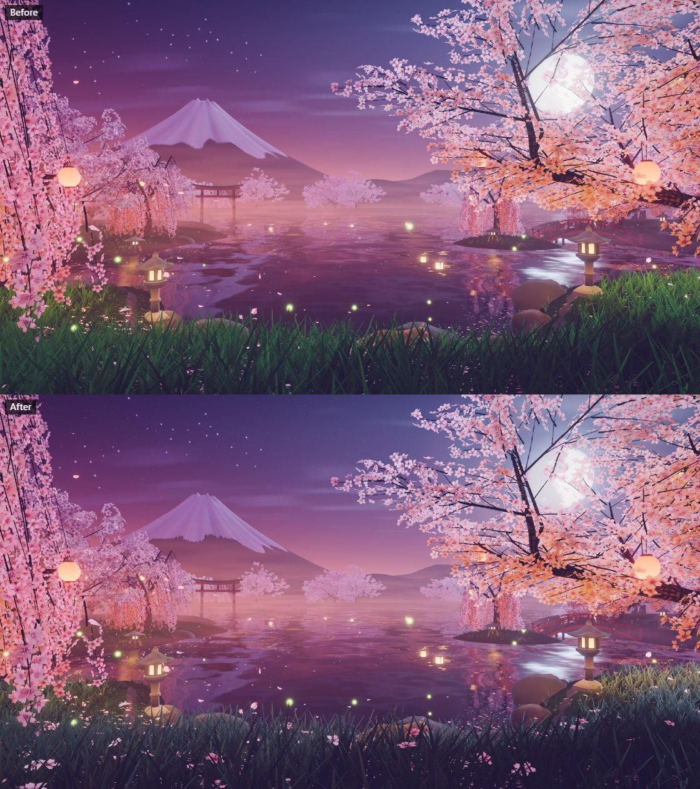
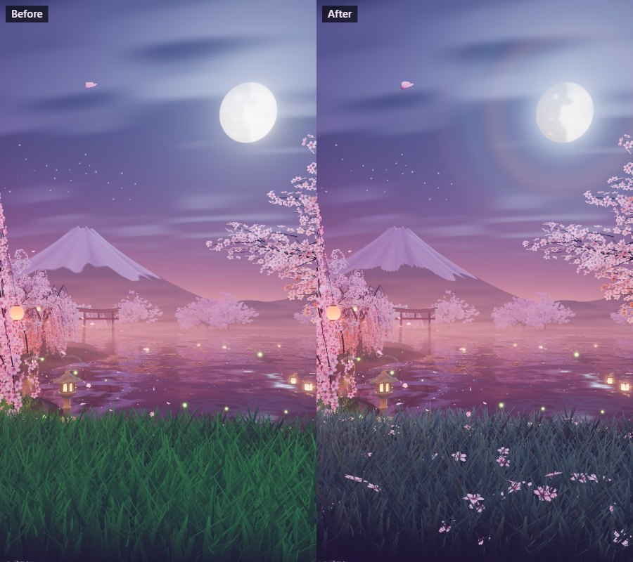
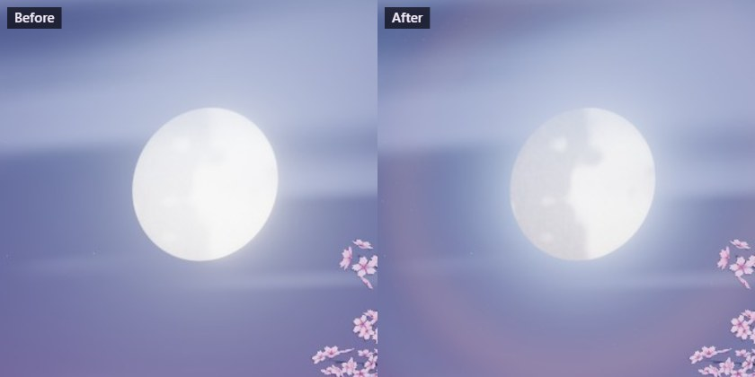
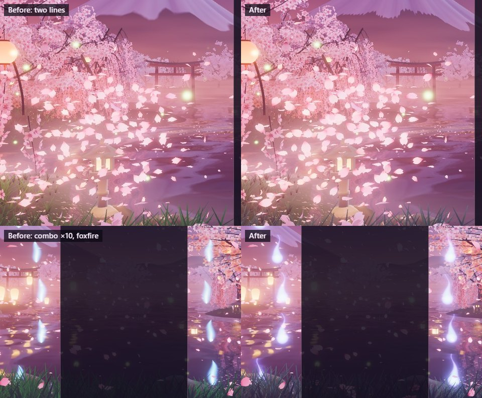
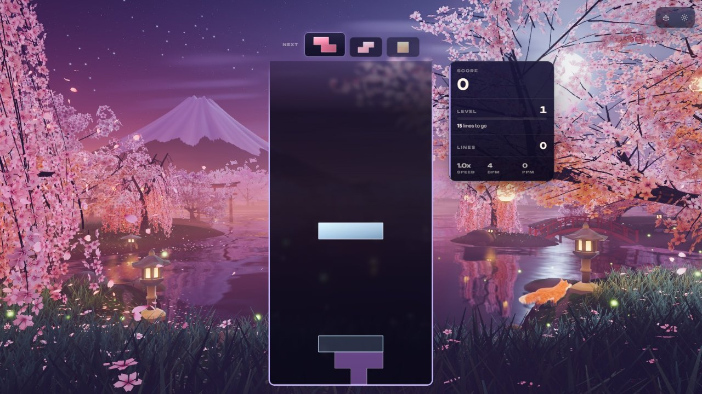

# Sakura Twilight — the atmosphere pass (2026-10-21)

Olov asked to "start improving the visuals, effects, atmosphere and graphics in the Sakura Twilight
theme". The theme had one overhaul behind it ([SAKURA_TWILIGHT_OVERHAUL_2026-10.md](SAKURA_TWILIGHT_OVERHAUL_2026-10.md)).
Captures of the idle garden, the gameplay events, the tiers and portrait found what held it back;
each change below was iterated in the playground against those captures (Electron on a private
dev server, RTX 5080 laptop, WebGPU; consoles clean throughout) and then checked in the real game.

## What held it back

- **The grass was daylight green.** The knoll's tufts ran from a saturated mid green at the tips
  to near black at the roots, one carpet across the bottom fifth of a landscape screen and the
  bottom two fifths of a phone. Under a violet night sky it was the one thing out of key.
- **Petals were kites.** The petal in the air is the pack's four-triangle petal; near the eye, in
  every gameplay burst, its straight edges read as pale diamonds.
- **The moon was a white coin.** Its disc was lit at 2.3 before the tone curve, so the seas the
  shader draws were lost in the shoulder, and only bloom said "moon".
- **The mountain's snow was smooth.** Snow came only from the vertex colours of a 168-sector cone:
  a soft, blobby line with no texture inside it.
- **Foxfire read as streaks.** The combo gauge's flames were narrow ellipses with a white core,
  drawn tall: at play distance, stretched blue-white dashes beside the board.
- **The sky had few stars of its own.** Most of the points on the landscape sky were the
  constellation figures' stars, which are always faintly there.

## What changed

**Night grass (`sakura-garden.js` `buildGrass`).** Blue-green in the open and olive where the noise
says the grass grows rank, in patches a few metres across, with the roots in the dark. The moon no
longer brightens the green: it silvers the tips it catches from behind (a cool sheen rising with
height up the blade). The nearest grass, under the knoll's lip, stands in shade, which frames the
garden the way the old green carpet did not; lantern light and the lock rings are added after the
shade, so they still carry.

**Fallen blossom (`sakura-garden.js` `buildFallenBlossom`).** Whole flowers (the pack's `flower`,
20 triangles) lie in the tops of the tufts within 24 m of the eye, face up at whatever slant they
caught, white going pink at the heart, lit like the petals in the air. They are placed from their
own seeded generator, so the garden's shared random sequence (and everything built after the grass)
is unchanged. One instanced draw, 6 % of the tier's tufts (High 600, Minimal 96), kept out of the
lake's mirror like the grass.

**Petals (`sakura-petals.js` `createSakuraPetalGeometry`).** The pack's petal is now the size
reference for a finer one built at load: six rows from claw to tip, three vertices a row, cupped
across its width and rolled back toward a notched tip (20 triangles, smooth normals). The shading
turns across the petal as it tumbles, and the colour is blushed at the claw and palest at the
margins of the blade.

**The hazy moon (`sakura-sky.js` `moon`).** Oborozuki, the misty moon of spring: the disc is lit at
1.5, below the shoulder, so its seas and a speckle of craters read; the glow is an aureole in the
thin cloud round it, with the faint rings of a lunar corona (red-brown, then blue-green, then rose).
The lake mirrors the same node.

**Snow in the gullies (`sakura-backdrop.js` `buildMountain`).** The snow line is the authored one
broken by noise drawn out down the fall line (wrapped round the summit a whole number of times, so
it has no seam), sharper than before; snow in the gullies' shade is bluer than on the ribs, and the
moon's terminator across the cone is stronger. The generator's own note stands: long tongues read
as drips from the lake, so the fingers stay short.

**Foxfire (`sakura-spirits.js` `buildFoxfire`).** Each flame is a will-o'-wisp: a round head of cold
fire with a tail that licks upward and changes length as it flickers, in a soft halo of its own.

**Star dust (`sakura-sky.js` `stars`).** A third, faint layer of many small stars under the two
bright ones, so the sky between the figures has depth.

**Late shadow redraws (`sakura-light.js` `SHADOW_REDRAWS`).** The moon's shadow map is static and
was redrawn on the first ten frames and at frames 45 and 150. In the game the prewarm compiles
pipelines asynchronously and skips what is not ready; in one of four in-game runs the near grass
stood in full moonlight (silver-lilac, not the dark blue-green of the playground and the other three
runs), which is what a map drawn before the trees' shadow pipelines were ready would give. The map
is now also redrawn at frames 300, 600 and 1,200 (one shadow pass each). The case was seen once
and could not be forced, so the fix is reasoned, not demonstrated.

## Cost

Measured timings were not taken: other sessions were using the GPU heavily, and readings in that
state are noise. By construction:

| Change | High | Extreme | Minimal |
| --- | --- | --- | --- |
| Petals in the air (4 → 20 triangles) | 24 k → 120 k triangles | 36 k → 180 k | 4.4 k → 22 k |
| Fallen blossom (one new draw, one new pipeline) | 600 × 20 = 12 k triangles | 18 k | 1.9 k |
| Grass fragment | + 1 noise sample, a few ALU ops | same | same |
| Sky dome fragment | + 1 star layer (a hash, a few ops); corona: a few `exp` | same | same |
| Shadow map | up to 3 more draws in the first 20 s | same | same |

## Verification

- **Playground** (`?effect=sakura-twilight&orbit=0&hud=0&seed=271`): idle at `t=12` and `t=40`, with
  the stand-in card (`board=1`), `event=drop|double|tetris|combo|level|over`, Low, Minimal,
  `forceWebGL=1`, portrait 720 × 1280 at High and Low. No WebGPU validation errors, no TSL
  warnings, on both backends.
- **In the game** (scratch Electron harness, real boot, theme pinned at High, single player,
  hard drops by real key events): the theme reached `running`, the petals stepped in their worker,
  the garden reported 600 fallen flowers, and the console carried nothing from the theme. Four
  runs; see the shadow note above.

  

- **Tests**: `tests/unit/sakura-*.test.js` and `build-steps.test.js`, 485 passing. The world contract
  now says the petals in the air are the pack's petal drawn finer, at its size, and owned (disposed)
  by the world; the fallen flowers are the pack's flower, kept out of the mirror and counted in the
  garden's stats.
- **Lint**: 0 errors in `src/themes/sakura-twilight` (warnings 20 → 18). `npm run typecheck` passes.

## Known limits

- At Low and Minimal (no bloom veil) the corona's rings show more strongly than at High.
- The fallen flowers are static: the grass under them sways in the wind and they do not, and a
  gust that lifts the fallen petals leaves them where they lie.
- The far-shore sprite trees and the bare branches the lower tiers show were not touched.
- The icon was not re-baked; it still shows the moon and mountain as they were.
