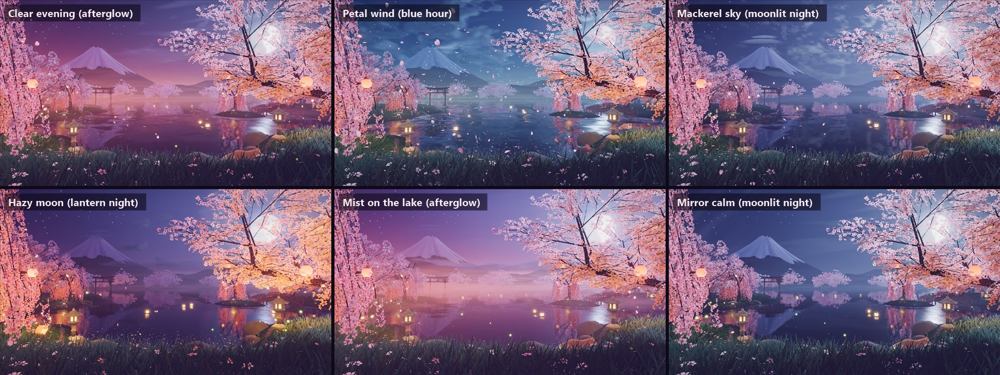
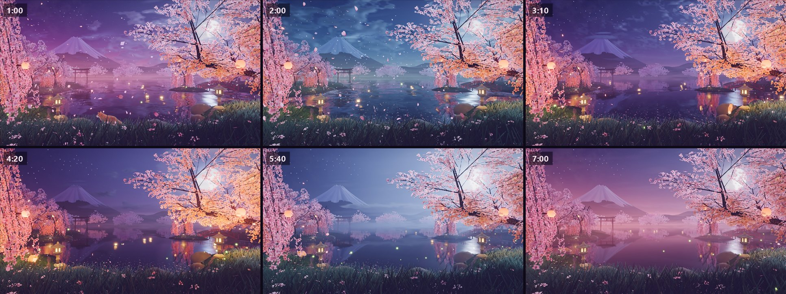
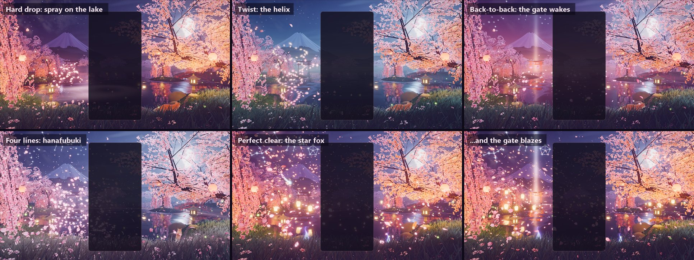
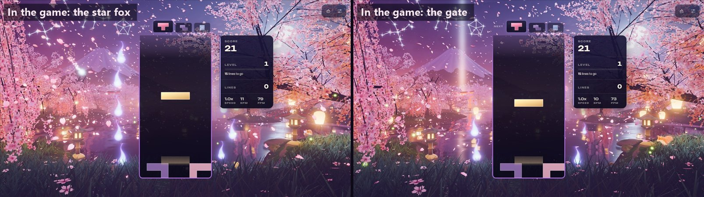
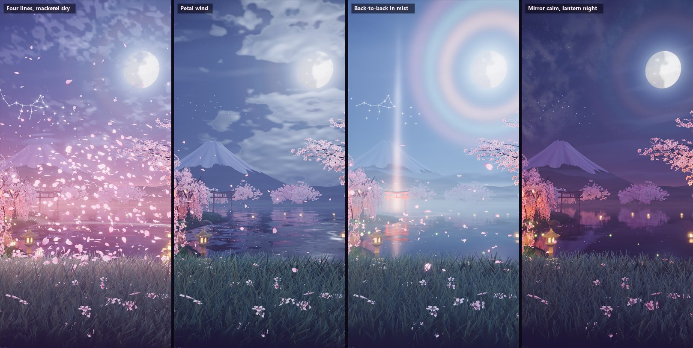

# Sakura Twilight — the living night (2026-11-18)

**Status: implemented on branch `feature/sakura-twilight-living-night`. A record of what was
found, what was built and how it was checked — not a backlog.** The third pass on the theme,
after the overhaul ([SAKURA_TWILIGHT_OVERHAUL_2026-10.md](SAKURA_TWILIGHT_OVERHAUL_2026-10.md))
and the atmosphere pass
([SAKURA_TWILIGHT_ATMOSPHERE_2026-10.md](SAKURA_TWILIGHT_ATMOSPHERE_2026-10.md)).

The ask (the owner, 2026-11-18): audit everything that makes up the theme, find what is weak,
generic or missing, and raise it to one of the most striking themes in the game, keeping what
works; it should change as you play so it never looks the same for long; every event should have
an effect of its own, the biggest moments the most spectacular; smooth and readable throughout.

## The audit

Captured before any change: the five hours at rest, every event, Low, portrait, on WebGPU
(playground, `seed=271`, stand-in board card).

**Strong, and left as they were:** the composition for the two side thirds; the Blender-grown
cherries and their two lights (silver rim, warm underside); the grass and fallen blossom; the
lanterns; the fox and its mind; the petal simulation; the hazy moon; the piece colours and the
board's readability (the card is dark and the garden never crosses it).

**Weak:**

| What | Why it was weak |
| --- | --- |
| The sky | One faint cirrus layer drawn as a deck seen from below: at a level camera it is a few pale streaks, the same streaks in every hour. Most of the upper left of the frame was empty gradient. |
| Change over time | Five hours turned the colours, and nothing else: the wind, the lake, the mist, the petals and the mountain were the same at minute nine as at second one. |
| The mountain | A clean cone that never changed: no cloud, no weather. |
| The lake | Ruffled in the same patches always; never still enough to be the mirror a moonlit lake is. |
| The stars | One colour, no river of heaven, though the theme has a whole "lantern night" for a dark sky. |
| The events | Good, but one language. A lock, a clear, a twist, four lines and a perfect clear were all "petals from the card's edge, more of them". A hard drop was a stronger lock. A twist's spiral read as another puff. A back-to-back only brightened a ring round a moon that is half hidden by the right-hand tree. A perfect clear replayed the four-line blizzard with every dial up. |
| The level-up | Its sky lanterns rose mostly from the far shore, behind the board card. |
| Game over | The lanterns dimmed a little; in a still frame it was hard to tell from the garden at rest. |
| Fast play | A quick hand sends a lock ring across the lake every half second: their faint skirts stacked into a lilac veil over the dark foreground grass (seen in the real game, not in single-event captures). |

**Missing:** weather; anything on the mountain; a use for the torii, which stands in the best
open spot of the frame and did nothing; life in the sky.

## What changed

### The night changes: six airs beside the five hours

`sakura-weather.js` is a second clock (84 s an air; the hours take 110 s, so the two drift apart
and an hour meets a different air each time it comes round). An air is
seventeen numbers the light rig copies into uniforms; nothing is rebuilt, so every tier and both
backends show it. The first air is the garden as it was built, per the house rule that a
session opens on the look it always had.

| Air | The sky | The garden | The mountain |
| --- | --- | --- | --- |
| Clear evening | high wisps, a few stars | the light breeze, a steady fall of petals | bare |
| Petal wind | torn banks hurrying across the moon | the breeze doubles, the boughs toss, petals stream through the whole garden | a banner of snow off the summit |
| Mackerel sky | a field of small scales | as at rest | a cap of cloud |
| Hazy moon | a thin veil: the moon in a wide ring, the stars thinned | soft light, more mist, more shafts | a thin cap, cloud at its foot |
| Mist on the lake | mostly clear above | the far shore and the gate become shapes in the mist, the moon's shafts stand in the air | a sea of cloud at its waist |
| Mirror calm | deep and clear, the river of heaven | the lake lies like glass and the mountain stands on its head in it; few petals; every firefly out | bare |

The hours were sharpened so each differs in more than tint: the blue hour is bluer, the lantern
night has a dimmer moon, brighter lanterns and the most stars, the moonlit night a brighter moon
and the densest shafts, the dawn a paler rim. Two new numbers an hour: how much of the river of
heaven the sky is dark enough to show, and how dense the moon's shafts stand.

A level-up still turns the night an hour on. Neither clock is gated by Reduce motion or the
effects setting (a slow change of colour and air is the theme, not an effect); Reduce motion
holds a fresh wind to the garden's own breeze and thins the blizzard.

### The sky (`sakura-sky.js`)

Rewritten as one function. The cloud is drawn **from the side**, in azimuth and height, not as
a deck seen from below: banks from one noise field read twice (the finer read travels faster and
tears the broad one, so a bank changes shape as it crosses), lit on the side turned to the moon
with their hearts in shade; the old wisps on the slant; a mackerel field; a veil. The cloud
travels on a clock of its own that sums the air's pace, so a change of wind never jumps the sky.
Stars are blue-white, gold and a rare rose. The river of heaven rises from behind the mountain's
left shoulder across the open sky of both framings, with a dark rift that widens and pinches.
The moon's seas are read only inside its disc. A star falls by itself every quarter minute or
so when the sky is clear enough to show one. The dome is now drawn last among the opaque things,
so the sky behind the trees, the mountain and the lake is never shaded.

### The mountain's weather (`sakura-backdrop.js`)

Two cards in one draw: a sea of cloud at the mountain's waist, and at the summit a cap of two
stacked lenses and the snow banner. The summit's card stands a little nearer than the summit,
and the cap is hung where the eye sees the summit through it, so it sits on the mountain instead
of floating behind it.

### The lake (`sakura-water.js`)

How much of the water the wind ruffles is the air's: lanes drawn out along the breeze in a wind,
none in a mirror calm, when the reflection is nearly undisturbed. Round the moon's glitter the
ruffled water now carries a soft band of its light toward the eye.

### Every event its own instrument (`sakura-showpieces.js`)

Petals still answer every lock and clear. On top of them:

| Event | What it has that no other has |
| --- | --- |
| Lock | The puff from the card's edge and a ring over the lake (as before). Rings now make room for one another: a quick hand sends a train of fine rings, not a sheet of light. |
| Hard drop | The piece goes through the card into the lake: a crown of spray stands up on the water beside the board on the piece's side, taller the further it fell. |
| One to three lines | The twin jets, a lantern set afloat per line, the gust front from two lines (and every lantern's flame is fanned as the front passes). |
| Three lines | Every firefly in the garden rises at once in a slow bright cloud, and sinks back. |
| Four lines | Hanafubuki: a blizzard of petals streams through the whole garden on the wind, from the eye to the far bank, for several seconds; a second four-line clear thickens it. |
| Twist | A double helix of lit petals winds itself up beside the board to above where the piece turned, turns, opens and lets go. |
| Back-to-back | The gate wakes: light stands in the torii and its reflection in the lake, and the gate itself glows; taller for every one in a row. (The moon's rainbow corona still opens too.) |
| Combo / streak | The stream of petals round the board, the foxfire gauge and the constellations, as before. The foxfire is now the combo's alone. |
| Level up | Sky lanterns lift off the lake where it shows either side of the board, near to far, and stand in the water; the night turns an hour. |
| Perfect clear | The star fox comes down: a spirit light leaves the Fox among the stars, crosses the sky over the mountain's flank trailing sparks, and goes through the gate, which blazes; a great ring leaves its feet. With it the whole sky is drawn, the fallen petals rise and every sky lantern lifts. |
| Fever | As before (the meteor shower, the festival lanterns), now inside a light stream of the blizzard. |
| Game over | The wind dies, the lanterns burn low, the mist closes in over the lake and the fireflies settle; the picture dims a little. |

Everything is stateless on the GPU (a few numbers per slot in a uniform array, the motion
closed-form in the vertex stage) and nothing is parked invisible: a showpiece at rest is drawn
with its vertices folded onto a point, so its pipeline is built with the rest of the garden and
its first appearance in play compiles nothing.

### Two things tried and taken out

- **A wave of lantern light along the far shore for three lines.** In the landscape framing the
  far shore is behind the board card and the near trees; the wave could not be seen. The
  fireflies' rise replaced it.
- **A ring from the hard drop's splash.** With the lock's own ring that made two rings a piece,
  and the foreground grass turned pale under fast play. The splash sends none.

## Cost

Measured in the playground at 1920 x 1080 with the GPU timestamp profiler, capped at 30 fps
(the owner's standing rule for light GPU work), ten seconds a case, two interleaved rounds,
this branch against the untouched `main` checkout on a second server:

| Case | GPU ms a frame, before | after |
| --- | --- | --- |
| High, at rest | 1.05, 1.08 | 1.02, 1.03 (clear) · 1.05, 1.01 (petal wind) · 1.04, 1.02 (mackerel) |
| Low | 0.48, 0.47 | 0.42, 0.42 (petal wind) |

That is "no dearer", not a frame rate: capped readings on an RTX laptop say nothing about an
integrated GPU, and no uncapped run and no integrated-GPU run was made. Drawing the dome last is
what pays for the richer sky. The page's own time per frame was within the noise (medians
4.6 to 6.3 ms either side).

## Verification

- **Playground**, WebGPU, High, landscape 1280 x 720 and portrait 540 x 1100: every air, every
  hour, every event above, the two clocks unpinned at 1 to 7 minutes; `forceWebGL=1`; Medium, Low
  and Minimal. Every capture's console was clean (no WebGPU validation error, no TSL warning).
- **In the game** (headless Chrome on real WebGPU, the real boot, theme pinned at High, single
  player, hard drops by real key events, then the theme's own handlers for a twist, a
  back-to-back, four lines, a perfect clear and a level-up): the theme ran, console clean.

  

- **Portrait** has its own framing; the moon is clear of the trees there, so the hazy moon's
  ring and the mackerel sky show best in it.

  

## Known limits

- The cap cloud is a painted card: from the lake it reads as a lenticular cloud, not as a volume.
- The mist's air (`mist`) hides the far shore almost entirely at dawn; that is intended, and it
  lasts under a minute.
- The star fox's flight is staged for the landscape framing; in portrait it comes in from the
  left edge and is short.
- Low and Minimal have no bloom: the gate's light and the helix are flatter there.
- The theme icon was not re-baked: the garden's resting look is unchanged.
- No uncapped frame-rate run and no integrated-GPU run was made.
