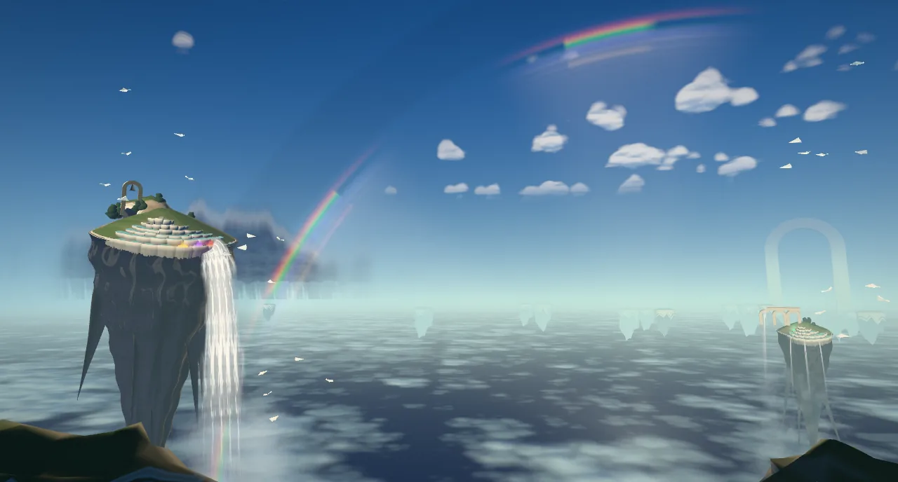
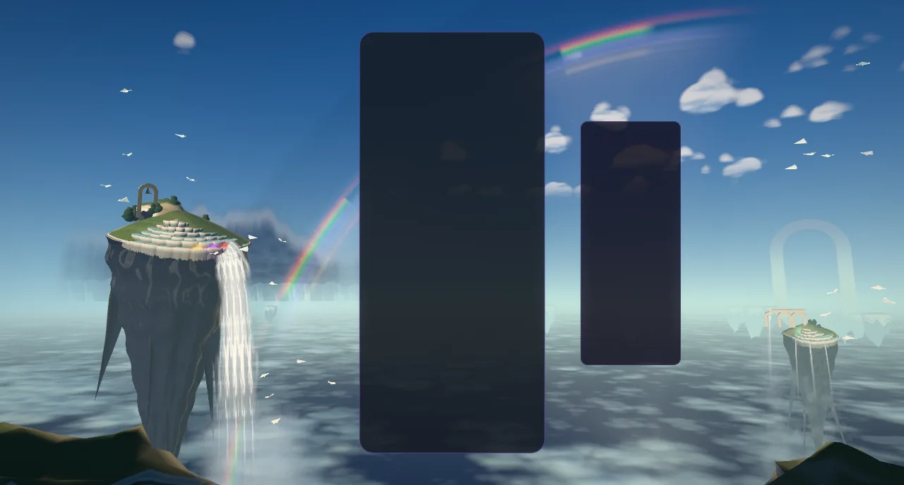
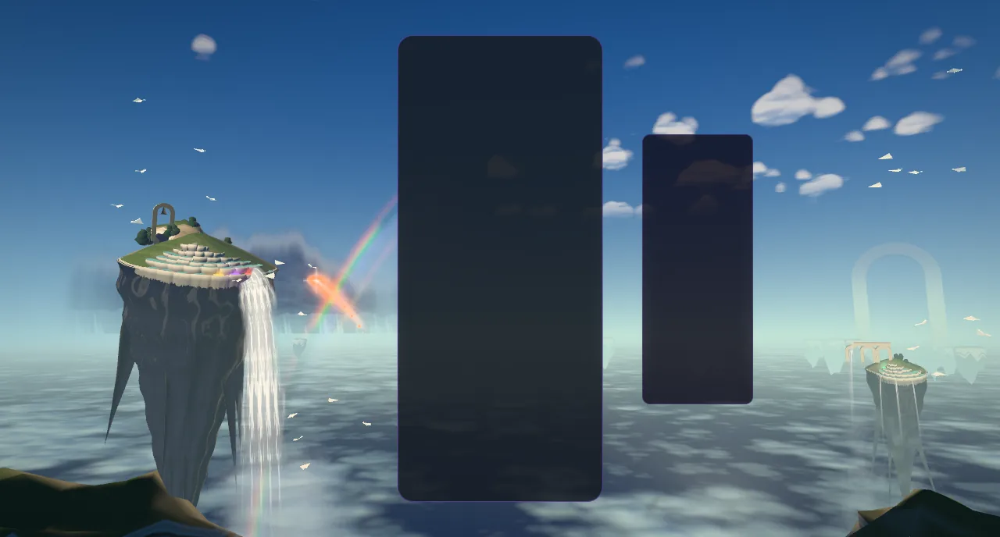
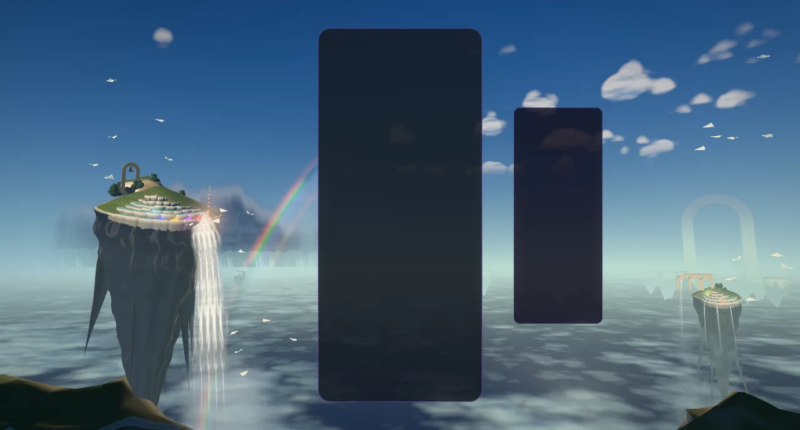
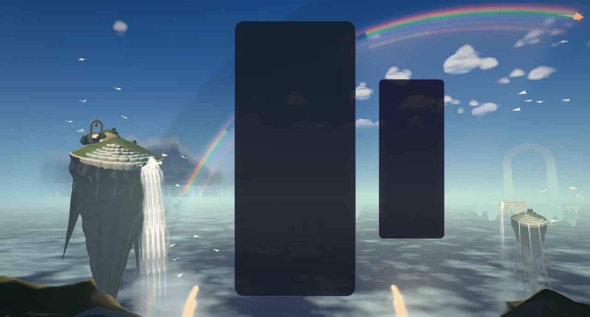
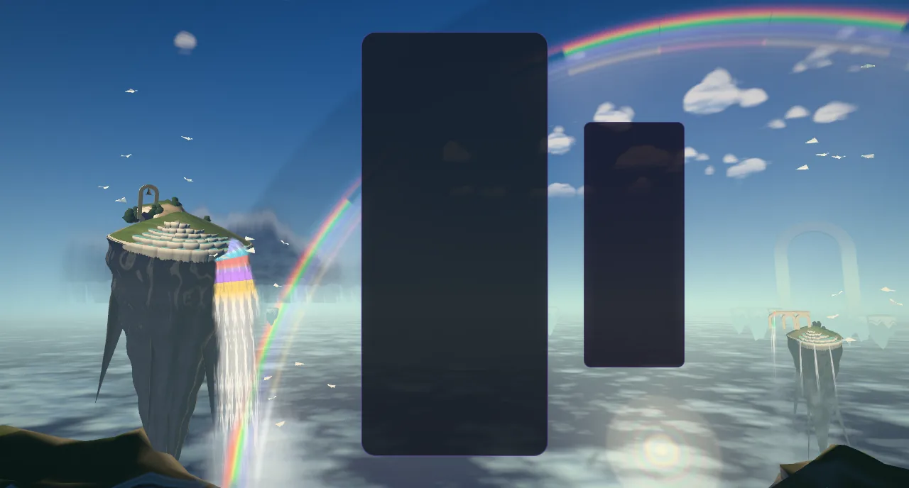
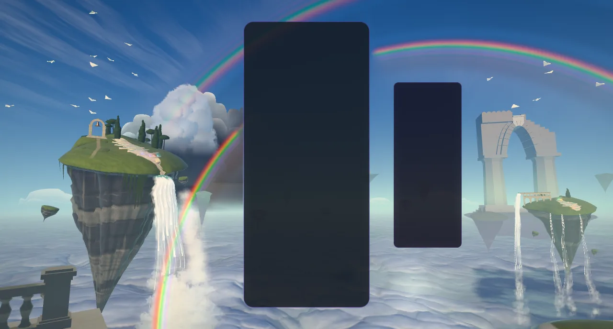
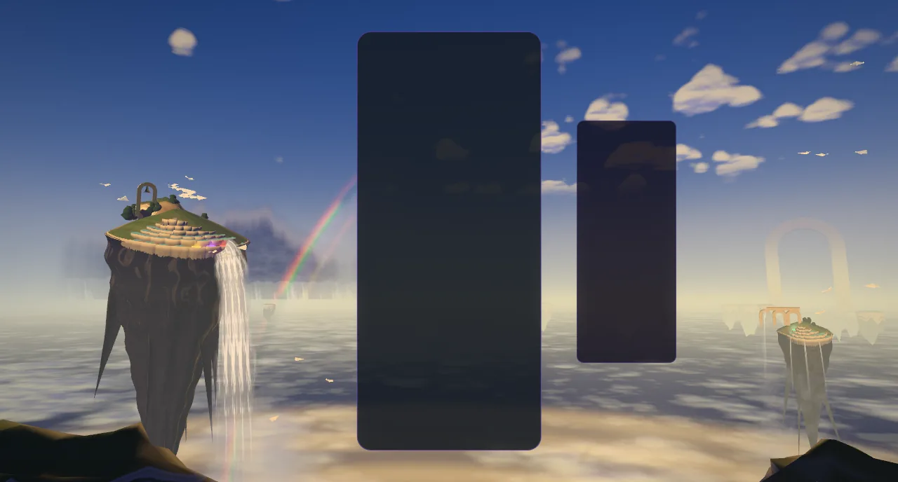
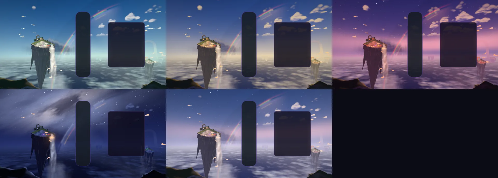

# Sky Children — Irisfall: the high country with the sun behind you

Implemented 2026-10-11/12 on `ccr-10c88c36-tbdwqd`, with Three.js 0.186.1 (`WebGPURenderer`, TSL,
the WebGL2 backend as the fallback). A from-scratch rebuild in `src/themes/sky-children/`
(registry id `sky-children`): it replaces the V2 module (the valley terrain, floating islands and
cloud sea, the MoodDirector, the compute/MRT post, the Poly Haven detail maps and the `skyV2*` URL
flags). Nothing is loaded from disk: every mesh is grown in code and every texture (the noise
fields, the spray puff, the droplet-optics table) is baked on the CPU at build time. This document
records the shipped design and what was verified. It is a reference, not a backlog.

## The picture

The eye stands on an overlook at the edge of the high country with the sun low **behind** it.
Ahead is the other half of the sky: cobalt overhead, a pale haze on the far horizon, banks of
cumulus lit full-face by the sun at your back, and a slate shower standing behind the Spring Isle.
There is no ground. Below the horizon lies the Deep: a wall of luminous mist that swallows the
isles' roots, falling away to blue-violet dark, with ragged mist shelves kilometres down and the
isles' shadows lying across them as wedges that converge on the antisolar point.

Left of the card, high, the **Spring Isle**: an upturned mountain with a crown of moss, a stand of
trees and a bronze bell in its arch, and a cascade of white travertine terraces holding jade pools
that runs on a diagonal down its front to the right shoulder, where the **Mother Fall** pours off
the lowest lip, frays into horsetails and mist, and drops the whole height of the frame into the
Deep. Right of the HUD, lower and further, the **Twin Isle** with the broken span of its aqueduct
and its threads of falls. Far off on the right horizon a colossal arch, the **Far Gate**, only a few
shades off the air. Paper gliders (the children) circle on thermals.

Every optic the droplets make is there, seen away from the sun: the rainbow, its secondary,
Alexander's dark band between them, supernumerary fringes, the white fogbow on the mist, the
opposition glow at the antisolar point and, when the board earns it, the **glory**.

## The one idea

> **The board is the spring of the high country. Each piece pours its colour into a terraced pool,
> each clear lets the pools fall down the white falls, and while the chain holds, the children
> paint the rainbow, one stroke per link, until from this height it closes into a full circle.**

The sun stands behind the eye, so the whole frame is composed round the antisolar point A, which
the frame solver places from the live layout: the bow is a circle of radius R1 round A, its leg
standing in the free zone left of the card and plunging through the Mother Fall's spray into the
Deep. Every optic reads ONE table baked on the CPU (`bakeOpticsLut`): Airy theory across 16
wavelengths (400–700 nm, the CIE observer turned into linear sRGB), summed over a spread of drop
sizes and smeared by the sun's disc; four rows — the primary (its alpha holds the supernumeraries
of smaller, matched drops), the secondary, the fogbow, the glory with the opposition glow.

## Event language

| Gameplay | What the high country does |
|---|---|
| Lock | A light-copy of the piece appears at the card's edge on its side, at its rows, white-hot, inside a ring of its light running out with sparks thrown off it; it melts into beads and springs out as a **ribbon of light-water** (a thin hot core streaked bead to bead in a soft halo, a teardrop head with a glint, droplets let go of its tail) that arcs to the pool on that side nearest its height. Beside the HUD it goes round it on one smooth curve and its sparks keep off it. It lands with a crown of glints, a slim pillar of its colour standing up out of the pool and a ring across the water; the pool **holds** the colour (18 s, then fading) and glows as a jewel on the terraces. |
| Hard drop | No melt: the light fires at once as a jet (0.2 s) toward a pool below the row, a bigger ring and twice the sparks, the eye dips. A drop of 12 rows or more bursts the Mother Fall's spray. |
| Line clear | Each cleared row's light **pours off both sides of the card**: a stream leaving the edge, curling over and falling into the Deep (straight down the card–HUD gap beside the HUD). One surge runs down every fall per line in the hour's accent; the oldest held colours (3 per line) run down the terraces and ride down the white falls as coloured bands. Two lines bank the gliders and run the broken span; three raise a tower of spray with a bow standing in it. |
| Four lines | **The hush** (0.33 s): the falls thin to threads, the spray hangs, the gliders stop dead. Then the light behind you flares, the opposition glow blooms, the shadow wedges deepen and the **glory** opens round the antisolar point, one ring per line; the **great pour** sends every held colour down the Mother Fall at once as stripes, and the bow flashes complete. |
| Perfect clear | The same with eight rings, and the Far Gate's spillway runs for the only time. |
| T-spin | The falls are wrung (a half-turn travelling down every sheet at water speed), two children rise in a double helix, the bell swings. |
| Back-to-back | The clear releases only half its count; the long-wing glider keeps station on the bow. A plain clear ends it. |
| Combo | The children paint the bow, one stroke per link (7 primary strokes cut along the visible arc in reading-order groups 2 / 3 / 2: leg up, crest, leg down through the Deep; then 5 on the secondary, 3 / 2). Supernumeraries from 3, Alexander's band from 3 (deeper from 7), the bow burning brighter from 7, a band of light running round both bows from 10, faster at the cap. A break withdraws the strokes newest-first. |
| Level up | The bell tolls the hour: a gold pulse at the bell, rings of light sweeping out across the cloud sea from under the Spring Isle, every pool ringing, a flight of gliders launching; the light turns one hour round the wheel over 3.6 s. |
| The clock | The light walks round the wheel by itself (110 s an hour, resting 15 % at each end), in every mode. |

### The hours

Five hours on a wheel: **Jade Morning** (cobalt and aqua), **Gilded Afternoon** (a gold haze and
gold-lit cloud over a blue zenith), **Rose Hour** (the Belt of Venus over the Earth's shadow, the
cloud banks lit rose), **Moonbow Night** (sparse stars, the Milky Way, a pale moonbow, the grotto
behind the Mother Fall breathing warm light), **Pearl Dawn** (opal). Every colour is a row of one
`uniformArray` and every number a uniform, so the wheel never rebuilds a shader.

## The frame

`sky-children-frame.js` (three-free) solves the camera and the bow from the live layout rects:
one lens up to a 100° horizontal field, then Hor+; the **leg plan** in landscape (A low right of
the HUD, R1 in [38°, 46°] so the leg's foot lands in the free zone left of the card, the crest
inside the top edge), and the **smile plan** on a phone or beside a row of boards (A under the
cards, the bow hanging under them as a smile), taken whenever the leg cannot clear the cards.
`sky-children-plan.js` places every set piece from screen anchors through the solved camera, so
the composition holds in every layout. The post stack keeps calm zones over the card and the HUD.

## How it is built

| Module | What it holds |
|---|---|
| `sky-children-core.js` | Three-free numbers: colour (OKLab/OKLCh), falls' ballistics, the spectral droplet-optics bake, the noise bakes. |
| `sky-children-hours.js` | The five hours and the wheel. |
| `sky-children-frame.js`, `sky-children-plan.js` | The frame solver (camera, A, the bows, the strokes) and the placement of the realm. |
| `sky-children-tsl.js` | The sky as one function of a direction: the air, cumulus banks, the shower, the Deep with its shelves and wedges, the optics (strokes, bows, fogbow, glory, the toll's rings). Loops over strokes and casters are real shader loops (the dome's fragment is about 40 KB of WGSL at High); the spray runs the stroke loops once per corner of a puff, not per pixel. |
| `sky-children-isles.js` | All the stone, grown in code: the body (crown, asymmetric outline, root with strata, drip grooves and pinnacles), the terrace cascade, crags, trees, ruins; one stone material (key from behind, cool fill, moss, travertine, iron-stone, bronze, air). |
| `sky-children-water.js` | The pools: one instanced draw; a Fresnel mirror of the sky, a milky body, the held colour glowing from within. |
| `sky-children-falls.js` | Every fall in one draw: ballistic ribbons, rope streaks in travel time, fraying into horsetails and mist, coloured packets. |
| `sky-children-fx.js`, `sky-children-events.js` | The glow layer (glow, disc, cell, glint, streak, ring, soft shapes) and the spray; the event records evaluated in closed form each frame. |
| `sky-children-flock.js`, `sky-children-gliders.js` | The children: a closed-form flock and paper darts drawn instanced. |
| `sky-children-world.js` | The choreography, shared by the theme and the playground effect. |
| `sky-children-post.js` | Bloom with calm zones over the card and HUD, a hue-preserving filmic, split-tone grade, grain, dither, FXAA. |
| `sky-children-director.js`, `sky-children-composition.js`, `sky-children-quality.js`, `sky-children-theme.js` | The gameplay director (per-player chains), the layout reader, the tiers, the lifecycle adapter. |

Everything is a function of the world clock and event timestamps; the clocks whose rate changes
(water, spray, flight, mist) are integrated, so `seek(t)` plus a fixed-step replay reproduces any
frame.

## Lifecycle and safety

- **Flashes are governed** (WCAG 2.3.1): every flare the world raises asks the flash governor first,
  so at most three flash onsets reach the screen in any second, however many boards clear at once.
- **The run outlives its runtime.** The clock, the level and the run's turn of the wheel of hours
  are carried over a rebuild in place (a quality change on screen, a lost WebGPU device) and over
  the restarts that replace a runtime of the same sitting: a tier chosen behind the menu (resume()
  hands the theme back to the manager for one full restart under its loading mask, never a resume
  followed by a rebuild) and a restored WebGL2 context. Only a real stop forgets them. A tier saved
  while a build is under way is built next.

## The second pass: an audit, and nothing left floating (2026-10-12)

The first build was put to a visual audit: seven critics (the isles, the waterfall, the clouds, the
rainbow, the gate and the far field, composition, atmosphere) scored it against the repo's most
loved themes, a skeptic per dimension tried to refute every finding (a few were, many were
amended), and an art director wrote one brief and a file-partitioned plan from what survived. Four
packages were then built in parallel, each reviewed by a code reviewer and an art reviewer and
fixed, and merged: the isles, the gate and the composition; the sky and the clouds; the falls and
the spray; the bow and the optics.

**The isles and the gates.**
- The isles are mountains turned over, not carrots: a convex crown with knolls under a rounded turf
  lip that overhangs a set-back cap rock, a cliff of seeded beds (hard caps standing out over undercut
  soft beds, buttresses, ravines), and a root that hangs as fused lobes with saddles between them,
  ending well above the sea with air under it. They are larger than in the first build (the Spring
  Isle 72 m across its crown, the Twin 46 m), so their works stand well inside their rims.
- One stone material without seams: the stone kinds never interpolate (the crown is the iron's kind
  with a continuous crown weight beside it), bedded iron and lime, white drips, a meadow on the crown
  (dry drifts, lush hollows, tussock grain) and a worn ochre path from the rim past the gateway to the
  spring, the lip's cast shadow on the cliff under it, a cool sky rim on the shade side, the Deep's
  bounce under every overhang, a per-hour albedo saturation (the moss goes grey by moonlight).
- The cascade is rimstone terraces: crescent dams across the flow, each pool brimming over the turf
  its dam's middle stands on, its curtain falling to the slope below, the terraces gathering into the
  spillway notch cut in the right shoulder, from which the Mother Fall leaves (the cliff under it runs
  dark and wet). A terrace's pools spread over the stretch of its crest that holds water.
- Rocks adrift beside and under the isles, faceted outcrops bedded in the crown, moss curtains (not
  sticks) hanging from the lip, cypress and pine groves with each tree on its own ground.
- Masonry is laid in ashlar (courses sized to stay a few pixels tall at each piece's distance), a mid
  value so the travertine and the falls stay whiter; bronze carries verdigris in streaks.
- The gateway stands on a terrace the builders levelled into its knoll, its footing sunk into it; the
  bell hangs from the keystone by its stem.
- The Twin Isle grows a promontory carrying a two-tier aqueduct along its axis, each bay a wall
  pierced by its arch, every pier sunk below the lowest turf under it; its broken end lets the span's
  water go.
- The Far Gate is a colossal ruin in three planes (turned off square so a pier's reveal and the
  soffit take the key, its right shoulder sheared away, a scalloped attic, a notch at its centre with
  a travertine drape under the weir, fallen blocks bedded in the mesa's turf in front of it), veiled
  by the sky behind it a few shades darker.
- The far archipelago floats at many heights in three bands, each isle leaning its crown toward the
  eye with its own build (squat or tall, tilted), with height-dependent air.
- The overlook's parapet frames the bottom corners (two small coulisses on a phone).

**The sky.** A storm wall of billows behind the cumulus tower, with the storm's dark under the bow;
an anticrepuscular fan of rays converging on the antisolar point and laid on the cloud sea; a
composed altocumulus deck; cirrus; far banks as round-headed low cloud walls along the horizon; one
wind and one cloud light shared by every layer; a grained Milky Way.

**The falls.** The Mother Fall pours as a curtain that breaks into streamers, with a billowing, lit
plume where the frame cuts it (the tower of spray stands a third of the frame on a three-line
clear, governed by the flash budget); the Twin's falls fray into horsetails; thin falls end in a
breath of spray; the grotto behind the Mother Fall glimmers through her water at night; far water
takes the far stone's air; the Far Gate's spillway hangs as a curtain.

**The bow.** A pale rest bow standing in the rain (its leg's rain going on below the horizon), one
band mask for the whole bow with its ends fanning out on the bright side, brush-stroke ends, quieter
supernumeraries, the fogbow a few L* lift of the far mist, a brighter glory, and a fast, continuous
frame search (rows of boards smile; room kept for the glory and the Far Gate). The strokes are cut
round the isle, its tower and the parapet where they stand in front of the bow.

**Nothing left floating.** The owner, looking at a close-up, saw the arches standing on air. Every
work now stands on the crown exactly as `buildMassif` lays it (`crownHeight`: the outline's stretch,
the promontory, the dome and knolls, the turf's lumps, the spillway's notch, the levelled pads), its
footing sunk deep enough for the coarsest tier's facets. Two adversarial grounding audits followed
(inspectors per structure ray-casting the built meshes on every tier, a skeptic per finding), and
what they confirmed is fixed and pinned by tests: piers that overhung the gateway's top course, a
bell hanging free, open joints; dams wound face-down (only their pools showed, as decals), the
lowest terraces hanging metres over the rim, pools overlapping by two thirds; boulders resting on a
point with air under them; open spandrels under the aqueduct's courses; the Far Gate's 5 m attic
slab over a void, a notch that did not exist, fallen blocks inside a pier and over air; summit caps,
the mesa's pinnacles, the bell and the aqueduct's stub wound inside out. A test now checks that
every closed piece of every stone builder is wound one way, outward.

## Tiers

Every tier keeps the whole picture and every event. Scene triangles as built: Minimal 45.2 k,
Low 57.1 k, Medium 73.7 k, High 98.6 k, Ultra 127.1 k, Extreme 161.2 k, all inside their budgets
(60 / 80 / 100 / 140 / 180 / 230 k); the same 15 draws on every tier.

## Verification

- **Playground** (`?effect=sky-children`): headless Chromium on SwiftShader through Playwright (the
  WebGL2 backend: this container has no GPU and its WebGPU adapter does not start). Several
  hundred frames over a dozen rounds, each round judged against the previous one, and two rounds
  of independent art critique (composition and value, colour and light, effects and motion), whose
  findings drove the isle rebuild, the Deep, the sky, the spectral bow and the event redesign.
  Consoles clean.
- **Real game** (`/?skipIntro=1&unlockAll=1&skyChildrenFixedDt=40`, the theme pinned through the
  settings manager, real keyboard hard drops): the theme ran on WebGL2 at Low, the locks filled
  pools, no warning or error from the theme.
- **Unit tests** (15 files, 344 tests): the core (the spectral table's physics), the hours, the
  flash governor, the pool ledger, the isles (every work, terrace, grove and outcrop against the
  crowns as built on every tier; every stone wound outward), the frame solver (lens, plans, stroke
  groups), the plan, the events, the flock, the shaders (every material through both node builders,
  the dome under its 64 KB gate), the world (built in Node and driven through the theme's calls),
  the theme adapter, the director and the composition. They found real faults the stills did not show, all fixed:
  strokes straddling the crest and the leg-down groups, the foot behind the left card with two
  boards, no right-hand pools at Minimal, back-to-back never ending on a plain clear, a long frame
  skipping the great pour, seek replaying the flock's flights, a thread crossing the stats bar,
  phone pools behind the card, the dome's WGSL over budget, every tier over its triangle budget.
- **Adversarial review**: four finders (logic, lifecycle, shaders, tests) read the whole diff and
  each finding was put to a skeptic. Sixteen were confirmed and all are fixed, each with a
  regression test where one could be written: NaN lamps after a game over, silent pools lighting up
  after their release, the long-wing that never landed, colour ribbons overwritten half-way down a
  fall, threads dropped from a full lock ring, the hour snapping on a rebuild after a new run, a new
  run spinning a whole day, meditation clicks ignored, a resume that forced a second restart, a tier
  lost during a build, a context loss resetting the run, parallax stuck after the pointer left, NaN
  vertices on dormant falls, a seam across the Milky Way, and an ungoverned flash.

- **Depth at 13 km**: the near plane stays at 0.3 m, so the depth buffer resolves about 35 m at the
  Far Gate. Its wall stands 42 m or more behind the orders it carries and each side is one solid,
  but the hairline joints between its voussoirs can still show stair-stepped seams in a narrow lens
  (not at the frame's own field of view).

### Not verified, and what is open

- No frame on a real GPU, WebGPU or otherwise: the look was judged on SwiftShader's WebGL2. The
  calm zones, bloom and grade should be checked once on hardware.
- Nobody has watched it move at speed: motion was judged from stills at fixed times and from tests.
- The icon is my pick from the playground's icon lens (`?effect=sky-children&t=30&quality=High&combo=7&held=6&hour=2&hud=0&icon=1&iconFov=34&iconYaw=0.42`).
- `sky-children-ledger.js` (PoolLedger, StrokeBook, Dial) is a reference model that the world does
  not import: the world keeps its own pool choice, release and dial. Its tests pin the model, not
  the world. It should be wired in or removed.
- The old `src/themes/sky-children-v2/` folder (and `src/themes/shared/sky-core/`, the V2 textures,
  its playground effect and its two tests) is still on disk, unloaded by the registry; whether to
  delete it is the owner's call.

## Reproduce

Playground: `npm run dev:playground`, then `/playground.html?effect=sky-children&t=30&quality=High&board=1`
plus `event=lock|drop|clear|tspin|b2b|quad|perfect|levelUp|newRun|gameOver|break`, `eventAge=<s>`,
`lines=`, `row=`, `u=`, `color=<hex>`, `shape=`, `combo=<n>`, `held=<n>`, `hour=<place>` (0 Jade
Morning … 4 Pearl Dawn), `players=2|4`, `parts=sky,isles,...`, `noPost=1`, `values=1`, `hud=0`,
`icon=1` (+ `iconFov`, `iconYaw`, `iconPitch`), `P.<name>=<value>` for the look's numbers. Theme
flags: `skyChildrenTime`, `skyChildrenFixedDt`, `skyChildrenParts`, `skyChildrenFalseColor`,
`skyChildrenForceWebGL`.
