# Spring — the river in its spring flood (2026-10-18)

The owner asked for the Moonlit Forest theme to be remade from scratch and renamed **Spring**,
to complete the four seasons beside Summer, Fall and Winter, on three r186.1, "a visual
masterpiece, complete with amazing piece-lock and combo effects", from `main`. A first pass built
Dutch bulb fields; the owner was not sure about it and asked for "spring, with flowers, a
floating river in a beautiful northern Swedish landscape … the most beautiful pouring river,
and Swedish landscape with flowers", and later that "all the trees must look better also, like
the high detailed trees that we also have". This is that remake; the bulb fields are gone.

Spring takes Moonlit Forest's registry slot (group `biomes`, a heavy-GPU theme), its Odyssey orb
(orb 12 of the campaign, authored id 13, renamed "Spring Flood" with its description and tip rewritten for the
river; it follows Grainfields, the chapter's opener, which took Misty Lake's orb the same day) and its song (the same recording,
retitled "Spring" and renamed `spring.mp3`; the track key `MoonlitForest` resolves to `Spring`).
`moonlit-forest` is an alias of `spring` in `RETIRED_THEME_IDS`, so saved selections, collection
grants and Odyssey completions that name it now mean Spring. The frozen V2 save table keeps
`moonlit-forest` (PLAYBOOK §4.5). The old theme (a 694-line wrapper over a "Silverheart Glade"
playground scene, its FX controller, tests and icon) is removed.

| Moonlit Forest (before) | Spring (after) |
|---|---|
| 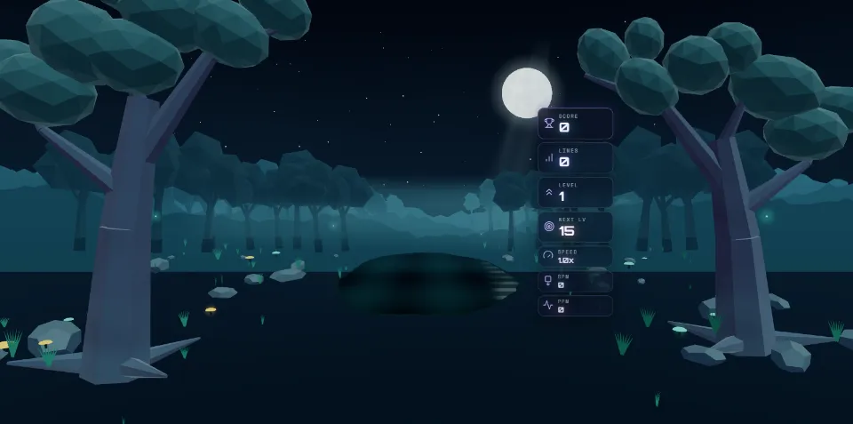 |  |

To look at it: `npm run dev`, then `/playground.html?effect=spring&t=10&hour=0.3&board=1`
(`hour` 0 morning, 1 afternoon, 2 golden evening, 3 sunset, 4 light night, 5 dawn mist;
`event=lock|drop|clear|quad|tspin|perfect|levelUp|release|over` with `eventAge`; `combo=<n>`,
`b2b=<n>`, `locks=<n>`, `shape=<piece>`; `look=x,y,z,fov` and `eye=x,y,z` for close-ups;
`icon=1` for the icon's lens; `atlas=albedo|normal` shows the woods' impostor atlas). In the
game: `/?unlockAll=1&skipIntro=1`.

## The subject

A Norrland river at the end of May, in the spring flood, at 65° north: the sun barely sets, the
birches are in first leaf, the fells still hold snow in their gullies, and the meadows by the
water are white with wood anemones, yellow with globeflowers and marsh marigolds, pink with red
campion. The eye stands among the flowers on a low granite knoll at the outside of a bend. Up to
the left the river pours over a step of dark schist in tongues (the model is Tännforsen in
Jämtland: a broad fall cut into a layered rock step, ribs of rock parting its water), churns in
its plunge pool, comes down toward the knoll in a staircase of rapids, swings round under it and
runs away to the right through spruce and birch toward the fells.

**The theme's idea: the flood is your play.** Each piece is a flower of the meadow, and a lock
makes a patch of its flower burst into bloom where it landed; clears send surges down the river;
a chain is the spring flood rising.

## The picture

- **The fall** (`spring-fall-plan.js`, `spring-fall.js`): the river has cut a notch into its step
  and comes over in tongues. The main tongue, thick and glassy at the brink, leaps free from a
  recess it has worn under the lip; to its left the water slides down a stair of slabs and risers,
  whitening at each step; to its right a thinner tongue lands on a ledge and runs off it; ribs of
  wet rock part them, threads spill over the ribs. One plan describes it all: the rock face (where
  the rock stands at every height across the step), and each column's path down it, traced by
  letting the water fall (free, sliding down a slab under gravity and drag, landing on a ledge and
  running off it). The water is a sheet of 190 columns × 150 rows along those paths; it is read by
  the moment each parcel left the lip, so its streaks fall at the true, quickening speed; glassy
  for the first moments, then torn white in billows and ropes, fraying lower down into strands that
  show the wet rock; it fans out as it falls; low down it is lost in its own spray. The rock face
  is a grid laid on the plan: dark schist in bedded layers (each standing a little in or out, so
  the face climbs in ledges) cut by cracks, its overhangs, hollows and joints darkened per vertex,
  wet and near-black where the water and the spray reach, lichened, mossy and turfed where they do
  not. The mist rises where each tongue lands and where the water bursts on the rock.
- **The river** (`spring-river.js`): the upper reach (each column stopping at its own lip,
  drawing down over the brink), then the pool and the rapids. The pool boils where the tongues land
  (`poolBoil`, from where each column's path meets the water), milky where it is torn; the rapids'
  ledges slant and wander, pouring white in places and sliding through as smooth tongues in others.
  A two-phase flow map moves foam, streaks and ripples at the local speed; every foam threshold is
  widened by its own footprint on screen, so nothing sparkles or blots at a grazing angle.
- **The woods** (`spring-forest.js`, `spring-impostors.js`, `spring-woods.js`): the nearest trees
  are the modelled birches and spruces (Blender-authored, every spray of leaves an instance).
  Every other tree of the valley — about ten thousand on High, out to 2.3 km — is a card of one of
  those same models: as the world is made, each model is drawn side on, two turns of it, into an
  atlas by the forest's own materials in a bake mode (albedo and coverage in one texture, normals,
  occlusion and leaf share in another), and the cards are lit from it by the hour's sun and sky as
  the models are, so the far woods are the near trees, not stand-ins. Spruce grows down the gorge's
  slopes and along the step's rim; a birch and a spruce stand on the rim either side of the fall.
- **The valley** (`spring-terrain.js`): one height function from the river's plan (two reaches,
  the step, the notch's shoulders either side of the lip, the gorge, the knoll, the fells), baked
  offline into three grids (`scripts/spring/bake-valley.mjs` → `assets/spring-valley.bin`) that the
  land, the trees, the flowers and the rocks all read. Far off, the forest's edge frays into stands,
  tongues and bogs at the far country's own scale; above the treeline the heath is pale with lichen
  on the ridges and dark in the shelter, and the snow lies on the tops and runs down the gullies.
- **The meadow** (`spring-meadow.js`, `spring-flowers.js`): modelled grass and seven spring
  flowers, one per piece (globeflower I, marsh marigold O, wood anemone T, hepatica S, red campion
  Z, lady's smock J, violet L).

| The fall | The woods: cards of the modelled trees | The impostor atlas |
|---|---|---|
| 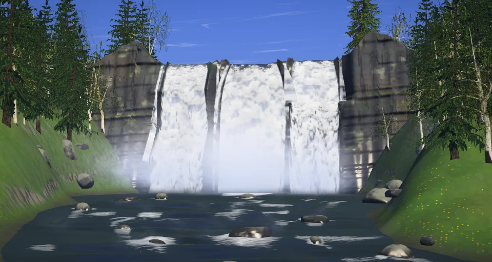 | 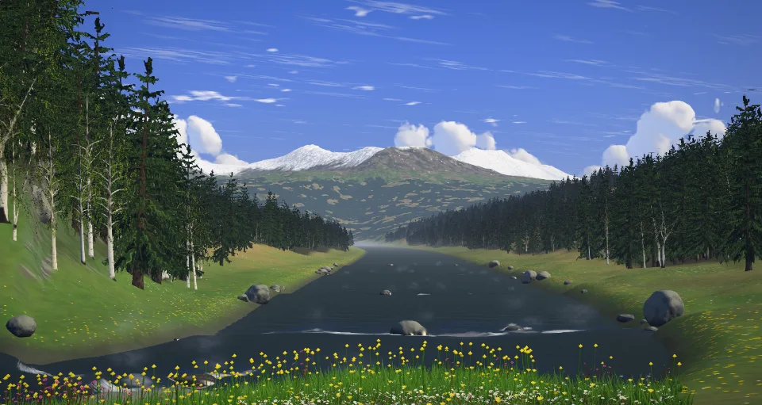 | 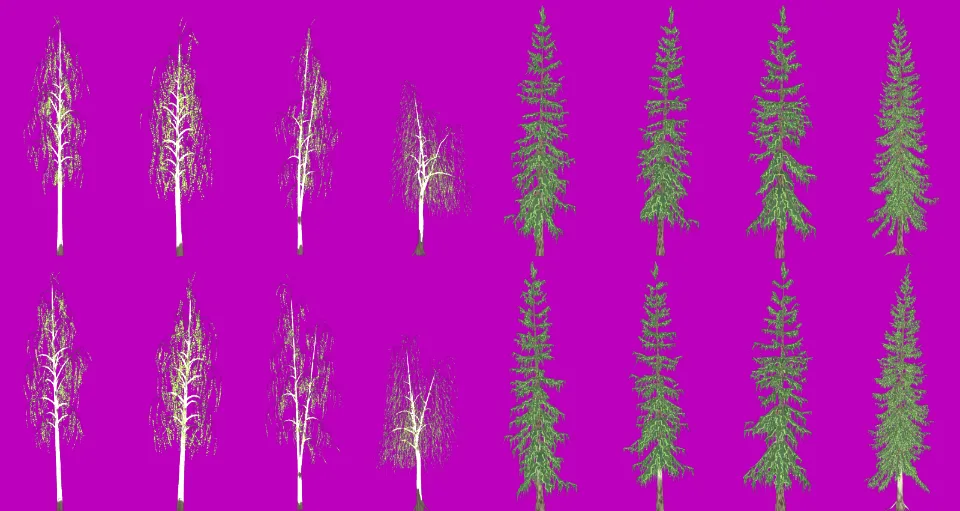 |

## The light

Six stations on a day of the end of May (`spring-hours.js`): **morning**, **afternoon**, **golden
evening**, **sunset** (the sun gone behind the western rim, the fells still lit), **the light
night** (the sun just under the north, a rose band over the fells) and **dawn mist**. The sun's
height is the real one at 65.5° N; the valley loses it behind the skyline at its bearing (a
measured table of the skyline every 10°, `SKYLINE`) while high ground keeps it longer. The day
turns with the clock alone and a level-up steps it a whole station forward on top; no station
rests (the worst rate, measured over a whole turn, is 0.095 stops a second against the house
limit of 0.15).

| Morning | Golden evening |
|---|---|
| 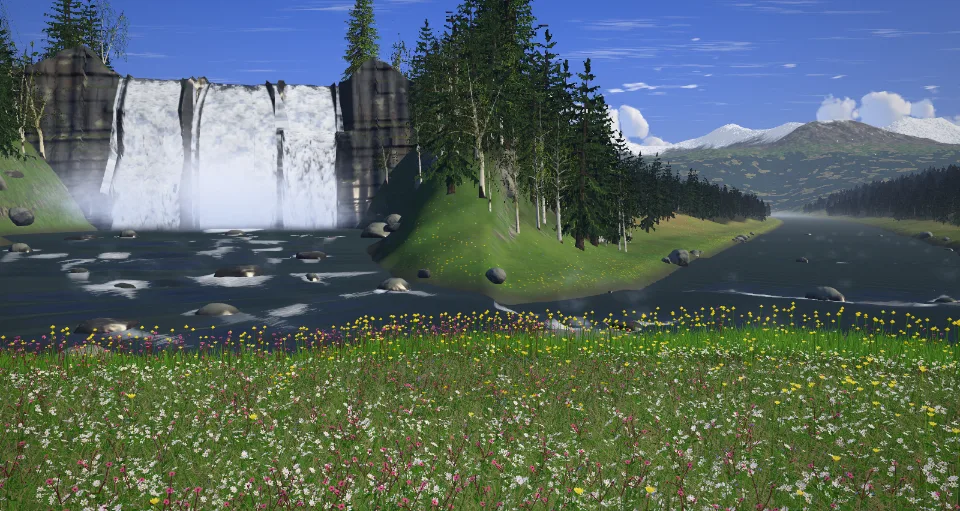 | 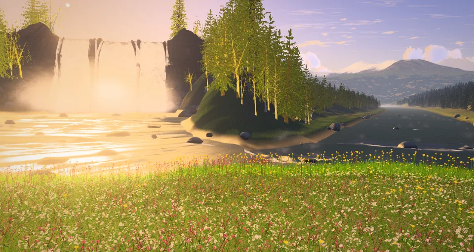 |
| **Sunset** | **The light night** |
| 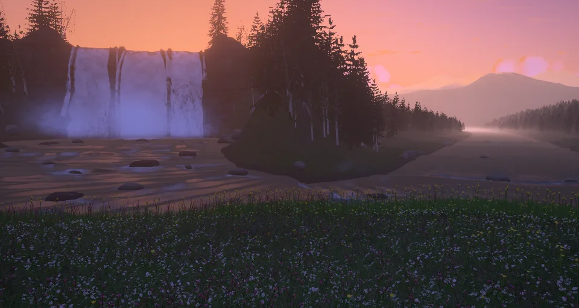 | 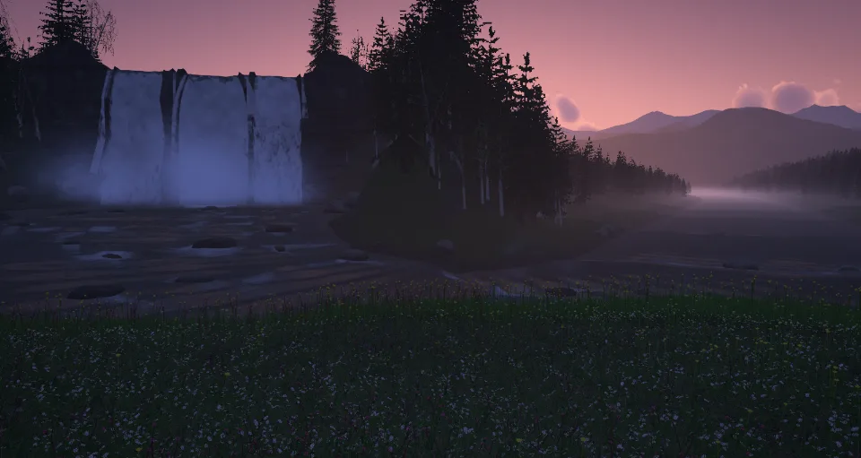 |
| **Afternoon** | **Dawn mist** |
| 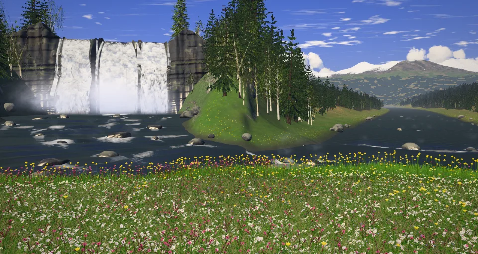 | 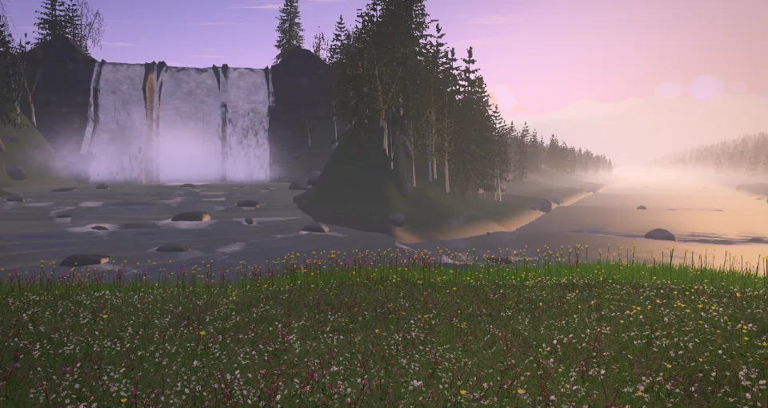 |

## What gameplay does

| Event | What happens |
|---|---|
| Lock | A patch of the piece's own flower bursts into bloom on the knoll where it landed, opening outward from the spot (on the water it splashes, and the patch opens on the knoll's edge at the same bearing). The piece's own pollen is shaken up out of the patch and drifts off on the breeze, and the air round it puffs out, up and lights; a hard drop shakes out more and knocks a ring of down off the plants. |
| Clear | One surge down the river from the pool, the bigger the more lines: a hump of water with a steep front that breaks white across the river like a bore, the water behind it streaked with the foam it threw; the whole knoll flushes into bloom. Pollen and down lift off both sides of the card in the cleared rows' colours (each side its half of the board), and a breath runs out through the air from the eye. |
| Chain | The spring flood rises with each link: the river swells and runs whiter in streaks, faster, and the fall's mist thickens; when the chain breaks it falls back. Each link spins up a whirlwind of pollen and down beside the card, on alternate sides and stronger each time; the air thickens, hurries down the breeze and turns in two gyres; a broken chain lets its down go over the knoll. |
| Four lines | The great surge, and the last of the winter's ice goes out on it: floes come down from the pool and run the rapids. |
| T-spin | The pool turns in a whirl where it drains, arms of foam winding into a dark eye, spray flung off its rim; a whirlwind turns beside the card on the lock's side. |
| Back-to-back | The river glitters while the run lasts; each step strikes a scatter of glints off the ripples in front of the knoll, and the air's motes sparkle. |
| Perfect clear | Two surges, and whooper swans come over the valley; the air stills and turns gold, and gold pollen and down shower slowly over the knoll and the river. |
| Level up | The day steps a station forward (it also turns with the clock alone); cranes pass over on their way north, and willow down drifts over the knoll from upwind. |
| Game over | The light falls to dusk; it comes back with the next run. |

| Lock | Three lines | Chain of 6 |
|---|---|---|
| 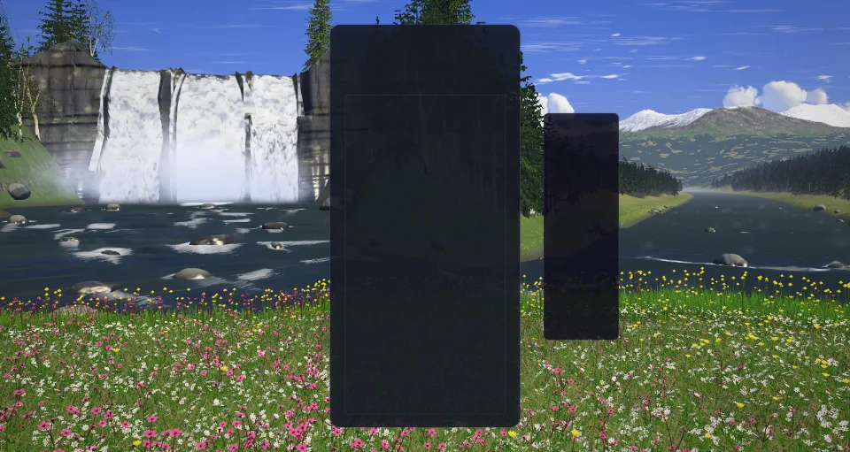 | 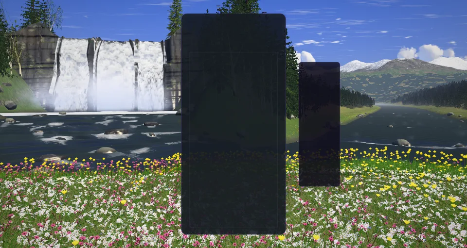 | 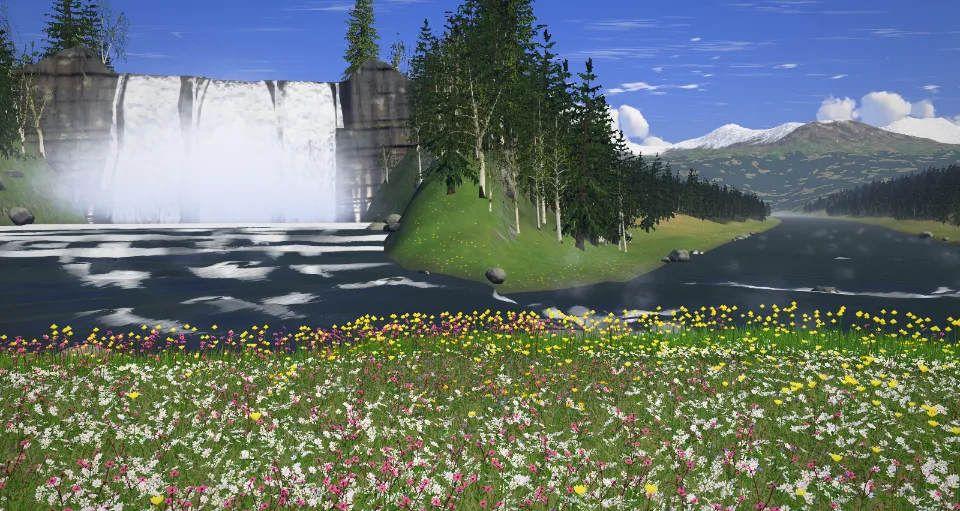 |
| **Four lines** | **T-spin** | **Perfect clear** |
| 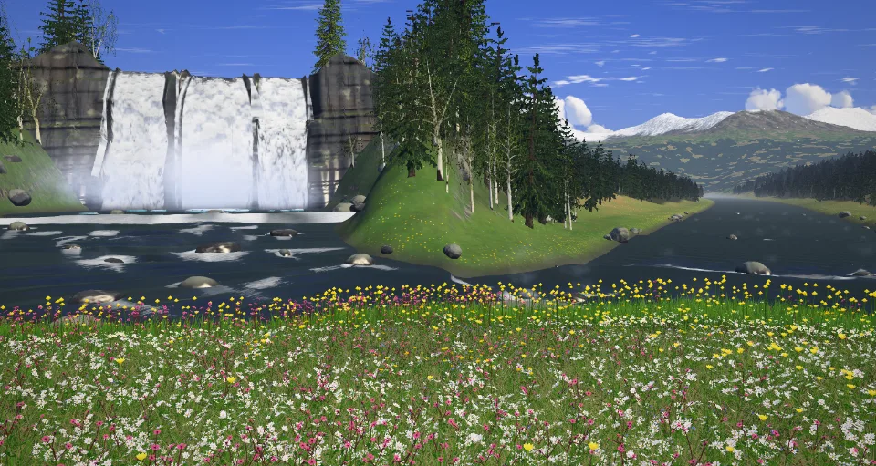 | 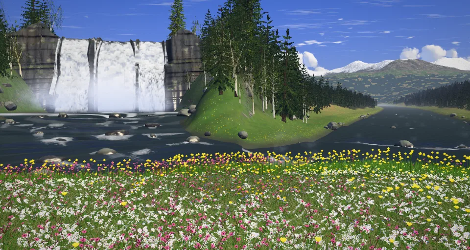 | 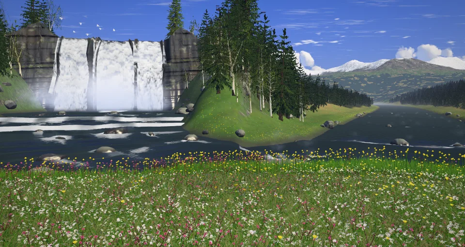 |
| **Chain of 9** | **Level up (cranes)** | **Back-to-back** |
| 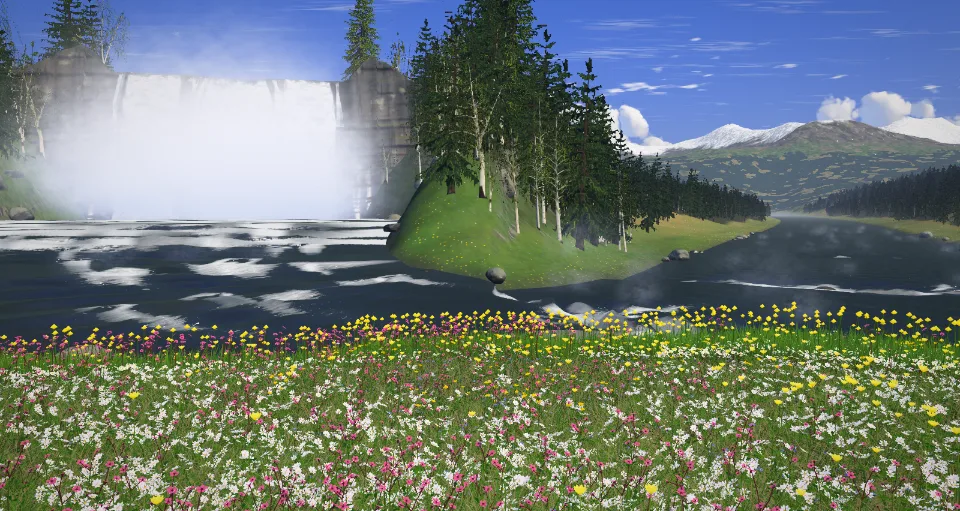 | 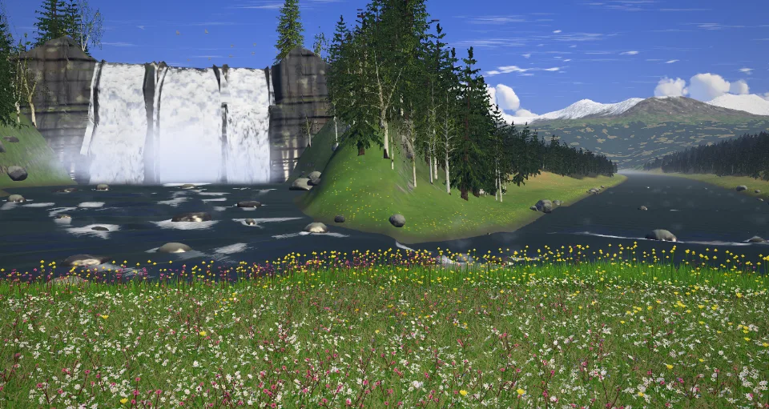 |  |

Every reaction is closed-form in the theme clock or written into preallocated slots (patches of
bloom, surges, floes, birds, motes), so `seek(t)` plus a fixed-step replay reproduces any frame.

## Quality tiers

Every tier keeps every part and every beat. Tiers scale the grass and flowers, the land fan, the
river ribbon, the fall's sheet (70–270 columns) and rock face (120–420 columns), the modelled
trees and their sprays, the woods' cards (1,500 … 18,000) and their atlas's texels (128–384 a
tree), boulders, the air's motes (320 … 2,400) and the ring gameplay throws into it (384 …
2,304), mist, floes, birds and the pixel-ratio cap.

## Decisions and traps

- **The fall was a weir.** The first river's fall was one ballistic sheet off a straight lip: it
  read as a dam's spillway. It is now a plan of tongues, ribs and a sculpted step, with every
  column's path traced over the rock it runs on (the plan's tests pin that no path passes through
  the rock, in the air, down a slab or off a ledge).
- **A renamed loop variable.** `riverNearest`'s refine loop once named its segment start `k0`,
  shadowing the window's bound; renaming it to `a` missed one use, so every nearest point snapped
  to the window's first sample: the knoll's flowers lost their water edge and vanished. Probe
  heights and edges against the previous bake before trusting a re-bake.
- **The woods.** Simple lathe spruces and icosahedron birches read as toy trees beside the
  modelled ones, so the far woods are now cards of the models themselves (an impostor atlas drawn
  once by the forest's own materials). A render target's v = 0 is its top row in r186; the cards
  read the atlas y-down.
- **Blotches on the water.** At a grazing angle a pixel covers metres of water along the flow:
  metre-scale foam rafts thresholded hard became white tiles, and the flood's foam boost laid
  white over calm water in blotches. Thresholds are widened by their own `fwidth`, far off the
  rafts give way to the fine churn, the flood scales the white water instead of adding to calm
  water, and a surge's white is a steep breaking front plus lines behind it.
- **A surge seen edge-on.** From the knoll the pool lies almost level with the eye; a surge with a
  gentle 9 m face foreshortened to a hairline. Its front is now 1.8 m long, so it stands up.
- **Clearings on the fall's slopes.** A forest clearing 170 m across happened to fall on the
  gorge's slope beside the fall, leaving it bare grass; round the fall the woods have no
  clearings and grow on slopes steeper than elsewhere.
- **Far canopy.** Per-vertex forest cover is smooth over the far rows' tens of metres, and the
  land's metre-scale reads are a single mean colour there: the far woods read as blobs. Far off
  the canopy is read without clearings and broken by bogs and a frayed edge at the far scale.
- **Woods missing at some starts (fixed 2026-10-19).** The woods' cards are drawn from the
  impostor atlas, baked once at start and kept. Its warm `compileAsync` read the depth and stencil
  from the theme's renderer, which has none (the scene pass owns depth), where a render reads them
  from the target (r186 `Renderer.js:953` against `:1843`): it compiled pipelines without the
  atlas's depth, and the bake needed others. Without the app's async pipelines those compiled in
  the bake and it was whole; under them (a start under a loading surface, a hidden prewarm, an
  in-play switch, ADR-0020) they were left for later, every draw of the bake was skipped and the
  empty atlas was kept, so the far woods were missing for the session while the modelled trees
  near the eye stood (SwiftShader, real atlas: 0 of 16 draws, 0 of 13 478 texels, against 16 of
  16 without a session). Whether a start went through a session decided it: sometimes every tree,
  sometimes not. The warm now compiles for the target's depth (the bake's 15 pipelines async, none
  synchronous); the atlas's targets are one-shot bakes the async pipelines and the build budget
  leave alone (`isOneShotBake`); the bake counts each pass's draws and is drawn again on the next
  frames until every tree is in it (`BAKE_ATTEMPTS`, 600; the cards show once it is whole); and a
  first bake that throws is retried by the next frame instead of giving the woods up. Every tier
  and both backends bake the same way (WebGL2 has no async pipelines). `getDiagnostics().world.woods`
  reports the atlas (baked, failed, attempts); `tests/unit/spring-woods-bake.test.js` pins it.
  The atlas as each bakes it under a session: `spring-captures/woods-atlas-session-ab.webp`.

## Verification

All on the RTX 3070 laptop (`force_high_performance_gpu`), through the playground's batch capture
and the real game on the dev server. **The laptop was in Silent mode throughout (the owner's
note), so every frame rate below is directional only**; perf must be re-measured in Performance
mode. Captures are under `.cache/spring/` in the build worktree; the doc's frames are in
`spring-captures/`.

- **Playground:** every hour, every event, chains of 2, 6 and 9, the fall, the pool and the rapids
  close up, the woods and the fells, the impostor atlas (albedo and normals), High and Low on
  WebGPU, Low and Minimal on WebGL2 (`forceWebGL=1`, the atlas included), a 412 × 915 portrait and
  the icon's lens. No WebGPU validation errors: the only console lines are the blocked HMR socket
  and Electron's CSP notice.
- **The real game** (`/?skipIntro=1&themeValidation=1&unlockAll=1`, theme pinned): keyboard hard
  drops, a two-line clear, a chain, four lines, a chain break, game over and a level-up through
  the app's own event bus; 0 dropped events on every run.
  - WebGPU, High, 1584 × 813: 130.1 fps at rest, 126.6 through four lines (display-limited, in
    Silent mode). The level-up stepped the light from morning to afternoon.
  - WebGL2 (`forceWebGL=1`), Low: 130.4 fps at rest, 126.7 through four lines.
- **Gates** (in the build worktree): typecheck, `lint:ci` (550 errors against the 574 baseline;
  the Spring files lint with 0 errors and 0 warnings), `check:boundaries` (1,802 modules),
  `npm run build` with the boot closure, the URL parameter catalogue. The theme's unit tests
  (seven files: core, hours, world, director, theme, rename migration, and the fall's plan with the
  impostor atlas's layout) pass. `check:pages-artifact`, `check:release-gates`,
  `audit:theme-lifecycle`, `check:ip-strings` over `dist/`, `perf:budgets:gate` and the full suite
  were not re-run after the remake.

| Minimal on WebGL2 | In the game: four lines | In the game: WebGL2, Low | A phone-shaped window |
|---|---|---|---|
| 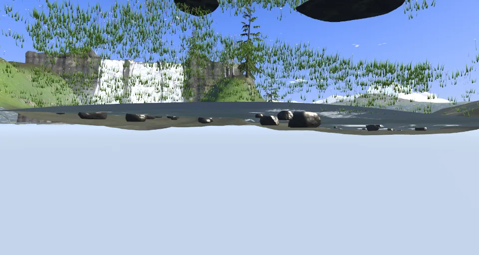 | 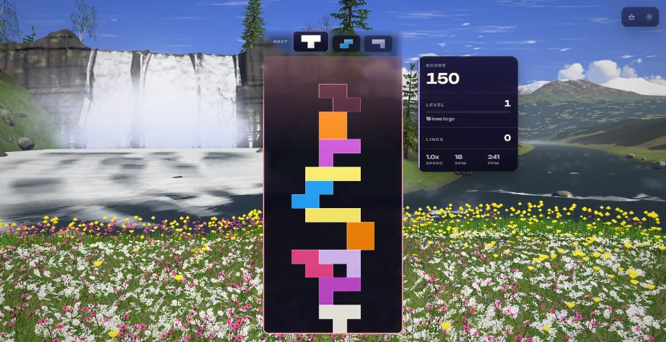 | 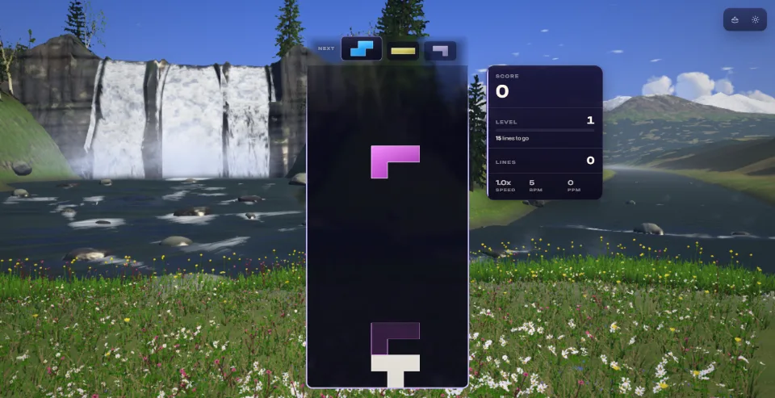 | 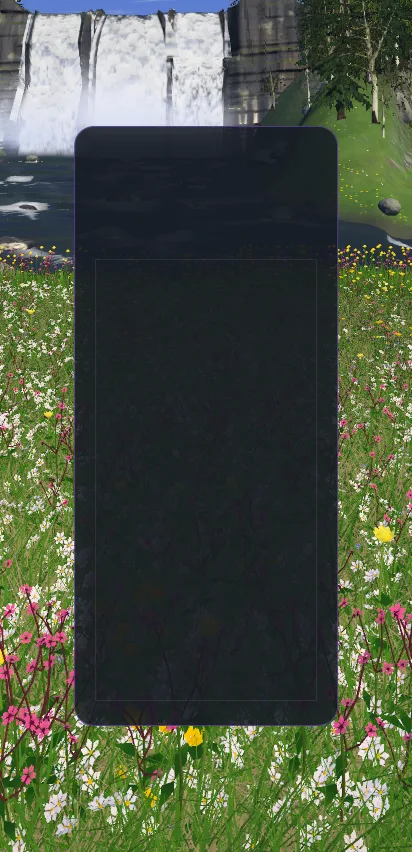 |

- **The icon:** from the eye on the knoll over its flowers to the fall
  (`?effect=spring&t=10&hour=0.3&quality=High&icon=1`, the lens is `icon=1`'s default) at
  852 × 852, cut to a 512 px circle and judged at 80 px.

  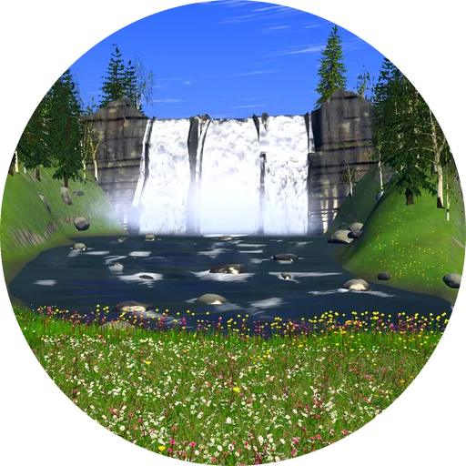

- **Not done:** no physical phone, no perf reading in Performance mode, and the clock-only drift
  strip was not re-taken after the remake (the unit tests pin the day's drift and step). The song
  is the Moonlit Forest recording, retitled; a new Spring song was not asked for.

## Performance pass (2026-10-19)

The owner asked for 130+ fps on the RTX 3070 laptop at **Extreme**, with the look kept. Every
change below draws the same picture; none lowers a tier's content.

**How it was measured.** The session ran in a cloud container with no GPU. The playground's
`effect=spring&quality=Extreme&t=10&hour=0.3` was drawn on SwiftShader, Chromium's software
WebGPU (headed under Xvfb, `--use-webgpu-adapter=swiftshader --disable-gpu-watchdog`), at
1280 × 720 with the tier's 4× MSAA. Each part was drawn alone at full and at quarter resolution:
fragment cost scales with the pixels and vertex cost does not, so the two times split them. The
untouched commit ran from its own worktree as the A (both runs with HMR off). Two A runs gave
bit-identical frames, so every difference below is the change's own. A software renderer gives
the parts' relative costs and exact pictures, **not the laptop's frame rate**: that still has to
be read on the laptop (below).

**Where Extreme's frame went.** Triangles drawn a frame, counted from real builds:

| | Before | After |
|---|---:|---:|
| Modelled trees, Extreme (foliage + bark) | 9.01 M (7.87 + 1.15) | 3.23 M (2.09 + 1.15) |
| Modelled trees, High | 4.25 M | 1.55 M |
| Whole scene, Extreme | ≈ 13.8 M | ≈ 8.1 M |
| Meadow · land · rocks · step face · river (unchanged) | 2.72 · 0.83 · 0.74 · 0.20 · 0.23 M | same |

The forest alone was two thirds of the frame's triangles, and most of it was the weeping birch
(`birch-hero`, 1,550 sprays of 24 leaves, every leaf a fan of 18 triangles), of which Extreme
plants 21. On the software renderer the forest drawn alone went from 6.2 s to 3.3 s a frame, its
resolution-independent share from 5.3 s to 2.6 s; the whole frame from 24.4 s to 22.5 s (the
meadow and the land, which keep their geometry, carry most of what is left there; whole-frame
times on SwiftShader vary by about a tenth between runs).

**What changed.**
- **The far leaves** (`spring-forest.js` `LEAF_LOD`, `thinSpray`, `leafLod`). The nearest modelled
  tree stands 72 m from the eye and the nearest weeping birch 83 m; a leaf is six centimetres,
  1-1.4 px in a 1600-pixel frame. Past 40 m (every modelled tree) a leaf is drawn from its stalk,
  its tip and the two corners at its stalk: two triangles, grown about the stalk to the leaf's
  own area, so the crown keeps every leaf, its placing, colour and light. A spray's twig (a
  three-sided tube) keeps its first, middle and last rings. The grove birches' four-triangle
  strand leaves, the spruces' shoots and all bark are untouched, and the impostor atlas still
  bakes every spray whole. Same trees, same sprays, same 16 draws.
- **The ground is drawn after the river** (`spring-land.js`): the land, the heaviest opaque
  material, was drawn before the river and shaded under the whole water surface. It now comes
  after the stones, the trees, the meadow and the river. Far off the depth buffer cannot separate
  the river from its bed and shallow banks (its steps are half a metre at 1 km, 2.4 m at 2 km);
  the river used to win those ties by being drawn second, so the land now uses a strict depth test
  and still loses them.
- **Nearest first** (`spring-impostors.js`, `spring-meadow.js`): the woods' 18,000 cards and the
  meadow's plants are stored nearest the eye first, so the near ones fill the depth before the
  thousands behind them are shaded. The eye stands still, so the order holds for every frame.
- **The mist** (`spring-mist.js`): 600 puffs lie up to 170 deep where the tongues land (six
  screens of blended fragments at Extreme, by projecting the layout). A puff's card is now an
  octagon whose sides touch the circle its square's sides touched (a sixth fewer fragments; past
  that circle a puff was already as faint as at the square's own edges), and what is the same
  over a puff (its forward scatter, the air's clarity to it, its height's lift) is worked out per
  corner instead of per pixel.
- **Effects at rest** (`spring-floes.js`, `spring-flights.js`): with no ice on the river and no
  birds out, the floes and the flights no longer rewrite and upload every matrix each frame.

| The frame, before and after (SwiftShader) | The weeping birches' crowns at about five-fold, before and after |
|---|---|
| 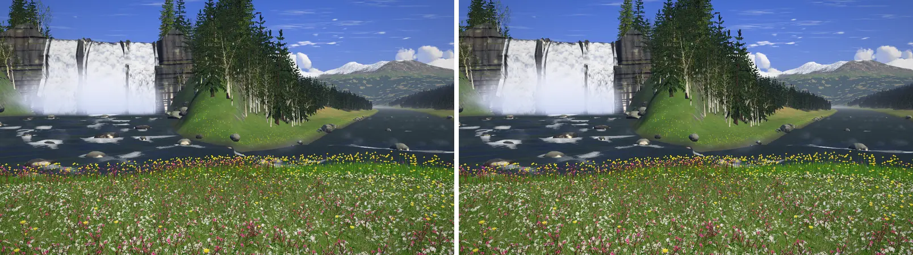 | 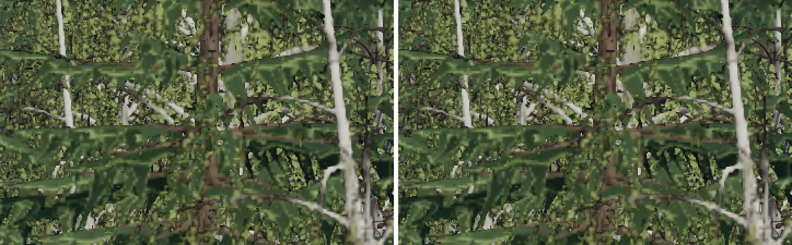 |

**The pictures.** The frame differs from the A by 0.08 of a level (of 255) on average; 0.14 % of
its pixels by more than 8 levels, all of them single pixels at leaves' edges in the crowns and
along the mist's puffs. Close-ups at four to five times (the weeping birches over the fall, the
left bank's birches, the fall, the meadow, the far woods) differ in 0.02-0.8 % of pixels, the
same way. The meadow, the river and the far river's banks show no change. No WebGPU validation
errors or console warnings in any run.

**Gates.** The Spring unit tests (eight files, 198 tests, with the new `spring-perf.test.js`:
the far leaves and twigs, the mist's card, the draw order and depth test, the meadow's order, the
effects at rest), typecheck and the Spring files' lint (0 errors, 0 warnings).

**Not done, for the laptop.** No frame rate was read on the RTX 3070. To read one, in Performance
mode on AC: `node scripts/validate-all-themes.mjs --theme spring --perf --perf-quality Extreme
--perf-target-fps 144`, or in the game at Extreme with the frame-rate cap off. If Extreme still
falls short, what is left by size is the meadow's 2.7 M triangles (the foreground: kept), the
bark's 1.15 M (the weeping birch's drooping limbs: halving their rings would show), the boulders'
0.74 M (5,120 triangles each, many over 80 m off: a clustered far version is the next candidate)
and the mist's blending under 4× MSAA.

## The air (2026-10-19)

The valley's air was empty between events. It now carries willow down and birch pollen on the
breeze, and gameplay throws more into it, after Grainfields' motes (closed-form air everywhere,
a ring of event motes where something happens).

- **The air** (`spring-air.js`): one mesh of camera-facing quads with no instance data at all.
  Where a mote is follows from its index and the air's clock in the vertex shader: a home at a
  bearing and a distance from the eye (log-spaced from 2.2 to 85 m, so the near air is as full as
  the far), a run down the breeze (0.86, −0.51, the meadow's) from it, a wobble across it and a
  bob. Three in ten are down (14–28 mm, white, lit by the sun from any side and blazing against
  it), the rest pollen (5–11 mm, gold, flickering as it turns). Lit as fine matter in the air:
  forward scatter, the sky's fill, the valley's haze (`airClarity`). Its light is worked out once
  a corner, and a mote drawn wider than it is (the floor is about a pixel and a half) spreads its
  light thinner, so far specks neither shimmer nor glare. 320 (Minimal) … 2,400 (Extreme).
- **What the game does to the air**, through uniforms the world writes: a lock's patch row (the
  air within about three metres of it puffs out, up and lights); a clear's breath
  (`u.airWave`: a band running out from the eye at 11 m/s that lifts and lights what it
  passes); a chain's stir (`u.air.z`, eased in over a second and out over several: more of the
  motes show, they wobble wider, and the air's own clock (`u.air.x`, integrated, so it never
  jumps) runs up to 2.3 times as fast); two gyres either side of the card (`u.airGyres`, with
  the angle they have turned in `u.air.y`) that turn the air within about nine metres of them,
  the inner faster, and lift it; back-to-back's glory makes every mote sparkle; a perfect clear
  stills the air (`u.air.w`: its clock slows to 0.15 of its pace) and turns it gold.
- **What gameplay throws into the air** (`spring-motes.js`, the world's bursts): pollen in the
  piece's colour lifted toward white, so the blue S still reads; down; glints; and a whirl kind
  that circles a centre as it climbs, its circle widening with height (a funnel). What floats
  drifts off down the breeze, faster the older it is. The table under "What gameplay does" says
  which event throws what. Bursts are sized by the square root of the tier's ring (384 …
  2,304), skipped under reduced motion (the air then drifts at 0.4 of its pace), and every
  clock the air reads is session state, so a seek or a rebuild in place gives the same air.

**Traps.**
- `patch` is a reserved word in WGSL. A TSL `Loop` named `patch` built cleanly through both node
  builders and was refused by Tint in the first capture (the air's pipeline was invalid, the
  frame's command buffer with it). `tests/unit/spring-air.test.js` now fails on a reserved
  word declared as a name.
- A whirlwind's foot was hidden: the first sites (13–15 m out) lie on the knoll's far slope,
  under the sightline over its brow, so a whirl showed only once it had climbed past it. The
  gyres stand on the knoll's top now, 9.5 m out, in the middle of the free strip left of the
  card and right of the card or the HUD beside it, worked out from the lens at rest (portrait
  included) whenever the viewport or the layout changes.
- A lock's pollen first read as more flowers: small specks of the flower's own colour among the
  flowers. It now arcs up clear of the meadow, glows lifted toward white, and the opening cups
  glint.
- The first air was too faint to read (272 pixels over six levels in an 800 × 450 frame): the
  motes are larger now, down is lit from any side, and more of the air shows at rest.

**Checks.** A CPU replay of every burst's motion against the terrain (on screen, not under the
brow; `burst-vis` in the session's scratchpad, not shipped) placed each one: a lock's pollen
rises through the frame on its side; the clear's lanes cover both sides; the whirls rise left of
the card (x 0.05–0.19) and right of the HUD (0.71–1.0); a level up's down crosses the upper left,
the perfect shower the sky. SwiftShader captures (WebGPU, Low 800 × 450 and Medium 1280 × 720),
no validation errors or console warnings in any.

| Golden evening: the air against the sun | A hard drop of the S: its blue pollen |
|---|---|
| 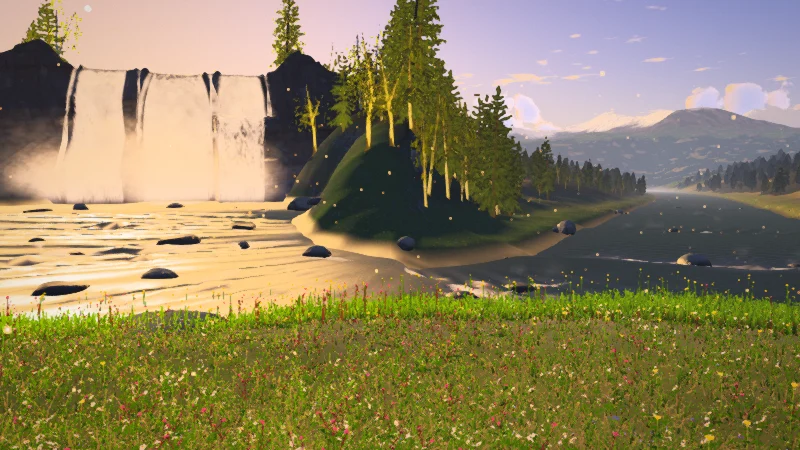 | 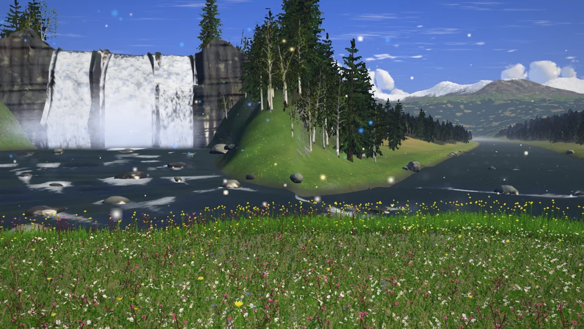 |
| **A chain of six, with the board** | **Three lines: the breath and the lanes** |
| 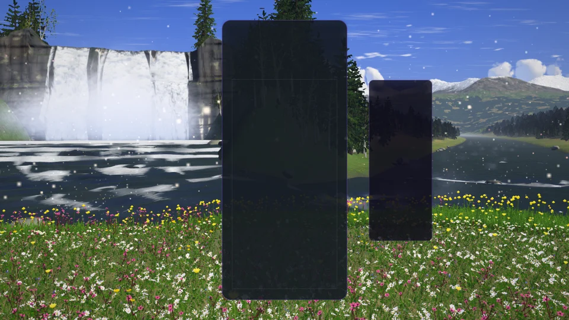 | 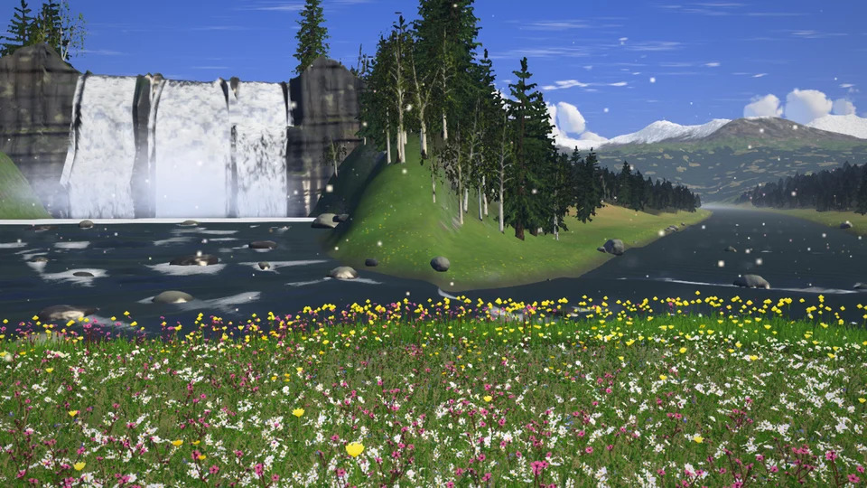 |

**Cost.** Two draws: the air (2,400 quads at Extreme, 9,600 vertices, each a handful of hashes,
an eight-step loop over the patch rows and the haze; no texture reads) and the ring (2,304 quads,
most of them idle and clipped in the vertex stage). The fragments are a Gaussian each over a few
pixels (a near tuft about twenty). Not measured on the RTX 3070; against the 8.1 M-triangle
frame of the performance pass it is noise.
