# Spring — the river in its spring flood (2026-10-18)

The owner asked for the Moonlit Forest theme to be remade from scratch and renamed **Spring**,
to complete the four seasons beside Summer, Fall and Winter, on three r186.1, "a visual
masterpiece, complete with amazing piece-lock and combo effects", from `main`. A first pass built
Dutch bulb fields; the owner was not sure about it and asked for "spring, with flowers, a
floating river in a beautiful northern Swedish landscape … the most beautiful pouring river,
and Swedish landscape with flowers", and later that "all the trees must look better also, like
the high detailed trees that we also have". This is that remake; the bulb fields are gone.

Spring takes Moonlit Forest's registry slot (group `biomes`, a heavy-GPU theme), its Odyssey orb
(orb 12 of the campaign, authored id 13, renamed "Spring Flood" with its description and tip rewritten for the
river; it follows Grainfields, the chapter's opener, which took Misty Lake's orb the same day) and its song (the same recording,
retitled "Spring" and renamed `spring.mp3`; the track key `MoonlitForest` resolves to `Spring`).
`moonlit-forest` is an alias of `spring` in `RETIRED_THEME_IDS`, so saved selections, collection
grants and Odyssey completions that name it now mean Spring. The frozen V2 save table keeps
`moonlit-forest` (PLAYBOOK §4.5). The old theme (a 694-line wrapper over a "Silverheart Glade"
playground scene, its FX controller, tests and icon) is removed.

| Moonlit Forest (before) | Spring (after) |
|---|---|
| 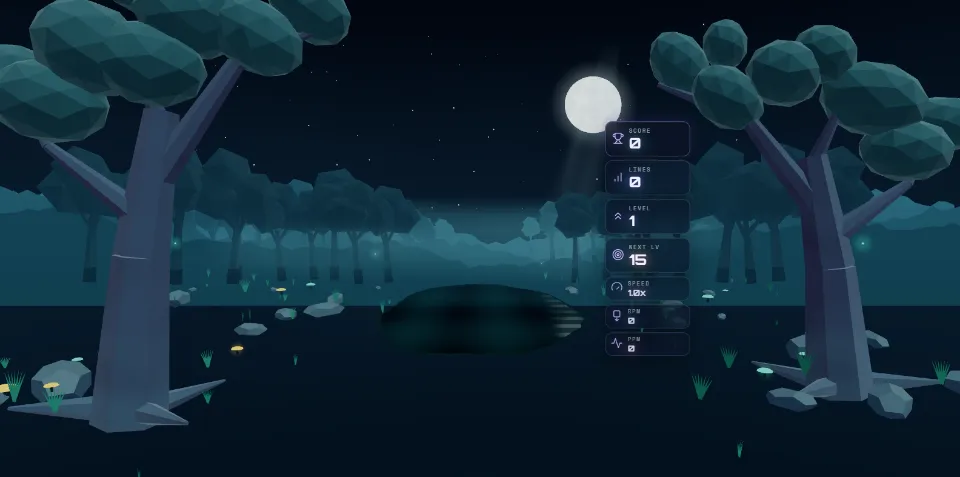 | 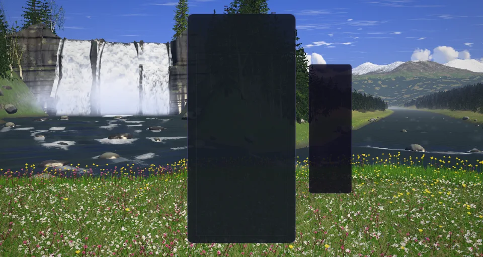 |

To look at it: `npm run dev`, then `/playground.html?effect=spring&t=10&hour=0.3&board=1`
(`hour` 0 morning, 1 afternoon, 2 golden evening, 3 sunset, 4 light night, 5 dawn mist;
`event=lock|drop|clear|quad|twist|perfect|levelUp|release|over` with `eventAge`; `combo=<n>`,
`b2b=<n>`, `locks=<n>`, `shape=<piece>`; `look=x,y,z,fov` and `eye=x,y,z` for close-ups;
`icon=1` for the icon's lens; `atlas=albedo|normal` shows the woods' impostor atlas). In the
game: `/?unlockAll=1&skipIntro=1`.

## The subject

A Norrland river at the end of May, in the spring flood, at 65° north: the sun barely sets, the
birches are in first leaf, the fells still hold snow in their gullies, and the meadows by the
water are white with wood anemones, yellow with globeflowers and marsh marigolds, pink with red
campion. The eye stands among the flowers on a low granite knoll at the outside of a bend. Up to
the left the river pours over a step of dark schist in tongues (the model is Tännforsen in
Jämtland: a broad fall cut into a layered rock step, ribs of rock parting its water), churns in
its plunge pool, comes down toward the knoll in a staircase of rapids, swings round under it and
runs away to the right through spruce and birch toward the fells.

**The theme's idea: the flood is your play.** Each piece is a flower of the meadow, and a lock
makes a patch of its flower burst into bloom where it landed; clears send surges down the river;
a chain is the spring flood rising.

## The picture

- **The fall** (`spring-fall-plan.js`, `spring-fall.js`): the river has cut a notch into its step
  and comes over in tongues. The main tongue, thick and glassy at the brink, leaps free from a
  recess it has worn under the lip; to its left the water slides down a stair of slabs and risers,
  whitening at each step; to its right a thinner tongue lands on a ledge and runs off it; ribs of
  wet rock part them, threads spill over the ribs. One plan describes it all: the rock face (where
  the rock stands at every height across the step), and each column's path down it, traced by
  letting the water fall (free, sliding down a slab under gravity and drag, landing on a ledge and
  running off it). The water is a sheet of 190 columns × 150 rows along those paths; it is read by
  the moment each parcel left the lip, so its streaks fall at the true, quickening speed; glassy
  for the first moments, then torn white in billows and ropes, fraying lower down into strands that
  show the wet rock; it fans out as it falls; low down it is lost in its own spray. The rock face
  is a grid laid on the plan: dark schist in bedded layers (each standing a little in or out, so
  the face climbs in ledges) cut by cracks, its overhangs, hollows and joints darkened per vertex,
  wet and near-black where the water and the spray reach, lichened, mossy and turfed where they do
  not. The mist rises where each tongue lands and where the water bursts on the rock.
- **The river** (`spring-river.js`): the upper reach (each column stopping at its own lip,
  drawing down over the brink), then the pool and the rapids. The pool boils where the tongues land
  (`poolBoil`, from where each column's path meets the water), milky where it is torn; the rapids'
  ledges slant and wander, pouring white in places and sliding through as smooth tongues in others.
  A two-phase flow map moves foam, streaks and ripples at the local speed; every foam threshold is
  widened by its own footprint on screen, so nothing sparkles or blots at a grazing angle.
- **The woods** (`spring-forest.js`, `spring-impostors.js`, `spring-woods.js`): the nearest trees
  are the modelled birches and spruces (Blender-authored, every spray of leaves an instance).
  Every other tree of the valley — about ten thousand on High, out to 2.3 km — is a card of one of
  those same models: as the world is made, each model is drawn side on, two turns of it, into an
  atlas by the forest's own materials in a bake mode (albedo and coverage in one texture, normals,
  occlusion and leaf share in another), and the cards are lit from it by the hour's sun and sky as
  the models are, so the far woods are the near trees, not stand-ins. Spruce grows down the gorge's
  slopes and along the step's rim; a birch and a spruce stand on the rim either side of the fall.
- **The valley** (`spring-terrain.js`): one height function from the river's plan (two reaches,
  the step, the notch's shoulders either side of the lip, the gorge, the knoll, the fells), baked
  offline into three grids (`scripts/spring/bake-valley.mjs` → `assets/spring-valley.bin`) that the
  land, the trees, the flowers and the rocks all read. Far off, the forest's edge frays into stands,
  tongues and bogs at the far country's own scale; above the treeline the heath is pale with lichen
  on the ridges and dark in the shelter, and the snow lies on the tops and runs down the gullies.
- **The meadow** (`spring-meadow.js`, `spring-flowers.js`): modelled grass and seven spring
  flowers, one per piece (globeflower I, marsh marigold O, wood anemone T, hepatica S, red campion
  Z, lady's smock J, violet L).

| The fall | The woods: cards of the modelled trees | The impostor atlas |
|---|---|---|
| 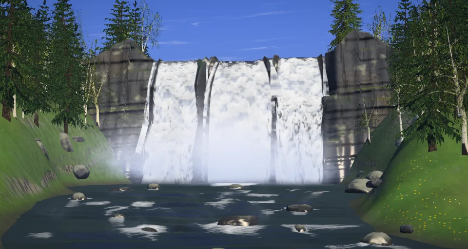 | 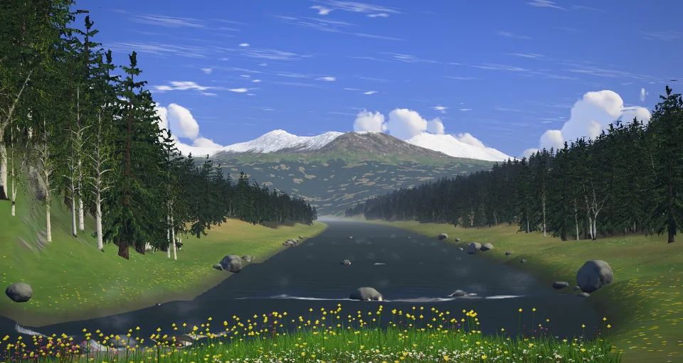 | 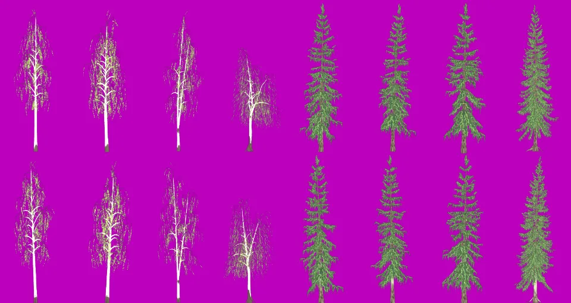 |

## The light

Six stations on a day of the end of May (`spring-hours.js`): **morning**, **afternoon**, **golden
evening**, **sunset** (the sun gone behind the western rim, the fells still lit), **the light
night** (the sun just under the north, a rose band over the fells) and **dawn mist**. The sun's
height is the real one at 65.5° N; the valley loses it behind the skyline at its bearing (a
measured table of the skyline every 10°, `SKYLINE`) while high ground keeps it longer. The day
turns with the clock alone and a level-up steps it a whole station forward on top; no station
rests (the worst rate, measured over a whole turn, is 0.095 stops a second against the house
limit of 0.15).

| Morning | Golden evening |
|---|---|
| 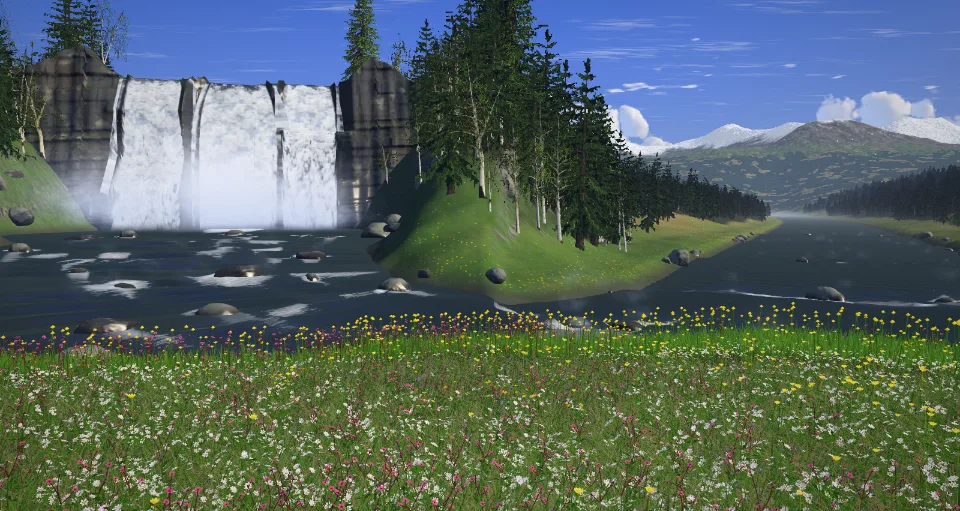 | 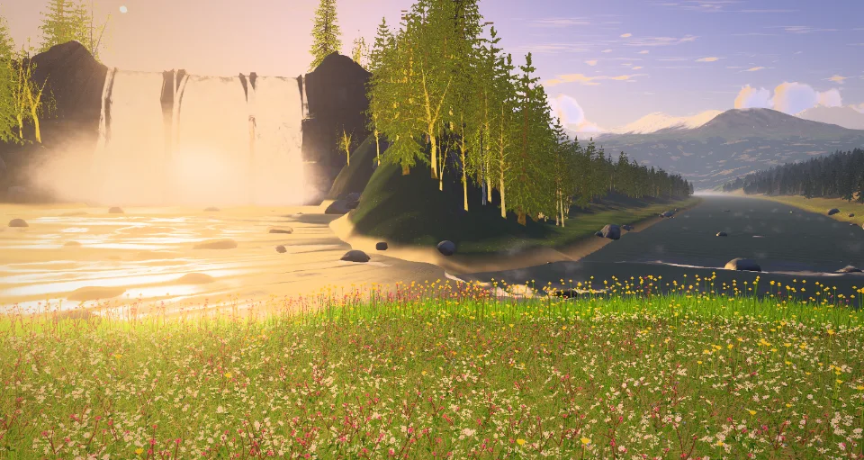 |
| **Sunset** | **The light night** |
| 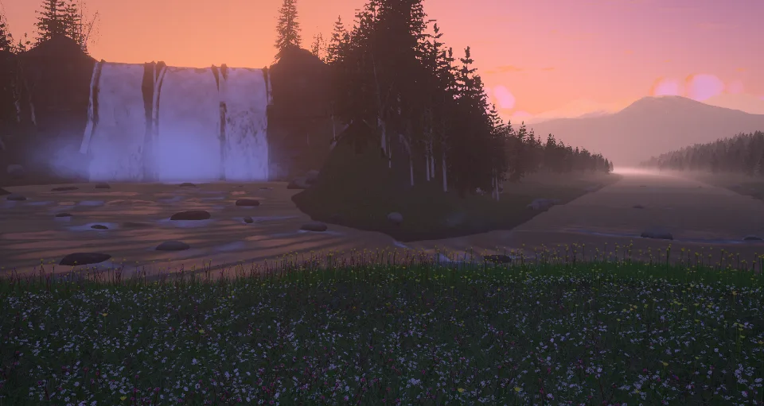 | 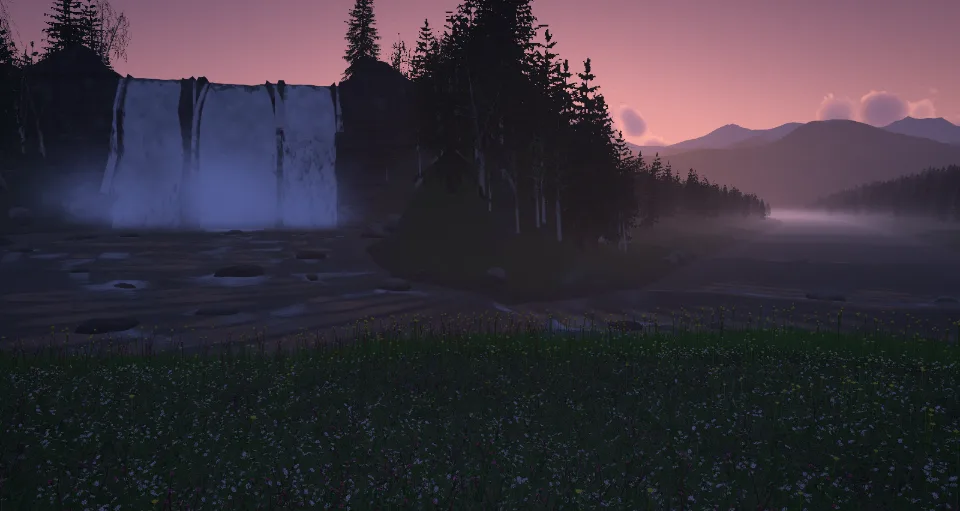 |
| **Afternoon** | **Dawn mist** |
| 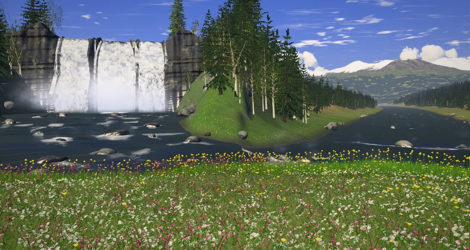 | 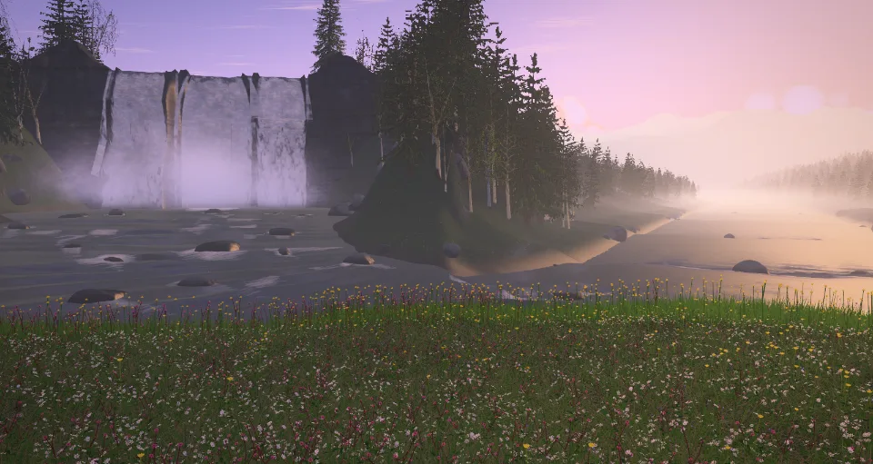 |

## What gameplay does

| Event | What happens |
|---|---|
| Lock | A patch of the piece's own flower bursts into bloom on the knoll where it landed, opening outward from the spot (on the water it splashes, and the patch opens on the knoll's edge at the same bearing). The piece's own pollen is shaken up out of the patch and drifts off on the breeze, and the air round it puffs out, up and lights; a hard drop shakes out more and knocks a ring of down off the plants. |
| Clear | One surge down the river from the pool, the bigger the more lines: a hump of water with a steep front that breaks white across the river like a bore, the water behind it streaked with the foam it threw; the whole knoll flushes into bloom. Pollen and down lift off both sides of the card in the cleared rows' colours (each side its half of the board), and a breath runs out through the air from the eye. |
| Chain | The spring flood rises with each link: the river swells and runs whiter in streaks, faster, and the fall's mist thickens; when the chain breaks it falls back. Each link spins up a whirlwind of pollen and down beside the card, on alternate sides and stronger each time; the air thickens, hurries down the breeze and turns in two gyres; a broken chain lets its down go over the knoll. |
| Four lines | The great surge, and the last of the winter's ice goes out on it: floes come down from the pool and run the rapids. |
| T-spin | The pool turns in a whirl where it drains, arms of foam winding into a dark eye, spray flung off its rim; a whirlwind turns beside the card on the lock's side. |
| Back-to-back | The river glitters while the run lasts; each step strikes a scatter of glints off the ripples in front of the knoll, and the air's motes sparkle. |
| Perfect clear | Two surges, and whooper swans come over the valley; the air stills and turns gold, and gold pollen and down shower slowly over the knoll and the river. |
| Level up | The day steps a station forward (it also turns with the clock alone); cranes pass over on their way north, and willow down drifts over the knoll from upwind. |
| Game over | The light falls to dusk; it comes back with the next run. |

| Lock | Three lines | Chain of 6 |
|---|---|---|
|  | 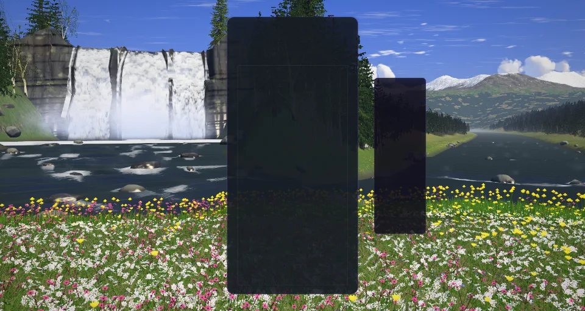 | 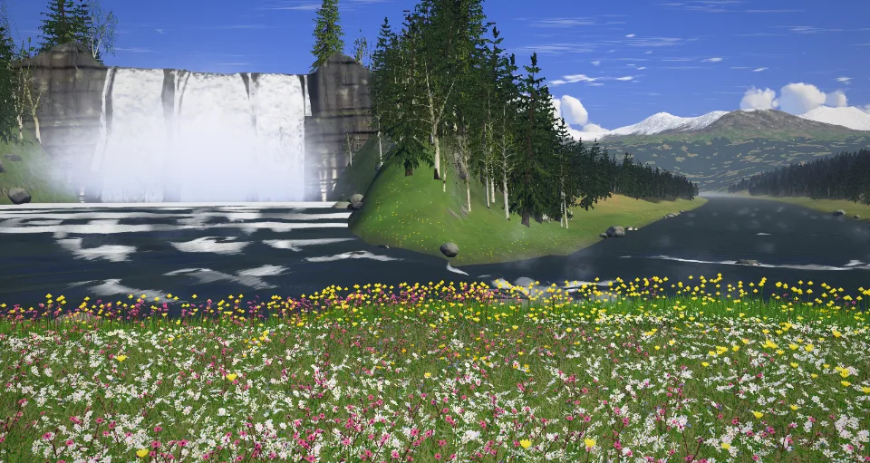 |
| **Four lines** | **T-spin** | **Perfect clear** |
| 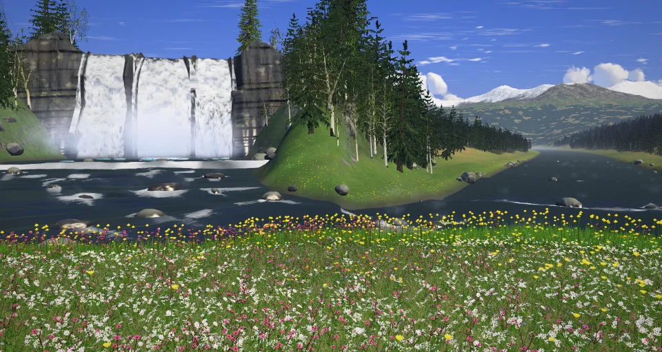 | 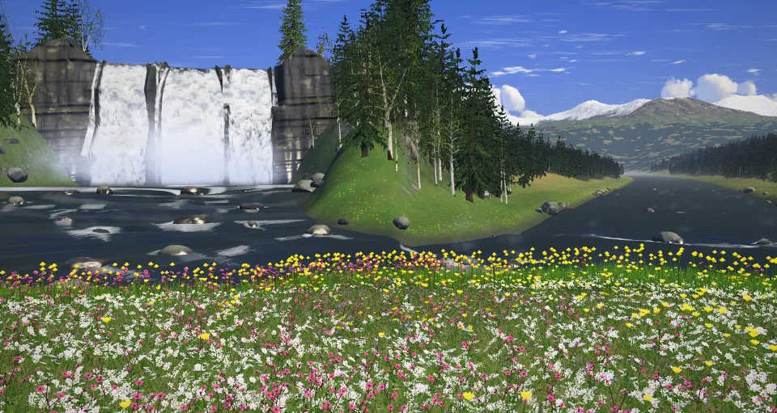 | 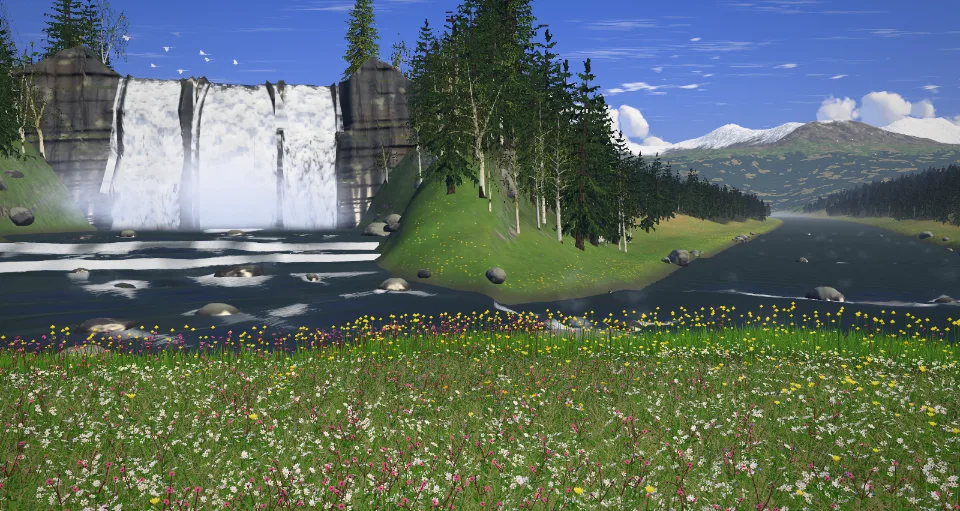 |
| **Chain of 9** | **Level up (cranes)** | **Back-to-back** |
| 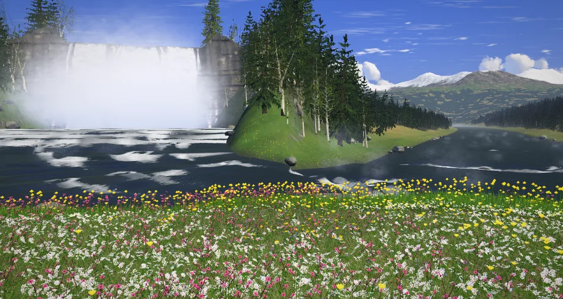 |  | 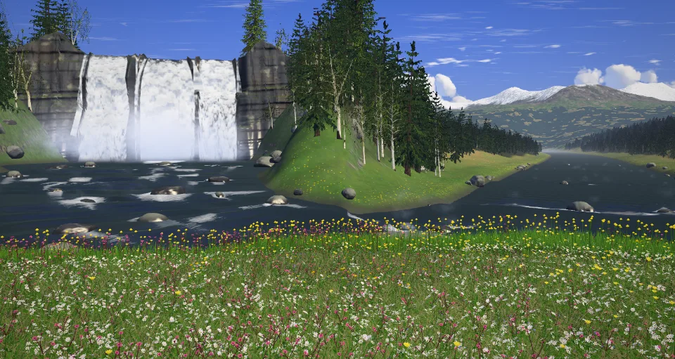 |

Every reaction is closed-form in the theme clock or written into preallocated slots (patches of
bloom, surges, floes, birds, motes), so `seek(t)` plus a fixed-step replay reproduces any frame.

## Quality tiers

Every tier keeps every part and every beat. Tiers scale the grass and flowers, the land fan, the
river ribbon, the fall's sheet (70–270 columns) and rock face (120–420 columns), the modelled
trees and their sprays, the woods' cards (1,500 … 18,000) and their atlas's texels (128–384 a
tree), boulders, the air's motes (320 … 2,400) and the ring gameplay throws into it (384 …
2,304), mist, floes, birds and the pixel-ratio cap.

## Decisions and traps

- **The fall was a weir.** The first river's fall was one ballistic sheet off a straight lip: it
  read as a dam's spillway. It is now a plan of tongues, ribs and a sculpted step, with every
  column's path traced over the rock it runs on (the plan's tests pin that no path passes through
  the rock, in the air, down a slab or off a ledge).
- **A renamed loop variable.** `riverNearest`'s refine loop once named its segment start `k0`,
  shadowing the window's bound; renaming it to `a` missed one use, so every nearest point snapped
  to the window's first sample: the knoll's flowers lost their water edge and vanished. Probe
  heights and edges against the previous bake before trusting a re-bake.
- **The woods.** Simple lathe spruces and icosahedron birches read as toy trees beside the
  modelled ones, so the far woods are now cards of the models themselves (an impostor atlas drawn
  once by the forest's own materials). A render target's v = 0 is its top row in r186; the cards
  read the atlas y-down.
- **Blotches on the water.** At a grazing angle a pixel covers metres of water along the flow:
  metre-scale foam rafts thresholded hard became white tiles, and the flood's foam boost laid
  white over calm water in blotches. Thresholds are widened by their own `fwidth`, far off the
  rafts give way to the fine churn, the flood scales the white water instead of adding to calm
  water, and a surge's white is a steep breaking front plus lines behind it.
- **A surge seen edge-on.** From the knoll the pool lies almost level with the eye; a surge with a
  gentle 9 m face foreshortened to a hairline. Its front is now 1.8 m long, so it stands up.
- **Clearings on the fall's slopes.** A forest clearing 170 m across happened to fall on the
  gorge's slope beside the fall, leaving it bare grass; round the fall the woods have no
  clearings and grow on slopes steeper than elsewhere.
- **Far canopy.** Per-vertex forest cover is smooth over the far rows' tens of metres, and the
  land's metre-scale reads are a single mean colour there: the far woods read as blobs. Far off
  the canopy is read without clearings and broken by bogs and a frayed edge at the far scale.
- **Woods missing at some starts (fixed 2026-10-19).** The woods' cards are drawn from the
  impostor atlas, baked once at start and kept. Its warm `compileAsync` read the depth and stencil
  from the theme's renderer, which has none (the scene pass owns depth), where a render reads them
  from the target (r186 `Renderer.js:953` against `:1843`): it compiled pipelines without the
  atlas's depth, and the bake needed others. Without the app's async pipelines those compiled in
  the bake and it was whole; under them (a start under a loading surface, a hidden prewarm, an
  in-play switch, ADR-0020) they were left for later, every draw of the bake was skipped and the
  empty atlas was kept, so the far woods were missing for the session while the modelled trees
  near the eye stood (SwiftShader, real atlas: 0 of 16 draws, 0 of 13 478 texels, against 16 of
  16 without a session). Whether a start went through a session decided it: sometimes every tree,
  sometimes not. The warm now compiles for the target's depth (the bake's 15 pipelines async, none
  synchronous); the atlas's targets are one-shot bakes the async pipelines and the build budget
  leave alone (`isOneShotBake`); the bake counts each pass's draws and is drawn again on the next
  frames until every tree is in it (`BAKE_ATTEMPTS`, 600; the cards show once it is whole); and a
  first bake that throws is retried by the next frame instead of giving the woods up. Every tier
  and both backends bake the same way (WebGL2 has no async pipelines). `getDiagnostics().world.woods`
  reports the atlas (baked, failed, attempts); `tests/unit/spring-woods-bake.test.js` pins it.
  The atlas as each bakes it under a session: `spring-captures/woods-atlas-session-ab.webp`.
- **Woods missing on WebGL2, so on phones (fixed 2026-10-27).** The atlas's smaller levels were
  empty on the WebGL2 backend, so every card but the nearest few was cut away; see "The woods on a
  phone (2026-10-27)" at the end.

## Verification

All on the RTX 3070 laptop (`force_high_performance_gpu`), through the playground's batch capture
and the real game on the dev server. **The laptop was in Silent mode throughout (the owner's
note), so every frame rate below is directional only**; perf must be re-measured in Performance
mode. Captures are under `.cache/spring/` in the build worktree; the doc's frames are in
`spring-captures/`.

- **Playground:** every hour, every event, chains of 2, 6 and 9, the fall, the pool and the rapids
  close up, the woods and the fells, the impostor atlas (albedo and normals), High and Low on
  WebGPU, Low and Minimal on WebGL2 (`forceWebGL=1`, the atlas included), a 412 × 915 portrait and
  the icon's lens. No WebGPU validation errors: the only console lines are the blocked HMR socket
  and Electron's CSP notice.
- **The real game** (`/?skipIntro=1&themeValidation=1&unlockAll=1`, theme pinned): keyboard hard
  drops, a two-line clear, a chain, four lines, a chain break, game over and a level-up through
  the app's own event bus; 0 dropped events on every run.
  - WebGPU, High, 1584 × 813: 130.1 fps at rest, 126.6 through four lines (display-limited, in
    Silent mode). The level-up stepped the light from morning to afternoon.
  - WebGL2 (`forceWebGL=1`), Low: 130.4 fps at rest, 126.7 through four lines.
- **Gates** (in the build worktree): typecheck, `lint:ci` (550 errors against the 574 baseline;
  the Spring files lint with 0 errors and 0 warnings), `check:boundaries` (1,802 modules),
  `npm run build` with the boot closure, the URL parameter catalogue. The theme's unit tests
  (seven files: core, hours, world, director, theme, rename migration, and the fall's plan with the
  impostor atlas's layout) pass. `check:pages-artifact`, `check:release-gates`,
  `audit:theme-lifecycle`, `check:ip-strings` over `dist/`, `perf:budgets:gate` and the full suite
  were not re-run after the remake.

| Minimal on WebGL2 | In the game: four lines | In the game: WebGL2, Low | A phone-shaped window |
|---|---|---|---|
| 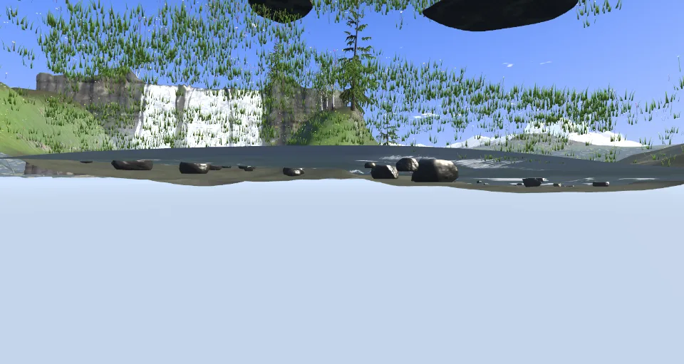 | 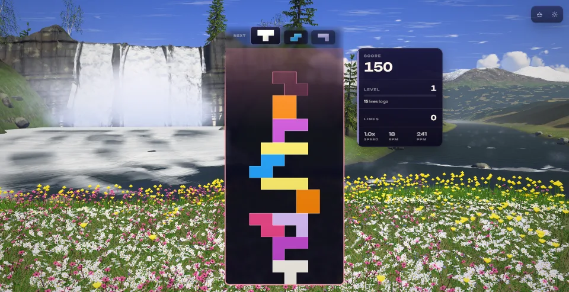 | 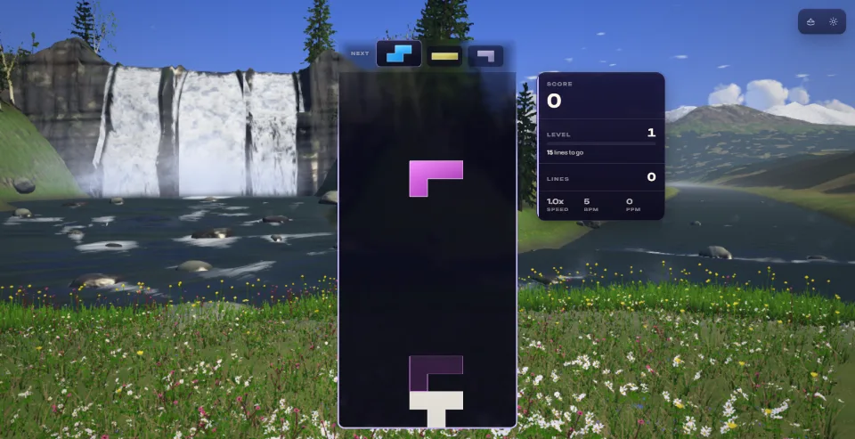 | 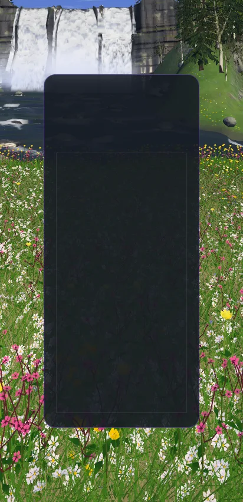 |

- **The icon:** from the eye on the knoll over its flowers to the fall
  (`?effect=spring&t=10&hour=0.3&quality=High&icon=1`, the lens is `icon=1`'s default) at
  852 × 852, cut to a 512 px circle and judged at 80 px.

  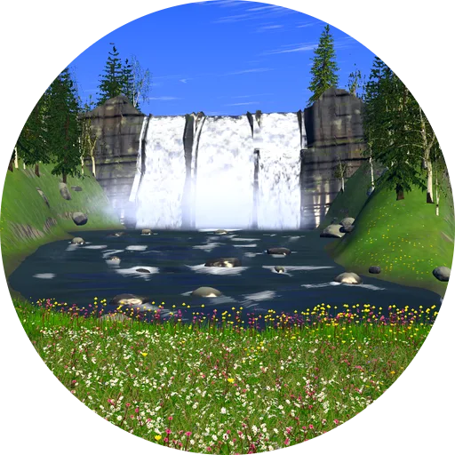

- **Not done:** no physical phone, no perf reading in Performance mode, and the clock-only drift
  strip was not re-taken after the remake (the unit tests pin the day's drift and step). The song
  is the Moonlit Forest recording, retitled; a new Spring song was not asked for.

## Performance pass (2026-10-19)

The owner asked for 130+ fps on the RTX 3070 laptop at **Extreme**, with the look kept. Every
change below draws the same picture; none lowers a tier's content.

**How it was measured.** The session ran in a cloud container with no GPU. The playground's
`effect=spring&quality=Extreme&t=10&hour=0.3` was drawn on SwiftShader, Chromium's software
WebGPU (headed under Xvfb, `--use-webgpu-adapter=swiftshader --disable-gpu-watchdog`), at
1280 × 720 with the tier's 4× MSAA. Each part was drawn alone at full and at quarter resolution:
fragment cost scales with the pixels and vertex cost does not, so the two times split them. The
untouched commit ran from its own worktree as the A (both runs with HMR off). Two A runs gave
bit-identical frames, so every difference below is the change's own. A software renderer gives
the parts' relative costs and exact pictures, **not the laptop's frame rate**: that still has to
be read on the laptop (below).

**Where Extreme's frame went.** Triangles drawn a frame, counted from real builds:

| | Before | After |
|---|---:|---:|
| Modelled trees, Extreme (foliage + bark) | 9.01 M (7.87 + 1.15) | 3.23 M (2.09 + 1.15) |
| Modelled trees, High | 4.25 M | 1.55 M |
| Whole scene, Extreme | ≈ 13.8 M | ≈ 8.1 M |
| Meadow · land · rocks · step face · river (unchanged) | 2.72 · 0.83 · 0.74 · 0.20 · 0.23 M | same |

The forest alone was two thirds of the frame's triangles, and most of it was the weeping birch
(`birch-hero`, 1,550 sprays of 24 leaves, every leaf a fan of 18 triangles), of which Extreme
plants 21. On the software renderer the forest drawn alone went from 6.2 s to 3.3 s a frame, its
resolution-independent share from 5.3 s to 2.6 s; the whole frame from 24.4 s to 22.5 s (the
meadow and the land, which keep their geometry, carry most of what is left there; whole-frame
times on SwiftShader vary by about a tenth between runs).

**What changed.**
- **The far leaves** (`spring-forest.js` `LEAF_LOD`, `thinSpray`, `leafLod`). The nearest modelled
  tree stands 72 m from the eye and the nearest weeping birch 83 m; a leaf is six centimetres,
  1-1.4 px in a 1600-pixel frame. Past 40 m (every modelled tree) a leaf is drawn from its stalk,
  its tip and the two corners at its stalk: two triangles, grown about the stalk to the leaf's
  own area, so the crown keeps every leaf, its placing, colour and light. A spray's twig (a
  three-sided tube) keeps its first, middle and last rings. The grove birches' four-triangle
  strand leaves, the spruces' shoots and all bark are untouched, and the impostor atlas still
  bakes every spray whole. Same trees, same sprays, same 16 draws.
- **The ground is drawn after the river** (`spring-land.js`): the land, the heaviest opaque
  material, was drawn before the river and shaded under the whole water surface. It now comes
  after the stones, the trees, the meadow and the river. Far off the depth buffer cannot separate
  the river from its bed and shallow banks (its steps are half a metre at 1 km, 2.4 m at 2 km);
  the river used to win those ties by being drawn second, so the land now uses a strict depth test
  and still loses them.
- **Nearest first** (`spring-impostors.js`, `spring-meadow.js`): the woods' 18,000 cards and the
  meadow's plants are stored nearest the eye first, so the near ones fill the depth before the
  thousands behind them are shaded. The eye stands still, so the order holds for every frame.
- **The mist** (`spring-mist.js`): 600 puffs lie up to 170 deep where the tongues land (six
  screens of blended fragments at Extreme, by projecting the layout). A puff's card is now an
  octagon whose sides touch the circle its square's sides touched (a sixth fewer fragments; past
  that circle a puff was already as faint as at the square's own edges), and what is the same
  over a puff (its forward scatter, the air's clarity to it, its height's lift) is worked out per
  corner instead of per pixel.
- **Effects at rest** (`spring-floes.js`, `spring-flights.js`): with no ice on the river and no
  birds out, the floes and the flights no longer rewrite and upload every matrix each frame.

| The frame, before and after (SwiftShader) | The weeping birches' crowns at about five-fold, before and after |
|---|---|
| 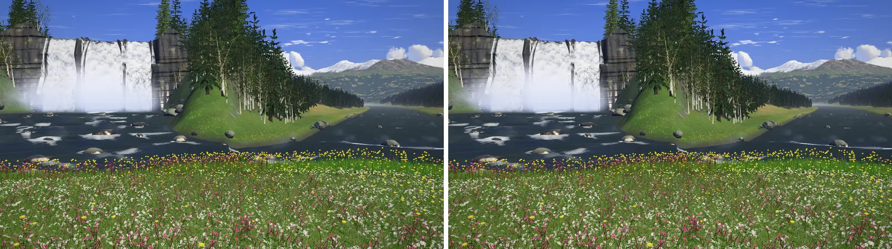 | 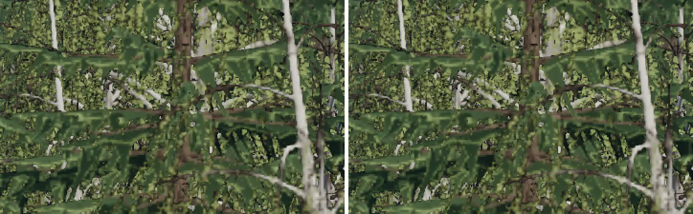 |

**The pictures.** The frame differs from the A by 0.08 of a level (of 255) on average; 0.14 % of
its pixels by more than 8 levels, all of them single pixels at leaves' edges in the crowns and
along the mist's puffs. Close-ups at four to five times (the weeping birches over the fall, the
left bank's birches, the fall, the meadow, the far woods) differ in 0.02-0.8 % of pixels, the
same way. The meadow, the river and the far river's banks show no change. No WebGPU validation
errors or console warnings in any run.

**Gates.** The Spring unit tests (eight files, 198 tests, with the new `spring-perf.test.js`:
the far leaves and twigs, the mist's card, the draw order and depth test, the meadow's order, the
effects at rest), typecheck and the Spring files' lint (0 errors, 0 warnings).

**Not done, for the laptop.** No frame rate was read on the RTX 3070. To read one, in Performance
mode on AC: `node scripts/validate-all-themes.mjs --theme spring --perf --perf-quality Extreme
--perf-target-fps 144`, or in the game at Extreme with the frame-rate cap off. If Extreme still
falls short, what is left by size is the meadow's 2.7 M triangles (the foreground: kept), the
bark's 1.15 M (the weeping birch's drooping limbs: halving their rings would show), the boulders'
0.74 M (5,120 triangles each, many over 80 m off: a clustered far version is the next candidate)
and the mist's blending under 4× MSAA.

## The air (2026-10-19)

The valley's air was empty between events. It now carries willow down and birch pollen on the
breeze, and gameplay throws more into it, after Grainfields' motes (closed-form air everywhere,
a ring of event motes where something happens).

- **The air** (`spring-air.js`): one mesh of camera-facing quads with no instance data at all.
  Where a mote is follows from its index and the air's clock in the vertex shader: a home at a
  bearing and a distance from the eye (log-spaced from 2.2 to 85 m, so the near air is as full as
  the far), a run down the breeze (0.86, −0.51, the meadow's) from it, a wobble across it and a
  bob. Three in ten are down (14–28 mm, white, lit by the sun from any side and blazing against
  it), the rest pollen (5–11 mm, gold, flickering as it turns). Lit as fine matter in the air:
  forward scatter, the sky's fill, the valley's haze (`airClarity`). Its light is worked out once
  a corner, and a mote drawn wider than it is (the floor is about a pixel and a half) spreads its
  light thinner, so far specks neither shimmer nor glare. 320 (Minimal) … 2,400 (Extreme).
- **What the game does to the air**, through uniforms the world writes: a lock's patch row (the
  air within about three metres of it puffs out, up and lights); a clear's breath
  (`u.airWave`: a band running out from the eye at 11 m/s that lifts and lights what it
  passes); a chain's stir (`u.air.z`, eased in over a second and out over several: more of the
  motes show, they wobble wider, and the air's own clock (`u.air.x`, integrated, so it never
  jumps) runs up to 2.3 times as fast); two gyres either side of the card (`u.airGyres`, with
  the angle they have turned in `u.air.y`) that turn the air within about nine metres of them,
  the inner faster, and lift it; back-to-back's glory makes every mote sparkle; a perfect clear
  stills the air (`u.air.w`: its clock slows to 0.15 of its pace) and turns it gold.
- **What gameplay throws into the air** (`spring-motes.js`, the world's bursts): pollen in the
  piece's colour lifted toward white, so the blue S still reads; down; glints; and a whirl kind
  that circles a centre as it climbs, its circle widening with height (a funnel). What floats
  drifts off down the breeze, faster the older it is. The table under "What gameplay does" says
  which event throws what. Bursts are sized by the square root of the tier's ring (384 …
  2,304), skipped under reduced motion (the air then drifts at 0.4 of its pace), and every
  clock the air reads is session state, so a seek or a rebuild in place gives the same air.

**Traps.**
- `patch` is a reserved word in WGSL. A TSL `Loop` named `patch` built cleanly through both node
  builders and was refused by Tint in the first capture (the air's pipeline was invalid, the
  frame's command buffer with it). `tests/unit/spring-air.test.js` now fails on a reserved
  word declared as a name.
- A whirlwind's foot was hidden: the first sites (13–15 m out) lie on the knoll's far slope,
  under the sightline over its brow, so a whirl showed only once it had climbed past it. The
  gyres stand on the knoll's top now, 9.5 m out, in the middle of the free strip left of the
  card and right of the card or the HUD beside it, worked out from the lens at rest (portrait
  included) whenever the viewport or the layout changes.
- A lock's pollen first read as more flowers: small specks of the flower's own colour among the
  flowers. It now arcs up clear of the meadow, glows lifted toward white, and the opening cups
  glint.
- The first air was too faint to read (272 pixels over six levels in an 800 × 450 frame): the
  motes are larger now, down is lit from any side, and more of the air shows at rest.

**Checks.** A CPU replay of every burst's motion against the terrain (on screen, not under the
brow; `burst-vis` in the session's scratchpad, not shipped) placed each one: a lock's pollen
rises through the frame on its side; the clear's lanes cover both sides; the whirls rise left of
the card (x 0.05–0.19) and right of the HUD (0.71–1.0); a level up's down crosses the upper left,
the perfect shower the sky. SwiftShader captures (WebGPU, Low 800 × 450 and Medium 1280 × 720),
no validation errors or console warnings in any.

| Golden evening: the air against the sun | A hard drop of the S: its blue pollen |
|---|---|
| 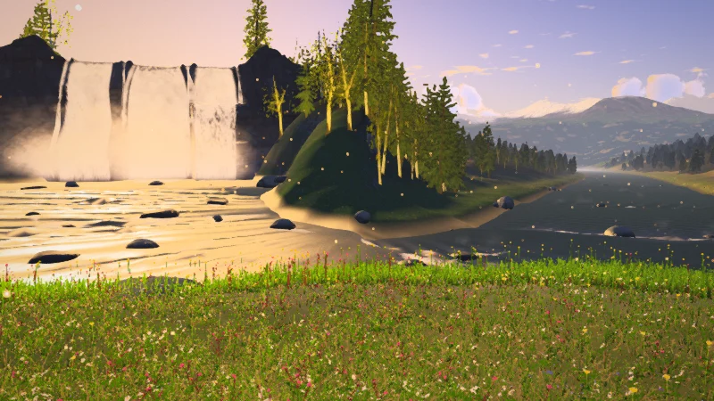 | 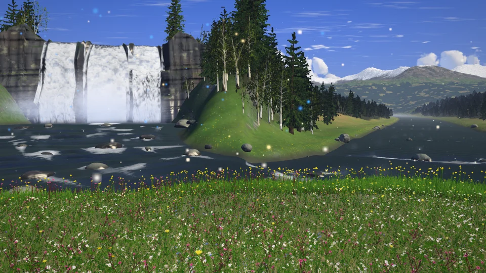 |
| **A chain of three, with the board: the third link's whirlwind right of the HUD** | **That whirlwind, at two seconds** |
| 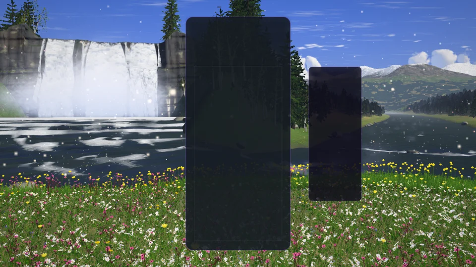 | 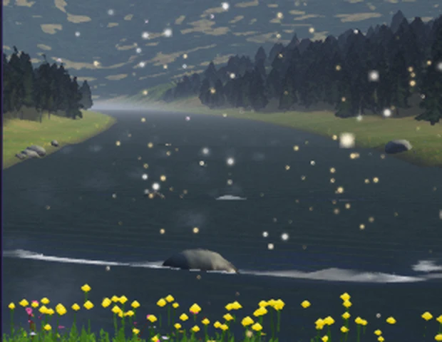 |
| **Three lines: the breath and the lanes** | |
| 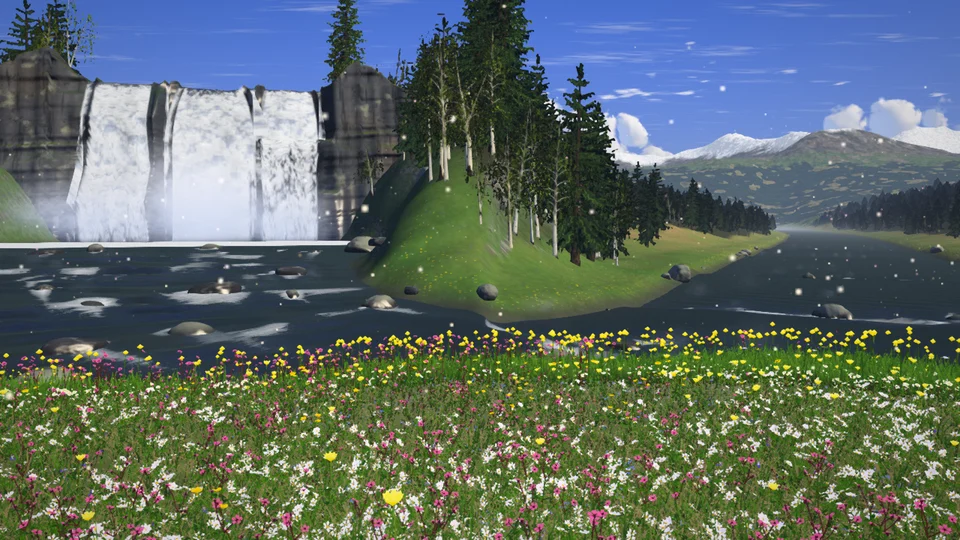 | |

**Cost.** Two draws: the air (2,400 quads at Extreme, 9,600 vertices, each a handful of hashes,
an eight-step loop over the patch rows and the haze; no texture reads) and the ring (2,304 quads,
most of them idle and clipped in the vertex stage). The fragments are a Gaussian each over a few
pixels (a near tuft about twenty). Not measured on the RTX 3070; against the 8.1 M-triangle
frame of the performance pass it is noise.

## Second pass: the water, the fall and the game's light (2026-10-21)

The owner asked for the theme's visuals, effects, atmosphere and graphics to be improved. Looked at
from the knoll and close up, the weak places were the water and the fall: the river mirrored
only the sky, so it read as a blue sheet with nothing standing over it; the fall was white
blotches on a flat sheet, its rock bedded in level bands like masonry; a long chain or four lines
laid hard white stripes across the pool; and what a lock does to the meadow was hard to see.

**The water mirrors the valley** (`spring-river.js`). As the ribbon is built, each vertex measures
each bank's horizon square across the river (`MIRROR`: the steepest rise of the ground and its
woods over the water at 15 distances out to 340 m, from the valley's bake, `aBank`), and the
material meets it where the reflected ray crosses toward that bank: turf low down, the woods over
it, their crowns rising and falling along the bank; down the valley the fells' ridge under the
haze; in the pool and the rapids, looking back up the river, the step (its white water between
shoulders of dark rock). The reflection's edges are broken by the ripples and blurred by rough
water. Without the bake (tests) the banks fall back to a flat horizon.

**The fall** (`spring-fall.js`, `spring-fall-plan.js`). The water is read in fibres half a metre
across, drawn out down the fall by its acceleration, so the white water hangs in columns rather
than blotches; the thick tongue holds together glassy for most of a second, its fibres tearing
white one by one; the glassy water mirrors less sky (it read silvered). The rock's layers fold a
metre or two over tens of metres instead of running level, its dry face stands out in buttresses
and leans back by different amounts, its blocks differ less from each other within a layer, and
its wet sheen is broken (a strong one read as polished metal). The plan's tests still hold: no
path runs through the rock.

**The pool under the flood.** A surge's long back rose at full height right where the surges start
and stood across the pool as a white step; it now rises out of the pool over its first nine metres,
its front leads in mid-stream and wanders, and its white breaks into heaps and gaps. The mist's
puffs thin to nothing where they meet the water (`vSoft`), and the boil behind the curtain lies in
its shadow, so the ribbon's straight back edge no longer shows as a hard line. The flood's foam
lines and rafts are broken into lace by the churn and widened by their own footprint, and the
metre-scale rafts' share is halved (seen from the knoll they foreshortened into horizontal blots).

**The game's light in the meadow** (`spring-meadow.js` `gameLight`, `PATCH_LIGHT`). A lock's patch
now rolls a ring of light through the flowers in its flower's colour as it opens (taken to full
strength, so the violet and the hepatica read as well as the campion), and its own flowers glow
from within for a moment after the ring has passed; a clear's breath runs out from the eye through
the meadow as a warm band. Both come from the patch rows and the breath's uniform the world
already writes: closed form, nothing new per frame.

**The air and the sky.** The air's motes and gameplay's motes end inside their quad's circle (a
near tuft drew its quad as a glowing square). The morning's and the afternoon's zenith are a
softer northern blue and their haze a little thicker (the sky read saturated cobalt), the golden
evening's zenith follows; the hours' tests (chroma, continuity) still hold. The fells' lichen
drifts have soft edges (they read as camouflage).

| Morning: before, after | The fall: before, after |
|---|---|
| 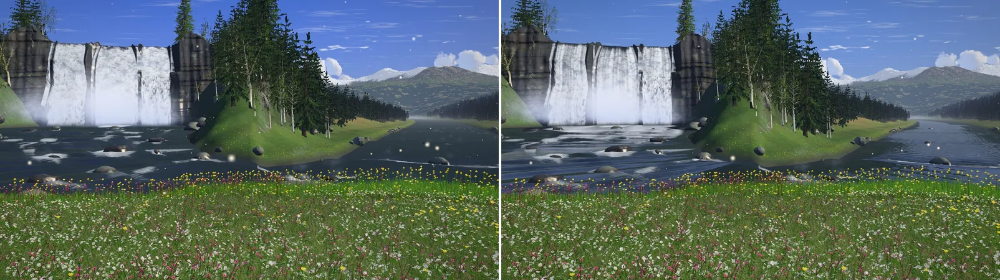 | 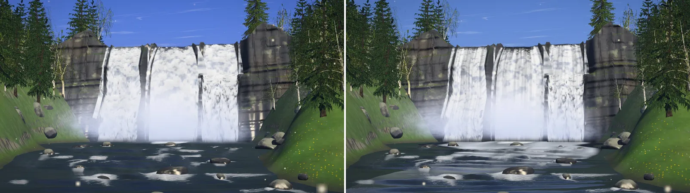 |
| **The pool: before, after** | **Down the valley: before, after** |
| 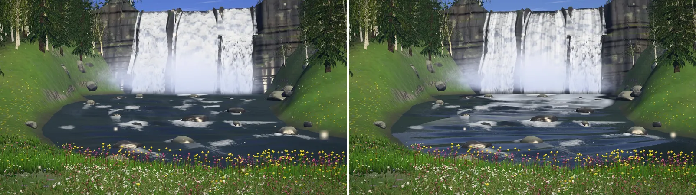 | 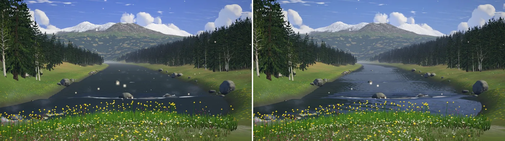 |
| **Golden evening: before, after** | |
| 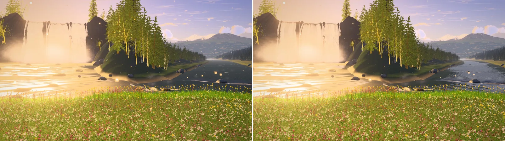 | |

| A hard drop of the Z: the campion's ring of light | A chain of six over the pool |
|---|---|
| 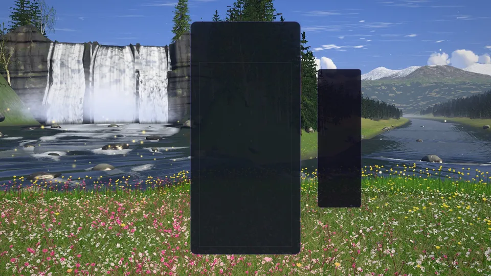 | 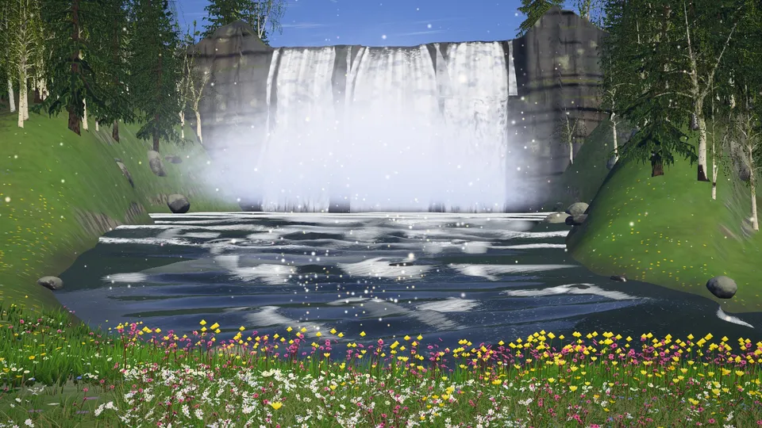 |

**Verification.** Playground captures on this laptop through Electron (WebGPU on the RTX 5080
Laptop, `force_high_performance_gpu`; WebGL2 at Low with `forceWebGL=1`), 1600 × 900, from a
private dev server: all six hours, the fall, the pool and the river close up, a lock, a hard drop,
three lines, four lines, a T-spin, chains of six, a perfect clear. No WebGPU validation errors or
console warnings in any. The Spring unit tests (eleven files, 229 tests, with the new
`spring-river.test.js` for the banks' horizon), typecheck and the Spring files' lint pass. The
cost: the river's colour gains about two dozen arithmetic lines and four texture reads, the
meadow's flower vertices one more loop over the patch rows (like the one `patches()` already
runs). The ribbon's build measures 30 ground points every 1.5 m along the river (`MIRROR.every`):
on High it took 430–570 ms against 350–370 ms without, in Node while other sessions loaded the
machine (noisy; about a tenth to a fifth of a second more, inside the river's own build step).
Frame rate was not measured.

## Third pass: the waterfall (2026-10-21)

The owner asked for the waterfall's water, and everything round the water at the fall, to be more
stunning and impressive. Close up, the curtain was a flat sheet of evenly bright white with a few
vertical lines; the spray was a uniform fog; the rock beside the water was the same grey schist
as everywhere else; the pool at the foot was flat foam; and a clear laid a straight white bar
across the pool.

**The curtain** (`spring-fall.js`, the pour material, rewritten). The water falls in strands, a third
of a metre to a couple of metres across, that meander a little as they fall (`SWAY`) and are drawn
out by the water's own acceleration (short at the brink, long streaks lower down). Each strand
ribs the sheet's light across it (`RIB`), so it reads as a column. The water breaks into clumps a
column at a time (`PACKET`: 0.8 m columns, each throwing 0.7–1.5 clumps a second), each a bright
ragged head with its tail streaming up behind it. Droplets glitter where a lump faces between the
sun and the eye (`GLITTER`). Lower down the curtain tears into strands and clumps with the wet
rock and the spray between them, and its foot is ragged, strand by strand lost in the boil. With
the sun behind it (the golden evening), the thin water glows peat-amber through itself and the
thick strands stand darker against it. The glassy brink and its tearing are kept.

**The spray** (`spring-mist.js`, `spring-light.js`). A **spray bow**: sunlight turned back by the
droplets, at the true angles (`BOW`: the primary 40.3°–42.4° from the point opposite the sun,
violet inside; the fainter secondary 50.4°–53.5°, its colours reversed; the spray inside the
primary a little brighter). With the sun high behind the eye (morning and the late morning) the
bow arcs through the spray at the fall's foot; from close in, a double bow. Its angle is worked out
once a corner (the ring is smooth enough across a puff to interpolate), its colour once a pixel.
**Splash plumes** (`PUFF.splash`) where each tongue hits the pool: quick, crisp, solid nearly down
to the water. The drifting cloud billows: each puff is lumps whose edges are its noise's, lit on
their upper sides and shaded under the lumps over them, instead of a soft glow.

**The rock round the water** (`spring-fall.js`, the face material). Beside the tongues and on the
ribs between them, where the spray drifts but the water does not scour, the schist is carpeted in
vivid spray-fed moss and liverwort, in cushions broken by bare rock: the greenest thing in the
gorge. Trickles run down the face beside the tongues, dark and glistening, beaded with light that
runs down them. At the fall's foot the ground the spray reaches is soaked dark (`spring-land.js`).

**The pool** (`spring-river.js`). The boil heaps up in domes where the tongues land (`BOIL`: 22 m
domes up to 1.1 m high, welling and sinking as they roll out downstream), which tilt its surface;
its foam is a finer froth; water full of air under it glows pale aqua instead of grey. Behind the
curtain, under the overhang, the water lies in shadow.

**The straight white bar** (fixed). A clear's surge, seen from the knoll, lies almost edge-on 15 m
out from the fall: its breaking front was one unbroken white line across the river, and the water
it lifted at the edges stood out through the banks. The surge now stays in the river (fading out
before the banks) and its front breaks in stretches where the water piles over the stones under
it, with smooth water between. (The second pass had darkened the recess for this line; that was
not its cause.)

| The fall: before, after | From close in: before, after |
|---|---|
| 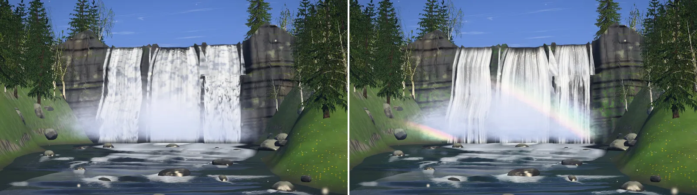 | 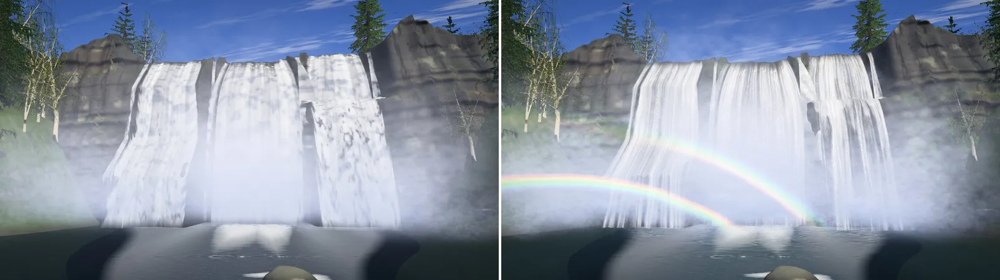 |
| **The brink: before, after** | **The foot: before, after** |
| 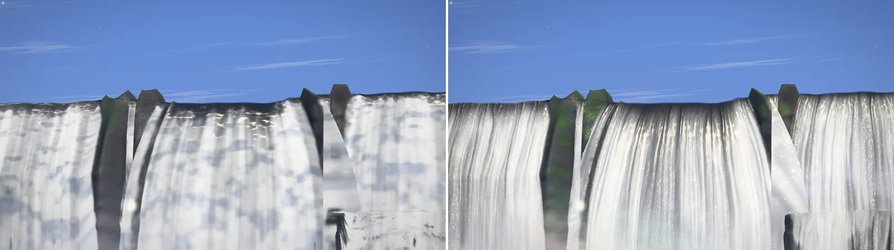 | 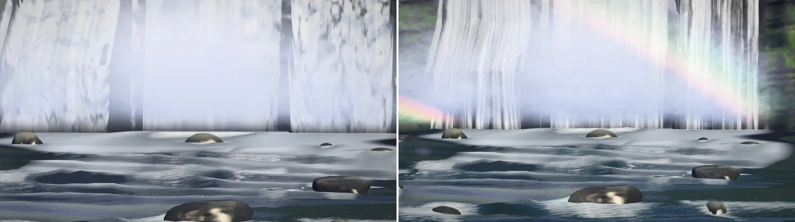 |
| **Golden evening, the sun behind it: before, after** | |
| 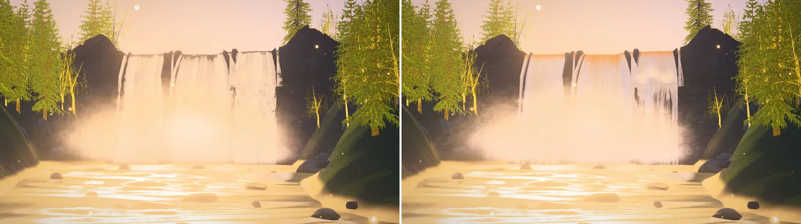 | |

| The view from the knoll | A chain of six |
|---|---|
| 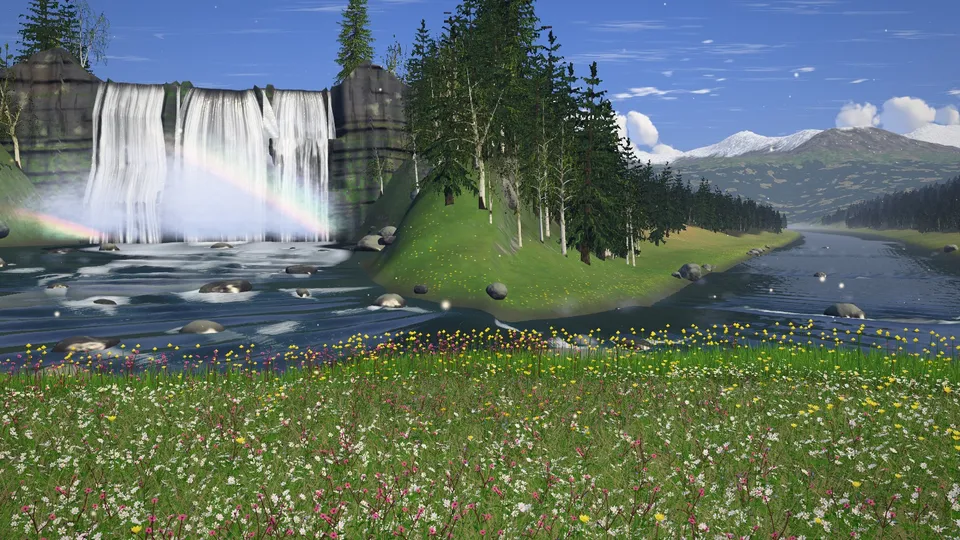 | 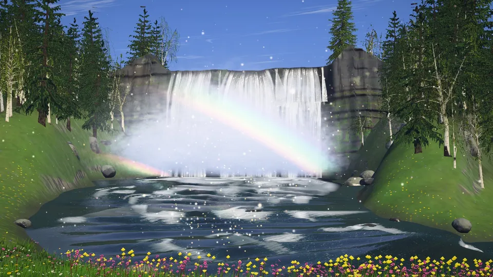 |

**Verification.** Playground captures through Electron on this laptop (WebGPU on the RTX 5080
Laptop; WebGL2 at Low with `forceWebGL=1`), 1600 × 900, from a private dev server: the fall, its
brink, its foot and a close-in view at the late morning, the golden evening, the light night and
dawn mist; a lock, three lines, four lines, a T-spin and a chain of six; Minimal on WebGPU. No
WebGPU validation errors or console warnings in any. The Spring unit tests (twelve files, 234
tests, with the new `spring-waterfall.test.js`: the splash plumes stand where the tongues land, the
bow's angles, the clumps' sizes and rates, the boil's reach), typecheck and the Spring files' lint
pass.

**Cost.** The curtain's colour reads six noise texels a pixel (it read eight) and does more
arithmetic for the strands, the clumps and the glitter; the mist's fragment gains the bow's colour
(two hue ramps; the angle is per corner) and a crisper heap, with the same two texels; 14 % of the
puffs became short-lived splash plumes (the cloud's feet went from 50 % to 40 % of them, so the
count per tier is the same); the pool's colour reads one more texel everywhere (the froth) and three
more inside the boil only. The face reads six texels (it read four) for its moss and trickles.
Frame rate was not measured: the GPU was shared with the owner's other work.

## The woods on a phone (2026-10-27)

The owner, from a phone: "When it started the spring theme on my phone, all the trees along the
river is not seen. There should be trees alongside the river." The screenshot had the knoll's
modelled trees and the ones on the rim of the step, and bare banks all the way down the valley.

**Cause.** A phone without WebGPU draws through three's WebGL2 backend. The woods' cards read the
impostor atlas, a multisampled (4×) target with mipmaps, and three r186's WebGL2 backend makes a
target's mipmaps before it resolves the multisampled draw into it (`WebGLBackend.finishRender`:
`generateMipmaps`, then `_resolveRenderTarget`, which blits the samples into the texture). The
atlas's full-size level held the trees; every smaller level held what was there before the bake:
nothing. A card far enough off to read a smaller level (all but the nearest few) found no tree
there and the alpha test cut it away. WebGPU resolves inside the pass, before its mipmaps, so the
laptop never showed it. Nothing reported it either: every tree was drawn, so the atlas called
itself whole (`getDiagnostics().world.woods`), and the playground's `atlas=albedo` view reads the
full-size level, which was right.

**Fix.** `remipResolvedBake` (`spring-impostors.js`): after each bake pass on the WebGL2 backend
the target's mipmaps are made again from what the pass drew (the backend's own `generateMipmaps`,
two calls a session). WebGPU is left as it was. `spring-woods-bake.test.js` pins the order (each
pass drawn and resolved, then its mipmaps made, again on every retried bake), that WebGPU is left
alone, and the three it works round: if an upgrade has three resolve first, the pin fails and the
workaround can go; if the backend's flag or method is renamed, it fails before the woods go
missing again.

**Verification.** The production theme started as the game starts it (`theme.init()` and
`theme.start()` on the shared renderer) in a phone-shaped page: 844 × 390 landscape and 390 × 844
portrait at DPR 2 with touch, Chromium 153 on software rendering (SwiftShader WebGPU, llvmpipe
WebGL2), the landscape frames compared with the clock pinned (`springTime=10`); on the WebGL2
backend (`navigator.gpu` absent, `forceWebGL=1`) at High and Low (portrait at High), and on WebGPU
at High and Low; and the playground on the forced WebGL2 backend at Low. Before the fix WebGL2 drew
the phone's picture; after it, it matches WebGPU.
Over the woods down the valley (right of the knoll, above the water) the dark tree pixels went from
5.7 % to 29.9 % at High (WebGPU 27.3 %) and from 3.8 % to 26.5 % at Low (WebGPU 23.8 %), and the
mean difference from the WebGPU frame there fell from 13.5 to 2.8 (of 255). No warning or error in
any console. WebGPU in compatibility mode (the device a phone may get: four colour targets, 15
varyings, 4096 texels; emulated by leaving out `core-features-and-limits`) had its woods too (the
playground at Minimal, before the fix, which leaves WebGPU alone). Not done: a physical phone; the
next start of the theme on the owner's phone is the check.

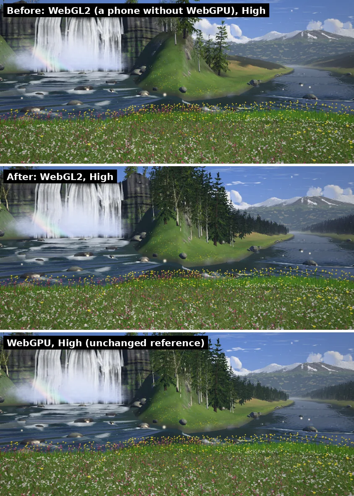

## Fourth pass: the living valley (2026-11-18)

The owner asked for the whole theme to be audited and raised until it is one of the game's most
stunning: every part reviewed, what works kept and built on, the theme "varied over time, shifting
and evolving as you play so it never looks the same for long", every event with its own distinct
effect and the biggest moments the most spectacular, smooth and easy to read throughout.

To look at it: `/playground.html?effect=spring&t=10&hour=0.3&weather=1&board=1` (`weather` 0 fair,
1 mackerel sky, 2 building heaps, 3 after the shower, 4 veiled sun, 5 clear and windy; fractions
mix; it also turns with the clock alone, one every 130 s of `t`), with the events and their
`eventAge` as before.

### The audit

Every hour and every event was captured from `main` first (the playground, 1600 × 900, High).

| Part | What was found |
|---|---|
| The golden evening | The fall, its spray and the whole pool burned out into one cream sheet. The post's false-colour view showed the river over 2.5 after exposure: the sun's glitter on the water was a lobe so wide (cos³² of the mirror angle) that it covered the pool, and the foam was lit as if seen from the sun's side. |
| The sky | A few cirrus dashes and four heaps on the horizon, the same at every hour of every day. Sunset and the light night were flat gradients with nothing in them. The cumulus deck overhead read as soft smears. |
| The spray | A violet-blue glowing blob at sunset and through the night (lit by the zenith's blue alone). |
| The meadow | In a fever or a flush the anemones' white swallowed every other colour on the knoll. Through sunset and the night the lower half of the frame was nearly black. |
| The air | Round dots: dust, not petals. |
| The events | Nearly every one was "more flowers and a few specks". Four lines, a perfect clear and a level-up were hard to tell from a single line; the birds were 15-pixel chevrons a quarter of a kilometre off, and a level-up's cranes took twelve seconds to reach the frame. |
| Over time | Six stations of light and nothing else: no weather, nothing that came by on its own. |
| Under quick hands | A probe (below) found that 76–87 % of the motes a hot session spawned overwrote one still in the air. |

The fall's plan, the river, the knoll, the woods and the fells are the picture, and stay.

### The weather (`spring-weather.js`)

A second wheel beside the day's, on its own clock: each weather holds and crosses to the next in
130 s (the crossing takes 46), so a round of six takes 780 s against the day's 600, and the same
hour does not meet the same sky two days running. A session opens on the fair day, the day the
hours author. Each weather is a row of numbers the world spends on what it already draws:

| Weather | What it does |
|---|---|
| Fair | The hours' own day. |
| Mackerel sky | Rippled altocumulus over the whole sky; under a low sun it burns from below. |
| Building heaps | The cumulus stands taller and fuller, its shadows sweep the valley, a fresher breeze. |
| After the shower | Washed, clear air under broken cloud, a little mist on the water, and a rainbow where the sun allows one. |
| Veiled sun | A milky veil of cirrostratus, a 22° halo round the sun, soft light, still air. |
| Clear and windy | A deep clean sky, the fells sharp, the clouds, the plants and the air's motes hurried by a stiff breeze. |

The wind is integrated (`windX`, `windZ`, `bankTurn`), so a weather that blows harder never jumps
the clouds, and `windTravel(time)` gives a seek the same travel stepping would.

| A mackerel sky in the morning | The same sky at sunset |
|---|---|
| 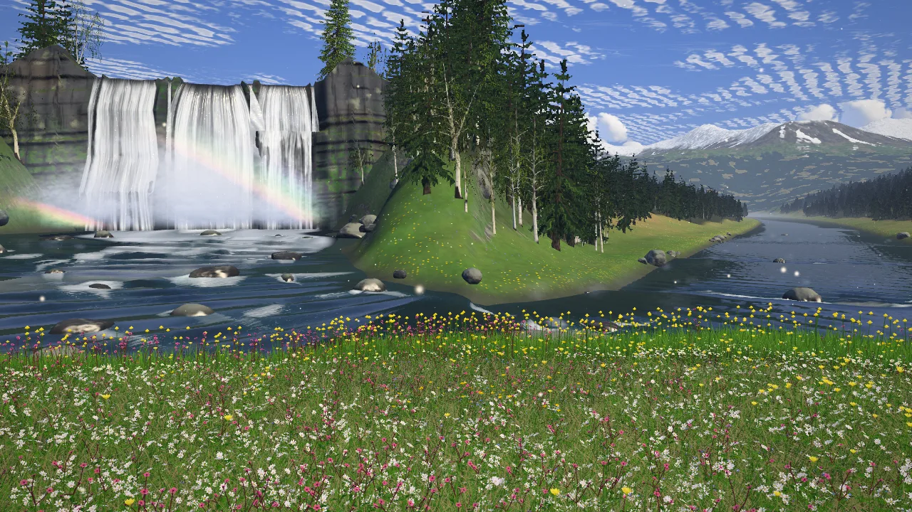 | 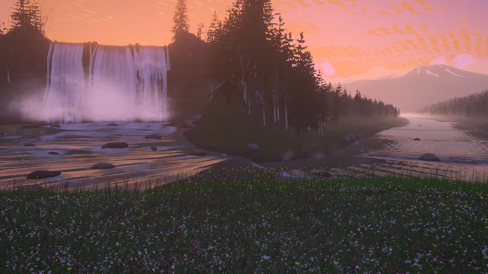 |
| **After the shower, the afternoon: the bow over the fells** | **Building heaps** |
| 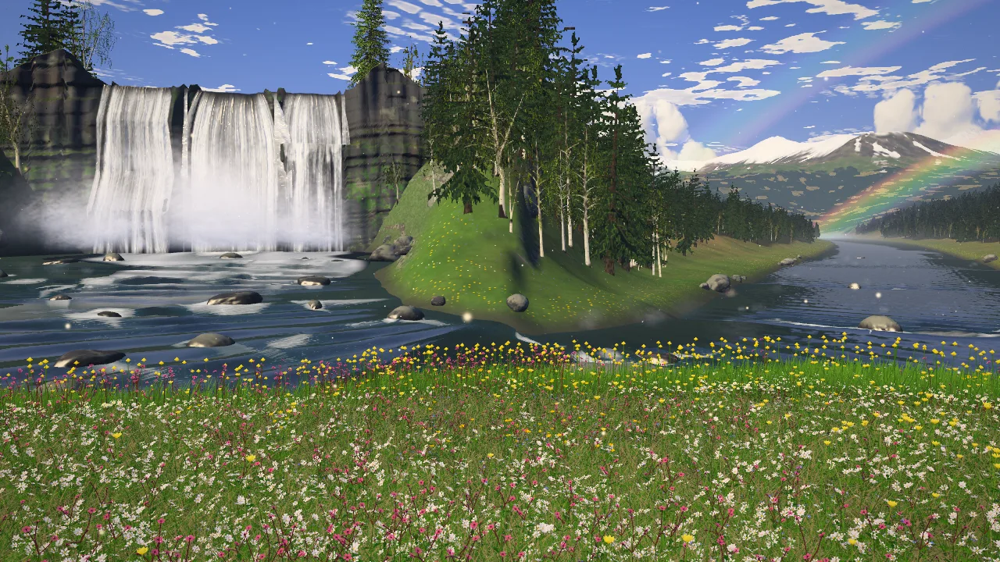 | 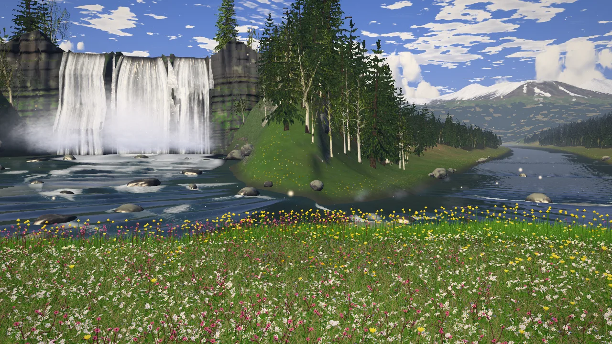 |
| **Veiled sun, the golden evening** | **The light night, clear: the night-shining clouds** |
| 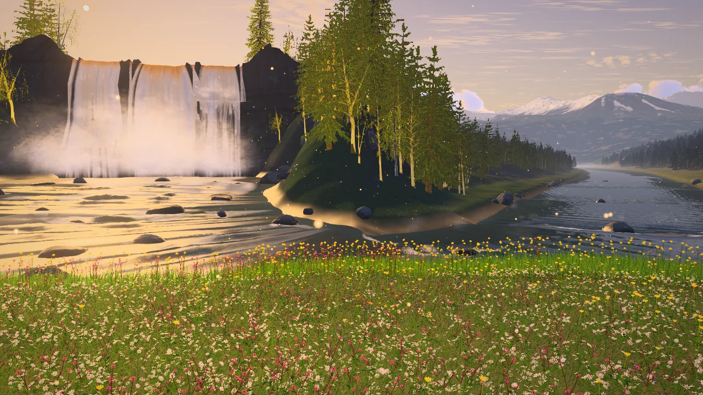 |  |

### The sky (`spring-sky.js`, `spring-cumulus.js`, `spring-bow.js`)

From the top down, each layer a plane the view ray meets, drifting at its own pace so the layers
slide past each other and the clouds form and melt; what an hour or a weather does not show is
branched out, not multiplied by nothing.

- **Stars**: a few of the brightest, high up, in the light night only.
- **Night-shining clouds**: silver-blue ranks of billows low over the north where the sun hides,
  in the heart of the light night. Licence: at 65.5° N at the end of May the sun is 2.7° under the
  horizon at midnight, and noctilucent clouds are seen from about 6°; they are the north's own
  night sky a few weeks later.
- **The veil and the halo**: the ring 22.4° from the sun, sharp and red on its inner edge.
- **Cirrus**, as before, thickened by the weather and lit from below by a low sun.
- **Altocumulus**: pillows built from two waves (rows across the wind, broken along their
  length), bent by a noise, not cut from one; white-edged and grey-middled by day, lit from below
  by a low sun, gold toward it and rose and mauve round from it.
- **The cumulus deck**: its field cut again through lumps at two sizes, so each cloud is a heap
  with a cauliflower edge and a grey base seen from under.
- **The heaps on the horizon** drift round it on the wind (0.02° a second at a breeze of 1, coming
  back in far outside any lens), billow faster, and stand as tall as the weather builds them.
- **The twilight**: under a low sun the horizon's fire stands where the sun is, and round from it
  the band cools to rose and the blue of the earth's shadow.
- **The rainbow**: a ring of quads at the bow's true angles from the point opposite the sun, a
  kilometre and a half out, so the near trees hide it and the far fells stand behind it, and it
  joins the bow in the fall's spray. It stands where a rainbow would and nowhere else: over the
  fall's side in the morning, low over the fells in the afternoon, and not at all with the sun
  ahead of the eye or more than 42° up (`bowLight`).

### The light

- **The golden evening**: the sun's road on the water is a tight core and a faint skirt, the
  mirrored sky is held back toward the sun, foam seen against the sun shows its shaded side, and a
  cloud of spray shades its own body, blazing only where it is thin. The pool is molten gold with
  its rocks and ripples in it, and the fall keeps its strands.
- **The spray out of the sun** takes the horizon's and the haze's light with the zenith's, so it
  no longer glows violet in the evening's shade.
- **Sunset and the light night**: more of the sky's light on the land (`fill`, `bounce`), so the
  meadow's flowers show through the dusk.
- **The meadow**: a flush or the heat of play opens the flowers half as far as a lock's own patch
  does, and a pale petal takes less of the game's extra light, so the knoll keeps its colours.

| The golden evening: before, after | The light night: before, after |
|---|---|
|  |  |
|  |  |

### What gameplay does now

Each event has a sight of its own; this table replaces the one above.

| Event | What happens |
|---|---|
| Lock | A patch of the piece's own flower bursts into bloom where it landed, its light rolling out through the meadow, **and a puff of its petals is thrown up over it**, tumbling as they fall back; its pollen drifts off on the breeze. A hard drop throws more, higher and wider, and knocks a ring of down off the plants. |
| Clear | **More water comes over the fall**: a pulse of thick white water leaves the brink and falls with the fall at its own speed, and the surge it becomes leaves the pool as it lands. The knoll flushes into bloom, and **a gust carries a streamer of petals across the knoll for each line that went**, in that row's own colours, each on the next of four lanes. |
| Chain | The spring flood rises with each link (the river, the spray, the bow in it), a whirlwind of petals turns beside the card on alternate sides, the air stirs; a broken chain lets its down go. |
| Four lines | **The fall thunders**: it runs full and white from brink to pool, its spray towers over the brink, the bow blazes across it, the last of the winter's ice goes out on the great surge, and the sky answers with half its crown. |
| T-spin | The pool turns in a whirl, and a tall whirlwind of petals turns beside the card on the lock's side. |
| Back-to-back | **A sheet of light runs down the river** from the pool to the far bend, stronger each step of the run (a soft band the ripples break, never sparks); the river glitters while the run lasts. |
| Perfect clear | **The sky's crown**, and what it shows follows the hour: every cloud flushed with the hour's glow; a rainbow with the sun behind the eye; the sun's shafts fanned out with the sun ahead; the night-shining clouds flared in the light night. **Whooper swans come over the fall's brink, drop to the river and fly low along it past the knoll.** The air stills and turns gold, gold petals shower, and the whole knoll stands in flower. |
| Level up | The day steps a station forward; **a skein of cranes crosses the valley** from the left edge to the right; willow down drifts over. |
| Fever | The flood at its height, the knoll in flower in the colours played, cranes over the gorge's rim. |
| Game over | The light falls to dusk and **the last petals let go**, falling slowly over the knoll. |

| A hard drop | Three lines: the streamers |
|---|---|
|  |  |
| **Four lines: before** | **Four lines: the fall thunders** |
|  |  |
| **The thundering fall, close** | **A T-spin** |
|  |  |
| **A perfect clear: the swans along the river** | **A perfect clear in the light night** |
|  |  |
| **A level-up's cranes (a long lens)** | **A run's end** |
|  |  |

Everything rejoins as before: the thunder and the crown are `Rejoin` envelopes (a second quad
takes the thunder up where it stands), a clear soon after another feeds the pulse still at the lip
and a later one takes the other of two slots, and the streamers step through the lanes.

### Birds (`spring-flights.js`)

Remade. Each bird is a body, a neck and head, and wings of an arm and a hand hinged at the wrist
(168 triangles a swan, 184 a crane): the vertex stage beats them, the hand a little behind the arm, the body
rising on the downstroke. Swans are white with the yellow-and-black bill; cranes grey with dark
flight feathers, a dark neck and trailing legs. A flight flies a curve through waypoints by arc
length, every bird at its place behind and beside the leader from the first frame, banked into the
route's turns; it starts just out of sight (behind the fall's brink, or a few seconds' flight
beyond the widest lens's left edge) and leaves through the right edge, so no bird is grown, shrunk
or raced in. Three routes: `river` (over the brink, down to the water, low past the knoll against
the dark river, up and away), `high` and `rim`.

Birds also come **by the clock**, about every two minutes: a pair of swans along the river, a few
cranes high up, three of either over the rim (`VISITS`, dealt by the visit's number, so a seek
puts a visit under way back on its route).

### The pop under quick hands

A CPU probe (a real world in Node, a scripted 42 s of hot play at 60 fps: a hard drop every 0.6 s,
a clear every other lock in a rising chain, quads and a perfect clear among them) counted the motes
written over a slot whose mote was still within four fifths of its life:

| Tier (ring before → after) | `main` | This pass |
|---|---:|---:|
| Minimal (384 → 512) | 7,023 of 8,826 (80 %) | 0 of 4,050 |
| Low (640 → 832) | 9,652 of 11,255 (86 %) | 0 of 6,554 |
| Medium (896 → 1,152) | 11,682 of 13,408 (87 %) | 0 of 8,964 |
| High (1,280 → 1,664) | 13,975 of 16,038 (87 %) | 0 of 12,749 |
| Extreme (2,304 → 2,944) | 16,374 of 21,470 (76 %) | 0 of 21,645 |

Hot play asks for about twice the ring, and each spawn took the slot whose turn it was. Every burst
is now sized by the room the ring has (`SpringWorld.grant`, `Motes.free`: slots never used or past
nine tenths of their life), free slots are handed out first, an event's petals are spawned before
its pollen, and the rings are a third larger. Calm play spawns what it did. Screenshots cannot show
this; the probe's counts are the evidence, and `tests/unit/spring-living.test.js` pins the zero.

### Verification

- **Playground**, a private headless Chrome on the RTX 5080 Laptop from a private dev server,
  capped at 30 fps: every hour against several weathers with the board, every event at several
  ages, the fall close up, the birds through a long lens, a live strip of the looping demo;
  WebGL2 at Low and Minimal (`forceWebGL=1`), Minimal on WebGPU, Medium, reduced motion, a
  420 × 900 portrait. No WebGPU validation error, shader error or console warning in any.
- **The real game** (`/?skipIntro=1&unlockAll=1`, the frame rate capped at 30): Spring picked from
  the menu, a single-player run started, 33 real hard drops over 26 s, a game over and the next
  run's morning, then four lines and a perfect clear sent to the theme's world. WebGPU, High,
  0 dropped events; the console held only the two Steam Cloud notices a browser always has and one
  mode notice from the script's own late call.
- **Cost**: the playground's GPU timer at 1920 × 1080, High, capped at 30 fps, fourteen seconds a
  case, `main` and this pass served side by side, three rounds, medians:
  the morning 2.2–2.5 ms a frame on `main` and 2.1 ms here under a mackerel sky; the light night
  2.0–2.1 ms on `main` and 2.3–2.4 ms here under building heaps (the stars and the night-shining
  clouds are its own); the looping demo 2.1–2.4 ms on `main` and 2.2–2.4 ms here. One round on
  `main` read 6.5 ms (the GPU clocked down between capped frames): capped readings scatter by a
  few tenths of a millisecond, so this says the pass costs at most a few tenths, not what the
  frame rate is. An uncapped frame-rate reading was not taken.
- **Tests**: `tests/unit/spring-living.test.js` (37: the weather wheel, the sun's gates for the bow,
  the night-shining clouds and the under-light, the wind's travel, the sky, the rainbow, the heaps
  and the birds built to WGSL and GLSL with no var read before it is set, the routes' starts and
  ends against the widest lens, a flight flown whole at one pace, the clock's visits and a seek
  into one, each event's own sight, the session state through a rebuild, the motes never cut
  short); three older tests updated for the petals and the birds' new mesh. The Spring files:
  14 test files, 295 tests, lint and typecheck clean.

| Minimal on WebGL2: a perfect clear at sunset under a mackerel sky |
|---|
|  |

### Open calls

These are doubts of mine, not the owner's words.

- **The night-shining clouds are a licence** (above). They are the light night's only sight of its
  own; without them it has the rose band and the mist.
- **The rainbow is rare by the clock.** It needs the "after the shower" weather to meet the
  morning or the afternoon; four lines and a perfect clear raise it whenever the sun allows. In the
  morning its foot stands at the frame's left edge; the afternoon's low arc over the fells is the
  one that reads.
- **The birds are drawn larger than life** (swans 1.15, cranes 1.35), and a level-up's cranes are
  hidden for a few seconds as they pass behind the hill's trees in the middle of the frame.
- **The fall's rock was not re-cut.** Its lip is still a level line between two square shoulders;
  the thunder, the pulse and the spray's tower give it life, but its outline is the old one.
- **A clear's surge now leaves the pool 1.2 s after the clear** (as its pulse lands), where it left
  at once before.
- **Not done**: a physical phone, an uncapped frame-rate reading, the song (still the Moonlit
  Forest recording, retitled), the theme's icon (the view it shows is unchanged).

## Fish in the river (2026-11-19)

The owner asked for jumping trout and salmon in the river (`spring-fish.js`).

To look at it: `/playground.html?effect=spring&t=55&leap=fall` (`leap=fall|ledges|runs` shows the
first of that lane's leaps from `t` on; `leapPhase=` how far through its flight, past 1 its ring
and splash; `leapLook=<fov>` aims the inspection lens at the fish).

### What leaps where

| Lane | Fish | Where | The leap |
|---|---|---|---|
| `fall` | salmon, 0.65–1.05 m | the plunge pool's middle, 9–20 m below where the tongues land | 1.5–2.7 m high, toward the falling water, often turning onto its side as it drops back |
| `ledges` | salmon | out of the pool at the foot of a rapids' chute (seven ledges in sight, the nearer more often) | 0.8–1.5 m, up the step onto higher water |
| `runs` | brown trout, 0.32–0.55 m | the pool's tail, and two calmer runs below the bend | 0.3–0.7 m, across the stream either way, the tail working, sometimes flopping back |

Each lane leaps **by the clock**, a pure function of the time (`leapAt(lane, k)`): about every
13 s at the fall, 15 s up the ledges, 7 s in the runs, so one every three or four seconds
somewhere, and a seek shows the same fish in the same place. The heat of play brings the **salmon
run** on (`HEAT.leaps`, `HEAT.leapsFever`): extra salmon at the fall and up the ledges, up to one
more every four or five seconds in a fever; never under reduced motion, where the clock's fish
still leap.

A leap is an arc of the fish's middle at real gravity (T = √(8H/g)) from under the surface to
under it again, deep enough that the nose breaks the water first; the river (drawn first,
depth-tested) hides what is still under. The nose follows the flight, the body curls most at the
top, the tail beats (4 a second a salmon, 6.5 a trout) as a wave run back down the body, and the
skin's normals turn with the bend. Salmon are countershaded steel-blue over a mirror flank that
gives back the sky's light more than its blue (dark against the white water, flashing in the sun);
trout olive over bronze.

Where a fish breaks the water, leaving and falling back, a **ring of foam** spreads and drifts off
on the current (added light, written once as the leap leaves the water and moved in closed form),
and a splash of drops is thrown up through the motes (each leap's own seed deals them, so a seek
splashes the same).

### Decisions and traps

- **Everywhere the river is in sight it runs along the line of sight** (toward the eye down the
  rapids, away below the bend). A salmon leaping straight upstream is seen end on: at 960 × 540 the
  first ledge salmon was two pixels. The leaps head well off the stream's line (salmon 0.3–1 rad
  off upstream, trout across it), toward mid-river when they leave near a bank.
- **Drawn larger than life**, 1.6 times, as the birds are (1.15, 1.35): a 1.05 m salmon is drawn
  1.7 m, and is still about 20 pixels at 1080p a hundred metres off. `FISH.*.drawn` is the knob.
- **Kept clear of the board and the lens's edges.** Every reach carries its own span across the
  river: below the bend the near bank is past the 16:9 lens's edge, and the far side of the ledge
  under the knoll is behind the card. `spring-fish.test.js` walks 120 leaps a lane against 10°–34°
  of bearing.
- **The fall's mist hides a fish behind it.** Leaping where the tongues land, a pale salmon was
  lost in the boil's cloud; the lane leaps from the pool's middle, and salmon are dark with a
  mirror rather than pale.
- **One instance buffer a mesh.** Four vec4 rows a fish, two a ring, each one interleaved buffer
  (the eight-vertex-buffer limit). The fish's rows are written only while one is in the air, the
  rings' only when a leap starts.

### Verification

- **Captures** in a cloud container (headless Chromium, SwiftShader), WebGL2 backend:
  the three lanes through a long lens and in the full frame at 960 × 540 and 1920 × 1080, High
  and Minimal, with and without the board; a trout's ring and splash after it falls back; a
  390 × 844 portrait (the river lies behind the card there, as before). No console error or
  warning but the container's "No available adapters".
- **Not captured: the WebGPU backend.** SwiftShader's WebGPU device is lost in this container on
  the unchanged theme too, so no WebGPU frame of Spring could be drawn here. Both materials build
  to WGSL and GLSL in `spring-fish.test.js` with no warning and no var read before it is set.
- **Tests**: `tests/unit/spring-fish.test.js` (19); the full unit suite passes.

| Through a long lens: a salmon in the plunge pool, a salmon below the bend, a trout, a trout's ring and splash |
|---|
|  |
| **In the game's frame at 1080p, High, with the board (crops at 2×): a salmon in the fall's mist, a trout by a boulder below the bend** |
|  |

### Open calls

- **They are small in the full frame**: 10–25 pixels at 1080p. In motion, with the splash and the
  ring, they catch the eye; still, they are a detail to find, not a show. `FISH.*.drawn` and the
  lanes' `gap` are the knobs.
- **On a phone** the river lies behind the card, and the fish with it.
