# Starlight — the mirror of the night

Implemented 2026-10-11 on `feature/starlight-masterpiece`, with Three.js 0.186.1. A from-scratch
rebuild: it replaces the earlier theme in full (a deep-space backdrop of a nebula quad, a
parallax starfield, a compute stardust river, meteors, shock rings and constellation "signs",
with an MRT bloom pipeline and a reaction director of its own). Starlight keeps its identity —
a quiet sky full of stars, shooting stars, constellations that draw themselves — and
everything else is new. This document records the shipped design and what was verified. It is a
reference, not a backlog.

## The picture

A dark-sky night over a lake as flat as a mirror. The Milky Way stands over the far hills, its
bright heart beside the pole star, its dust lanes and star clouds made of points, not of haze;
the water repeats all of it, stars and all, and a few lamps on the far shore lay broken paths
of light toward the lens. Nothing in the sky is still: the whole of it turns round the pole
star, once in 24 minutes, so the band sweeps the frame like the hand of a clock and the
picture is never the same twice.

The card sits in the middle of the frame, so the picture is composed round it: the pole stands
in the free space on its left (the world reads the live card rect and stands the pole in the
middle of that space), the constellations are drawn in whatever sky the card and the HUD leave
free, and the lake's rings open under the card and run out on both sides of it.

## The one idea

**The board writes the sky, and a chain is a long exposure.** Every locked piece becomes a star
in the constellation that is being drawn, in the piece's own colour; clears draw its lines; a
finished figure stays and turns with the sky. And a chain of clears opens the camera's shutter:
every star draws a trail round the pole, longer with the chain, until the sky is a wheel of
light — and, with the lake below, a wheel and its reflection.

## Event language

| Play | The sky |
| --- | --- |
| Lock | A mote in the piece's colour leaves the card's edge at the piece's height (its top edge when the star stands over the card), eases up a bowed path and settles as a star of that colour in the figure being drawn: it flares as it arrives, with four thin spikes. Under the piece's column a ring of the same colour runs out over the lake. When every star of the figure is lit, a lock gives one of them its own colour. |
| Hard drop | The same, faster and brighter, with a wider, stronger ring and a jolt of the lens. |
| Clear | The figure's lines are drawn, two for every row, each from one star to the next with a bright point at its tip (a star a line needs is lit for it). One shooting star for every row crosses the free sky, away from the shower's radiant, and the lake shows it too. |
| Four lines, perfect clear | The figure is finished at once and flares. A fireball crosses the whole sky: it lights the air round it, the hills and the lake, sheds three pieces, leaves a train that the high winds bend while it fades, and its light passes the lens as a slow ring when it lands. The Milky Way swells. A perfect clear adds a storm of shooting stars, and every figure in the sky answers. |
| Finished figure | It flares once, then stays in the sky and turns with it. The next lock begins another, in another free place. The sky keeps five; the oldest fades for the sixth, and one that sets behind the hills is let go. |
| T-spin | The sky pirouettes: it whirls 22° round the pole and every star streaks. |
| Chain of clears | The shutter opens: every star draws a trail round the pole (two clears in a row a short one, eight a long one, 40° at most), the sky turns up to four times as fast, shooting stars come up to fourteen times as often, the band's fine stars melt into its glow. It closes slowly when the chain breaks. |
| Level up | An hour passes in a breath: the sky swings 15° on (every star streaks for a second), a shooting star falls, and the light takes the next hour's colours: deep night, airglow, first light, afterglow, zodiacal light, blue hour, and round again. |
| The clock, with no play at all | **The light turns by itself, slowly, whatever the level**: one hour in 100 s, resting 15 s on an hour and on its way to the next for the other 70 s. A level-up is a step added on top of where the clock has carried the light (`wheel = clock / 100 + level − 1`), so the colours never wait for a level. The sky itself turns all the while (15° a minute), and now and then a lone shooting star falls. |
| New run | The figures fade, the shutter closes and the light eases back to the hour the clock is on. The clock itself goes on. |

## How it is built

All of it is generated: no models, no textures on disk, no compute, no render target of its
own. One 256² noise texture is baked on the CPU when the scene is built (four fBm fields, one
per channel); the star catalogue is generated from it at the same time.

Everything in the sky is a DIRECTION, drawn at one radius round the lens. Every star is kept in
polar coordinates about the pole, so the sky's turning and a star's trail are one angle.

- **`starlight-sky.js`** — one dome. A pixel above the horizon reads the night in its own
  direction; a pixel below it meets the water, is bent by the water's slope there and reads the
  night in the mirrored direction, so the lake is the same function as the sky and costs the
  same. The Milky Way is a handful of reads of the noise texture in the galaxy's own
  coordinates (the disc and its bulge, crowded star clouds, dust that reddens what it covers,
  emission knots), plus the **star powder**: two grids of cells with at most one Gaussian
  point each, more of them where the band is crowded. The points are analytic, so they neither
  blur nor crawl as the sky turns. The dust is an optical depth (second pass, below). The air
  of the hour, the banded airglow, the zodiacal light, the town's glow, the two crests of
  hills and the woods on the near one, the mist on the water, the lamps on the far shore and
  their paths on the water, the rings' light and a fireball's light are closed-form. The
  dust, the horizon (hills, woods, mist) and the star powder are read only inside branches on
  where they can be (galactic latitude, altitude, the band's density).
- **`starlight-stars.js`** — the field: every star is an instanced strip laid along its own
  circle round the pole, from where it stands back to where it stood `exposure` radians ago,
  shaded as a capsule with a bright head. With the shutter closed the same instances are drawn
  as one quad each (a second geometry on the same material: same pipeline). The glints (a soft
  heart, a halo, four pixel-wide spikes) of the catalogue's brightest stars and of every
  kindled star, and the figures' lines. Each is drawn twice, in the sky and in the lake (the
  direction mirrored and bent by the same water slope the dome reads); stars set behind the
  hills and redden toward the horizon.
- **`starlight-fx.js`** — the streaks: shooting stars, the fireball, its train and the motes
  of locks are one strip laid along a great circle, the head's place a function of the start
  time, so a frozen clock replays them exactly.
- **`starlight-world.js`** — owns the state and writes it to the shared uniforms once a frame;
  places a figure where the frame has room for it. The sky's angle is accumulated, never
  `clock × rate`, so the chain's faster turning, a level's swing and a T-spin's whirl can
  never make it jump (a unit test bounds the per-frame turn in a new session and an old one).
- **`starlight-core.js`** holds the numbers (the pole's frame, the galaxy's, the band and its
  dust, the catalogue, the hours, the figures) and is three-free;
  **`starlight-tsl.js`** the shared uniforms and TSL (the frames, the hills, the water);
  **`starlight-post.js`** the post stack (bloom on a hue-preserving knee, the lens breath,
  lens fringe, calm zones behind the card and HUD, one filmic tone map).
- **`starlight-director.js`**, **`starlight-composition.js`** — the gameplay intake and the
  layout reader, as in the other rebuilt themes.

Sizes are authored in pixels of a 1080-line frame and floored at about one pixel of the buffer
really drawn (`sized()`), so a star covers the same share of the sky on a phone's small buffer
as on a 4K screen.

The fourteen figures are real star patterns under plain names (the plough, the hunter, the
queen, the swan, the lyre, the lion, the scorpion, the winged horse, the eagle, the crown, the
twins, the herdsman, the archer, the dolphin), drawn in a shuffled order. The sky they are
drawn on is invented: its Milky Way passes the pole so that the frame always holds one of its
arms.

Two functions the boot warp used from the old theme's noise library (`curlNoise3`, `rotate2`)
moved into `src/ui/intro-noise-lib.js`, so no file outside the theme imports from it any more.

Blender was not used: the scene is a sky, a mirror and a line of hills, and nothing in it is a
model.

## Tiers

Every tier keeps the whole picture and every event (`starlight-quality.js`). Lower tiers draw
fewer stars (4,000 at Minimal, 30,000 at High, 56,000 at Extreme) with fewer quads along a
trail, mirror fewer of them, and drop the star powder, the dust's frayed edges and threads
(Medium and up), the airglow's bands and the mist's curls, the water's fine ripples and bloom.
The mist, the woods, the zodiacal light and the town's glow are on every tier.

## Reproduce

```
npm run dev:playground
/playground.html?effect=starlight&t=14&orbit=0                            rest
/playground.html?effect=starlight&t=24&orbit=0&board=1&locks=6&clears=2   a figure half drawn
/playground.html?effect=starlight&t=24&orbit=0&board=1&locks=5&event=quad&eventAge=0.6
/playground.html?effect=starlight&t=24&orbit=0&board=1&locks=6&combo=7    a chain
/playground.html?effect=starlight&t=14&orbit=0&board=1&level=2|3|4|5|6    the other hours
/playground.html?effect=starlight&t=64|114|164|214|...&orbit=0            the clock alone, on level 1
/playground.html?effect=starlight&demo=1                                  a looping script of play
```

In the game: `?starlightTime=<s>`, `?starlightFixedDt=<ms>`, `?starlightParts=sky,stars,figures,streaks`,
`?starlightFalseColor=1`, `?starlightForceWebGL=1`.

Frames at `t=14` or earlier rest on the level's own hour; later ones show where the clock has
carried the light.

The icon is the playground frame
`effect=starlight&icon=1&t=24&quality=Ultra&iconFov=50&iconPitch=-0.23&combo=12&level=6&event=quad&eventAge=0.72`,
a square frame, baked to a 512 px circle (contrast 1.14, saturation 1.25, brightness 1.08).

## Verification

Done on 2026-10-11 on the development laptop (RTX 3070, Electron 38), other sessions running:

- Playground, WebGPU: rest, a lock, a hard drop, one- to three-line clears, four lines, a perfect
  clear, a T-spin, a level up, held chains of 2 to 12, the six hours, the clock alone at nine
  times, 16:9, 21:9 and a 450 px portrait frame; and a strip of eight moments of every event
  1,500 s into a session. Console clean in every shot.
- Playground, WebGL2 backend (`forceWebGL=1`) at High and at Minimal: same picture, console
  clean.
- The real game on the dev server (WebGPU, High): the theme starts, real hard drops from the
  keyboard light the stars of the first figure (the hunter's eight), clears through the game's
  own bus draw its lines and finish it, a chain opens the shutter (16° of trail at a chain of
  four), four lines send the fireball, a level-up swings the sky and turns the hour, a live
  quality change rebuilds in place and keeps the clock and the level, and leaving the theme
  leaves no canvas behind. Console clean. The same run on the WebGL2 backend
  (`?forceWebGL=1`) and on the laptop's integrated AMD GPU (`force_low_power_gpu`, WebGPU):
  same behaviour.
- The clock alone, in the real game: with the night's clock stepped fast
  (`?starlightFixedDt=100`) and no line cleared, the HUD stays on level 1 while the light goes
  deep night (10 s) → three quarters of the way to airglow (63 s) → airglow (119 s) → nearly
  first light (174 s) → first light (230 s) → on its way to afterglow (283 s), and the sky turns
  from −26° to +43° round the pole.
- A rebuild in the middle of the night, in the real game: a change from High to Medium at 151 s
  of the night's clock (airglow, 52 % turned toward first light) came back at 161 s, 72 %
  turned. The night goes on from where it was.
- The repo's lifecycle validator (`scripts/validate-all-themes.mjs --theme starlight`): PASS,
  107 of 107 checks, no console error. Its screenshot and result replace the old ones under
  `docs/theme-screenshots/`.
- Phone emulation (`scripts/validate-mobile-webgl2.mjs`, software WebGL2) at Low and at Minimal:
  pass, and its landscape, portrait and effects screenshots show the whole scene. Its first run
  also passed while its pictures showed every star as a blob and the fireball as a white cone
  on the small buffer: that is what `sized()` and the rounded head fixed.
- Unit tests: `starlight-core`, `starlight-world`, `starlight-director`, `starlight-theme` (140
  tests; three of them hold the clock's turn: the light moves on any level with no gameplay, a
  level's step is added on top of it, and a rebuild in place keeps the clock; one bounds how far
  the sky may turn in a frame during a rapid chain of T-spins, in a new session and an old one).
- Local gates on the worktree: typecheck, TS ratchet, lint ratchet, architecture fitness, theme
  lifecycle audit, boundaries, palette, perf budgets, the production build with its boot-closure
  guard, ip-strings, pages-artifact and release gates, all green (the lint count and the fitness
  metrics shrank; their baselines were left alone). The full unit suite ran once: 807 of 809
  files. The two failures fail the same way on untouched main on this machine:
  `odyssey-level-briefing` (it expects "250,000" and the Swedish locale prints "250 000") and
  `tts-recorder-e2e` (its setup makes a symlink, which this Windows account may not: EPERM).

Frame rate, as observed and no more: the in-game runs read 126 to 131 frames a second at High in
a 1584 × 813 window on the RTX (both backends) and on the integrated AMD GPU alike, which is the
display's own rate. So none of the three fell below it; the readings do not say how much room is
left.

Not done: no perf-lane (ADR-0016) reading; nothing on a real phone; the theme was not played by a
person for a full session, and not in local multiplayer, Infinity, the meditation mode or
Odyssey (their layouts were not captured).

## Second pass (2026-10-21): the air between

Done on `feature/starlight-atmosphere`. The first pass's picture held, but its Milky Way read
as a grey haze with dust like cut-out cotton, its star powder as salt over everything, and the
lake as a copy of the sky. Nothing about the events changed.

- **The dust is an optical depth.** It was a narrow smoothstep of fBm (a cut-out, faceted by
  the magnified texel grid); now the band's light is multiplied by `exp(−τ · (1, 1.2, 1.45))`,
  so a lane darkens and reddens by how much dust lies in front of it and its edges are drawn
  by the extinction itself. τ is broad dark clouds (a wide ramp, squared), the Great Rift (a
  lane that wanders off the plane's line, wider at the core, its edges frayed by a fine read),
  and threads drawn out 6:1 along the band: the ridge `(1 − |2n − 1|)³` of a smooth field
  read at mip 2, switched on and off along its length by a second field, so they run on as
  soft strands instead of closing into marbled loops or cracking like plaster.
- **The texel grid is gone from every sharpened read.** `noiseSmooth()` (starlight-tsl.js)
  reads the noise at a whole mip with the texel's weights eased (quintic): one fetch, and a
  thresholded read draws curves, not the facets of the bilinear grid. The CPU has the same
  reader and the same mip chain (`noiseLevels`, `sampleNoiseSmooth`, `dustTau` in
  starlight-core.js); the catalogue thins its stars by the broad dust only (no thread or frayed
  edge thins a star a viewer could count).
- **The band's light.** A star cloud is where the broad field is high: brighter (the light
  rises with its square) and a warm white between the disc's blue and the bulge's gold. The
  emission knots are smaller, fewer and wisped by a finer read, each a cloud with a bright
  heart.
- **Grain, not salt.** The star powder's brightness is `h⁹`: nearly every point is faint grain,
  a few are resolved stars; its coarse grid is 40 % as dense and has no floor. The
  catalogue's faintest stars (fainter than 4.6) fall off faster still, so the bright ones stand
  out of the fine dust.
- **The mist on the water.** A low bank lies on the lake and in the far shore's hollows, in
  front of the hills: thicker in places along the shore (a broad read that drifts), with its
  own slow curls (Medium and up), lit by the hour's horizon glow and, round each lamp, by the
  lamp. It veils the far hills' feet (their depth now reads), and the lake mirrors it with
  everything else.
- **Woods on the near crest.** A serrated edge of spruce in stretches: one tree a cell of
  azimuth, each a narrow cone with its tiers of branches, anti-aliased over a pixel, read only
  below the tallest tip. The stars set behind it (`woodsTop`), and the lake mirrors it.
- **The zodiacal light, and a town.** The zodiacal hour has the phenomenon itself: a cone of
  warm light leaning up off the right-hand horizon along the ecliptic, wide at its foot,
  narrowing as it climbs (a new palette scalar, `zodiac`: faint in every dark hour, the hero
  of its own). The right-hand lamps have a town behind them: a faint warm dome over the hills.
- **The lake looks down into itself.** It gives back nearly all of the sky at a glance and
  less as the eye looks down (`mirrorShare` 0.95 → 0.44), so the frame's foot shows the lake's
  own dark and the reflection is no longer a copy.

### Cost

The dome is one full-screen pass, so everything new is read only where it can matter: the
dust inside `|b| < 2.6 × reach` (most of the sky is outside it), the hills, woods and mist
below an altitude of 0.16, the woods below the tallest tip, the star powder where the band
is dense enough to hold a star, the nebulae near the plane. The branches are coherent over
wide regions of sky.

Measured as interleaved batches of frames (each one advancing three's node frame, so the scene
pass really renders, then waiting on the GPU queue), old build (origin/main from a scratch
worktree) against new, other sessions using the machine:

- RTX 5080 Laptop, 2538 × 1440, High and Low: no difference the runs can resolve (about 2 ms
  a frame either way, much of it CPU).
- Radeon 610M (the integrated GPU, `force_low_power_gpu`), 1600 × 900: before the branches,
  Low cost 44 % more and High 21 % more. With them, and the dust's threads moved to Medium and
  up, Low measured within about 5 % of the old build and High level within noise. The iGPU
  was shared with other sessions' work during the last runs (both builds' frames went from
  15 to 37 ms between runs), so read these as ratios of interleaved runs, not as absolute
  costs.
- The catalogue costs about 25 ms more to generate at High (the dust reader's mip chain and
  eased reads), within the run-to-run spread at Extreme.

### Verified

- Playground, WebGPU, High: rest, the six hours, a figure half drawn, a chain of seven, four
  lines; Low and Minimal; the WebGL2 backend at High and at Low and Minimal. Console clean in
  every shot.
- The real game on a private dev server (WebGPU, High): Starlight starts, real hard drops send
  their motes and rings, a four-line clear sends its shooting stars and the fireball, a chain
  opens the shutter. Console clean (the one device "destroyed" line is the outgoing theme
  releasing its renderer).
- `scripts/validate-all-themes.mjs --theme starlight`: PASS, 0 lifecycle failures, 0 console
  errors; its screenshot and result replace the old ones.
- Unit tests: the four Starlight suites (144 tests, four new: the dust's optical depth, the CPU
  mip chain, the eased reader, the zodiacal hour) and a new shader gate,
  `tests/unit/starlight-shaders.test.js`: every material in the built night through the WGSL
  and GLSL node builders at High, Low and Minimal, failing on a warning, an undeclared binding,
  a var read where no assignment has certainly run (the branches' trap), equal smoothstep
  edges, a NaN literal or a stringified node.

Not done: nothing on a real phone; no perf-lane reading; no full session played by a person.

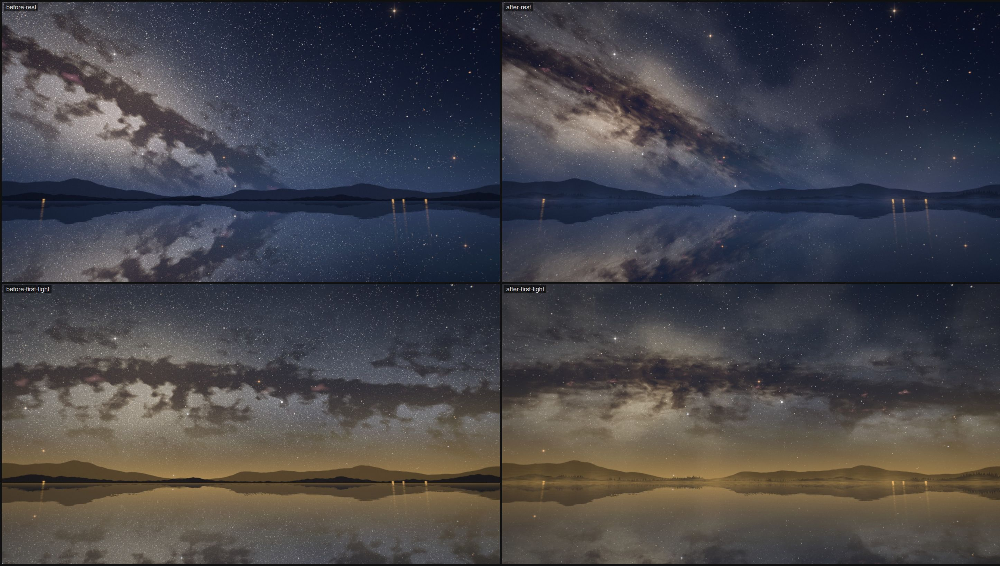

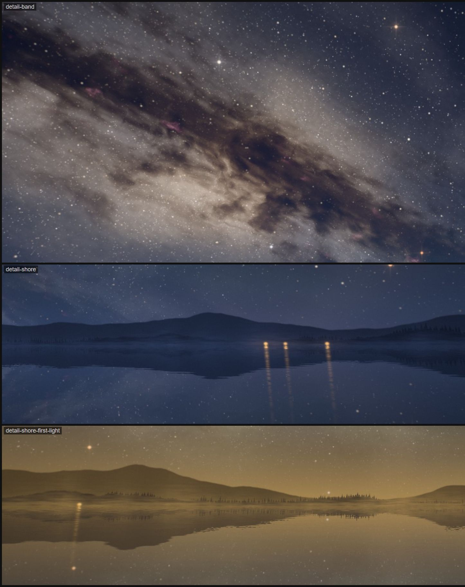

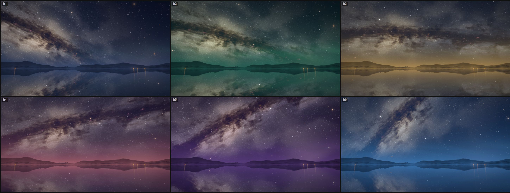

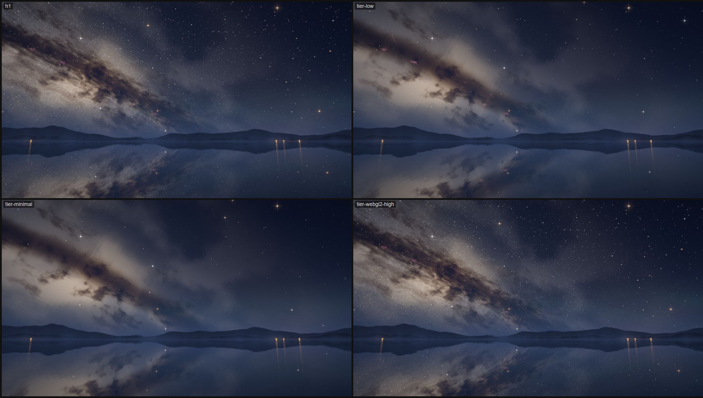

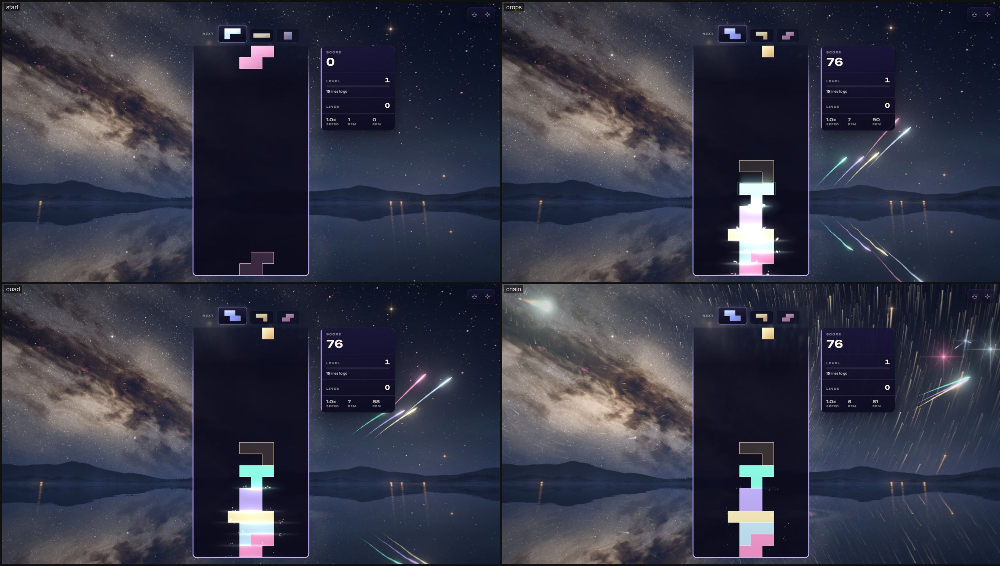

## Captured previews

The first pass's frames (2026-10-11), before the second pass's air:

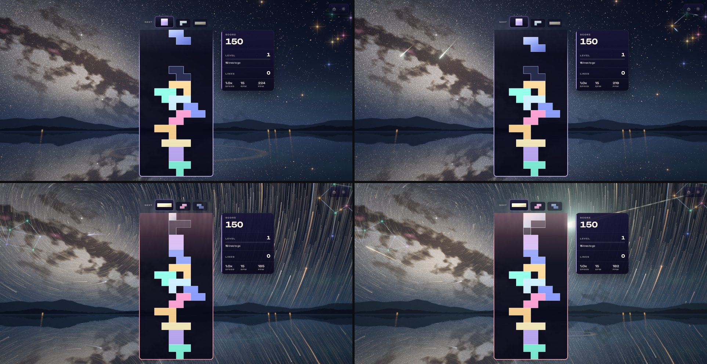

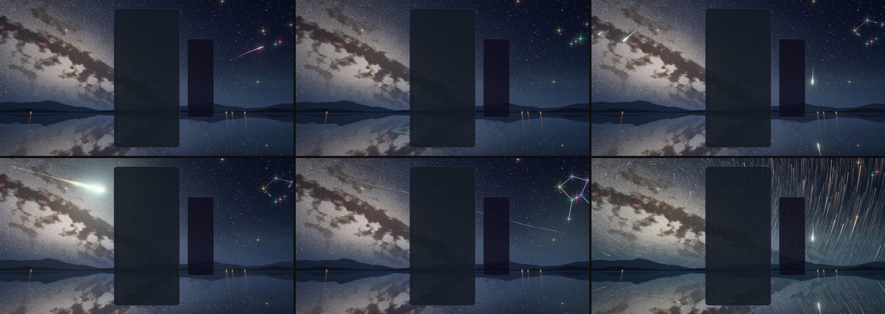

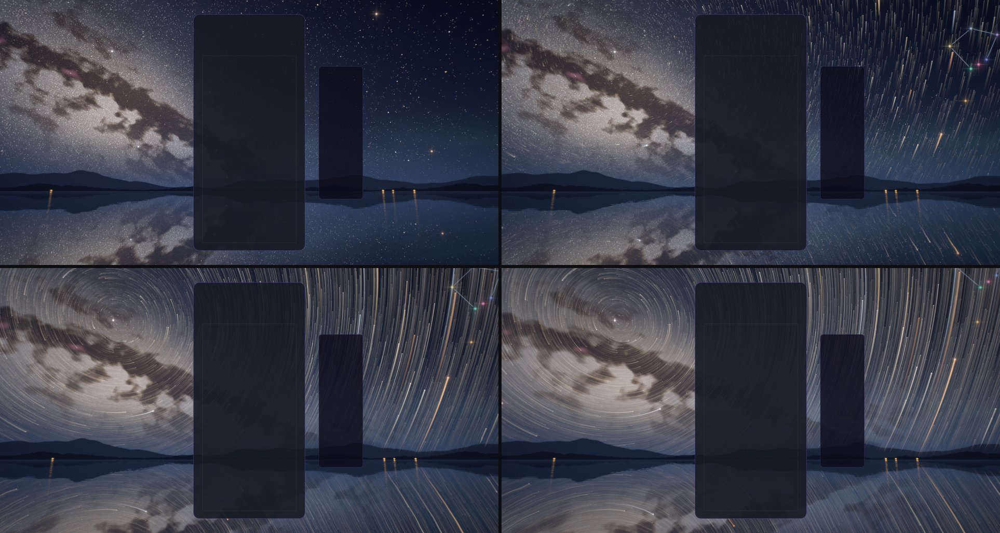

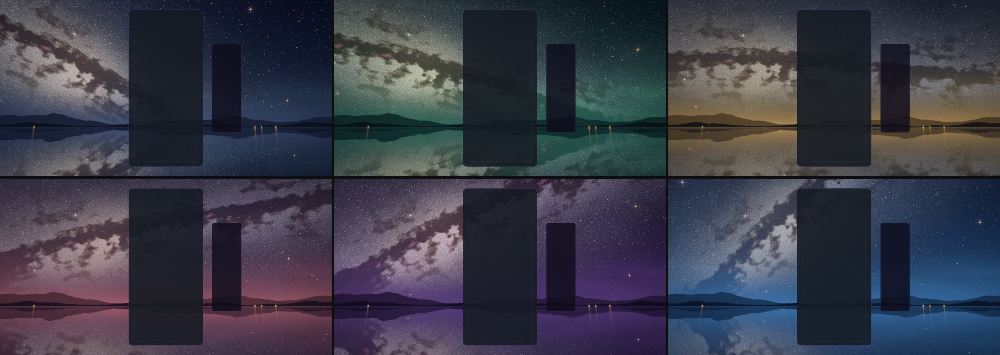

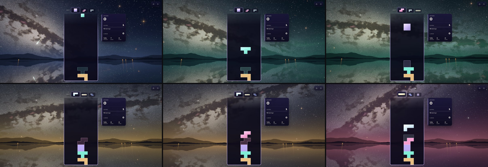

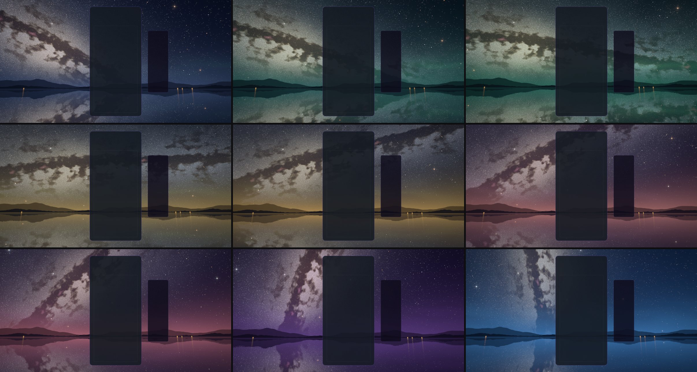

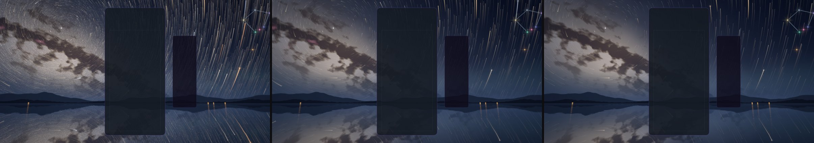

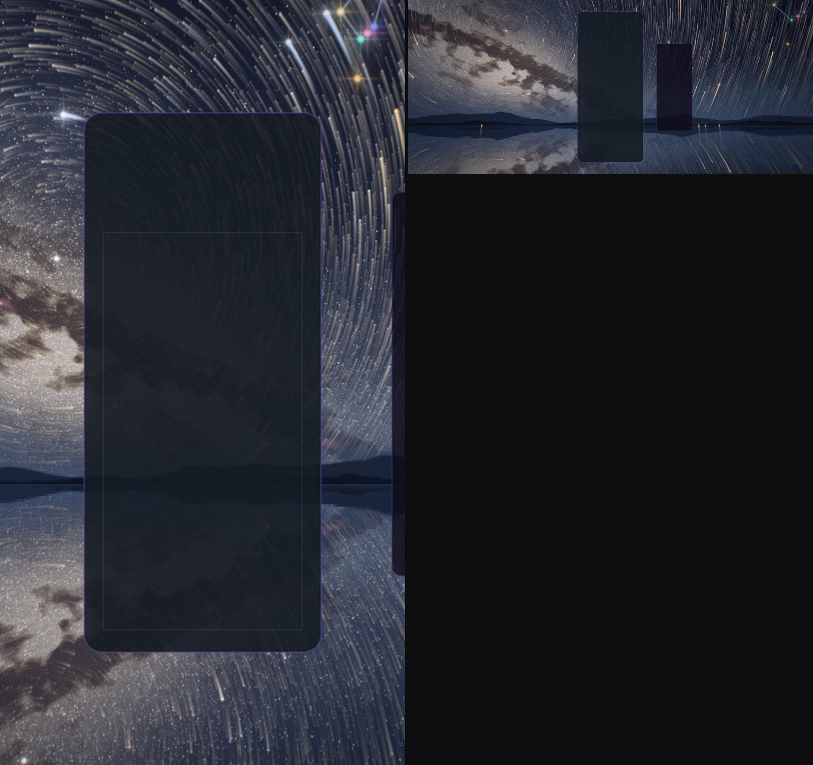
