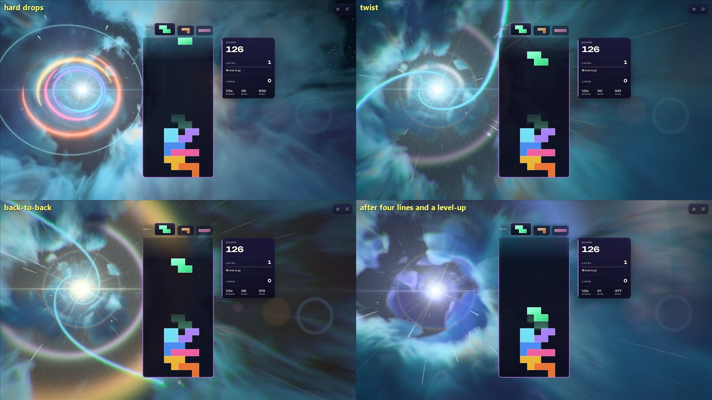
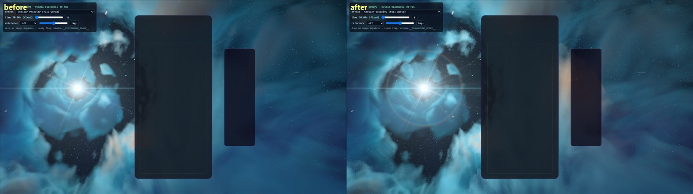
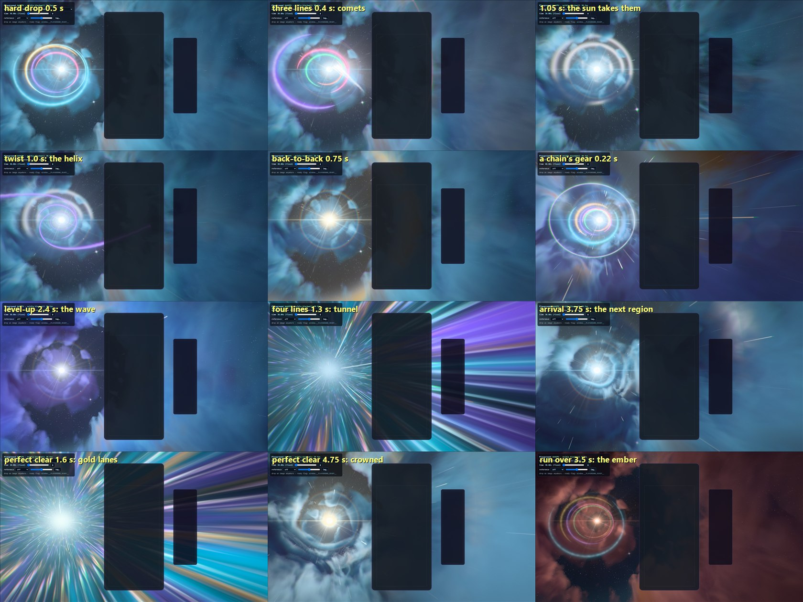
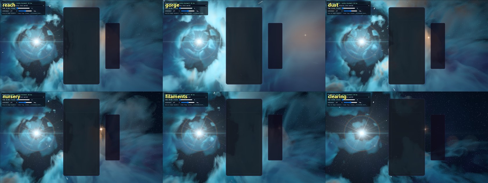
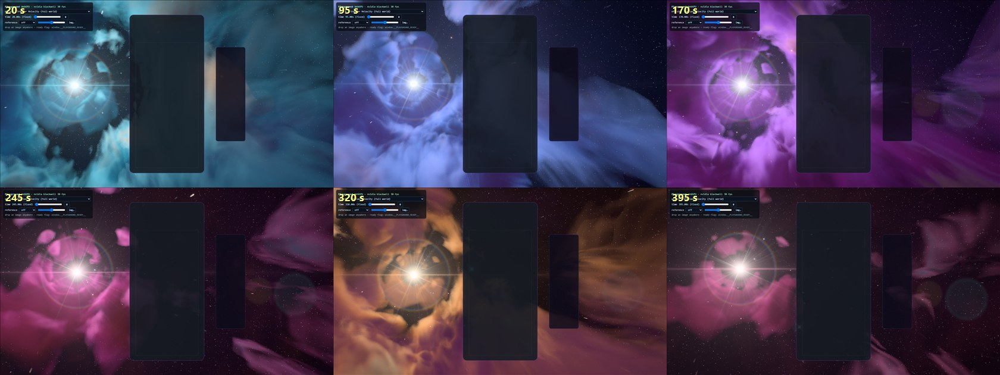
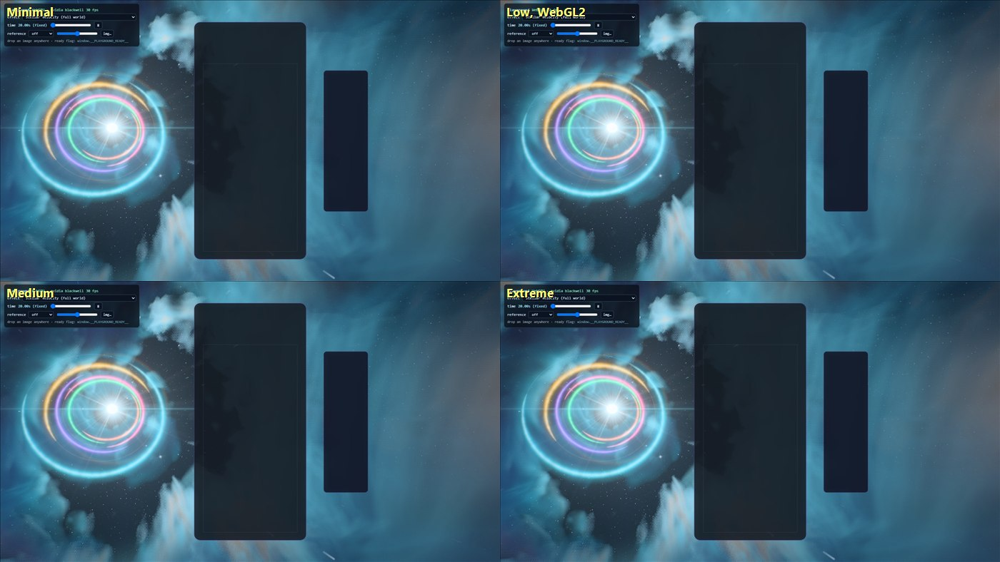
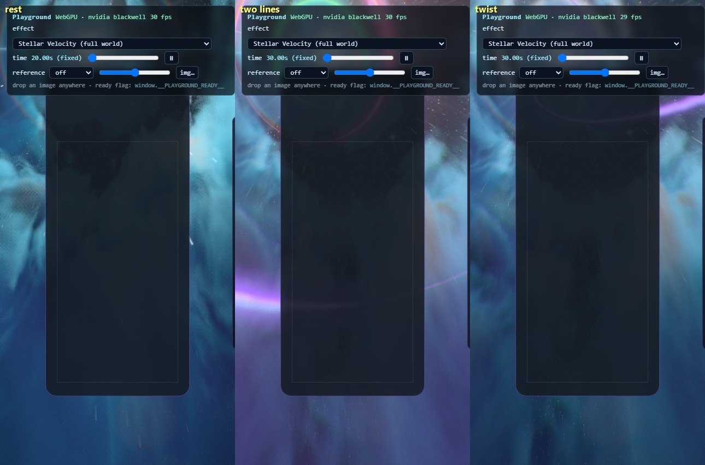

# Stellar Velocity — the living pass (2026-11-17)

Olov asked for a thorough audit of Stellar Velocity and for it to become one of the game's most
visually stunning themes: the star, its lens flare and streak, the billowing clouds and their warm
highlights, the dark opening, the streaks and particles rushing past, the starfield, speed and depth,
colour, light, glow, animation, UI and every event reviewed; the scene made to change as you play;
every event given an effect of its own, the biggest the most spectacular; play still smooth and easy
to read. Blender was offered. Earlier work:
[STELLAR_VELOCITY_VISUAL_OVERHAUL_2026-10.md](STELLAR_VELOCITY_VISUAL_OVERHAUL_2026-10.md) (the
rebuild and its second pass).

Branch `feature/stellar-velocity-living`. Every state and event was captured from `main` first
(playground, private dev server, headless Chrome on the RTX 5080 Laptop at `maxFps=30`).

## What the audit found

- **The near wall was a blur.** To the right of the board (most of what shows beside the card) the
  canyon's nearest gas is magnified far past what a 64³ volume holds: a soft blue smear with no
  structure. The masses read as cotton balls, lit and shaded gas close in value.
- **The opening's rim was combed.** The march's start pattern (interleaved gradient noise) runs
  on in one direction from row to row; where the steps are longest (round the opening the camera
  flies toward, where the eye goes first) the cloud's edges were sliced into scan lines.
- **The lens was four hairlines.** Four thin spikes and one thin streak; no ghosts, no halo, no
  burst.
- **Nothing changed but the colour.** The palette walked its line, but the canyon itself (how wide,
  how dusty, what burns in it) was the same canyon at every minute.
- **Events shared shapes.** The cleared rows left the card as three thin white scratches; a
  perfect clear looked exactly like four lines; a level-up a second in showed next to nothing; a
  twist was only a roll; a hard drop was a brighter lock; the run's end did nothing.

What already worked was kept: the canyon marched toward a far sun, the hoops each piece lays and
a clear flies through, the starbow and the gears of a chain, the hush and the tunnel of a jump, the
six palettes on the clock, the post's rush and grade.

## What each event does now

One rule: a shape of its own for each, so no two read alike.

| Event | Its own effect |
| --- | --- |
| Lock | As before: a bolt in the piece's colour, a hoop of plasma where it lands, a pulse down the walls. |
| Hard drop | The bolt slams its hoop open: a **white-hot shock ring** bursts out of it past the edges of the frame and is gone in under a second. |
| Clear, 1 to 3 lines | Each cleared row leaves its card as a **comet** that flies down the course into the sun (no longer screen-space scratches); as the sun takes each one it flares and a **ring of the comet's light** leaves it. We still fly through every hoop laid, and a front per line comes down the canyon. |
| Chain step (a gear) | A **shock ring** bursts ahead of us and a ring leaves the sun, bluer the deeper the chain; the sky bunches into the starbow as before. |
| Cascade wave | An afterburner-blue shock ring per wave past the first, on top of the bluer, faster fronts. |
| Back-to-back | The sun and its spikes burn gold and a **broad ring of gold** leaves it (brighter for a second in a row). |
| Twist | The canyon rolls, and a **double helix** of light in the twisting piece's colour grows out of the sun toward us, turning as it comes, the other way each time. A twist that clears nothing winds a fainter one. |
| Four lines | The hush, the tunnel, and we drop out **in the next region of the nebula** (see below), with young stars of its own, under a great ring of light from the sun. |
| Perfect clear | The tunnel's third-colour streaks become **lanes of gold** beside the nebula's own colours, and we arrive **crowned**: a gold sun, gold spikes and streak, gold dust, two rings. |
| Level up | The new colour **comes down the canyon from the sun as a wave**: the far gas and the sky turn first, the gas nearer than the front keeps the old colour until the front passes us; a ring of the new colour leaves the sun. |
| Run over | **The drive dies.** We coast to a drift, the sun sinks to an ember, the nebula's light dims and reddens, the held hoops go out, and a ring falls into the sun. A new run (or any play) rekindles it with a white ring; left alone it finds its breath after 14 seconds. |

Gold over teal is grey (gotcha #253), so the crown's gold never tints the nebula's lanes: it
replaces the third colour's streaks with gold ones. The first attempt, gold mixed into every lane,
turned the tunnel champagne grey.

## What changes by itself

Everything here is a function of the world clock (and of how many jumps there have been), so a seek
finds it where it would have been.

| What | How it moves |
| --- | --- |
| The voyage | The canyon passes through **six regions**, one every 72 s, each passing into the next over the last 30 % of its step: an open **reach** (today's look), a narrow **gorge** run faster with the streamers strong, lanes of dark **dust** with burning edges, a **nursery** of young stars, a field of **filaments**, a **clearing** where the walls stand back and the stars show. Each round is shuffled and never repeats the region it left (`stellar-velocity-voyage.js`). |
| The young stars | A stretch of the course holds nine sites; up to six burn at once, in the nursery brightest. Each is a white-hot point with a halo and short spikes, and lights the gas round it in a tight pocket (hot white-blue, the palette's third colour, or rose) that takes the gas's colour where it dominates. They come toward us with the cloud and slide past. |
| The palette | As before: one palette every 85 s, there and back; a level adds a step. 85 and 72 never line up, so the same colour comes back in another region. |
| The sun | Every 24 to 42 s it throws a soft ring of its own light. |
| The dust | At a glide it draws a short streak, so the drift reads as motion. |

## The gas and the lens

| Part | Now |
| --- | --- |
| Near gas | Gas within about two units of the lens thins as it comes (we see past it to the walls and fly through it), and a finer read wisps the edges of what is close (`WISP_SCALE`). |
| Light | Firmer shade (two taps toward the sun weigh more), a deeper shadow colour, and an ionisation front: gas the sun still reaches burns in the glow toward the sun's white, by `lit³` (from the taps, never from a band of density, which draws contours: #127). |
| The opening | Starts on an ordered 4 × 4 pattern read back through a [1 2 1] filter, the cloud's edge softened by the step's length, and a cap on how opaque one long step may be; the softening and the cap scale with the tier's steps (gotcha #1514). |
| The lens | A short, fine starburst of 120 rays, a thin chromatic halo ring, a broad faint second streak, and five ghosts down the line from the sun through the middle of the frame (soft discs, 1 % of the sun's visible light, folding in as the sun nears the middle); all put out by cloud in front of the sun, all calmed over the card (#1413). |

## Files

| File | Role |
| --- | --- |
| `stellar-velocity-voyage.js` | New, three-free: the regions, their order, a jump's skip, the young stars' sites. |
| `stellar-velocity-core.js` | Comets, sun rings, shocks, helix, the stall and the ember, the colour wave's speed. |
| `stellar-velocity-nebula.js` | The march: regions, wisps, near thinning, rims, the colour wave, the young stars' light (each skipped for rays that never pass near it), ordered starts, step softening and cap. The backdrop: the sun's rings, the crown's gold lanes. |
| `stellar-velocity-fx.js` | Shock rings, the helix, the young stars' sprites; bolts carry their own bow (a comet's arc into the sun is shallow). The row jets are gone. |
| `stellar-velocity-world.js` | The choreography for all of the above, `holdRegion`, `onGameOver`, `onSessionStart`, `rekindle`. |
| `stellar-velocity-post.js` | Starburst, halo ring, ghosts, second streak. |
| `stellar-velocity-theme.js` | A run's end lets the drive die (`endRun`); a mode's start rekindles it. |

Blender was not used: the scene is gas, light and points, and nothing in it is a mesh a model would
improve.

## Tiers

Every tier keeps every event. The young stars' light on the gas is Medium and up (Low and Minimal
show the stars themselves); the near wisps ride on the detail read (Medium and up) as before.

## Traps worth knowing (also in the skill: gotchas #1514, #1515, #1413)

- **Interleaved gradient noise combs a tube march's long steps.** A plain hash is sand. An ordered
  4 × 4 pattern read through taps exactly half a texel off cancels its 2 × 2 part.
- **A per-step opacity cap and an edge softened by step length thin a short march to nothing.**
  Minimal (12 steps) lost its walls until both were scaled by the tier's steps.
- **Lights a march carries in a few slots pop when the slots change hands.** A frame-to-frame probe
  of the carried light measured a jump of 0.73 in one frame as a fourth young star took a freed
  slot. Fixed by fading each light to zero at both ends of the carried stretch and easing it in on
  admission (never out): now under 0.08 per frame through a 40 s run with a chain
  (`tests/unit/stellar-velocity-living.test.js`).
- **A warm light added over teal gas is grey**, and so is gold mixed into the tunnel's lanes: give
  the warm colour its own place (a tight pocket that takes the gas's colour, a band of its own).
- **A comet's bolt kept the hoop bolt's bow**, scaled by the flight's length: a 30-unit flight into
  the sun arced out of the top of the frame. Each bolt carries its own bow now.

## Verification

- **Playground** (private Vite, headless Chrome, WebGPU on the RTX 5080 Laptop, 1600 × 900, `maxFps=30`):
  rest; every event above at one or two ages; the six regions; the clock at six moments; Minimal,
  Low on WebGL2, Medium, High, Extreme; an upright 430 × 852 frame at rest, through a clear and a
  twist; WebGL2 at High at rest, in the nursery and through six of the new events. No console
  errors or warnings in any capture.
  ([WebGL2: six of the new events](stellar-velocity-living/webgl2-events.jpg))
- **The real game** (private headless Chrome, `/?skipIntro=1&unlockAll=1`, frame rate capped at 30):
  the theme on WebGPU at High, aimed at the live board; real hard drops from the keyboard, then a
  two-line clear, a twist, a back-to-back, four lines and a level-up through the bus, then hard
  drops until the run ended. The world reported each: hoops held, rings thrown, the jump moving the
  voyage from the reach to the gorge, the palette stepping from ion to azure, the drive stalled at
  the end. Console: the two `[SteamCloud] Upload deferred` warnings a browser always shows.
- **Unit tests:** 206 in the Stellar Velocity files and the URL-parameter catalogue, including a new
  `stellar-velocity-living.test.js` (the voyage's order and blend, a jump's region, the young stars
  and the pop probe, every new event, the stall and its three ways back). The shader gate builds the
  nine parts on WGSL and GLSL at High and Minimal, clean.
- **Gates:** typecheck, TS and lint ratchets (lint at its baseline), architecture fitness,
  dependency boundaries, theme lifecycle audit, the skill's audit and tests.

## Cost

Capped GPU timestamps from the playground's profile (`profile=1&trackTimestamp=1&maxFps=30`,
1920 × 1080, RTX 5080 Laptop), this branch and untouched `main` served side by side and alternated,
two rounds of 10 s each (median ms per frame):

| Case | main | branch |
| --- | ---: | ---: |
| High, rest | 0.787 | 0.894 (+14 %) |
| High, demo loop | 0.829 | 0.967 (+17 %) |
| Low, rest | 0.230 | 0.245 (+7 %) |
| Low, demo loop | 0.248 | 0.271 (+9 %) |

Measured before the starburst was branched to the sun's reach (a trim that changes no pixel), so a
little high. Isolated with the post off at High: the young stars' light 0.028 ms (0.014 after the
per-ray skip), the near wisps 0.020, the step cap 0.010, the rest (regions, rims, colour wave) about
0.045.

## Not done, and open calls

- Not verified: a physical phone; the integrated GPU (needs an uncapped run); the perf lane
  (ADR-0016); local multiplayer, Infinity and Odyssey layouts in a capture.
- The theme icon and `docs/theme-screenshots/stellar-velocity.png` still show the earlier look.
- My doubts, not the owner's words: the near gas is still soft (it is magnified past any volume
  this size can hold; thinning it was the cheaper cure); the halo ring is a strong look on the warm
  palettes; the helix can cross the top of the card for a moment (the calm zone dims it there); the
  arrival from a jump is bright and pale for a second before the new region settles; the ember at a
  run's end might want to be darker still.
