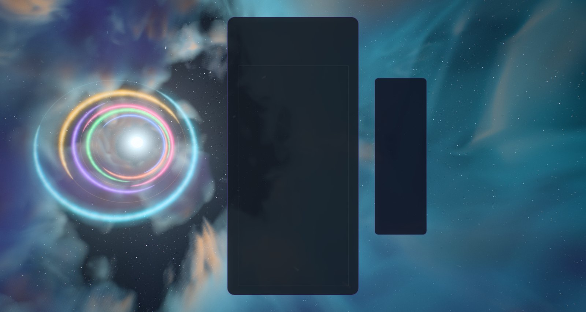
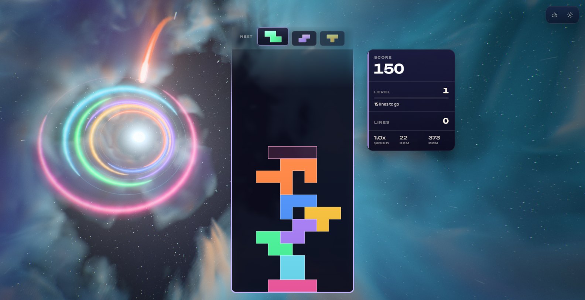
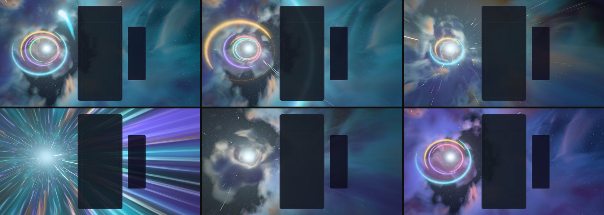
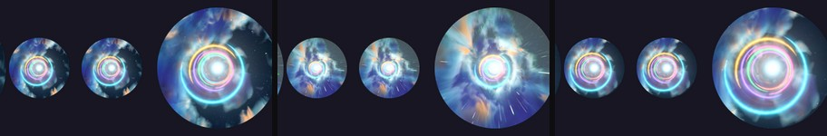
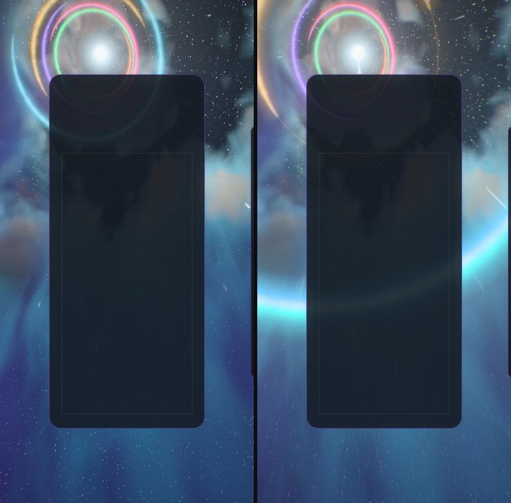
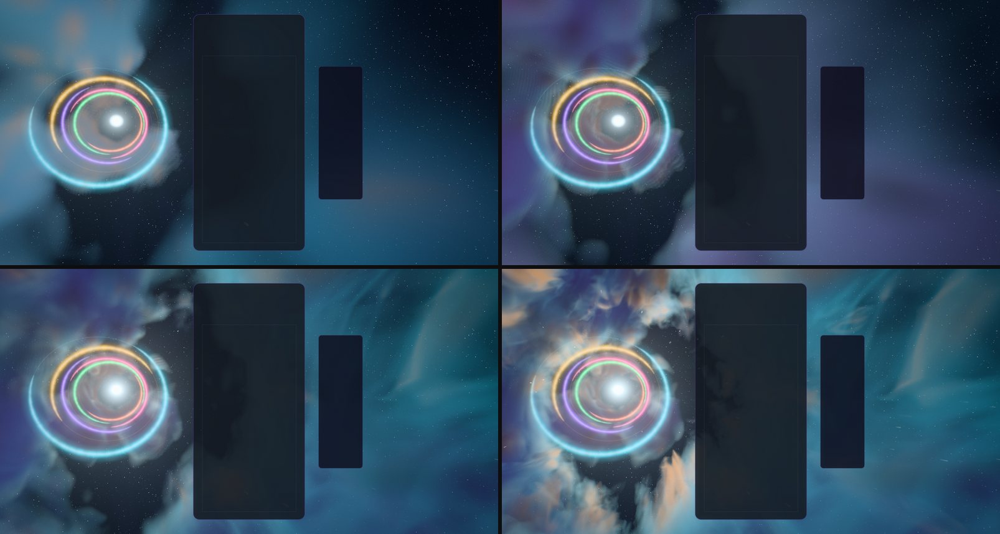
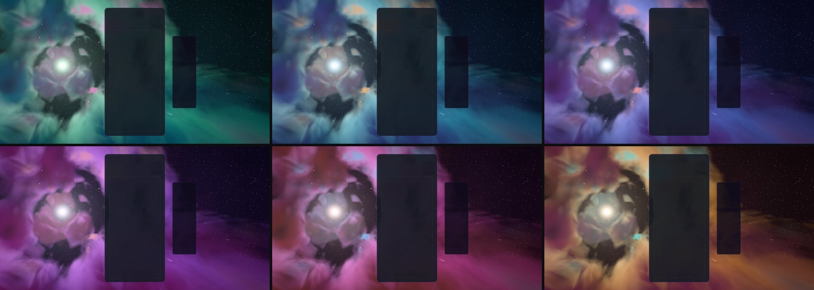
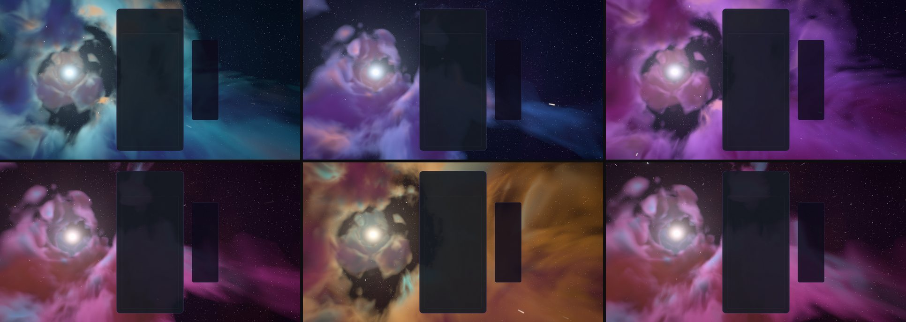

# Stellar Velocity — the starbow run

Implemented 2026-10-11 on `feature/stellar-velocity-masterpiece`, with Three.js 0.186.1. A
from-scratch rebuild: it replaces the earlier theme in full (the 5,300-line class with its own
adaptive scaler, compute starfield, MRT audit and classic-WebGL fallback materials, and the
"luminous slipstream" atmosphere of 2026-06). Stellar Velocity keeps its identity — a run at
speed through a bright nebula toward a far light, with the stars drawn out into trails — and
everything else is new. This document records the shipped design and what was verified. It is a
reference, not a backlog.

## The picture

We ride down a canyon of luminous cloud toward one far sun. The sun stands left of the board
(above it on an upright phone): it is the point everything flies out of. The cloud is lit from
ahead, so its far sides glow in the nebula's own colour, its near sides stand in a dimmer, second
colour, and the gas nearest the sun burns in a third. Between the masses is open space: the deep
sky and its stars. Near stars and motes of dust slide past as we go.

The gameplay card covers the middle of the frame, so the picture is built for what stays visible:
the sun and the hoops stand left of the card, the canyon's wall sweeps past behind it and out to
the right, where it is nearest and fastest.

## The one idea

The board is the drive. Every piece lays a hoop of light on the course ahead, in its own colour.
A clear fires the drive and we fly through every hoop we have laid. A chain of clears is a gear:
the faster we go, the more the sky bunches toward the sun and splits into the starbow. Four lines
jump.

## Event language

| Event | Response |
| --- | --- |
| Piece lock | The piece leaves its card as a bolt in its own colour and flies down the course. Where it arrives, a hoop of plasma springs open in that colour: one crescent, thick at its middle and drawn out to points, with bright knots running along it. It stands in the canyon as a ring of light (the cloud round it is lit by it), and a pulse of the same colour comes down the walls toward us. The course **holds** the hoop (its light falls to 1/e in 34 s); twelve at most, the dimmest giving way. Each new hoop is turned on from the last by the golden angle, so what the board lays is a spiral round the sun. Every lock is also a little thrust. |
| Hard drop | The same, harder: a fatter bolt, a brighter hoop, a stronger pulse, a camera kick. Still one hoop. |
| Line clear | The cleared rows leave their card as jets of light toward the sun. Then the drive fires and we go through every hoop on the course, the nearest first, 0.07 s apart: each comes at us ever faster, opens across the whole frame and is gone, its colour crossing the edges of the picture as it passes. A front of white light per line comes down the canyon after them, and the speed jumps. The more the board has laid, the more a clear sets off. The piece that made the clear lays the first hoop of the next round. |
| Combo | Each step of a chain is a gear. The canyon rushes (and is drawn out along the lines that run from the sun), the near stars become trails, and the whole sky bunches toward the sun and takes the starbow's colours: violet and blue round the sun, white behind the board, amber and red out at the edge. The sun stands brighter. When the chain breaks we let off and slow over several seconds. |
| Four lines / perfect clear | The drive holds its breath: every light sinks for a quarter of a second while the sky is drawn into the sun. Then it jumps: a tunnel of light in the nebula's own colours fills the frame for 2.3 s (3.3 s after a perfect clear), and we drop out in a stretch of the canyon we have not seen, the sun standing bright in it and a broad front of light coming down. |
| T-spin | The canyon rolls: cloud, stars and hoops wind round the course and spring back. |
| Level up | The nebula moves one palette along its line of six (aurora, ion, azure, violet, rose, solar; level 1 starts on ion) and a slow, broad front of the colour it is on its way to comes down the canyon. **The nebula also drifts along the same line by itself, one palette every 85 seconds, there and back, whatever the level:** the two simply add. |

Combo here is the true consecutive-clear combo (one `ComboTracker` per player in
`StellarVelocityDirector`); the bus's `COMBO` event is cascade depth (ADR-0011). With several
boards on screen each lock leaves its own card, and the gear follows the longest chain any board
is holding.

The piece colours (`stellar-velocity-tetrominos.js`) are the starbow's bands: redshift rose,
flare orange, sodium gold, mint, ice cyan, blueshift blue, ultraviolet. None sits in its shape's
guideline hue band (0/7 on the palette screen). The earlier file was in a legacy top-level format
the runtime resolvers never read, so this theme's board had been falling back to the default
palette; it now has its own.

## How it is built

| File | Role |
| --- | --- |
| `stellar-velocity-core.js` | Three-free constants and maths: the canyon's measures, gears and warp for a chain, aberration and Doppler, where a hoop stands and how a fired one comes at us, fronts, the jump's phases, the starbow's ramp, the six palettes, where the sun hangs for an aspect. |
| `stellar-velocity-tsl.js` | Hashes, the light-at-speed functions, the baked cloud (two 3D textures) and grain, the shared uniforms, target and material helpers. |
| `stellar-velocity-nebula.js` | The canyon, marched into a reduced-resolution target once a frame, and the backdrop that lays it over the deep sky: far stars, the sun, the starbow's ring, the tunnel. |
| `stellar-velocity-stars.js` | The near stars and the dust: instanced quads strung between where a point is and where it was a shutter ago. |
| `stellar-velocity-fx.js` | Hoops, bolts, row jets. |
| `stellar-velocity-world.js` | Owns the uniforms, the parts, the camera rig and the choreography. Shared with the playground effect, so what is iterated there ships. |
| `stellar-velocity-director.js` | Renderer-free: stages bus events per player and resolves one lock and one clear per frame. |
| `stellar-velocity-composition.js` | Three-free: reads the live card, board and HUD rects and maps board columns and rows onto the screen. |
| `stellar-velocity-post.js` | One scene pass, bloom, and one output pass. |
| `stellar-velocity-quality.js` | The six tiers. |
| `stellar-velocity-theme.js` | Lifecycle, renderer selection, settings, layout watch, GPU-loss recovery, capture flags. |

Techniques worth knowing before changing it:

- **One node renderer on both backends.** `WebGPURenderer` on WebGPU, its WebGL2 backend
  otherwise (or `?forceWebGL`). Nothing uses compute or MRT: every star, mote, hoop, bolt and jet
  is a closed-form function of uniforms, so the WebGL2 backend draws the same scene.
- **The canyon is a volume, walked where the cloud is.** Cloud stands only between the open
  channel round the course and an outer radius, so a view ray is walked from where it leaves the
  one to where it leaves the other: every step takes it the same share further from the course,
  whichever way it looks. (Steps spaced by distance from the camera aliased badly on rays that
  run nearly along the course.) Past the outer radius there is nothing, which is what lets the
  sky and its stars show between the masses.
- **Two volumes from the same lattices.** The cloud is one tileable RGBA8 3D texture (masses,
  filaments, billows, a slow field), baked on the CPU. A second one, half the size, is baked from
  the same lattices without each field's finest octave. A step longer than the fine detail reads
  the second: the same masses, with nothing in them the step could miss. The light taps always
  read it. The cloud is also drawn out along the course (×2.2), so its walls are streamers.
- **Streamers from a mipped 2D grain.** Fine filaments come from the 2D fBm texture read in the
  canyon's own cylinder (round the course, out from it, slowly along it) at a mip as coarse as
  the step is long.
- **Lit from behind.** One or two reads of the far volume toward the sun say how much of its
  light reaches a sample. Lit gas takes the palette's `glow`, shaded gas its `deep`, forward
  scatter and the rims of the dust its `accent`: warm round the sun, cool away from it.
- **The target and its tent.** The canyon is painted into a half-float target (8-bit, square-root
  coded, where a WebGL2 context cannot draw to float) at 34–80 % of the buffer. Each pixel starts
  its walk at a different place, and the backdrop reads the target through a four-tap tent,
  which is what hides the steps. The target's alpha is how much of the sky shows through; the
  near stars read it too, so far ones dim behind cloud.
- **Light at speed is one number.** `warp` (0 at rest, 0.9 in a long chain, 0.985 in a jump)
  bunches the far stars, the near stars, the hoops and, by half, the canyon itself toward the
  course (aberration) and shifts their colour (Doppler). The starbow is read from the shift
  relative to a ring 27° off the course: the true white band lies about 57° out, off the frame.
  At speed the lattice of far stars gives way to the near stars that actually draw trails;
  squeezed, it was television static.
- **How far we have come is integrated.** The speed changes with play, so the clock is never
  multiplied by it: the world adds `speed × dt` each frame and hands the shaders the distance,
  wrapped where every read of the cloud comes round whole. Everything else is a function of the
  clock and of event timestamps, so `seek(t)` plus a fixed-step replay reproduces any frame.
- **Events are queued with the time they happen at.** A bolt's landing, a hoop passing the
  camera, the jump after the hush and the arrival are entries in a small sorted queue that the
  frame reaching them fires, stamped with their own moment. A slot a bolt is flying to is
  reserved until it lands.
- **The nebula's colour is a place on a line.** The six palettes are stored in hue order and the
  line is walked there and back, so neighbours mix without passing through grey; in every palette
  the two glows are different colour families, and a unit test checks they still are half-way
  between every neighbouring pair. The live palette is the one at `level − 1 + time / 85 s`, with
  a rest of 15 % of a step at each end. On a level change the PLACE is eased, never the colours.
  The theme keeps its clock across a rebuild in place (a quality change, a lost device).
- **HDR, single output.** One scene pass, a max-channel bloom knee that follows the iris, and
  one output pass: the rush (a zoom blur along the lines from the sun), lens fringe, calm zones
  under the card and HUD, bloom, the sun's shafts, a tinted event flash, a hue-preserving filmic
  curve, grade, vignette, grain and dither. `usesMrtScenePass()` is false.

## Tiers

| Tier | March steps | Fine read | Light taps | Cloud lit by hoops and fronts | Canyon target | Cloud volume | Near stars | Dust | Bloom, shafts | Rush taps | Fringe |
| --- | ---: | --- | ---: | --- | ---: | ---: | ---: | ---: | --- | ---: | --- |
| Minimal | 12 | off | 0 | off | 34 % | 32³ | 500 | 140 | off | 0 | off |
| Low | 18 | off | 1 | on | 40 % | 48³ | 900 | 260 | off | 4 | off |
| Medium | 28 | on | 1 | on | 45 % | 64³ | 1,600 | 450 | on | 5 | off |
| High | 40 | on | 2 | on | 60 % | 64³ | 3,000 | 700 | on | 7 | on |
| Ultra | 52 | on | 2 | on | 70 % | 64³ | 4,200 | 1,000 | on | 8 | on |
| Extreme | 64 | on | 2 | on | 80 % | 64³ | 5,600 | 1,400 | on | 10 | on |

Every tier keeps the whole picture and every event. These are allocation budgets, not
measurements of frame rate.

## Assets

None. Everything is generated in code: the two cloud volumes, the grain, every mesh. No model or
texture file is loaded, and Blender was not used: the scene is gas, light and points.

The theme has a new icon (`src/themes/stellar-velocity/stellar-velocity-theme-icon.png`, with the
same bytes at `public/assets/themes/`): the sun through the playground's icon lens with ten hoops
laid.

## Verification

- Unit tests: 161 tests in five new files (core 32; world 34; director 21; composition 10;
  theme 64), all passing, plus the shared tables' tests (URL-parameter catalogue, dual-state
  tripwire, canonical mobile quality, renderer parity, lifecycle audit). The old theme's
  atmosphere test is gone with the code it covered.
- Playground captures on WebGPU (RTX 3070 Laptop, 1600 × 852): rest; a lock and a hard drop in
  flight; clears; chains of three to ten; the hush, the tunnel and the arrival; a T-spin; a
  level-up; all six palettes; the clock's drift at six moments; Minimal, Medium, Ultra and
  Extreme; Low on the forced WebGL2 backend; an upright 430 × 852 frame at rest and through a
  clear; reduced motion. The capture sets had no shader, validation or script errors in their
  consoles.
- Gates: typecheck; TS ratchet; lint ratchet (616 errors against a baseline of 807; the new
  files add none, and the baseline was left as it is); architecture fitness (metrics improved,
  not locked in); theme lifecycle audit; dependency boundaries; palette gate (0/7 for this
  theme); perf-budget gate; production build with the boot-closure guard; IP-string gate; Pages
  artifact check; release gates — all pass.
- Whole suite, run once: 815 files, 14,997 tests; 813 files passed. The two that did not are this
  machine's, not this change's: `odyssey-level-briefing` expects "250,000" and gets "250 000"
  from the Swedish number format, and `tts-recorder-e2e` cannot create a symlink without the
  Windows privilege (`EPERM`).
- In the real game (Electron, dev server, single player, themes unlocked with `?unlockAll=1`):
  the theme starts on WebGPU, aims its events at the live board, takes real hard drops from the
  keyboard and bus-injected clears, a chain and four lines, survives a live quality change (High
  to Medium, keeping its clock) and lets go of its canvas when another theme takes over; no
  console errors. The same script ran clean on the WebGL2 backend at High and on the integrated
  AMD GPU at High. One run each.
- The repo's lifecycle validator (`scripts/validate-all-themes.mjs --theme stellar-velocity`,
  against the dev server): pass, 107 checks, 0 lifecycle failures, 0 console errors, 0 process
  failures.
- Phone emulation (`scripts/validate-mobile-webgl2.mjs`, software WebGL2): pass at Low and at
  Minimal. Its first pictures showed the far stars as snow (on a small buffer a pixel-sized star
  was half its lattice cell); fixed in `stellar-velocity-nebula.js` and re-run.
- The clock's drift: six playground frames at level 1 with no events, at 10, 95, 180, 265, 350
  and 435 s, stand on ion, azure, violet, rose, solar and rose again; the real game, left on
  level 1, reported ion 14 s after it started and azure at the end of the same run, most of a
  minute later and after a rebuild in place.

Observed, not measured (whole-game frame interval at 1584 × 813, one run each): about 131 frames
a second at High on the RTX 3070 at rest and through the jump, which is this display path's cap,
on WebGPU and on the WebGL2 backend alike; on the integrated AMD GPU at High, the cap at rest and
78 through the jump.

Not verified: GPU cost per tier through the theme perf lane (ADR-0016);
physical phones; local multiplayer, Infinity and Odyssey layouts in a capture (their routing is
unit-tested only); the icon in the running theme picker and on an Odyssey level orb; sessions of
several hours; a review of the theme class and director, which a helper wrote from the Void Ember
precedent and which were checked by their tests and by the runs above, not read line by line.
`docs/theme-screenshots/stellar-velocity.png` still shows the previous artwork (a fleet capture
writes it).

## Reproduce

Run `npm run dev:playground`, then:

`/playground.html?effect=stellar-velocity&t=20&quality=High&board=1`

Add `event=lock|drop|clear|quad|tspin|perfect|levelUp` with `eventAge=<s>`, and `combo=<n>`,
`level=<n>`, `lines=<n>`, `u=<0..1>`, `row=<r>`, `color=<hex>`. `locks=<n>` plays n locks first,
so the course is holding their hoops when the event fires. `demo=1` (without `t`) plays a looping
script. `parts=` draws only the named parts (`canyon`, `stars`, `motes`, `hoops`, `bolts`,
`jets`); `falseColor=1` bands the pre-tone-map peak; `noPost=1` shows the raw scene;
`forceWebGL=1` uses the WebGL2 backend; `reduce=1` is reduced motion. In the game:
`?stellarVelTime=`, `?stellarVelFixedDt=`, `?stellarVelParts=`, `?stellarVelFalseColor=1`.

A palette's place is `level − 1 + t / 85`, and it rests on a palette for the first 12 s of a
step, so `level=2`, `level=3`, `level=4`, `level=5` and `level=10` at `t=10` stand on azure,
violet, rose, solar and aurora.

The theme icon is a frame through the playground's icon lens (the camera looking straight down
the course):

`/playground.html?effect=stellar-velocity&t=20&quality=Ultra&icon=1&iconFov=36&locks=10`

captured in a 1000 × 852 window, cropped to a 784 px square round the middle, given a colour
lift (contrast 1.14, saturation 1.26, brightness 1.1) and baked as a 512 px circle on a
transparent ground.

## Captured previews

