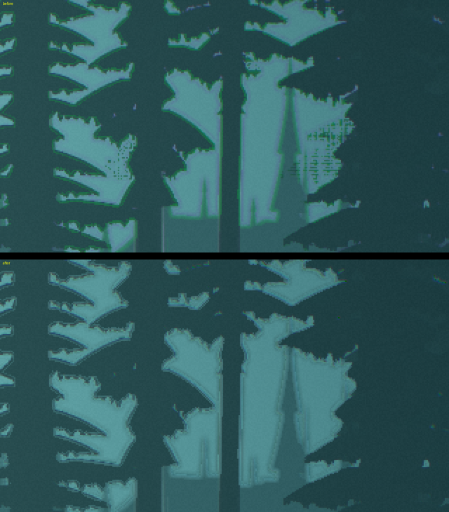
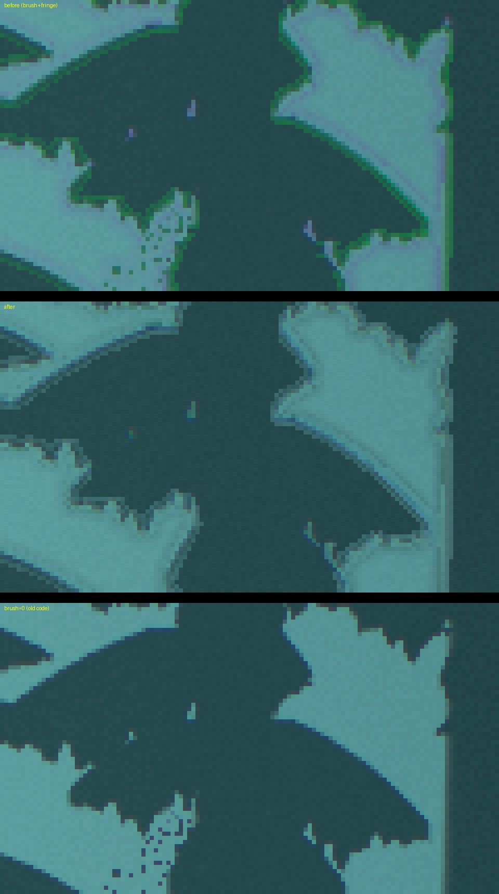
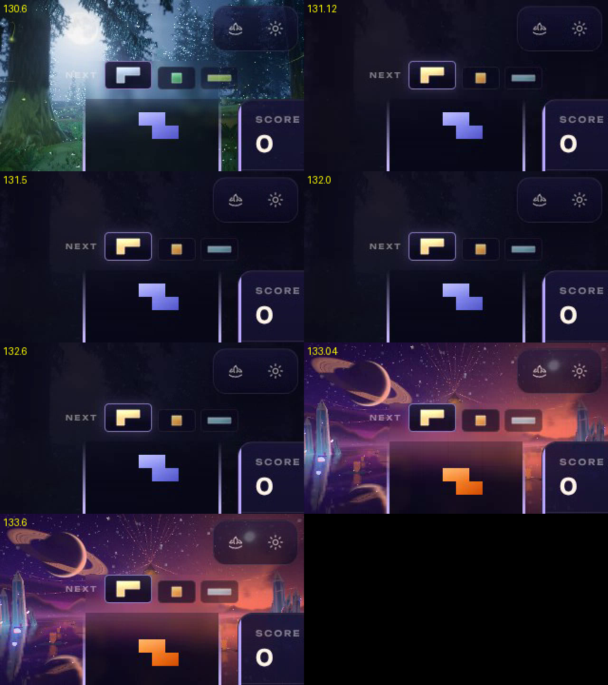

# Stillwater's far trees and Vesper Chrysalis's black flashes (2026-10-23)

**A record.** Two reports from play, investigated and fixed:

- **Stillwater.** Some branches of the trees at the back "bleed and glitch" and do not look right.
- **Vesper Chrysalis.** The whole screen blinks black, back and forth, as the theme starts. It
  happens when Vesper is picked during a game (the Hub's Themes tab, or N / Shift+N): several
  quick flashes between black and the scene in the first second or two. Seen on an RTX 5080
  laptop with a 165 Hz panel.

## How it was checked

The cloud container this was done in has no GPU, so everything ran in headless Chromium on
SwiftShader: WebGPU through SwiftShader's Vulkan, WebGL2 through ANGLE on SwiftShader. The
`chrome-devtools` MCP did not connect, so Playwright scripts did its job: open the page, wait for
the theme, capture, read the console.

SwiftShader is slow. While Vesper comes in at High it draws a frame about every 2 s, and later
about 5 a second at 320×180. Timings below are SwiftShader's, not the laptop's. Nothing here was
run on the RTX 5080 (see [Still to check](#still-to-check)).

## 1. Stillwater: the far trees

Three faults, all on the far tree line, all reading as branches that "bleed" or "glitch".

| What showed | Where | Cause | Fix |
|---|---|---|---|
| A speckle of holes round every branch tip, crawling as the view breathes | the crowns (`createCrowns`), the boughs and their lichen (`createBoughs`, `lichenFragment`) | Each tree's own numbers (a crown's width, length, shape and seed; a bough's seed) reached the fragment stage as interpolated varyings. Interpolated across a card, a constant comes out a few bits off from pixel to pixel. A hash of it (`swHash11`) turns those bits into a different random number at each pixel, so twigs and whorls were decided pixel by pixel: with alpha-to-coverage and MSAA, a dotted pattern. | Flat varyings: `varying(node, name).setInterpolation('flat', 'either')`, which is `@interpolate(flat, either)` in WGSL and `flat` in GLSL. |
| Dashed grey seams along the whorls | the crowns' `whorl()` | The whorl's coarse noise is read at coordinates that jump from one whorl to the next. A 2 × 2 pixel block across a whorl's line sees a huge difference, so the sampler picks a far too coarse mip level and returns a grey average. | That noise is read at the level the pixel's footprint calls for: `.level(log2(max(pxm · 1.7 · NOISE_SIZE, 1)))`. |
| Green and magenta outlines along every branch edge (the "bleed") | the post pass (`stillwater-post.js`) | The brush (a four-quadrant Kuwahara filter) moves edges by a pixel or two. The lens fringe then replaced red and blue with samples of the *unbrushed* scene, beside the brushed green. Where the brush had moved an edge, the channels came from two different pictures: green on one side, magenta on the other. | The fringe adds the scene's own red and blue split (the offset sample minus the centre sample, both taken from the unbrushed scene) to the brushed colour, clamped at 0. |

*Before (top) and after (bottom): WebGPU, High, a crop of a 2560 × 1440 frame. Before: the
green edges, the speckled tips and the dashed whorl seams.*

*Eight times larger. The third panel is the old code with the brush off: the speckle is still
there, so it comes from the crowns, and the green edges are gone, so they come from the brush and
fringe together.*

**Checked.**
- WebGPU at High, 2560 × 1440: the far tree line before and after, as above.
- Each part on its own: crowns only, trunks only, mist. The brush and MSAA were toggled off in
  turn to tell the faults apart.
- The WebGL2 backend at High, the Medium tier, and the trees' reflections in the water.
- Unit tests: Stillwater's 20 files, 573 tests, pass.

## 2. Vesper Chrysalis: black flashes when picked during a game

### What happens when a theme is picked in play

1. The theme manager builds the new theme behind the one that is playing, in a hidden container.
   Then it reveals the new theme, and the old one fades out under it for 2.5 s, still drawing
   (`_completeBehindSwitch`, the `.theme-container` opacity transition).
2. As the new theme comes in, the settings are saved, twice:
   - the Themes tab commits the choice (`backgroundTheme`, `backgroundMode`);
   - theme-linked music saves the song the theme links to (`musicTrack`, in
     `SoundManager.setTrack`).
3. `SettingsManager.save()` emits `SETTINGS_CHANGED` with *all* the settings:
   `{ settings: { ...this.settings }, dirtyKeys, ... }`.

### The cause

Every theme listens for `renderScale` in a settings payload, to apply a new pixel ratio. The test
was `readSettingUpdate(payload, 'renderScale').present` (`settingUpdate` in six themes). It is
true for **every** save, because every save carries `renderScale` with the rest.

On it, each theme forced a resize: `this.appliedSize = null; this.resize(width, height)`. Clearing
`appliedSize` skipped `resize()`'s own check for the same size at the same pixel ratio. So every
save, whatever it changed, reached `renderer.setSize()`. That:

- assigns the canvas's width and height, which gives a WebGPU canvas a new, blank drawing buffer;
- makes three's WebGPU backend drop its canvas target (depth and MSAA buffers) and configure the
  context again on the next render;
- runs from a microtask, outside the frame loop.

Until the theme's next frame was presented, the canvas showed that blank buffer: black. At the
reveal, Vesper's first frames are its heaviest (its mirror, bloom and post targets all rebuilt for
the "new" size). Two saves land as it comes in, so the screen went black, then showed the scene,
then went black again: the flashes. The outgoing theme did the same as it faded out.

### The fix

The `renderScale` handler no longer clears `appliedSize`. `resize()` compares the size and the
pixel ratio itself. The ratio comes from `getEffectivePixelRatio`, which reads the render scale
main.js has just applied. So:

- a real change of render scale still resizes. That includes the Settings menu, base-theme's
  adaptive `PERFORMANCE_DOWNSCALE` re-emit and the desktop performance policy;
- a save that changes something else no longer touches the canvas.

This is fixed in Vesper and in the 50 other themes that had the same forced resize. Each of those
51 `resize()` guards compares width, height and the effective pixel ratio:

> aether-tides, astral-weave, bioluminescence, chiral-gold, chromatic-impasto, cinder-drift,
> cosmic-noir, fall, fluid-dreams, forest, galaxy, geode, golden-forest, grainfields,
> halcyon-apex, high-coast, himalayan-peak, ice-temple, kaleidosonic, koi-pond, luminous-tides,
> lunara, moonlit-greenhouse, nebula-flow, neon-district, ocean, painted-ages, pyrestorm,
> rainbark, rainbow-terraces, sakura-twilight, serenity-warp, shifting-sands, solar-eclipse,
> spring, starlight, stellar-drift, stellar-velocity, stillwater, summer, sunbraid, sunset,
> supernova, thermal-bloom, tornado, verdant-hills, vesper-chrysalis, void-ember, voltage-storm,
> waves, winter

Eight themes never forced the resize and are unchanged: aurora, black-hole, blood-moon,
crystal-cave, murmuration, parhelion, sunfall and wolfhour. main.js acts on `renderScale` only
when it really changed, so it was never part of this.

### Measured

The harness:
1. boots the game and starts a single-player game on Forest;
2. switches to Vesper in play the way the Themes tab does: `switchTheme`, then save the choice.
   Theme-linked music is on, as by default;
3. records the brightness of every frame Vesper's canvas submits, and the page as a video.

Brightness is the mean luma of the page video's frames, 0–255. The scenes sit at 56–71; the HUD
alone on black is about 23.

| Run | Saves as Vesper came in | What the screen did |
|---|---|---|
| Before the fix | 2 | Forest, then **1.9 s of black** (mean luma 23), then Vesper |
| Before the fix, no saves (theme-linked music off, choice not saved) | 0 | Forest, then Vesper; no black |
| After the fix (all themes), two runs | 2 | Forest, then Vesper; **no black**: the darkest frame after the reveal is luma 53.6 in one run, 52.8 in the other |

In the second run after the fix, a MutationObserver logged every class and style change on the
theme containers, and every size set on a canvas inside them:

- Vesper's canvas got its size once, when it was built (29.3 s). It was never set again: not at
  the reveal, and not at either save (`musicTrack` at 112.913 s, `backgroundTheme` at 112.921 s).
- The containers swapped once, at 112.917 s: Forest lost `active` and Vesper gained it. Nothing
  swapped them back.
- The two containers' opacity at Vesper's frames:

  | Time | Vesper | Forest |
  |---|---|---|
  | 114.5 s | 0.00 | 1.00 |
  | 116.5 s | 0.88 | 0.12 |
  | 118.6 s | 1.00 | 0.00, hidden |

  That is the 2.5 s crossfade. It starts at the first style update after the swap, once
  SwiftShader frees the main thread.

**The page video shows that crossfade as cuts.** SwiftShader's GPU process is busy for about 2 s
per Vesper frame, so the page is drawn to the screen only now and then. In the first run after
the fix, the video showed one frame of Vesper just as the crossfade began, then Forest for 1.8 s,
then Vesper. Vesper's opacity in that run still rose steadily (0.00, then 0.99), so that one frame
came from the starved compositor, not from the page.

*Before the fix, the reveal in the page video (seconds into the run): Forest, about 2 s of black,
then Vesper.*

**Regression test.** `tests/unit/vesper-chrysalis-theme.test.js` gained "leaves its canvas alone
on a save that keeps the pixel ratio". It fails on the old code (the save resized the renderer)
and passes now. "Re-applies its pixel ratio when the render scale changes" still passes.

## Still to check

On the RTX 5080 laptop: pick Vesper during a game from the Hub's Themes tab, and again with N /
Shift+N. It should cross-fade from the old theme with no black. SwiftShader cannot show what a
165 Hz panel does in those first frames.

## Sources

- [dev.to: Don't use rAF with WebGPU](https://dev.to/snosme/dont-use-raf-with-webgpu-and-canvas-in-general-3cj4)
- [GPUCanvasContext.configure](https://docs.w3cub.com/dom/gpucanvascontext/configure)
- [GPUCanvasContext (MDN mirror)](https://ligm.univ-eiffel.fr/~forax/MDN/developer.mozilla.org/en-US/docs/Web/API/GPUCanvasContext.html)
- [Chromium: destroyed WebGPU canvas pixel test](https://gitcode.com/openharmony-tpc/chromium_src/blob/master/content/test/data/gpu/pixel_destroyed_webgpu_canvas.html)
- [three.js forum: post-processing and MSAA on WebGPU](https://discourse.threejs.org/t/add-post-processing-in-the-context-of-web-gpu-and-use-msaa-anti-aliasing/78274)
- [three.js forum: single-frame flashes](https://discourse.threejs.org/t/single-frame-lightning-flashes-on-a-lit-globe-bloom-threshold-x-sliver-triangle-jitter/94341)
- [three.js Reflector docs](https://threejs.org/docs/pages/Reflector.html)
- [Babylon.js forum: WebGPU snapshot rendering flickers](https://forum.babylonjs.com/t/webgpu-snapshot-rendering-mode-causes-flickering/27963)
- [NativeScript WebGPU recipes](https://canvas.nativescript.org/canvas/guides/webgpu-recipes)
- [WebKit bug 301627](https://bugs.webkit.org/show_bug.cgi?id=301627)
