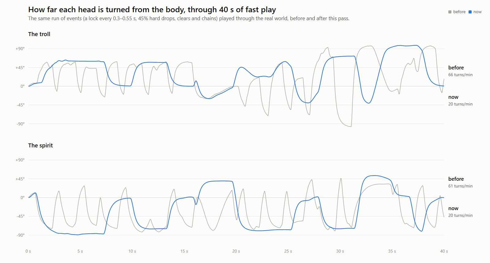
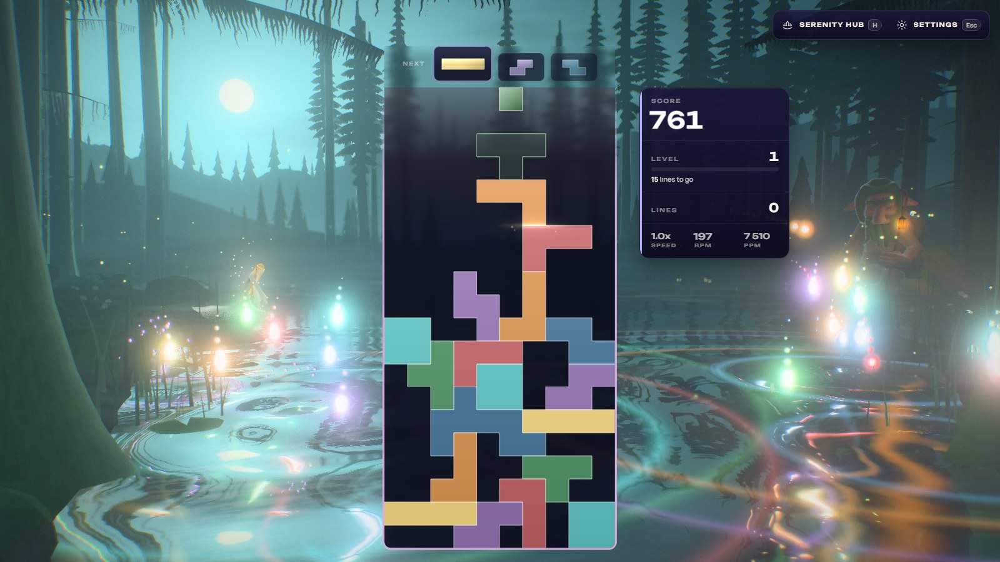
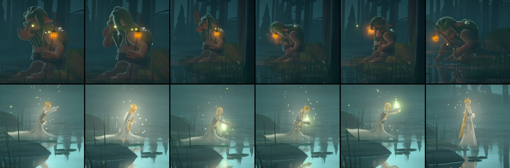
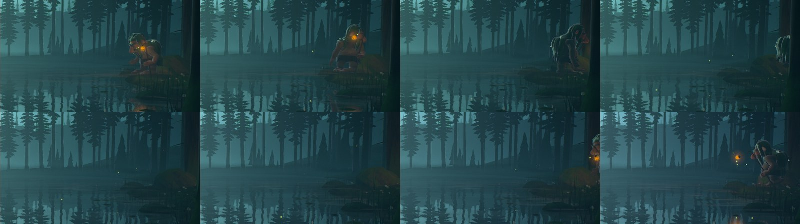
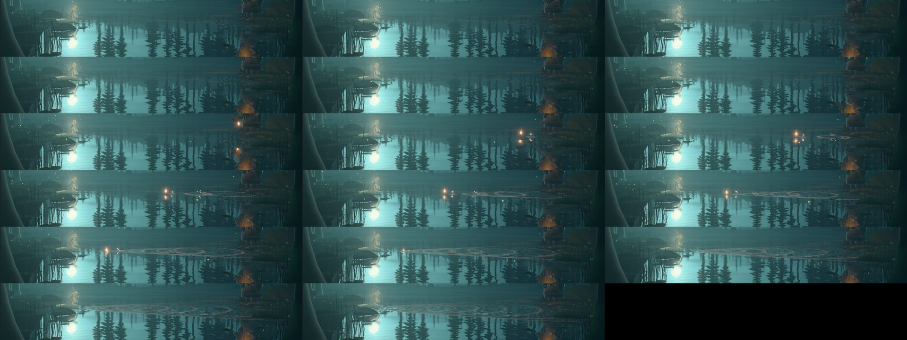
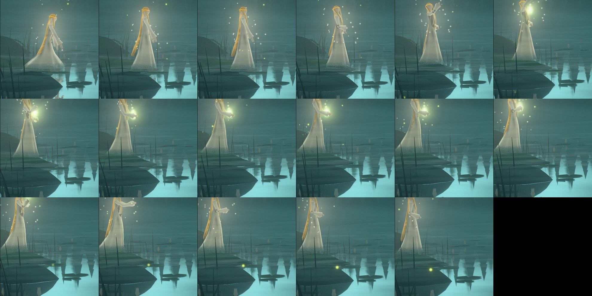
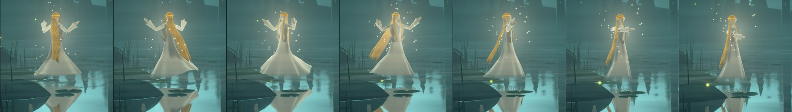
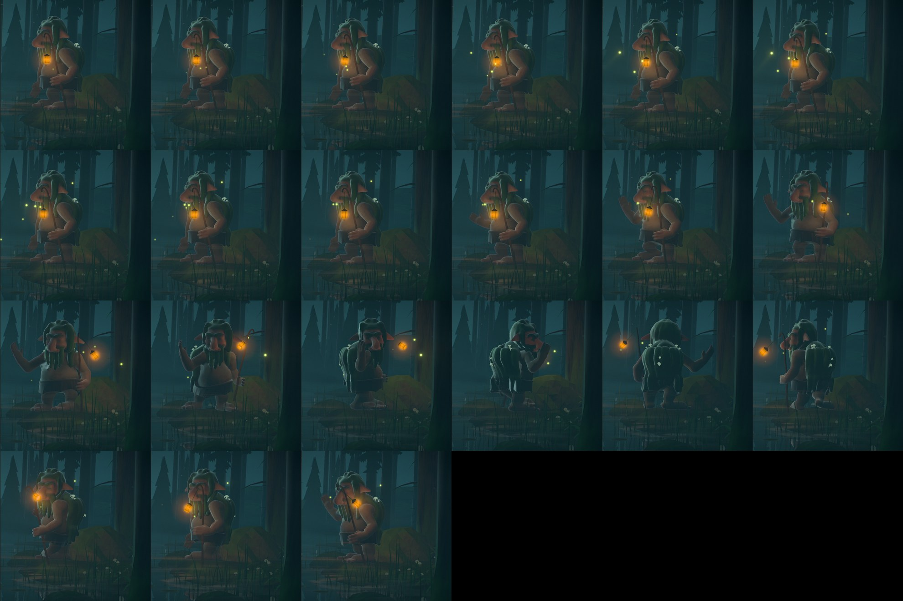
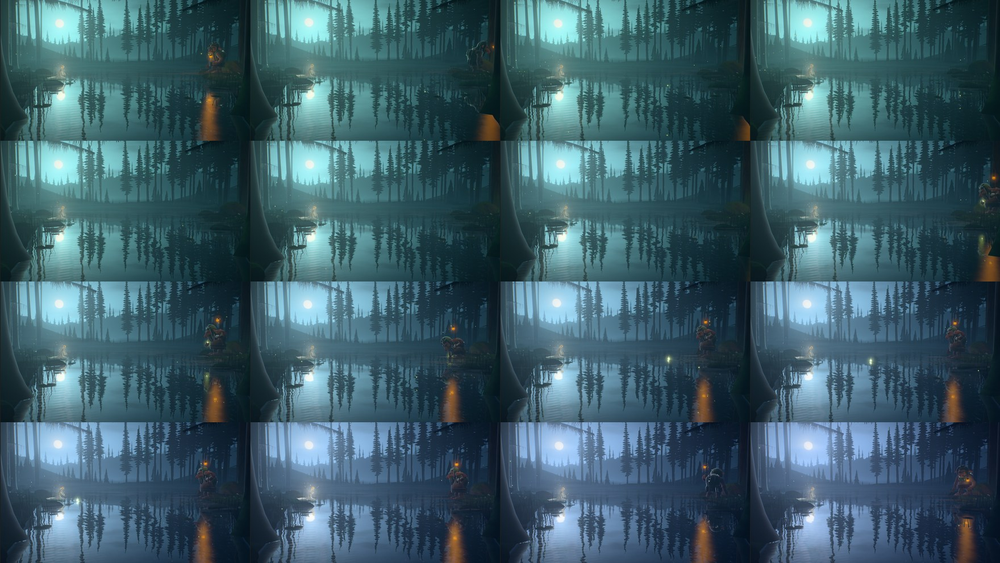
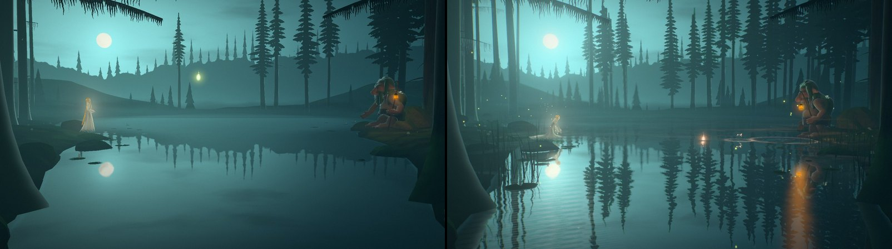

# Stillwater — the troll and the spirit, alive

Implemented 2026-10-23 on `feature/stillwater-figures-life`, on top of the figures and their story of
2026-10-18 (`docs/STILLWATER_STORY_2026-10.md`, whose figures, story beats, heart's flight and path of
light all stand). This pass gave the two a way of looking, a life of their own between the moments
play gives them, and a story that grows across the night.

What the author asked for: "when playing fast the troll feels like it looks back and forth on the
water ripples in an unnatural way. That might also be the case for the spirit. I want much smoother
and much more varied movements of them two... they should be able to walk away for a bit and also
interact with each other over the water. We need to really tell a story here."

## What was wrong (the audit)

Measured by driving the real `StillwaterWorld` with both figures in Node through the same fast
session (a lock every 0.3–0.55 s, 45% hard drops, clears and chains), a calm one and an idle one:

| 90 s of fast play | before | after |
| --- | --- | --- |
| The troll's gaze: turns that reverse, a minute | 66.7 | 21.3 |
| His head's speed, 95th percentile / peak (rad/s) | 6.5 / 15.3 | 2.1 / 4.0 |
| His walks, and metres walked | 12, 18.8 m | 7, 8.8 m |
| The spirit's gaze: turns that reverse, a minute | 56.7 | 21.3 |
| Her head's speed, 95th percentile / peak (rad/s) | 3.7 / 6.8 | 2.1 / 2.9 |
| Her drifts, and metres drifted | 29, 22.6 m | 16, 9.3 m |

The causes, in the order they mattered:

1. **Every light was a new thing to look at, and the newest always won.** Each lock pushed a 1.6 s
   look at its own landing point (scattered over the whole side of the water by `pickLanding`), and
   `eventLook` returned the latest; in a quick run the target jumped every few hundred milliseconds
   and the heads (springs of 0.11 s with no speed limit) followed every jump.
2. **Her whole body turned for a glance.** She faced the lantern whenever any look was set and the
   tarn's heart otherwise, so every lock on her side swung all of her.
3. **The staff and lantern were retargeted** between raised, held out and planted within a second.
4. **A hard drop always made him start** (a third of a start even on the heels of another).
5. **A chain broken and begun again walked him home and back** over and over in a quick run.
6. **At rest there was almost nothing to them**: he sat and dozed, she knelt and trailed her
   fingers, one glance on a hash every ten seconds, a shift of weight. Neither ever left their place,
   and they did nothing together but in a chain.

## How they look now

`stillwater-attention.js`. Every update the story offers each of them what there is to watch, each
with a weight (the water before them, the other across the water, where the lights are falling on
their side, a light followed down, the tarn's heart after a clear, the sky turning, the heart in
flight above all, and whatever their own life has them doing), and an `Attention` chooses:

- a look is **held for its dwell** (1.2 s him, 0.9 s her) against anything merely better; only
  something heavier by a clear margin (the heart rising, a hard drop out of a calm) takes it at once;
- when what was held goes before the dwell is up, **the eyes stay where it was** for the rest of it;
- **a quick run is one place, not many lights**: the lights falling on a side draw an `Area` a share
  of the way toward each, and the figure watches that place moving on a slow spring. Only in a calm
  night (`busy` < 0.35, from a count of locks over three seconds) is a single light followed down.

The heads move on **two springs in series with a speed cap** (`followTo` in stillwater-motion.js):
a turn gathers speed, peaks and settles with no jolt at either end, and the gaze never turns faster
than about 140°/s (him) or 175°/s (her) whatever is asked. A start is a quick rise, never a jump
in one frame, and only out of a calm. Her body turns with where she goes (to him in a chain, home
after one, along her way when she drifts), not with what she glances at. She drifts toward a place
that moves at her pace (0.6 m/s at most), so a long way is a glide; the spring alone had darted her
at up to 5 m/s over long distances. In a quick run a broken chain leaves them waiting at the water
for up to four seconds (`LINGER`) before they go home, since another chain is likely on its way.

## Their life between times

`stillwater-life.js`. When play leaves them alone (2.5 s of calm, play not busy, no chain, heart or
parting under way) each has things to do, chosen by a seeded draw stepped with the clock (a replay
meets the same night). A scene is a list of beats; a beat lasts a set time or until something is so
(he has arrived, she is on her feet) and no longer than its `max`; play ends a scene where it stands
and the story takes them from there.

| His | Hers |
| --- | --- |
| rubs his big nose, sheepish | smooths her hair back behind her ear |
| strokes his beard down, thinking | sings to the moon, her hands at her breast (her motes rise thicker) |
| stretches, his arm high, a yawn | catches a firefly, cups it, lets it go up into the night |
| draws his lantern in to trim it (it brightens) | twirls on the water, her gown flaring, her hair swinging out |
| cocks his head at a sound in the wood | drifts back among the flowering lilies and kneels there a while |
| looks up at the moon, leaning back on his staff | drifts far back along her shore into the mist, and returns |
| **walks off into the wood**, out of the picture, and comes back | a slow round out over the water |
| goes down to the water, crouches and drinks from his hand | looks up at the moon, her hands clasped |
| strolls along the bank and stands looking out | |

### Together, across the water

| From how near (`kin`) | What they do |
| --- | --- |
| at once | **Their eyes meet**: shy at first (she looks away, her hand to her breast; he rubs his nose and looks at the water), fond once they are nearer (she tilts her head; he nods). **A greeting**: one looks across and waves (his hand high over his head, his lantern lifted); the other waves back, or, while they are still shy, looks away. |
| 0.15 | **A bow and a curtsy**: he gets up and bows deep over his lantern; she rises and curtsies, her gown held out. |
| 0.25 | **The call**: he goes down to the water and knocks his staff on it twice; she kneels and sets her fingertip to it; the two rings run out to meet in the middle. |
| 0.35 | **A firefly sent across**: she catches one, holds it to her lips and blows it over the water to his lantern (it arrives, the lantern flares, he nods); from 0.6 he sends one back to her hands. |
| 0.4 | **Skipping a stone**: he goes to the edge, picks up a pebble, warms it at his lantern and skips it across to her: a warm light hopping over the water, a ring at every touch; she claps (or laughs, while still shy). |
| 0.5 | **Her song**: she sings, he sways along on his stone, then nods to her. |
| 0.55 | **A dance**: she drifts out and twirls twice; he gets up and tries a turn of his own, heavily, his lantern swinging out on its cord, and staggers; she laughs behind her hands; he rubs his nose. |
| 0.65 | **The moon**: both look up at it a long while, then at each other. |
| 0.75 | **A boat of light**: he goes into the wood and comes back carrying a little light; at the water's edge he sets it afloat; it drifts all the way across to her; she kneels and takes it into her hands, and holds it to her breast. |

### The story across a night

`kin` (0..1) is how near they have grown. A night begins at 0.1: strangers who have watched each
other across the water for a very long time and never spoken. It only ever grows: a little with every
calm second together, with every line cleared and every step of a chain, more for every heart she
takes, for the path of light running between them, for a meeting of eyes, for every scene they see
through together. Ten quiet minutes bring them about half the way; a run with chains and four-line
clears, further. At first they only steal glances and look away when caught; then they greet, bow,
call to each other across the water; then they play (the stone, the firefly, the song, the dance);
at the last they watch the moon together, and he brings her a light from the wood. A new run keeps
what they have become; only a seek (captures) starts the night over.

While play holds them, the story is as it was: a chain draws them out, four lines raise her heart,
a broken chain parts them with a long look. In a quick run they are not idle either: he nods at a
clear, she claps for more than one line (at most every six seconds, and not when play is very
quick: then they simply watch).

## How it is built

- `stillwater-attention.js` (three-free): `Attention` (dwell, margin, urgent, the eyes kept where a
  thing was) and `Area` (where a run of lights is falling).
- `stillwater-life.js` (three-free): `KIN`, `PLACES` (the troll's way into the wood between his
  boulders and past the young spruce, out of a wide frame at x ≈ 12; her lilies, her way into the
  mist, her dance), `SCENES` (beats), `StillwaterLife` (the scheduler: a seeded draw per scene, no
  scene twice running, a scene of theirs waits up to `DUET_WAIT` for the other to be free, the eyes
  meeting as a reflex), and the lights' paths (`skipPath`, `skipAt`, `arcAt`, `boatAt`).
- `stillwater-gestures.js` (three-free): `TROLL_GESTURES`, `SPIRIT_GESTURES` (each a pose as a function
  of its own clock, hands placed relative to a posed bone so they follow a bow or a kneel),
  `GestureSlots` (a gesture cut short fades out), `HANDOVERS` (gestures made to follow one another).
- `stillwater-story.js`: the interests and the attention, the life stepped and merged under play,
  `busy`, `drawn` (where they stand, lingering), `STARTLE_CALM`, the clear reflexes.
- `stillwater-troll-body.js`, `stillwater-spirit-body.js`: the head on `followTo`; the gesture
  layer over spine, chest, neck, head, shoulders, hips and hands (elbows bent to each gesture's pole);
  his staff's new modes (`tend`, `thump`); her twirl's turn (kept if it is cut short).
- `stillwater-world.js`: the life's events on the water: the pebble's rings and splashes, and the
  lights of their life (a firefly held, sent, let go; the little boat and its wake) written into the
  wisps' table after the wisps, so the water mirrors them and they light the banks; the lantern
  trimmed and her song lend their lights a glow.

**The game's eye sees his left side** (he faces her across the water), so his right hand is on the
far side of him: his gestures put it where it shows (above his head, before his face, out to the
side, down to the water). A first pass that scratched behind his right ear could not be seen at all.

Nothing was modelled: both skeletons (21 and 19 bones) carry every gesture, and the lights are the
theme's own wisps. Blender was not needed.

## Captures

The playground takes two new parameters: `kin=<0..1>` and `scene=<name@t,...>` (begins one of
their scenes at time t whatever they are doing; with it the effect replays from 0 like `story=`).
Close-ups from the game's own eye with the icon lens: the troll `icon=1&iconFov=14&iconYaw=-0.478
&iconPitch=0.05` (his head: `iconFov=9&iconYaw=-0.47&iconPitch=0.06`), the spirit
`icon=1&iconFov=9&iconYaw=0.335&iconPitch=-0.01`. For example
`playground.html?effect=stillwater&kin=0.5&scene=skip@8&t=18`.

## Tiers

Every tier keeps the whole life (it is CPU only: no new parts, uniforms or passes). On Minimal and
Low, which have no mirror pass, the lights of their life cross the water without their reflection,
as the wisps do.

## Verification

- **Unit tests:** the Stillwater suite is 573 tests in 20 files, all passing. New: attention 10 (a
  look held for its dwell, the urgent taking it, the eyes kept where a thing was, a quick run turned
  no oftener than the dwell allows, the area followed without a jump, the head's turn capped and
  without a jolt), life 15 (no scene while play has them, a calm night full of different scenes,
  scenes of theirs only from their nearness, waiting for the other, every scene ending, play ending
  one where it stands, the walk into the wood out of the picture and home, her kept on her feet, the
  stone's skips, kin never falling, shy then fond, the same night replayed scene for scene, the
  lights' paths), gestures 41 (every gesture finite and from nothing back to nothing, the hand-overs
  meeting exactly, slots fading, both bodies making every gesture finite, standing and kneeling, a
  hand asked for within reach, a twirl a whole turn and one cut short never swinging her back),
  story 3 (a quick run watched as one place, a start only out of a calm, the linger), world 2 (the
  fault itself: a quick run through the real world with both figures, under 35 turns a minute where
  the old code makes 77; and a long calm in which they get up, go about and do things together).
  Changed on purpose, with what they now promise: the playground's parameter list (`kin`, `scene`);
  the troll sits again after a break *at some point* in the 25 s (he may be off on an errand at its
  end); the lights after a chain compared with what their own lives lend them taken out; the random
  play's "left alone, at rest" holds when neither has done anything of their own for twenty seconds.
- **The full unit suite:** 1,157 files pass; the 4 that fail are the known local-only ones
  (records-view, game-over-modal-result-compatibility, odyssey-level-briefing: this machine's locale
  prints `250 000`; tts-recorder-e2e: symlink EPERM), which fail on clean main too.
- **Static gates:** typecheck, ts-ratchet (at baseline), lint-ratchet (at baseline; the touched files
  have 2 warnings fewer than before), architecture fitness, the theme lifecycle audit, boundaries, the
  production build with its boot-closure guard, ip-strings, release gates, perf budgets.
- **Playground on the RTX (Electron, WebGPU)** at High: every gesture and scene in close-ups and in
  the full frame, strips of consecutive frames for the walk into the wood, the drink, the lilies, the
  mist, the call, the stone, the firefly, the dance, the boat; Minimal on WebGPU and High and Low on
  the WebGL2 backend; consoles clean.
- **The real game** (private dev server, scratch Electron harness, `unlockAll=1`, High on WebGPU):
  22 s of real hard drops from the keyboard about three a second, both heads sampled every rendered
  frame: **13 turns a minute** for each (the old code's 60 to 77 in Node), looks on the area of their
  side most of the time; then calm, in which their scenes ran in the live theme (scratch and brush,
  the firefly, the drink, the twirl, a stroll, a greeting). Consoles: no errors (only the harness's
  own Electron and Steam warnings).

### Not verified, and what is open

- No ADR-0016 perf-lane reading. The work is CPU only (a few dozen interests and a two-figure
  scheduler per frame; the Node world steps at about 60 µs a frame with both figures) and adds
  nothing on the GPU but rows in the wisps' table it already had; no timing was taken.
- Nothing on a real phone or an upright frame: the routes are in the stage's coordinates and drawn in
  with the stage on a narrow frame, but not looked at there.
- The scenes' choices (what is in the book, their weights and timings, the nearness each needs, how
  fast `kin` grows) are mine, not yet the author's. The firefly's and the boat's colours are the
  hour's firefly colour; the pebble's is his lantern's.
- Her face and his hands have no fingers to speak of: a wave, a clap and a laugh are read from the
  arms and the head.
