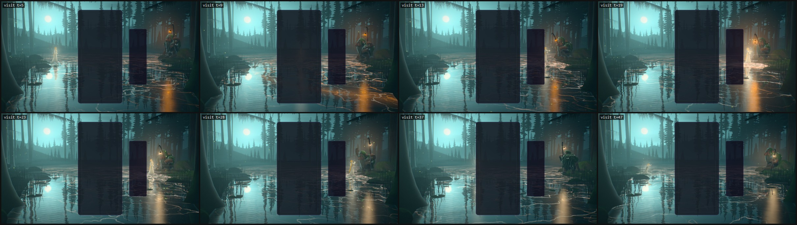
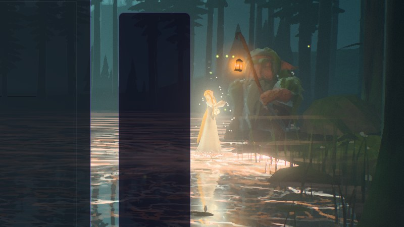
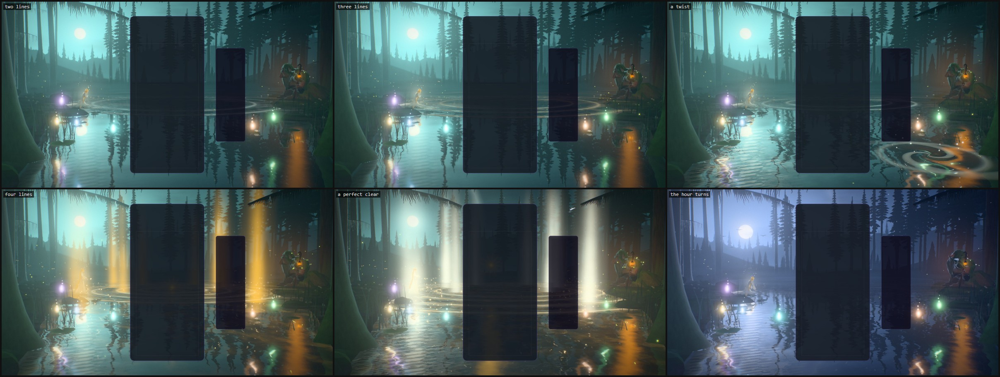

# Stillwater — the living tarn

Implemented 2026-11-17 on `feature/stillwater-living-tarn`, with Three.js 0.187.0, on top of the
tarn of 2026-10 (`STILLWATER_VISUAL_OVERHAUL_2026-10.md`), its wood (`STILLWATER_SPRUCE_WOOD_2026-10.md`)
and its two figures (`STILLWATER_STORY_2026-10.md`, `STILLWATER_FIGURES_LIFE_2026-10.md`), all of
which still stand. This pass was asked for as an audit and then a lift of the whole theme, with
three things named: the picture should change over time, every event should have an effect of its
own with the biggest moments the most spectacular, and the spirit and the troll should stop being
"two separate figures on opposite shores".

## What the audit found

Looked at in the playground at the game's own framing (the solo card and HUD over it), every hour,
every event and every scene of the two, and read in the code:

| | What was there | What was wrong |
| --- | --- | --- |
| The two | Thirty scenes, a nearness that grows (`kin`), gestures, gifts of light | A scene could only begin after 2.5 s without a piece locking, so in ordinary play none ever began: they only watched their own sides. And what they did together was a dot of light crossing BEHIND the card, or a gesture forty pixels tall: at game size nothing joined them |
| The picture over time | Seven hours on a wheel | One picture in seven tints: the same moon in the same place, the same mist, the same water |
| One to three lines | Swells from the tarn's heart with a thread of light | Hardly seen; one, two and three lines looked alike |
| Four lines | A hush, the heart's flare, a gold net, a great ring | Good, but all of it lay on the water: nothing stood up |
| A perfect clear | "As four lines, and the mist lifts" | The same picture as four lines |
| A twist | Three thick pale rings | Not a whirl |
| Their lights | The lantern's column on the water, her halo | The lantern lit a metre of bank; nothing of either light reached the other |

## The two, across the water

**Their story runs beside play.** A scene waits only for what STIRS the tarn (a clear, a hard drop
out of a calm, the hour turning: `story.lastStir`) and for play that has grown quick; pieces set
down at an even pace are no reason to wait. They grow nearer through play as through a calm
(`KIN.calm`, a second of the night together), and a scene of theirs comes about every half minute.
The first time through, the night tells each of their scenes once, the one that needs the least
nearness first (`pick` in `stillwater-life.js`): a wave, a light sent across, a bow, the call, a
firefly, the stone, her song, a dance, and then she crosses. After that the draw is free. In a
five-minute run of ordinary play (a piece every 1.3 s, a clear every ten) the playground told
greet, signal, bow, call, gift, skip, song, dance, visit and moon, in that order.

**Their lights lie on the water** (`u.reach`, `lace` in `stillwater-water.js`). From each of them
thin threads of light travel outward over the tarn: hers the pale of the moon on water, his the
lantern's gold. At rest each lies only on the water before them and the tarn stays a mirror. A
chain, a meeting of eyes or a scene of theirs carries both across the whole tarn, and where both
lie they braid: rose gold where a thread of hers crosses one of his.

**A light sent across** (`u.pulse`, `sendPulse`). Either can send a pulse of light out over the
water: a low swell with a bright front that crosses the tarn at 4.6 m/s, its threads lit behind
it. The sender flares as it leaves; the other turns to watch it come and glows as it arrives.
The `signal` scene is one sending and the other answering once it has crossed (and, once they are
no longer strangers, both at once: the fronts meet in the middle). As a clear's lights come home
the two send each other one too, the one who took more first (not on every clear); a second
difficult clear in a row sends both at once; her song crosses the water as two slow pulses.

**She crosses to him** (`visit`, `waltz`, `ember`; from nearness 0.45, 0.55 and 0.62). She rises,
sets out, and glides the whole way over the tarn (1.25 m/s; out of sight behind the card a few
seconds, then out again on his side). He gets up, comes down to the water's edge and holds his
lantern high to light her way, then out to her as she comes; he bows, she curtsies. Then one of
three things, and each leaves something behind for minutes:

- **`visit`**: she holds her hands to his lantern and her light goes into it: both flare, motes of
  both colours rise round them in a spiral, and the lantern burns pale gold for 85 s (the bank,
  the water and the mist take the new colour: it is the palette's own lantern).
- **`waltz`**: she turns on the water before him; he sways and tries a turn of his own.
- **`ember`**: he trims the lantern, a warm light passes to her hands, and she carries it home
  across the water held to her breast and sets it on the moss by her stone, where it burns for
  two and a half minutes: his light on her shore.

A chain that begins while she is across holds her there, beside him; when it breaks she glides home.

## The night's own weather, and who comes by

`stillwater-night.js` (CPU only). The hours turn the colours; the AIR turns on a clock of its own
(96 s an air, never in step with the hours' 110), in a new order every round, the first always
the still one the theme is known by:

| Air | What it does |
| --- | --- |
| still | The hour's own picture: the tarn is glass |
| mist | The far wood goes into it, the moon's light stands wide, its shafts between the trunks |
| clear | The dark comes far down the sky, the far wood stands crisp, more stars (and they fall) |
| rain | A ring for every drop in the near water, the far water dimpled, streaks lit by the lantern and by her |
| breeze | The mirror breaks into ripples and the moon's road into glitter; the boughs sway |

The sky function answers the air (`thick` in `swBackdrop`): each rank of the far wood is as deep
in the mist as the air says, not a constant. **The moon climbs and sinks with the hours**
(`moonEl`, `moonSize` in each hour): low and a third larger at moonrise and at first light, high
and small at midnight; its image in the water, its road and the post's shafts follow.

**Visitors**, one at a time, each at a seeded moment of a 17 s slot (about one slot in four
passes with nobody), each kind with its own rest:

- **a fish rises**: a ring and a splash on open water beside the card;
- **a star falls** down the strip of sky the frame shows (and through the water); never in rain or thick mist;
- **an owl** crosses the sky on slow wings, past the moon;
- **the old elk** comes down to the far shallows behind the spirit, turned toward her light: it
  stands, lowers its head and drinks (rings run out from its muzzle), lifts it, and is gone after
  46 s. Both figures turn to watch it. It is one shape, a 2D distance field of some thirty limbs
  drawn on a quad that stands in the scene (so the mist lies in front of it and the water mirrors
  it): nothing was modelled, and Blender was not needed.

## Every event its own answer

| Gameplay | The tarn's answer (new in **bold**) |
| --- | --- |
| Lock, hard drop | As before: the light falls, a ring, a wisp; harder, a second ring and a gust |
| One line | The swell, **brighter on its crest and lighting the mist it passes under**; the lights go home; **the two send each other a light** |
| Two lines | All that, and **the lilies open in a wave and the fireflies go up off both banks** |
| Three lines | All that, **the wood's eyes open, and the moon's shafts stand between the trunks** |
| Four lines | The hush, the heart's flare, the gold net, the rings, **and pillars of tarnfire: tall soft columns of gold light standing on the water to either side of the card, the far ones a breath after the near, mirrored** |
| A perfect clear | **The pillars turn pale as the moon and taller, the moon sends a ring out across the sky, and stars fall over the wood** (with the mist lifting, as before) |
| A twist | **A whirl where the piece went in: the mirror wound about it in two arms of the piece's colour, motes spiralling up out of it** |
| Back to back | The lantern blazes, **and both send their light at once: the fronts meet mid-tarn** |
| Level up | The hour turns, the wind, the dew, **a flight of birds out of the far wood and a ring from the moon** |
| A chain | As before (the two come out, the wood wakes), **and their lights run across the whole tarn and braid** |
| Game over | The lights go home, **and the night's lights sink low a while and come back** |

Pillars standing are never put out to be lit again: more four-line clears add to them.

## How it is built

- **`stillwater-night.js`** (new, three-free): `AIRS`, `airAt` (rest, then a melt), the seeded
  order of each round; the visitors' schedule (`visitorOfSlot`, `visitorsBetween`: a pure function
  of the clock, so a seek and a replay meet the same night).
- **`stillwater-air.js`** (new): the rain's streaks, the birds, the elk, the pillars, and a wide
  soft glow of the lantern in the mist. Each of the first four is hidden until its moment
  (`WAITING_PARTS`): a rest frame pays nothing for them.
- **`stillwater-water.js`**: the two lights' threads and their braid, the pulses (they bend the
  mirror too), rain, the whirl, a swell's crest in a band of its own light.
- **`stillwater-tsl.js`**: the sky's answer to the air, the moon's size, a ring from the moon,
  falling stars (a small table, `u.meteors`), cloud by the air.
- **`stillwater-life.js`, `-story.js`, `-spirit-body.js`**: the four new scenes and their beats
  (`crossingBeats`, `homewardBeats`, `sendBeat`), the story's order, when a scene may begin, her
  glide, her staying by him through a chain.
- **`stillwater-world.js`**: all of it wired: the air on the hour, the visitors, the events, the
  pulses and their queue, the reach, the lantern relit, the ember (a light in the wisps' table,
  so the water mirrors it and it lights her bank).

Everything is still a function of the world clock and the events' times. The playground takes
`air=`, `visitors=0`, `visitor=<kind>@<t>`, `reach=`, `pulse=`.

## Tiers and cost

Every tier keeps every event, every air and the whole story. Minimal has no rain streaks (the
rings and the dimpled water are the water's own) and four birds. Rain, the whirl and the threads
are inside real branches: a still night at rest pays for none of them.

Measured cool (the playground live at 30 fps, `profile=1&trackTimestamp=1`, 1920 x 1080, High, the
RTX on WebGPU, sixteen seconds a case): **0.72 ms of GPU a frame on main, 0.77 ms here on a
still night, 0.79 ms in the rain with both lights across the whole tarn.** Not a frame-rate
measurement, and not an integrated GPU.

## Verification

- **Unit tests:** 609 in 22 files, all passing. New: `stillwater-night.test.js` (9: the airs'
  order and melt, the visitors' schedule, the same visitors however the frames fall),
  `stillwater-tarn.test.js` (19, the real world without a GPU: each air on the hour, the moon by
  the hour, every visitor, two and three lines, the pillars, the dusk, the pulses, the reach, the
  lantern relit and the ember, and the visit itself frame by frame with both figures: she crosses,
  her light goes into his lantern, she is home again; a chain holds her by him), and 8 more in
  `stillwater-life.test.js` (scenes beside steady play, the story's order, every kind of visit,
  what each leaves behind, a visit cut short). Changed on purpose: the world's tests hold the air
  still and bring no visitors unless they ask (`night`); a twist is a whirl, not three rings; a
  part that waits for its moment is hidden at rest; the moon's place is read from the hour.
- **Gates:** typecheck, ts-ratchet, lint-ratchet (the theme's own files: 0 errors, 35 warnings
  against main's 36), architecture fitness, the theme lifecycle audit.
- **Playground on the RTX** (a private headless Chrome, 30 fps): every air, every visitor, every
  event and the visit as strips, with clean consoles, at High on WebGPU; High on the WebGL2
  backend; Minimal, Low, Medium and Ultra; a 390 x 844 frame. The phone frame found a fault the
  wide one hid: the pillars' top edge drew as a dark line (a root of a height that MSAA had
  extrapolated below zero); clamped.
- **The real game** (the dev server, headless Chrome, `unlockAll=1`, capped at 30 fps): Stillwater
  picked, a single-player run played with real hard drops from the keyboard for 75 s, through a
  game over and into a second run. WebGPU, High, one canvas, the console clean but for the two
  Steam cloud warnings a browser always gives. The two greeted, signalled and bowed beside play.

### Not verified, and what is open

- Nobody has watched it move: stills, strips and numbers only. The pace of the crossing, of the
  pulses and of the airs' melt want an eye.
- No reading on an integrated GPU and none on a phone; multiplayer and Odyssey layouts were not
  captured (the lights and the pillars are placed for the solo card).
- On a tall phone frame the card covers nearly all of the tarn: the visit happens behind it.
- Owner's calls: whether the threads are too much on the water at rest; the elk's size and how
  often it comes; rain at all in a theme called Stillwater; how fast the two grow near (the whole
  story is told in about seven minutes of play); the pillars' height.
- The elk has no walk: it comes out of the mist and goes back into it where it stands.
- The owl is hard to see against the dark wood on the troll's side.
