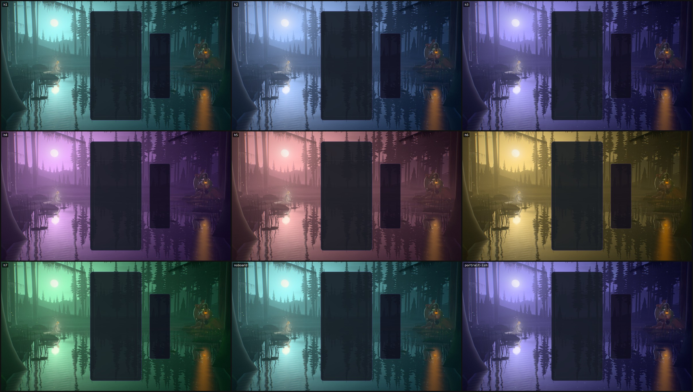
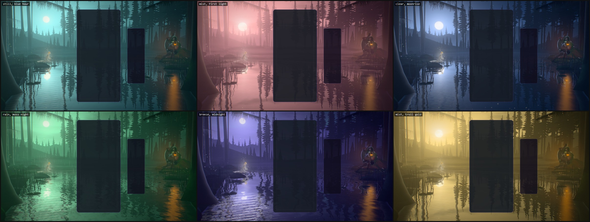
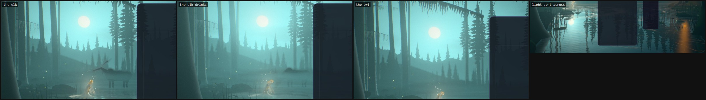
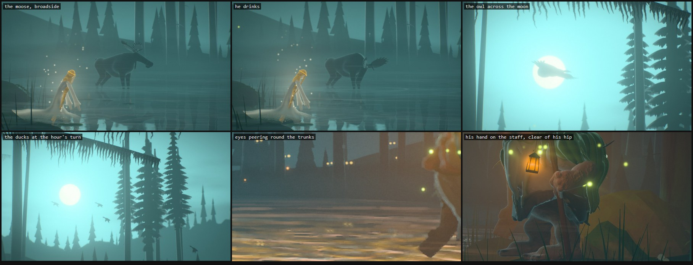
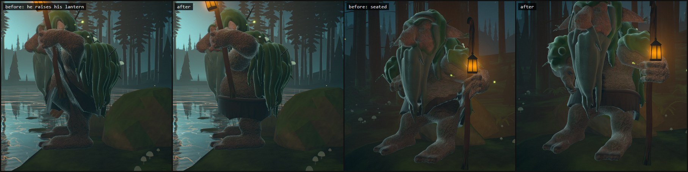
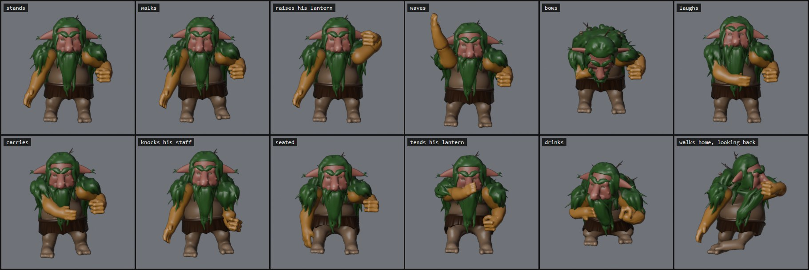

# Stillwater — the living tarn

Implemented 2026-11-17 on `feature/stillwater-living-tarn`, with Three.js 0.187.0, on top of the
tarn of 2026-10 (`STILLWATER_VISUAL_OVERHAUL_2026-10.md`), its wood (`STILLWATER_SPRUCE_WOOD_2026-10.md`)
and its two figures (`STILLWATER_STORY_2026-10.md`, `STILLWATER_FIGURES_LIFE_2026-10.md`), all of
which still stand. This pass was asked for as an audit and then a lift of the whole theme, with
three things named: the picture should change over time, every event should have an effect of its
own with the biggest moments the most spectacular, and the spirit and the troll should stop being
"two separate figures on opposite shores".

## What the audit found

Looked at in the playground at the game's own framing (the solo card and HUD over it), every hour,
every event and every scene of the two, and read in the code:

| | What was there | What was wrong |
| --- | --- | --- |
| The two | Thirty scenes, a nearness that grows (`kin`), gestures, gifts of light | A scene could only begin after 2.5 s without a piece locking, so in ordinary play none ever began: they only watched their own sides. And what they did together was a dot of light crossing BEHIND the card, or a gesture forty pixels tall: at game size nothing joined them |
| The picture over time | Seven hours on a wheel | One picture in seven tints: the same moon in the same place, the same mist, the same water |
| One to three lines | Swells from the tarn's heart with a thread of light | Hardly seen; one, two and three lines looked alike |
| Four lines | A hush, the heart's flare, a gold net, a great ring | Good, but all of it lay on the water: nothing stood up |
| A perfect clear | "As four lines, and the mist lifts" | The same picture as four lines |
| A twist | Three thick pale rings | Not a whirl |
| Their lights | The lantern's column on the water, her halo | The lantern lit a metre of bank; nothing of either light reached the other |

## The two, across the water

**Their story runs beside play.** A scene waits only for what STIRS the tarn (a clear, a hard drop
out of a calm, the hour turning: `story.lastStir`) and for play that has grown quick; pieces set
down at an even pace are no reason to wait. They grow nearer through play as through a calm
(`KIN.calm`, a second of the night together), and a scene of theirs comes about every half minute.
The first time through, the night tells each of their scenes once, the one that needs the least
nearness first (`pick` in `stillwater-life.js`): a wave, a light sent across, a bow, the call, a
firefly, the stone, her song, a dance, and then she crosses. After that the draw is free. In a
five-minute run of ordinary play (a piece every 1.3 s, a clear every ten) the playground told
greet, signal, bow, call, gift, skip, song, dance, visit and moon, in that order.

**Their lights lie on the water** (`u.reach`, `lace` in `stillwater-water.js`). From each of them
thin threads of light travel outward over the tarn: hers the pale of the moon on water, his the
lantern's gold. At rest each lies only on the water before them and the tarn stays a mirror. A
chain, a meeting of eyes or a scene of theirs carries both across the whole tarn, and where both
lie they braid: rose gold where a thread of hers crosses one of his.

**A light sent across** (`u.pulse`, `sendPulse`). Either can send a pulse of light out over the
water: a low swell with a bright front that crosses the tarn at 4.6 m/s, its threads lit behind
it. The sender flares as it leaves; the other turns to watch it come and glows as it arrives.
The `signal` scene is one sending and the other answering once it has crossed (and, once they are
no longer strangers, both at once: the fronts meet in the middle). As a clear's lights come home
the two send each other one too, the one who took more first (not on every clear); a second
difficult clear in a row sends both at once; her song crosses the water as two slow pulses.

**She crosses to him** (`visit`, `waltz`, `ember`; from nearness 0.45, 0.55 and 0.62). She rises,
sets out, and glides the whole way over the tarn (1.25 m/s; out of sight behind the card a few
seconds, then out again on his side). He gets up, comes down to the water's edge and holds his
lantern high to light her way, then out to her as she comes; he bows, she curtsies. Then one of
three things, and each leaves something behind for minutes:

- **`visit`**: she holds her hands to his lantern and her light goes into it: both flare, motes of
  both colours rise round them in a spiral, and the lantern burns pale gold for 85 s (the bank,
  the water and the mist take the new colour: it is the palette's own lantern).
- **`waltz`**: she turns on the water before him; he sways and tries a turn of his own.
- **`ember`**: he trims the lantern, a warm light passes to her hands, and she carries it home
  across the water held to her breast and sets it on the moss by her stone, where it burns for
  two and a half minutes: his light on her shore.

A chain that begins while she is across holds her there, beside him; when it breaks she glides home.

## The night's own weather, and who comes by

`stillwater-night.js` (CPU only). The hours turn the colours; the AIR turns on a clock of its own
(96 s an air, never in step with the hours' 110), in a new order every round, the first always
the still one the theme is known by:

| Air | What it does |
| --- | --- |
| still | The hour's own picture: the tarn is glass |
| mist | The far wood goes into it, the moon's light stands wide, its shafts between the trunks |
| clear | The dark comes far down the sky, the far wood stands crisp, more stars (and they fall) |
| rain | A ring for every drop in the near water, the far water dimpled, streaks lit by the lantern and by her |
| breeze | The mirror breaks into ripples and the moon's road into glitter; the boughs sway |

The sky function answers the air (`thick` in `swBackdrop`): each rank of the far wood is as deep
in the mist as the air says, not a constant. **The moon climbs and sinks with the hours**
(`moonEl`, `moonSize` in each hour): low and a third larger at moonrise and at first light, high
and small at midnight; its image in the water, its road and the post's shafts follow.

**Visitors**, one at a time, each at a seeded moment of a 17 s slot (about one slot in four
passes with nobody), each kind with its own rest:

- **a fish rises**: a ring and a splash on open water beside the card;
- **a star falls** down the strip of sky the frame shows (and through the water); never in rain or thick mist;
- **an owl** crosses the sky on slow wings, across the moon (see the polish above);
- **the old moose** comes down to the far shallows behind the spirit to drink (see the polish
  above: first drawn as a 2D silhouette, now a figure built in Blender that walks).

## Polish from play (2026-11-17, later)

The owner played the merged pass in Serenity mode and sent back five things. All five are fixed.

- **A black line across the back of the picture.** A row of dark dashes along the far waterline,
  under the far wood, that stayed for about a minute after any pulse of light the two sent. It
  came only in the real game, because the clock's own exchanges send pulses there and the
  playground's captures did not. Found by switching each part off in turn in the live game: only
  removing the water cleared it. The pulse's wake was `step(0, back) * exp(back * -0.2)`: far
  ahead of the front `back` is hundreds of metres below zero, so the `exp` overflowed to
  infinity, and infinity times the mask's zero is not a number; the farthest rows of water, at
  the horizon, drew black. The term is now bounded before it is masked (`max(back, 0)`).
- **The troll's arm stuck in his shorts.** His staff hand was planned 0.66 m from his middle
  and 0.72 m below his chest: exactly the outside of his hip in its cloth (measured off the mesh,
  0.67 m). The planted staff now stands further out (`STAFF_STAND`), he holds it higher (at his
  chest, `STAFF.plant` 1.45 m up it, eased to the carried grip when he lifts it), and his free
  hand hangs and swings clear of his hip instead of across it.
- **The yellow eyes in front of the trees.** They were planned in open gaps of the far wood, so
  they floated in the air. Each pair now stands behind a real trunk of the tier's own wood
  (`planEyes(pairs, seed, trunks)`), peering round its edge: one eye clear of the bark, the
  other half behind it, coming and going as the head sways. Every tier still gets its full count
  (a trunk can hide a second pair on its other side, at another height).
- **The flying bird.** A flat sprite of two wings in a V. It is now two real birds built from
  numbers (`stillwater-birds.js`), whose wings fold at the shoulder and the wrist in the vertex
  stage (`foldWing` is the CPU twin): a great grey owl (a big round head, broad wings with
  fingered tips, slow deep beats and long glides) whose flight dips across the moon's disc
  wherever the hour has the moon stand, dark on the brightest sky; and a flight of mallards that
  get up off the far water as the hour turns (a ring and a splash where each leaves it), climb
  over the far wood and string out across the sky. The first ducks flew against the dark far
  wood and could not be seen at all: they now climb 13 m in their first seconds.
- **The moose: a better look, and the bump on his neck.** The 2D silhouette is gone. He is the
  theme's own figure now, built in Blender like the troll (`scripts/blender/stillwater/moose.py`:
  a distance field of smooth masses meshed with OpenVDB, 9,000 triangles, a 16-bone skeleton,
  baked occlusion, `assets/moose.glb`): a deep chest, a long smooth topline rising from the rump
  over the shoulders and falling into the neck (a first build had a round hump over the withers
  that read as a bump on his neck; it is a long low swell now), the overhanging muzzle and the
  bell, pale stockings below the knees and hocks, broad palms with their points along the far rim
  only. `stillwater-moose.js` poses him every frame: he walks in out of the mist through the far
  shallows (a moose's walk, each leg in turn), steps round broadside, looks about, lowers his
  head and drinks (rings from his muzzle), lifts it, turns his head to the spirit's light a long
  moment, and turns and walks back into the mist. His hooves ring the water; he keeps to where it
  is at his knees. Both figures watch him come and watch him drink.
- **The moose walks and turns like one.** He used to spin on the spot to come broadside and to
  turn for home (the whole body rotating about its middle while the legs paddled fore and aft),
  his hooves skated half a metre a step (the stride covered 1.75 m of ground, the legs swept
  0.67 m), his legs snapped from still to mid-stride as he set off, and his steps fell in a
  diagonal order. Now his body keeps to a way laid down in metres: a curve in that bears round to
  broadside as he slows, and a walked turn to his left (1.8 m radius) that runs into a straight
  line into the mist. He faces along it and bends his forequarters into its turns. His pace
  slackens and gathers on smoothsteps, and his steps keep a slow rhythm as he stands, so his last
  steps finish and his first ones are short. Each hoof is planted where his body will stand over
  it halfway through its stance, and it stays there. The hind legs reach their hooves exactly (two
  bones solved, the reach easing short of straight). A fore leg is a column swung from the
  shoulder at its hoof, its knee folding as it comes through: the rig's fore leg rests at 99% of
  its reach, and a two-bone solve there snapped. The steps fall in a lateral walk (left hind, left
  fore, right hind, right fore). His body dips and rolls a little with them, his head nods, he
  looks about in glances and holds, and he turns his head into his turns. Tests: on the ground a
  hind hoof stays within 1 cm and a fore hoof within 8 cm of where it went down; no bone turns
  more than 0.2 rad in a 60 fps frame; he never turns faster than his way bends; he stands
  broadside, his legs at rest, from his arrival until he sets off.

Checked: the real game's Serenity mode (combo, back-to-back, level-up) with the far shore
enlarged three times; the playground on WebGPU and on the WebGL2 backend, at Minimal, Low, High and
Ultra, and in a 390 x 844 frame. Tests: 612 in 22 files (the moose's path, pose and visit; the
birds' meshes, fold and flight; the eyes behind trunks).

## The troll's arm, caught in his cloth (2026-11-18)

After the polish above the owner wrote: "The troll still gets stuck in his shorts with his arms."
The polish had moved his hands; the fault was not where his hands were. It was three faults, one in
his model and two in how he moves, and the first two had been there since he was first built.

**1. His arm was grown into his cloth.** He was one surface: one signed distance field, meshed
once. At rest his left fist hangs by his hip, and a field joins what touches, so fist and
loincloth were one skin; and bone heat binds skin to the nearest bone it can see, so the cloth
beside his fist was bound to his HAND (53 % of the front of his loincloth, in the file) and 705 of
the 1,254 vertices of his left forearm and hand to his thigh. Whenever the hand left his hip a web
of cloth and skin stretched after it: 300 to 800 edges pulled 5 to 50 cm long in every pose he
takes, worst with his lantern raised. Raising his staff hand to his chest in the polish above made
it show more, not less. The same fault, smaller, held his mantle of hair to his thighs (it webbed
as he walked and sat) and a twig bound to his head to the mantle it was caught in.

He is five shells now, in the one mesh (`scripts/blender/stillwater/troll_shape.py` `SHELLS`):
his body (skin and cloth), the hair of his head, the mantle over his back, and each arm from the
ball of its shoulder to its nails with the moss on that shoulder. Each is a field and a closed
surface of its own; no face joins one to another. An arm is bound to its own three bones and
nothing else (by rule, blended across the elbow and the wrist); hair and mantle hang by rule from
his head and torso, never from a leg; his body's skin is bound by bone heat to a skeleton WITHOUT
his arms. `check_shell` and `check_binding` refuse a build in which that is not so, and
`stillwater-troll-assets.test.js` pins it on the files. Skin stretched between an arm and his
trunk: none, in any pose. His look is unchanged (the same masses, the same mane, drawn from the
same numbers); the triangle counts are the same.

**2. His arms went through his own body.** He is stout, his belly stands further forward than his
knees when he sits, and his forearms are as thick as a man's thighs. Posed for where his wrists
should be alone, the hand he rested on his knee lay inside his own lap (under his cloth: this is
most of what "stuck in his shorts" looked like when he sat), a hand laid on his heart went in
through his belly, the staff he knocked on the water came down through the side of him, and
carrying his lantern home he turned his face round into his own fist. His file now names the
masses he is built of (`flesh` in its extras: pelvis, belly, chest, breasts, shoulders, neck, skull,
jaw, nose, ears, cloth, thighs, shins, with the bone that carries each; the sculpt's own numbers),
and `stillwater-troll-flesh.js` with `solveArmClear` / `solveStaffHand` in the body keep both arms
out of them: where a forearm or a hand would stand in him, the wrist is moved and the elbow swung
out of it, and the staff goes with the hand that holds it (lifted, the whole of it; planted, it
leans the other way about its foot). A hand that comes to his body pointing into it lies flat on
it instead (a hand on his heart, on his belly). Seated, his hand rests on the outside of his knee,
where it shows. The deepest any part of an arm stands in him through a night of his: 19 cm before,
under 9 now, and that in passing (a hand to his lantern, the start of a wave). It costs 0.05 ms a
frame.

**3. His staff hand jumped.** Measuring how smoothly his hands move found that his left hand flew
30 to 50 cm along the staff in a single frame, every few steps as he walked and whenever he set
the staff down. Where his hand sits on the staff was found each frame by a step that overshoots
when his arm is square to the staff, and the polish above had put his hand at his chest, where it
always is. It is now the exact answer (the two places on the staff a comfortable arm's length from
his shoulder), and his hand slides and turns on the staff no faster than a hand does
(`FIST_SLIDE_SPEED`, `FIST_TURN_SPEED`). The staff he had carried was also dropped, not set down
(the whole way to the ground in an eighth of a second): `STAFF_PLANT`. The largest change of
either hand's velocity in one frame fell from 28 m/s walking (and worse) to under 2; the largest
left is 4, the knock of his staff on the water.

Three smaller things with these: a wave now stands his hand up beside his head (his forearm lay
across his brow on the way); the lantern he trims hangs before the end of his long nose, not in
his face; and his right hand is where it should be from his first frame (it came out of his chest).

**How it was found, and how to find the next one.** By measuring, not by looking: at game
distance none of it could be told apart. Three measures, each of his real file posed by his real
body through everything he does (thirty poses): how far each edge of his skin is stretched beyond
its rest length; how deep arm skin stands behind the posed surface of his body's skin and cloth;
and how much each hand's velocity changes in a frame. `stillwater-troll-flesh.test.js` keeps the
second and third on the masses (13 tests), and the model's tests the first as a rule on the file.
The pictures here are those posed meshes rendered in Blender.

**Checked:** the playground on the RTX at Ultra, High, Low and Minimal, on WebGPU and on the WebGL2
backend, close and at the game's own distance, consoles clean; 645 unit tests in 23 files;
typecheck, the ts, lint and fitness ratchets, the lifecycle audit, the dependency rules, the
production build, the performance budgets and the release gates.

**Open:** nobody has watched it move (stills and numbers again). His hair and mantle still pass
through an arm that crosses them (they are draped at rest, not simulated). His loincloth is a
stiff band: seated it lies over his thighs but does not hang. A hand has no finger bones: it
cannot close on what it carries. A far look over his shoulder still twists his long hair hard.

## Every event its own answer

| Gameplay | The tarn's answer (new in **bold**) |
| --- | --- |
| Lock, hard drop | As before: the light falls, a ring, a wisp; harder, a second ring and a gust |
| One line | The swell, **brighter on its crest and lighting the mist it passes under**; the lights go home; **the two send each other a light** |
| Two lines | All that, and **the lilies open in a wave and the fireflies go up off both banks** |
| Three lines | All that, **the wood's eyes open, and the moon's shafts stand between the trunks** |
| Four lines | The hush, the heart's flare, the gold net, the rings, **and pillars of tarnfire: tall soft columns of gold light standing on the water to either side of the card, the far ones a breath after the near, mirrored** |
| A perfect clear | **The pillars turn pale as the moon and taller, the moon sends a ring out across the sky, and stars fall over the wood** (with the mist lifting, as before) |
| A twist | **A whirl where the piece went in: the mirror wound about it in two arms of the piece's colour, motes spiralling up out of it** |
| Back to back | The lantern blazes, **and both send their light at once: the fronts meet mid-tarn** |
| Level up | The hour turns, the wind, the dew, **a flight of birds out of the far wood and a ring from the moon** |
| A chain | As before (the two come out, the wood wakes), **and their lights run across the whole tarn and braid** |
| Game over | The lights go home, **and the night's lights sink low a while and come back** |

Pillars standing are never put out to be lit again: more four-line clears add to them.

## How it is built

- **`stillwater-night.js`** (new, three-free): `AIRS`, `airAt` (rest, then a melt), the seeded
  order of each round; the visitors' schedule (`visitorOfSlot`, `visitorsBetween`: a pure function
  of the clock, so a seek and a replay meet the same night).
- **`stillwater-air.js`** (new): the rain's streaks, the birds, the elk, the pillars, and a wide
  soft glow of the lantern in the mist. Each of the first four is hidden until its moment
  (`WAITING_PARTS`): a rest frame pays nothing for them.
- **`stillwater-water.js`**: the two lights' threads and their braid, the pulses (they bend the
  mirror too), rain, the whirl, a swell's crest in a band of its own light.
- **`stillwater-tsl.js`**: the sky's answer to the air, the moon's size, a ring from the moon,
  falling stars (a small table, `u.meteors`), cloud by the air.
- **`stillwater-life.js`, `-story.js`, `-spirit-body.js`**: the four new scenes and their beats
  (`crossingBeats`, `homewardBeats`, `sendBeat`), the story's order, when a scene may begin, her
  glide, her staying by him through a chain.
- **`stillwater-world.js`**: all of it wired: the air on the hour, the visitors, the events, the
  pulses and their queue, the reach, the lantern relit, the ember (a light in the wisps' table,
  so the water mirrors it and it lights her bank).

Everything is still a function of the world clock and the events' times. The playground takes
`air=`, `visitors=0`, `visitor=<kind>@<t>`, `reach=`, `pulse=`.

## Tiers and cost

Every tier keeps every event, every air and the whole story. Minimal has no rain streaks (the
rings and the dimpled water are the water's own) and four birds. Rain, the whirl and the threads
are inside real branches: a still night at rest pays for none of them.

Measured cool (the playground live at 30 fps, `profile=1&trackTimestamp=1`, 1920 x 1080, High, the
RTX on WebGPU, sixteen seconds a case): **0.72 ms of GPU a frame on main, 0.77 ms here on a
still night, 0.79 ms in the rain with both lights across the whole tarn.** Not a frame-rate
measurement, and not an integrated GPU.

## Verification

- **Unit tests:** 609 in 22 files, all passing (645 in 23 after the troll's arm: see above). New: `stillwater-night.test.js` (9: the airs'
  order and melt, the visitors' schedule, the same visitors however the frames fall),
  `stillwater-tarn.test.js` (19, the real world without a GPU: each air on the hour, the moon by
  the hour, every visitor, two and three lines, the pillars, the dusk, the pulses, the reach, the
  lantern relit and the ember, and the visit itself frame by frame with both figures: she crosses,
  her light goes into his lantern, she is home again; a chain holds her by him), and 8 more in
  `stillwater-life.test.js` (scenes beside steady play, the story's order, every kind of visit,
  what each leaves behind, a visit cut short). Changed on purpose: the world's tests hold the air
  still and bring no visitors unless they ask (`night`); a twist is a whirl, not three rings; a
  part that waits for its moment is hidden at rest; the moon's place is read from the hour.
- **Gates:** typecheck, ts-ratchet, lint-ratchet (the theme's own files: 0 errors, 35 warnings
  against main's 36), architecture fitness, the theme lifecycle audit.
- **Playground on the RTX** (a private headless Chrome, 30 fps): every air, every visitor, every
  event and the visit as strips, with clean consoles, at High on WebGPU; High on the WebGL2
  backend; Minimal, Low, Medium and Ultra; a 390 x 844 frame. The phone frame found a fault the
  wide one hid: the pillars' top edge drew as a dark line (a root of a height that MSAA had
  extrapolated below zero); clamped.
- **The real game** (the dev server, headless Chrome, `unlockAll=1`, capped at 30 fps): Stillwater
  picked, a single-player run played with real hard drops from the keyboard for 75 s, through a
  game over and into a second run. WebGPU, High, one canvas, the console clean but for the two
  Steam cloud warnings a browser always gives. The two greeted, signalled and bowed beside play.

### Not verified, and what is open

- Nobody has watched it move: stills, strips and numbers only. The pace of the crossing, of the
  pulses and of the airs' melt want an eye.
- No reading on an integrated GPU and none on a phone; multiplayer and Odyssey layouts were not
  captured (the lights and the pillars are placed for the solo card).
- On a tall phone frame the card covers nearly all of the tarn: the visit happens behind it.
- Owner's calls: whether the threads are too much on the water at rest; the elk's size and how
  often it comes; rain at all in a theme called Stillwater; how fast the two grow near (the whole
  story is told in about seven minutes of play); the pillars' height.
- The elk has no walk: it comes out of the mist and goes back into it where it stands.
- The owl is hard to see against the dark wood on the troll's side.
