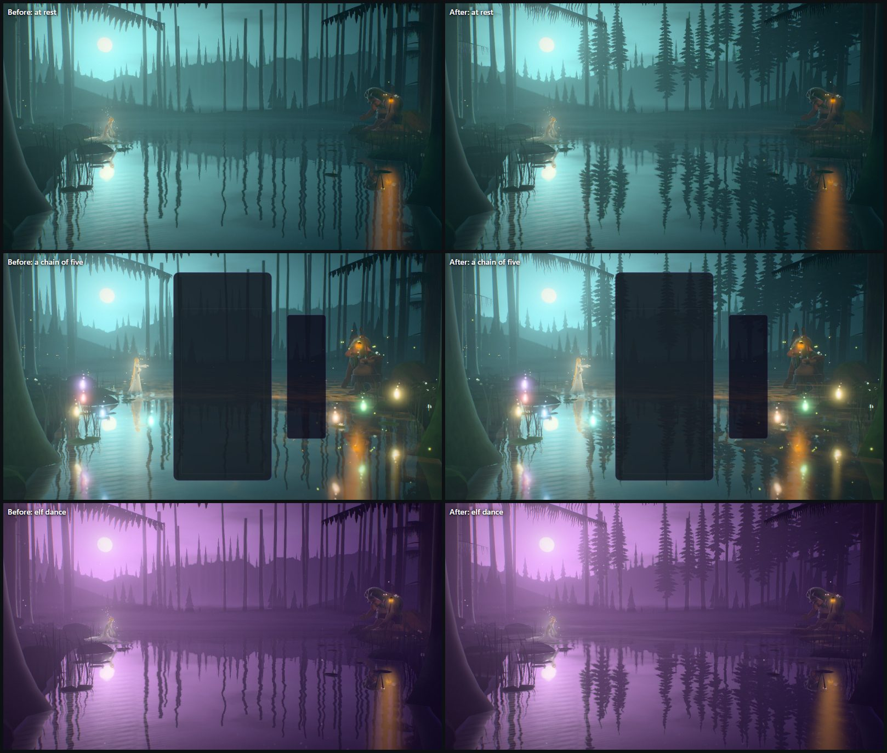
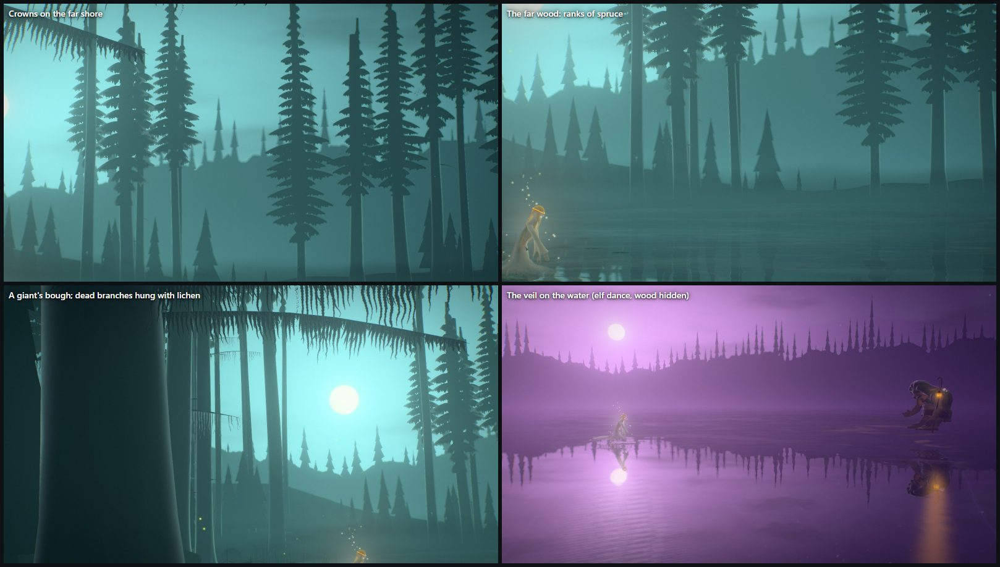
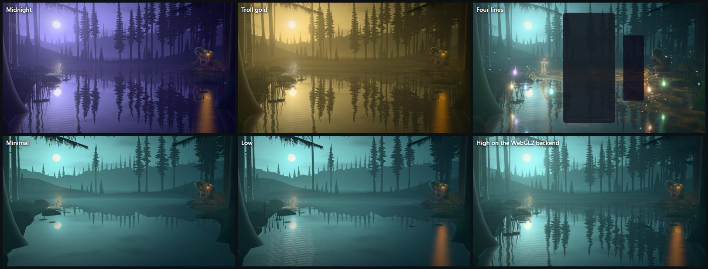
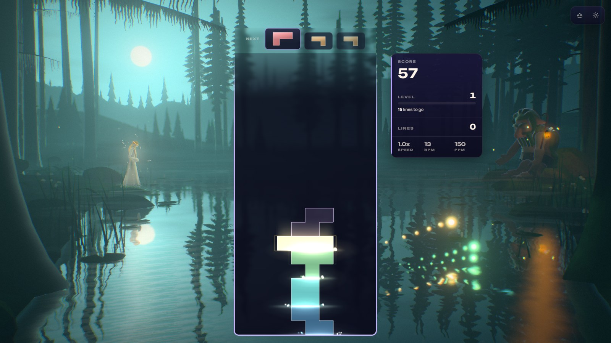
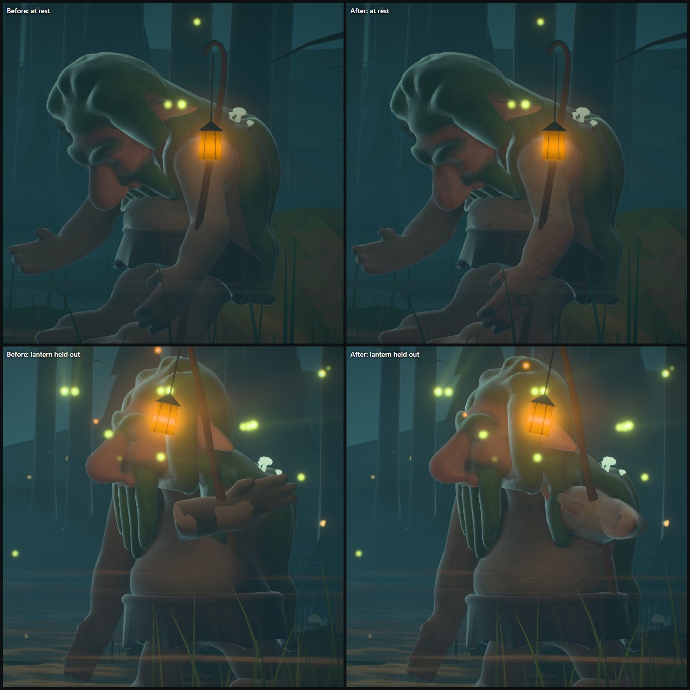
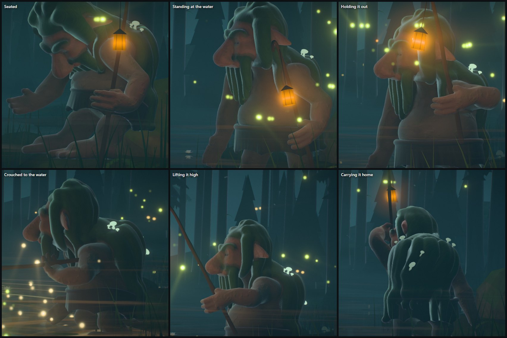

# Stillwater — the spruce wood (atmosphere pass, 2026-10-21)

Olov asked to "start improving the visuals, effects, atmosphere and graphics in the Stillwater
theme". The tarn had been rebuilt on 2026-10-09 ([STILLWATER_VISUAL_OVERHAUL_2026-10.md](STILLWATER_VISUAL_OVERHAUL_2026-10.md))
and its two figures given a story on 2026-10-18 ([STILLWATER_STORY_2026-10.md](STILLWATER_STORY_2026-10.md)).
The water, the hours, the figures and the event language stand; this pass is about the wood round
the water and the air over it. Everything was iterated in the playground (Electron on a private dev
server, RTX 5080 laptop, WebGPU) against captures of the rest frame, a chain, four lines, the hours,
the tiers, a tall frame, an ultra-wide one and the WebGL2 backend, and then seen in the real game.



## What held it back

- **A wood of bare poles.** Every tree on the banks was a column that ran off the top of the frame
  with nothing on it. The ones across the water (40–70 m off) ended inside the picture in a flat
  cut top. The wood read as telephone poles or a burnt forest, not as the old spruces of a Bauer
  tarn, and the mirror doubled the poles into a barcode.
- **Needles for a far wood.** The far ranks drawn by the sky function were spikes nine times as tall
  as they were wide, standing on rolling hills: stalagmites, not spruce.
- **Paper teeth at the top of the frame.** The giants' boughs were a straight spine with a row of big
  regular triangles under it; the other boughs, hung on near trunks and seen from below, read as
  planks and shelves laid across the gaps between trunks.
- **No mist on the water.** The mist stood in sheets over the far water; the tarn itself, the place
  the elf dance is named for, had none lying on it.

## What changed

**Crowns (`stillwater-trees.js` `planCrowns`, `createCrowns`, `crownCard`).** Every tree but the two
giants beside the viewer ends in a spruce's crown: whorl under whorl of branches that leave the
trunk level and bow toward their tips, with a ragged curtain of twigs hanging from each, long
enough that one whorl's curtain reaches the next one's branches; a narrow cone, fuller on some trees
and more of a spire on others, its lowest whorls short and sparse, now and then a branch broken
short, a dark mass where the whorls run together round the trunk, and pale tufts of beard lichen
under the lower branches of about half the trees (drawn only where a tuft is wider than a pixel or
two). Trees at the water's edge keep their low branches (the light comes off the tarn); trees
inland carry their crowns high. A crown that would reach into one of the picture's windows starts
above it (`crownFloor` in the plan: above the moon and its halo on the spirit's side at any range,
above the troll and his lantern on his). Each crown is one card that turns about its trunk to face
the eye (the mirror's eye too, so the crowns stand in the tarn), set a little in front of the trunk
so the needles hide it, and cut out in the fragment stage with its edge drawn to the pixel; over a
multisampled scene pass the edge is laid down by coverage (alpha to coverage). The light is the
night's (`swLight`): the upper side of a whorl takes the sky, the inside is dark, and close to the
moon the outermost twigs take a thread of its light. 102 cards at High, one draw.

**The far wood (`stillwater-tsl.js` `swBackdrop`).** Each rank is spruce silhouettes about four times
as tall as they are wide: a cone that falls in tiers, each tier widest at its foot where the boughs
droop, the step back to full width drawn over one pixel (so the tiers' edges are smooth both ways);
a few stand over the rest, a few have died back to a bare spire. Two or three overlapping sets of
trees per rank close it into a wall (`wood` in the tiers). A rank is skipped where the view is
above its tallest possible tree (most of the sky, and the steep mirror rays of the near water).

**Boughs (`createBoughs`).** The giants' boughs are hanging curtains of twigs, closely set, each its
own length, wavering toward its end and feathered with needles, crowding into one dark band at the
branch and parting lower down, over a scalloped hem; where a twig is narrower than a few pixels the
curtain closes into one. Out in the wood the boughs are now the old trunks' dead branches, a dark
stick thinning to its end hung with pale beards of lichen (`lichenFragment`), only on trunks 16–44 m
off and hung across the line of sight (from the near trunks, seen steeply from below, a bough's arc
read as a hoop).

**The veil (`stillwater-fx.js` `createVeil`).** Layers of low mist lying on the water (three at High),
drifting and curling over one another (one noise field folded over itself), thin where the banks
rise, gone close to the eye and lost in the far mist. Its colour is the night's haze, lit: the
moon's light is scattered on toward the eye where the veil lies between it and the moon, and the
lantern, the spirit, the heart in flight and the gathered wisps glow in it. It lies on the water and
is not mirrored. It thickens with the hour's mist (most in the elf dance), lifts with a perfect
clear and dims while the night holds its breath.





In the real game (High, WebGPU, after six real hard drops from the keyboard):



## The troll's skin

Asked for next: "Can we keep improving the skin of the troll, it looks a bit flat." His hide was
one albedo (two colours, his ruddy face and his earthen hide) under the baked occlusion and the
night's soft light: smooth clay. It is now (`stillwater-troll.js`):

- **Grain laid on his rest pose** (`positionGeometry` and `normalGeometry`, sampled three ways), so
  it stays on his skin as he moves: lumps and warts, a net of creases and a little grain, as relief
  (the surface-gradient bump his moss already used) and in colour. What is finer than a pixel gives
  way: the creases and grain are drawn only where a pixel spans a few millimetres (a close view, a
  4K frame); in a normal frame at his 20 m they read as speckle, so they are off there and the lumps
  carry the relief.
- **Colour that is not one:** olive and lichen-grey blotches over the earth of it, darker spots of
  age, the creases dark, the lumps a shade paler, and the ends of him (hands, feet) flushed like his
  face.
- **Light that goes into it:** warm light along the edge of the lit side (the lantern's, and a cooler
  share of the moon's), and a red glow through what is thin (ears, nose) when the lantern is behind
  it; a damp sheen, most on his nose and brow and none in a crease; his skin takes the moon with
  less wrap than his moss and leather, so it models his face and arms instead of lighting them all
  alike. On his arms the baked occlusion is let off lightly (it was baked with his arms hanging
  against his hips).
- **His arm no longer goes through his belly** (`stillwater-troll-body.js`). The patches on his
  forearm while he held his lantern out to her were not his skin: the staff's grip was held nearer
  his middle than his shoulder, so the arm could only reach it through his chest, whose skin showed
  through the forearm. The grip for holding it out, and for laying it out over the water, now stands
  out past his shoulder; a test pins it (and fails on the old grip).



### His grip on the staff

Asked for next: the arm holding the staff with the lantern still looked strange. It did, in two
ways. His hand never closed on the staff: the solver put his wrist on it and left the hand straight,
so the staff ran through the heel of his open hand. And his arm was either straight or folded shut:
measured through a night, leaning on the staff his elbow was bent 3–5° (the hand turned 90° at the
wrist to meet the upright staff), carrying it 130–155° (the skin pinched at the elbow), and holding
it out his wrist bent back as far as 147°.

Now (`stillwater-troll-body.js` `solveStaffHand`, `FIST`, `FIST_HOLD`):

- **His fist closes round it.** The staff runs across his palm, inside his curled fingers, his thumb
  toward its top, where the sculpt's palm and fingers are (`FIST`, from `troll_shape.py`
  `_limb_hand`); the hand's frame comes from the file's own bone tails (`tailsFromSpec`). The hand
  points on from his elbow through the staff, square to it, so the forearm comes to it in line, and
  the forearm takes half of the hand's turn about it, so the wrist does not wring.
- **He takes it where his elbow is comfortably bent.** His hand slides along the staff from the
  planned grip (the staff itself, and the lantern on it, stay where they are): leaning on it, to an
  elbow bent 60–100° (how a walking stick is held); carrying it, to any comfortable bend, sliding
  only a little so the staff's butt stays out of him. The grips for holding it out, crouching with
  it, lifting it high and carrying it home now stand out where his arm reaches them bent, not folded
  (his hands are big: the fist is a quarter of a metre down the hand from the wrist).
- Measured through a night (settled holds): the elbow 30–111°, the wrist at most 94°, the hand on the
  staff exactly, a carried staff's butt at least 0.52 m from his chest. Two tests pin it.



## Tiers

| | Minimal | Low | Medium | High | Ultra | Extreme |
| --- | --- | --- | --- | --- | --- | --- |
| Crowns | 28 | 42 | 68 | 102 | 122 | 138 |
| Far wood sets per rank (`wood`) | 2 | 2 | 3 | 3 | 3 | 3 |
| Veil layers (`veil`) | — | 1 | 2 | 3 | 3 | 3 |
| Crown, bough edges | cut | cut | cut | coverage | coverage | coverage |

(Crowns are the tier's trunks less the two giants.)

## Verification

- **Unit tests:** the Stillwater suite is 491 tests in 16 files, all passing. New: the crowns (one per
  tree but the giants, the same every time and no tree's crown moved by another; each on its own
  trunk with its tip over the trunk's top and its card in front of it; the trees at the water
  keeping their low branches; every crown above any window it would reach into; the cards square to
  the line of sight; most sight lines across the top of a wide frame meeting a crown, and none of
  nine through the moon's disc on any of seven frames from 3440 × 1440 to 390 × 844, at every
  tier), the wood's boughs (16–44 m off, across the line of sight), and in the world the parts,
  their layers (the veil not mirrored), the draw order (the veil first of what is blended) and the
  moon's sight lines cast through the crowns as they are really drawn (`crownCard` is the vertex
  stage's CPU twin). For the troll (troll body, 20 tests): his staff hand held out past his left
  shoulder, not across his belly; his fist round the staff (across the palm, square to the hand,
  thumb up) wherever his arm reaches; the elbow bent, never straight or folded shut, the wrist easy,
  a carried staff's butt clear of his chest.
- **ESLint:** no errors and no new warnings in the theme, the playground effect and its tests.
- **Playground (RTX 5080, Electron, WebGPU):** rest, a chain, four lines, midnight, elf dance, troll
  gold, Ultra / High / Medium / Low / Minimal, the WebGL2 backend at High, 430 × 932 with the board,
  2560 × 1080, close-ups of the crowns, the far wood, the boughs and the veil; consoles clean.
- **The real game** (private dev server, scratch Electron harness, `unlockAll=1`): Stillwater at High
  on WebGPU, 24 parts with 102 crowns and 3 veil layers, six real hard drops from the keyboard;
  console clean (only Chromium's notice that `powerPreference` is ignored on Windows).
- **Cost:** GPU timestamps, playground, the new build against untouched main served from a second
  checkout, interleaved. On the RTX 5080 at 2560 × 1440, High: about +0.4 ms a frame (10th
  percentiles 1.4–1.8 ms before, 1.8–2.4 after). On the integrated Radeon 610M at 1600 × 900, Low,
  the first version cost about +8 ms (23–25 ms → 30–35 ms a frame, four rounds agreeing); the far
  wood was then made cheaper (the rank skip, no `pow`, two sets on Low and Minimal) and Minimal lost
  the veil. A second Low run could not resolve the result: other sessions were loading both GPUs and
  untouched code itself swung 22–79 ms between rounds; its best rounds suggest about +3 ms. An
  observation on a shared machine, not an ADR-0016 measurement.

### Not verified, and what is open

- No clean low-end timing after the optimisation (above), no real phone, no ADR-0016 perf lane.
- Nobody has watched it move: the veil's drift, the crowns' stir in a gust and the boughs' sway are
  checked in stills only.
- The crowns are cards: from the rest camera (which only breathes and leans a little) they hold; a
  camera that walked round a tree would show one.
- The beard lichen on the crowns is drawn only where it is wider than a pixel or two, so on most
  crowns across the water it does not show; it shows on the dead branches and the nearer crowns.
- The icon was not re-captured; the hours' palettes, the spirit and the post are unchanged.
- The troll's skin and grip were judged in stills, close up and at 2560 × 1440, not in motion. In the
  moment the staff swings from one hold to the next (lifting it high; sitting down from carrying it)
  it passes close to his shoulder and his elbow folds for a fraction of a second; the settled holds
  are as above. His hand has no finger bones: the fingers keep the sculpt's half-curl.

## Reproduce

```
/playground.html?effect=stillwater&t=20&quality=High                                   at rest
/playground.html?effect=stillwater&t=20&quality=High&icon=1&iconFov=18&iconPitch=0.2&iconYaw=0.05   the crowns
/playground.html?effect=stillwater&t=20&quality=High&level=4&parts=water,sky,veil,spirit,troll     the veil
```
