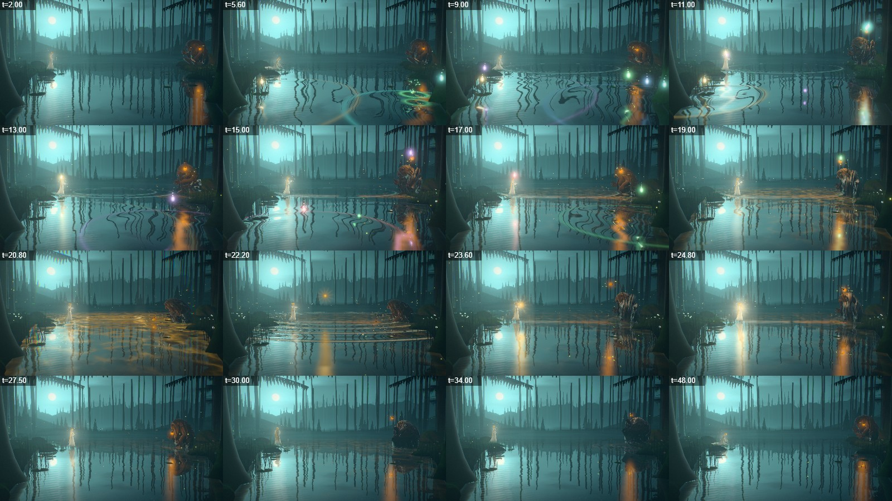
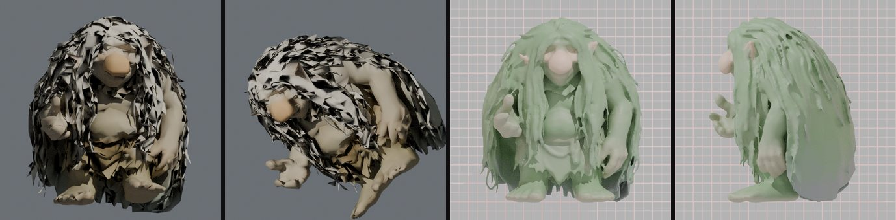
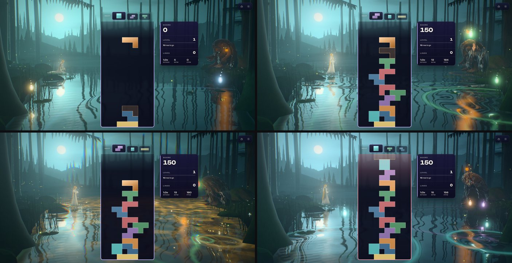
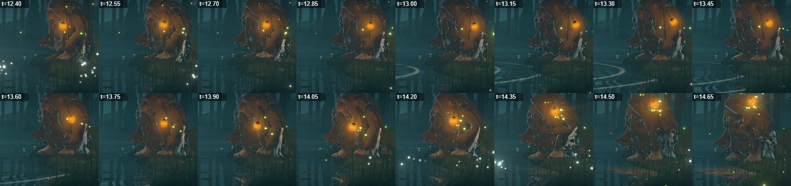
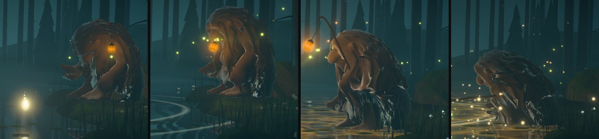
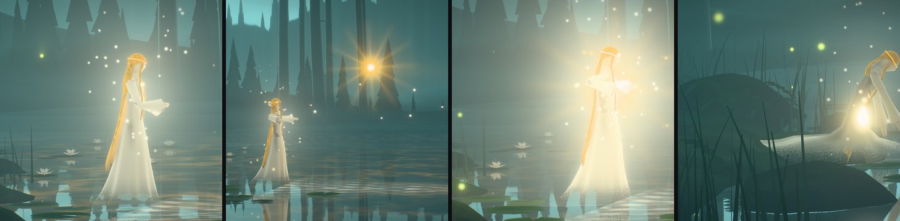
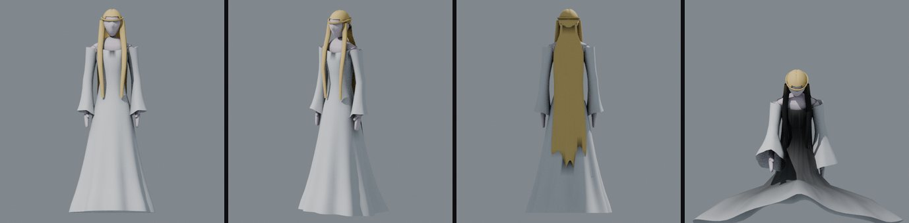
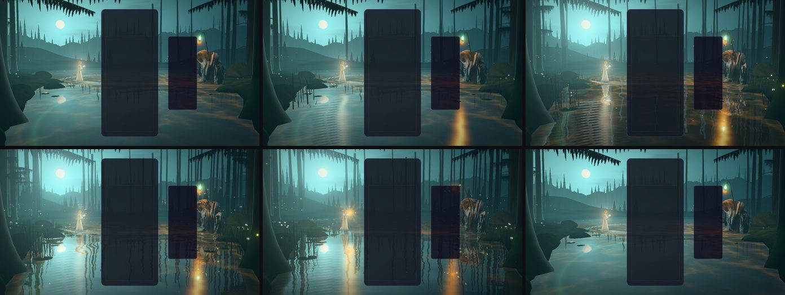
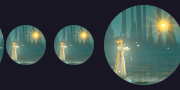

# Stillwater — the troll and the spirit

Implemented 2026-10-18 on `feature/stillwater-story`, on top of the tarn rebuilt on 2026-10-09
(`docs/STILLWATER_VISUAL_OVERHAUL_2026-10.md`, whose place, water, wood, hours and event language
stand). This pass rebuilt the two figures and gave them a story. It supersedes that record's
sections on the figures (the lathe spirit, the troll's walk clip and his lantern on a staff carried
at the shoulder).

What the author asked for: better-looking figures; animations and an interaction between them that
tell a story with some depth; movement that is natural instead of "hacky and wacky"; a theme that is
mystical, with a spiritual atmosphere.

## What was wrong

- **The troll** was a TRELLIS reconstruction whose pelt is a soup of thin triangle shards. It drew
  as torn paper and flickered as he moved. His rig was thirteen bones weighted by distance, with one
  `Walk` clip played by the ground covered: the legs stretched like rubber, standing still snapped
  him back into the sculpt's pose, and the staff was fixed in model space, not to his hand.
- **The spirit** was a lathe silhouette with no limbs. She slid along a curve, rings were dropped
  at "footfalls" she did not have, and her gown and hair were moved by a single trailing vector.
- **Behaviour** followed the combo number directly. In this game every clear reports a combo of
  at least 1, so the two lurched toward each other at every clear and back at the next lock, and
  nothing happened between them.

## The story

Long ago the princess dropped her gold heart into the tarn, and she has stayed, a pale spirit on
her stone, looking down into the water for it. The old troll of the wood keeps a lantern lit on the
far bank. They have never crossed the water.

| Gameplay | What the two do |
| --- | --- |
| At rest | She kneels on the water off her stone, her gown pooled round her, trailing her fingertips in it (a ring now and then), looking down for her heart. He sits on his stone with his staff planted beside him, the lantern hanging at his side; fireflies circle it; after a long calm he nods off. Now and then one looks across; sometimes the other is looking back, and both lights warm a little. |
| Lock | The light falls; the one on that side follows it down. A hard drop turns them both, and wakes him with a start. Falling pieces do not call her up from the water. |
| Clear | Both look out to where the swells come from. The lights gathered home go to her hands (she lifts them, cupped) and to his lantern (he lifts it). A single clear is not a chain: nobody leaves their place for it. |
| Chain | Two clears in a row get him up off his stone (he leans in, pushes up, straightens) and her up off the water, drifting out. Three walk him down to the water's edge; five into the shallows, his steps ringing the water. She drifts out over the tarn toward him, gown and hair trailing, a soft wake behind her. From four he holds his lantern out to her and she holds out her hand; light runs out on the water from each toward the other and motes drift between them. |
| Four lines | The night holds its breath; the heart wakes gold on the bed. If he is at the water he crouches and lays his lantern out over it; the heart rises out of the tarn, crests, crosses to her, and she takes it to her breast and blazes. He lifts his lantern high. |
| Chain breaks | They do not turn at once: they hold each other's eyes a while (2.6 s). Then he trudges home slower, bowed, carrying his lantern up where she can see it; she drifts back to her stone looking over her shoulder at him. A chain that breaks and begins again holds them in that look, then settles them where the new chain has them; a growing chain never sends them back. |
| Level up | Both look up at the turning sky. |
| Game over | They go home at once, without the long look. |

## How it moves

No clips. Both figures are posed every frame from what they mean to do (`stillwater-story.js`
decides, in the stage's coordinates; the world converts to true metres; the bodies carry it out):

- **The troll** (`stillwater-troll-body.js`): feet planted where they landed; a step is taken only
  when a foot has fallen behind where it should be (walking, turning, shifting his weight), one foot
  at a time, heel first off and last down, landing on the real ground (`groundHeight`); legs solved
  onto the feet by a two-bone IK with the knees forward and a little out; hips carried by the legs
  (rising as a leg passes under, sinking as a foot lands, rolling over the bearing leg); the head
  leads a look, the neck and chest follow; acts (sit down, stand up, crouch, rise) are short
  timelines that lean in first and can be turned back halfway, eased so a reversal does not jump;
  breath slower seated and deeper after a walk; standing still he rests on one leg, then the other.
  The staff is placed first, like a third foot that steps with his right foot, and his left hand
  takes it; held, it raises the lantern, holds it out, lays it out over the water, or carries it up
  on the way home. The lantern hangs from the crook on a cord as a damped pendulum.
- **The spirit** (`stillwater-spirit-body.js`): she drifts on a slow spring and leans into the way
  she goes; her gown's four panels (skirt bones) trail her motion, stir in the air and spread on the
  water when she kneels; her two hair links always hang with the weight of hair and stream behind
  her; her hands are placed by a two-bone IK for what she does with them (folded, cupped, held out,
  open wide, crossed on her breast, trailing in the water); a soft S of a stance that shifts hips now
  and then; breath; a look the head leads.
- Springs are critically damped and stepped in closed form (`stillwater-motion.js`), so a long frame
  never overshoots and a replay at another step lands on the same pose. Everything is a function of
  the clock and the events: `seek(t)` plus the fixed-step replay reproduces any frame.

## The figures

- **Troll** (`assets/troll-lod0..3.glb`, `scripts/blender/stillwater/troll.py`): his own sculpt,
  rebuilt: the shards thickened and voxel-remeshed into one solid body under a cloak of matted
  dreadlocks, the paint carried over as masks, the pelt told from the body by thickness, four LODs
  (32,000 / 17,000 / 9,700 / 3,700 triangles), a 21-bone skeleton, baked occlusion. His parts are told
  by place and thinness (skin, bare hide, pelt, the leather of his loincloth), and he is coloured as a
  troll of the wood (`TROLL_LOOKS`, default `forest`): a cloak of deep moss and pale sage lichen
  with strand relief, rosy grey skin on his nose and hands, bare hide on his arms, legs and belly, a
  dark leather loincloth, and tiny glowing caps in his moss that wake with the chain as the ones on
  the banks do. His own lantern's light on him is whitened a share so those colours survive it; a
  moonlit edge and wet glints find his outline.
- **Spirit** (`assets/spirit-lod0..1.glb`, `scripts/blender/stillwater/spirit.py`): built from
  numbers: a slender body, a gown with a train, bell sleeves, gold hair to her knees, a circlet; 19
  bones; 11,166 / 5,582 triangles. Lit from within (brightest at the breast), thin cloth glowing
  edge-on, gold hair with a sheen, her hem dissolving into the mist on the water; a halo and motes of
  light rising round her.
- Both files are compact (quantised, no clips; the skeleton rides in the extras) and are written by
  `scripts/blender/stillwater_assets.py`; provenance in `src/themes/stillwater/assets/ATTRIBUTION.md`.

## Atmosphere

- The heart's flight (`createHeartOrb`, uniform `orbAt`): a bead of gold with a halo and slow rays,
  lighting the night as it goes and laying its own long reflection on the water.
- The path of light (uniforms `path`, `pathEnds`, drawn by the water): while a chain holds them near,
  a glittering band runs out on the water from each of them, her pale light from her side, his
  lantern's from his, flowing toward the middle; and motes drift from her breast and his lantern
  toward each other behind the board.
- A meeting of eyes (`story.gaze`): both lights warm a little.
- Fireflies: about one in eight circles the troll's lantern, wherever he carries it.
- Her hem leaves a soft wake as she drifts; his steps in the water ring it; her fingertips ring it.

## Tiers

Every tier keeps both figures and the whole story. The troll's LOD follows `troll` (3 on Minimal
and Low, 2 Medium, 1 High, 0 Ultra/Extreme); the spirit's `spirit` (1 on Minimal and Low, else 0);
her motes `motes` (0, 16, 20, 32, 40, 40).

## Icon

Re-captured: the gold heart crossing the water to her as she opens her arms (512 x 512, a full-bleed
circle on a transparent ground; both copies replaced).

## Verification

- **Unit tests:** the Stillwater suite is 482 tests in 16 files, all passing. New: motion 17, rig 15,
  troll body 18, spirit body 15, story 24; reworked: the world 85 (its loader mock now parses the real
  figure files), the figures' assets 21 (all six LODs: bands, skeleton, joints, weights), core,
  meshes, quality, playground. They were written by a helper that was not allowed to touch the source
  and pinned what it found with `it.fails`; all thirteen pins were real faults and are fixed (among
  them: the troll's knees and elbows never bent, because both turns of a limb shared one scratch
  quaternion; a reset kept his walk; on narrow frames the story mixed the stage's coordinates with
  the world's, so he never arrived home and the heart landed 1.6 m short; a chain that broke and began
  again pulled the bond the wrong way; her float hopped; the lantern's cord stretched; two pairs of
  blended draws shared a render order). The pins are now plain tests.
- **Static gates** on the worktree: typecheck, ts-ratchet, the lint ratchet (575 against a baseline of
  599; the baseline is not changed here), architecture fitness, the theme lifecycle audit,
  boundaries, the palette screen, perf budgets; the production build with its boot-closure guard,
  ip-strings, pages-artifact, release-gates. ESLint: 0 errors in the theme, the playground effect and
  the Stillwater tests.
- **Playground on the RTX 3070 (Electron, WebGPU)** and on the WebGL2 backend: every tier, a tall
  frame with and without the board, reduced motion, close-ups of both figures in every act, strips of
  consecutive frames (the gait at 0.15 s, the sit-down, the whole story); consoles clean. A
  `story=` parameter (events at absolute times, replayed from 0 for every frame) makes such strips
  one continuous story.
- **The real game** (dev server, scratch Electron harness, `unlockAll=1`), at High on WebGPU: real
  hard drops from the keyboard, clears, a chain, four lines, a break and a level through the app's
  own event bus, a live tier change, leaving the theme (no canvas left behind). Both figures load;
  the story's states follow (seated / kneeling at rest, the bank on a chain, the crouch for the heart,
  home after the break). About 130 frames a second (this machine's display cadence): an observation
  on a shared machine, not a measurement.
- **Node probes** of the troll's body through a scripted night: planted feet slide 0.00000 m; no NaN.

### Not verified, and what is open

- No ADR-0016 perf-lane reading; nothing on an integrated GPU or a real phone.
- On an upright phone frame with the board up, the board hides the spirit (as it hid her before).
- Up close (the icon's distance) the troll's matted locks still show the sheet-like edges of the
  sculpt's own reconstruction; at the game's distance they read as moss.
- The spirit's face is a quiet egg with a nose and brow; it is never more than a few pixels in play.
- Multiplayer and Odyssey layouts were not captured with the new figures.
- The paces, the story's timings (the 2.6 s parting, 6 s before he sits, 9 s before she kneels),
  the palettes of the figures and the icon are choices made here.
