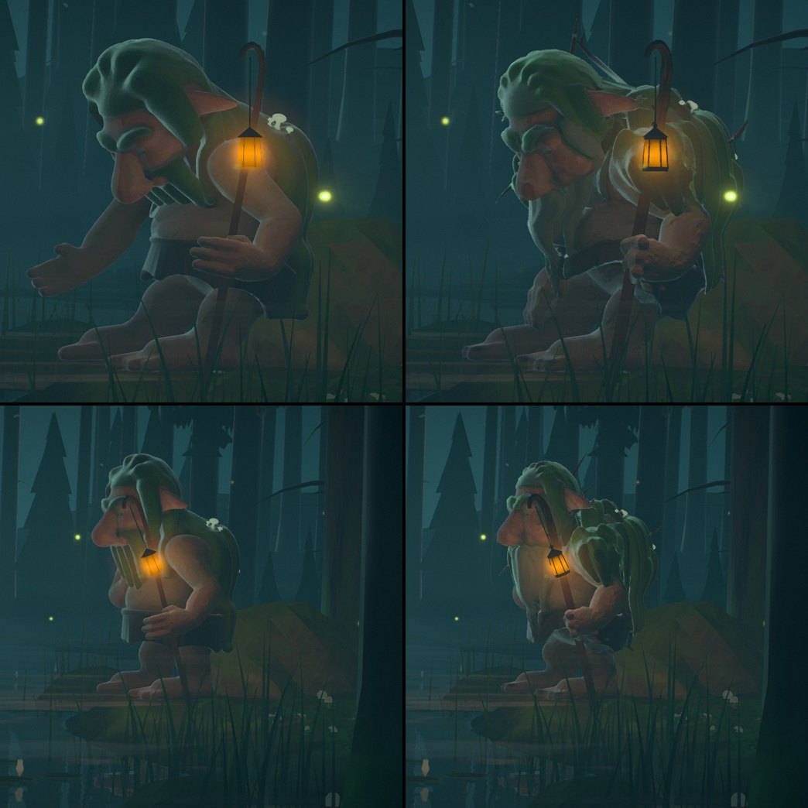
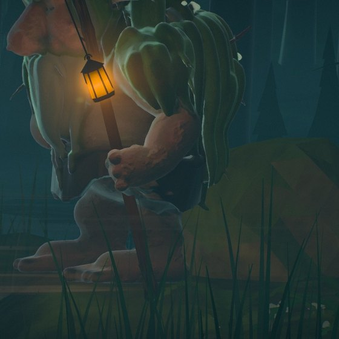
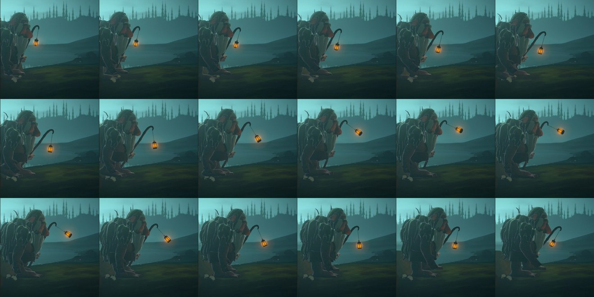
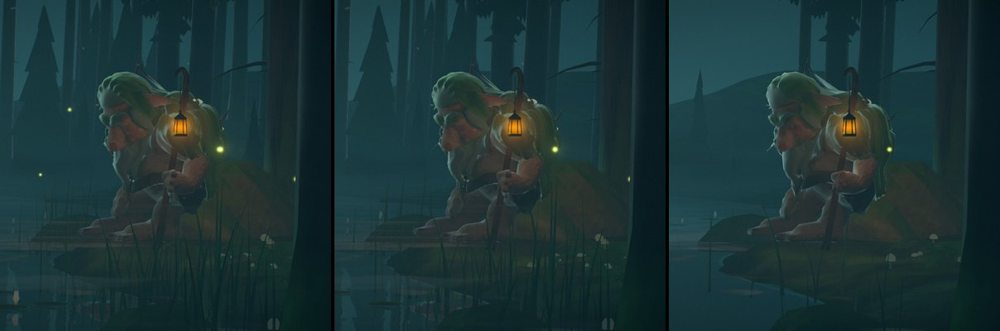

# Stillwater — the troll redrawn, and moving with weight

Implemented 2026-10-23 on `feature/stillwater-troll-design`, on top of the troll drawn clean from
numbers (`scripts/blender/stillwater/troll_shape.py`) and his life of the same day
(`docs/STILLWATER_FIGURES_LIFE_2026-10.md`, whose looks, scenes and story all stand). This pass
redrew him (skin, arms, hands, mane, hair, beard), gave him a staff he can hold and a lantern worth
carrying, and put weight into how he moves.

What the author asked for: "keep improving the design of the troll, the skin, the arms, the beard,
the hair, how it moves and how it looks... also the animations and how it looks holding the stick...
good skin texture, amazing mane, hair, beard and everything... the animations and movement of the
troll to be world class... fix the hand how it holds the stick and everything else."

## What was wrong

Seen in the game's own frames (the playground's icon lens on him at the game's camera, every hour,
Ultra and High) and in clay renders of the sculpt in Blender:

1. **His hair was a shell.** The crown read as a smooth green hood with ridges, the mantle as a
   barrel, and where the locks parted the skin showed between them in stripes.
2. **His beard was a napkin, then a pleated cup.** One ring of locks round his jaw, all alike, read
   as a white bib; bowed, the ring tipped forward with his head and stood round his chin like a
   paper cake case.
3. **His skin was clay.** One colour, smooth, its grain too fine to survive at the 1.4 cm a pixel he
   is drawn at in play.
4. **His arms were tubes and his hands mittens**, and his left hand did not hold the staff: the
   fingers stood open beside it.
5. **Seated, his right hand was held out palm up**, as if begging, all the time he sat.
6. **A bald ball of a shoulder** stood behind his lantern, the brightest thing on him.
7. **The staff was a smooth pole**, the lantern a hexagonal can.
8. **He moved without weight.** His feet stepped and his hips bobbed, but nothing landed in him: no
   give at a footfall, his head and shoulders level as a camera rig, his right hand fixed to its
   forearm.

## His shape (`troll_shape.py`)

Still one signed-distance field of round cones and ellipsoids, meshed by OpenVDB, the skeleton's
twenty-one bones unchanged.

- **Body.** A deltoid, biceps and an elbow's knob on each arm; a forearm swelling toward the
  elbow (a troll's is bigger than his upper arm); an old man's chest over his belly and a navel in
  it; knobbed kneecaps; heavy jowls; warts set onto his skin by marching to its surface (`_onto`).
- **Hands.** A palm with a heel and knuckles, fingers of three joints, a thumb, and a nail of dark
  horn on each. **The left hand is a fist closed round the staff** (`_fist`): the fingers from their
  knuckles over the front of the staff and round under it, the last finger tightest, the thumb
  round the other way and over the first finger. Where the staff runs is the runtime's own
  `FIST` (`stillwater-troll-body.js`, now `off: 0.046`); the sculpt's `FIST_ALONG`, `FIST_OFF` and
  `STAFF_R` match it, and `grip_cut()` takes the staff's way out of the fist, so the staff fills a
  fist that closes on nothing.
- **Mane.** Moss over his scalp from a soft hairline; a crown of thin locks fused into hair combed
  back and lying flat to his head, his face and ears free; a mantle of a dense underlayer (so no
  skin shows) under many thin locks with ragged ends, from a yoke round his neck to the tops of his
  shoulders; **moss grown over each shoulder**, cushions round the cap of it and locks falling
  down the outside of the upper arm (they hang from the upper arm and the collarbone, so they go
  where his arm goes); stray tufts that break his outline; twigs caught in it; lichen patches on
  his shoulders and back; bushy brows; tufts at his ear tips.
- **Beard.** Beard-lichen: a core from his chin down his chest that narrows as it falls, and
  tresses strewn over his jaw, each with a sibling or two beside it (beard-lichen hangs in strings
  that cling together), gathered toward his middle as they fall to a ragged point at his belly;
  **sideburns** down from his temples before his ears to where it begins; a drooping moustache. It
  hangs from his head, then through his **neck** (new) to his chest, so it bends smoothly as he
  bows his head instead of folding into a cup.
- **Which way each lock runs.** `parts_at` also gives each vertex its nearest lock's direction
  (root to tip; down for a lump of moss, back from the brow over the scalp), written into the
  files as `_FLOW` (int8 unit vectors) and read by `stillwater-rig.js` as the `flow` attribute.

## His look (`stillwater-troll.js`)

- **Strands along the locks**, at two sizes, laid along each lock's own flow on the rest pose (so
  they stay on the hair as he moves) and drawn as relief.
- **Skin at the size he is seen.** Grain by the metres a pixel spans on him: lumps and warts, then
  folds of old skin (a net of them, which carries at 1.4 cm a pixel), then creases, pores and grain
  as he comes nearer; olive and grey blotches at two sizes, age spots, folds stained with moss,
  pale lichen specks on his shoulders, his ends flushed like his face.
- **Moss is velvet**: it gathers light along its edges; a few locks are old moss gone russet;
  outermost and lit, it is paler and yellower. **His beard is beard-lichen**: grey-green strings,
  darker within, glowing where his lantern or the moon is behind them. (The file's colour marks it:
  skin 0.18 on moss.)

## Staff and lantern

- **The staff** (`createStaffGeometry`) is an old branch: a knob of root for its foot, its grain
  twisting round it in flutes (gentle along `STAFF_GRIP`, the stretch his hand may slide over, so
  his fist closes on it), knots above his reach, four twigs broken off short, and the crook. Its
  radius where he holds it is the fist's (`STAFF_GRIP.radius`, 4.6 cm). Its bark has fissures
  winding with the grain, pale ridges, a finer grain, moss about its foot, and is worn smooth and
  dark where his hand slides, with a little shine in his lantern's light.
- **The lantern** (`createLanternFrameGeometry`) has a frame of dark iron: a foot, six posts at the
  corners of its horn panes, a band round their top, the cap, a knob and the bail it hangs by; the
  horn is clouded unevenly and sooted toward the top.

## How he moves (`stillwater-troll-body.js`)

Still no clips: every bone posed from what he means to do, in layers. Added:

- **Weight.** Each footfall sends his body down a little and it comes back (`FOOTFALL`: a heavy
  step's kick, a shuffle's share, settling in 0.11 s); his chest dips with it and his head nods a
  beat after. His shoulders roll a little more than his hips over the leg that bears him while his
  neck and head keep his eyes level.
- **The free arm swings** against his stride, forward and a little across him with the elbow
  giving, back straighter.
- **The right wrist follows through** (`WRIST`): the hand catches up its forearm's turns a beat
  behind (0.075 s) and never trails by more than 0.55 rad, so a swing trails and a stop catches up.
- **Seated, the right hand rests on his right knee**, palm down, the fingers over the front of it,
  the wrist frame laid along his thigh (`handOnKnee`, `poseRightHand`). Gestures take the hand
  from there as before.
- **Inertia.** Setting off, his trunk is left behind a moment; stopping, it carries on forward and
  comes back (from the change of his pace, through the lean's spring).
- **A turn is led by his head**: his head and neck go into it ahead of his body, by how fast he
  turns.

## Seeing it

- **The playground's own camera.** `cam=x,y,z&camAt=x,y,z&camFov=n` on
  `playground.html?effect=stillwater` puts a camera anywhere on the stage; with `parts=` leaving
  the trunks out it sees his walk side on. The strip above:
  `quality=High&kin=0.2&scene=wood@3&parts=sky,water,ground,boulders,troll,mist,caps&cam=12.9,2.1,-3.2&camAt=12.9,1.85,-10.6&camFov=30`
  at t = 12.8…14.5.
- **Close-ups at the game's camera**: the icon lens, `icon=1&iconFov=14&iconYaw=-0.478&iconPitch=0.05`
  (his body), `iconFov=9&iconYaw=-0.47&iconPitch=0.06` (his head), and `kin=0.5&scene=bow@3` at 5.2 s
  to have him standing.
- **The sculpt alone** builds in Blender in about two minutes:
  `blender --background --factory-startup --python scripts/blender/stillwater_assets.py -- --out <dir> --only troll --voxel 0.003`.

## Budgets and tiers

| File | Tier | Triangles | Bytes |
| --- | --- | --- | --- |
| `troll-lod0.glb` | Ultra, Extreme | 52,000 | 1,042,528 |
| `troll-lod1.glb` | High | 28,000 | 562,524 |
| `troll-lod2.glb` | Medium | 15,000 | 302,516 |
| `troll-lod3.glb` | Minimal, Low | 6,000 | 122,512 |

Up from 32,000 / 17,000 / 9,700 / 3,700: the mane is hundreds of locks, the fist and the beard's
tresses need their triangles, and each vertex carries its flow. `tests/unit/stillwater-troll-assets.test.js`
keeps them in those bands and every file under a tenth of the source sculpt.

## Verification

- `tests/unit/stillwater-troll-body.test.js`, `stillwater-gestures.test.js`,
  `stillwater-troll-assets.test.js` and `stillwater-playground.test.js` pass (the fist's tests follow
  the new `FIST.off`; the playground's lists `cam`, `camAt` and `camFov`).
- The whole unit suite passes but for tests this branch does not touch that fail on this machine
  alone (its locale writes 250 000 for 250,000; a symlink Windows refuses in a worktree).
- Every capture above came with no WebGPU validation error or warning in the console.

## Open

- His fingers are one with his hand (no finger bones): the fist is always closed, and the right
  hand always the same relaxed curl.
- The walk is judged from frame strips, not film: a turntable of him walking on flat ground in the
  playground would be the next tool.
