# Summer — an evening by the lake (visual overhaul, 2026-10-08)

> The theme was shown as "Midsommar" until 2026-10-25; it is called Summer everywhere now,
> and so is its song (a saved `Midsommar` track key still resolves to it).

**Status: implemented (branch `feature/summer-masterpiece`). A record of what was built and
how it was checked — not a backlog.** Replaces the flat-shaded meadow scene that lived in a
playground effect and its three TRELLIS trees. The hours of the night (the palette that
follows the level and the clock) were added the next day, 2026-10-09, on
`feature/summer-evening-hours`.

| Before | After (High, native WebGPU) |
| --- | --- |
| 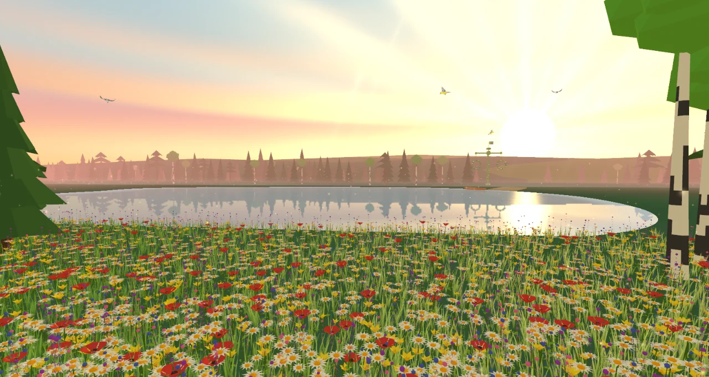 | 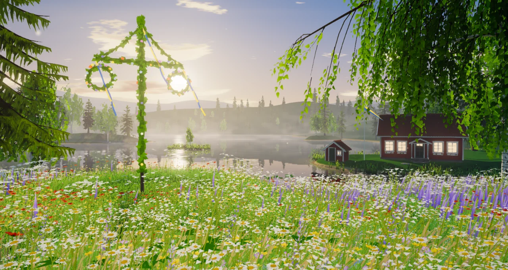 |

## What the player sees

The same place as before — a Swedish lake on a summer's eve, a flowering meadow, a maypole,
a red cottage, birch and spruce — now built as a world and lit by a sun that stands low over
the water and will not set. The camera stands in the meadow behind a crest of tall flowers.
On the left an old spruce leans into the frame beside the maypole on its mown ring, wound
with birch leaves, hung with two wreaths and flying blue and yellow ribbons. The maypole
stands exactly where, from the resting camera, the evening sun is seen through its
right-hand wreath; below it the sun's path runs down the open lake toward the camera, past
a skerry with one small birch and a wooded headland in the evening mist. (Through the night
the sun moves on and comes back to the ring: see *The hours of the night*.) On the right a
weeping birch hangs its strands over
the jetty and the rowboat, and the Falu-red cottage with its white corners looks out from
its promontory with the lamps lit and smoke at the chimney, a pennant on the pole beside
it, and the boathouse at the water on the tip of the promontory, clear of the house.
Behind everything, four ridges of blue hills. The lake is a real mirror of all of
it; butterflies work the flowers, swallows hunt over the cove, and seed down drifts through
the light.

The board card hides the middle quarter of a landscape screen, so the picture is composed
for the two side thirds and the strips above and below the card. In single player the
score card stands right of the board, which is why the sun stands on the left: an earlier
framing had it on the right, behind that card. Portrait keeps the same world, turned
toward the maypole and the sun.

## Seven kinds of flowers

On a summer's eve you pick seven kinds of flowers. Each tetromino is one of them, and the
piece colours are the petal colours:

| Piece | Flower | | Piece | Flower |
| --- | --- | --- | --- | --- |
| I | poppy (vallmo) | | Z | lupine (lupin) |
| O | harebell (blåklocka) | | J | orange hawkweed (rödfibbla) |
| T | buttercup (smörblomma) | | L | wood cranesbill (skogsnäva) |
| S | oxeye daisy (prästkrage) | | | |

Which flower goes with which piece is not arbitrary: the project's palette gate
(`npm run check:palette`) screens every theme against the shape-to-colour mapping that is
familiar from other block games, and this assignment matches none of its seven roles (the
first assignment tried matched five; the palette it replaces matched three).

Red clover, cow parsley, dandelion clocks and water lilies fill the meadow and the cove
around them.

## The hours of the night

On the longest day the sun does not set: it sinks to the hills, rests there and climbs
again. The night passes through five hours that come round, and each has its own colours
and its own place for the sun:

| Hour | The sun | The light |
| --- | --- | --- |
| Evening | In the ring of the maypole's right-hand wreath. | Gold sun, deep blue overhead, peach clouds: the scene as it was first built, and where a session starts. |
| Rose hour | Sinking below the wreath, toward the lake. | The sun reddens; a rose and lilac sky, pink in the mist over the water. |
| White night | Resting on the far hills, an ember. | Deep blue sky, the land in dusk; the cottage windows and the maypole's lanterns are the brightest things on the shore. |
| Dawn | Rising beside the maypole, between the pole and the wreath. | An apricot sun in a pale turquoise sky, peach on the clouds, mist thick on the lake. |
| Morning | High over the wreath, in open sky. | A white-gold sun, saturated blue, white clouds, the lamps nearly out. |

From the morning the sun comes down into the ring again. It stands in the ring at the
evening hour only, but it leaves and returns slowly: the blend between two hours lingers at
each, so for about the first minute of a session, and of every round, the sun is still
inside the wreath.

Two things move the night, and they add:

- **The level.** Each level stands one hour further on (level 1 evening, level 2 the rose
  hour, level 6 evening again). A level-up turns the night to its hour over a few seconds,
  the short way round the circle, together with the level-up's flourish.
- **Time.** The night also moves on by itself, one hour every four minutes
  (`SUMMER_HOUR_SECONDS`), so a long level, or a mode without levels, still sees the whole
  night in twenty minutes.

An hour is 19 colours and 5 numbers in
[`summer-hours.js`](../src/themes/summer/summer-hours.js): the sun's light, the two ambient
poles, the sky dome, the haze, the clouds and the lit air of the shafts; haze density, how
brightly the lamps burn, a few per cent of exposure, and the sun's azimuth and elevation.
The light rig copies the blend into uniforms every frame, so no material is rebuilt and both
backends and every tier show the same hour. The shadow map, otherwise drawn once, is drawn
again when the sun has moved three hundredths of a degree, and at most every other frame:
now and then while the night drifts, and for the few seconds a level-up takes to turn it.
What does not change: any geometry, and the piece colours (they are the flowers').

The sun's path keeps to the sky between the maypole and the board. The board is sized by
the window's height, so at this lens its edge is 10.7 degrees from straight ahead whatever
the window's shape, and in single player the score card stands right of it. Every hour's
sun, disc and all, is left of that edge; a unit test walks the whole night to hold it.

Rules that follow from the hour being the scene's light and not an effect:

- With background effects switched off, a level-up still turns the hour; only the flourish
  is withheld.
- A rebuild of the scene (a quality change, a lost GPU device) takes the night up where it
  stood, and so does coming back to the theme while the theme manager still holds it.
- A new game is not announced to themes: the night stays where the last game left it until
  the first level-up, which names level 2 and turns it to the rose hour.

| Evening | Rose hour | White night |
| --- | --- | --- |
|  | 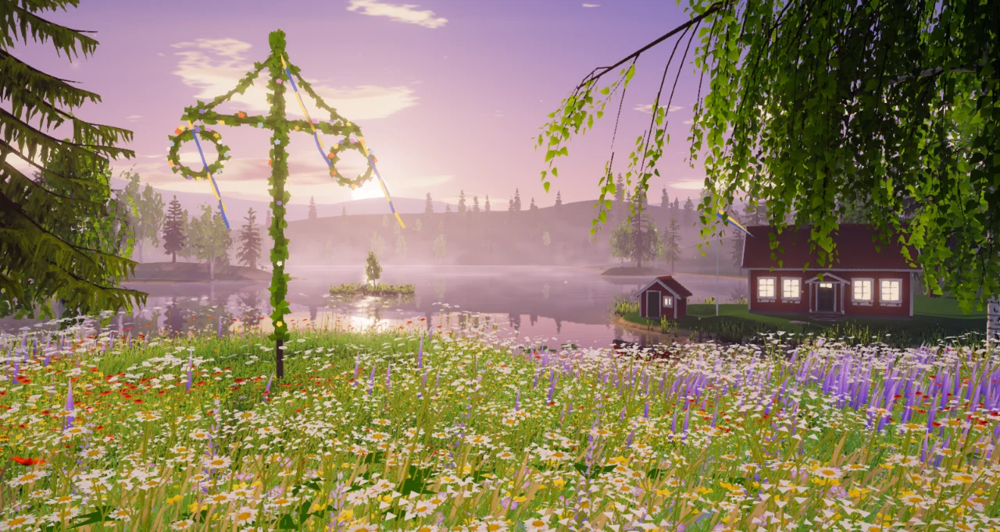 | 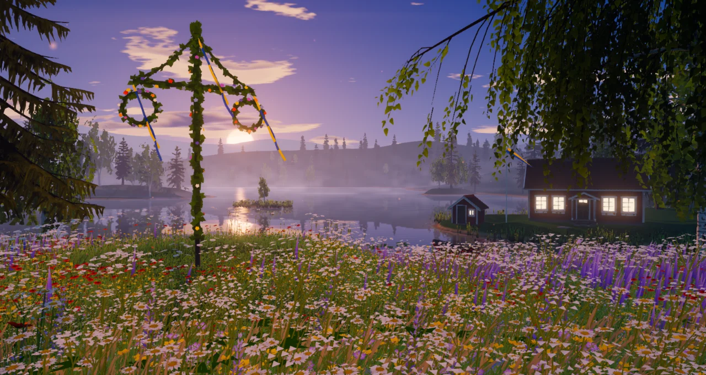 |

| Dawn | Morning | A lock in the white night |
| --- | --- | --- |
| 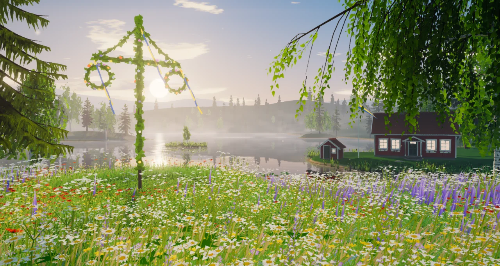 | 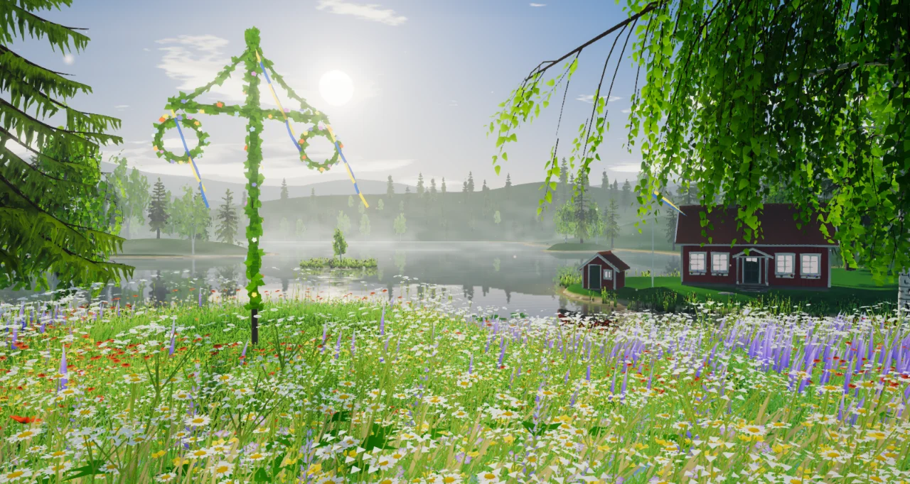 | 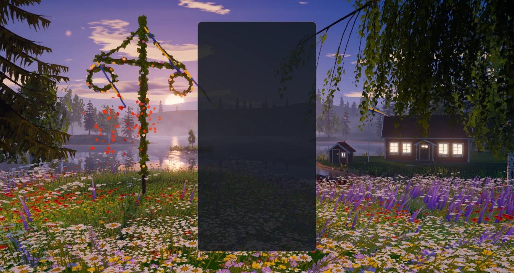 |

## How the evening answers the game

`SummerReactions` is a pure director; `SummerFxDirector` turns its cues into petals thrown
from behind the board card, gusts sent through the grass from the foot of the board, and
rings dropped on the water behind it, at the column and height where the event happened.

| Event | Response |
| --- | --- |
| Piece lock | Petals of the piece's own flower puff from the card's edge beside it; a gust spreads through the meadow from the foot of the board, and that kind of flower nods, swells and glows wherever it grows; a ring opens on the lake. |
| The bouquet | Each kind of flower locked for the first time lights its lantern on the maypole's wreaths. The seventh kind completes the bouquet: the whole garland flares, the ribbons stream, and the maypole throws petals of all seven colours into the sky. The seven lanterns stay lit through the flare, then burn down, all but the kinds already picked for the next bouquet. |
| Hard drop | A stronger gust and ring, and from a long drop dandelion seed is shaken into the air where the piece came down. |
| Line clear (1–3) | Twin jets of petals from both sides of the card at the cleared rows, a broad ring, the sun's path flaring; from two lines a second ring and a front of wind that flattens the grass and bends the woods as it crosses; butterflies go up. |
| Four lines | All of that, petals and seed lifting off the whole meadow around the board, a sunburst, and the swallows towering. |
| Combo / streak | Petals gather into a flower crown that turns around the board, each petal the next of the seven kinds. Cascade depth (`COMBO`) or consecutive clearing locks raise it; it climbs, thickens and quickens, and above the halfway mark silk ribbons unfurl in spirals around the board. A lock without a clear ends the streak and the crown falls into the grass. |
| T-spin | A spinning garland of buttercup petals (the T piece's flower) beside the board, and a ring. |
| Back-to-back | Holds the crown and lifts the light. |
| Perfect clear / level up | The whole evening exhales: light, rings, wind, petals, wings (a perfect clear also throws a bouquet). A level-up also turns the night one hour on (above). |
| Game over | The wind dies; petals come down onto the grass and the water. |

A petal that lands on the lake leaves a small ring (at most a few a second), and now and
then a fish rises or the boat rocks, so the water is never dead. Everything honours
`backgroundComboEffects` and `pieceLockRipple`, pauses with the theme, and is driven by
simulation seconds. No event allocates: petals come from a fixed hidden reserve, emitters,
rings and gusts from fixed pools.

| Lock (poppy) | Two lines | Four lines |
| --- | --- | --- |
| 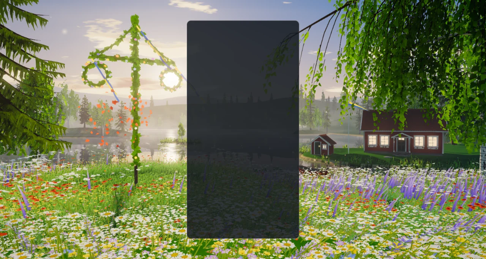 | 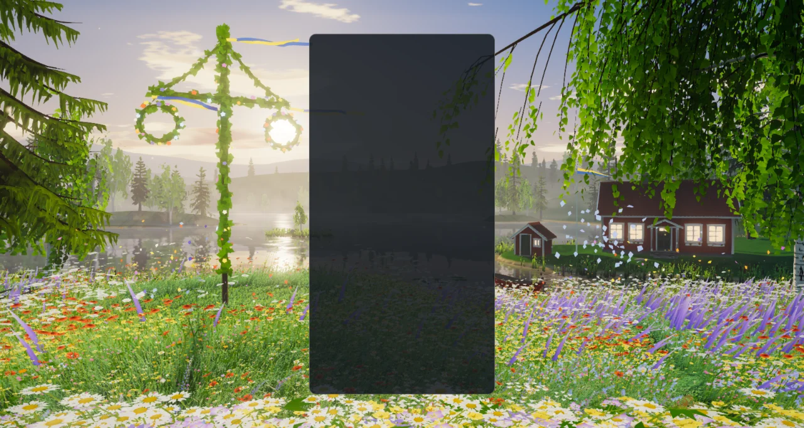 | 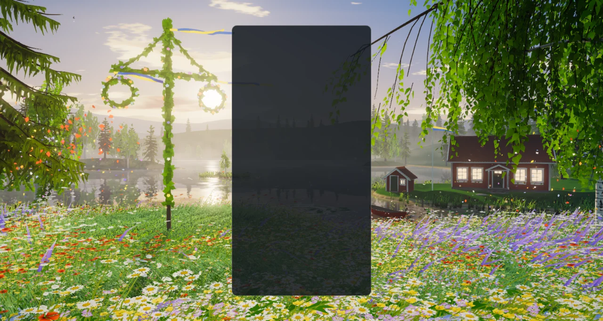 |

| The bouquet | Combo, held | In the game |
| --- | --- | --- |
| 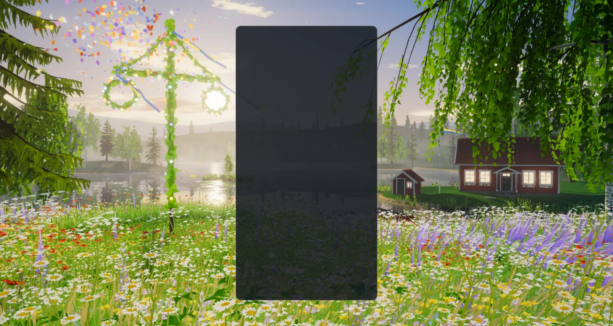 | 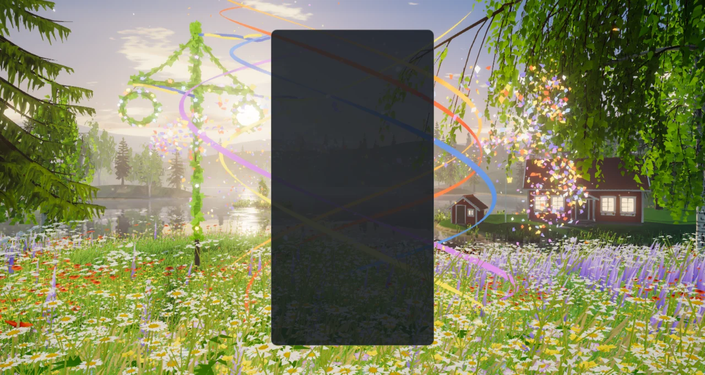 | 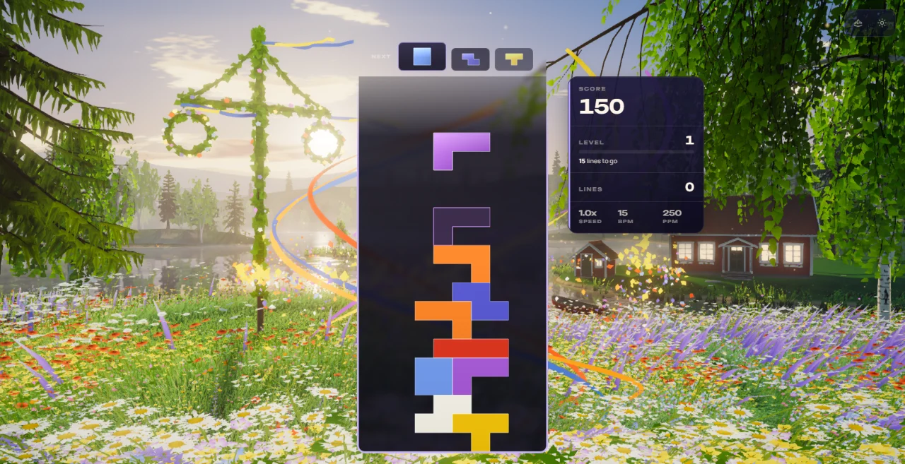 |

### The visual pass (2026-10-20)

A look at the evening with fresh eyes, keeping everything it already was.

- **The meadow against the light.** Grass and flowers lit the face the eye sees by the
  sun's angle to either side of a blade (`abs(dot(normal, sun))`), so with the low sun
  behind the meadow every blade and petal was lit from the front and the meadow read flat
  and pale. Now only the face turned to the sun is sunlit; a blade or petal seen against
  the light is shaded and the light comes through it instead, brightest where the sun
  stands straight behind it. The meadow gains depth and the backlit tips glow.
- **Petals with round tips.** A near petal was a two-triangle kite whose widest point was
  half-way, so up close the daisies and buttercups read as paper triangles. A petal is
  now a strap that widens from a narrow claw and closes in a blunt tip (four triangles):
  about 30 % more triangles on the near flowers, none on the far ones.
- **Crowns with a shaded side.** 40 % of the sun wrapped round a crown to its shaded side,
  which flattened the birch and the spruce; it is 25 %, so the inner strands sit in shade
  and the sunward fringe glows.
- **Sparks on the sun's path.** The lake's glitter was one smooth highlight. Separate
  sparks now wink on the ripples down the path: a hashed lattice on the water, its cells
  growing with distance so a spark stays a few pixels at any depth, each cell a facet with
  its own random tilt that lights only when it puts the sun in the eye.

Checked in the playground at High and Low on native WebGPU, 1920×1080, 1280×720 and
390×844: evening, white night, lock, four lines, combo; clean consoles. GPU per frame at
1080p, interleaved against the evening before the pass: about 2.6 ms against 2.5 ms (within
run-to-run noise). `tests/unit/summer-*.test.js`: 675 tests.

## The living eve (2026-11-17)

An audit of the whole theme, then a pass over what it found. Everything above still stands;
this section records what was weak and what was built on top.

### What the audit found

Looked at in the playground and in the game, hour by hour and event by event, part by part:

| Part | Finding |
| --- | --- |
| The sky | The weakest part. One flat deck of cloud seen from below: in the low band the game frames (the lowest 25 degrees) it showed as pale horizontal streaks, the same in every hour. Nothing in it moved visibly. |
| Change over time | Only the hours (five palettes, twenty minutes a round). Within one hour the scene never changed: the same clouds, the same breeze, the same lake. |
| The far shore and hills | A bare green slope with a tree here and there (340 sprites over 800 m of shore), which read as a park, not as woods. |
| The lake | Good mirror and sun road. But the rings every lock and clear drops on it opened a metre and a half off the near shore, behind the crest of flowers the camera looks over: in play they were never seen. |
| The maypole | Well modelled, thinly dressed: six narrow ribbons and small flowers on the wreaths only. |
| The events | Every event was petals from the card's edge plus a ring and a gust. A hard drop, a twist, a back-to-back, a perfect clear and a level-up differed in amount, not in kind; a perfect clear and a level-up were both "the whole evening exhales". Game over only let the petals fall. |
| Life | Butterflies and swallows only; nothing on the water. |
| The meadow, the cottage and shed, the trees, the island, the light and the haze, the piece colours | Strong. Kept as they are. |

### The weather

Beside the hours the day now has weather, on a clock of its own
([`summer-weather.js`](../src/themes/summer/summer-weather.js)): six kinds, 76 seconds each,
each holding for the first part of its time and then easing into the next.

| Weather | What it does |
| --- | --- |
| Fair evening | Scattered cumulus on a light breeze: the scene as it was built, and where a session starts. |
| A fresh breeze | The wind doubles: cat's-paws race over the lake, fronts of wind cross the meadow and the woods every few seconds, cloud shadows hurry over the land, the air clears. |
| Towers over the hills | The cumulus builds tall and the sun fans out between the clouds. |
| Sun shower | Rain falls through the sunshine in front of the eye, every drop lit from behind, and dimples the lake. |
| Mist on the water | The air stands still; mist lies on the lake and in the hollows, the far shore sinks into it, the sun's shafts stand in it. |
| Mackerel sky | A fleece of small cloudlets high over a lake like glass. |

The hours take twenty minutes to come round and the weather seven and a half, so the two never
line up for long: with the level turning the hour as well, the picture changes about once a
minute and does not repeat within a session. A weather is sixteen numbers the light rig copies
into uniforms; nothing is rebuilt, so every tier and both backends show the same weather.

| Fair evening | A fresh breeze | Towers over the hills |
| --- | --- | --- |
| 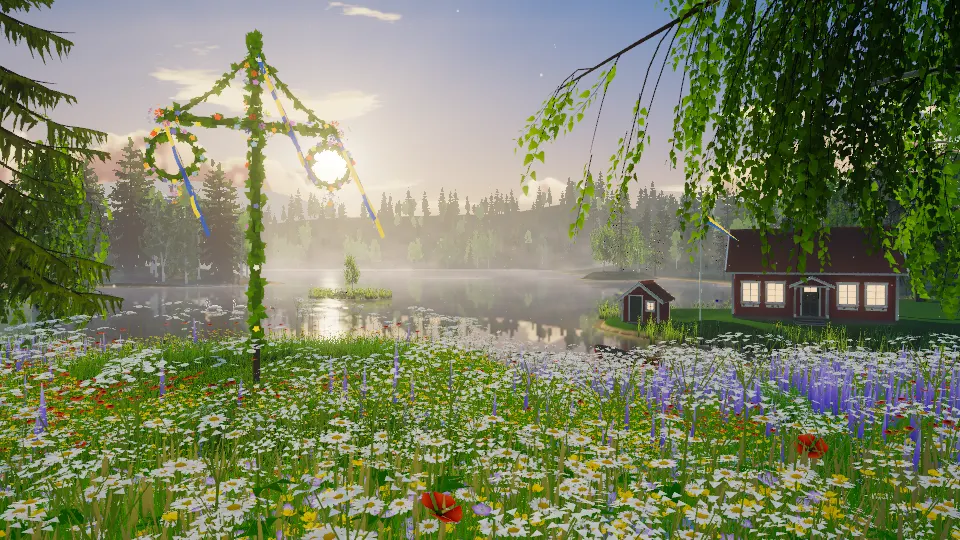 | 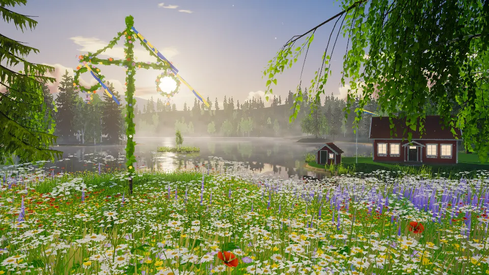 | 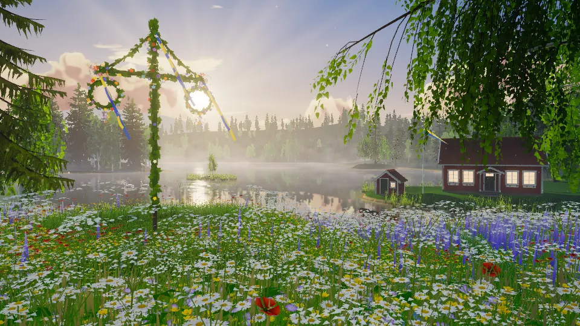 |

| Sun shower | Mist on the water | Mackerel sky |
| --- | --- | --- |
| 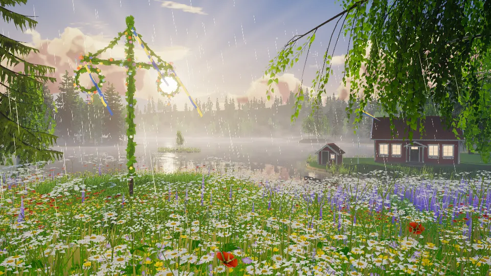 | 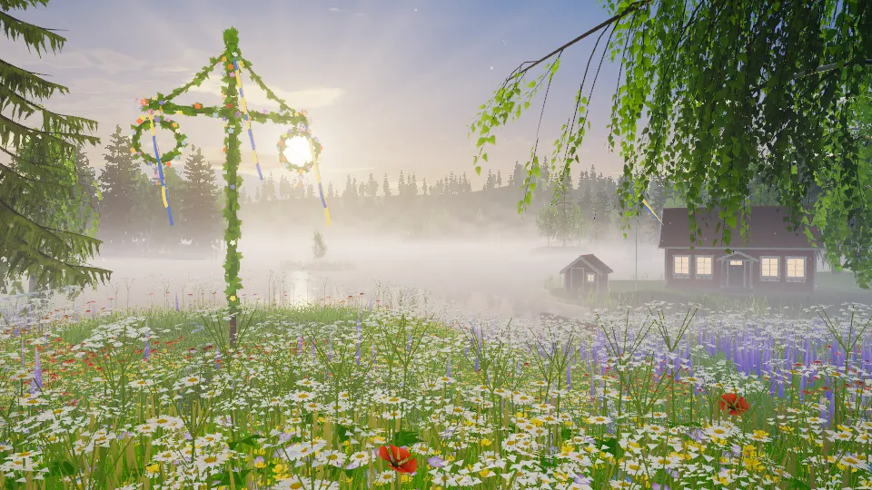 | 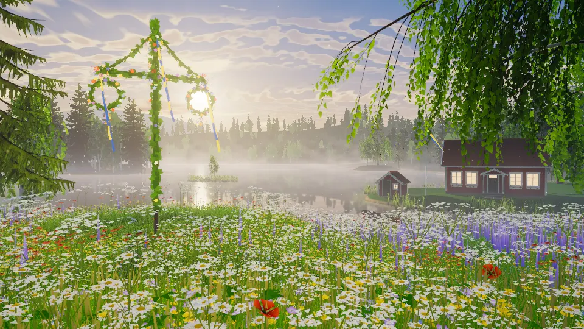 |

### What was rebuilt

- **The sky** ([`summer-atmosphere.js`](../src/themes/summer/summer-atmosphere.js)). Two rows of
  cumulus are drawn from the side, in azimuth and elevation, standing on flat bases over the far
  shore and above it: where along the horizon they mass is one slow noise, their billows a finer
  one, and a cloud ends where its billows no longer outweigh the height above the base. The same
  field read a step toward the sun says which side of a billow is lit, so toward the sun a cloud
  is a shaded heart inside a burning rim and away from it a peach body with cream billows. The old
  deck stays as high streaks; a mackerel field, a veil of cirrus, noctilucent clouds over the
  resting sun in the white night, and a slowly turning fan of rays about the sun are new. The
  weather says how much of each there is; the hour still says what colour it is.
- **Cloud shadows.** The clouds' shadows drift over the meadow, the lake, the woods and the
  buildings (`cloudLight` in the light rig: one read of the shared noise, taken once at the root
  of a grass clump, a flower or a tree).
- **The far woods.** Four times the sprite trees (1,400 at High), most of them on the far shore
  and the headland, and the ground under them painted as canopy: the hills are forest now.
- **The lake.** Rings open on the water the camera sees past the crest (17 m out and beyond);
  the weather lays it flat or ruffles it; rain dimples it.
- **The maypole.** Ten ribbons, three from each arm and four from the top, and posies of all
  seven kinds tied at its head, where the arm crosses, at the arm's ends and under each wreath.
  They are painted by the maypole's own shader, so every head is a lantern of the bouquet.
- **The white night.** Glow-worms: the specks that drift low over the flowers breathe a
  green-gold light on and off, and the noctilucent clouds shine over the sun.
- **Petals.** A petal in the air is a claw that widens into a rounded blade, folded and cupped,
  paler at the claw (it was a four-cornered kite, which read as confetti).
- **Swans.** A pair of mute swans and their cygnets glide a slow round on the open water left of
  the maypole, mirrored in the lake, and a skein of them flies low across it: by itself every
  few minutes, and on every level-up. The birds are modelled in Blender
  (`scripts/blender/summer_swan.py`, headless, byte-reproducible) and shipped as a generated
  module, [`summer-swan-model.js`](../src/themes/summer/summer-swan-model.js); the round and the
  flight lines are found by numbers through the rest camera
  ([`summer-swan-routes.js`](../src/themes/summer/summer-swan-routes.js)) and drawn in three
  instanced draws ([`summer-swans.js`](../src/themes/summer/summer-swans.js)).

| The white night: noctilucent clouds, glow-worms | A level-up sends the swans up |
| --- | --- |
| 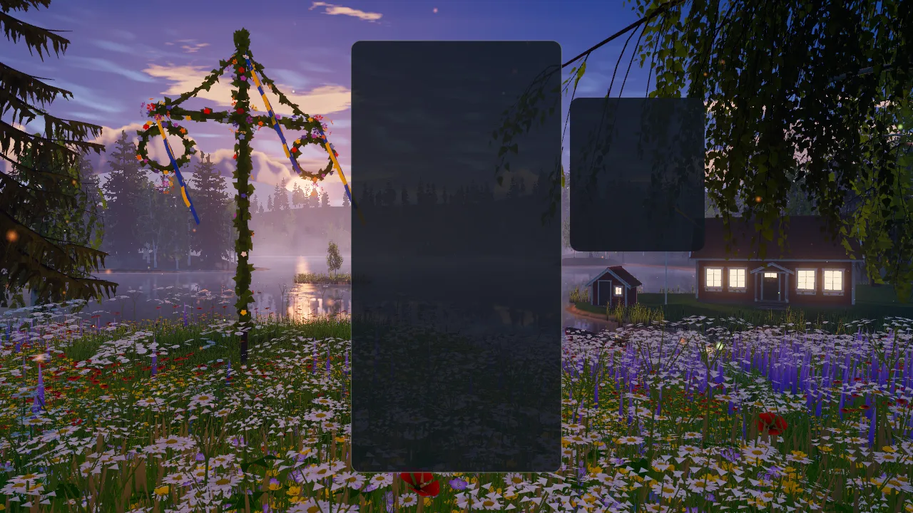 | 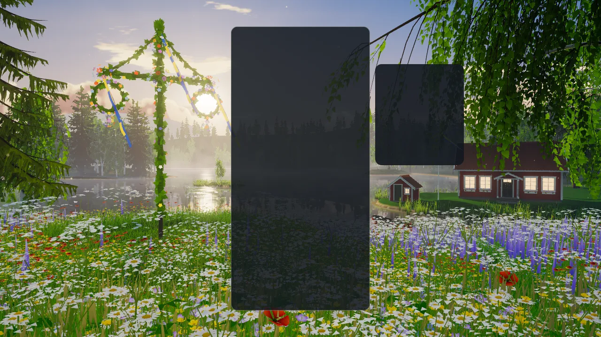 |

### An effect of its own for every event

| Event | What is its own |
| --- | --- |
| Piece lock | As before: petals of the piece's flower from the card's edge, that flower nodding and glowing wherever it grows, a gust through the grass, a ring on the lake (now seen). |
| Hard drop | The piece comes down like a stone in the grass: a ring of its own flower's petals leaps out of the meadow to both sides of the board's foot, pollen among them, over the dandelion seed it shakes loose. |
| Line clear (1–3) | As before: twin jets at the cleared rows, a broad ring, from two lines a front of wind. |
| Four lines | As before: the meadow lifts its petals and the swallows tower; and now the sun's fan of rays opens across the sky. |
| Combo / streak | As before: the crown of petals and the silk ribbons round the board. They are a combo's alone now (a back-to-back or a perfect clear no longer raises the ribbons). |
| Twist | The maypole dances: its ten ribbons fly out and wheel round the pole. The spinning garland beside the board stays. |
| Back-to-back | A stone skips down the sun's road, ring after ring, each touch a glint, further and with more hops for every one in a row; the sun's rays answer. |
| The bouquet | The maypole throws the bouquet, and one great flower of every colour opens about its head. |
| Perfect clear | The largest thing the evening does. Seven flowers open in the air beside the board, one after another, one for each kind: a thread of pollen climbs, and the petals of one kind are thrown from a gold heart to their places in a flower drawn in the air, five to eight great petals each made of the small ones. The air holds each for a moment and a half, then lets it fall. Six stand to either side of the board and the last, in every colour, opens about the maypole's head, with the sunburst and the rising meadow as before. A flower's whole rim is kept clear of the board card, the score panel (both are measured), the screen's edges and the meadow under it: on the score panel's narrow side the three stand one above another, drawn a little smaller, and on an upright screen they open in a row above the board. |
| Level up | The hour turns, and a wave of bloom rolls away from the eye through the meadow, opening and lighting every flower as it passes, and runs on across the lake as a band of sparkling water. A skein of swans takes wing over the lake. |
| Game over | Dusk: the wind dies, mist rises off the water, the light lowers and cools while the petals come down. It lifts again when the next session starts. |

Frame-wide brightenings (the rays, the hearts of the flowers) go through `flashScale()`; what
moves the maypole's ribbons is scaled by Reduce motion. Nothing is thrown in front of the board:
the card and the score panel are measured, and the flowers open in the strips beside them. The
petal pool grew by a quarter (4,000 at High) so that the largest thing the game can ask for at
once, four lines with a perfect clear on top, finds every petal a free place while a combo's
crown is still turning.

| Perfect clear | Twist |
| --- | --- |
| 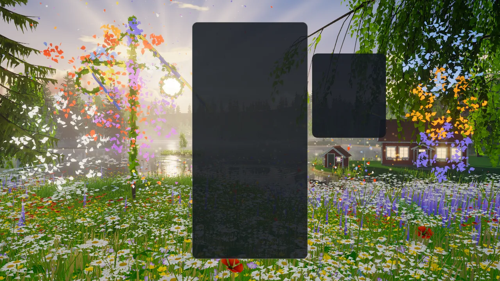 | 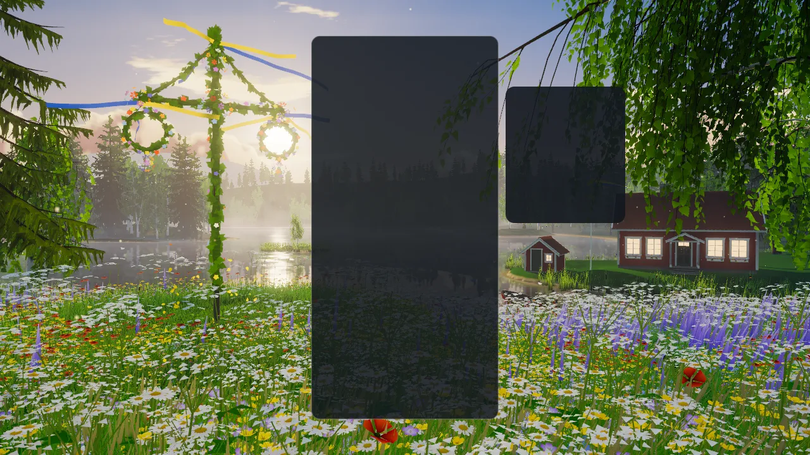 |

| Back-to-back | Level up |
| --- | --- |
| 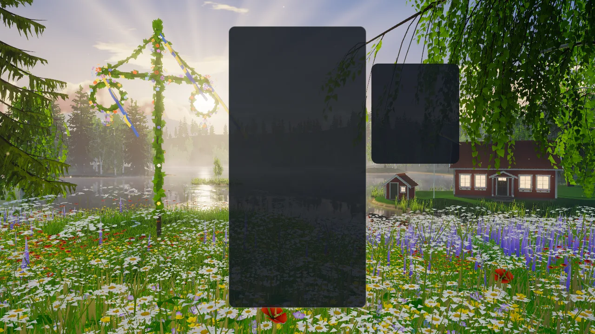 | 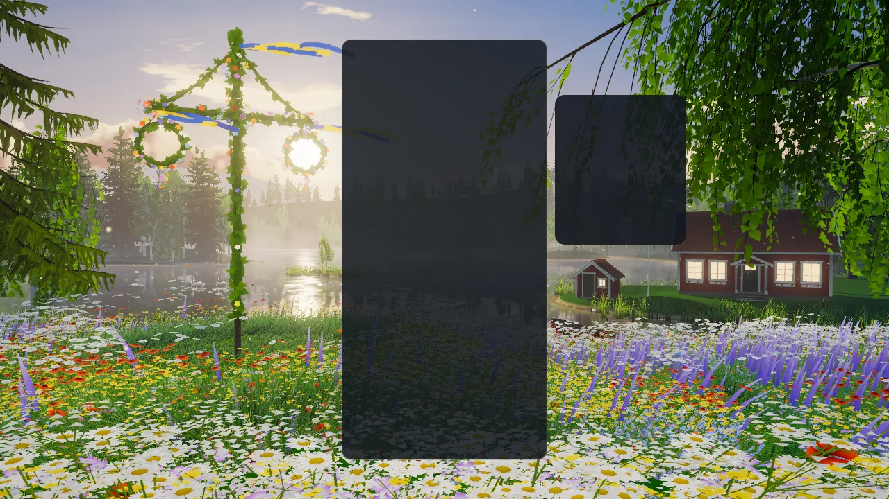 |

### What was kept, and what was left

Kept as they were: the meadow and its flowers, the cottage, the shed and the flagpole, the
birches and spruces, the skerry, the sun's path, the haze, the five hours' palettes, the piece
colours, the lock, the line clears and the combo's crown. The theme icon was baked again from the
new look and set beside the old one at picker size: the old one reads better there (warmer, the
pole larger), so it stays.

Not done: a rainbow for the sun shower (the sun is ahead of the eye, so a true bow would stand
behind it); the far ridges and the butterflies; portrait was checked, not tuned (the swans and
the sky flowers are sited for a landscape screen first).

## How it is built

### Trees and buildings authored in Blender

`scripts/blender/summer_meadow_assets.py` grows nine trees (an old weeping silver birch
and an old Norway spruce for the frame, three grove birches, four grove spruces) on the
branching library the Fall grove introduced and the Golden Forest's conifer recipe, bakes
bark ambient occlusion in Cycles, renders the far-shore sprite sheet, and builds the
cottage, the shed, the maypole, the jetty, the rowboat, a section of roundpole fence and
three boulders. A tree file holds a bark mesh and a point cloud of *foliage sites*; the
runtime instances shared sprays of real leaf and needle geometry onto them. The props carry
no materials: their vertex colour says what each face is made of (weathered timber, Falu
red, white paint, roof tile, stone, glass, door paint, garland, flower), and one shader in
the theme paints them all. Details, formats and the regeneration command are in
[`src/themes/summer/assets/ATTRIBUTION.md`](../src/themes/summer/assets/ATTRIBUTION.md).
The pack is 3.4 MB in twelve files with no third-party source and no generative model, and
regenerating it reproduced every file byte for byte (three runs, compared by SHA-256). It
replaces 18.4 MB of trees and props and a 4.6 MB HDRI.

The generator runs **headless** (`blender --background --factory-startup`); the Blender MCP
session was not used, so nothing in an open Blender was touched.

### Flowers, grass and reeds generated at run time

`summer-flowers.js` builds every plant of the meadow from a seed as real geometry — petals
are kites and fans, not alpha cards — at two levels of detail: ten kinds of flower, two
grass clumps and the water lilies. `summer-meadow.js` plants them in drifts (each kind has
its own patch noise, and the tall kinds favour the crest in front of the camera) and thins
them with distance into flecks the ground shader carries.

### Runtime modules (`src/themes/summer/`)

| Module | Owns |
| --- | --- |
| `summer-theme.js` | Lifecycle, renderer, asset loading, gameplay subscriptions, board tracking. |
| `summer-assets.js` | Loading and decoding the GLBs and the sprite sheet. |
| `summer-world.js` | Composition root: builds and updates everything below. |
| `summer-light.js` | The sun, its static shadow map, sky colour, haze, ambient, the wind of trees and of the meadow, the gust rings and the per-flower call levels, a shared noise texture. |
| `summer-composition.js` | Camera framings, hand-placed trees, the procedural stands, the visibility test. |
| `summer-terrain.js` | The analytic shores and heights, the terraces buildings stand on, the ground, the lake-depth map and the meadow map (path, mown ring). |
| `summer-flowers.js`, `summer-meadow.js` | Plant geometry; planting, and the two shaders that draw all grass and all flowers. |
| `summer-forest.js` | Bark and foliage instancing and their materials. |
| `summer-backdrop.js` | The sprite forest of the far shores and the blue ridges. |
| `summer-homestead.js` | The cottage, shed and pennant; the maypole, its lanterns and ribbons; fence, jetty, rowboat, boulders. |
| `summer-shore.js` | Reeds, bulrushes and water lilies. |
| `summer-lake.js`, `summer-rings.js` | The mirror, the water surface, and the ring pools (lake rings and meadow gusts). |
| `summer-atmosphere.js` | Sky, sun, cumulus and cirrus, mist banks, pollen. |
| `summer-life.js` | Butterflies and swallows. |
| `summer-garlands.js` | The silk ribbons a combo winds around the board. |
| `summer-petal-sim.js`, `summer-petals.js` | Petals, seed and pollen: simulation, and drawing. |
| `summer-hours.js` | The five hours of the night: their colours, the blend between them, and the hour a level stands at (pure). |
| `summer-weather.js` | The six weathers and the clock that turns them (pure). Since 2026-11-17. |
| `summer-swans.js`, `summer-swan-routes.js`, `summer-swan-model.js` | The swans: the instanced draws; the family's round and the skein's flight lines, found by numbers through the rest lens; the generated Blender model. Since 2026-11-17. |
| `summer-reactions.js` | The event director (pure), and where the night stands: the level, the turn to its hour, and the slow clock. |
| `summer-stage.js`, `summer-fx-director.js` | Board card → world, and cues → petals, force fields, rings and gusts. |
| `summer-post.js` | Volumetric shafts, bloom, grade, FXAA. |
| `summer-quality.js` | One table for everything a tier scales. |

### Techniques (three 0.186.1)

- **A meadow with no CPU in it.** Every grass clump and flower is an instance whose root
  and turn live on the geometry; the vertex shader stands it up, bends it in travelling
  bands of wind, and swells its flower heads when a gust ring from the board passes. All
  grass shares one material and all flowers another, whatever their kind or level of
  detail. Backlit blades and petals are lit as thin leaves, so the low sun shines through
  them.
- **Gust rings and lantern flowers as uniforms.** A gust is one `vec4` (position, age,
  strength) in a small uniform array that every plant's vertex shader reads; the per-flower
  "call" levels are two more. Nothing is rebuilt and no texture is written when the game
  speaks.
- **A planar mirror with an analytic ring pool.** The lake samples three's `ReflectorNode`
  through a wave normal built from the shared noise texture plus expanding rings. Petals,
  birds, ribbons and the maypole are scenery, so the mirror shows them too.
- **One static shadow map, used everywhere.** Materials stay unlit `MeshBasicNodeMaterial`
  and call a shared `shadow(light)` node themselves; nothing that casts moves and the sun
  moves slowly, so the map is drawn over the first frames and then only when the sun has
  moved a little way.
- **Volumetric shafts with `GodraysNode`**, at half resolution with a bilateral blur,
  raymarched through that shadow map, so the birch and the maypole cut their own beams.
- **Leaves and needles as geometry.** Every spray of every tree is an instance in eight
  draws; sprays that can never be on screen — directly or mirrored — are dropped at build
  time.
- **Level ground under what people built.** The terrain's height function carries
  terraces: the cottage, the boathouse and the maypole's mown dance ground each stand on
  one, the buildings bedded a few centimetres into it. From the play cameras the boathouse
  and the cottage are kept four degrees apart, so neither stands in front of the other.
- **Closed-form life.** Butterflies and swallows are functions of time in two vertex
  shaders: no compute pass, no per-frame CPU work, the same flight on both backends.
- **CPU petal simulation.** A few thousand particles in typed arrays: the same code on
  both backends, in the playground's deterministic `seek`, and in the unit tests.

### Quality tiers

| Tier | Stands / far trees | Sprays kept | Grass clumps | Flowers | Petal pool | Mirror | Shafts | Post |
| --- | --- | --- | --- | --- | --- | --- | --- | --- |
| Extreme | 44 / 2,000 | 100 % | 49,000 | 35,200 | 6,000 | 0.75 | 40 steps | on |
| Ultra | 38 / 1,700 | 100 % | 40,500 | 29,400 | 5,000 | 0.6 | 32 steps | on |
| High | 32 / 1,400 | 86 % | 32,000 | 23,600 | 4,000 | 0.5 | 26 steps | on |
| Medium | 24 / 950 | 62 % | 20,500 | 15,400 | 2,500 | 0.4 | 16 steps, 0.35 scale | on |
| Low | 16 / 560 | 40 %, trunks only | 10,400 | 7,800 | 1,400 | 0.3 | analytic glow in the haze | off |
| Minimal | 10 / 340 | 28 %, trunks only | 5,400 | 3,900 | 750 | 0.22 | analytic glow in the haze | off |

"Stands" are the modelled trees beyond the nine placed by hand. Low and Minimal draw the
same scene directly with ACES tone mapping and skip limb geometry. (Far trees and the petal
pool as of the living eve, 2026-11-17; before it they were 460 to 100 and 3,600 to 450.) Since
then a tier also sets how much of the sky is drawn (`sky`: Low and Minimal one row of cumulus
and the high deck; Medium the second row, the mackerel field, the noctilucent clouds and rain on
the lake as well; High and up finer billows) and how many swans there are (`swans`: two to four
cygnets with the pair, three to seven birds in a skein).

| Minimal, forced WebGL2 | Portrait, High |
| --- | --- |
| 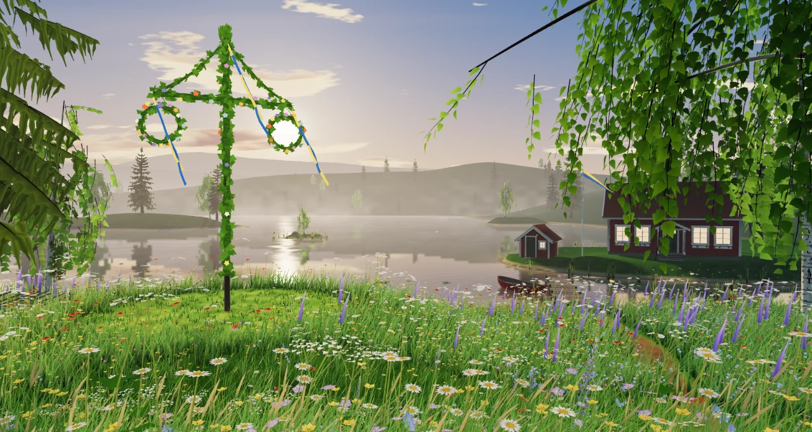 | 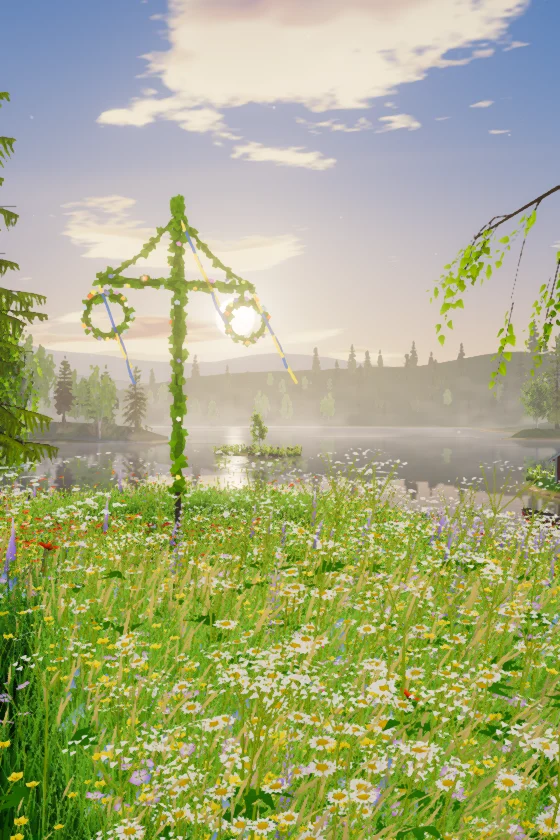 |

## Verification

- Unit tests: 631 tests in eight new files (reactions 84; petal simulation 47; stage and
  effects director 129; flowers 72; land 37; asset pack 77; world 65; theme 120), all
  passing, none skipped. They replace the three test files of the previous implementation.
  Two helper agents wrote most of them from the modules' contracts; what they found is
  listed below.
- Whole suite, run once while other sessions kept the machine busy: 690 files, 9,608 tests;
  685 files passed. The five that did not: four timeouts under load (three Odyssey forest
  and bake tests, and the URL-parameter catalog's scan of the source tree), a 300 ms Odyssey
  bake budget, and `odyssey-level-briefing`. Run again on their own with long timeouts,
  three of the five files pass. The other two are in files this change does not touch: the
  bake took 304 ms, and the briefing test expects `250,000` where this machine's Swedish
  locale prints `250 000`. CI is the authority for those.
- Gates: typecheck; TypeScript ratchet; lint ratchet (763 errors against a baseline of 807:
  the removed code took the difference with it, the new files add none, and the baseline was
  left as it is); architecture fitness; theme lifecycle audit; dependency boundaries (1,283
  modules); perf budgets; release gates; production build with the boot-closure guard (the
  theme's chunk is 138 kB, 49 kB gzipped); IP-string gate; Pages artifact check — all pass.
  The palette gate fails on `main` and here for the same unrelated reason (Stillwater);
  Summer scores 0/7 on it.
- `scripts/validate-all-themes.mjs --theme summer` against the dev server: 106 lifecycle
  checks, 0 failures, 0 console errors, 0 shader-pipeline failures — **with a temporary
  local patch to its worker that is not part of this change.** Since the theme collection
  landed, a theme card opens the theme's detail page and the theme is applied from a button
  there, and every theme but Forest is locked on a fresh profile; the worker still clicks
  the card and waits for a selection, so unpatched it fails for any theme (five checks,
  from `theme-card-selection-started`). The patch added `unlockAll=1` to the URL and
  pressed the detail page's Apply button. That worker runs Electron on its default graphics
  adapter, which on this laptop is the integrated AMD GPU (by the game's own renderer
  string), so the run also shows the theme starting and drawing a correct frame there:
  selecting it from Forest took 8.2 s the first time and 2.1 s the second, on the unbundled
  dev server. No frame rate was read on that GPU.
- Playground captures on WebGPU (RTX 3070 Laptop) unless noted, a final set of 20 taken
  after the last change, none with any console output: rest; hard drop; two lines; four
  lines; the bouquet; a lock with four kinds picked; a held combo of seven; perfect clear;
  T-spin; game over; High on the forced WebGL2 backend; Medium; Low; Minimal on WebGL2; an
  upright 560 × 840 frame at High and at Low on WebGL2; a 2.39:1 frame; the icon's lens; and
  two close views of the cottage from the water's edge.
- In the real game (Electron, dev server, single player): the theme starts on WebGPU, aims
  its events at the live board, takes real hard drops from the keyboard and injected
  clears, a combo and four lines, survives a live quality change (High to Medium), and
  leaves no canvas behind when another theme takes over.
- Faults found on the way, all fixed and, where a test can hold them, tested:
  - by the user, looking at captures: the cottage floated above its slope (the terrain now
    carries level terraces, and the buildings are bedded into them); the boathouse stood in
    front of the cottage (it moved to the tip of the promontory, and a test keeps the two
    apart as seen from both play cameras);
  - by the in-game frames: the sun stood behind the single-player score card (it moved to
    the left of the board); the maypole's crown was cut off by the top of the frame (the
    camera's target is a world height while its eye is a height above the ground, and the
    pitch had been worked out as if both were the same; a test now keeps the whole pole in
    frame);
  - by the helper agents' tests: a burst of gusts overflowed its queue; lake
    rings were placed on the meadow, and a later fix drew them back onto the bank; the
    bouquet's petals took their kind from a per-frame index, not a running count;
    `summerFlowerSlotForPiece(null)` answered with a filler flower; the lantern and
    flower-call uniforms started non-zero (a default `Vector4` has `w = 1`), so one lantern
    burned before the first frame; and the next lock put a finished bouquet's lanterns out
    while the maypole was still flaring.

Observed, not measured (whole-game frame pacing at 1584 × 813 on the RTX 3070 while other
sessions held the CPU and queued for the GPU, so the figures move between runs; three
runs): at High, a median frame of 8 to 15 ms and a 99th percentile of 15 to 23 ms through
the event script, no frame over 66 ms; 78, 79 and 130 fps reported.

Not verified: GPU cost per tier through the theme perf lane (ADR-0016); frame rate on
integrated graphics; physical phones; local multiplayer and Infinity layouts in a capture;
the icon on an Odyssey level orb; sessions of several hours. No sounds were added or
changed.
`docs/theme-screenshots/summer.png` still shows the previous artwork (a fleet capture
writes it). The icon and the sun standing in the maypole's wreath are the implementer's
choices and have not been reviewed.

### Addendum, 2026-10-09: the hours of the night

- Unit tests: a new file for the table of hours (21 tests) and new cases for the director
  (15), the world (4) and the theme (3). The nine Summer files now hold 674 tests, all
  passing, none skipped.
- Gates: typecheck; TypeScript ratchet; lint ratchet (676 errors against a baseline of 807,
  the new files adding none); architecture fitness; theme lifecycle audit; dependency
  boundaries; perf budgets; release gates; production build with the boot-closure guard;
  IP-string gate;
  Pages artifact check — all pass. The whole suite, run beside the build: 765 files, 12,748
  tests; 764 files passed, and the one that did not is `odyssey-level-briefing`, which
  expects `250,000` where this machine's Swedish locale prints `250 000` (it fails on
  untouched `main` here too).
- Playground captures on WebGPU (RTX 3070 Laptop) unless noted, a final set of 16 taken
  after the last change, none with any console output: the five hours at High; the sun
  coming down toward the ring (phase 4.6); a lock, a four-line clear and the bouquet in the
  white night; a level-up caught 1.4 s into its turn; the white night at Low and the
  morning at Minimal on the forced WebGL2 backend; the rose hour at Medium; the dawn at
  High on WebGL2; the white night in an upright 560 × 840 frame; and the cottage at night
  from the water's edge.
- In the real game (Electron, dev server, single player, WebGPU): five `LEVEL_UP` events
  sent through the game's event bus stepped the night to phases 1.06, 2.08, 3.12, 4.15 and
  0.19 (each level's hour plus the clock's drift meanwhile), the first caught mid-turn at
  0.49; a live quality change (High to Medium) rebuilt the scene and the new director
  reported the same level and hour; leaving the theme left no canvas.
- Before the GPU, the five palettes and the sun's path were tuned on Electron's software
  renderer (SwiftShader: the WebGL2 backend of the same code, at the Minimal tier), which
  needs no turn on the shared GPU.
- Faults found on the way, all fixed: `wrapSummerHour` returned −0 for a whole number of
  turns backwards (a test); the first white night read as a darker rose hour, because the
  camera looks toward the sun and the horizon band on that side fills the frame (the
  software captures); the morning sun's disc overlapped the board, whose edge had been
  taken as 0.9 degrees nearer the centre than it is (the new test that walks the whole
  night).

Observed, not measured (the in-game run above, on a machine other sessions were using):
a median frame of 7.7 ms and a 99th percentile of 15.8 ms through the five level-ups, no
frame over 66 ms, with the shadow map following the sun.

Not verified for the hours: what redrawing the shadow map during a turn costs on integrated
graphics or a phone; multiplayer layouts, where boards stand elsewhere on the screen and
may cover part of the sun's path; a whole twenty-minute round watched in real time. The
five palettes, the sun's path and the four-minute pace are the implementer's choices and
have not been reviewed.

## What was removed

- The previous implementation, about 4,550 lines with its tests: the whole scene in
  `src/playground/effects/summer-meadow.effect.js`, the `summer-dew-lock` and
  `summer-ring-dance` effects, `composition/season-director.js`,
  `composition/summer-gameplay-routing.js`, `rendering/summer-gameplay-fx.js`,
  `rendering/summer-trees.js` and the three test files that covered them.
  `rendering/summer-flora.js` stays: Odyssey's third chapter builds its wildflowers with it.
- 18.4 MB of assets (three reconstructed trees of 5–7 MB each, the old cottage, maypole,
  dock and flora files) and `public/hdri/belfast_sunset_puresky_2k.hdr` (4.6 MB), which
  nothing else read. The two low-detail trees the Koi Pond tree audition still loads moved
  to `src/themes/shared/assets/`.
- 1,360 lines of dead CSS for a DOM-built Summer that predates the WebGL one
  (`.summer-sun`, `.summer-god-ray`, `.butterfly-wing`, …); `#summer-theme` keeps one base
  colour.
- The old effect's URL flags (`bloom`, `comboSim`, `flowers`, `godrays`, `grass`, `motes`,
  `noBirds`, `noReflect`, `summerNoReflect`, `noTrees`, `reduced`, `reducedMotion`).
  `forceWebGL` / `summerForceWebGL` remain, and `summerSeed` is new.
- The three plan documents of the earlier design are kept and marked superseded.

## Known limits

- Grass and flowers are planted in the wedge the camera sees (out to an aspect of about
  2.4:1); they are not meant to be seen from elsewhere, and they are not in the lake's
  mirror.
- The shadow map is static, so swaying crowns and flying ribbons do not move their shadows,
  and the far shores lie outside it.
- Portrait is the landscape world seen from the same spot: the cottage is out of frame.
- The sun's path is composed for the picture, not for a compass: it loops within one patch
  of sky left of the board, where a real sun of the white nights would travel along the horizon. It
  never goes below five degrees, so the white night is a dusk under an ember sun, not a dark
  sky.
- The shadow map covers the meadow and the cove only: when the sun rests on the far hills,
  the hills hide part of its disc but do not shade the meadow.
- Bark, ground, roof and water detail are procedural in the shader; there are no texture
  maps beyond the sprite sheet.
- The far sprites face one camera.
