# Sunset — the lantern sea

Implemented 2026-10-11 on `feature/sunset-masterpiece`, with Three.js 0.186.1. A from-scratch
rebuild: it replaces the earlier theme in full (a classic `WebGLRenderer` scene with an
EffectComposer, a GLSL sky dome, a sprite-glow sun and moon, god-ray and shockwave planes, a
35 000-point starfield and a mirror-camera ocean adapted from `Water.js`, reading
`textures/water-normal.jpg` and `textures/2k_moon.jpg`). Sunset keeps its identity — the sun
going down into an open sea, its road of light, a day that turns into night and back — and
everything else is new. This document records the shipped design and what was verified. It is
a reference, not a backlog. On 2026-10-12 the six-hour wheel became the whole day: sunrise,
sunset, moonrise and moonset in the picture, every hour between, and a new sun and moon (see
"The day").

## The picture

An open sea seen from a little above the water, and the whole day turning over it. The sun
comes down the sky on the left of the card and sets into the sea there, its road of light
running from the horizon to the foot of the frame, broken into sparks near the eye and widening
into a shimmering band toward the horizon. A deck of cloud runs in over the eye toward the
place it goes down; as it sets the deck is lit from beneath, gold near the sun and rose away
from it, while low cloud toward the light stands dark against it with a burning edge. High
cirrus streams toward the sunset point like rays. As the sun sets the moon comes up on the
right; it rides over the picture through the night with the stars and the Milky Way wheeling
behind it, lays a silver road of its own, and goes down on the left just before the sun comes
up out of the sea on the right.

The card sits in the middle of the frame, so the picture is composed round it: the world reads
the live card and stats rects and puts the place the sky goes down in the middle of the margin
left of the card and the place it comes up in the free strip right of the card and the stats
bar. The horizon
stands low (61 % down a wide frame, the middle of a tall one), so the sky is most of the
picture.

## The one idea

**The board fills the sea with lanterns, and every clear sets some of them free.** A locked
piece sends a light of its own colour from the card's edge down to the water beside the card,
where it becomes a paper lantern afloat in that colour, riding the swell on a streak of its own
reflected light. A clear lifts the oldest of them off the water, and the evening wind carries
them away toward the place the sun goes down, climbing, until they are sparks over the horizon.
Over a game the sea fills with lights and the sky over the sunset fills with rising lanterns.

## Event language

| Play | The sea |
| --- | --- |
| Lock | A light in the piece's colour leaves the card's edge at the piece's height and arcs down to the sea beside the card, on the side its column is nearer (a piece low on the stack lands near the eye, one high up lands far out toward the horizon; the stats bar is kept clear). Where it lands a paper lantern of that colour lights with a flare and a ring runs out from it. The water mirrors it on a streak of its own light and is lit round it. |
| Hard drop | The same, set down hard: a splash of drops in the lantern's light, a wider, brighter ring. |
| Clear | For every line the oldest lantern on the water flares and lifts off, leaving a ring; the wind takes it toward the sunset. A chain lifts more at once. A halo blooms round the sun (round the moon at night): it runs out from the disc to 22° in a second, prismatic, red on its inner edge, holds, and fades; the sun's aureole flares and its road on the sea flares with it. |
| T-spin | The lanterns that lift go up turning round where they rose before the wind takes them. |
| Four lines, perfect clear | Every lantern on the water lifts at once, the sky is set on fire, and if the sun is low the last of its upper limb burns green for a breath (the green flash). A perfect clear also calls the whole flock. |
| Chain of clears | The sky catches fire: the cloud burns brighter and further from the sun with every clear held, the sun's road with it; from three clears a skein of gulls crosses in front of the sun (the moon at night), from five a great one. It cools slowly when the chain breaks. |
| Too many afloat | The water holds about half the pool; past that the oldest lantern sets out by itself, so the sky always has some in it. |
| Level up | The day runs on an eighth of itself (70.6 s of its timetable), eased over 3.6 s: the sun, the moon and the stars are seen to run across the sky. Two levels at once go twice as far, from where the last turn was headed; nothing turns the day back. |
| The clock, with no play at all | **The day turns by itself, slowly, whatever the level**: one whole day in 565 s, never standing still. A level-up is added on top of where the clock has carried the day (`wheel = clock + LEVEL_SECONDS × levels gained`), so the light never waits for a level. |
| New run | The lanterns go and the chain cools; the day goes on from where it was (the level is 1 again, the light does not move). A rebuild in place (a quality change, a lost device) hands the clock, the level and the day over whole. |

## The day

`sunset-hours.js` is the whole twenty-four hours. **Where the bodies run:** the sun comes up out
of the sea in the strip right of the card at 06:00, climbs (straight up at first, then leaning
left), leaves the top of the picture at about 08:30, stands 52° up over the picture at noon,
comes back in at the top left at about 15:30 and goes down into the sea in the margin left of
the card at 18:00. Under the sea it runs back from left to right. The moon keeps the same road
172° of the sky's turn behind the sun and lower (40° at its highest): it comes up on the right at
17:28 (so it stands over the sea on the right while the sun sets on the left), leaves the top of
the picture at about 21:30, comes back in at the top left at about 02:00 and goes down on the
left at 05:28, half an hour before the sun comes up on the right. A unit test walks the whole day
on the solo layout and checks that whenever the sun or the moon is in the picture it is clear of
the card and the stats bar. The stars turn about a pole behind the eye, 35° up, so in front of
the eye they come up on the right and go down on the left as the sun and the moon do; the Milky
Way is fixed to the same sky and stands across the picture at midnight.

**The light:** eleven stations name the day: midnight, before dawn (04:42), dawn (05:27, the moon
setting into the pink belt), sunrise (06:03), morning (08:00), noon, afternoon (15:00), golden
hour (17:00), sunset (18:00), afterglow (18:24) and dusk (19:18, the moon climbing on the right).
Between two of them the light is always on its way (half linear, half eased: it never stands
still), and no two neighbours mix through grey (a unit test walks the horizon, toward the sun and
away from it, every three minutes of the day). The sun's and the moon's own colours are not
authored: they come from the air they are seen through (Kasten–Young air mass, per-channel
extinction), so either one whitens as it climbs and reddens to a coal as it nears the sea,
wherever it is. The same air gives their roads on the sea (deeper again, seen twice through the
air) and the moon's glow; the moon's road and glow fade out by day. How far the stars are out
and which body keys the cloud follow the sun's and the moon's heights.

**The timetable:** a day takes 565 s of the clock and lingers where the light changes most. From
the start: golden hour (16:40) at 0 s, the sun on the water at 70 s, dusk at 140 s, 23:00 at
200 s, 03:00 at 260 s, 05:00 at 305 s, 06:00 at 355 s, 08:00 at 430 s, noon at 480 s, 16:00 at
540 s. The hours run through these knots on a curve that never runs back (monotone cubic,
periodic): the evening from golden hour to dusk and the dawn from the moon setting to the
morning are a quarter of the hours and take nearly half of the clock; at its fastest (round
noon) the day runs under six minutes a second.

**The sun and the moon, drawn:** the sun darkens toward its limb, blue most (a gold heart in a
deeper rim), its lower limb reddens near the sea, it is squashed by the air and looks a tenth
larger on the horizon. The moon is a sphere lit from the sun's side of it at a 50° phase angle,
a gibbous moon whatever the hour (a full one reads flat at 33 pixels): its shadow is on the limb
away from the sun wherever the sun is, the right as it rises beside the sunset, swinging
round through the night to the left as it sets before the sunrise, with the seas the eye knows (Imbrium,
Serenitatis, Tranquillitatis, Crisium, Fecunditatis, Nectaris, Procellarum, Nubium, Humorum,
Frigoris), Tycho with its rays, Copernicus, Kepler and Aristarchus, crater relief along the
shadow's edge and a faint earthshine. Its face turns as it crosses the sky, it looks a fifth
larger on the horizon, and it is light added to the air in front of it: a pale ghost in a lit
sky, the brightest thing in a dark one. The face is drawn only where the disc is (a branch with
explicit mip levels, so WGSL's uniformity rules hold).

## How it is built

All of it is generated: no models, no textures on disk, no compute. Two noise textures are baked
on the CPU when the scene is built (the sky's: broad fBm, rounded cells for cumulus heads, a
second fBm, fine fBm; the sea's: the slope of a five-octave height field and two heights).

- **`sunset-tsl.js`** — `skyColour(dir)`: the whole distance as ONE function of a direction —
  the air's three bands in the hour's colours (the sun's colour hangs as a lobe round its
  bearing), the sun and the moon with their glows and discs (the low sun squashed, its lower
  limb reddened, its heart yellower; the moon gibbous, with grey seas), the green flash, the
  stars on a 3D lattice (no stretched stars anywhere on the sphere) turning round the pole, the
  Milky Way arching across the night frame, a clear's 22° halo round the sun or the moon, high cirrus
  streaming toward the sunset point, long
  bars of cloud low over the sea, and the cloud deck drawn in relief: a few slices of one noise
  field at rising heights, composed from the lowest up, so toward the horizon the sides and
  tops of the clouds come into view over their bases. By day a cloud's top takes the light;
  with the sun on the horizon its base does, and low cloud toward the light shows its dark side
  with a lining. `glintLobe` is the share of water facets that mirror a light, from the slope
  and its variance.
- **`sunset-sky.js`** — the dome: `skyColour` along the view ray (drawn last among the opaque
  parts, depth test on, so it is shaded only where it shows), the air over the far sea below the
  horizon.
- **`sunset-sea.js`** — a fan of rings round the eye's foot out to 9 km. Eight Gerstner trains
  in the vertex stage, each fading out where the mesh is too coarse for it. The fragment
  rebuilds the slope from the same trains and up to three ripple layers, and keeps the slope a
  pixel cannot resolve as a variance: that variance is what draws the roads (sparks near the eye,
  a broad shimmering band toward the horizon) for the sun, the moon and every lantern through
  the same `glintLobe`. It mirrors `skyColour` along the mirror ray (fewer layers), takes the
  rings from a uniform table, and fades into the air over the far sea.
- **`sunset-lantern-pool.js`** (three-free) — every lantern's life in closed form in the world's
  clock: the light's arc from the card, afloat on the swell (`seaHeight`, `seaSlope` on the CPU),
  drifting out, lifted, climbing into the wind (lagged rise and drift, a T-spin's turn), guttering
  out at the horizon.
- **`sunset-lanterns.js`** — the lanterns (one instanced mesh: a tapered paper shell with bamboo
  ribs on a dark float, lit from inside in the piece's colour) and one additive layer of
  camera-facing glows (halos, the lights in flight with their trails, splash drops) that keep a
  few pixels across however far away they are.
- **`sunset-birds.js`** — the gulls: a common gull modelled, rigged and animated in Blender
  (`scripts/blender/sunset_gull.py` writes `sunset-gull-model.js`; see "The gulls, modelled and
  animated in Blender" below). Per bird per frame the CPU blends its beat and glide joint by joint
  into nine bones in a float table; the vertex stage skins each vertex to two of them.
- **`sunset-world.js`** — the uniforms, the day (the clock, the levels' offset, the sun's and the
  moon's places from `arcAt`), the tables (rings, lamps the sea mirrors),
  the event language, the camera (afloat: the swell lifts the eye a little), what the post needs.
- **`sunset-post.js`** — one scene pass, bloom with a hue-preserving high-pass (threshold above
  the brightest sky, so only the disc, the roads and the lanterns bloom), shafts marched toward
  the sun (none at night: they would comb the stars), calm zones under the card and stats, a
  hue-preserving filmic curve that whitens only the hottest values, the hour's grade, vignette,
  grain, FXAA.
- **`sunset-theme.js`**, **`sunset-director.js`**, **`sunset-composition.js`** — the adapter the
  recent rebuilds share (lifecycle, WebGPU with the WebGL2 backend, GPU-loss recovery, layout
  reads on frame time, the director that stages bus events and derives the true combo), with the
  clock and level carried across a rebuild in place.

## Tiers

Every tier keeps the whole picture and every event (`sunset-quality.js`): the deck's slices
(2 to 7) and how many of them the sea mirrors (0 to 3), its torn edges, cirrus, bars and the
Milky Way, the sea mesh (90 × 64 to 300 × 240), ripple layers (1 to 3), lanterns alive (24 to 64)
and how many the sea mirrors (4 to 22), rings, lights in flight, splash drops and the largest
flock (9 to 35). Bloom and shafts from Medium up; the pixel-ratio cap runs 0.7 to 1.6.

## Reproduce

Playground: `/playground.html?effect=sunset&t=14&quality=High&board=1` plus `hour=<h>` (holds the
day at an hour, 0 to 24: 4.7 before dawn, 5.45 dawn, 6.05 sunrise, 8 morning, 12 noon, 15
afternoon, 17 golden hour, 18 sunset, 18.4 afterglow, 19.3 dusk, 0 midnight; unset, `t` is the
day's clock: `t=0` is 16:40, sunset at `t=70`, sunrise at `t=355`),
`level=<n>`, `locks=<n>`, `lift=<n>&liftAge=<s>` (`spin=1`), `flock=<n>&flockAge=<s>`,
`event=lock|drop|clear|quad|tspin|perfect|levelUp` with `eventAge`, `lines`, `row`, `u`, `color`,
`combo=<n>`, `parts=sky,sea,lanterns,glows,birds`, `falseColor=1`, `noPost=1`, and
`P.<name>=<value>` to override any number of `TUNE` in `sunset-tsl.js` before the world is
built. The icon (shot on the six-hour wheel at its place 0.95, the sun on the water; on the day
that is `hour=18`): `t=40&quality=Ultra&hour=18&combo=5&icon=1&iconFov=24&iconYaw=0.322&iconPitch=-0.045&iconLanterns=9&lift=3&liftAge=6&flock=11&flockAge=9`
on a square frame.

Theme flags (the real game; add `unlockAll=1`): `sunsetTime=<s>` (seek and freeze),
`sunsetFixedDt=<ms>`, `sunsetParts=…`, `sunsetFalseColor=1`, `sunsetForceWebGL=1` (or
`forceWebGL=1`).

## Verification

All on 2026-10-11, on the feature tree (main 489105cf plus this rebuild).

- **Unit tests**: six files, 109 tests. `sunset-core` (the piece's light, the swell's slope
  against its height, the bodies' paths, the noise bakes); `sunset-hours` (the wheel, the bodies
  only ever turning one way, no crossing through grey, **the clock alone moving the light within
  the first minute and a whole hour in 96 s, a level adding one hour on top**, a new run going
  forward); `sunset-lantern-pool`; `sunset-world` (built for real in Node: every tier, the facing
  of the generated meshes, lanterns landing beside the card and never behind it, lifts, the green
  flash only with a low sun, the chain's fire and gulls, the hour on a level and by the clock, a
  new run); and the shared adapter's `sunset-director` and `sunset-theme` (from the sibling
  rebuilds). The Rainy Window half of `portrait-theme-composition.test.js` is kept; its Sunset
  half pinned the old class and went with it.
- **Gates**: typecheck, the ts and lint ratchets (the lint count fell to 612 against a baseline of
  807), architecture fitness, the theme lifecycle audit, dependency boundaries, palette, perf
  budgets, the build with the boot-closure guard, ip-strings, pages artifact, release gates: all
  pass. Full suite 816 of 819 files: the three reds fail on this machine whatever the change (the
  Swedish-locale briefing test, the TTS recorder's symlink that Windows refuses, and the Odyssey
  forest's 300 ms wall-clock bake budget, which passes alone, 23 of 23).
- **Playground**: WebGPU on the RTX at every tier and the WebGL2 backend, at 1600 × 852 and in
  portrait (430 × 850), every hour and every event; the look was iterated on SwiftShader
  (`hours.jpg`, `events.jpg`, `halo.jpg`, `tiers.jpg`, `portrait.jpg` here).
- **Real game** (Electron, dev server): WebGPU on the RTX at 131 fps at High (the display's rate),
  the WebGL2 backend at 122 to 131 fps; no console warning or error, no event dropped; real hard
  drops, clears, a chain (ten lanterns lifted, the flock called) and a level-up (`ingame.jpg`). A
  tier change at 151 s of theme clock came back at 155 s on the same hour (wheel place 1.57, then
  1.62): the light does not snap back.
- **The clock alone** (`clock-ingame.jpg`): the real game at level 1 with `sunsetFixedDt=50` and
  no clears: golden hour at 8 s, the sun on the water at 64 s, at the horizon at 119 s, afterglow
  at 174 s and 228 s, night at 283 s, level 1 in every frame.
- **Lifecycle validator** (`validate-all-themes --theme sunset`): 107 of 107 checks, no console
  error. `docs/theme-screenshots/sunset.png` and its result are that run's.
- **Phone emulation** (software WebGL2): pass at Low and Minimal, and their screenshots are clean.
- **The icon** (`icon.jpg`, `icon-at-picker-size.png`, the old one first): the sun half under the
  sea with its road, a lantern rising, gulls crossing, lanterns afloat; a 512 × 512 full-bleed
  circle in both icon places. It is my pick, previewed at 80 px beside its neighbours.

**The day (2026-10-12, on main 3ff50fe7 plus this change):**

- **Unit tests**: `sunset-hours` rewritten for the day (the stations and what they author, no
  grey crossing at any of 480 points of the day, darkest at midnight, never standing still; the
  sun up on the right at six, 52° up at noon, down on the left at six, right to left all day; the
  moon up just before sunset and down just before sunrise; the air's colours; the clouds handed
  to the moon and back; the timetable rising without a break, lingering at dawn and dusk, under
  six minutes of the day a second; the clock alone moving the light within the first minute; a
  level as an eighth of the day). `sunset-world`: the sun and the moon clear of the card and the
  stats bar at every quarter hour they are in the picture, the clock and two kinds of level-up
  (never back), the stars turning the same way as the sun, a new run keeping the day and a rebuild
  handing it over whole. Six files, 115 tests.
- **Playground** (WebGPU on the RTX at High; Low, Ultra and the WebGL2 backend too; no console
  error or WebGPU validation message): every station and the hours between (`day.jpg`: midnight,
  03:00, 04:42, dawn, sunrise, 07:00, noon, 15:30, golden hour, sunset, afterglow, dusk), the
  moon's face and phase cropped at its real size, a level-up running the day on, a clear's halo
  round the moon, four lines at sunrise (the green flash shows at sunrise too).
- **The clock alone in the real game** (`day-ingame.jpg`): level 1, no lines, `sunsetFixedDt=200`:
  16:51 at 8 s of theme clock, the sun on the water at 75 s (18:07), the moon up on the right at
  152 s (20:01), midnight at 217 s, the moon low on the left at 291 s (04:30), dawn at 332 s,
  the sun on the sea on the right at 361 s (06:07), the morning at 423 s, noon at 484 s and the
  sun coming down on the left again at 548 s (16:16).
- **Picks**: the station palettes, the 565 s day and its timetable, the arcs' heights, the moon's
  lag and 50° phase are my choices.

## The sea and sky pass (2026-10-21)

A pass over the rebuild, on `feature/sunset-atmosphere`: the day, the lanterns, the events and
the composition are as above; the water, the high cloud and the twilight's light are new.

**What was wrong.** The sea read as smeared paint: the broad ripple layer from the noise drew
blots of mirrored sky with no direction, and the swell was too low to be seen, so at sunset the
water was orange and lilac smudges and at noon a turquoise sheet with white streaks. The cirrus
was ruled hairlines fanning toward the place it streams to (the across-stream frequency was
tiny), and between the sun and the deck the sky was an even glow.

| Before | After |
| --- | --- |
| 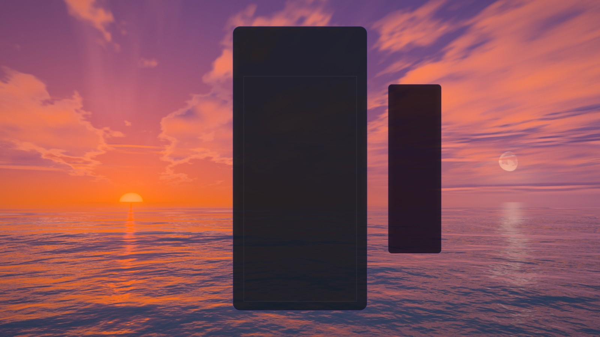 | 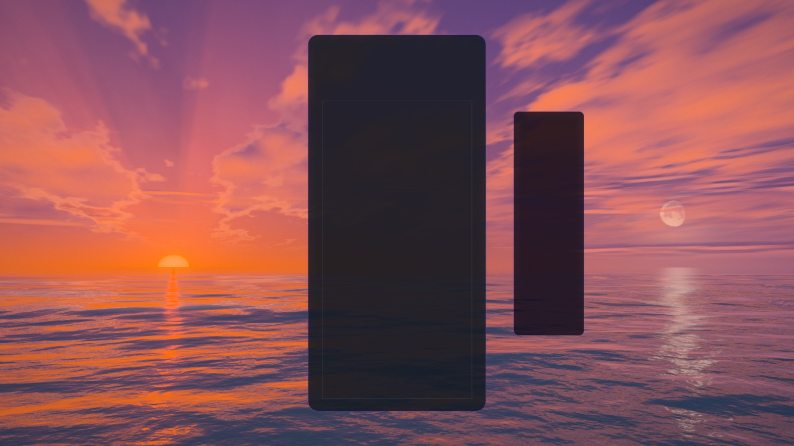 |
| 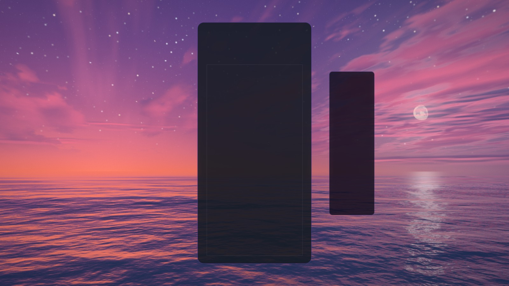 | 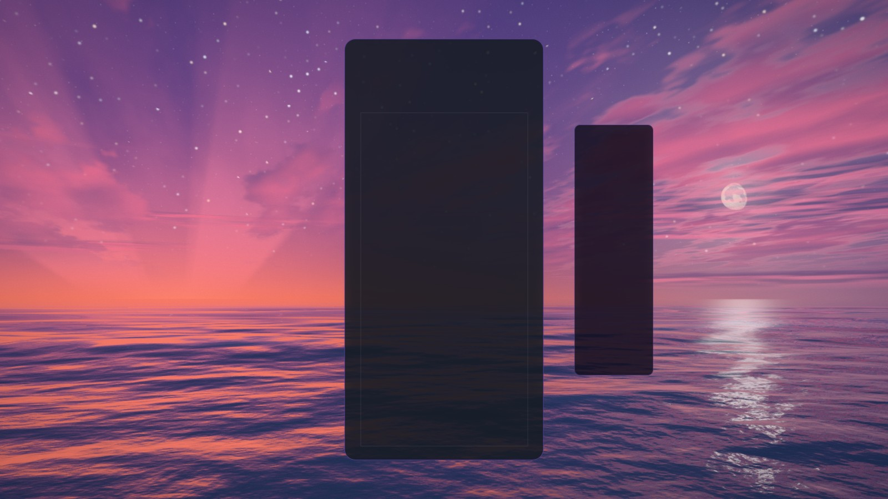 |
| 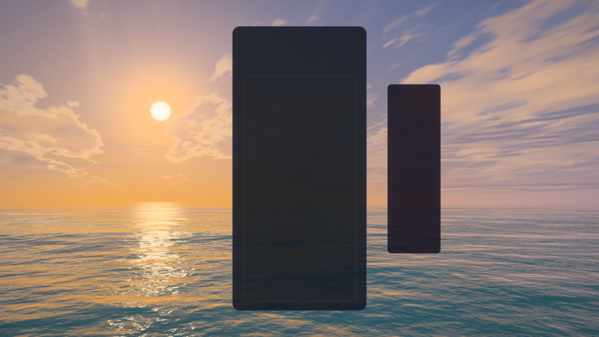 | 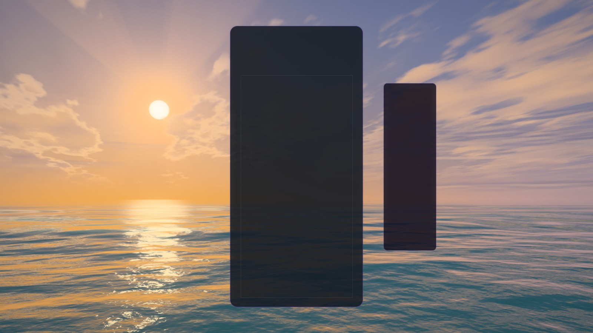 |
| 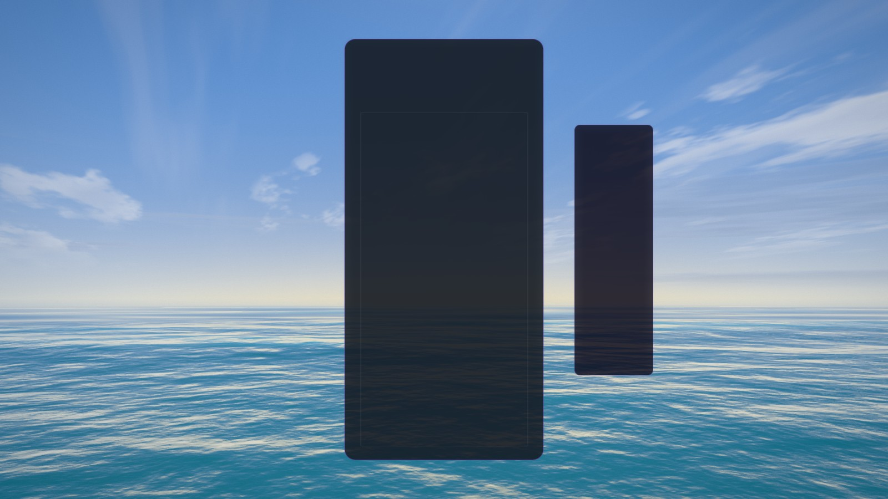 | 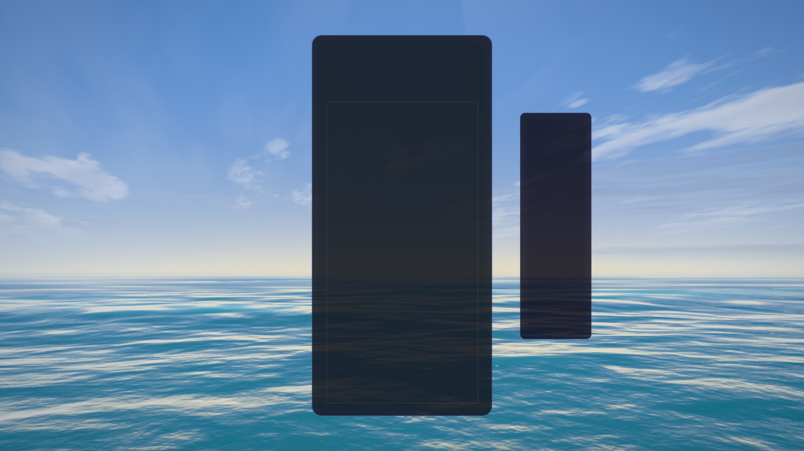 |
| 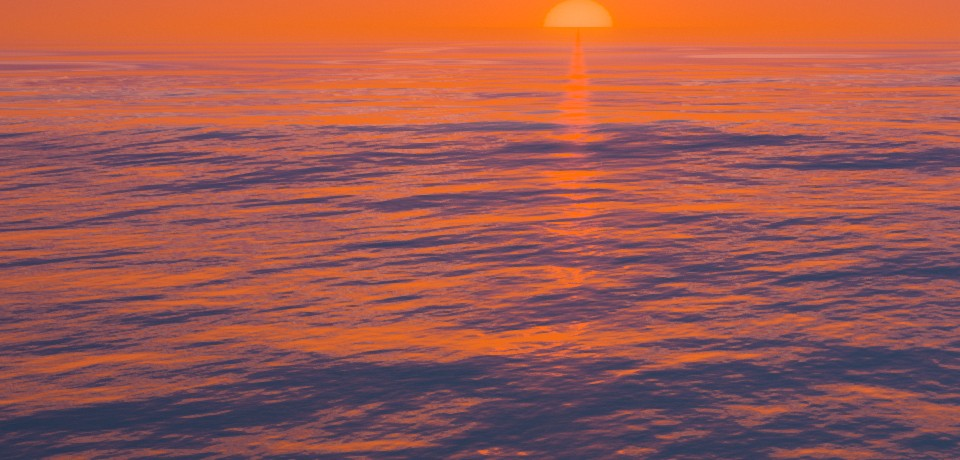 | 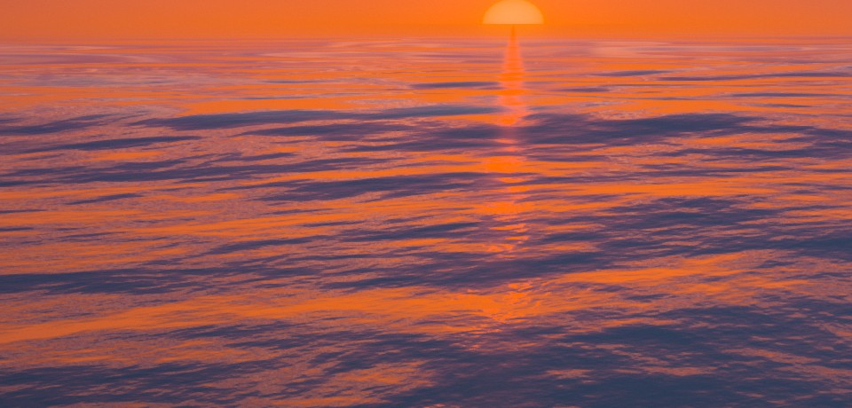 |

**The wind's chop.** `CHOP_ROWS` in `sunset-core.js`: sixteen short trains (9 m down to 0.4 m,
none the length of a swell train) with headings spread round the wind's, every one about equally
steep, drawn in the sea's fragment only (its slope, never its shape: the vertex stage, the CPU's
`seaHeight` and the floats are untouched). Their crests run across the view in long, broken
lines, so the water mirrors the sky in bands: the back of a crest the bright horizon, its front
the sky higher up. Each train's phase is bent by its own mix of two smooth fields read once from
the water's noise (`chopWarpTile` 140 m), so they never lock into a lattice of fish scales. Each
fades by the pixel's footprint like the swell's trains, and what a pixel cannot resolve goes into
the slope variance that draws the roads, so far out the chop widens the sun's road into its
shimmering band. `TUNE.chop` (0.45) scales them all; tiers draw 6 (Minimal) to 16 (Extreme).
The broadest ripple layer is weaker (0.22 → 0.1) and the swell is a little higher (every train
from a steepness of 0.024 to 0.033, still far from breaking; the sum stays under the eye).

**Roads.** `TUNE.glint` 0.02 → 0.04: the sun's road is a clear column of light down the chop at
sunset and a broad glitter at the golden hour, and the lanterns' streaks break along the crests.

**Cirrus.** Wider across the stream (`cirrusScale` 0.06, 0.2 instead of 0.019, 0.085), bent by a
slow warp (`cirrusWarp`) and gathered into drifts by a slow mask (`cirrusPatch`), so it reads as
wisps in some parts of the sky, not a comb over all of it.

**Twilight rays.** `skyColour(…, { rays: true })` on the dome (not the sea's mirror): the shadows
of clouds beyond the horizon fan from the sun across its own glow, read on a circle round the sun
(no seam) from a blurred level of the noise (`.level(2.5)`: the fine octaves ruled hairlines down
every ray), mostly light with soft gaps between, never darker than the sky behind. They scale with
the sun's glow, so they come with the golden hour, are strongest once the sun is on or under the
sea (`sunLow`) and are gone at night; from under the horizon they fan up from the place the sun
went down. `rays`, `rayReach`, `rayCount` in `TUNE`.

**Left as it was.** The sun's disc on the horizon still reads soft and peach rather than a hot
coal; raising its power (tried: 9 → 17 on the horizon) changed nothing, because the disc and the
band round it sit together on the tone curve's shoulder. That needs a darker exposure at the
horizon hours and is a pass of its own.

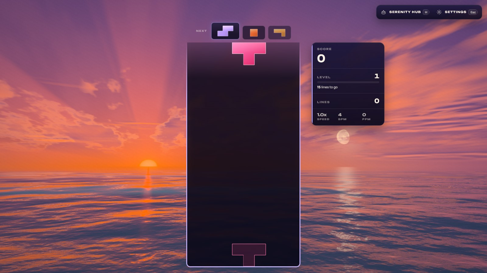

**Verification (2026-10-21, on main 1ce8fd7d plus this pass).**

- **Playground** (WebGPU on the RTX 5080 Laptop at High; Low, Minimal, the WebGL2 backend and a
  430 × 932 portrait frame too; no console warning or error): every station of the day, lanterns
  afloat and lifted, crops of the sea at full resolution.
- **Real game** (Electron, the dev server): WebGPU at High, `sunsetTime=70`, no warning or error.
- **Cost**: 60 frames rendered in one task and the queue awaited, at 1920 × 1080, old and new
  back to back twice: 2.5–3.1 ms a frame at High against 2.5–2.7 ms before, the same within the
  noise on Medium and below (other sessions shared the GPU).
- **Unit tests**: `tests/unit/sunset-shaders.test.js` (new) builds every material and the post
  output through the WGSL and GLSL node builders at High and Minimal without a word, under budget,
  with no unassigned var read, and checks that every chop train is in the sea's fragment and none
  in its vertex stage. All eight Sunset files, 133 tests, pass.

Not done: no perf-lane (ADR-0016) reading, no integrated-GPU or real-phone reading, the
multiplayer, Infinity, meditation and Odyssey layouts not captured, and nobody has watched it
move except through stills and strips. Blender was not used: the scene is a sky, a sea and small
generated meshes. The 22° halo, the hour palettes, the 96 s hour and the icon are my choices.

## The gulls, modelled and animated in Blender (2026-10-28)

On `feature/sunset-birds`. Olov: "I want to improve the look of the flying birds in the sunset
theme, we can use blender MCP to model the birds and animate them!"

**What was wrong.** Each gull was a flat diamond 1 cm deep with two flat wings that bent at one
joint: no head, no tail, no volume. The flock crosses the light side-on, so what showed was a body
seen as a line and wings seen as fins, all painted one near-black whatever the hour (white gulls
are black against the noon sky too).

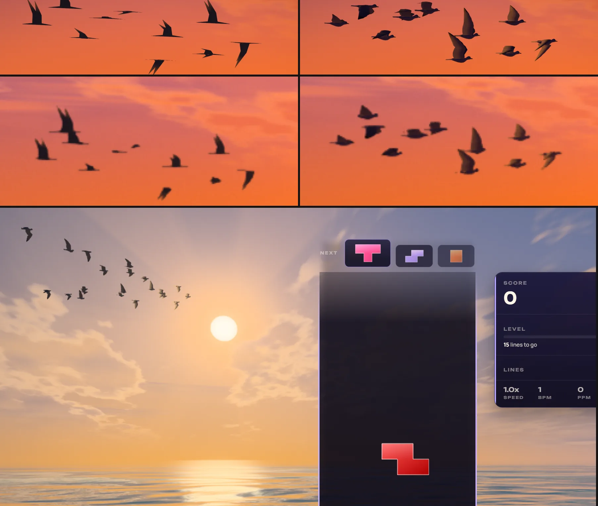

**The bird.** A common gull (fiskmås) built in Blender by `scripts/blender/sunset_gull.py`
(1,496 triangles, real size: 1.33 m across, 0.41 m bill to tail): a round head carried close with
a dark eye and a slim yellow bill, a slim body, a short square tail, and long narrow wings bent at
the wrist, cambered airfoil sections thinning to a feathered trailing edge. Plumage per vertex:
white head, body and tail, the soft grey back and upper wing, black wingtips with two white
mirrors, grey flight feathers underneath. The wing is authored along its span stations and drawn
out by `reach(s)` (the long wings name a gull at 30 px; a 1.2 m first draft read as a dove).

**The rig and the animation.** Nine bones (body, head, tail; the arm, forearm and hand of each
wing, named the Blender way: `.L` on +x). Every vertex follows at most two of them, in bands that
widen toward the trailing edge, which swings furthest when the wing folds; the hand's band runs
out behind the wrist like the line between the primaries and the secondaries. Two keyframed
actions on the armature: **Flap**, one wingbeat (the downstroke 55 % of it, the wing open and
pronated; the upstroke with the elbow and wrist flexed, the hand swept back and trailing, then
flicked up at the top; the body rising on the downstroke while the head is held steady) with
cyclic Bezier curves, and **Glide**, the gull's crank (the arm raised, the hand lowered). The key
poses are joint angles in the script; Blender's interpolation makes the cycle.

**Into the game.** The script samples Blender's evaluated rig at 24 points of the beat plus the
glide and writes `src/themes/sunset/sunset-gull-model.js` (38 KB: base64 positions, triangles,
skin, plumage and the bone poses; nothing is fetched, the theme still loads no assets). It checks
the game's skinning against Blender's own deformed mesh before writing (within 0.0002 mm) and puts
a few of Blender's vertices in the module for the tests. `sunset-birds.js` turns the rows into each
bone's turn about its own joint and, per bird per frame on the CPU, blends two rows of the bird's
beat and its glide joint by joint and chains them from the body out (blending whole deforms pulled
the wrist apart 1.9× halfway into a glide), then banks and heads the bird and writes its nine
bones into a small float table; the vertex stage reads two bones per vertex from the bird's row
(`instanceIndex`) and skins position and normal. One draw, four vertex buffers.

**The light.** Lit by the hour, not painted black: the sky the feathers face (the theme's own
`skyBase` along the normal), the sea's mirror of the low sky the same way from below, the sunlit
water from beneath by day, and the key on the faces turned to it as bright as the hour lights a
white cloud (`cloudLit`). Seen against a low light the shaded side drops to a silhouette (`glare`:
looking within ~55° of a sun under ~38°; not tied to the disc's share over the sea, since the sky
round a sun just set is still the glare), so the skein is black against the fire at sunset and the
golden hour, white gulls with black tips at noon. Thin feathers are lit through only within ~11°
of the disc (birds crossing the sun glow gold); the outline takes a thin rim within ~18° of it (a
wider rim tinted every small bird brown). `TONE` in `sunset-birds.js` holds the shares.

**Flight.** The skein, its joins and its paths are as before; the beat is now in turns of the
Blender cycle (each bird its own pace, about 0.4–0.55 beats a second, which with the skein's slow
crossing is about two wingspans a beat, a real gull's proportion slowed down), the glides blend
into the Glide pose, and the bird turns to its heading by a rotation (the old vertex stage
mirrored the model, harmless only because it was symmetric). `GULL_SCALE` 1.8 → 2.1.

**Reproduce.**

```bash
"C:/Program Files/Blender Foundation/Blender 5.2/blender.exe" --background --factory-startup \
  --python scripts/blender/sunset_gull.py -- --out src/themes/sunset/sunset-gull-model.js [--preview <dir>]
```

From a live Blender (the MCP): `runpy.run_path("scripts/blender/sunset_gull.py",
run_name="sunset_gull")["show"]()` builds the bird, the rig and both actions in a scene of its own
(`SunsetGull`, 24 frames a beat) and touches no other scene; it writes the same file byte for byte
as the headless run. Don't call viewport operators (frame selected, play) from inside an MCP call:
that crashed Blender once here. Playground close-up of the skein crossing the sun:
`?effect=sunset&t=40&quality=High&hour=18&flock=11&flockAge=9&icon=1&iconFov=7&iconYaw=0.50&iconPitch=-0.095`
(`iconFov=13&iconYaw=0.47&iconPitch=-0.07` takes in the whole skein and the sun).

**Verification (2026-10-28, on main 390fc497).**

- **Playground** (Chrome, WebGPU on the RTX 5080 Laptop, High, through the chrome-devtools MCP: the
  dev Electron is blocked by Windows Smart App Control on this machine since it was re-downloaded
  unsigned): sunset, golden hour, afterglow, morning and noon, the long lens, game size at
  1600 × 900 (DPR 1.5) and a strip of nine frames a quarter second apart; no console warning or
  error.
- **Real game**: Single Player on Sunset at High, the whole flock (23 at High) called through the
  live world; the frames were stepped by hand because the automated browser ran theme loops at
  about 1 Hz (Ocean too, so not this change). No warning or error.
- **Unit tests**: `tests/unit/sunset-gull.test.js` (new): the mesh and its skin; the vertex
  stage's twin against Blender's own deformed vertices (< 0.5 mm); a whole stroke with no jump at
  the loop's join, the wrist flexed on the upstroke, the glide open; no skin edge stretched past
  1.75× or closed under 0.18× in any pose or blend; every joint held to its parent in any blend;
  each bird where the skein puts it, bill first, life-sized times `GULL_SCALE`. The shader gate
  builds the new material for WGSL and GLSL with the rest of the world.
- **Cost by construction** (no GPU timing: other sessions share both GPUs): one draw of 1,496
  triangles per bird (9 to 35 birds by tier, 52 k triangles at most), four texel reads and two
  quaternion turns per vertex, two `skyBase` calls per pixel of bird; on the CPU nine bones per
  flying bird per frame and a 18 × birds float texture upload.

Not done: no phone or integrated-GPU reading, no perf-lane reading; the Blender viewport shot of
the rig came back black through the MCP (the scene is there to open). Ideas left: a skein that
sometimes flies obliquely toward or away from the eye (it is always seen side-on now, so the
wings' plan and the M of the glide show only in the bank), and gulls answering the lanterns.
