# Sunset — the lantern sea

Implemented 2026-10-11 on `feature/sunset-masterpiece`, with Three.js 0.186.1. A from-scratch
rebuild: it replaces the earlier theme in full (a classic `WebGLRenderer` scene with an
EffectComposer, a GLSL sky dome, a sprite-glow sun and moon, god-ray and shockwave planes, a
35 000-point starfield and a mirror-camera ocean adapted from `Water.js`, reading
`textures/water-normal.jpg` and `textures/2k_moon.jpg`). Sunset keeps its identity — the sun
going down into an open sea, its road of light, a day that turns into night and back — and
everything else is new. This document records the shipped design and what was verified. It is
a reference, not a backlog. On 2026-10-12 the six-hour wheel became the whole day: sunrise,
sunset, moonrise and moonset in the picture, every hour between, and a new sun and moon (see
"The day").

## The picture

An open sea seen from a little above the water, and the whole day turning over it. The sun
comes down the sky on the left of the card and sets into the sea there, its road of light
running from the horizon to the foot of the frame, broken into sparks near the eye and widening
into a shimmering band toward the horizon. A deck of cloud runs in over the eye toward the
place it goes down; as it sets the deck is lit from beneath, gold near the sun and rose away
from it, while low cloud toward the light stands dark against it with a burning edge. High
cirrus streams toward the sunset point like rays. As the sun sets the moon comes up on the
right; it rides over the picture through the night with the stars and the Milky Way wheeling
behind it, lays a silver road of its own, and goes down on the left just before the sun comes
up out of the sea on the right.

The card sits in the middle of the frame, so the picture is composed round it: the world reads
the live card and stats rects and puts the place the sky goes down in the middle of the margin
left of the card and the place it comes up in the free strip right of the card and the stats
bar. The horizon
stands low (61 % down a wide frame, the middle of a tall one), so the sky is most of the
picture.

## The one idea

**The board fills the sea with lanterns, and every clear sets some of them free.** A locked
piece sends a light of its own colour from the card's edge down to the water beside the card,
where it becomes a paper lantern afloat in that colour, riding the swell on a streak of its own
reflected light. A clear lifts the oldest of them off the water, and the evening wind carries
them away toward the place the sun goes down, climbing, until they are sparks over the horizon.
Over a game the sea fills with lights and the sky over the sunset fills with rising lanterns.

## Event language

| Play | The sea |
| --- | --- |
| Lock | A light in the piece's colour leaves the card's edge at the piece's height and arcs down to the sea beside the card, on the side its column is nearer (a piece low on the stack lands near the eye, one high up lands far out toward the horizon; the stats bar is kept clear). Where it lands a paper lantern of that colour lights with a flare and a ring runs out from it. The water mirrors it on a streak of its own light and is lit round it. |
| Hard drop | The same, set down hard: a splash of drops in the lantern's light, a wider, brighter ring. |
| Clear | For every line the oldest lantern on the water flares and lifts off, leaving a ring; the wind takes it toward the sunset. A chain lifts more at once. A halo blooms round the sun (round the moon at night): it runs out from the disc to 22° in a second, prismatic, red on its inner edge, holds, and fades; the sun's aureole flares and its road on the sea flares with it. |
| T-spin | The lanterns that lift go up turning round where they rose before the wind takes them. |
| Four lines, perfect clear | Every lantern on the water lifts at once, the sky is set on fire, and if the sun is low the last of its upper limb burns green for a breath (the green flash). A perfect clear also calls the whole flock. |
| Chain of clears | The sky catches fire: the cloud burns brighter and further from the sun with every clear held, the sun's road with it; from three clears a skein of gulls crosses in front of the sun (the moon at night), from five a great one. It cools slowly when the chain breaks. |
| Too many afloat | The water holds about half the pool; past that the oldest lantern sets out by itself, so the sky always has some in it. |
| Level up | The day runs on an eighth of itself (70.6 s of its timetable), eased over 3.6 s: the sun, the moon and the stars are seen to run across the sky. Two levels at once go twice as far, from where the last turn was headed; nothing turns the day back. |
| The clock, with no play at all | **The day turns by itself, slowly, whatever the level**: one whole day in 565 s, never standing still. A level-up is added on top of where the clock has carried the day (`wheel = clock + LEVEL_SECONDS × levels gained`), so the light never waits for a level. |
| New run | The lanterns go and the chain cools; the day goes on from where it was (the level is 1 again, the light does not move). A rebuild in place (a quality change, a lost device) hands the clock, the level and the day over whole. |

## The day

`sunset-hours.js` is the whole twenty-four hours. **Where the bodies run:** the sun comes up out
of the sea in the strip right of the card at 06:00, climbs (straight up at first, then leaning
left), leaves the top of the picture at about 08:30, stands 52° up over the picture at noon,
comes back in at the top left at about 15:30 and goes down into the sea in the margin left of
the card at 18:00. Under the sea it runs back from left to right. The moon keeps the same road
172° of the sky's turn behind the sun and lower (40° at its highest): it comes up on the right at
17:28 (so it stands over the sea on the right while the sun sets on the left), leaves the top of
the picture at about 21:30, comes back in at the top left at about 02:00 and goes down on the
left at 05:28, half an hour before the sun comes up on the right. A unit test walks the whole day
on the solo layout and checks that whenever the sun or the moon is in the picture it is clear of
the card and the stats bar. The stars turn about a pole behind the eye, 35° up, so in front of
the eye they come up on the right and go down on the left as the sun and the moon do; the Milky
Way is fixed to the same sky and stands across the picture at midnight.

**The light:** eleven stations name the day: midnight, before dawn (04:42), dawn (05:27, the moon
setting into the pink belt), sunrise (06:03), morning (08:00), noon, afternoon (15:00), golden
hour (17:00), sunset (18:00), afterglow (18:24) and dusk (19:18, the moon climbing on the right).
Between two of them the light is always on its way (half linear, half eased: it never stands
still), and no two neighbours mix through grey (a unit test walks the horizon, toward the sun and
away from it, every three minutes of the day). The sun's and the moon's own colours are not
authored: they come from the air they are seen through (Kasten–Young air mass, per-channel
extinction), so either one whitens as it climbs and reddens to a coal as it nears the sea,
wherever it is. The same air gives their roads on the sea (deeper again, seen twice through the
air) and the moon's glow; the moon's road and glow fade out by day. How far the stars are out
and which body keys the cloud follow the sun's and the moon's heights.

**The timetable:** a day takes 565 s of the clock and lingers where the light changes most. From
the start: golden hour (16:40) at 0 s, the sun on the water at 70 s, dusk at 140 s, 23:00 at
200 s, 03:00 at 260 s, 05:00 at 305 s, 06:00 at 355 s, 08:00 at 430 s, noon at 480 s, 16:00 at
540 s. The hours run through these knots on a curve that never runs back (monotone cubic,
periodic): the evening from golden hour to dusk and the dawn from the moon setting to the
morning are a quarter of the hours and take nearly half of the clock; at its fastest (round
noon) the day runs under six minutes a second.

**The sun and the moon, drawn:** the sun darkens toward its limb, blue most (a gold heart in a
deeper rim), its lower limb reddens near the sea, it is squashed by the air and looks a tenth
larger on the horizon. The moon is a sphere lit from the sun's side of it at a 50° phase angle,
a gibbous moon whatever the hour (a full one reads flat at 33 pixels): its shadow is on the limb
away from the sun wherever the sun is, the right as it rises beside the sunset, swinging
round through the night to the left as it sets before the sunrise, with the seas the eye knows (Imbrium,
Serenitatis, Tranquillitatis, Crisium, Fecunditatis, Nectaris, Procellarum, Nubium, Humorum,
Frigoris), Tycho with its rays, Copernicus, Kepler and Aristarchus, crater relief along the
shadow's edge and a faint earthshine. Its face turns as it crosses the sky, it looks a fifth
larger on the horizon, and it is light added to the air in front of it: a pale ghost in a lit
sky, the brightest thing in a dark one. The face is drawn only where the disc is (a branch with
explicit mip levels, so WGSL's uniformity rules hold).

## How it is built

All of it is generated: no models, no textures on disk, no compute. Two noise textures are baked
on the CPU when the scene is built (the sky's: broad fBm, rounded cells for cumulus heads, a
second fBm, fine fBm; the sea's: the slope of a five-octave height field and two heights).

- **`sunset-tsl.js`** — `skyColour(dir)`: the whole distance as ONE function of a direction —
  the air's three bands in the hour's colours (the sun's colour hangs as a lobe round its
  bearing), the sun and the moon with their glows and discs (the low sun squashed, its lower
  limb reddened, its heart yellower; the moon gibbous, with grey seas), the green flash, the
  stars on a 3D lattice (no stretched stars anywhere on the sphere) turning round the pole, the
  Milky Way arching across the night frame, a clear's 22° halo round the sun or the moon, high cirrus
  streaming toward the sunset point, long
  bars of cloud low over the sea, and the cloud deck drawn in relief: a few slices of one noise
  field at rising heights, composed from the lowest up, so toward the horizon the sides and
  tops of the clouds come into view over their bases. By day a cloud's top takes the light;
  with the sun on the horizon its base does, and low cloud toward the light shows its dark side
  with a lining. `glintLobe` is the share of water facets that mirror a light, from the slope
  and its variance.
- **`sunset-sky.js`** — the dome: `skyColour` along the view ray (drawn last among the opaque
  parts, depth test on, so it is shaded only where it shows), the air over the far sea below the
  horizon.
- **`sunset-sea.js`** — a fan of rings round the eye's foot out to 9 km. Eight Gerstner trains
  in the vertex stage, each fading out where the mesh is too coarse for it. The fragment
  rebuilds the slope from the same trains and up to three ripple layers, and keeps the slope a
  pixel cannot resolve as a variance: that variance is what draws the roads (sparks near the eye,
  a broad shimmering band toward the horizon) for the sun, the moon and every lantern through
  the same `glintLobe`. It mirrors `skyColour` along the mirror ray (fewer layers), takes the
  rings from a uniform table, and fades into the air over the far sea.
- **`sunset-lantern-pool.js`** (three-free) — every lantern's life in closed form in the world's
  clock: the light's arc from the card, afloat on the swell (`seaHeight`, `seaSlope` on the CPU),
  drifting out, lifted, climbing into the wind (lagged rise and drift, a T-spin's turn), guttering
  out at the horizon.
- **`sunset-lanterns.js`** — the lanterns (one instanced mesh: a tapered paper shell with bamboo
  ribs on a dark float, lit from inside in the piece's colour) and one additive layer of
  camera-facing glows (halos, the lights in flight with their trails, splash drops) that keep a
  few pixels across however far away they are.
- **`sunset-birds.js`** — the gulls: a common gull modelled, rigged and animated in Blender
  (`scripts/blender/sunset_gull.py` writes `sunset-gull-model.js`; see "The gulls, modelled and
  animated in Blender" below). Per bird per frame the CPU blends its beat and glide joint by joint
  into nine bones in a float table; the vertex stage skins each vertex to two of them.
- **`sunset-world.js`** — the uniforms, the day (the clock, the levels' offset, the sun's and the
  moon's places from `arcAt`), the tables (rings, lamps the sea mirrors),
  the event language, the camera (afloat: the swell lifts the eye a little), what the post needs.
- **`sunset-post.js`** — one scene pass, bloom with a hue-preserving high-pass (threshold above
  the brightest sky, so only the disc, the roads and the lanterns bloom), shafts marched toward
  the sun (none at night: they would comb the stars), calm zones under the card and stats, a
  hue-preserving filmic curve that whitens only the hottest values, the hour's grade, vignette,
  grain, FXAA.
- **`sunset-theme.js`**, **`sunset-director.js`**, **`sunset-composition.js`** — the adapter the
  recent rebuilds share (lifecycle, WebGPU with the WebGL2 backend, GPU-loss recovery, layout
  reads on frame time, the director that stages bus events and derives the true combo), with the
  clock and level carried across a rebuild in place.

## Tiers

Every tier keeps the whole picture and every event (`sunset-quality.js`): the deck's slices
(2 to 7) and how many of them the sea mirrors (0 to 3), its torn edges, cirrus, bars and the
Milky Way, the sea mesh (90 × 64 to 300 × 240), ripple layers (1 to 3), lanterns alive (24 to 64)
and how many the sea mirrors (4 to 22), rings, lights in flight, splash drops and the largest
flock (9 to 35). Bloom and shafts from Medium up; the pixel-ratio cap runs 0.7 to 1.6.

## Reproduce

Playground: `/playground.html?effect=sunset&t=14&quality=High&board=1` plus `hour=<h>` (holds the
day at an hour, 0 to 24: 4.7 before dawn, 5.45 dawn, 6.05 sunrise, 8 morning, 12 noon, 15
afternoon, 17 golden hour, 18 sunset, 18.4 afterglow, 19.3 dusk, 0 midnight; unset, `t` is the
day's clock: `t=0` is 16:40, sunset at `t=70`, sunrise at `t=355`),
`level=<n>`, `locks=<n>`, `lift=<n>&liftAge=<s>` (`spin=1`), `flock=<n>&flockAge=<s>`,
`event=lock|drop|clear|quad|twist|perfect|levelUp` with `eventAge`, `lines`, `row`, `u`, `color`,
`combo=<n>`, `parts=sky,sea,lanterns,glows,birds`, `falseColor=1`, `noPost=1`, and
`P.<name>=<value>` to override any number of `TUNE` in `sunset-tsl.js` before the world is
built. The icon (shot on the six-hour wheel at its place 0.95, the sun on the water; on the day
that is `hour=18`): `t=40&quality=Ultra&hour=18&combo=5&icon=1&iconFov=24&iconYaw=0.322&iconPitch=-0.045&iconLanterns=9&lift=3&liftAge=6&flock=11&flockAge=9`
on a square frame.

Theme flags (the real game; add `unlockAll=1`): `sunsetTime=<s>` (seek and freeze),
`sunsetFixedDt=<ms>`, `sunsetParts=…`, `sunsetFalseColor=1`, `sunsetForceWebGL=1` (or
`forceWebGL=1`).

## Verification

All on 2026-10-11, on the feature tree (main 489105cf plus this rebuild).

- **Unit tests**: six files, 109 tests. `sunset-core` (the piece's light, the swell's slope
  against its height, the bodies' paths, the noise bakes); `sunset-hours` (the wheel, the bodies
  only ever turning one way, no crossing through grey, **the clock alone moving the light within
  the first minute and a whole hour in 96 s, a level adding one hour on top**, a new run going
  forward); `sunset-lantern-pool`; `sunset-world` (built for real in Node: every tier, the facing
  of the generated meshes, lanterns landing beside the card and never behind it, lifts, the green
  flash only with a low sun, the chain's fire and gulls, the hour on a level and by the clock, a
  new run); and the shared adapter's `sunset-director` and `sunset-theme` (from the sibling
  rebuilds). The Rainy Window half of `portrait-theme-composition.test.js` is kept; its Sunset
  half pinned the old class and went with it.
- **Gates**: typecheck, the ts and lint ratchets (the lint count fell to 612 against a baseline of
  807), architecture fitness, the theme lifecycle audit, dependency boundaries, palette, perf
  budgets, the build with the boot-closure guard, ip-strings, pages artifact, release gates: all
  pass. Full suite 816 of 819 files: the three reds fail on this machine whatever the change (the
  Swedish-locale briefing test, the TTS recorder's symlink that Windows refuses, and the Odyssey
  forest's 300 ms wall-clock bake budget, which passes alone, 23 of 23).
- **Playground**: WebGPU on the RTX at every tier and the WebGL2 backend, at 1600 × 852 and in
  portrait (430 × 850), every hour and every event; the look was iterated on SwiftShader
  (`hours.jpg`, `events.jpg`, `halo.jpg`, `tiers.jpg`, `portrait.jpg` here).
- **Real game** (Electron, dev server): WebGPU on the RTX at 131 fps at High (the display's rate),
  the WebGL2 backend at 122 to 131 fps; no console warning or error, no event dropped; real hard
  drops, clears, a chain (ten lanterns lifted, the flock called) and a level-up (`ingame.jpg`). A
  tier change at 151 s of theme clock came back at 155 s on the same hour (wheel place 1.57, then
  1.62): the light does not snap back.
- **The clock alone** (`clock-ingame.jpg`): the real game at level 1 with `sunsetFixedDt=50` and
  no clears: golden hour at 8 s, the sun on the water at 64 s, at the horizon at 119 s, afterglow
  at 174 s and 228 s, night at 283 s, level 1 in every frame.
- **Lifecycle validator** (`validate-all-themes --theme sunset`): 107 of 107 checks, no console
  error. `docs/theme-screenshots/sunset.png` and its result are that run's.
- **Phone emulation** (software WebGL2): pass at Low and Minimal, and their screenshots are clean.
- **The icon** (`icon.jpg`, `icon-at-picker-size.png`, the old one first): the sun half under the
  sea with its road, a lantern rising, gulls crossing, lanterns afloat; a 512 × 512 full-bleed
  circle in both icon places. It is my pick, previewed at 80 px beside its neighbours.

**The day (2026-10-12, on main 3ff50fe7 plus this change):**

- **Unit tests**: `sunset-hours` rewritten for the day (the stations and what they author, no
  grey crossing at any of 480 points of the day, darkest at midnight, never standing still; the
  sun up on the right at six, 52° up at noon, down on the left at six, right to left all day; the
  moon up just before sunset and down just before sunrise; the air's colours; the clouds handed
  to the moon and back; the timetable rising without a break, lingering at dawn and dusk, under
  six minutes of the day a second; the clock alone moving the light within the first minute; a
  level as an eighth of the day). `sunset-world`: the sun and the moon clear of the card and the
  stats bar at every quarter hour they are in the picture, the clock and two kinds of level-up
  (never back), the stars turning the same way as the sun, a new run keeping the day and a rebuild
  handing it over whole. Six files, 115 tests.
- **Playground** (WebGPU on the RTX at High; Low, Ultra and the WebGL2 backend too; no console
  error or WebGPU validation message): every station and the hours between (`day.jpg`: midnight,
  03:00, 04:42, dawn, sunrise, 07:00, noon, 15:30, golden hour, sunset, afterglow, dusk), the
  moon's face and phase cropped at its real size, a level-up running the day on, a clear's halo
  round the moon, four lines at sunrise (the green flash shows at sunrise too).
- **The clock alone in the real game** (`day-ingame.jpg`): level 1, no lines, `sunsetFixedDt=200`:
  16:51 at 8 s of theme clock, the sun on the water at 75 s (18:07), the moon up on the right at
  152 s (20:01), midnight at 217 s, the moon low on the left at 291 s (04:30), dawn at 332 s,
  the sun on the sea on the right at 361 s (06:07), the morning at 423 s, noon at 484 s and the
  sun coming down on the left again at 548 s (16:16).
- **Picks**: the station palettes, the 565 s day and its timetable, the arcs' heights, the moon's
  lag and 50° phase are my choices.

## The sea and sky pass (2026-10-21)

A pass over the rebuild, on `feature/sunset-atmosphere`: the day, the lanterns, the events and
the composition are as above; the water, the high cloud and the twilight's light are new.

**What was wrong.** The sea read as smeared paint: the broad ripple layer from the noise drew
blots of mirrored sky with no direction, and the swell was too low to be seen, so at sunset the
water was orange and lilac smudges and at noon a turquoise sheet with white streaks. The cirrus
was ruled hairlines fanning toward the place it streams to (the across-stream frequency was
tiny), and between the sun and the deck the sky was an even glow.

| Before | After |
| --- | --- |
| 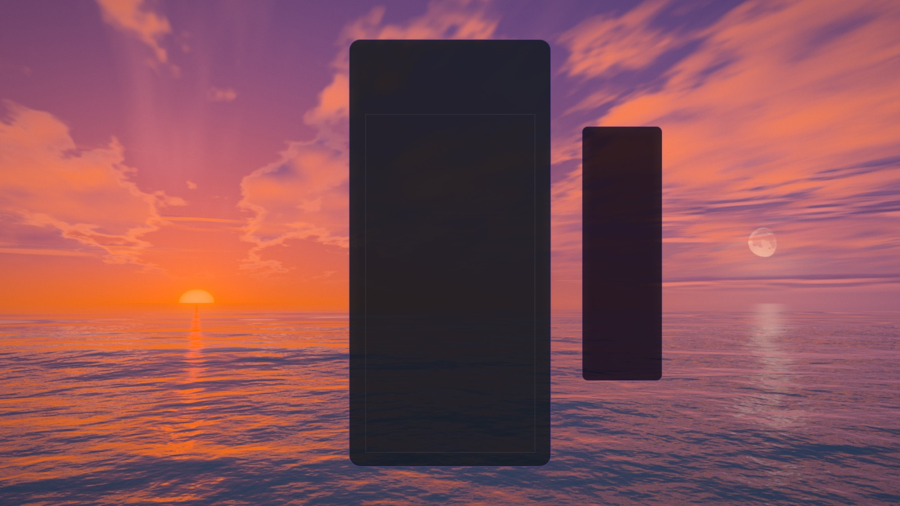 | 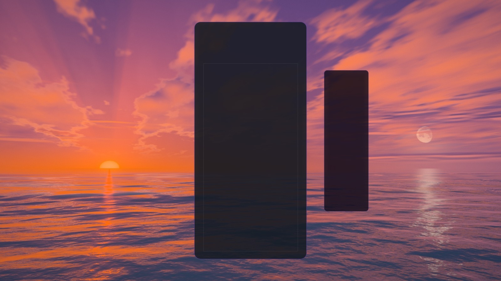 |
| 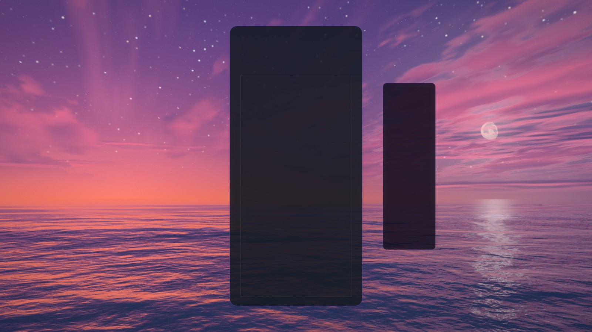 | 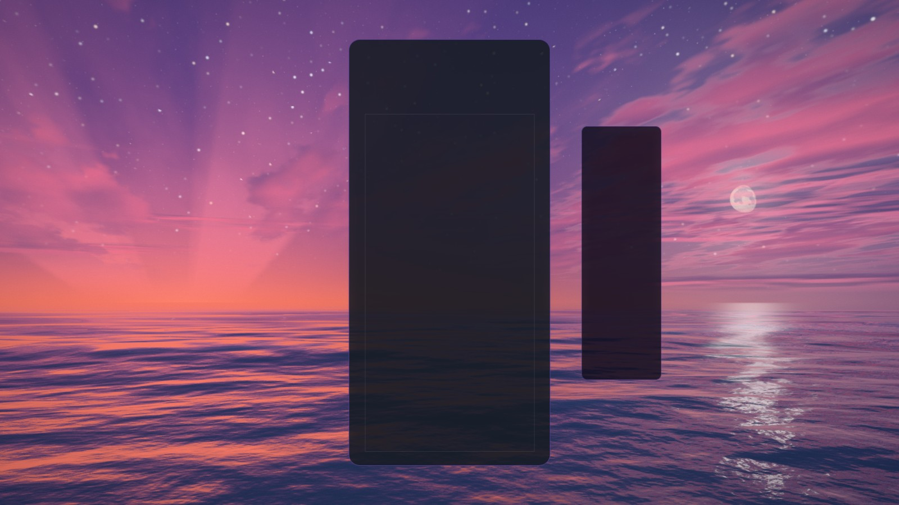 |
| 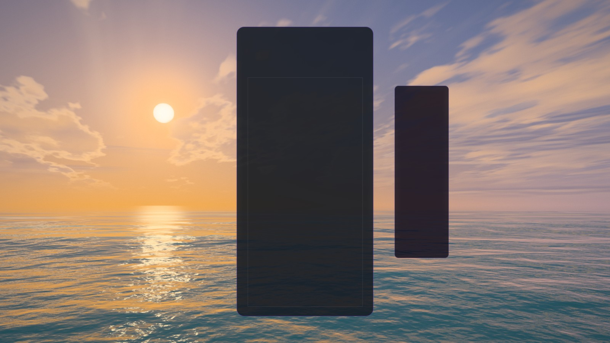 | 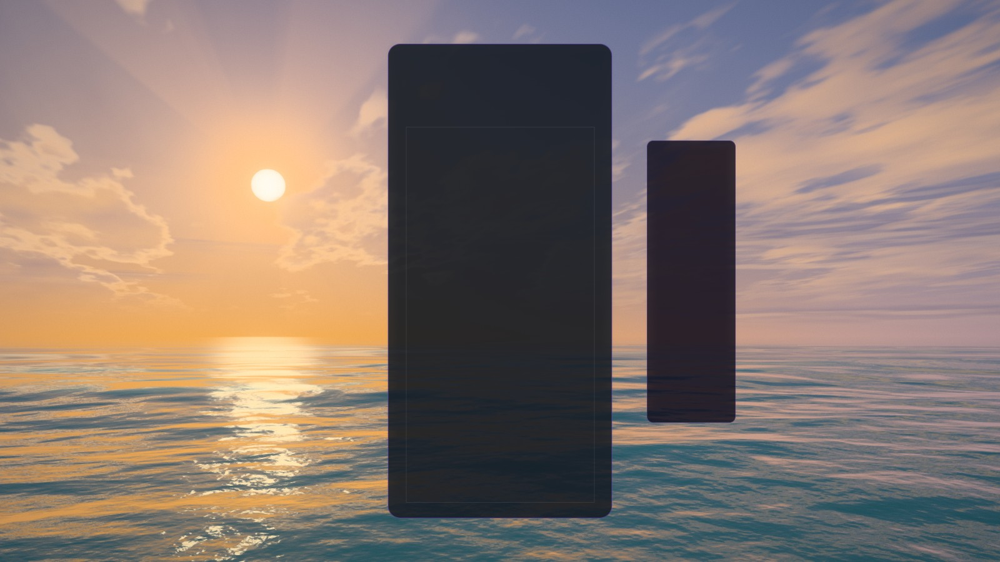 |
| 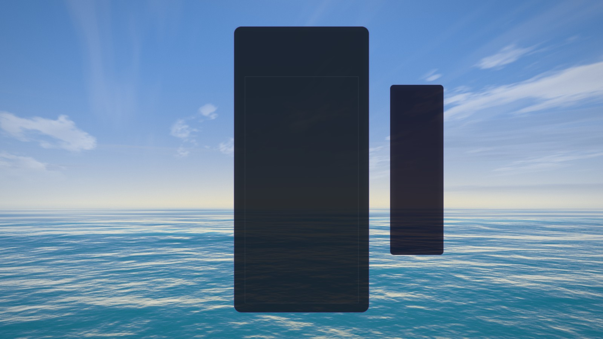 | 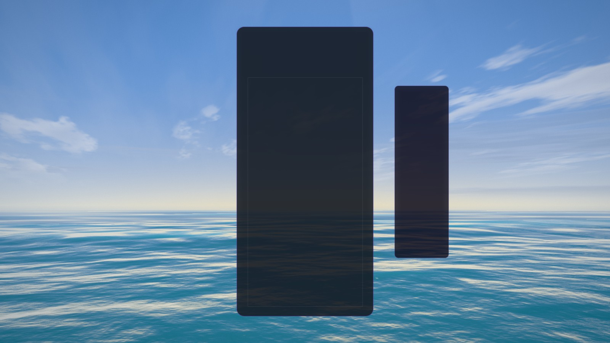 |
| 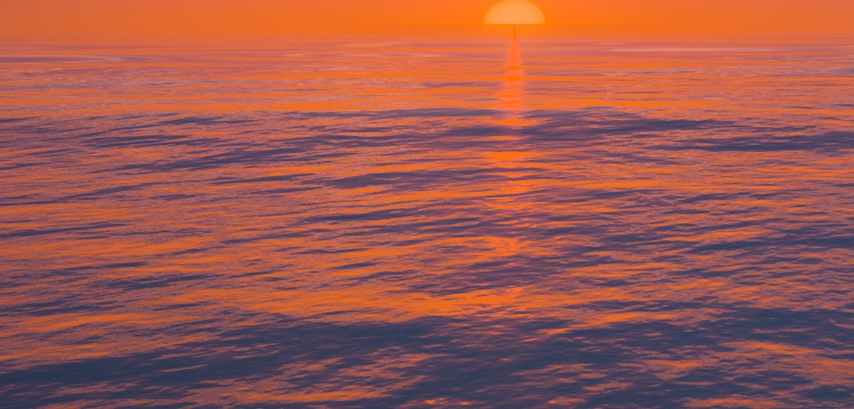 | 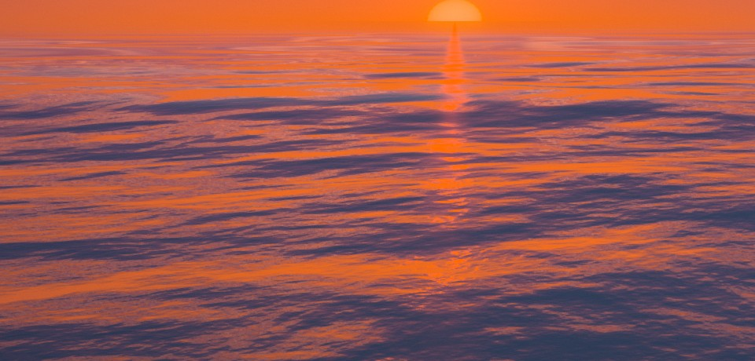 |

**The wind's chop.** `CHOP_ROWS` in `sunset-core.js`: sixteen short trains (9 m down to 0.4 m,
none the length of a swell train) with headings spread round the wind's, every one about equally
steep, drawn in the sea's fragment only (its slope, never its shape: the vertex stage, the CPU's
`seaHeight` and the floats are untouched). Their crests run across the view in long, broken
lines, so the water mirrors the sky in bands: the back of a crest the bright horizon, its front
the sky higher up. Each train's phase is bent by its own mix of two smooth fields read once from
the water's noise (`chopWarpTile` 140 m), so they never lock into a lattice of fish scales. Each
fades by the pixel's footprint like the swell's trains, and what a pixel cannot resolve goes into
the slope variance that draws the roads, so far out the chop widens the sun's road into its
shimmering band. `TUNE.chop` (0.45) scales them all; tiers draw 6 (Minimal) to 16 (Extreme).
The broadest ripple layer is weaker (0.22 → 0.1) and the swell is a little higher (every train
from a steepness of 0.024 to 0.033, still far from breaking; the sum stays under the eye).

**Roads.** `TUNE.glint` 0.02 → 0.04: the sun's road is a clear column of light down the chop at
sunset and a broad glitter at the golden hour, and the lanterns' streaks break along the crests.

**Cirrus.** Wider across the stream (`cirrusScale` 0.06, 0.2 instead of 0.019, 0.085), bent by a
slow warp (`cirrusWarp`) and gathered into drifts by a slow mask (`cirrusPatch`), so it reads as
wisps in some parts of the sky, not a comb over all of it.

**Twilight rays.** `skyColour(…, { rays: true })` on the dome (not the sea's mirror): the shadows
of clouds beyond the horizon fan from the sun across its own glow, read on a circle round the sun
(no seam) from a blurred level of the noise (`.level(2.5)`: the fine octaves ruled hairlines down
every ray), mostly light with soft gaps between, never darker than the sky behind. They scale with
the sun's glow, so they come with the golden hour, are strongest once the sun is on or under the
sea (`sunLow`) and are gone at night; from under the horizon they fan up from the place the sun
went down. `rays`, `rayReach`, `rayCount` in `TUNE`.

**Left as it was.** The sun's disc on the horizon still reads soft and peach rather than a hot
coal; raising its power (tried: 9 → 17 on the horizon) changed nothing, because the disc and the
band round it sit together on the tone curve's shoulder. That needs a darker exposure at the
horizon hours and is a pass of its own.

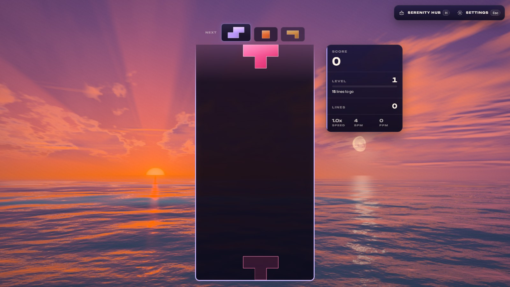

**Verification (2026-10-21, on main 1ce8fd7d plus this pass).**

- **Playground** (WebGPU on the RTX 5080 Laptop at High; Low, Minimal, the WebGL2 backend and a
  430 × 932 portrait frame too; no console warning or error): every station of the day, lanterns
  afloat and lifted, crops of the sea at full resolution.
- **Real game** (Electron, the dev server): WebGPU at High, `sunsetTime=70`, no warning or error.
- **Cost**: 60 frames rendered in one task and the queue awaited, at 1920 × 1080, old and new
  back to back twice: 2.5–3.1 ms a frame at High against 2.5–2.7 ms before, the same within the
  noise on Medium and below (other sessions shared the GPU).
- **Unit tests**: `tests/unit/sunset-shaders.test.js` (new) builds every material and the post
  output through the WGSL and GLSL node builders at High and Minimal without a word, under budget,
  with no unassigned var read, and checks that every chop train is in the sea's fragment and none
  in its vertex stage. All eight Sunset files, 133 tests, pass.

Not done: no perf-lane (ADR-0016) reading, no integrated-GPU or real-phone reading, the
multiplayer, Infinity, meditation and Odyssey layouts not captured, and nobody has watched it
move except through stills and strips. Blender was not used: the scene is a sky, a sea and small
generated meshes. The 22° halo, the hour palettes, the 96 s hour and the icon are my choices.

## The gulls, modelled and animated in Blender (2026-10-28)

On `feature/sunset-birds`. Olov: "I want to improve the look of the flying birds in the sunset
theme, we can use blender MCP to model the birds and animate them!"

**What was wrong.** Each gull was a flat diamond 1 cm deep with two flat wings that bent at one
joint: no head, no tail, no volume. The flock crosses the light side-on, so what showed was a body
seen as a line and wings seen as fins, all painted one near-black whatever the hour (white gulls
are black against the noon sky too).

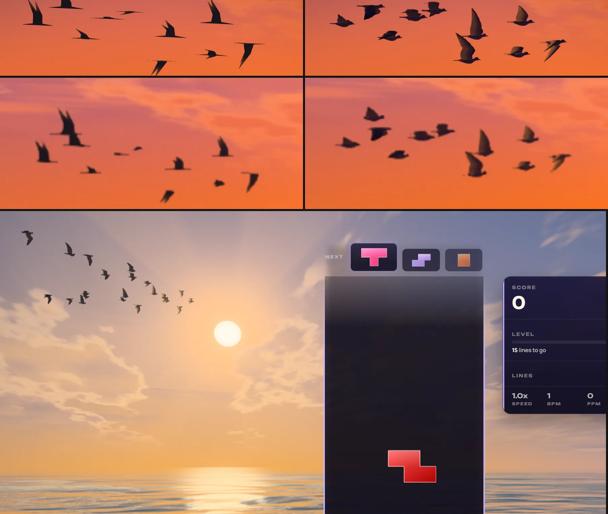

**The bird.** A common gull (fiskmås) built in Blender by `scripts/blender/sunset_gull.py`
(1,496 triangles, real size: 1.33 m across, 0.41 m bill to tail): a round head carried close with
a dark eye and a slim yellow bill, a slim body, a short square tail, and long narrow wings bent at
the wrist, cambered airfoil sections thinning to a feathered trailing edge. Plumage per vertex:
white head, body and tail, the soft grey back and upper wing, black wingtips with two white
mirrors, grey flight feathers underneath. The wing is authored along its span stations and drawn
out by `reach(s)` (the long wings name a gull at 30 px; a 1.2 m first draft read as a dove).

**The rig and the animation.** Nine bones (body, head, tail; the arm, forearm and hand of each
wing, named the Blender way: `.L` on +x). Every vertex follows at most two of them, in bands that
widen toward the trailing edge, which swings furthest when the wing folds; the hand's band runs
out behind the wrist like the line between the primaries and the secondaries. Two keyframed
actions on the armature: **Flap**, one wingbeat (the downstroke 55 % of it, the wing open and
pronated; the upstroke with the elbow and wrist flexed, the hand swept back and trailing, then
flicked up at the top; the body rising on the downstroke while the head is held steady) with
cyclic Bezier curves, and **Glide**, the gull's crank (the arm raised, the hand lowered). The key
poses are joint angles in the script; Blender's interpolation makes the cycle.

**Into the game.** The script samples Blender's evaluated rig at 24 points of the beat plus the
glide and writes `src/themes/sunset/sunset-gull-model.js` (38 KB: base64 positions, triangles,
skin, plumage and the bone poses; nothing is fetched, the theme still loads no assets). It checks
the game's skinning against Blender's own deformed mesh before writing (within 0.0002 mm) and puts
a few of Blender's vertices in the module for the tests. `sunset-birds.js` turns the rows into each
bone's turn about its own joint and, per bird per frame on the CPU, blends two rows of the bird's
beat and its glide joint by joint and chains them from the body out (blending whole deforms pulled
the wrist apart 1.9× halfway into a glide), then banks and heads the bird and writes its nine
bones into a small float table; the vertex stage reads two bones per vertex from the bird's row
(`instanceIndex`) and skins position and normal. One draw, four vertex buffers.

**The light.** Lit by the hour, not painted black: the sky the feathers face (the theme's own
`skyBase` along the normal), the sea's mirror of the low sky the same way from below, the sunlit
water from beneath by day, and the key on the faces turned to it as bright as the hour lights a
white cloud (`cloudLit`). Seen against a low light the shaded side drops to a silhouette (`glare`:
looking within ~55° of a sun under ~38°; not tied to the disc's share over the sea, since the sky
round a sun just set is still the glare), so the skein is black against the fire at sunset and the
golden hour, white gulls with black tips at noon. Thin feathers are lit through only within ~11°
of the disc (birds crossing the sun glow gold); the outline takes a thin rim within ~18° of it (a
wider rim tinted every small bird brown). `TONE` in `sunset-birds.js` holds the shares.

**Flight.** The skein, its joins and its paths are as before; the beat is now in turns of the
Blender cycle (each bird its own pace, about 0.4–0.55 beats a second, which with the skein's slow
crossing is about two wingspans a beat, a real gull's proportion slowed down), the glides blend
into the Glide pose, and the bird turns to its heading by a rotation (the old vertex stage
mirrored the model, harmless only because it was symmetric). `GULL_SCALE` 1.8 → 2.1.

**Reproduce.**

```bash
"C:/Program Files/Blender Foundation/Blender 5.2/blender.exe" --background --factory-startup \
  --python scripts/blender/sunset_gull.py -- --out src/themes/sunset/sunset-gull-model.js [--preview <dir>]
```

From a live Blender (the MCP): `runpy.run_path("scripts/blender/sunset_gull.py",
run_name="sunset_gull")["show"]()` builds the bird, the rig and both actions in a scene of its own
(`SunsetGull`, 24 frames a beat) and touches no other scene; it writes the same file byte for byte
as the headless run. Don't call viewport operators (frame selected, play) from inside an MCP call:
that crashed Blender once here. Playground close-up of the skein crossing the sun:
`?effect=sunset&t=40&quality=High&hour=18&flock=11&flockAge=9&icon=1&iconFov=7&iconYaw=0.50&iconPitch=-0.095`
(`iconFov=13&iconYaw=0.47&iconPitch=-0.07` takes in the whole skein and the sun).

**Verification (2026-10-28, on main 390fc497).**

- **Playground** (Chrome, WebGPU on the RTX 5080 Laptop, High, through the chrome-devtools MCP: the
  dev Electron is blocked by Windows Smart App Control on this machine since it was re-downloaded
  unsigned): sunset, golden hour, afterglow, morning and noon, the long lens, game size at
  1600 × 900 (DPR 1.5) and a strip of nine frames a quarter second apart; no console warning or
  error.
- **Real game**: Single Player on Sunset at High, the whole flock (23 at High) called through the
  live world; the frames were stepped by hand because the automated browser ran theme loops at
  about 1 Hz (Ocean too, so not this change). No warning or error.
- **Unit tests**: `tests/unit/sunset-gull.test.js` (new): the mesh and its skin; the vertex
  stage's twin against Blender's own deformed vertices (< 0.5 mm); a whole stroke with no jump at
  the loop's join, the wrist flexed on the upstroke, the glide open; no skin edge stretched past
  1.75× or closed under 0.18× in any pose or blend; every joint held to its parent in any blend;
  each bird where the skein puts it, bill first, life-sized times `GULL_SCALE`. The shader gate
  builds the new material for WGSL and GLSL with the rest of the world.
- **Cost by construction** (no GPU timing: other sessions share both GPUs): one draw of 1,496
  triangles per bird (9 to 35 birds by tier, 52 k triangles at most), four texel reads and two
  quaternion turns per vertex, two `skyBase` calls per pixel of bird; on the CPU nine bones per
  flying bird per frame and a 18 × birds float texture upload.

Not done: no phone or integrated-GPU reading, no perf-lane reading; the Blender viewport shot of
the rig came back black through the MCP (the scene is there to open). Ideas left: a skein that
sometimes flies obliquely toward or away from the eye (it is always seen side-on now, so the
wings' plan and the M of the glide show only in the bank), and gulls answering the lanterns.

## The longtail boat, modelled in Blender (2026-11-06)

Now and then a Thai longtail boat (ruea hang yao) crosses the far sea: it comes into the picture
past one edge a few hundred metres out, crosses at an unhurried pace and leaves past the other.
Nothing in play calls it; it belongs to the evening, like the turning day. By day it is a painted
boat in the light, against a low sun a silhouette on the road of light, and from dusk its lantern
is lit and the sea mirrors that light as it mirrors the lanterns.

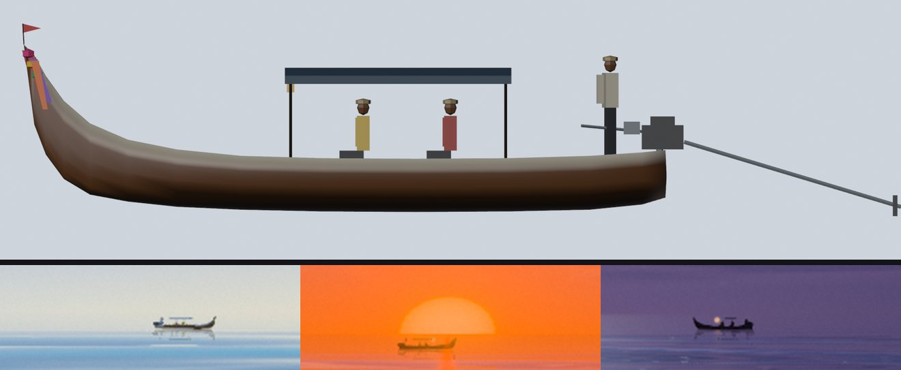

**The model.** `scripts/blender/sunset_longtail.py` builds it in Blender 5.2 and writes
`src/themes/sunset/sunset-longtail-model.js` (1,178 triangles, about 43 KB in the theme's own
chunk). It is built for the silhouette that names a longtail at 40–60 px: a long, narrow teak hull
whose bow sweeps up into a tall prow wrapped in coloured garlands and ribbons with a pennant on its
tip, a faded tarp canopy on four poles, the boatman standing at the stern with the tiller, two
passengers under the canopy, a car engine on its pivot with the long propeller shaft angled down
astern into the water, and a lantern on the canopy's front bar. Real size, 11 m from the transom
to the prow's tip; the waterline is y = 0. Each part is its own Blender object; the export reads
them back evaluated and triangulated, flat for boxes and posts, smooth for the hull, with a linear
paint colour and a lantern flag per vertex. The rebuild is byte for byte.

    blender --background --factory-startup --python scripts/blender/sunset_longtail.py -- \
        --out src/themes/sunset/sunset-longtail-model.js [--preview <dir>]

From a live Blender (the MCP): `runpy.run_path("scripts/blender/sunset_longtail.py",
run_name="sunset_longtail")["show"]()` builds the same boat in a scene of its own
("SunsetLongtail") and leaves every other scene alone. `--preview` renders side, three-quarter,
front, top and a silhouette against an evening sky with Workbench (headless here through Mesa's
llvmpipe EGL).

**The passages** (`sunset-boat.js`, `BOAT`). The first comes 60–150 s after a start (a seek, a
rebuild); after a passage leaves, the next sets out 180–420 s later. Each runs along a course
260–420 m out, turned up to 9° off square to the view, at 4.6–6.6 m/s, from 7° past one edge of
the frame to 7° past the other: about a minute and a half to two minutes across a wide frame,
less across a phone's. Left to right or right to left at random. The plan comes from a generator
of the boat's own, restarted at every seek, so a seek to a time always shows the same boat (or
none). It rides the same swell the lanterns do (three quarters of `seaHeight` under it, pitch and
roll from `seaSlope` along and across its course).

**The light** is the gulls': the sky the paint faces and the sea's light from below, the sun or
the moon on the faces turned to it, a silhouette against a low light, a thin rim close to the
light, and the far sea's own haze between the eye and the boat. The lantern's glass is lit from
dusk (`lampForSun`: lit below the horizon, out from 5° up); its light joins the glows (a few
pixels across however far away) and the lamps the sea mirrors.

**The mirror.** This far out the sea is nearly a mirror of the pale low sky, and the first
captures showed a boat hanging in that sky. So the boat is drawn a second time, mirrored about the
water under it (a child mesh whose matrix is `boat⁻¹ · mirror · boat`): only what stands above the
water, tinted, broken into bands by the ripples and fading downward (`MIRROR`). The sea's surface
lies in front of the mirrored hull, so the mirror's vertex stage draws it at 45 % of its distance
along the same lines of sight: the same place on screen, in front of the far water it sits on and
still behind any lantern nearer than it.

**Reproduce.** Playground: `?effect=sunset&t=30&quality=High&board=1&hour=18&boat=1&boatAge=26&boatRange=300`
(`boat=-1` right to left; `boatSlant=<deg>`, `boatSpeed=<m/s>`); `hour=12` for noon,
`hour=19.3` for dusk with the lantern lit. `parts=…,boat` draws it in a part capture.

**Verification (2026-11-06, on main fdbea971 plus this change).**

- **Playground** (headless Chromium in a cloud session, WebGPU on SwiftShader at High; the
  chrome-devtools MCP was not available): noon, sunset and dusk at 1600 × 900, Low on the WebGL2
  backend at golden hour, and portrait (430 × 850) at the afterglow; no console warning or error.
- **Unit tests**: `tests/unit/sunset-boat.test.js` (new): the model as Blender wrote it (real
  size, waterline, hull facing outward, only the lantern's glass lit); a passage entering and
  leaving past the frame's edges at its range, its bow along its course, always under the horizon;
  the timing over an hour (first passage, gaps, never two at once, on the water a fifth to a third
  of the time); the same boat after a seek; riding the swell; the lantern from dusk; the mirror
  mirrored about the water; in the world, sent across, in the picture just under the horizon,
  left out by a part capture. The shader gate builds both materials for WGSL and GLSL with the rest
  of the world.
- **Cost by construction**: two draws of 1,178 triangles while a boat is in sight (the boat and
  its mirror), none otherwise; one lantern glow and one mirrored lamp at night.

Not done: no wake (at this range it would be a pixel or two), no real-game or real-GPU capture
here, and a rebuild in place (a quality change) starts the boat's evening over, so a boat
mid-passage leaves the picture then.

## The living sea (2026-11-17)

On `feature/sunset-living-sea`. The owner asked for a full audit of the theme and then to raise it
to "one of the most visually stunning themes in my game: a true graphical masterpiece": the sun,
the moon, the sky and clouds, the boat, the water, the horizon and landscape, colour, light and
reflections, every event with an effect of its own and the biggest the most spectacular, a picture
that changes over time, and play that stays smooth and easy to read.

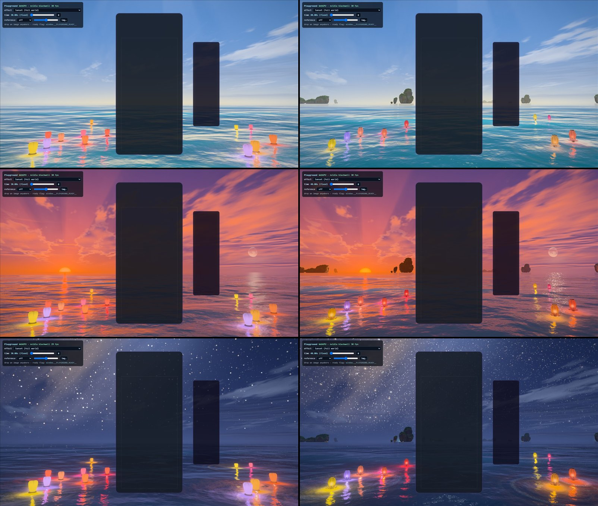

### What the audit found

Captured before anything was changed: fifteen hours of the day and sixteen events at 1600 × 900,
High, WebGPU.

| Part | What was weak |
| --- | --- |
| The sun | The theme's own subject read as a pale peach blob with a soft edge, lower in contrast than the sky round it, on a thin stem of light at sunset; a white disc ringed orange by day. |
| The horizon | Empty at every hour: no land anywhere, nothing between the eye and the edge of the world. |
| The stars | Five-pixel discs, all the same size, out already in the afterglow. |
| Noon and night | The two dullest hours: a blue sky with a few streaks and a turquoise sheet; a dark sea under dots. The night is two fifths of the day's clock. |
| The sea | Smooth paint: the roads of the sun and the moon had no sparkle in them. |
| The boat | A 20-pixel speck 260 to 420 m out, once every three to seven minutes, with no wake. |
| The lantern | A tulip-shaped lathe on a disc, flat and toy-like, the nearest thing to the eye. |
| Variety | The day turned, but the weather never did: the same cloud and the same sea every evening, and the same moon every night. |
| Clears | One, two and three lines differed only in how many lanterns lifted, and a lantern lifts slowly: a second after a clear nothing on screen had changed. |
| Four lines, the crown | "The sky on fire" was a shift of colour; the green flash is a few pixels; at noon and at midnight, with the sun and the moon out of the picture, the halos round them were not seen at all. |
| Hard drop | Its drops were two pixels across. |
| Level up | The day runs on an eighth of itself: seen only by who is looking at the sky. |

### The sun, the moon and the stars

- **The tone curve burns out channel by channel** (`sunsetFilmic`). The hue-preserving shoulder is
  as it was; above it the hottest values now saturate red first, then green, then blue, as film
  does, so a low sun's heart goes from ember to gold to white. The old path went straight to white
  and took both the disc and its road on the water through pink. Nothing under the knee changes.
- **The disc**: a limb a pixel and a half wide whatever the lens; limb darkening by how low the sun
  stands (strong and red on the horizon, slight at noon, where a strong one ringed a white sun
  orange); less power on the horizon (9 → 6), so the limb stays ember and only the heart goes gold.
- **The mirage**: under a line a fifth of a degree over the horizon the low sun's image is turned
  over, so its lower limb comes down to meet a second limb rising from the sea and the two join in
  a foot before the disc goes under (the omega of a sunset over warm water).
- **A pillar of light** stands over the sun (the moon by night) for three lines and more.
- **The moon is a different moon each night**: the gibbous moon the theme opens on, then one near
  full, a half moon, a crescent with the earth's light on its dark side, and round again
  (`MOON_PHASES`, `moonPhaseAt`). It changes at noon, under the sea. The light it gives the sea and
  the air follows how much of it is lit, so a crescent night is darker and has more stars in it.
- **Stars are points**: sized in pixels, not in lattice cells, in three densities with brightness
  dealt steeply: a handful of bright ones, some hundreds the eye can count, a dust.
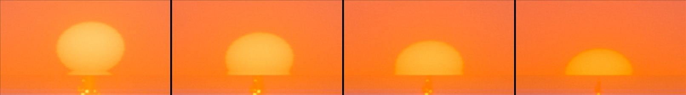

- **Shooting stars** (`sunset-meteors.js`): one falls now and then in a dark sky by itself, and a
  crown at night brings a shower of thirteen. One instanced draw of ribbons that face the lens.

### The weather

`sunset-weather.js`: a second clock beside the day's. Five skies, 94 s each (resting 40 % of it,
then melting into the next), 470 s round against the day's 565 s, so the same hour meets a
different sky each time it comes:

| Sky | What it is |
| --- | --- |
| trade | The sky the theme ships: a broken deck running in toward the sunset, cirrus over it. Every number neutral. |
| towers | Heaps of cumulus standing along the horizon on flat bases (`o.towers` in `skyColour`: a height field over the bearing, lit on the side that faces the key, dark with a burning edge toward a low light, their feet in the haze). They stand back from where the sky sets and rises. With the light low, lightning flickers inside a far one now and then, without a sound (never under reduced motion; scaled by the flash setting). |
| mackerel | A fuller deck broken into small cells, row on row: the widest fire at sunset; a fresher wind on the water. |
| clear | Hardly a cloud, the air washed clean (the haze reaches 1.8 times as far), the sea near glass: the sharpest sun, the most stars. |
| veil | High thin cloud: the light spreads wide round the sun and the moon and a 22-degree ring stands round them by itself, the distance goes soft, the stars are few. |

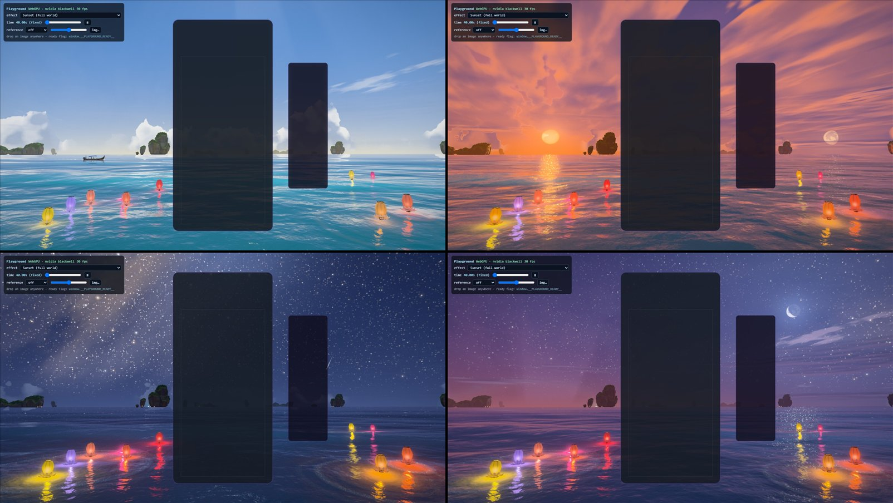

Now and then (`NowAndThen`, dealt from a seed by number, so a seek lands on the same ones): a
shooting star, the lightning, and by day a few gulls crossing.

### The sea

- **Glitter.** The roads of the sun, the moon and every wave of light are no longer an even sheen:
  62 % of their light is sparks a pixel or two across, each flashing on a beat of its own. They lie
  on a lattice of the eye's own angles (a bearing and a dip), so they are the same size on screen
  near the eye and at the horizon; the lobe still says where the road lies and the chop still
  breaks it.
- **The sea's own fire.** Once the sky is dark, water that is stirred answers with a cold cyan
  light: the ring a lantern lands in, and every wave a clear sends out (`U.seaFire`).
- **The weather's hand**: the wind's chop and how far the eye sees through the air are uniforms
  now (`U.chop`, `U.hazeReach`).
- **The islands are mirrored in it** (below).

### The horizon: islands, and the night's boats

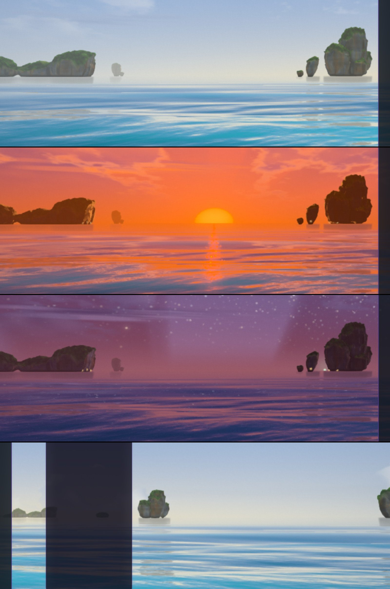

Fourteen limestone karst islands stand along the horizon, from four shapes modelled in Blender by
`scripts/blender/sunset_islands.py` (it writes `sunset-islands-model.js`: 8,746 triangles, 132 KB):
a cluster of top-heavy towers 131 m high with clefts and sea caves, a ridge of three humps 447 m
long with one sheer end, a needle of 44 m with a rock at its foot, and a low islet. Each is an
implicit solid (lumps, tiers, flutes, an eight-metre notch at the waterline) with a skin of jungle
on what faces up, meshed, decimated, and painted per vertex with limestone, stain or jungle times
an occlusion traced in Blender. Used at different turns and sizes the four give fourteen
silhouettes, 1.3 to 8 km out, the nearest 93 px tall.

They stand in two groups that turn with the places the sky sets and rises (`sunset-islands.js`),
so both gates stay open sea whatever the layout: the sun goes down into the water between the long
ridge and the tall cluster, and nothing stands within 6.9 degrees of either gate (an island that
would stand in the other gate when the two come close is left out). The light is the boat's: the
sky the face looks at, the sea's light from below, the key on the faces turned to it, a cut-out
against a low light. Rock is shaded by its facets, the jungle lets the key through, and facets
seen edge-on burn near the light. One material, two draws.

**In the water.** The part bakes a skyline (for each bearing from each gate, how high the land
stands and how far off: a 512 × 2 texture), and the sea reads it along its mirror ray: where the
ray comes down on land the water shows the island's dark body, paled by the air between, darkest
at the island's foot and thinning toward its mirrored top. And the far sea is no longer the colour
of the sky it meets: rough water seen low mirrors the sky from higher up than a mirror would
(`TUNE.roughLift`), so the sea stands a shade darker than the horizon and the islands stand on it.

**Lamps.** From dusk the people who live under the near islands light their lamps: twelve warm
points at the water's edge (the model carries the places).

Far out at night six fishing boats work with their lamps over the side: a hard green-white point
each and the haze it lights (`NIGHT_BOATS`, two soft lights a boat, placed off the gates).

### The boat

It passes 110 to 250 m out (it was 260 to 420), every two to four minutes (three to seven), so it
is a boat with people in it: 60 to 100 px long. Spray trails astern of it and a wave stands at its
bow (soft lights in the sky's colour: a wake drawn ON the sea is a fifth of a pixel tall from an
eye 3 m up). It rides the sea as the mesh draws it out there (`seaMeshHeight`: the far rings leave
the short wave trains out, and a boat on the full swell stood half a metre off the drawn water),
and its mirror image is lit as the boat is.

### The lantern

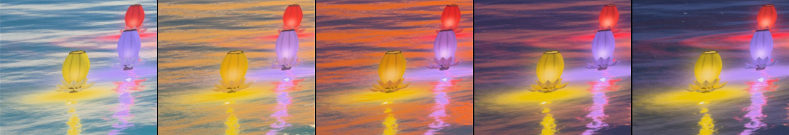

The tulip-shaped lathe became a lotus lantern, modelled in Blender by
`scripts/blender/sunset_lantern.py` (it writes `sunset-lantern-model.js`: 680 triangles, 19 KB): a
small dark float sitting in the water, two rings of eight folded paper petals (the outer open on
the water, the inner cupped up, each creased down its middle and none quite like the next), and a
bud of eight paper gores swelling between bamboo ribs, hooped at mouth and crown, open at the top.
0.66 m tall, 0.40 m across the bud, 0.64 m across the petals. Per vertex Blender's normal and one
RGBA8: how far up, baked occlusion, the dark lines, the part.

The material is paper in the hour's light (the sky by the normal, the sea from below, the key on
the faces turned to it and through the paper on the side turned away, occlusion in the folds) and
a flame behind paper at once (the piece's colour most where the flame stands, a hot core found
from the line of sight to the flame so it sits inside the bud, ribs dark against it, the inner
wall lit through the open top, petals lit on the faces turned to the flame). How much of the flame
shows comes from the hour's ambient light: a lantern at noon is a coloured paper thing in
sunlight, at night a light. A seed gives each lantern its size, build, lean and paper.

In the world the lantern is drawn 1.18 times life size, its halo is fitted to the bud (0.5 m
afloat, 0.62 m in the air) and both the halo and the light the sea mirrors follow how brightly a
flame shows against the hour (the stations' `lantern`, which nothing read before): round a paper
lantern in full sun a glow was the least believable thing in the picture.

### Every play, an effect of its own

What was there stays (the lantern a lock sets down, the lanterns a clear lifts, the halo, the green
flash, the sky's fire and the gulls of a chain, the day a level runs on). What is new is seen
wherever the sun and the moon are, because it is on the sea and along the horizon:

| Play | What it adds |
| --- | --- |
| Hard drop | A jet straight up over the crown of drops, the drops large enough to see, and a second ring behind the first. |
| One line | **A wave of light** runs out over the whole sea from under the board to the horizon: sheen and sparks in the hour's own light (gold toward sunset, near white under a high sun, the sea's cyan fire by night). It gathers speed as it goes (`waveReach`), so it crosses the near water and the far water at one pace on screen and is at the horizon in four seconds. |
| Two, three lines | A stronger wave each (also with every clear a chain holds and every wave of a cascade); from three lines **a pillar of light** over the sun or the moon. |
| Twist | **A whirl of light** winds round where its lantern rose, in that lantern's colour, turning the way the lantern turns. One that clears nothing still turns the water. |
| Back-to-back | **A second wave** on the heels of the first (and the sun dogs, as before). |
| Four lines | Two waves; **the rays are thrown wide** across the sky; and **the far shore answers**: lanterns are let go all along the horizon, the letting-go running along the shore from where the sun sets, most of them candle gold and some in the colours of the lanterns that just rose. They climb, the wind takes them, and the horizon glows gold under them (`sendRelease`, 70 to 340 by tier). |
| Perfect clear | The crown on all of it: a larger letting-go, the pillar, the great halo and the whole flock, and by night **a shower of shooting stars**. |
| Level up | **The horizon is lit from end to end** in the hour's brightest light as the day runs on, and every flame afloat leaps. |

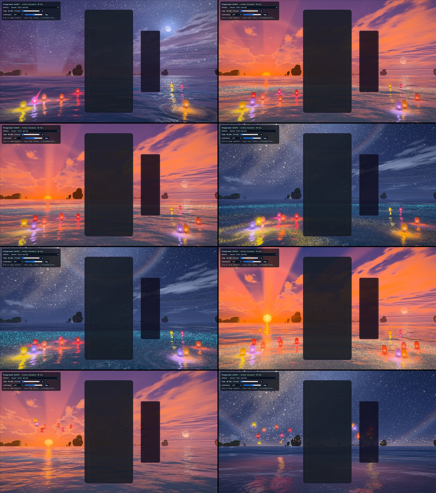

### The icon

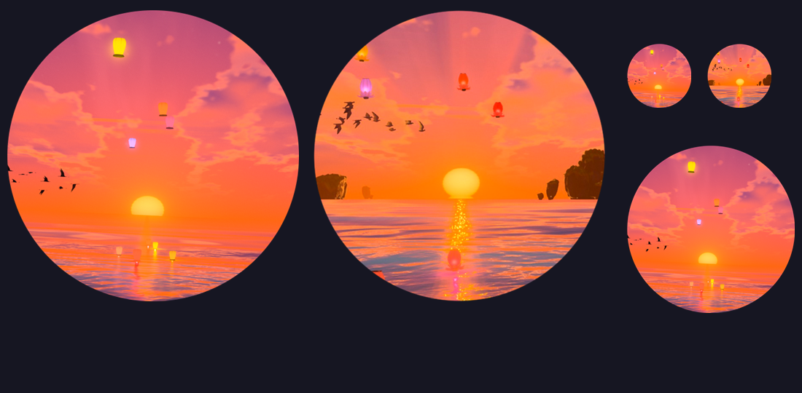

Re-baked from the new world (this supersedes the recipe under "Reproduce" at the top): the level
game camera with no board, so the horizon is level, cropped square round the place the sun sets.
Playground at 2400 × 1350: `?effect=sunset&quality=Ultra&t=40&hour=17.9&combo=5&locks=12&lift=5&liftAge=9&flock=13&flockAge=10`,
the square 800 px wide from (330, 330), then the middle 86 % of that scaled to a 512 px disc with
saturation × 1.1 and contrast × 1.05. The sun on the water with its glittering road, the long ridge
and the tall cluster either side of it, lanterns rising, a skein of gulls.

### Cost

GPU time a frame (timestamp queries, the playground's live demo loop at 1920 × 1080, High, capped
at 30 fps, the RTX 5080 Laptop, two rounds interleaved with the untouched base): 0.63 ms before,
0.80 to 0.84 ms by day and 0.84 to 0.96 ms at night after. CPU time a frame unchanged (1.3 to 1.4 ms).

### Reproduce

Playground additions: `weather=trade|towers|mackerel|clear|veil` (or a phase number), `moon=<deg>`,
`meteor=<s>`, `shower=<s>`, `b2b=1`, `event=spin`, `parts=…,islands,meteors`.

### Verification (2026-11-17, on main 46339ef5 plus this pass)

- **Playground** (private headless Chrome on the RTX 5080 Laptop, WebGPU, High, 1600 × 900, every
  URL capped at 30 fps): every hour and every weather, each event at several ages, the moon's four
  phases, the boat near and far, the islands' waterline and the nearest lanterns enlarged, an
  eight-frame strip of a perfect clear. Also the WebGL2 backend at High and Low, Minimal, Medium
  and Ultra, a 430 × 932 portrait frame and a frame with no board. No console warning or error in
  any of them.
- **Real game** (the dev server in headless Chrome, WebGPU, capped at 30 fps), twice, the second
  time with everything in: a single-player run on Sunset, twelve real hard drops with real key
  presses, then a chain of seven clears, a twist, four lines, a perfect clear and a level through
  the game's own event bus. No warning or error that names the theme or the renderer. The scripted
  drops top the board out before the end, so the last two frames are the game-over screen.
- **Unit tests**: 231 in 14 Sunset files, all passing. New: `sunset-weather` (the skies, their clock
  beside the day's, the things that happen by themselves), `sunset-events` (the wave, the whirl,
  the ladder from one line to the crown, the far shore's lanterns, the weather in the world, the
  shooting stars, the night boats, the boat's spray, the moon from night to night, the sea as its
  mesh draws it), `sunset-islands` and `sunset-lantern` (the models as Blender wrote them, the
  gates clear at every vertex, the skyline against a plane cut of the placed meshes, the sun and
  the moon clear of all land while they are low). The shader gate builds every material, the
  islands' and the meteors' among them, for WGSL and GLSL at High and Minimal, under budget.
- **Gates**: typecheck, the ts and lint ratchets at baseline, architecture fitness, dependency
  boundaries, the theme lifecycle audit, palette, perf budgets, the build with its boot-closure
  guard, the wording gate on the built files, pages artifact and release gates: all pass. The
  theme's chunk is 362 KB (177 KB gzipped) with the generated islands and lantern in it. Not run:
  the full suite.

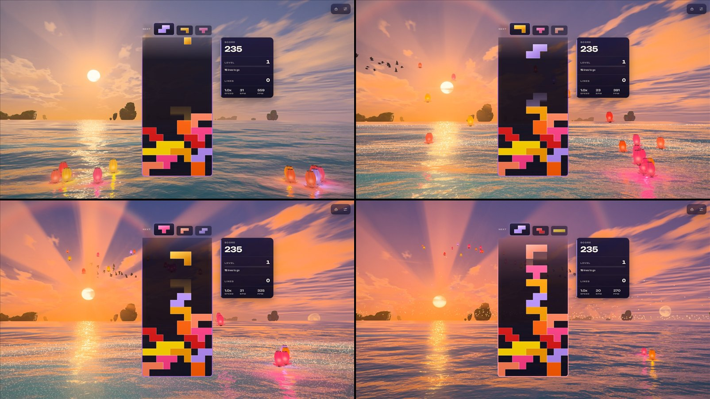

Not done, and the lead's own doubts: nobody has watched it move except through strips of stills,
so whether the sparks on the water and the edge-lit facets of the islands shimmer under the
camera's sway on tiers without antialiasing is unseen; no integrated-GPU or phone reading and no
uncapped frame-rate measurement; multiplayer, Infinity and meditation layouts not captured; in
portrait with a board every island is behind the card; the islands drop out at once, not eased,
in the narrow window where the two gates come close; a twist's whirl reads as a field of sparks
in the lantern's colour more than as arms; `docs/theme-screenshots/sunset.png` is the old look. The five skies and their order, the four moons, the karst islands, the lotus
lantern, and what each play adds are the session's choices.

## Calmer water, living clouds (2026-11-17, evening)

On `feature/sunset-calmer-sea`. After playing the living sea the owner said: "The distant clouds
look too 'static' and the glitter or grain on the water while playing and making effects is too
much!!!"

**The water.** The sparks of the glitter lattice were in every effect that spreads over the sea
(the wave of light a clear sends out and its wake, the rings by night), so each clear filled the
sea with flashing single pixels: in play, grain. Now no effect carries sparks: the wave is a soft
band of light that the water catches as it catches the sky (weighted by its Fresnel, so it runs
over the crests and the far sea), its wake a faint afterglow, and by night a fainter glow line in
the sea's cold colour; the rings by night glow instead of sparkling, and a wave lifts the sun's road
a third as much. The roads of the sun and the moon still twinkle, but sparsely and slowly (larger
cells, longer and softer twinkles, 24 % of the road's light instead of 62 %). Measured as the share
of water pixels standing out from their neighbourhood in one frame: during effects 1.8–7.2 %
before, 0.8–1.7 % after, against 0.7–1.3 % for the sea at rest.

**The clouds.** The far clouds only slid with the wind, and near the horizon a slide is all but
invisible. Now the layers of the field move at speeds of their own, so clouds change shape at any
distance: the deck's clouds form and melt as they stream in (a cloud in about 45 s), the towers'
heads drift along the horizon over their feet and boil upward, the bars drift and change. All on
the clouds' own clock, which runs faster as play heats; no extra texture reads. The towers also no
longer end in straight walls either side of the sun: they sink and thin away toward it.

Verified in the playground on WebGPU (sunset, noon, night; the clear, four lines and the twist;
20 s strips of the horizon, living against frozen), WebGL2 at High and Low, Minimal and portrait;
consoles clean; the 231 Sunset tests pass.
