# Synthwave Sunset — the pleasure pier (visual overhaul, 2026-10-20)

**Status: shipped (branch `feature/synthwave-sunset-overhaul`, merged to `main` 2026-10-20; a
second pass on the air, the shore and the evening, `feature/synthwave-sunset-second-pass`,
2026-10-21: see [Second pass](#second-pass-2026-10-21-the-air-the-shore-the-evening); a fourth,
2026-11-17, on branch `feature/synthwave-sunset-masterpiece`: see
[Fourth pass](#fourth-pass-2026-11-17-an-evening-that-never-stands-still-an-instrument-for-every-event),
which supersedes the event table and the evening described below; a fifth, the same day, on
`feature/synthwave-strollers`: [the people on the pier](#fifth-pass-2026-11-17-the-people-on-the-pier),
which replaces the strollers described in the fourth). A
record of what was built and how it was checked — not a backlog.** Replaces the outrun picture (a slit sun behind wireframe mountains, flat box
buildings, palm silhouettes and a scrolling neon grid), which showed nearly the same thing as Neon
Dusk, the orb before it, with a retro seaside at dusk. The id, the name, the song and the Odyssey
orb stay: a rebuild in place, so no save migration. Everything is on three 0.186.1 and shared by
the game and the playground.

| Before | After (High, native WebGPU) |
| --- | --- |
| 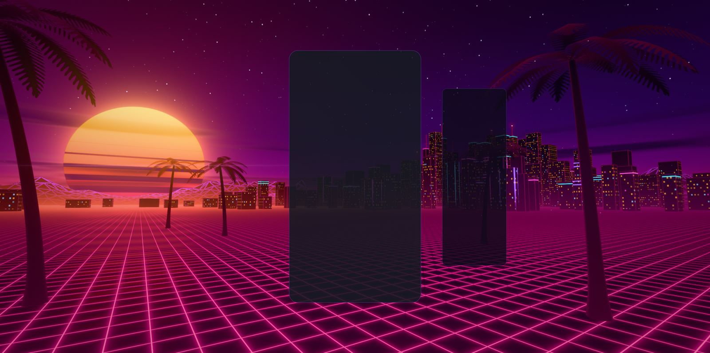 | 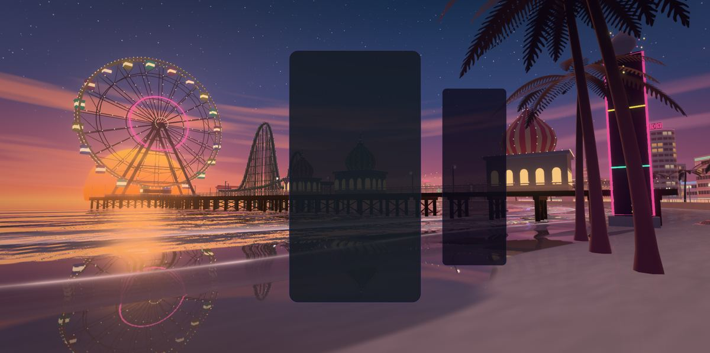 |
| 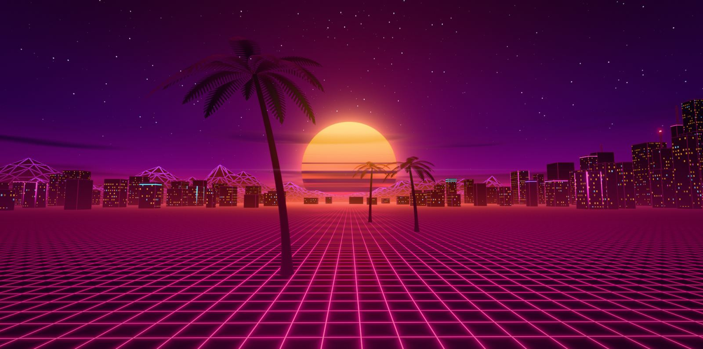 | 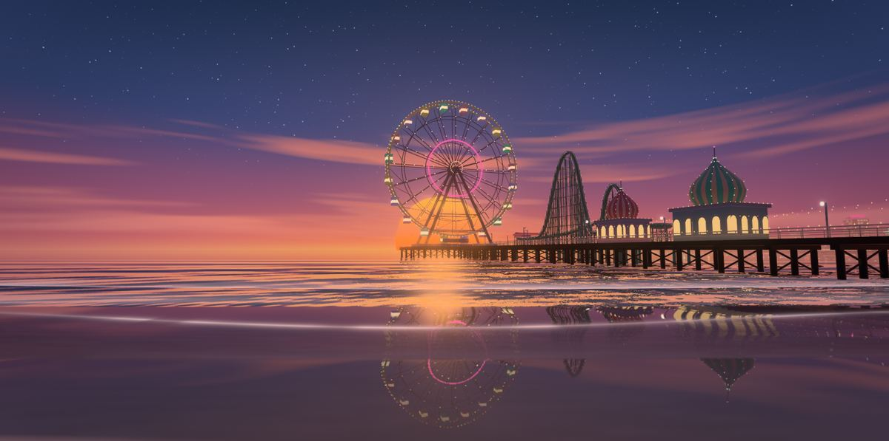 |

## Why this setting

The concept page offered three settings (a neon pier, a vaporwave mall, a hillside pool above a
city); the user chose the pier. It keeps the name's promise (a synthwave sunset) but puts it in a
place: nothing else in the fleet has a ferris wheel, a pier, a coaster or fireworks (checked
against `docs/theme-concepts/reference/catalog.md`). Its neighbours stay clear: Neon Dusk (outrun
sun, neon ridges, glass grid floor), Chromadelic Highway (no road, no night drive) and Neon District
(no city street: the town here is far across the bay). Synthwave Sunset is orb 60, the last of the
campaign ("Electric Nights", the duel with the rival Neon), and comes right after Neon District:
after the city's streets the Odyssey ends at the sea.

Two near neighbours were watched throughout: Luminous Tides (orb 7, a wild night beach whose surf
glows cyan) and Sunset (orb 27, the open sea at golden hour). This beach is at dusk, not night, its
surf is white water lit by the sky (it never glows), and its hero is something built.

## What the player sees

The eye stands on wet sand at the waterline. In the free space left of the board the sun, a deep
orange, sinks into the sea behind a ferris wheel at the end of a long timber pier, so it shows
through the spokes. The wheel turns slowly: bulb-lit rims, a pink neon inner ring, pastel cabins
that hang upright. It stands on the pier head, a T-shaped dock turned square to the pier, on its
own piles. The pier runs from the right edge out to it on bents of piles with cross-bracing, white
railings strung with bulbs, lamp posts with garlands between them, onion-dome pavilions with lit
arched windows, a neon pylon sign at its land end, and a wooden coaster on a trestle beside the
deck, just left of the board: one closed circuit (station, lift hill, drop, camelback, a turn at
the far end, a low return line and a turn back into the station) on its own deck and piles. Round the bay on the right a
promenade with palms and globe lamps curves away past a beachfront of Miami Art Deco hotels to a
dark headland with house lights. Three tall palms frame the right edge.

The hotels come in three kinds, in pastel stucco (flamingo, mint, lemon, lilac, peach, white, aqua)
with white trim. Streamline hotels turn the corner toward the pier in a quarter round, with ribbon
windows under eyebrow ledges wrapping the curve, a drum and a mast on the corner and a vertical
neon blade sign. Resort towers have round ends, a balcony on every floor and a neon sign on struts
at the roof corner, turned to the beach. Deco hotels have pilasters that rise past the parapet in
steps and a ziggurat crown with a spire. The signs spell words (HOTEL, LIDO, TIDES, SURF, CORAL,
ROXY, ISLE, ASTOR) in 3 × 5 neon letters; neon runs along the rooflines and spills down the
parapets; lobbies glow under canopies with a neon edge; windows are lit room by room (warm, white,
rose, the blue of a television) and more come on as the evening deepens. Low shops fill the gaps
and a second row of plainer blocks stands behind, so the beachfront reads as a town. The sun low
over the sea warms the fronts that face it, and the street lamps wash the lower floors.

| | |
| --- | --- |
| 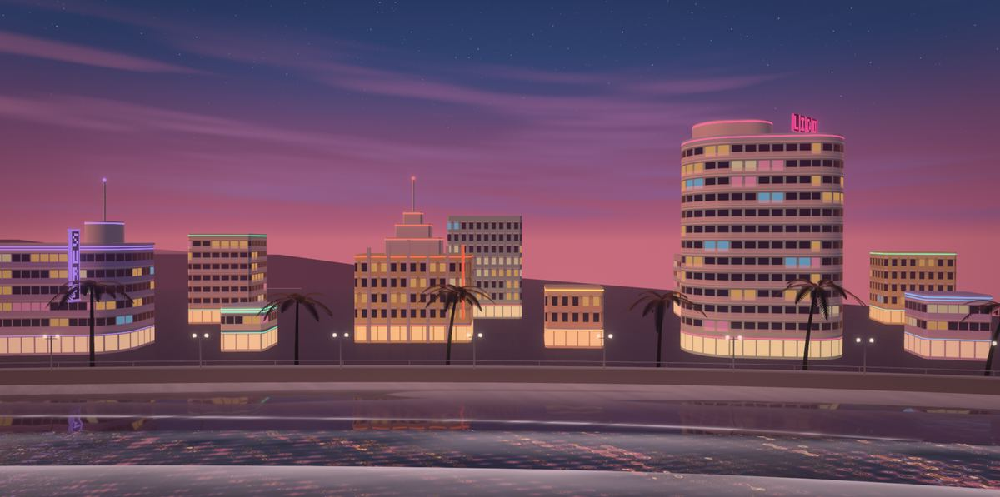 | 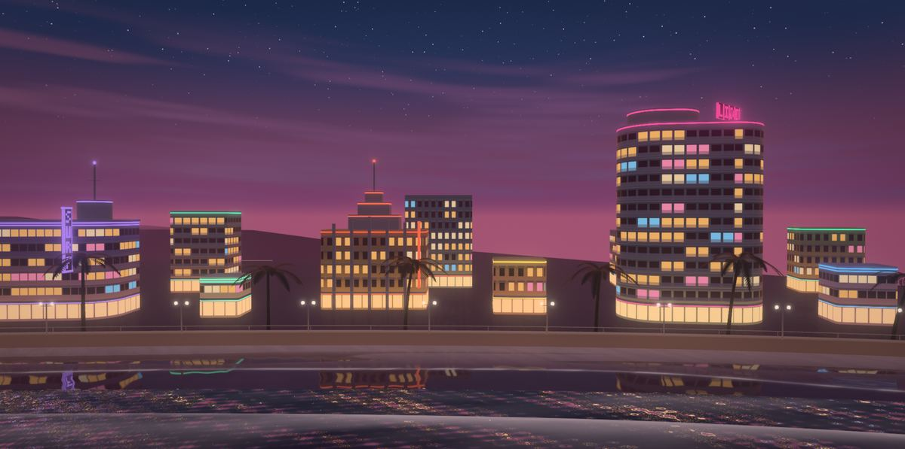 |

The sky runs tangerine and gold on the horizon under the sun, coral and dusty rose, mauve, then
teal-indigo overhead with the first stars; long cirrus is lit pink from below. The sea carries a
road of light under the sun and mirrors the wheel, the pier and the town; the surf rolls in as
white water; each breaker runs up the beach as a thin sheet with a foam edge and drains, leaving
the sand glossy, and the wet sand smears the lights into long streaks.

The evening moves. In the menus it rests (`DUSK.rest`); while a game is played it deepens with the
clock and steps on each level, so over a duel the sun sets into the sea, the sky darkens to its
afterglow and the pier's lights come on from the land end out to the wheel.

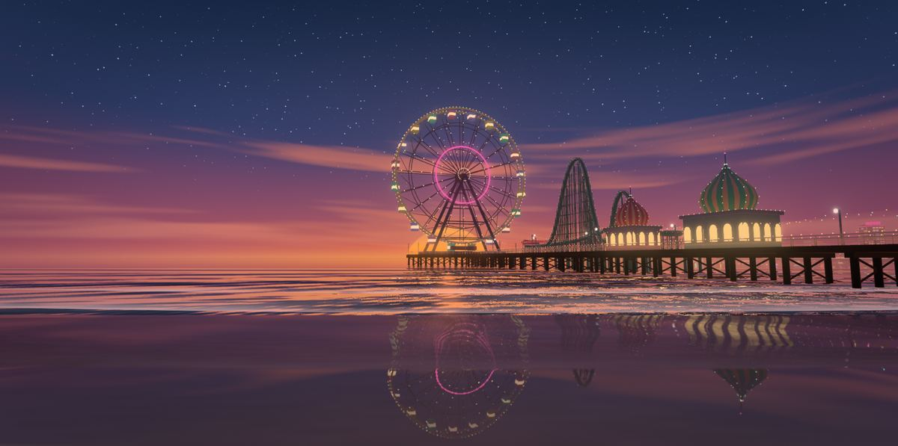
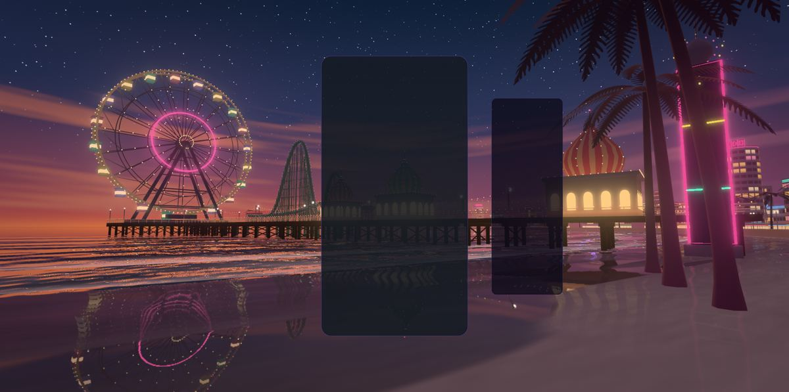

## How the seaside answers the game

| Event | What happens |
| --- | --- |
| Lock | Two bands of the piece's colour leave the bottom of the wheel (left of it for the left columns, right for the right) and run round both rims to meet at the top in about 1.25 s, lighting the rim tube itself as well as its bulbs. |
| Line clear | One firework shell per line rises from a barge off the pier and bursts in the free sky above and left of the wheel; the first shell is the locking piece's colour. The sky glows round each burst (the sea mirrors that glow). |
| Four lines | A finale volley (three to eight shells by tier) and a gold willow. |
| Chain (true combo) | The coaster climbs one notch of the lift hill per link, and its beam fills lemon from the lift's foot up to the train: a meter that can be counted. A chain of three or more that breaks lets the train go: a tyre drive takes it over the crest and it rides the circuit on its own speed (energy from the crest's height) with a trail of mint light behind it, brakes on the return line and rolls round the last turn into the station, once round. A chain of one or two rolls back down the lift. |
| Cascade (bus `COMBO`) | Nothing of its own: every wave's `LINE_CLEAR` already fires its own shells. |
| Level up | The evening steps on (`DUSK.levelStep`), the wheel's neon ring turns from pink to mint (or back), two shells. |

Events are staged as they arrive and handed to the world once at the top of the next frame
(`flushEvents`). The true combo is `ComboTracker`'s; because it only resets on the NEXT lock, a
lock with no clear in its own tick delivers `onChain(0)` itself (lock and clear are emitted in one
synchronous tick), so the coaster lets go on the breaking lock. Only the local board drives the
world (`player` undefined or 1). Everything is gated by Settings > Combo effects in background as
before.

| | |
| --- | --- |
| 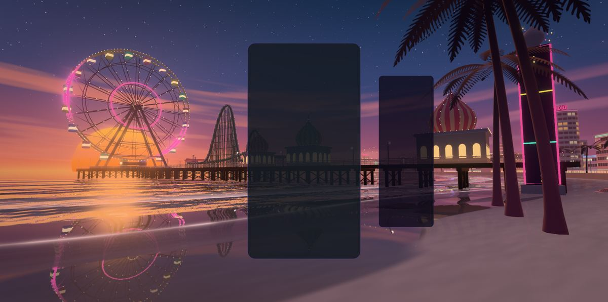 | 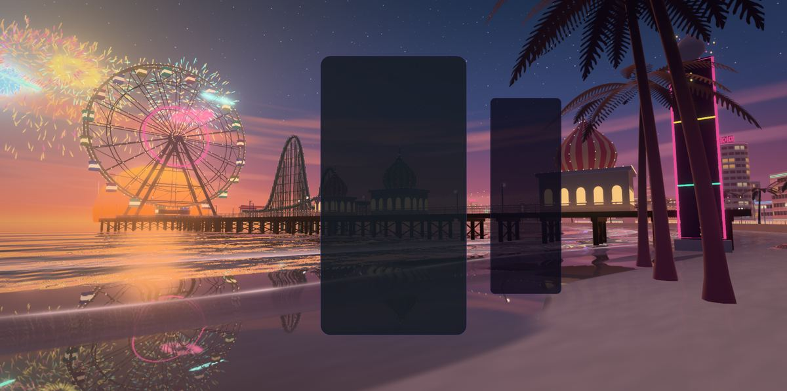 |
| 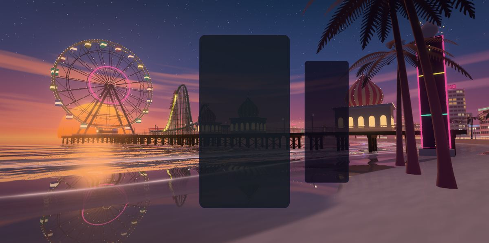 | 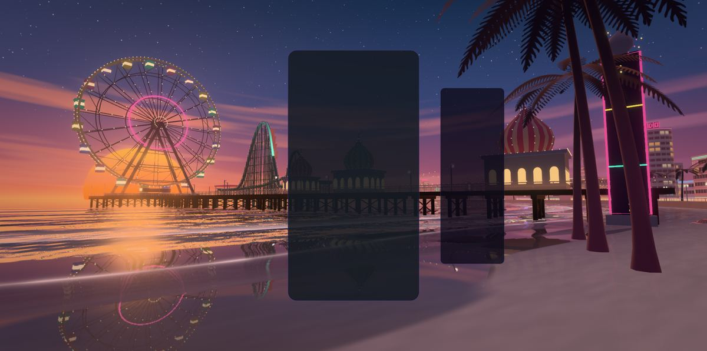 |

## How it is built

### Runtime modules (`src/themes/synthwave-sunset/`)

| File | What it holds |
| --- | --- |
| `-theme.js` | The lifecycle shell (renderer, post, layout watch, event staging, DRS). Clears to transparent: the reflection pass composites by alpha and the sky covers the frame. |
| `-world.js` | Builds the parts, solves the composition (unchanged: the camera yaws so the sun sits in the free zone left of the board), the camera, the evening, the events, the coaster's state. |
| `-tsl.js` | Rig, sun and shore constants; hashes and value noise (laid-out, pure); the sky as ONE function of a direction (`swSky`). |
| `-layout.js` | Where the wheel, the pier and its T-head stand; the pier's frame. |
| `-sky.js` | The dome: `swSky` along the view ray, shooting stars. |
| `-sea.js` | One plane for sea, surf, swash and sand; the mirror. |
| `-wheel.js` | The wheel's structure (one draw, turned in the vertex stage) and its bulbs. |
| `-pier.js` | Deck, T-head, bents, railings, lamps, pavilions, the pylon (one draw) and the pier's bulbs. |
| `-coaster.js` | The closed circuit (a centripetal Catmull-Rom loop with two U-turns) and its marks (station, lift foot and crest, the return), track, trestle, station, the deck it stands on, the train (four instanced cars placed on the CPU), track bulbs. |
| `-promenade.js` | Seawall, railing, lamps, the headland ridge; mounts the hotels and adds their beacons to the lamp bulbs. |
| `-hotels.js` | The beachfront: streamline, resort and deco hotels, shops in the gaps and a row behind (one draw), their facade shader and the signs' 3 × 5 letters. |
| `-palms.js` | Framing palms and the promenade row (one draw). |
| `-gulls.js` | The gulls: the Blender-built model's one instanced draw, its wings folded and the bird flown, lit and mirrored in the vertex and fragment stages; the startle and the roost that move it (third pass). |
| `-gull-flight.js` | How the gulls fly (no shader code; the vertex stage's twin): the flights, the startle envelope, the roost's state machine, the wingbeat from the authored poses, the fold. |
| `assets/` | `gull.glb` (scripts/blender/synthwave_gull.py), its manifest (size, SHA-256, the rig) and attribution. |
| `-fireworks.js` | Shells, tails and bursts (one instanced draw, analytic motion) and the two sky glows. |
| `-bulbs.js` | The shared static bulb field (pier, coaster, promenade). |
| `-geo.js` | Tube, strut, box (any right-handed basis), lathe, rounded-rectangle outlines and convex prisms on them (winding set from each triangle's geometric normal); `outwardness` for winding tests. |
| `-post.js` | Bloom and the output pass (below). |
| `-tetrominos.js` | The piece palette (below). |

Retired: `-floor.js` (the grid), `-skyline.js` (wireframe mountains, box city), `-fx.js` (grid
cells, the solar burst, motes).

### Techniques (three 0.186.1)

- **One sky, three readers.** `swSky(u, dir, …)` is the whole sky (gradient by sun alignment and
  `sqrt(elevation)`, aureole, horizon band, cirrus, the disc with limb darkening, 3D-lattice stars,
  the fireworks' glows). The dome reads it along the view ray, the sea and the wet sand along their
  mirror rays, so reflections are exact and cost no pass.
- **A sea that stays stable at any distance.** Eight directional sine trains with analytic slopes,
  each faded out once its phase changes by about a radian per pixel; the slope variance it carried
  moves into the roughness of the sun's highlight. The sun on the water is a Beckmann lobe the
  size of the disc, made rougher across the line of sight than along it (a stylised, wider road of
  light: a physical lobe is a hairline at grazing angles).
- **Surf and swash on the shore's period.** Breakers roll in across the surf zone as white water
  with trailing foam broken by noise; each one that reaches the waterline runs up as a thin mirror
  sheet with a foam edge and drains (`SHORE.period`, the run-up varies per wave and along the
  beach). The whole foreground stays damp and glossy, with runnels of standing water.
- **A mirror for what stands in the scene.** A `reflector()` at 0.25 to 0.6 resolution renders only
  `MIRROR_LAYER` (the wheel, the pier, the coaster, the town, the fireworks; the camera sees the
  layer too) with alpha, and the sea lays it over its mirrored sky (`sky·(1−a)+rgb`), displaced by
  the waves on the water and smeared down the line of sight into streaks on the wet sand (five
  Gaussian taps). Every additive part writes `vec4(rgb, 0)` so it adds light without blacking out
  the mirrored sky behind its quad. Minimal has no mirror pass (sky only).
- **Bulbs.** Instanced camera-facing quads sized in metres with a floor of about 1.4 buffer pixels,
  dimmed by the area the floor added (far bulbs keep their true average). Programmes: steady
  twinkle, chases, frosted globes, sparkle, and the coaster's track (meter, ride race).
- **Facades are shaded, not modelled.** A hotel is a few convex prisms; its storeys, windows,
  eyebrow ledges, balconies, lobby and neon lines come from the arc length along its plan outline
  (a vertex attribute, so windows wrap a round corner) and the height, each band box-filtered by
  its pixel footprint (`swFilteredPulse` for repeating bands, a non-repeating twin for the neon
  lines) so a far facade settles to its average instead of shimmering. Kind, colours, style and seed
  are packed as small integers and read with `floor(x + 0.5)`, so hashes see exact values.
- **Neon letters.** Each letter of a sign is its own box whose broad faces carry the letter's
  3 × 5 bitmap as one integer (five base-8 rows) and a face coordinate per vertex; the shader
  decodes the bit under each fragment. Both faces read correctly, and far letters fade to their
  average coverage.
- **The wheel turns in the vertex stage** (`aWheel.x` picks static, turning, cabin, neon); the
  cabins move round the circle without turning; the turning parts turn their normals too.
- **Fireworks are analytic.** Per particle: spawn point and time, velocity, drag, gravity, kind;
  each star is a streak along its own on-screen motion (about a sixth of a second of exposure) with
  a white-hot start. A shell's launch velocity is solved to reach its burst point.
- **Post.** The old Khronos-neutral tone map bleached the sun to peach. The output pass now keeps
  identity up to 0.62 on the max channel, then a soft shoulder to 1, and scales the other channels
  by the same ratio (hue survives; only cores above about 4 whiten). The grade splits teal shadows
  and warm highlights by scaling only (no additive lift). The anamorphic streak is gone (an outrun
  signature).

### Gotchas found on the way (also worth knowing elsewhere)

- **A normal first read inside one branch of a `select` is zero, then NaN, in the others.** The
  coaster shaded its beam, station and rails as timber-black: three assigns `normalView` /
  `normalViewGeometry` where they are first built, so a material that builds `normalWorld` inside
  each branch of a kind select reads an unassigned zero in every branch but the first. Pin the
  normal (`normalize(normalWorld).toVar()`) before branching. The shader gate's unassigned-read
  check now covers these builtins (`tests/unit/synthwave-sunset-shaders.test.js`) and fails on the
  unpinned version.
- **`vec3(select(…))` collapses to a scalar** (known r186 trap): the output pass's highlight
  whitening failed to compile on WebGPU (`mix(vec3, f32, f32)`) while the Node gate passed. Spell
  `vec3(v, v, v)`.
- **A capture's seek runs every frame.** The playground calls `seek()` once per frame in `?t=` mode;
  the effect replays its event each time, so anything the replay accumulates (here the evening
  deepening with play) piled up until the sun set. `world.seek` puts the evening back.
- **A tonemap test on a bright light.** Judge a sun's colour with `noPost=1` against the post: the
  scene had the right orange all along.

### Quality tiers

| Tier | Clouds | Sea trains | Mirror | Promenade palms | Firework pool / finale |
| --- | --- | --- | --- | --- | --- |
| Minimal | 0 | 4, no swash | none | 6 | 900 / 3 |
| Low | 2 | 5 | 0.25 | 10 | 1400 / 4 |
| Medium | 2 | 6 | 0.35 | 14 | 2000 / 5 |
| High | 3 | 8 | 0.5 | 20 | 2600 / 6 |
| Ultra | 3 | 8 | 0.5 | 24 | 3200 / 7 |
| Extreme | 3 | 8 | 0.6 | 28 | 4000 / 8 |

Bloom and MSAA follow `POST_LOOK` as before (bloom from Medium, 4× MSAA from High).

### Accessibility

- **Reduce motion:** the camera rests (as before); the wheel turns at about 15 % (a lag, so a seek
  still lands right); the coaster runs at half speed; the finale has at most three shells and every
  burst 60 % of its stars; no ambient shooting stars.
- **Reduce flashing effects** (ADR-0021): the fireworks' sky glow keeps `REDUCED_FLASH_SCALE`
  (`flashScale()`), stars fade in over 0.35 s instead of popping, lose their white-hot start and
  their glitter flicker, and burn at 60 %. No frame-wide flash exists.

### The palette

`#FFD36E` bulb gold (I), `#4FB4FF` sky blue (O), `#FF9440` tangerine (T), `#F24FAE` flamingo (S),
`#6CF5C9` mint (Z), `#D92B4A` deep coral (J), `#8A55F5` dusk lilac (L); v2 solid tiles. The
colours were dealt to the pieces anew on 2026-11-12 (the same seven, in the pier's own order).
`npm run check:palette`: 0/7 in the usual bands, exact and widened. Under protanopia, deuteranopia and
tritanopia simulation the closest pair is gold against tangerine (deuteranopia), ΔE 14.8 with 13
points of lightness between them.

### The icon

`?icon=1` frames the wheel in front of the setting sun with the pier, the coaster's hill and the
reflection (`iconFov` 36, `iconYaw` 2.4°, `iconPitch` 4.5°). Captured at 720×720 on Ultra with
`dusk=0.28`, lifted (saturation 1.14, contrast 1.08, brightness 1.04) and baked to a 512 px circle
on a transparent ground (8-bit RGBA PNG) in an Electron canvas (this machine has no PIL for
`scripts/process_icons.py`). The public mirror is byte-identical.

## Verification

All captures are single-effect playground shots (`?effect=synthwave-sunset`, 1584×787 at pixel
ratio 1.5, mock solo board unless `board=0`), taken with a small Electron script because other
sessions held the shared browser; no full-game or fleet captures.

- Console: no WebGPU validation errors on WebGPU and on the WebGL2 backend (`forceWebGL=1`, the
  finale included).
- Tiers: Minimal draws the whole composition (sky-only mirror, no bloom).
- Phone portrait (430×932): coherent, though the wheel sits partly behind the mock board; the
  composition solver is the old one (see Known limits).
- The dock: the wheel's boarding platform stands on the T-head, which reaches past its legs
  (`pier-head-under-the-wheel.jpg`).
- The coaster: one closed circuit, seen from above the sea with the playground's inspection lens
  (`eye=95,38,-45&aim=37,12,-88&fov=42`, `coaster-circuit.jpg`); a ride captured from the game
  camera at 1.5 s (the drop, `coaster-ride.jpg`), 9 s (the trail low on the return line) and 11 s
  (rolling into the station).
- The town: the same lens from over the bay (`eye=180,22,-150&aim=300,20,-60&fov=45`) at the
  menu's evening and at `dusk=0.88`, and from above the pier (`eye=-15,30,-100&aim=38,14,-88`),
  on WebGPU and on the WebGL2 backend (the same picture, no console errors).

| | |
| --- | --- |
| 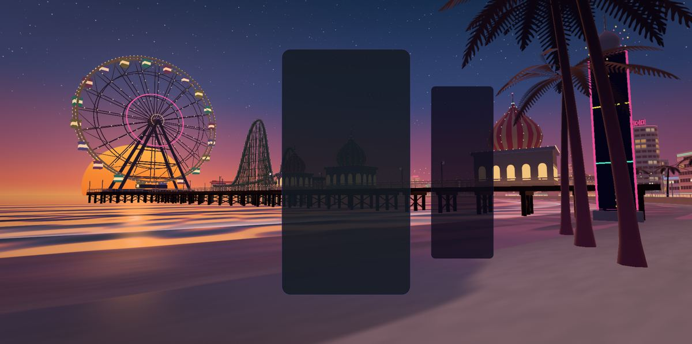 | 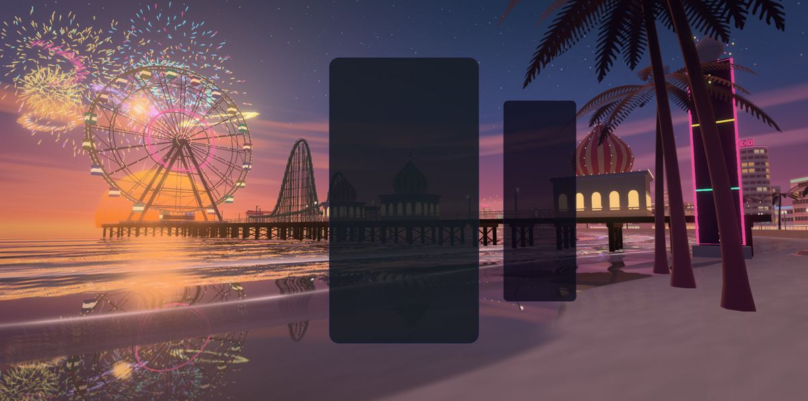 |
| 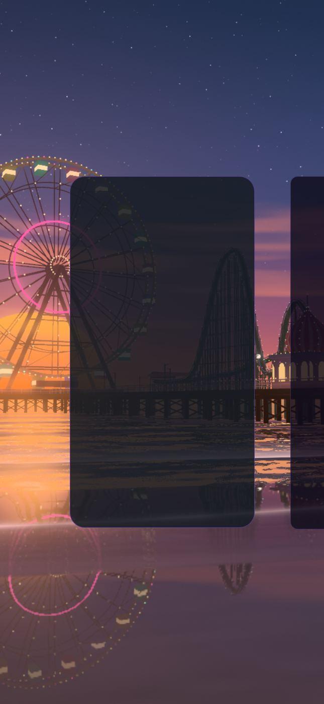 | 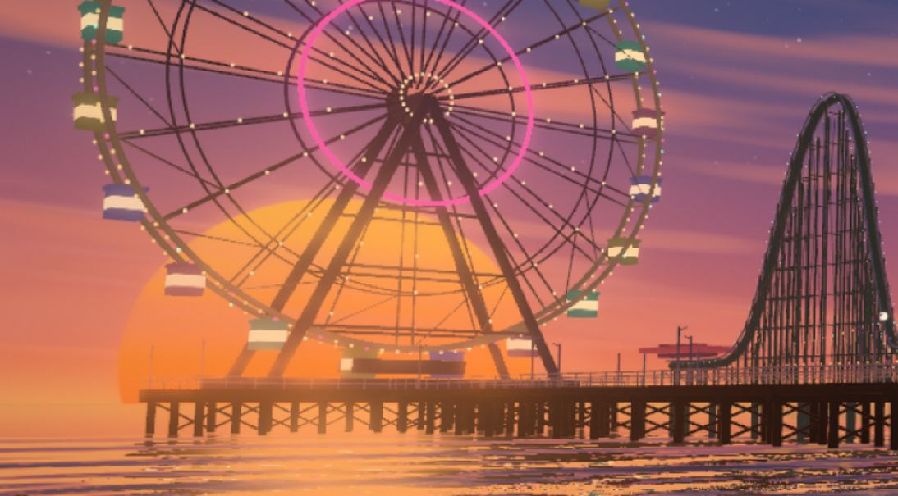 |
| 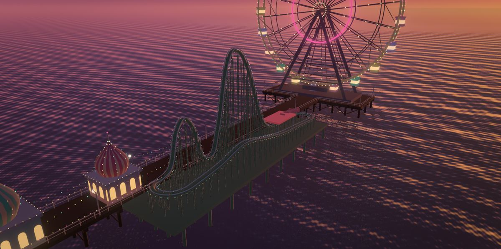 | 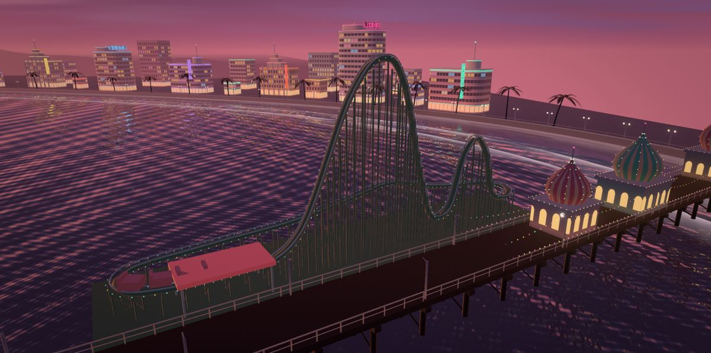 |

Tests: `tests/unit/synthwave-sunset-theme.test.js` (event staging and the true combo, the draw
list, the layout of sun, wheel and pier, solid winding, the hotels' prisms and sign letters and
that the town stays behind the seawall, the lock chase, the fireworks' placement and finale, the
coaster's notches, ride and closed circuit, the evening, Reduce flashing) and
`tests/unit/synthwave-sunset-shaders.test.js` (every material and the post output built for WGSL
and GLSL at High and Minimal, size budget, no `mx_*`, no equal-edge smoothstep, no NaN literals,
no unassigned reads including the normal builtins, pure `sw_*` helpers). Also green:
`theme-reduced-motion-batch-b`, `reduce-flashing`, `url-parameter-catalog`. The whole unit suite
ran: three failures (`game-over-modal-result-compatibility`, `odyssey-level-briefing`,
`records-view`) fail the same way on a clean `main` (8d0cd0cd) and are not this change's.

Performance (playground, High, live, GPU timestamps, 1980×985 buffer, 4× MSAA, this machine's
NVIDIA Blackwell GPU), with the town and the closed coaster: GPU p50 0.36 ms, p95 0.38 ms; CPU p50
0.6 ms; no dropped frames over 2117 (0.34 / 0.36 ms before the hotels were rebuilt).
The old theme's last record measured 0.39 ms p50 on an RTX 3070 in the perf lane; the two are not
the same instrument (ADR-0016), so this is a sanity check, not a comparison.

## Second pass (2026-10-21): the air, the shore, the evening

The first build had the place; it lacked the air between the eye and the place, and its shore
gave itself away (a hard white line across the frame, flat sand, a mirror that tore into blocks).
Everything below is in the same modules, on every tier unless the table says otherwise.

| Before | After (High, native WebGPU) |
| --- | --- |
| 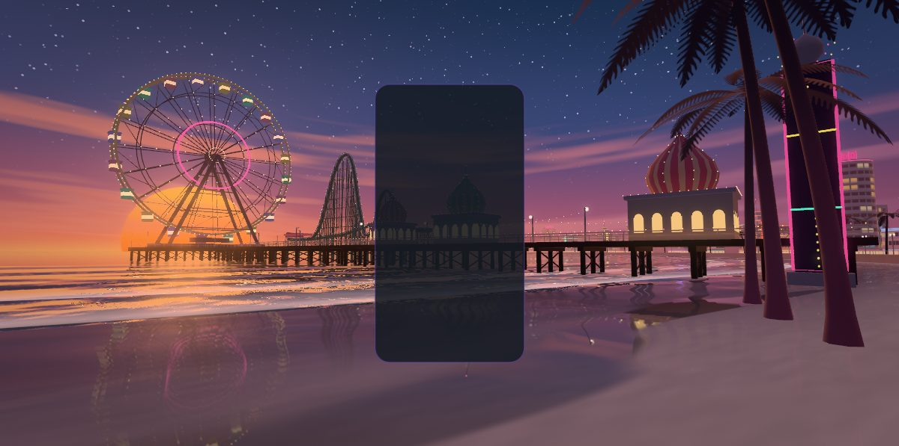 | 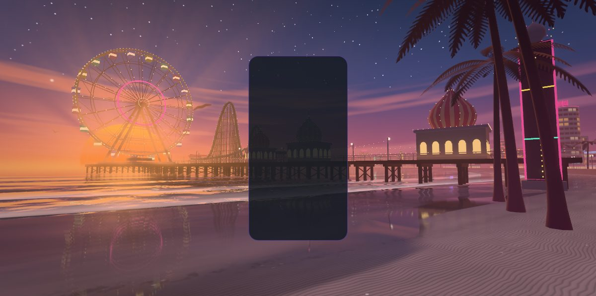 |
| 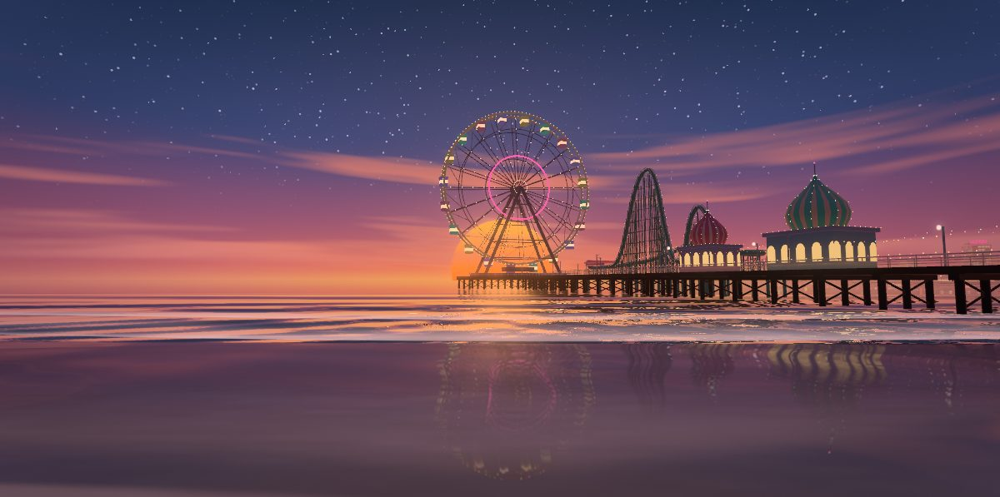 | 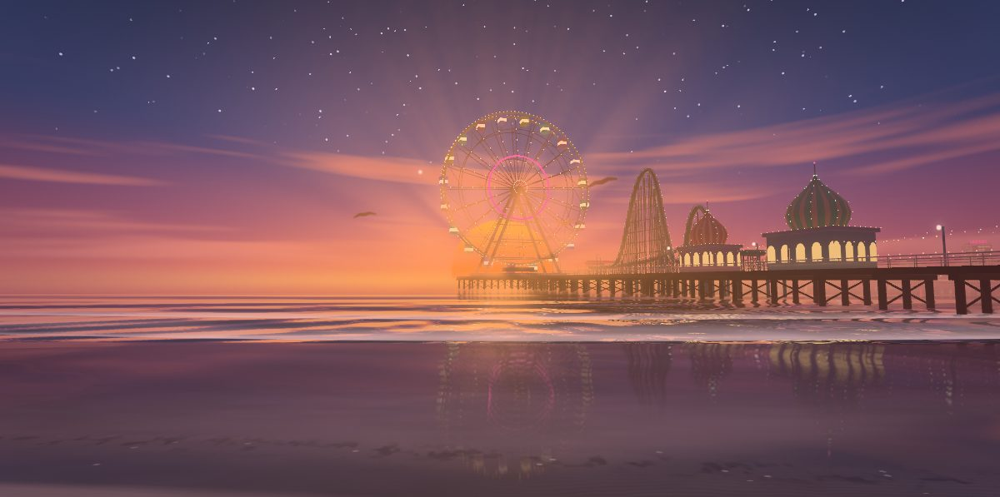 |
| 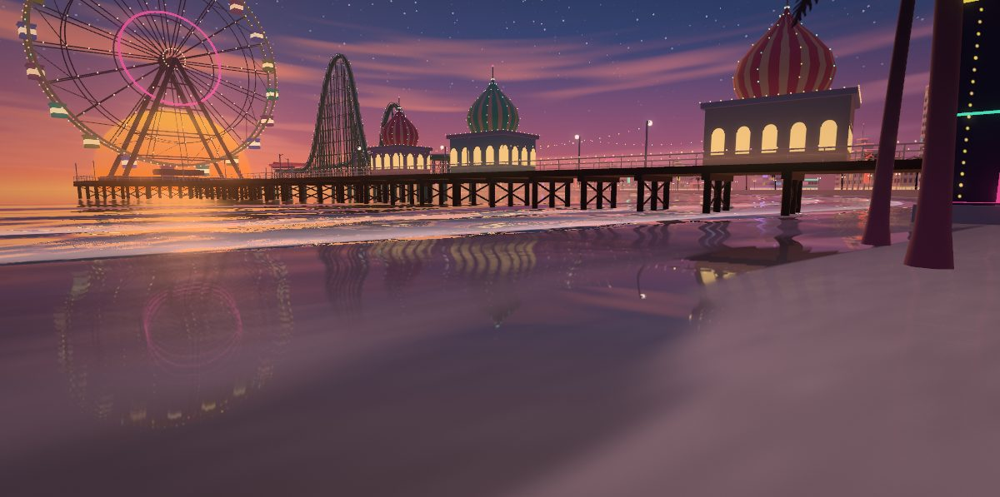 | 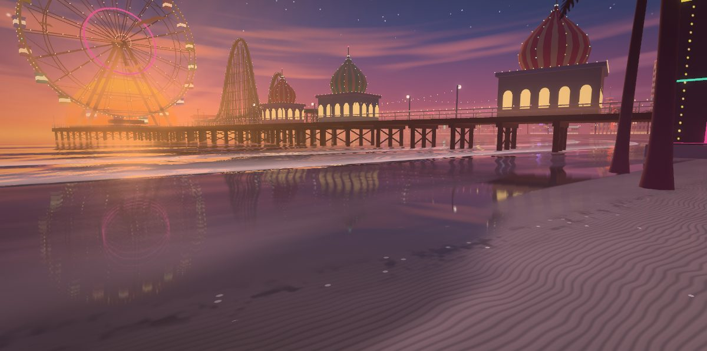 |
| 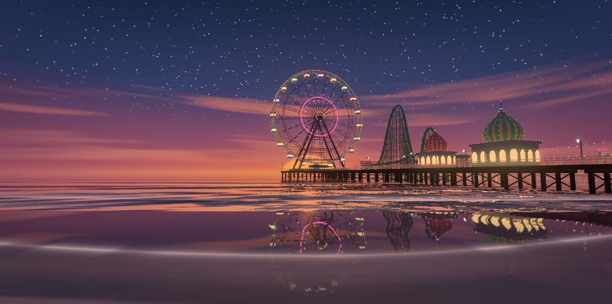 | 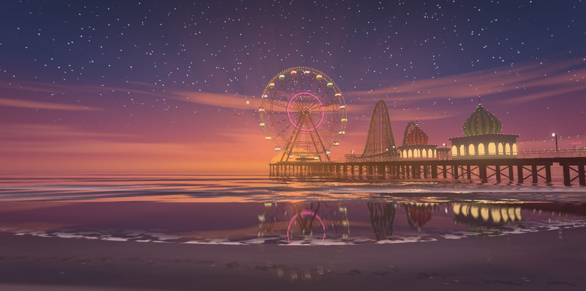 |
| 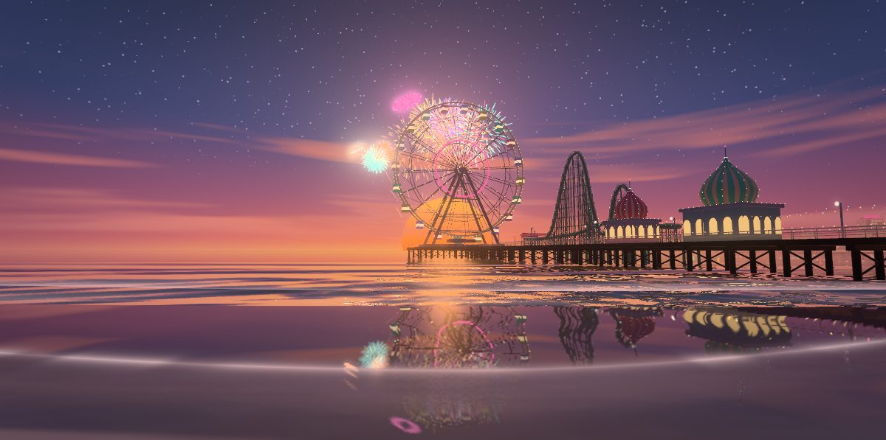 | 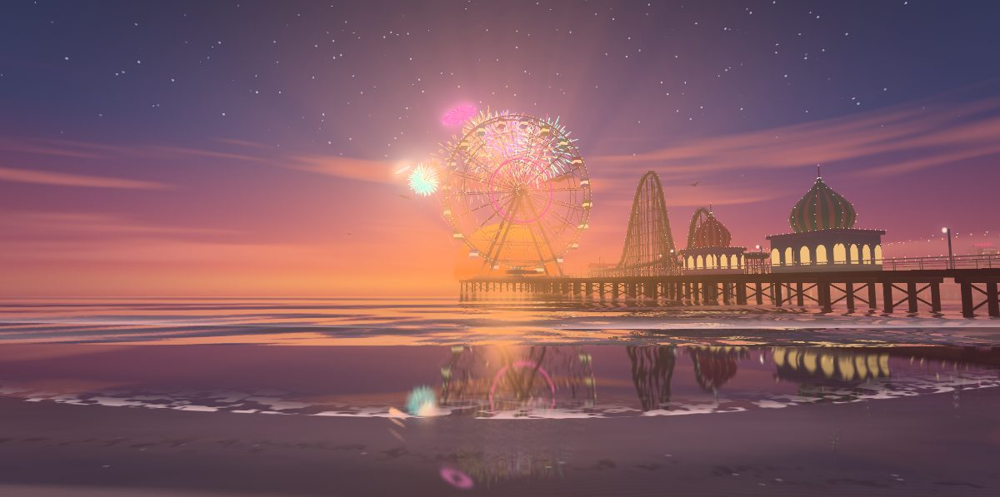 |

### What changed

- **Sea mist** (`-post.js`, `MIST`). An exponential height fog hugging the water (density 1/420
  per metre at sea level, scale height 12 m), integrated in closed form along each view ray to
  what the scene's depth says it meets, in the output pass. It is lit by the horizon's own colour
  on that bearing (`swSkyGradient` along the flattened ray, so far things dissolve into the sky
  that meets them) and warmed toward the sun. The pier's piles and the wheel's foot are hazed while
  its crown stays clear; the town round the bay fades into it; the sand underfoot takes under 3 %.
  Over the sky (whose gradient already holds the air) only `overSky` = 40 % of it is laid, which is
  still enough to sink the setting sun's lower limb into a warm band. `mistOpticalDepth` is its JS
  twin, and a test pins those shares.
- **The sun's shafts through the wheel** (`-post.js`, `SHAFTS`, Medium and up). Three small passes
  at `shaftScale` resolution: the emitters (where four depth taps say sky, the sun's own disc and
  aureole computed from where it stands on screen), a radial march of `shafts` taps toward the sun,
  and a six-tap fill over one of its steps (the breathing stage's two short marches: N + M taps
  for the smoothness of N × M, no jitter). The spokes, the cabins and the pier cut dark lanes into
  the light. Held back over the disc itself (`overDisc`) so the sun keeps its edge, faded to 15 %
  once it is down.
- **The swash** (`-sea.js`). The uprush's front is foam piled at the sheet's leading edge, crisp in
  front and thinning out behind over a width that wanders along the beach, holed into lace in the
  sheet's own coordinates (the holes ride up with it); a front thinner than its pixel is drawn no
  brighter than the share it covers, so the far swash is a soft seam, not a white wire across the
  frame. Where the sheet stops, a wavy swash mark of bubbles lingers while it drains.
- **The sand** (`-sea.js`, Medium and up). Wind ripples above the highest swash (crests about a hand
  apart, wandering and forking, asymmetric, patchy, each faded by its footprint), the wrack line of
  the last high tide (seaweed in clumps along a wavy band, softened to its mean where the clumps
  are under a pixel) and shells along it and, thinly, over the dry sand. The sun and the bright
  western sky light the faces turned toward them, so the ripples read; after sunset the light comes
  from above.
- **The mirror on the water.** The reflection's screen-space shift is held to 3 % across and 5 %
  down the screen (the eight trains' summed slope used to shift it by a fifth and tear the pier
  into blocks), and the image is drawn down into short streaks on the water as on the wet sand.
- **The evening sky** (`-tsl.js`). The stars come out in order of brightness: in the menu's early
  dusk only the brightest fifth, by nightfall all of them, fewer low in the bright west. The
  evening star (`EVENING_STAR`) hangs left of the sun above the cirrus, steady and warm with a soft
  halo, brighter as the sky darkens.
- **Gulls** (`-gulls.js`). Seven (by tier) wheel over the pier, each on its own slow loop in the
  free sky beside the board (bearings about −24° to +32° of the sun, 38–140 m out), the loop's
  centre drifting so none repeats. The silhouette is drawn in the fragment shader (a body, two
  wings bent at the wrist into an M, their dihedral from the vertex stage: long glides broken by
  bouts of flapping, banked into the turn) and catches a warm rim toward the sun. They glide slower
  under Reduce motion (`u.gullTime` lags the clock like the wheel) and go to roost by full dusk.

### Gotcha found on the way

- **Screen-space shafts from the frame's bright sky take any light that draws no depth for sky.**
  The first emitter was the scene's colour wherever the depth said sky: the wheel's bulbs and the
  fireworks (additive, no depth write) passed for sky, and a finale near the sun threw searchlight
  beams across the frame. The emitter is now the sun's own disc and aureole, computed from its
  screen position, with the depth only as the mask; the bright scene is never read. (Recorded in
  the `webgpu-threejs-tsl` skill's table.)

### Tiers (additions)

| Tier | Shafts (taps / resolution) | Sand detail | Gulls |
| --- | --- | --- | --- |
| Minimal | none | no | 3 |
| Low | none | no | 4 |
| Medium | 14 / 0.25 | yes | 5 |
| High | 20 / 0.35 | yes | 7 |
| Ultra | 24 / 0.4 | yes | 8 |
| Extreme | 28 / 0.5 | yes | 9 |

The sea mist and the evening sky are on every tier. Playground: `noMist=1` and `noShafts=1` turn
the two post effects off for an A/B; `parts=` knows `gulls`.

### Verification

Single-effect playground captures (`?effect=synthwave-sunset`, 1584 × 787 and 1200 × 597, the mock
solo board unless `board=0`) from a scratch Electron script against a private dev server, the
before shots from a detached `origin/main` worktree on a second server: the game view, the menu,
the beach close-up (`eye=6,2.2,17&aim=16,0,2&fov=55`) at three swash phases, nightfall
(`dusk=0.55`, `0.88`), the four-line finale, Medium, Low, Minimal, the WebGL2 backend
(`forceWebGL=1`) and a 430 × 932 portrait. No WebGPU validation errors or TSL warnings on either
backend.

Tests: the shader gate now builds the post with the world's uniforms, so the mist and all three
shaft passes are built for WGSL and GLSL at High and Minimal under the same checks (size, no
`mx_*`, no equal-edge smoothstep, no NaN literals, no unassigned reads), and checks the shafts
exist exactly on the tiers that ask for them. `synthwave-sunset-theme.test.js` adds the gulls' loops
(in the free sky, low over the sea, at every time over ten minutes; one draw a tier) and the
mist's shares (the near sand, the pier's foot, the wheel's crown, the horizon, the sun's centre).

Cost (playground, High, 2560 × 1600, GPU timestamps, RTX 5080 Laptop, four interleaved rounds
against `origin/main`): the medians were about 0.8 ms before and 1.15 ms after, the shafts about
0.2 ms of the difference and the mist under 0.1 ms. Other sessions were using the GPU throughout
and single rounds swung by 2×, so these are an order of magnitude, not a measurement. The first
shaft build read the multisampled scene and depth at every tap and cost twice as much; the emitter
pass is what made it cheap. Not measured on the integrated Radeon.

## Third pass (2026-10-26): the gulls

Asked for: "is there any ways we can improve the birds flying around? we have access to Blender
MCP if needed for design and animation", then "Now do whats recommended!". What the captures of
the second pass's gulls showed: the closest birds, which should read best, came out as pale
orange-brown smears (the warm rim toward the sun tinted the whole bird, not its edge); most loops
crossed the Ferris wheel, where the birds took the spokes' colour; each bird was a flat cut-out
of an M that always faced the camera, never seen side-on or turning; they ignored the fireworks
going off beside them and turned see-through in mid-air at nightfall.

### What changed

- **A real gull, built in Blender.** `scripts/blender/synthwave_gull.py` (headless Blender 5.2,
  like the Himalayan eagle's) builds a herring gull at real size (1.40 m span): a white spindle
  body with a round head, a heavy yellow bill with its red spot, a short square tail, long narrow
  wings bent at the wrist, pale grey above with black tips and a white mirror, white below. About
  1,650 triangles, 53 kB (`assets/gull.glb`, its manifest and attribution beside it). `--preview`
  renders every pose from six views, lit and as 60 px silhouettes, which is how the shape was
  judged (a game shows the birds 12 to 60 px across).
- **Wings folded in the vertex stage, no skeleton.** Each vertex carries how much the shoulder,
  the wrist and the tip move it (`_wing`, eased across a band either side of each joint); the
  stage folds about the two hinges whose pivots the manifest records. The glide is the gull's
  crank (arms up, hands angled down from the wrist), trimmed a little all the time; the wingbeat
  (2.6 Hz) is built from four authored poses, the top, the downstroke, the bottom and the
  upstroke with the wrist flexed, as `A + B cos φ + C sin φ + D sin² φ`, smooth all the way
  round. Birds glide, flap in bouts, beat steadily when climbing, commuting or startled.
- **Flown like a bird** (`-gull-flight.js`, which the vertex stage repeats line for line). Each
  loop is an ellipse or an eight laid square to the line of sight, its centre drifting and its
  size breathing; the bird climbs heading out to sea into the breeze and sinks coming back. Its
  heading is the path's direction a step either side of now, and it leans into the turn by the
  lift a coordinated turn needs (65 % of it, so the tight ends stay a calm glide). So a bird is
  seen side-on, from behind, foreshortened, banking, as it circles.
- **In the open sky round the wheel.** The flights, by tier: low over the sea across the sun's
  disc (and so in the sea's mirror), high over the wheel's crown, the strip of sky left of the
  wheel, a lazy eight above the coaster, a mate for the high bird and one for the eight (same
  loop, a wing's length out and a beat behind, at the leader's pace), a far bird on a long glide
  across the whole sky, one skimming the surf near the beach, a far circler in front of the sun.
  All but the long glide spend over 55 % of the time in the free sky left of a game's board.
- **Lit as a silhouette with a warm edge.** The sky's own gradient from above, the sunset sea's
  glow from below, the low sun on the faces turned to it, the fireworks' colours, the town's neon
  faintly from below after dark. The body is then held to at most a fifth of the luminance of the
  sky behind it (a backlit gull is a silhouette; lit, it vanished into the bright sunset), and
  over that a warm rim on the edges turned to the sun and the sun through the thin feathers when
  a bird crosses its disc. Near the sun the post's in-scattered light still tints them, as it
  tints the wheel's dark spokes.
- **Startled by the fireworks.** Every burst hits an accumulating envelope (the shared Swell's two
  exponentials rebased to the last hit, passed to the shader as one `vec4`, so any time can be
  read): the loops widen, the birds climb and draw away from the barge and beat hard, then settle
  over a few seconds. A volley builds the scatter; it never restarts it. Under Reduce motion the
  startle is 40 %.
- **Going to roost.** As the evening passes each bird's hour (pairs together, 0.62 to 0.84) it
  breaks off its loop onto a straight line away, out to sea into the afterglow or off along the
  coast, beating steadily, and is gone (drawn at nothing) 48 s on; when the evening turns back
  below its hour it flies in the same way over 40 s and turns into its loop. The hours stand
  clear of the evening's stops (0.57, 1) by more than the 0.03 hysteresis, or a bird would wait
  out a whole stop away. A small state machine on the clock decides when; a seek rebuilds it from
  the last five minutes of the evening's walk.
- **One draw, in the mirror.** Still one instanced draw (the model's four buffers and one
  interleaved instance buffer; WebGPU binds eight a draw, and six separate instance attributes
  were ten), now on the sea's mirror layer too. The model arrives after the world is built; the
  draw holds a hidden placeholder of the same layout until then (`world.gullsReady`; the
  playground's first frame waits for it).
- **Playground.** `follow=<i>` is a long lens from the rest eye that keeps gull i in the middle
  of the frame (`fov=`, default 4): its shape, wingbeat and light up close.

### Verification

Playground captures (Electron, a private dev server, RTX 5080 Laptop) of the game view and the
menu at several times, every bird cropped at full resolution, `follow=` sequences of the
wingbeat, a bank and a startled bird, a four-line clear at 0.1, 2.5, 4 and 7 s, the evening's
roost from all home (t = 650) through the afterglow (none left) to all back (t = 870), Medium
(no MSAA: the edges step, as the rest of that tier) and the WebGL2 backend (`forceWebGL=1`). No
WebGPU validation errors once the instance attributes were interleaved. In the real game
(single player, High): the model arrives (1,648 triangles, seven birds), no console errors, and
four seconds after a four-line clear the gulls have lifted and scattered, beating hard.

Tests: `synthwave-sunset-gull-asset.test.js` (the file is the one the manifest records, a gull's
size and shape, the hinge weights, the glide's crank and a still body under the fold, the model
swapped into the one draw); `synthwave-sunset-theme.test.js` (the flights stay in the open sky,
above the sea and off the beach for ten minutes, at a gull's pace, the mates beside their leaders;
one draw a tier within eight vertex buffers; the startle adds up, stays near its ceiling, settles,
and a quad sets it off in the world; the roost goes in the order of the hours, the mates together,
empties the afterglow and brings everyone home, and a seek rebuilds what the walk did; the
wingbeat hits the authored poses and never jumps); the shader gate builds the gulls for WGSL and
GLSL and finds the path helper emitted once and called four times.

Cost: nine birds of 1,648 triangles, drawn twice (the mirror), each vertex evaluating its loop four
times; small next to the scene, not measured on its own.

## Fourth pass (2026-11-17): an evening that never stands still, an instrument for every event

Asked for: an audit of the whole theme, then "one of the most visually stunning themes in my
game", varied over time, every event with its own distinct effect, the biggest moments the most
spectacular, smooth and easy to read throughout.

### What the audit found

The place was strong (the wheel, the pier, the coaster, the sea and its mirror). What held it back:

- **Time.** One measure (`dusk`) walked between two looks, the sun on the sea and the afterglow, on
  an eight-minute loop: one palette, one kind of cloud, no night, no moon. The stars were one size
  and were out in hundreds while the sun was still up.
- **Events.** Nearly every event answered with the same four kinds of shell in the same patch of
  sky; they differed in count. A hard drop had a 25 % brighter band and nothing else, a cascade
  and a level-up almost nothing of their own, and the perfect clear looked like the four-line
  finale.
- **Fireworks.** Four kinds, single-colour spheres of straight streaks, bursting level with the
  wheel's upper half, so they sat on top of it.
- **Life.** Nothing moved on the pier or the sea but lights and gulls; the barge the shells rose
  from was not there at all.

| Before | After (High, native WebGPU) |
| --- | --- |
| 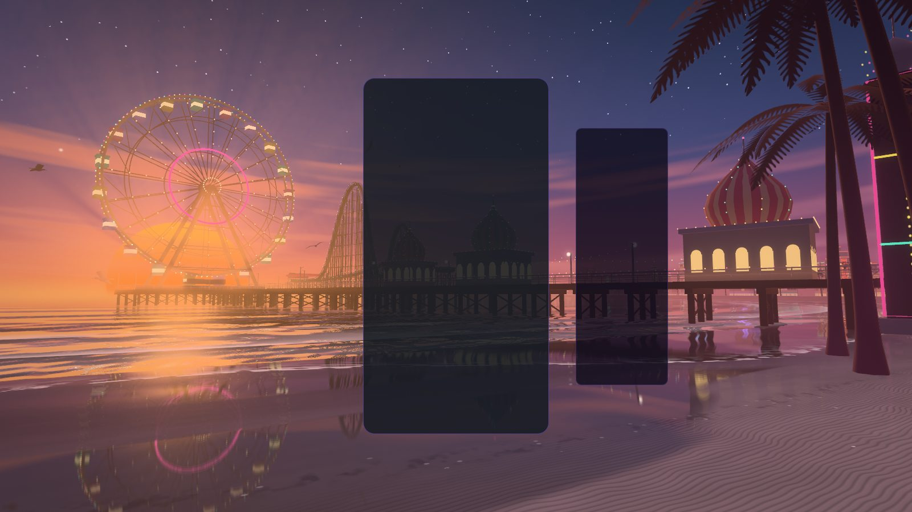 | 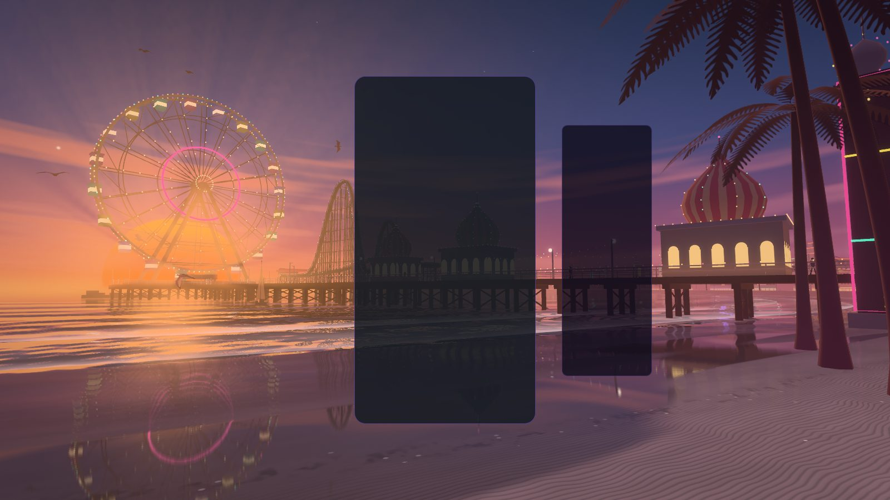 |
| 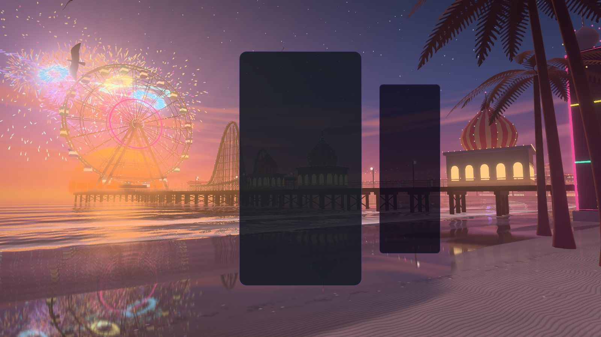 | 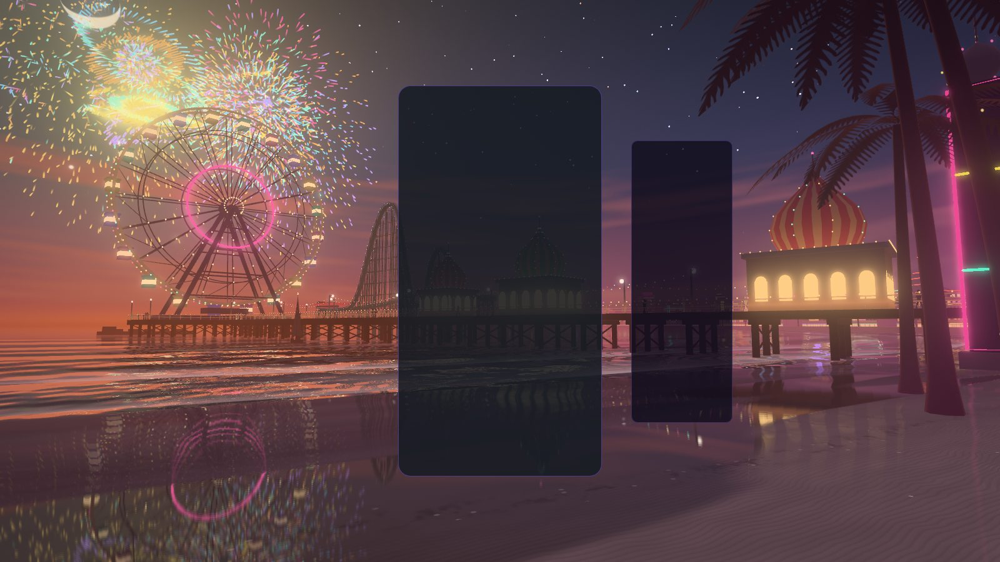 |

### The evening: four clocks (`-evening.js`)

A new module with no three and no shader code holds the evening's clocks. Each is a pure function
of the time, so a seek, a replay and a restart land on the same picture, and their lengths differ
(120, 210, 170 and 145 s), so the same picture does not come round for a long while.

- **The hour.** Four stops instead of two looks: golden hour, sunset, afterglow, night
  (`HOUR` 0..3, `EVENING.seconds` a stop, a level steps it on a quarter of a stop). The walk sets
  out from the sunset, the theme's opening look, toward the night, comes back through the sunset
  to the golden hour and turns again (twelve minutes there and back). At the golden hour the sun
  stands clear of the sea in the wheel's hub (`SUN.goldLift`), the neon ring inside its disc; at
  night the sky is indigo with a last ember on the sun's bearing, the Milky Way climbs over the
  wheel and a crescent moon, its horns turned from the sun, lays a cool road on the water. The old
  measure `dusk` is still there for the lights, the structures and the gulls' roost (0 at the
  golden hour, 0.14 at the sunset, 1 from the afterglow on); `gold` and `night` are new.
- **Tonight's colours.** Four temperaments, each a whole sky (horizon to zenith, toward the sun
  and away), the sun's disc, its glow and its road on the water: tangerine (the opening look, the
  constants the shaders held), flamingo, ember, peach and teal. The sky's shaders no longer hold
  colours: the world melts the palettes on the CPU (the short way round the colour wheel) and
  writes sixteen colour uniforms a frame (`SKY_KEYS` / `SKY_UNIFORMS`), which also took several
  mixes a pixel out of the sky function. The structures' rim light and the sea's glint follow.
- **The weather.** Long streaks of cirrus (the opening look), a mackerel sky, a clear sky, a bank
  of cumulus towers on the horizon. The mackerel sky is drawn in the sheet's own plane, so its
  rows close up toward the horizon; the low sun lights it from below and the light leaves its
  high part first as the evening deepens. The towers never stand across the sun; their rims burn
  on the side turned to it, and after dark heat lightning flickers inside them (silent, held back
  under Reduce flashing).
- **The sea.** Its liveliness (a scale on the swell's slopes): a light breeze, a glassy calm, a
  fresh breeze, a slack sea.

The stars come out in order of brightness: a handful at the sunset, a few hundred in the
afterglow, the whole field at night, with a steep fall from the bright few to the faint many.

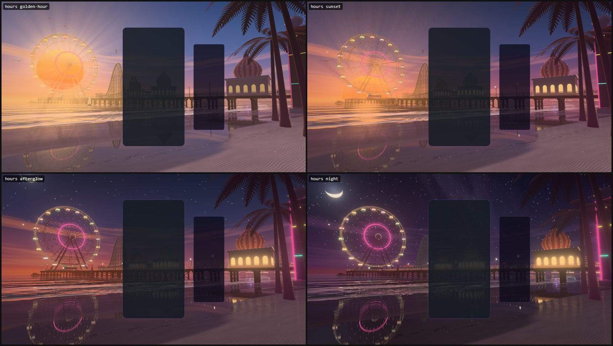
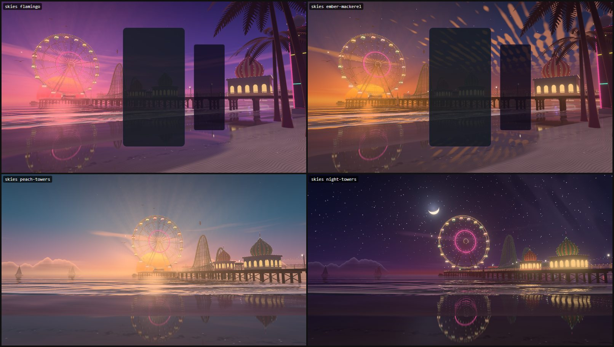
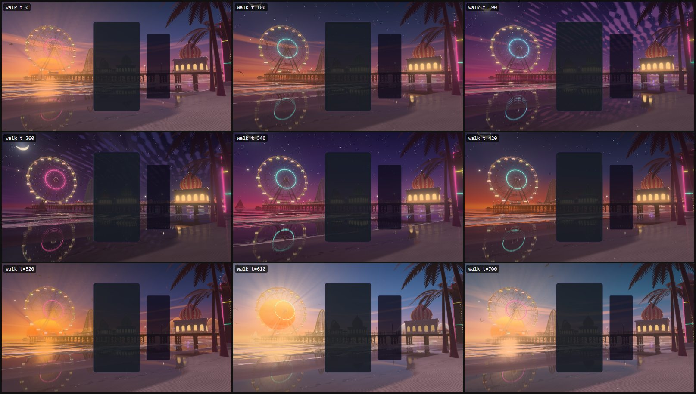

### An instrument for every event

| Event | Whose it is | What happens |
| --- | --- | --- |
| Lock | The wheel's rims | As before: two bands of the piece's colour run round to the top. |
| Hard drop | The pier's lights | A pulse of the piece's colour runs out along the pier from the land end to the wheel in under a second, on the bulbs and as a wash on the deck's edge, the railings and the foot of the walls; brighter the further the piece fell. Pulses follow each other down the pier under rapid drops. |
| One line | The barge | One shell in the piece's colour, its kind turning with each clear (peony, pistil, chrysanthemum, crossette). |
| Two lines | The barge | A pair of one kind bursting together, side by side. |
| Three lines | The barge | A fan: two chrysanthemums low, then a gold palm above them, crackling at the ends of its arms. |
| Four lines | The whole sky | The finale: a volley across the whole free sky, each shell higher than the last (chrysanthemum, pistil, ring, crossette, peony, saturn, strobe, palm), closed by a gold brocade crown high over everything, while the wheel's face bursts in gold from the hub out to the rim. |
| Twist | The wheel | A Catherine wheel: it whirls and throws lilac and gold sparks off its rim along the tangent, from jets that turn with it; with lines, harder and longer, under a lilac saturn. |
| Back-to-back | The wheel's hub | The salute's row of rings, and a fan of lasers from the hub in the neon colours, a beam more for each back-to-back in a row, each on its own slow sweep, held while they keep coming. |
| Cascade | The pier's deck | Roman candles: a comet each with a long tail that ends in a puff of crackle, thrown up and out over the sea, more of them the deeper the wave. |
| Chain | The coaster | As before: the lift's meter, the ride, the riders' cheer. |
| Perfect clear | The whole pier | A wall of gold comets from the length of the deck, then a waterfall of gold sparks pouring off its seaward edge into the sea, lit from the land end out to the wheel and mirrored in the water, under a curtain of gold willows; the wheel's face bursts in gold and the bay stands at full blaze. |
| Level up | The pier, a new act | Searchlights sweep up from the deck and cross over the bay, a broad wave of gold runs out along the pier's lights, the wheel's face bursts in its new colour, a saturn and a ring go up; the evening steps on. |
| Fever | The barge | As before, drawing on the new shells. |

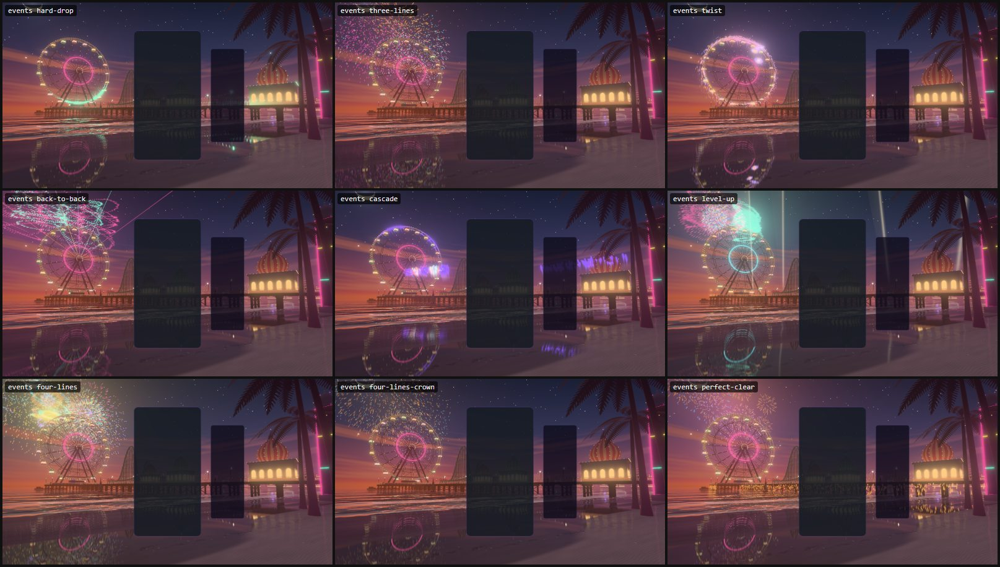

### How it is built

- **Fireworks (`-fireworks.js`).** Still one instanced draw and analytic motion. Trails cost no
  shader work: a particle born a moment after another with the same spawn state flies the same
  path that moment behind it, so a star's trail is a few dimmer copies of the star, and a
  willow's branches droop as real curves. Eleven shells (`SHELL_KINDS`), crackle as short-lived
  sparks, strobes that hang and blink (steady under Reduce flashing), and the ground effects:
  `comet`, `waterfall`, `spray`. The bursts stand higher (60 to 92 m, the finale's crown to about 120 m),
  over the wheel instead of on it. The pool grew (High 3,400 to 6,200) for the trails and the
  waterfall.
- **Beams (`-beams.js`).** One instanced additive draw of ten long quads turned about their own
  axis to face the eye: the lasers and the searchlights. A dark beam has no width, so the draw
  stays in the scene from the start and its pipeline is built with the world.
- **The wheel's light programmes.** Five (the classic, a pinwheel, a bloom of gold rings, a
  spectrum, a glitter), turned by the clock every 46 s, and a starburst for the big moments.
- **Life (`-life.js`).** Strollers on the pier: one instanced draw of upright cards, a figure
  drawn in the fragment stage and cut out with `maskNode`, legs scissoring with the distance
  walked; opaque, with depth, so the railings, the pavilions and the sea mist treat them as they
  treat the pier. Three sailing boats on there-and-back courses (they come about by turning
  through the eye's line instead of flipping) and the fireworks' barge at anchor: one merged mesh.
  Both are on the mirror layer.

Blender was not needed: everything added is light, particles, or a silhouette a few dozen pixels
tall, where a modelled mesh would not show.

### Gotchas found on the way

- **A trail of delayed copies blooms into a blob.** Each copy is itself a streak (0.17 s of its
  own motion), so copies a few hundredths of a second apart overlap four or five deep and their
  light adds up. Share it out (`min(1, gap / streak)`), so the trail burns about as bright as its
  head (skill row #1726).
- **A mackerel sky from thresholded noise is a lava lamp, from two crossed sines polka dots.** One
  wave train, broken along its ripples by a stretched noise, is the mackerel sky (skill row #1510).
- **The sea mist takes anything much past the pier's end.** The first boats, on lanes 640 m and
  more out, were ghosts. Life that should be seen has to sail inside the mist's first optical
  depth (about 400 m here).
- **Folding a walk through a share of its span is not exact.** `3 * pingPong(1 / 3)` is
  1.0000000000000004, and the opening look must be the opening look exactly: fold by hand.

### Tiers (additions)

| Tier | Mackerel sky | Strollers | Firework pool |
| --- | --- | --- | --- |
| Minimal | no (no cloud at all) | 12 | 2,000 |
| Low | no | 18 | 2,800 |
| Medium | yes | 30 | 4,200 |
| High | yes | 44 | 6,200 |
| Ultra | yes | 52 | 7,400 |
| Extreme | yes | 60 | 8,800 |

The four hours, the temperaments, the sea's states, the moon, the beams, the boats and every
event's effect are on every tier; the towers and their lightning from Low up. Playground: `hour=`, `temper=`, `weather=`, `sea=` hold a
clock still; `event=` knows `hardDrop`, `twist`, `b2b`, `salute`, `cascade`, `candles`, `perfect`
and `shell` (`kind=`); `parts=` knows `life` and `beams`.

### Accessibility

Reduce motion: the beams sweep at a quarter of their pace, the Catherine wheel throws 40 % of its
sparks from slower jets, the strollers walk on the gulls' held-back clock, the perfect clear's
wall is four comets. Reduce flashing: the wheel's starburst and the heat lightning keep
`flashScale()` of their strength (the lightning becomes one soft swell), the strobes burn steady.

### Verification

Playground captures from a private headless Chrome over CDP against a private dev server
(1600 × 900, High, RTX 5080 Laptop, 30 fps cap): the four hours, the four temperaments, the four
weathers, twelve minutes of the clock's own walk, every shell kind, every event at two or three
ages, the WebGL2 backend (`forceWebGL=1`), Minimal, Low and a 390 × 844 portrait. No WebGPU
validation error and no TSL warning on either backend. In the real game (single player, High,
WebGPU): the events fired through the event bus, the board read clearly, no console error of the
theme's.

| | |
| --- | --- |
| 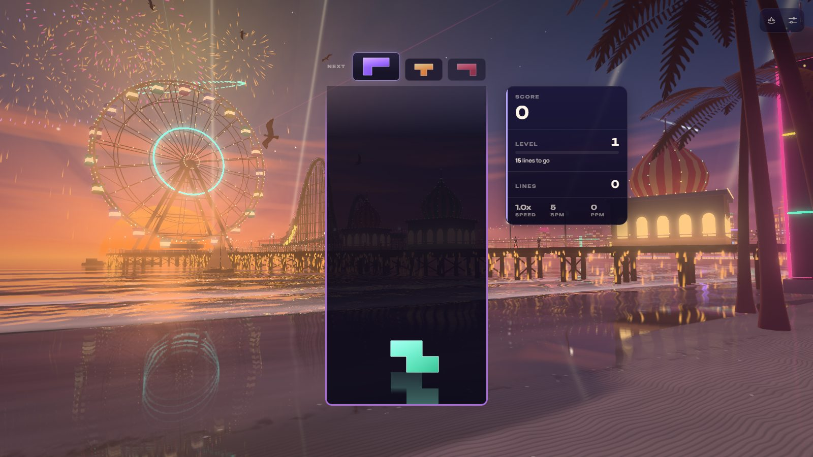 | 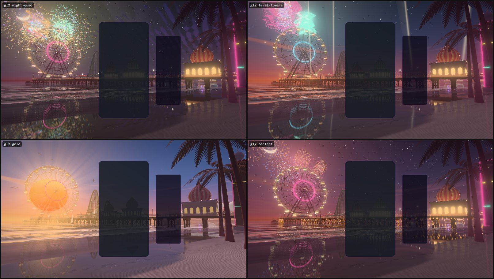 |
| 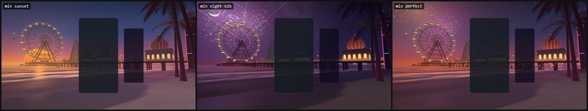 | |

Tests: `synthwave-sunset-theme.test.js` re-pins the evening (the walk through its four hours and
back, a level's step, the sun in the hub at the golden hour), and adds the clocks (temperaments
whole and melting, the weather and the sea on their stops, held values), the heat lightning (only
after dark, off the sun's bearing, held under Reduce flashing), an instrument for every event
(what each fires and where, the lasers' count, the searchlights' feet, every shell kind built
from finite numbers, a seek leaving nothing behind), the wheel's programmes and the life (the
strollers inside the railings, the boats clear of the pier). The shader gate walks the scene, so
the beams, the strollers and the boats are built for WGSL and GLSL at High and Minimal under the
same checks.

Cost (playground, live, GPU timestamps, 1920 × 1080, RTX 5080 Laptop, capped at 30 fps, twelve
seconds a case, `origin/main` on a second server): High at the opening look 0.48 ms before and
0.49 to 0.50 ms after; the dearest skies (night under a mackerel sky, the afterglow with towers)
0.57 ms; Medium 0.43 ms before, 0.51 ms at night under a mackerel sky. Not a frame-rate
measurement, and not measured on the integrated Radeon.

## Fifth pass (2026-11-17): the people on the pier

The owner's word on the fourth pass: the people walking on the pier "look a bit too bad and stiff
and squared … we can reduce the amount of people walking but make them look better designwise and
how they walk". The strollers were cards turned to the eye with a figure cut out of each (a disc
of a head, a block of a torso, two scissoring sticks): no arms, square shoulders, the same flat
front from every side, and in the game's view, where the pier runs away from the eye, plainly
flat. They also walked straight through the pavilions' walls.

| Before: the cards | After: the cast |
| --- | --- |
| 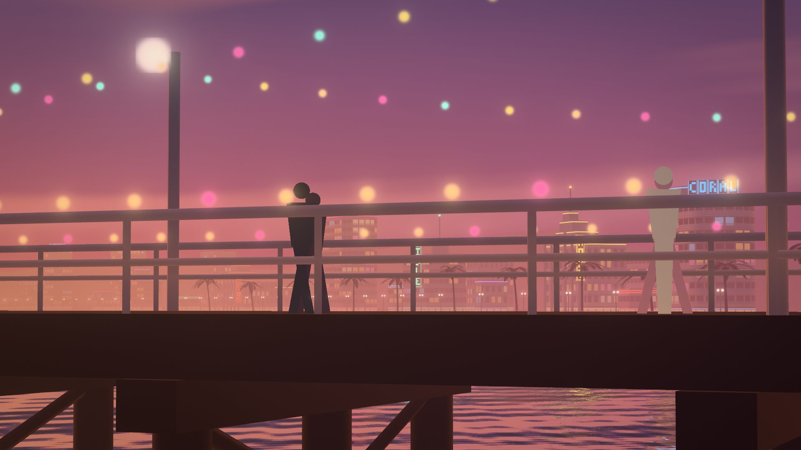 | 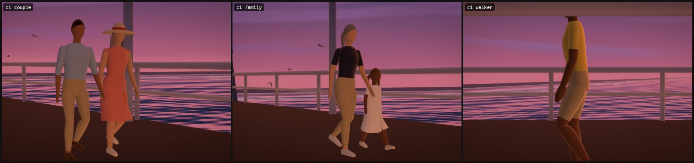 |
| 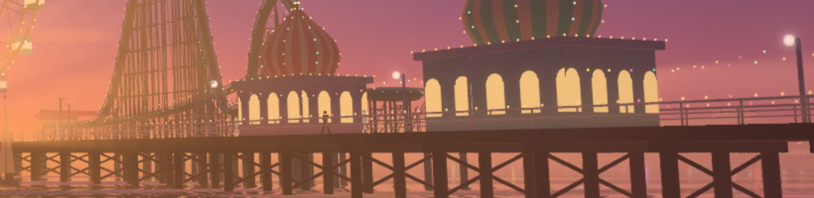 | 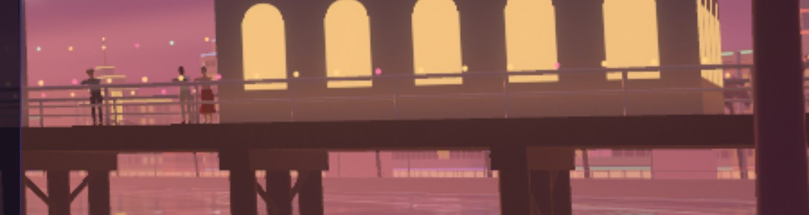 |

### The figures (Blender: `scripts/blender/synthwave_strollers.py` → `assets/strollers.glb`)

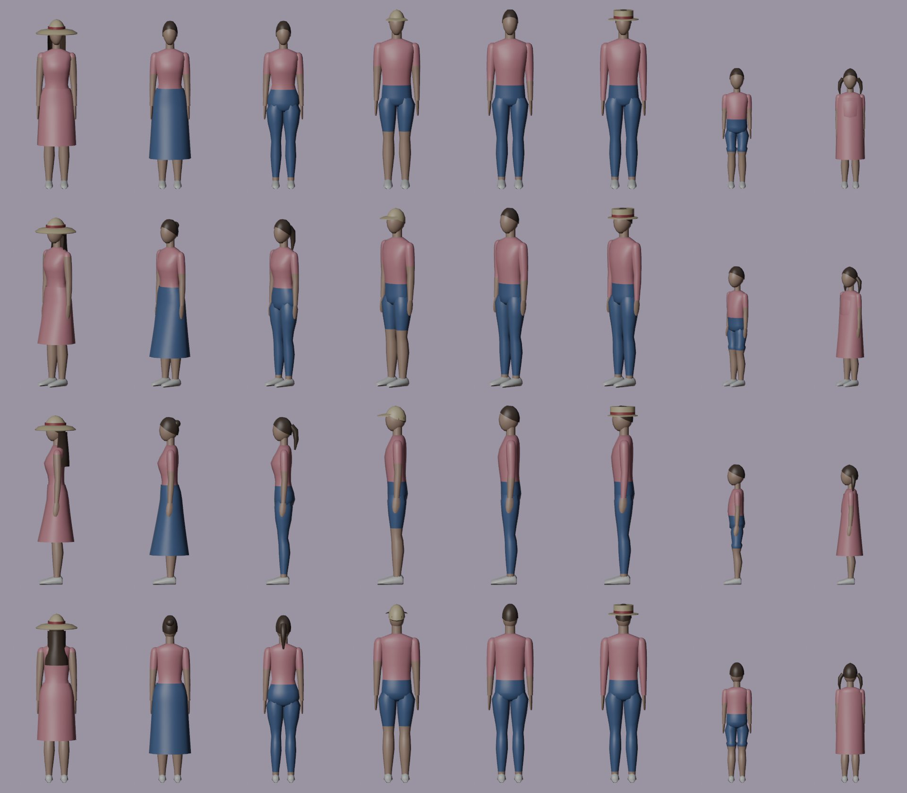

Eight people on three builds (a woman, a man, a child: their own shoulders, hips, heads and limbs),
each an outfit whose shape tells it at 15 px: a sundress with a wide straw hat and long hair, a
blouse and midi skirt with a bun, slacks and a ponytail, a tee, shorts and a cap, chinos, a light
jacket and a boater, a boy, a girl in a dress with pigtails. Lofted rings with the hems cut into
them, limbs a touch thicker than life (they are seen 10 to 45 px tall), one skeleton of thirteen
bones, two bones a vertex eased across each joint, a skirt that follows the thighs toward its hem,
the legs under a skirt in its colour (a knee swinging into the cloth reads as cloth pushed out).
Each vertex says what it is (skin, hair, top, bottom, shoes, hat, band) and how much sky it sees
(ray casts against the figure itself). 1,400–2,100 triangles each, 496 KB in all. The headless
script previews the cast from four sides and as game-sized silhouettes; that sheet is how the
proportions were set (the first draft's arms stood up out of the shoulders like epaulettes, the
thighs poked out of the hips, and the cap read as a helmet). Each person is dressed from colours
that suit the figure (seeded, so the same tier dresses them the same).

### The walk (`synthwave-sunset-strollers.js`, three-free)

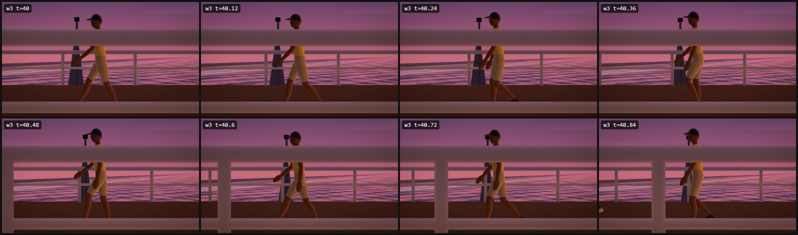

Every person is posed on the CPU each frame (17 µs for ten) by a model of how people walk, not a
swing of sticks: the gait's phase rides on the distance walked; the thigh moves back steadily while
its foot is flat and swings through fast; the knee gives as the weight lands and folds to clear the
deck; the foot strikes heel first and rolls off the toe; the hips turn and drop over each step, the
shoulders turn against them, the arms swing as far back as forward with the opposite leg. The
thigh's swing is solved from the stride so the planted foot keeps still (it drifts 2.5 cm over a
stance); the body is then set down so its lowest heel or toe stands on the deck, which gives the
rise and fall of each step. A walker who stops slows over the last metre, the steps shortening to
nothing, and turns on the spot with small steps; a pair turns together and ends side by side.
Standing, the weight shifts from leg to leg; a leaner's upper arms reach down to the rail and the
forearms, turned in, fold across it. Heads look ahead and now and then out to sea; the standers
look about; and at a firework everyone looks up at the burst (the neck turns so far, then the
shoulders). Everything is a function of the clock (a seek lands right) except the look at a burst.

### Fewer people, in the places the eye can see them

| Tier | Minimal | Low | Medium | High | Ultra | Extreme |
| --- | --- | --- | --- | --- | --- | --- |
| people (fourth pass) | 12 | 18 | 30 | 44 | 52 | 60 |
| people (now) | 4 | 6 | 7 | 10 | 12 | 14 |

Measured from the game camera, the deck is seen in two places: the far stretch left of the board
(pier metres 0–88, people 11–19 px) and a slot right of the HUD beside the first pavilion (133–140,
about 30 px; the board hides 88–120 and the HUD 126–133). The cast is placed by that map, the most
telling first so even Minimal shows them: a couple hand in hand, a man in a boater leaning on the
beach-side rail beside the pavilion, a pair who step out of the pavilion's door to the rail, lean
there half a minute and go back in, a walker in a cap, a mother with her daughter by the hand, a
woman leaning on the sunset-side rail, two friends at the pier head's end, walkers who pause to
look at the sea. Routes: `long` from inside the first pavilion (its walls hide the turn) out to the
pier head and back, through the other two pavilions by their end doors only; `far` on the open
stretch; `near` out of the pavilion and back.

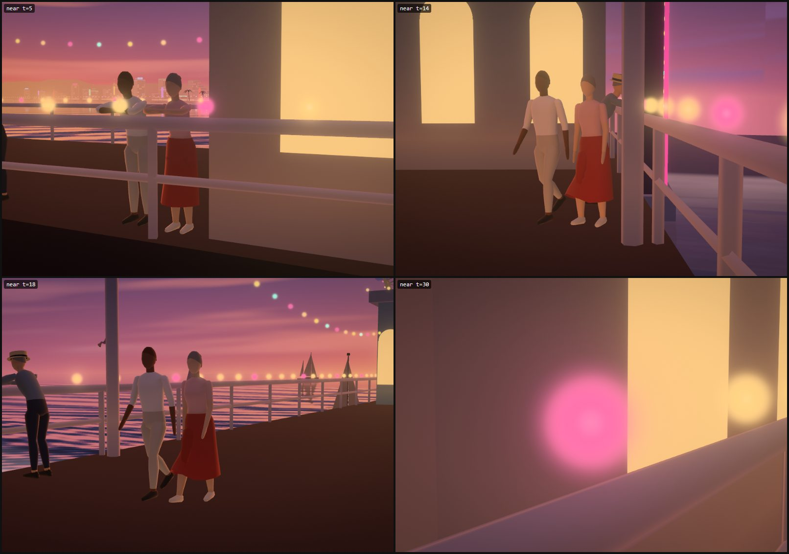

### Light

As the pier takes it: the evening sky from above (less where the body shuts it out), the low sun
warm on what faces it and as a rim round the outline (they are mostly silhouettes against the
sunset), and after dark the railing's bulbs and the lamps from below and the side. One draw for
everyone (the figures merged and dressed when the model arrives; the poses in a float texture, a
row a person, read with `textureLoad` on both backends), on the mirror layer.

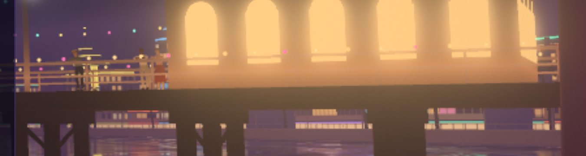

### Verification

- Captures (headless Chrome, real WebGPU, `maxFps=30`): close-ups through a new playground lens
  (`person=<i>&personView=dist,az,h,fov` walks beside person i), walk cycles by seek, the game view
  at three hours, night, the four-lines finale, WebGL2 (`forceWebGL=1`), Minimal and portrait;
  every console clean.
- GPU and CPU at full speed (the owner's go-ahead), RTX 1080p, the branch with and without the
  people and boats, alternating: GPU p50 0.541 against 0.542 ms at High, 0.2146 against 0.2146 ms
  at Minimal; CPU frame p50 0.9 ms both. (At `maxFps=30` the GPU clocks down between frames and
  some runs read about 5 ms either way: compare alternating runs, never one; gotcha #1103.)
- Tests: `tests/unit/synthwave-sunset-strollers.test.js` (the file against its manifest entry, the
  figures on the skeleton, each tier's count, loops that pass the pavilions by their doors only,
  stops that ease in and out, everyone on the deck with planted feet for four minutes, the same
  pose at the same time, heads turned to a burst, the merged draw); the shader gate now attaches
  the parsed cast and builds its material for WGSL and GLSL at High and Minimal.
- Gates: typecheck, lint ratchet, TypeScript ratchet, architecture fitness, dependency cruiser,
  theme lifecycle audit, performance budgets, release gates, the build and the shipped-text gate.

## Known limits

- **Portrait.** The composition solver is unchanged: on an upright phone the sun goes to the left
  edge and the wheel sits partly behind the board. A hero-above-the-card framing for portrait is a
  follow-up.
- **The song** is the old theme's recording under the same title.
- **The reflection pass** adds one pipeline per mirrored material (its target has no MSAA).
- **The shafts are screen-space:** they vanish with the sun off screen, as in a portrait
  framing.
- **The people** have no faces or fingers (they are seen 10 to 45 px tall), the walk is the same
  model for everyone (a child's only quicker), turning at a stop is a few small steps on the spot,
  and the far stretch's people are lost in the sun's glare at the golden hour.
- **The boats** sail close in because the sea mist takes anything much past the pier's end; a
  ship on the horizon would need the mist to spare it.
- **Start-up and the integrated GPU:** the fourth pass added three draws (beams, people, boats) and
  their mirror-pass pipelines; their cost at start and on the integrated Radeon is not measured
  (the people's cost on the RTX at full speed is below the noise).
- **The gulls** never land: perching on the pier's railings and lamps (and taking off from them)
  is a follow-up. Near the sun the post's in-scattered light still lifts their silhouettes, as it
  lifts the wheel's spokes.
- **Neighbours.** The beach, palms and a sun on the sea remain shared ground with Luminous Tides
  and Sunset; the differences above (dusk, unlit surf, a built hero) are what keep them apart.
