# Synthwave Sunset — the pleasure pier (visual overhaul, 2026-10-20)

**Status: shipped (branch `feature/synthwave-sunset-overhaul`, merged to `main` 2026-10-20; a
second pass on the air, the shore and the evening, `feature/synthwave-sunset-second-pass`,
2026-10-21: see [Second pass](#second-pass-2026-10-21-the-air-the-shore-the-evening)). A
record of what was built and how it was checked — not a backlog.** Replaces the outrun picture (a slit sun behind wireframe mountains, flat box
buildings, palm silhouettes and a scrolling neon grid), which showed nearly the same thing as Neon
Dusk, the orb before it, with a retro seaside at dusk. The id, the name, the song and the Odyssey
orb stay: a rebuild in place, so no save migration. Everything is on three 0.186.1 and shared by
the game and the playground.

| Before | After (High, native WebGPU) |
| --- | --- |
| 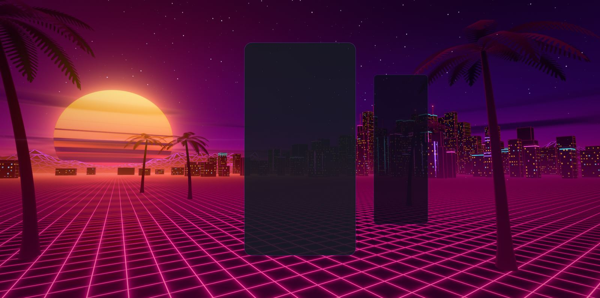 | 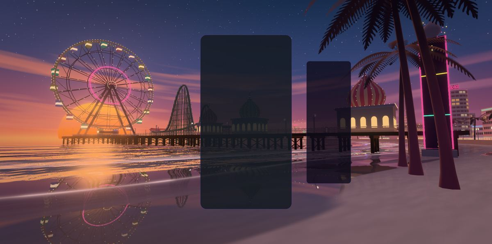 |
| 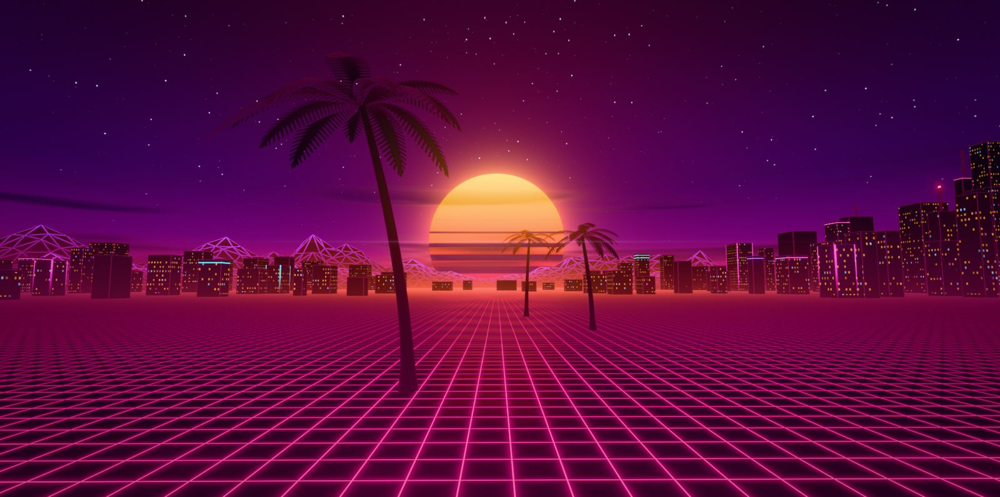 | 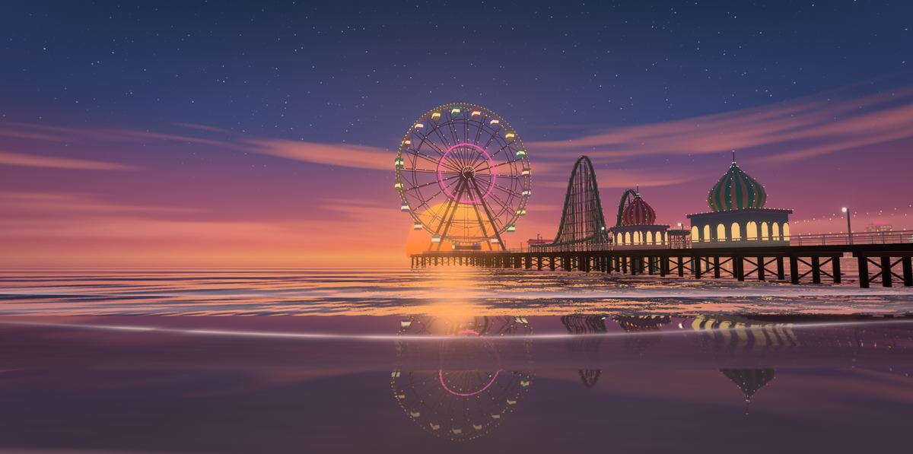 |

## Why this setting

The concept page offered three settings (a neon pier, a vaporwave mall, a hillside pool above a
city); the user chose the pier. It keeps the name's promise (a synthwave sunset) but puts it in a
place: nothing else in the fleet has a ferris wheel, a pier, a coaster or fireworks (checked
against `docs/theme-concepts/reference/catalog.md`). Its neighbours stay clear: Neon Dusk (outrun
sun, neon ridges, glass grid floor), Chromadelic Highway (no road, no night drive) and Neon District
(no city street: the town here is far across the bay). Synthwave Sunset is orb 60, the last of the
campaign ("Electric Nights", the duel with the rival Neon), and comes right after Neon District:
after the city's streets the Odyssey ends at the sea.

Two near neighbours were watched throughout: Luminous Tides (orb 7, a wild night beach whose surf
glows cyan) and Sunset (orb 27, the open sea at golden hour). This beach is at dusk, not night, its
surf is white water lit by the sky (it never glows), and its hero is something built.

## What the player sees

The eye stands on wet sand at the waterline. In the free space left of the board the sun, a deep
orange, sinks into the sea behind a ferris wheel at the end of a long timber pier, so it shows
through the spokes. The wheel turns slowly: bulb-lit rims, a pink neon inner ring, pastel cabins
that hang upright. It stands on the pier head, a T-shaped dock turned square to the pier, on its
own piles. The pier runs from the right edge out to it on bents of piles with cross-bracing, white
railings strung with bulbs, lamp posts with garlands between them, onion-dome pavilions with lit
arched windows, a neon pylon sign at its land end, and a wooden coaster on a trestle beside the
deck, just left of the board: one closed circuit (station, lift hill, drop, camelback, a turn at
the far end, a low return line and a turn back into the station) on its own deck and piles. Round the bay on the right a
promenade with palms and globe lamps curves away past a beachfront of Miami Art Deco hotels to a
dark headland with house lights. Three tall palms frame the right edge.

The hotels come in three kinds, in pastel stucco (flamingo, mint, lemon, lilac, peach, white, aqua)
with white trim. Streamline hotels turn the corner toward the pier in a quarter round, with ribbon
windows under eyebrow ledges wrapping the curve, a drum and a mast on the corner and a vertical
neon blade sign. Resort towers have round ends, a balcony on every floor and a neon sign on struts
at the roof corner, turned to the beach. Deco hotels have pilasters that rise past the parapet in
steps and a ziggurat crown with a spire. The signs spell words (HOTEL, LIDO, TIDES, SURF, CORAL,
ROXY, ISLE, ASTOR) in 3 × 5 neon letters; neon runs along the rooflines and spills down the
parapets; lobbies glow under canopies with a neon edge; windows are lit room by room (warm, white,
rose, the blue of a television) and more come on as the evening deepens. Low shops fill the gaps
and a second row of plainer blocks stands behind, so the beachfront reads as a town. The sun low
over the sea warms the fronts that face it, and the street lamps wash the lower floors.

| | |
| --- | --- |
| 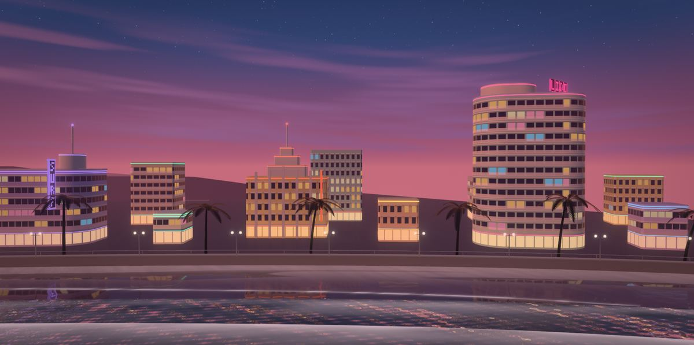 | 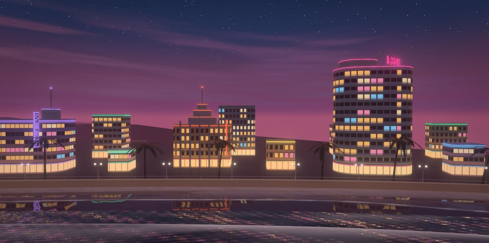 |

The sky runs tangerine and gold on the horizon under the sun, coral and dusty rose, mauve, then
teal-indigo overhead with the first stars; long cirrus is lit pink from below. The sea carries a
road of light under the sun and mirrors the wheel, the pier and the town; the surf rolls in as
white water; each breaker runs up the beach as a thin sheet with a foam edge and drains, leaving
the sand glossy, and the wet sand smears the lights into long streaks.

The evening moves. In the menus it rests (`DUSK.rest`); while a game is played it deepens with the
clock and steps on each level, so over a duel the sun sets into the sea, the sky darkens to its
afterglow and the pier's lights come on from the land end out to the wheel.

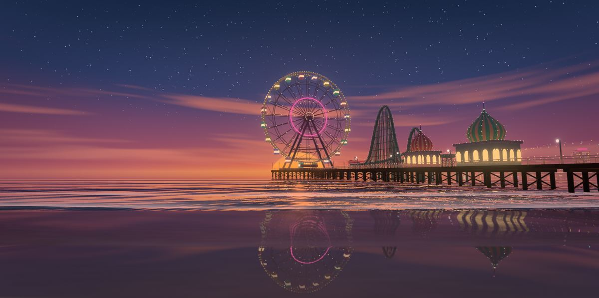
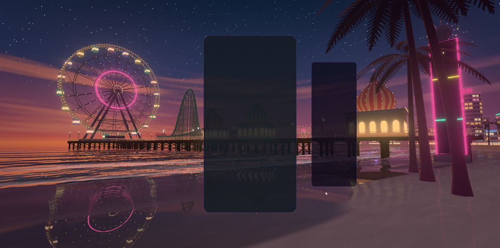

## How the seaside answers the game

| Event | What happens |
| --- | --- |
| Lock | Two bands of the piece's colour leave the bottom of the wheel (left of it for the left columns, right for the right) and run round both rims to meet at the top in about 1.25 s, lighting the rim tube itself as well as its bulbs. |
| Line clear | One firework shell per line rises from a barge off the pier and bursts in the free sky above and left of the wheel; the first shell is the locking piece's colour. The sky glows round each burst (the sea mirrors that glow). |
| Four lines | A finale volley (three to eight shells by tier) and a gold willow. |
| Chain (true combo) | The coaster climbs one notch of the lift hill per link, and its beam fills lemon from the lift's foot up to the train: a meter that can be counted. A chain of three or more that breaks lets the train go: a tyre drive takes it over the crest and it rides the circuit on its own speed (energy from the crest's height) with a trail of mint light behind it, brakes on the return line and rolls round the last turn into the station, once round. A chain of one or two rolls back down the lift. |
| Cascade (bus `COMBO`) | Nothing of its own: every wave's `LINE_CLEAR` already fires its own shells. |
| Level up | The evening steps on (`DUSK.levelStep`), the wheel's neon ring turns from pink to mint (or back), two shells. |

Events are staged as they arrive and handed to the world once at the top of the next frame
(`flushEvents`). The true combo is `ComboTracker`'s; because it only resets on the NEXT lock, a
lock with no clear in its own tick delivers `onChain(0)` itself (lock and clear are emitted in one
synchronous tick), so the coaster lets go on the breaking lock. Only the local board drives the
world (`player` undefined or 1). Everything is gated by Settings > Combo effects in background as
before.

| | |
| --- | --- |
| 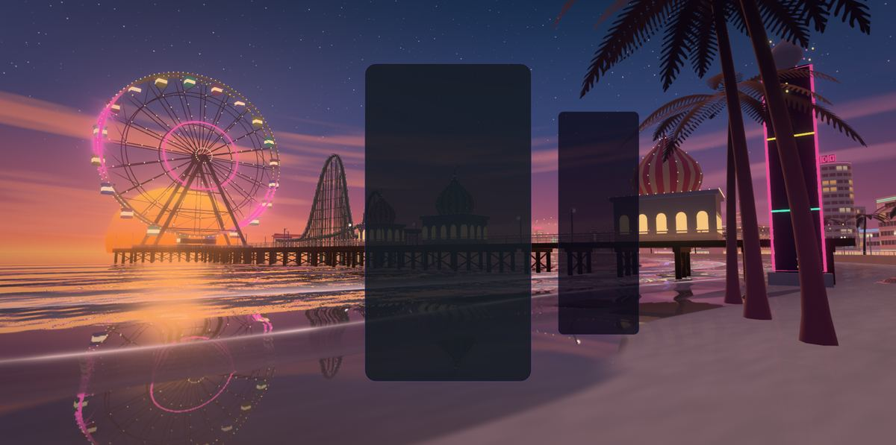 | 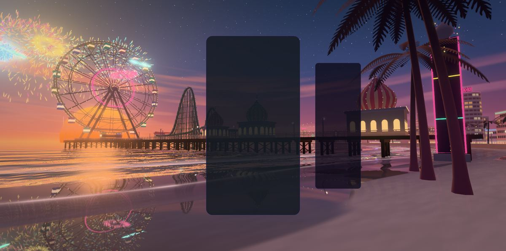 |
| 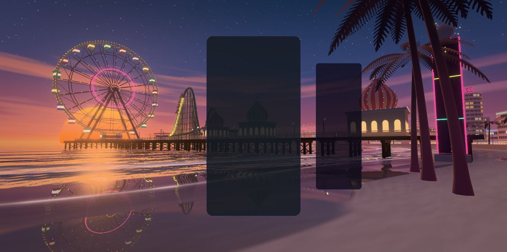 | 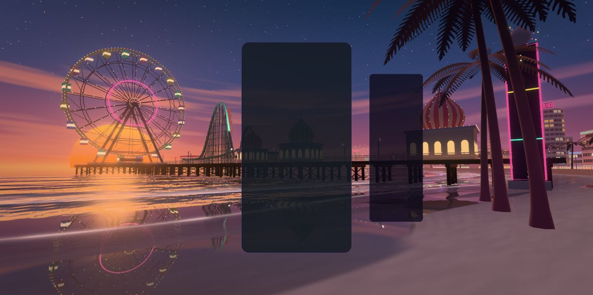 |

## How it is built

### Runtime modules (`src/themes/synthwave-sunset/`)

| File | What it holds |
| --- | --- |
| `-theme.js` | The lifecycle shell (renderer, post, layout watch, event staging, DRS). Clears to transparent: the reflection pass composites by alpha and the sky covers the frame. |
| `-world.js` | Builds the parts, solves the composition (unchanged: the camera yaws so the sun sits in the free zone left of the board), the camera, the evening, the events, the coaster's state. |
| `-tsl.js` | Rig, sun and shore constants; hashes and value noise (laid-out, pure); the sky as ONE function of a direction (`swSky`). |
| `-layout.js` | Where the wheel, the pier and its T-head stand; the pier's frame. |
| `-sky.js` | The dome: `swSky` along the view ray, shooting stars. |
| `-sea.js` | One plane for sea, surf, swash and sand; the mirror. |
| `-wheel.js` | The wheel's structure (one draw, turned in the vertex stage) and its bulbs. |
| `-pier.js` | Deck, T-head, bents, railings, lamps, pavilions, the pylon (one draw) and the pier's bulbs. |
| `-coaster.js` | The closed circuit (a centripetal Catmull-Rom loop with two U-turns) and its marks (station, lift foot and crest, the return), track, trestle, station, the deck it stands on, the train (four instanced cars placed on the CPU), track bulbs. |
| `-promenade.js` | Seawall, railing, lamps, the headland ridge; mounts the hotels and adds their beacons to the lamp bulbs. |
| `-hotels.js` | The beachfront: streamline, resort and deco hotels, shops in the gaps and a row behind (one draw), their facade shader and the signs' 3 × 5 letters. |
| `-palms.js` | Framing palms and the promenade row (one draw). |
| `-gulls.js` | Gulls wheeling over the pier (one instanced draw; second pass). |
| `-fireworks.js` | Shells, tails and bursts (one instanced draw, analytic motion) and the two sky glows. |
| `-bulbs.js` | The shared static bulb field (pier, coaster, promenade). |
| `-geo.js` | Tube, strut, box (any right-handed basis), lathe, rounded-rectangle outlines and convex prisms on them (winding set from each triangle's geometric normal); `outwardness` for winding tests. |
| `-post.js` | Bloom and the output pass (below). |
| `-tetrominos.js` | The piece palette (below). |

Retired: `-floor.js` (the grid), `-skyline.js` (wireframe mountains, box city), `-fx.js` (grid
cells, the solar burst, motes).

### Techniques (three 0.186.1)

- **One sky, three readers.** `swSky(u, dir, …)` is the whole sky (gradient by sun alignment and
  `sqrt(elevation)`, aureole, horizon band, cirrus, the disc with limb darkening, 3D-lattice stars,
  the fireworks' glows). The dome reads it along the view ray, the sea and the wet sand along their
  mirror rays, so reflections are exact and cost no pass.
- **A sea that stays stable at any distance.** Eight directional sine trains with analytic slopes,
  each faded out once its phase changes by about a radian per pixel; the slope variance it carried
  moves into the roughness of the sun's highlight. The sun on the water is a Beckmann lobe the
  size of the disc, made rougher across the line of sight than along it (a stylised, wider road of
  light: a physical lobe is a hairline at grazing angles).
- **Surf and swash on the shore's period.** Breakers roll in across the surf zone as white water
  with trailing foam broken by noise; each one that reaches the waterline runs up as a thin mirror
  sheet with a foam edge and drains (`SHORE.period`, the run-up varies per wave and along the
  beach). The whole foreground stays damp and glossy, with runnels of standing water.
- **A mirror for what stands in the scene.** A `reflector()` at 0.25 to 0.6 resolution renders only
  `MIRROR_LAYER` (the wheel, the pier, the coaster, the town, the fireworks; the camera sees the
  layer too) with alpha, and the sea lays it over its mirrored sky (`sky·(1−a)+rgb`), displaced by
  the waves on the water and smeared down the line of sight into streaks on the wet sand (five
  Gaussian taps). Every additive part writes `vec4(rgb, 0)` so it adds light without blacking out
  the mirrored sky behind its quad. Minimal has no mirror pass (sky only).
- **Bulbs.** Instanced camera-facing quads sized in metres with a floor of about 1.4 buffer pixels,
  dimmed by the area the floor added (far bulbs keep their true average). Programmes: steady
  twinkle, chases, frosted globes, sparkle, and the coaster's track (meter, ride race).
- **Facades are shaded, not modelled.** A hotel is a few convex prisms; its storeys, windows,
  eyebrow ledges, balconies, lobby and neon lines come from the arc length along its plan outline
  (a vertex attribute, so windows wrap a round corner) and the height, each band box-filtered by
  its pixel footprint (`swFilteredPulse` for repeating bands, a non-repeating twin for the neon
  lines) so a far facade settles to its average instead of shimmering. Kind, colours, style and seed
  are packed as small integers and read with `floor(x + 0.5)`, so hashes see exact values.
- **Neon letters.** Each letter of a sign is its own box whose broad faces carry the letter's
  3 × 5 bitmap as one integer (five base-8 rows) and a face coordinate per vertex; the shader
  decodes the bit under each fragment. Both faces read correctly, and far letters fade to their
  average coverage.
- **The wheel turns in the vertex stage** (`aWheel.x` picks static, turning, cabin, neon); the
  cabins move round the circle without turning; the turning parts turn their normals too.
- **Fireworks are analytic.** Per particle: spawn point and time, velocity, drag, gravity, kind;
  each star is a streak along its own on-screen motion (about a sixth of a second of exposure) with
  a white-hot start. A shell's launch velocity is solved to reach its burst point.
- **Post.** The old Khronos-neutral tone map bleached the sun to peach. The output pass now keeps
  identity up to 0.62 on the max channel, then a soft shoulder to 1, and scales the other channels
  by the same ratio (hue survives; only cores above about 4 whiten). The grade splits teal shadows
  and warm highlights by scaling only (no additive lift). The anamorphic streak is gone (an outrun
  signature).

### Gotchas found on the way (also worth knowing elsewhere)

- **A normal first read inside one branch of a `select` is zero, then NaN, in the others.** The
  coaster shaded its beam, station and rails as timber-black: three assigns `normalView` /
  `normalViewGeometry` where they are first built, so a material that builds `normalWorld` inside
  each branch of a kind select reads an unassigned zero in every branch but the first. Pin the
  normal (`normalize(normalWorld).toVar()`) before branching. The shader gate's unassigned-read
  check now covers these builtins (`tests/unit/synthwave-sunset-shaders.test.js`) and fails on the
  unpinned version.
- **`vec3(select(…))` collapses to a scalar** (known r186 trap): the output pass's highlight
  whitening failed to compile on WebGPU (`mix(vec3, f32, f32)`) while the Node gate passed. Spell
  `vec3(v, v, v)`.
- **A capture's seek runs every frame.** The playground calls `seek()` once per frame in `?t=` mode;
  the effect replays its event each time, so anything the replay accumulates (here the evening
  deepening with play) piled up until the sun set. `world.seek` puts the evening back.
- **A tonemap test on a bright light.** Judge a sun's colour with `noPost=1` against the post: the
  scene had the right orange all along.

### Quality tiers

| Tier | Clouds | Sea trains | Mirror | Promenade palms | Firework pool / finale |
| --- | --- | --- | --- | --- | --- |
| Minimal | 0 | 4, no swash | none | 6 | 900 / 3 |
| Low | 2 | 5 | 0.25 | 10 | 1400 / 4 |
| Medium | 2 | 6 | 0.35 | 14 | 2000 / 5 |
| High | 3 | 8 | 0.5 | 20 | 2600 / 6 |
| Ultra | 3 | 8 | 0.5 | 24 | 3200 / 7 |
| Extreme | 3 | 8 | 0.6 | 28 | 4000 / 8 |

Bloom and MSAA follow `POST_LOOK` as before (bloom from Medium, 4× MSAA from High).

### Accessibility

- **Reduce motion:** the camera rests (as before); the wheel turns at about 15 % (a lag, so a seek
  still lands right); the coaster runs at half speed; the finale has at most three shells and every
  burst 60 % of its stars; no ambient shooting stars.
- **Reduce flashing effects** (ADR-0021): the fireworks' sky glow keeps `REDUCED_FLASH_SCALE`
  (`flashScale()`), stars fade in over 0.35 s instead of popping, lose their white-hot start and
  their glitter flicker, and burn at 60 %. No frame-wide flash exists.

### The palette

`#FFD36E` bulb gold (I), `#FF9440` tangerine (O), `#F24FAE` flamingo (T), `#6CF5C9` mint (S),
`#D92B4A` deep coral (Z), `#4FB4FF` sky blue (J), `#8A55F5` dusk lilac (L); v2 solid tiles.
`npm run check:palette`: 3/7 in their conventional bands. Under protanopia, deuteranopia and
tritanopia simulation the closest pair is gold against tangerine (deuteranopia), ΔE 14.8 with 13
points of lightness between them.

### The icon

`?icon=1` frames the wheel in front of the setting sun with the pier, the coaster's hill and the
reflection (`iconFov` 36, `iconYaw` 2.4°, `iconPitch` 4.5°). Captured at 720×720 on Ultra with
`dusk=0.28`, lifted (saturation 1.14, contrast 1.08, brightness 1.04) and baked to a 512 px circle
on a transparent ground (8-bit RGBA PNG) in an Electron canvas (this machine has no PIL for
`scripts/process_icons.py`). The public mirror is byte-identical.

## Verification

All captures are single-effect playground shots (`?effect=synthwave-sunset`, 1584×787 at pixel
ratio 1.5, mock solo board unless `board=0`), taken with a small Electron script because other
sessions held the shared browser; no full-game or fleet captures.

- Console: no WebGPU validation errors on WebGPU and on the WebGL2 backend (`forceWebGL=1`, the
  finale included).
- Tiers: Minimal draws the whole composition (sky-only mirror, no bloom).
- Phone portrait (430×932): coherent, though the wheel sits partly behind the mock board; the
  composition solver is the old one (see Known limits).
- The dock: the wheel's boarding platform stands on the T-head, which reaches past its legs
  (`pier-head-under-the-wheel.jpg`).
- The coaster: one closed circuit, seen from above the sea with the playground's inspection lens
  (`eye=95,38,-45&aim=37,12,-88&fov=42`, `coaster-circuit.jpg`); a ride captured from the game
  camera at 1.5 s (the drop, `coaster-ride.jpg`), 9 s (the trail low on the return line) and 11 s
  (rolling into the station).
- The town: the same lens from over the bay (`eye=180,22,-150&aim=300,20,-60&fov=45`) at the
  menu's evening and at `dusk=0.88`, and from above the pier (`eye=-15,30,-100&aim=38,14,-88`),
  on WebGPU and on the WebGL2 backend (the same picture, no console errors).

| | |
| --- | --- |
| 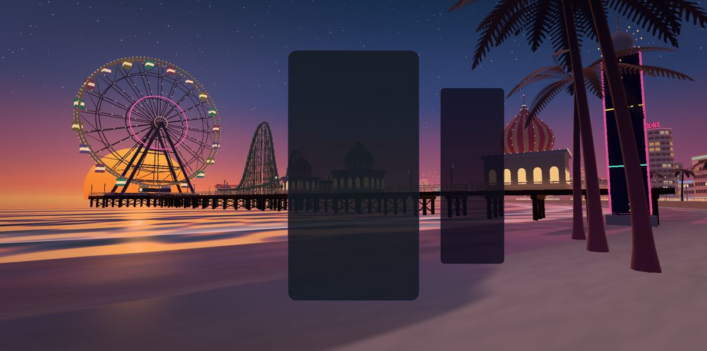 | 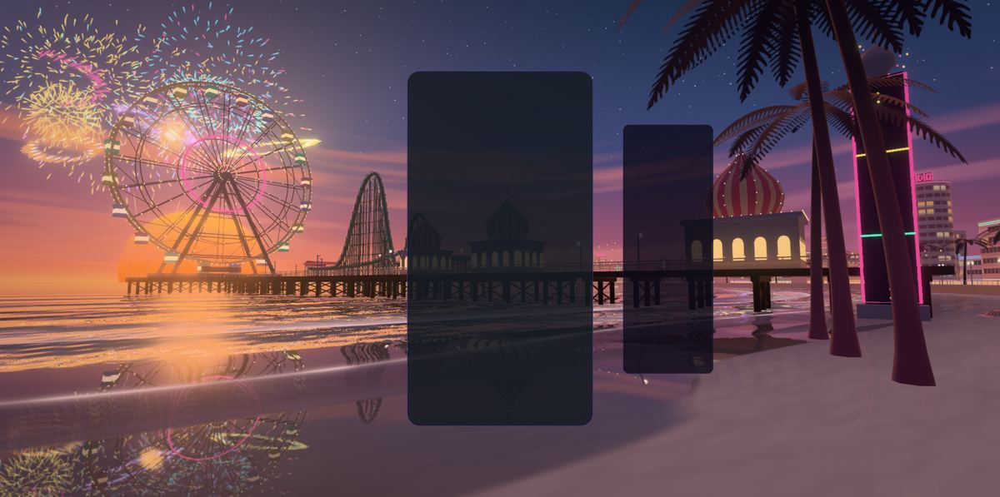 |
| 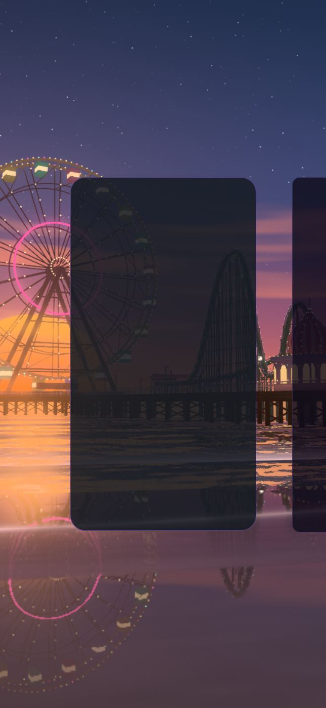 | 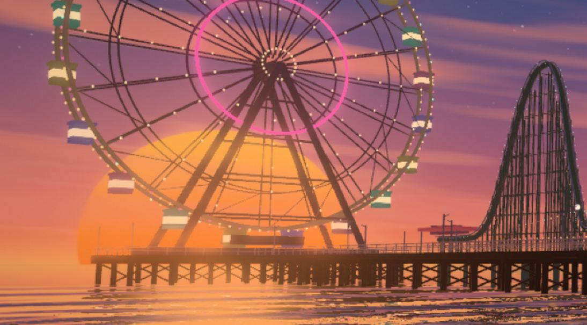 |
| 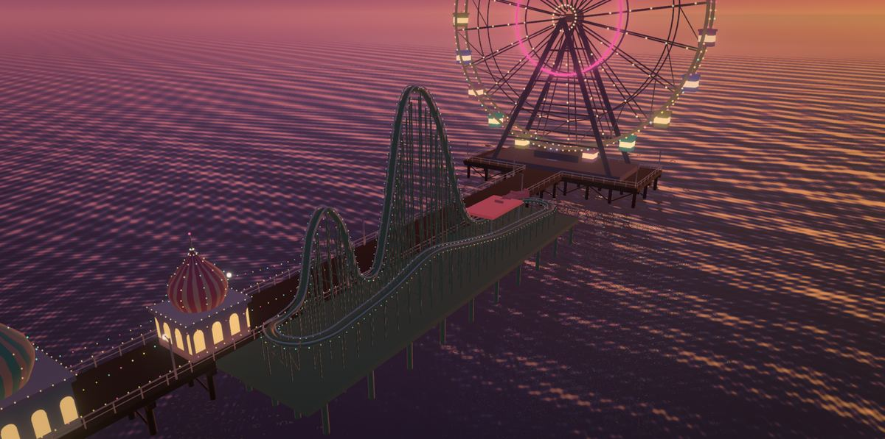 | 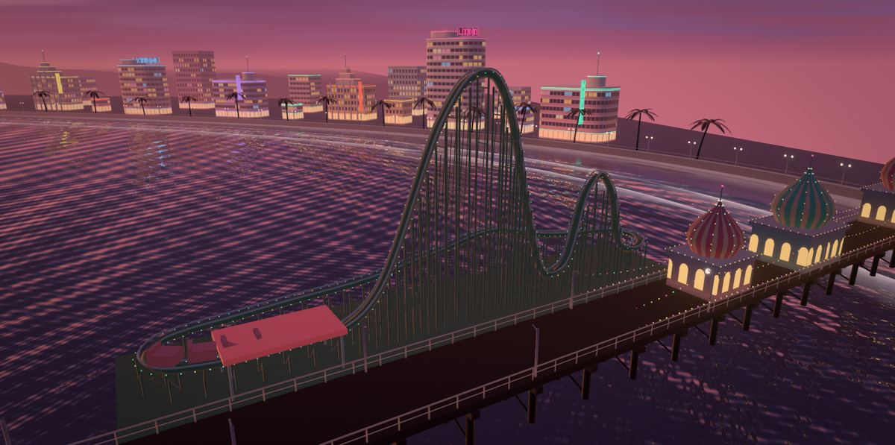 |

Tests: `tests/unit/synthwave-sunset-theme.test.js` (event staging and the true combo, the draw
list, the layout of sun, wheel and pier, solid winding, the hotels' prisms and sign letters and
that the town stays behind the seawall, the lock chase, the fireworks' placement and finale, the
coaster's notches, ride and closed circuit, the evening, Reduce flashing) and
`tests/unit/synthwave-sunset-shaders.test.js` (every material and the post output built for WGSL
and GLSL at High and Minimal, size budget, no `mx_*`, no equal-edge smoothstep, no NaN literals,
no unassigned reads including the normal builtins, pure `sw_*` helpers). Also green:
`theme-reduced-motion-batch-b`, `reduce-flashing`, `url-parameter-catalog`. The whole unit suite
ran: three failures (`game-over-modal-result-compatibility`, `odyssey-level-briefing`,
`records-view`) fail the same way on a clean `main` (8d0cd0cd) and are not this change's.

Performance (playground, High, live, GPU timestamps, 1980×985 buffer, 4× MSAA, this machine's
NVIDIA Blackwell GPU), with the town and the closed coaster: GPU p50 0.36 ms, p95 0.38 ms; CPU p50
0.6 ms; no dropped frames over 2117 (0.34 / 0.36 ms before the hotels were rebuilt).
The old theme's last record measured 0.39 ms p50 on an RTX 3070 in the perf lane; the two are not
the same instrument (ADR-0016), so this is a sanity check, not a comparison.

## Second pass (2026-10-21): the air, the shore, the evening

The first build had the place; it lacked the air between the eye and the place, and its shore
gave itself away (a hard white line across the frame, flat sand, a mirror that tore into blocks).
Everything below is in the same modules, on every tier unless the table says otherwise.

| Before | After (High, native WebGPU) |
| --- | --- |
| 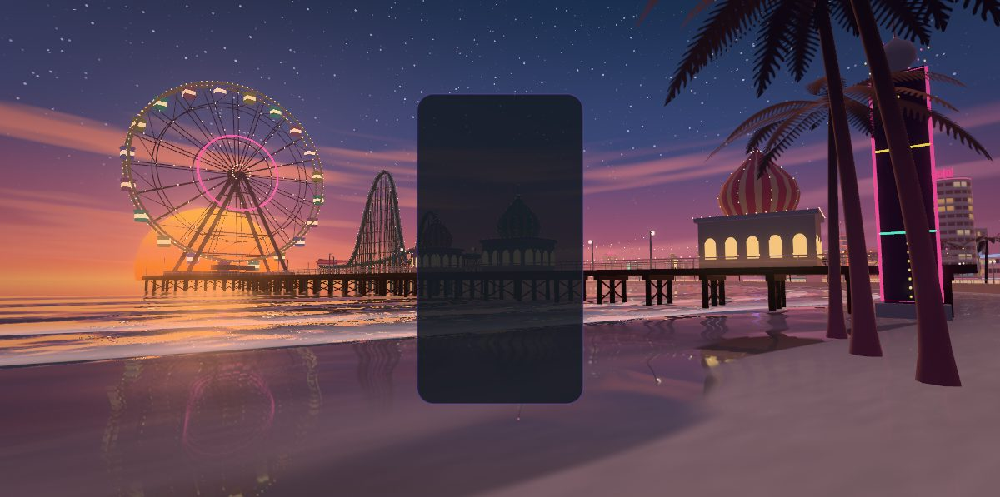 | 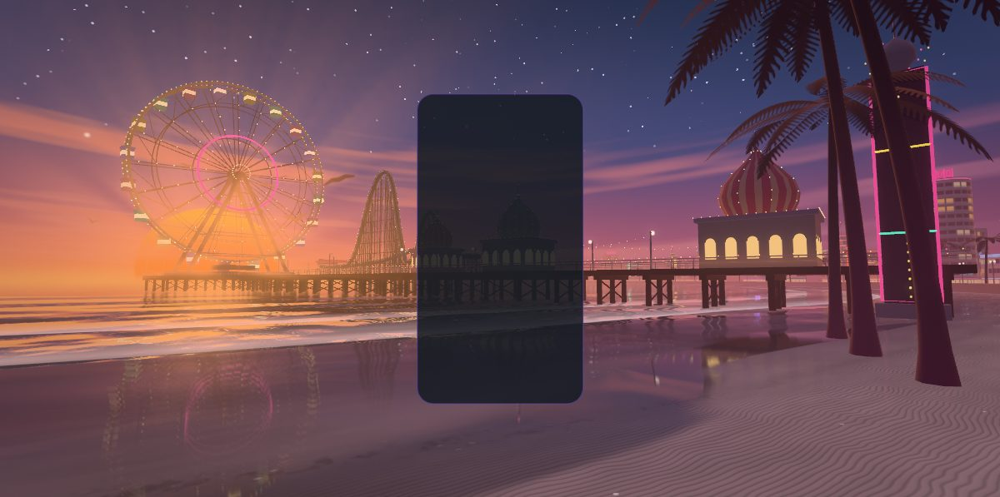 |
| 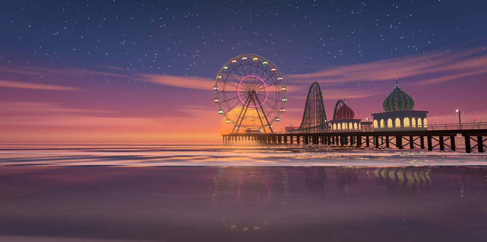 | 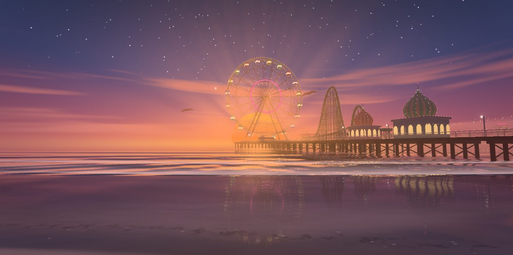 |
| 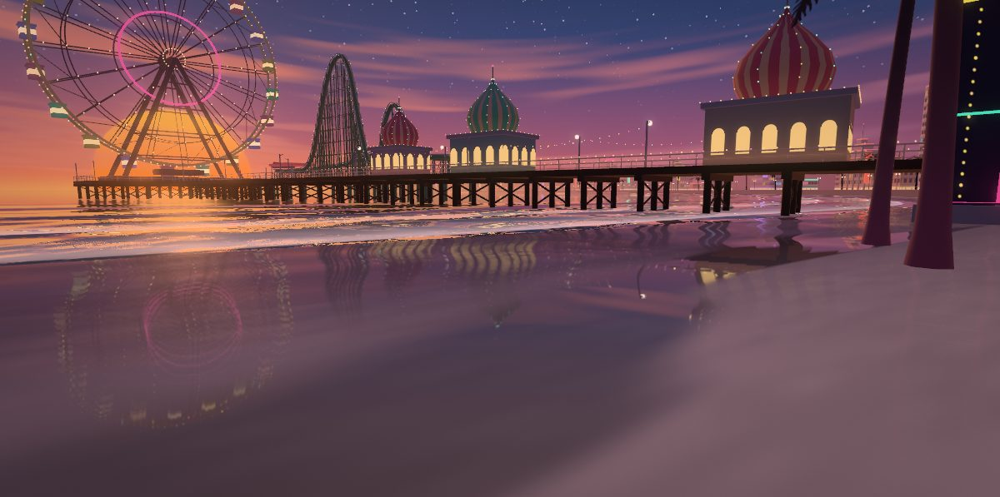 | 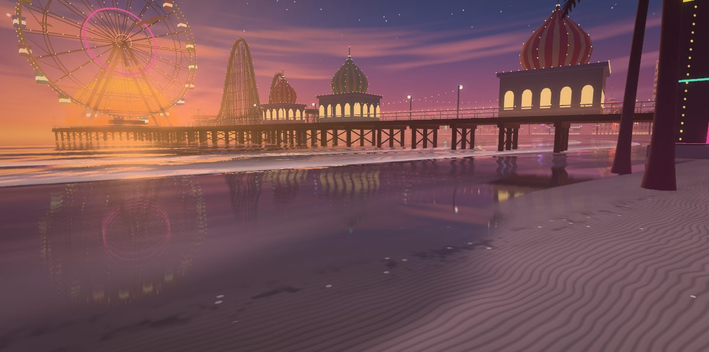 |
| 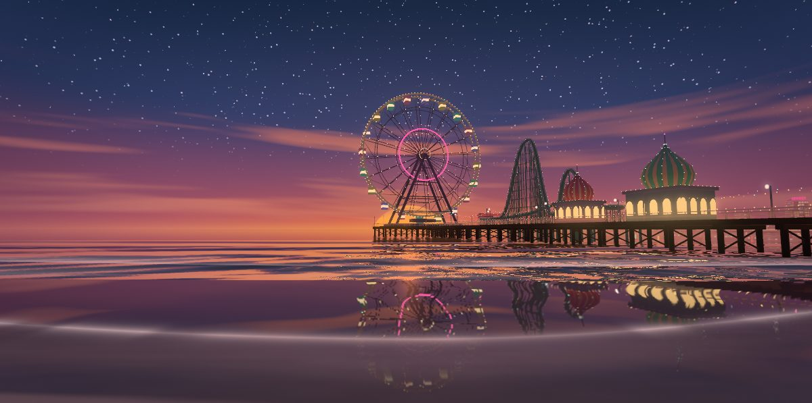 | 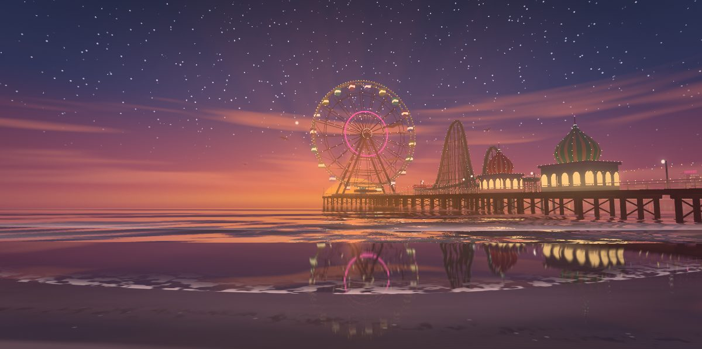 |
| 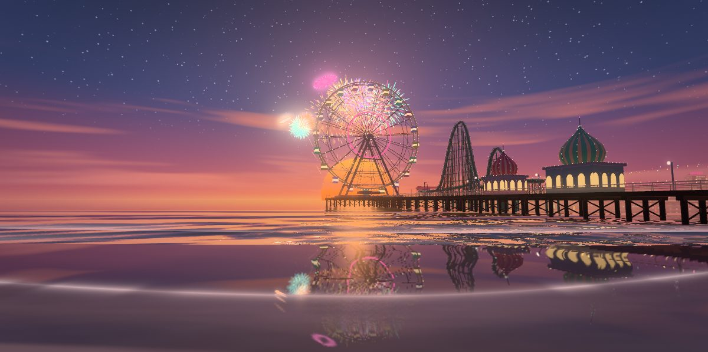 | 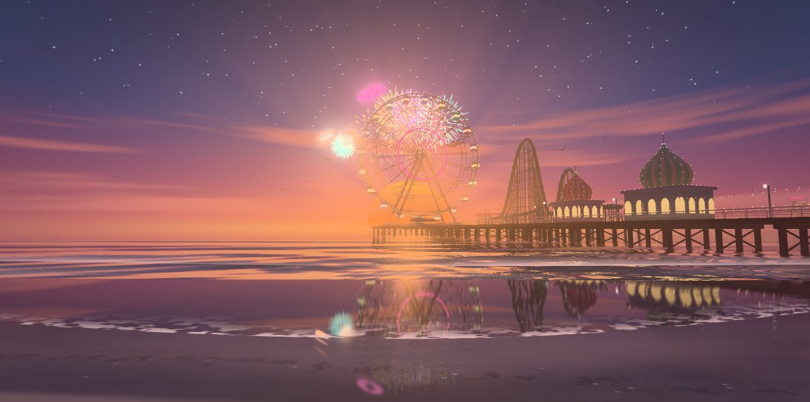 |

### What changed

- **Sea mist** (`-post.js`, `MIST`). An exponential height fog hugging the water (density 1/420
  per metre at sea level, scale height 12 m), integrated in closed form along each view ray to
  what the scene's depth says it meets, in the output pass. It is lit by the horizon's own colour
  on that bearing (`swSkyGradient` along the flattened ray, so far things dissolve into the sky
  that meets them) and warmed toward the sun. The pier's piles and the wheel's foot are hazed while
  its crown stays clear; the town round the bay fades into it; the sand underfoot takes under 3 %.
  Over the sky (whose gradient already holds the air) only `overSky` = 40 % of it is laid, which is
  still enough to sink the setting sun's lower limb into a warm band. `mistOpticalDepth` is its JS
  twin, and a test pins those shares.
- **The sun's shafts through the wheel** (`-post.js`, `SHAFTS`, Medium and up). Three small passes
  at `shaftScale` resolution: the emitters (where four depth taps say sky, the sun's own disc and
  aureole computed from where it stands on screen), a radial march of `shafts` taps toward the sun,
  and a six-tap fill over one of its steps (the breathing stage's two short marches: N + M taps
  for the smoothness of N × M, no jitter). The spokes, the cabins and the pier cut dark lanes into
  the light. Held back over the disc itself (`overDisc`) so the sun keeps its edge, faded to 15 %
  once it is down.
- **The swash** (`-sea.js`). The uprush's front is foam piled at the sheet's leading edge, crisp in
  front and thinning out behind over a width that wanders along the beach, holed into lace in the
  sheet's own coordinates (the holes ride up with it); a front thinner than its pixel is drawn no
  brighter than the share it covers, so the far swash is a soft seam, not a white wire across the
  frame. Where the sheet stops, a wavy swash mark of bubbles lingers while it drains.
- **The sand** (`-sea.js`, Medium and up). Wind ripples above the highest swash (crests about a hand
  apart, wandering and forking, asymmetric, patchy, each faded by its footprint), the wrack line of
  the last high tide (seaweed in clumps along a wavy band, softened to its mean where the clumps
  are under a pixel) and shells along it and, thinly, over the dry sand. The sun and the bright
  western sky light the faces turned toward them, so the ripples read; after sunset the light comes
  from above.
- **The mirror on the water.** The reflection's screen-space shift is held to 3 % across and 5 %
  down the screen (the eight trains' summed slope used to shift it by a fifth and tear the pier
  into blocks), and the image is drawn down into short streaks on the water as on the wet sand.
- **The evening sky** (`-tsl.js`). The stars come out in order of brightness: in the menu's early
  dusk only the brightest fifth, by nightfall all of them, fewer low in the bright west. The
  evening star (`EVENING_STAR`) hangs left of the sun above the cirrus, steady and warm with a soft
  halo, brighter as the sky darkens.
- **Gulls** (`-gulls.js`). Seven (by tier) wheel over the pier, each on its own slow loop in the
  free sky beside the board (bearings about −24° to +32° of the sun, 38–140 m out), the loop's
  centre drifting so none repeats. The silhouette is drawn in the fragment shader (a body, two
  wings bent at the wrist into an M, their dihedral from the vertex stage: long glides broken by
  bouts of flapping, banked into the turn) and catches a warm rim toward the sun. They glide slower
  under Reduce motion (`u.gullTime` lags the clock like the wheel) and go to roost by full dusk.

### Gotcha found on the way

- **Screen-space shafts from the frame's bright sky take any light that draws no depth for sky.**
  The first emitter was the scene's colour wherever the depth said sky: the wheel's bulbs and the
  fireworks (additive, no depth write) passed for sky, and a finale near the sun threw searchlight
  beams across the frame. The emitter is now the sun's own disc and aureole, computed from its
  screen position, with the depth only as the mask; the bright scene is never read. (Recorded in
  the `webgpu-threejs-tsl` skill's table.)

### Tiers (additions)

| Tier | Shafts (taps / resolution) | Sand detail | Gulls |
| --- | --- | --- | --- |
| Minimal | none | no | 3 |
| Low | none | no | 4 |
| Medium | 14 / 0.25 | yes | 5 |
| High | 20 / 0.35 | yes | 7 |
| Ultra | 24 / 0.4 | yes | 8 |
| Extreme | 28 / 0.5 | yes | 9 |

The sea mist and the evening sky are on every tier. Playground: `noMist=1` and `noShafts=1` turn
the two post effects off for an A/B; `parts=` knows `gulls`.

### Verification

Single-effect playground captures (`?effect=synthwave-sunset`, 1584 × 787 and 1200 × 597, the mock
solo board unless `board=0`) from a scratch Electron script against a private dev server, the
before shots from a detached `origin/main` worktree on a second server: the game view, the menu,
the beach close-up (`eye=6,2.2,17&aim=16,0,2&fov=55`) at three swash phases, nightfall
(`dusk=0.55`, `0.88`), the four-line finale, Medium, Low, Minimal, the WebGL2 backend
(`forceWebGL=1`) and a 430 × 932 portrait. No WebGPU validation errors or TSL warnings on either
backend.

Tests: the shader gate now builds the post with the world's uniforms, so the mist and all three
shaft passes are built for WGSL and GLSL at High and Minimal under the same checks (size, no
`mx_*`, no equal-edge smoothstep, no NaN literals, no unassigned reads), and checks the shafts
exist exactly on the tiers that ask for them. `synthwave-sunset-theme.test.js` adds the gulls' loops
(in the free sky, low over the sea, at every time over ten minutes; one draw a tier) and the
mist's shares (the near sand, the pier's foot, the wheel's crown, the horizon, the sun's centre).

Cost (playground, High, 2560 × 1600, GPU timestamps, RTX 5080 Laptop, four interleaved rounds
against `origin/main`): the medians were about 0.8 ms before and 1.15 ms after, the shafts about
0.2 ms of the difference and the mist under 0.1 ms. Other sessions were using the GPU throughout
and single rounds swung by 2×, so these are an order of magnitude, not a measurement. The first
shaft build read the multisampled scene and depth at every tap and cost twice as much; the emitter
pass is what made it cheap. Not measured on the integrated Radeon.

## Known limits

- **Portrait.** The composition solver is unchanged: on an upright phone the sun goes to the left
  edge and the wheel sits partly behind the board. A hero-above-the-card framing for portrait is a
  follow-up.
- **The song** is the old theme's recording under the same title.
- **The reflection pass** adds one pipeline per mirrored material (its target has no MSAA).
- **The gulls are not mirrored** (camera-facing quads in a mirror pass would need their own
  orientation rules), and the shafts are screen-space: they vanish with the sun off screen, as
  in a portrait framing.
- **Neighbours.** The beach, palms and a sun on the sea remain shared ground with Luminous Tides
  and Sunset; the differences above (dusk, unlit surf, a built hero) are what keep them apart.
