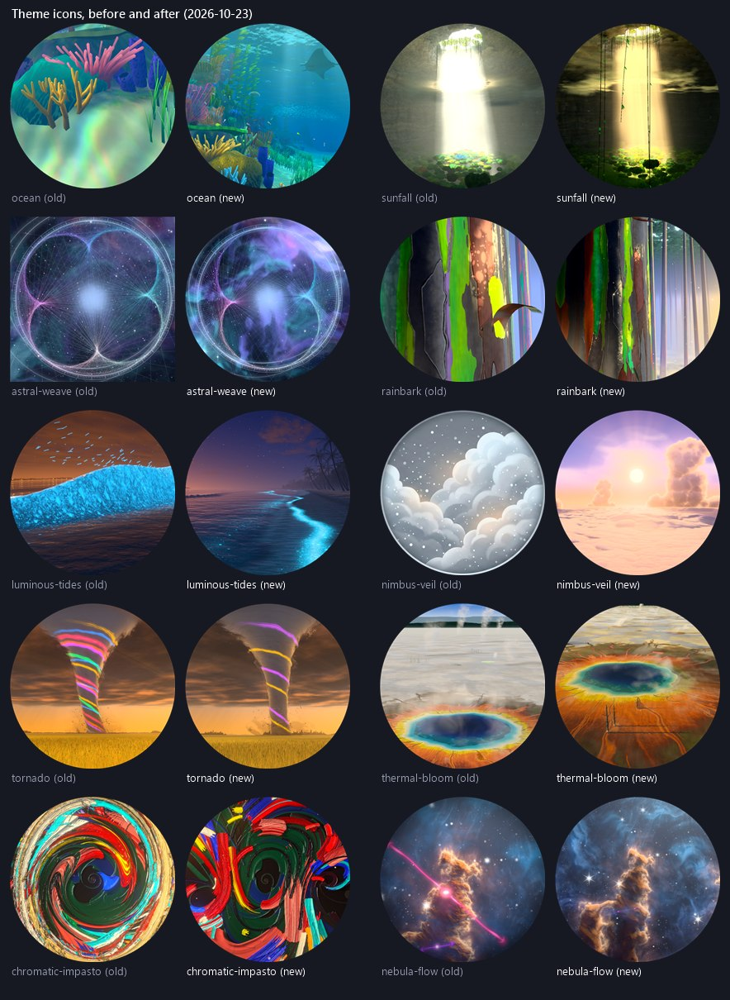

# Theme icon audit (2026-10-23)

**A record.** All 63 theme icons (`src/themes/<id>/<id>-theme-icon.png`) were reviewed against
the worlds they stand for, and the ten that did not show their theme well were re-baked from the
shipping world. The other 53 were kept.

## How the icons were judged

- Every icon at about 230 px and at the picker's size (~88 px), on the picker's dark ground, beside its
  neighbours.
- Every doubtful icon beside a fresh frame of its theme's current world (the playground at
  `36905f74`, `t=20`, High, a private dev server with its own dependency cache, the RTX adapter).
  Several worlds had been rebuilt since their icon was made.
- The new icons in the real game's Serenity Hub → Themes tab (a wide card that shows the middle
  band of the round image) and in the full picker line-up. No console errors in any capture.

## What changed

| theme | the old icon | the new icon |
| --- | --- | --- |
| Ocean | A coral close-up over a sickly iridescent sand smear; no water, no light. | The reef canyon as the game shows it: a manta in the light shafts, the coral wall and an elkhorn fan on the left, the silver school and the surface. |
| Sunfall | A blown-out white column in grey murk. | The doline from the game's eye under Amber Slant light: lianas in front, a warm defined column through the cloud deck landing gold on the canopy, the skylight's trees at the top. |
| Astral Weave | A square image, not a disc (the only one in the picker). | The same loom, rings and nebula as a disc. |
| Rainbark | An abstract bark close-up that did not read as a tree at picker size. | A painted trunk (lime, rust, maroon and slate peel) beside the misty sunlit grove. |
| Luminous Tides | A flat blue strip with a flock over it, chosen from SwiftShader renders. | The dusk beach: palms, the afterglow and a line of glowing surf curving in from the trees. |
| Nimbus Veil | A grey cartoon cloud with a white rim, in a style no other icon uses and from before the theme's rebuild. | The golden sea of cloud: the low sun, a towering cumulus and the cloud floor. |
| Tornado | A funnel wrapped in six neon ribbons, reading as a candy stripe. | The storm over the wheat at golden hour, holding two ribbons (the theme's lock signature, kept to a hint). |
| Thermal Bloom | The prismatic spring at the bottom under a flat grey basin taking the top half. | The spring at the centre: its rings, steam over the pool and the orange runoff channels. |
| Chromatic Impasto | A fisheye whorl that went beige and muddy at picker size. | The painting as it is: bold red, blue, teal, yellow and pink strokes round the dark green whorl. |
| Nebula Flow | The pillar crossed by a pink falling-piece trail that read as a stray laser. | The pillar's head against the blue nebula with its diffraction-spiked stars. |

Both copies were replaced: `src/themes/<id>/` (the one the build reads) and
`public/assets/themes/` (kept with the same bytes by convention). The public copy of Shifting
Sands, still the image from before its 2026-10-01 rebuild, was brought in line with its theme
folder. `public/assets/themes/forest-theme-icon.png` was left alone on purpose:
`scripts/build-win.mjs` uses it as the Windows application icon.

## Recipes

Frames from `/playground.html?effect=<id>&hud=0&<query>`, in a shown, off-screen Electron window
at device scale 1 (`force_high_performance_gpu`), 1024 × 1024 unless noted, 3 s after
`__PLAYGROUND_READY__` (Sunfall also waits for `diagnostics().assets === 'ready'`). The bake takes
a square of `crop` × the frame's short side centred at (`cx`, `cy`), resamples it to 512 px, applies
per channel `v = v^(1/gamma)`, then contrast about mid-grey, then saturation about Rec. 709 luma,
and cuts a disc with a 1.5 px anti-aliased edge on a transparent ground.

| theme | query | crop, centre | contrast, saturation, gamma |
| --- | --- | --- | --- |
| ocean | `t=20&icon=1&iconFov=50&iconYaw=0.3&iconPitch=-0.06&visit=mantaLoop&visitK=0.45` | 0.96 | 1.20, 1.28, 0.92 |
| sunfall | `t=20&eye=0,0,0&look=-185,10,-420,44&station=amber-slant` | 0.96 | 1.25, 1.35, 0.80 |
| astral-weave | `t=20` | 0.98 | 1.08, 1.12, 1 |
| rainbark | `t=20&icon=1&iconFov=54&iconYaw=14&iconPitch=8` | 0.96, (0.45, 0.5) | 1.12, 1.25, 1 |
| luminous-tides | `t=42` at 2400 × 1350 | 0.85, (0.66, 0.42) | 1.15, 1.25, 1 |
| nimbus-veil | `t=20&board=0` | 0.96 | 1.10, 1.15, 1 |
| tornado | `t=20&icon=1&iconFov=40&locks=2` | 0.96 | 1.12, 1.15, 1 |
| thermal-bloom | `t=20&icon=1&iconFov=46&iconPitch=-4&heat=0.8&breath=0.7` | 0.96, (0.5, 0.53) | 1.10, 1.12, 1 |
| chromatic-impasto | `t=20` | 0.98 | 1.05, 1.08, 1 |
| nebula-flow | `t=20&icon=1` | 0.96 | 1.10, 1.15, 1 |

Notes from the search:

- Sunfall's own `icon=1` lens (from over the void) frames the column as a wide flat block; every
  station and weather tried there looked like the old icon. The game's eye with a 44° lens puts the
  hanging lianas in front and narrows the column, and Amber Slant warms it. A gamma below 1 darkens
  the walls so the light carries.
- Ocean: a turn of 0.3 rad to the left brings the coral wall into frame; of the sea's visits, the
  looping manta is the one that sits in open water inside the disc.
- Luminous Tides: the icon lens looks at the breaking wave from the side (a flat band). The wide
  frame, cropped toward the palms, is the beach; at `t=42` the glowing surf draws one long curve.
- Chromatic Impasto's `icon=1` lens now frames a black margin beside the painting; the plain square
  frame was used instead.

## Kept, and why

The other 53 icons already show their theme's world and read at picker size. Some were looked at
closely and kept on purpose: Cosmic Noir (monochrome by design, and the lantern reads), Grainfields,
Halcyon Apex, Spring, Stillwater, Sunbraid and Verdant Hills (each shows the theme's own scene or
its signature event). Forest, Shifting Sands, Winter, Vesper Chrysalis and the other themes rebuilt
after their icon was made still match their worlds.

## Not done

- The Odyssey orbs reuse these files through `theme-icon-resolver.js`; they were not captured
  separately.
- The other images in `public/assets/themes/` (`astral-weave-icon.png`, `blood-moon-icon.png` and
  the six `*-hub-icon.png`) are referenced by nothing and were left as they are.
