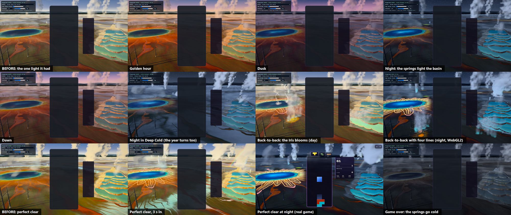

# Thermal Bloom — the living basin (2026-11-17)

An audit of the whole theme, then a pass on what it found. The picture, the build and the first
event language are in [THERMAL_BLOOM_VISUAL_OVERHAUL_2026-10.md](THERMAL_BLOOM_VISUAL_OVERHAUL_2026-10.md);
this record is what changed after it and why.

*Top-left and bottom-left are the theme as it was. The rest: the five hours, a night in Deep
Cold, the Iris's flower by day and by night, the perfect clear in the playground and in the real
game, and the cold game over.*

## The audit

Every part was captured at rest and in each event (playground, 1600 × 900, High, WebGPU) and the
code read beside the frames.

| Part | Found |
|---|---|
| The Iris, its bands and fingers | The best thing in the frame. Kept as it was. |
| Light | One flat morning, for ever. The year turned the ground's colours, but the light itself never changed, and nothing in a theme called Thermal Bloom glowed. |
| Sky | A plain cerulean band with cirrus; no hour, no stars. |
| Steam | Good at rest. Swollen (a perfect clear's far columns) it showed the march's jitter as a halftone, and sunlit it read cream rather than white. |
| Lock, hard drop, clear, level-up | Each had a shape of its own already (a spring, a jet, new sinter lips, a front along the fingers). Kept. |
| Four lines | The Chalice's eruption: a soft cream mass in the top-right corner. The biggest ordinary moment, and nearly the same picture as a three-line clear. |
| Back-to-back | The Consort's column: far off, top left, a few dozen pixels. In practice invisible. |
| Perfect clear | The Sleeper's column on the far rim, mostly behind the card and the HUD, and a wash over the ground. The biggest moment in the game looked like a rest frame. |
| Chain | The ladder of vents. "White-hot" at ten links did not read as hotter than six. |
| Game over | The Stair's pools drained and the picture muted by 15%: not seen. |
| Fast play | A hard drop a second piled a bank of steam over the Stair, hiding it. |
| Pieces and UI | The palette is the basin's own minerals and is checked for colour vision; the card and HUD are the game's. Nothing to change. |

## What changed

### The day turns

Beside the year (six seasons, 100 s each, a level a step) the basin now has a day:
`thermal-bloom-hours.js`. Five hours, 130 s each, on the clock alone: **Morning** (the look the
theme was built in, unchanged), **Golden Hour**, **Dusk**, **Night**, **Dawn**. A day is 650 s and
a year 600 s, so the two never meet the same way twice in a session: thirty looks, always on
their way to the next.

The sun does not move (the one rainbow needs it behind the left shoulder). What turns is its
light. Every material already read its light from a few uniforms, so an hour is
`season × mul + add` on the sun's colour, the zenith, the haze and the pearl, plus:

- `land`: the light on what the backdrop paints unlit (the forest rim, the plateau, snow);
- `twilight`, `earthShadow`: the rose band that stands over the far range opposite a sun below
  the horizon, and the earth's blue shadow under it;
- `alpen`: the last (or first) sunlight on what stands tall, so at dusk and dawn the steam
  columns' crowns blush while their feet are in shade;
- `stars`: the night sky (two layers of stars, the galaxy's band rising left of the card, a
  falling star in about one slot in three of 5.5 s);
- `shadow`, `shadowLong`: a sun below the horizon casts no shadows, and the ends of the day lay
  them long;
- `exposure`, `sat`, the grade: the eye opens at night (1.8×) instead of the light being raised.

Steam takes the hour too: its shade is the sky's (`tbSteamShade`), and under a moon it is pale,
the brightest thing in the landscape, never the dark grey of smoke (`tbSteamSun`).

### The heat shows as the light falls

`u.glow` is the springs' own light: 0 by day, 0.6 at night. The Iris is lit from its throat
(azure out of the deep, the ledges dark against it, the shelf a pale ring), the hottest bands
smoulder, the runoff channels carry thin veins of light that die away down the fingers, the
Stair's pools are lanterns, the jewel pools and the far vents small lamps. Drops and the
eruption's water catch it. By night the basin is lit from below.

Play raises the same light at any hour: the chain link by link (so ten links read hotter than
six), a fever, four lines, a perfect clear. A game over puts it out.

### Events

| Event | Before | Now |
|---|---|---|
| lock, hard drop, clear, T-spin, level | as in the first record | Unchanged in shape. Quick locks no longer pile steam: each newer boil-over close by halves what an older one still breathes. The devils are a third fuller. |
| chain | the ladder | The ladder, and the basin's own light rising with it. |
| four lines | the Chalice's column | The column, lit from its vent as the light falls, and a paler single bow standing in the air behind it while it rains (`thermal-bloom-aura.js`). |
| back-to-back | the Consort's far column | **The Iris blooms**: a flower of light opens out of its rim, drawn in lines (pointed petals in two rows, each an outline with three veins), turquoise-white at the rim through straw and apricot to rose at the tips. Ten petals a row at the first, more and longer the deeper the chain; quick ones build one flower. The eye flares with it. The Consort still answers. |
| perfect clear | the Sleeper, a wash | **The whole basin answers**: every petal of the flower, held open seven seconds longer; the Sleeper, the Consort and the Chalice erupt together (the only time three columns stand); the far columns swell near to far; and the **great bow**, a shower's double rainbow, stands from the floor into the sky for some fifteen seconds. By night it is a moonbow, nearly white. |
| game over | a 15% mute | **The springs go cold**: the living colour bleaches toward pale sinter, their light goes out, the eye draws back, the steam thins. It holds nine seconds and warms again by itself, so a menu behind a finished run is never left dead; a new run warms it at once. |

By themselves, between events: the far columns erupt on their own clocks (each every 64–150 s,
fifteen seconds of a taller, denser column, none in a session's first 45 s), lit pale from below
by night.

### Steam

- Sunlit steam is whiter (the sun's colour at 52% on it, was 70%).
- The halftone is gone from the swollen bodies: the upsample of the reduced march is nearly a
  box over its nine taps (interleaved gradient noise only cancels over a whole 3 × 3 block), a
  body's billows are never finer than the march can resolve, erosion eases where a step is
  longer than an erosion cell, and a coarse step's optical depth is capped.

## How it is built

| Module | Role |
|---|---|
| `thermal-bloom-hours.js` (new) | Three-free: the hours' table, the day's wheel, the blend. |
| `thermal-bloom-aura.js` (new) | The great bow: one camera-facing sheet 360 m out, depth-tested (the Stair and the Chalice stand in front of the shower), additive, not drawn while no bow stands. Part of `fx`. |
| `thermal-bloom-world.js` | Blends the hour into the light uniforms (`writeSeasonAir`), the springs' light (`playGlow`), `bloomIris`, `greatBowAt`, `farEruption`, `cold`, the boil-overs' crowding. |
| `thermal-bloom-tsl.js` | The new uniforms; `tbUnderLight`, `tbSteamSun`, `tbSteamShade`, `tbBowLight`, `tbCardClear`; the twilight band in `tbSky`. |
| `thermal-bloom-sky.js` | Stars, the galaxy, falling stars (a uniform branch: nothing by day), alpenglow on the far range. |
| `thermal-bloom-basin.js` | The Iris's light, the embers, the flower, the cold. |
| `thermal-bloom-terraces.js`, `-geyser.js`, `-bursts.js`, `-vapour.js`, `-steam.js`, `-devils.js`, `-fumaroles.js` | Each takes the hour's light and the springs' glow where it used a constant. |
| `thermal-bloom-post.js` | The calm zone's cap follows the exposure. |

Nothing is loaded from disk, as before. Every tier keeps the whole of it: an hour is uniforms,
the flower and the stars are uniform branches, the bow is one quad.

## Cost

GPU time a frame, 1920 × 1080, High, WebGPU on the RTX, the playground capped at 30 fps
(`profile=1&trackTimestamp=1`), main against this branch:

| Frame | main | branch |
|---|---|---|
| rest, morning | 1.98 ms | 1.99 ms |
| four lines, 2.5 s in | 2.44 ms | 2.53 ms |
| perfect clear, 7 s in | 1.99 ms | 1.87 ms |
| ten-link chain | 2.94 ms | 2.64 ms |
| rest, night | — | 1.80 ms |
| back-to-back, flower open | — | 2.55 ms |

Within the noise of eight samples a case. Not measured: the integrated GPU, and an uncapped
frame rate (the owner's call).

## Verification

- **Playground**: every hour at rest, two season mixes, and every event by day and by night, on
  WebGPU; night, dusk and the perfect clear on the WebGL2 backend; Minimal and Low; an upright
  phone (390 × 844) and 21:9. Clean console in every capture.
- **Real game** (headless Chrome, real hard drops): a run through the hours with four lines, a
  back-to-back four, a perfect clear at night and a game over. No dropped events, no theme
  warnings, the board easy to read in every hour.
- **An independent critic** judged the first round against the old frames: variety over time
  3 → 8, spectacle 4 → 6.5, light 6.5 → 7.5, but readability 7.5 → 6. It named the night as
  "a lava field in neon", the first flower as "a fried egg", the perfect clear as having no
  shape of its own, a glow showing through the card, and one regression (the Stair's pools had
  gone from teal-to-mint to flat blue by day). The second round answers each: the night's glow
  cut and its channels thinned to veins, more moon, the flower redrawn in lines, the three
  geysers and the held flower for the perfect clear, the events' light kept off the card
  (`tbCardClear`), and the pools' day colour restored. The second round was not re-judged by a
  critic.
- **Tests**: `tests/unit/thermal-bloom-living.test.js` (18) and the theme's twelve other files,
  271 in all with the URL catalogue, pass; the WGSL builds at Minimal and Ultra include the new
  part. Lint is at main's count for these files.

## Open calls for the owner

These are judgements I made that you may see differently:

1. **Night as a look at all.** It is the theme's name made visible, and the board reads well on
   it, but it is far from the morning the theme shipped with. `HOURS` in `thermal-bloom-hours.js`
   holds every number; dropping an hour is deleting its entry.
2. **How strong the glow is.** Rest at night is 0.6; a perfect clear lifts it to about 0.9.
   The first round (0.82, with the channels lit along their whole length) was judged neon.
3. **The flower's rose tips** are the palette's Streamer Rose; the critic found the first
   version's pink flat. They are thin lines now.
4. **The bow is only a leg**, on the Stair's side: with the sun off the left shoulder that is
   where a rainbow stands. A full arch over the board would look grander and be wrong against
   the snags' shadows.
5. **Shadows keep their direction** in every hour; only their length and strength change. A sun
   that moved would move the bow off the Chalice.
6. **Not done**: wildlife (the brief did not ask; birds or bison would be a pass of their own),
   the lock spring's hexagonal core and the Seal's scribbled foam (both older, both named by
   the critic), the theme icon and `docs/theme-screenshots` still show the morning only.

## Reproduce

`npm run dev:playground`, then `playground.html?effect=thermal-bloom&maxFps=30&board=1&…`:

| Frame | Query |
|---|---|
| an hour | `t=40&hour=0…4` (or `hour=night`, `hour=2.5`) |
| a season with it | `t=300&hour=3` (Deep Cold by night) |
| back-to-back | `t=40&event=b2b&b2b=2&lines=2&row=13&eventAge=1.4` (`lines=4`: with four lines) |
| perfect clear | `t=20&event=perfect&eventAge=3` and `…=7`; add `hour=3` for the moonbow |
| four lines at night | `t=40&event=quad&row=16&eventAge=2.5&hour=3` |
| game over | `t=40&locks=8&event=gameOver&eventAge=4` |
| the steam close up | `t=20&event=perfect&eventAge=8&cam=0,44,0,300,120,-600,24` |

Real game: `?skipIntro=1&unlockAll=1&themeValidation=1`, pick Thermal Bloom; the live theme is
`window.__THERMAL_BLOOM__` (`.world.hold('hour', 3)` holds the night).
