# Verdant Hills — a windy day on the downs (visual overhaul, 2026-10-09)

**Status: implemented (branch `feature/verdant-hills-masterpiece`). A record of what was built
and how it was checked — not a backlog.** Replaces the single-file scene of sine-wave hills,
sphere trees and crossed grass quads.

| Before | After (High, native WebGPU) |
| --- | --- |
| 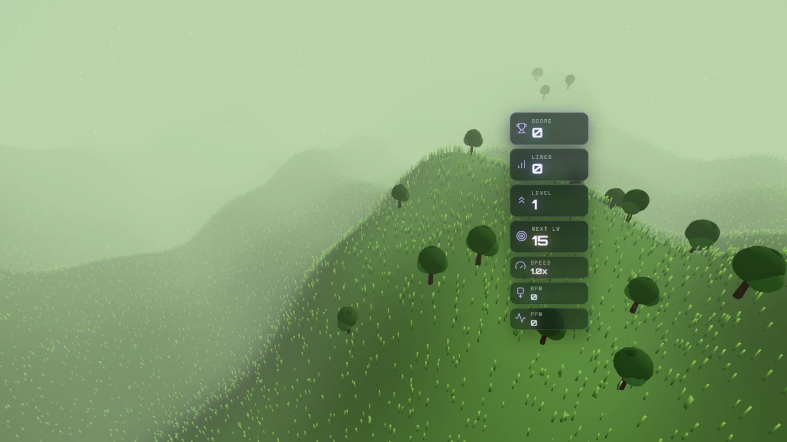 | 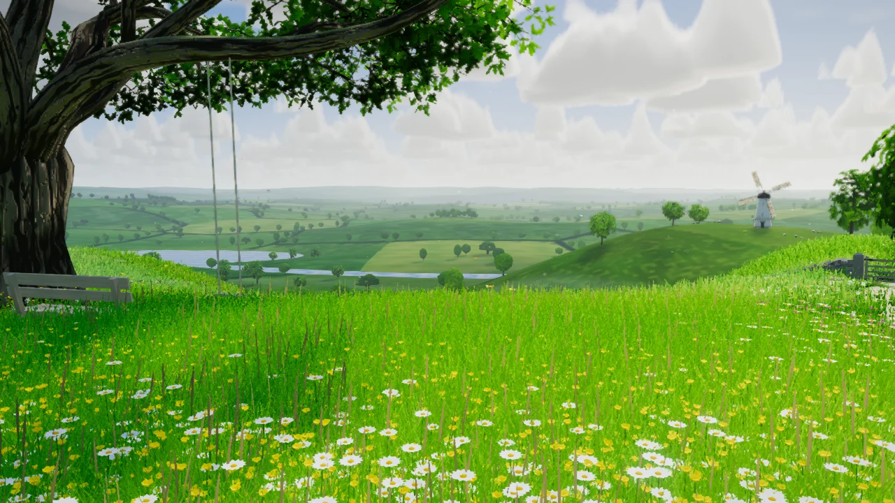 |

## What the player sees

The same place as before — rolling green hills, round-crowned trees, haze in the distance, wind
in the grass — now built as a world. The lens stands in deep grass on the crown of a hill of
the downs. Straight ahead the hill falls steeply away, so past a brow of buttercups, daisies
and clover the eye drops into a wide valley: a tarn, a river, a patchwork of pastures parted
by hedgerows and dotted with trees, and ridge behind ridge into the haze. On the left an old
oak stands at the edge of the frame with a bench at its foot and a rope swing under its long
bough; on the right a chalk path runs down a spur past a drystone wall and a gate, and beyond
the spur's foot a white windmill turns on the next hill.

Over all of it stands a sky of fair-weather cumulus, and their shadows drift across the
valley: every shadow on the grass belongs to a cloud overhead, because both are the same
field. The wind shows as bands of light travelling through the grass, in the windmill's sails,
in the swing, and in thin bright ribbons that the breeze now and then draws across the hill.

The board card hides the middle quarter of a landscape screen, so the picture is composed for
the two side thirds: the oak and the open sky the kites fly in on the left, the windmill, the
wall and the gate on the right (in single player the score card stands on that side, beside
the windmill, over the part of the sky the sun is in). Portrait keeps the same world, turned
a little toward the oak.

## Seven kites

Each tetromino is a kite, and the piece colours are the kites' own:

| Piece | Kite | | Piece | Kite |
| --- | --- | --- | --- | --- |
| I | poppy red | | Z | teal |
| O | cerulean | | J | tangerine |
| T | sunflower | | L | violet |
| S | fuchsia | | | |

Which colour goes with which piece is not arbitrary: the project's palette gate
(`npm run check:palette`) screens every theme against the shape-to-colour mapping that is
familiar from other block games, and this assignment matches none of its seven roles.

Five kites are flown from posts on the left-hand spur into the open sky left of the board,
two from the right-hand spur over the windmill.

## How the hills answer the game

`VerdantHillsReactions` is a pure director; `VerdantHillsFxDirector` turns its cues into
ribbons of wind drawn from the board card's edge, seed and chaff thrown out from behind it,
gusts sent through the grass from the foot of the board, and light let down between the
clouds.

| Event | Response |
| --- | --- |
| Piece lock | A ribbon of wind in the colour of the piece's kite curls away from the card's edge beside it and throws a loop; dandelion seed and chaff puff out; a gust spreads through the grass from the foot of the board; and that piece's kite goes up on its line, where it flies for twenty seconds. |
| Hard drop | A stronger ribbon and gust, and from a long drop the dandelion clocks are shaken: seed lifts off the grass where the piece came down. |
| Line clear (1–3) | White ribbons stream from both sides of the card at the cleared rows, with petals, chaff and seed blown out beside them; the wind freshens, so the clouds, the grass, the windmill and the swing all quicken; every flying kite climbs. From two lines a front of wind crosses the hill and runs away down the valley. |
| Four lines | All of that, long ribbons laid across the whole view, seed and petals lifting off the hilltop, leaves torn from the oak, the swallows going up — and the clouds open: the valley falls into shade and a pool of sunlight with its shaft crosses the hills from left to right. |
| Combo / streak | The wind winds around the board: a whirl of ribbons, one to each half-turn, with seed and petals caught in it. Cascade depth (`COMBO`) or consecutive clearing locks raise it; it climbs, quickens, and takes the kites' colours as it builds. A lock without a clear ends the streak and the whirl unwinds. |
| The kite festival | Seven kites in the air at once: a ribbon in each kite's colour fans up from behind the board, every kite climbs to the top of its line, and the clouds open. It needs some kites to come down before it can happen again. |
| T-spin | Twin spirals of wind beside the board, one in the T piece's sunflower. |
| Back-to-back | Holds the whirl and the kites' height, and lifts the light. |
| Perfect clear / level up | The whole day exhales: wind, ribbons, light, wings (a perfect clear also puts all seven kites up). |
| Game over | The wind dies: the kites come down, the grass stands, the clouds slow. |

Everything honours `backgroundComboEffects` and `pieceLockRipple`, pauses with the theme, and
is driven by simulation seconds. No event allocates: ribbons, kites, gusts and emitters are
rows in fixed uniform arrays, and seed comes from a fixed hidden reserve.

| Lock | Two lines | Four lines |
| --- | --- | --- |
| 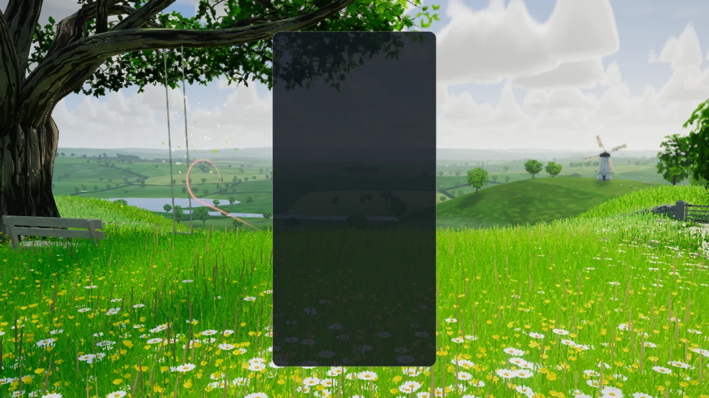 | 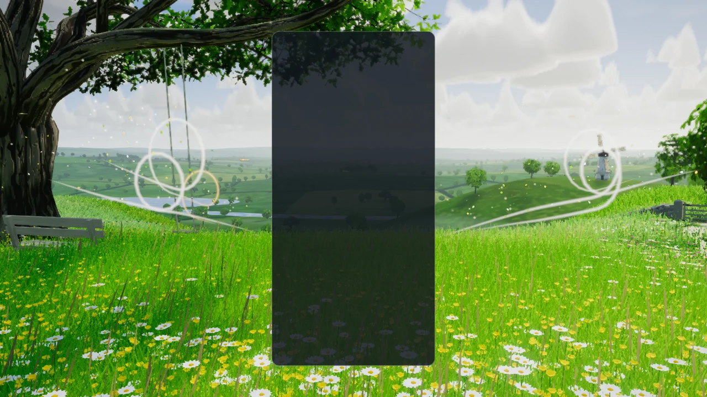 | 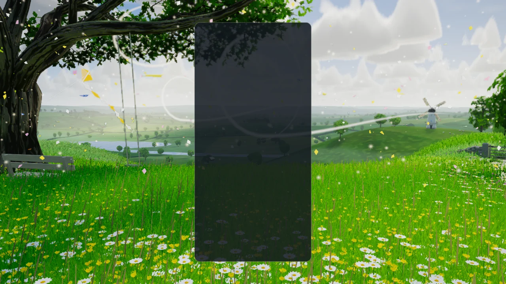 |

| Seven kites | Combo, held | In the game |
| --- | --- | --- |
| 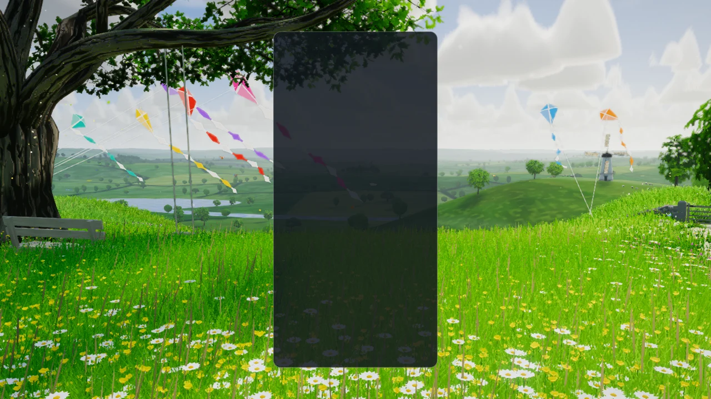 | 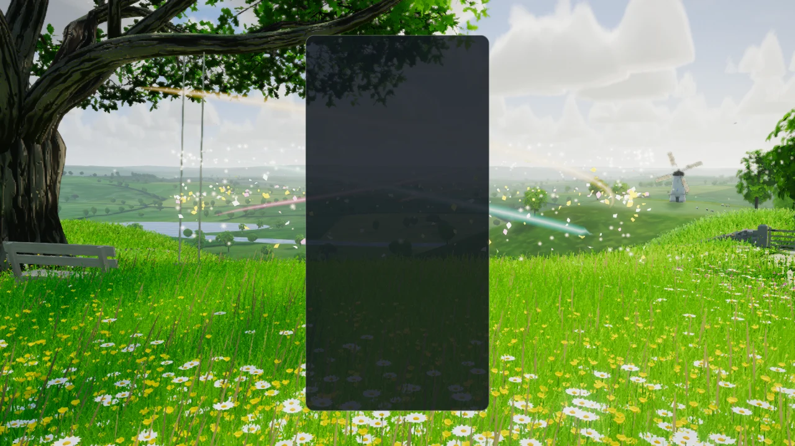 | 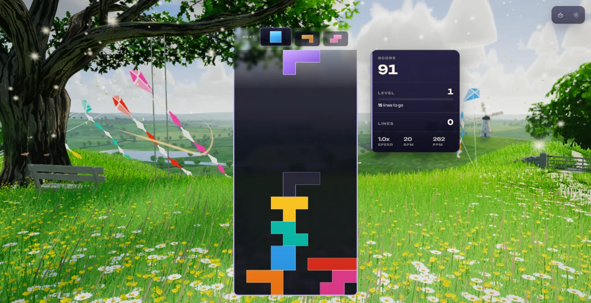 |

### The visual pass (2026-10-21)

A look at the day with fresh eyes, keeping everything it already was.

- **Cumulus with a shaded side.** The sun's ray lost half its light crossing a whole
  kilometre-deep cloud (`SIGMA_SUN` 0.0062), so every cloud was as white turned from the
  sun as toward it. It is 0.018: the far side of a heap is grey and the sun shows at its
  edges as a silver lining. Skylight now brightens a cloud from its flat grey base up its
  tower instead of lighting it evenly.
- **Rounded tops, not tents.** The billows that lifted a cloud's top were distances to a
  cell's heart, highest on the creases between cells, and lifted it by up to half the slab
  over cells only some 250 m across: every heap stood a 500 m spire on each crease and read
  as a row of pyramids. The lift is turned over (highest at a cell's heart), blurred, eased
  and about as tall as a cell is wide, so each one is a rounded bulge; the billows that
  carve the skin are squared, so their hearts are rounded lumps and the creases stay sharp.
- **A June sward, not lime.** The near grass lit a blade by the sun's angle to either side
  of it, so with the sun ahead every blade was lit from the front, and its glow was a
  saturated lime. Now only the face turned to the sun is sunlit and light comes through a
  blade seen against it; the greens are deeper and less saturated, and patches lean warmer
  or cooler, so the meadow reads as grass. Flowers are lit the same way.
- **The far bank in the water.** The tarn and the river were the sky's colour laid on the
  valley floor. Seen from the hill the water reflects a ray that rises as steeply as the
  eye's falls, so a bank, hedge or tree standing within h / tan(fall) beyond a point shows in
  the water instead of the sky. Four steps along the line of sight in the land map find the
  nearest land and how tall what stands on it is; there the water shows the bank's green,
  darker and greyer, broken into streaks across the line of sight by the ripples.

Checked in the playground at High and Low on native WebGPU, 1920×1080, 1280×720 and
390×844: idle, lock, four lines, festival; clean consoles. GPU per frame at 1080p,
interleaved against the day before the pass: about 4.0 ms against 4.1 ms (within run-to-run
noise). `tests/unit/verdant-hills-*.test.js`: 832 tests.

### Fluffy cumulus (2026-10-26)

Olov: "In verdant hills i want fluffier and better clouds, now they looks like triangles or
cones." Seen through a long lens they were shark fins, gumdrops and stacked slabs with furry
streaks down their flanks, and from the game's view a row of pale grey cut-outs.

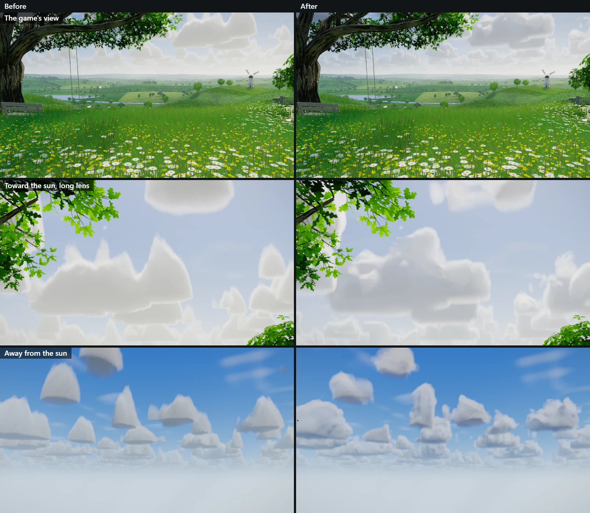

- **Why cones.** A heap's top was the square root of the cloud field, and the field is a sum
  of smooth mounds, `(1 − r²/s²)²` each: the square root of one is a paraboloid, which from
  the side is a cone, and every smaller mound on it stood a spire. The billows that carved the
  skin were flat noise stood on end and leant with height, so each was a slanted column: the
  shark fins, and the streaks.
- **The heap.** The field still says where a heap stands (so every shadow on the grass still
  belongs to a cloud overhead), but its height is read from the field blurred to the size of
  its heaps (mip 3.2), so each heap is one broad dome. `cloudHeap()` turns that into how far
  inside the heap a point is, in metres: below its top, in from its margin, the two met in a
  rounded shoulder; the base stays the flat condensation level.
- **The lobes.** A tileable 64³ volume of 3D noise (`verdant-hills-cloud-volume.js`: R is
  Perlin–Worley, round masses on masses; B a finer cellular fBm) pushes that skin out by up to
  ~400 m over the heart of each lobe and in between them, and the finer billows ~100 m more,
  fading beyond 14 km where they would only be grain. The volume rides in the field's frame,
  so the lobes travel with their cloud.
- **The light.** Distance now dissolves a cloud into the sky's own colour along the ray, not
  the milk of the horizon (which turned every cloud the same pale grey). Sky light follows how
  far up its own heap a point stands, and the lobe reading at the skin (high on a crown, low in
  a crease) shades each billow, so a heap reads as a cauliflower on the face turned from the
  sun too. Light that has scattered many times is softer at every order.
- **The march.** It strides long through clear air (as far as the nearest heap allows) and
  short in and near cloud; one even stride had been ~400 m toward the horizon, wider than the
  lobes. Each pixel starts a random part of a stride in (a hash: the interleaved gradient
  pattern printed itself into the flat bases as ribbing). The steps per tier are unchanged.
- **Off the page's thread.** The volume takes ~0.25–0.5 s to make, so a first visit bakes it in
  a module Worker (`verdant-hills-bakes.js`, `verdant-hills-bake.worker.js`) while the renderer
  and the pack come up; the light rig finds it in the shared bake cache. Minimal draws the flat
  layer as before and bakes nothing.
- **Cost by construction** (no GPU timings: the machine was shared with other sessions). Per
  step in clear air the march reads two field taps where it read four; in cloud, two field and
  two volume taps (four before); the two sun samples read four and three taps (four and two).

Checked in the playground at Extreme, High, Medium, Low and Minimal, Low on WebGL2, the
"long gold" and "showers coming" weathers and four lines (the clouds open), plus a real game
on High (the bake ran in its worker); no WebGPU errors. The playground's `?sky=` knob now
takes `sigma,veil,shade,soft,carve,fine,reach,lobe`.

### The living flock (2026-10-26)

Olov: "the sheeps in the back in verdant hills theme, can we have them animated so that they
move around in a visually stunning and perfect way?" They were two still poses (head up, head
down) instanced where the layout put them, and three of the five near groups could never be
seen: their sight line grazed the home hill's own brow and the meadow's tall grass a few metres
in front of the lens (`verdantHillsInSight` strides ~5 m and stepped over it). Now the flock is
alive: ewes and their lambs, each a skinned animal on the quadruped solver the foxes and the
polar bear share, moved by a flock mind of its own, grazing where the frame can see them.

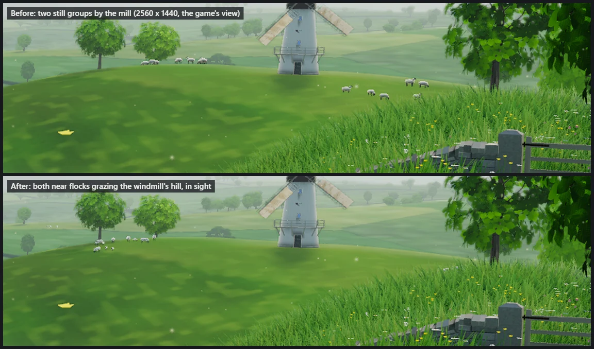

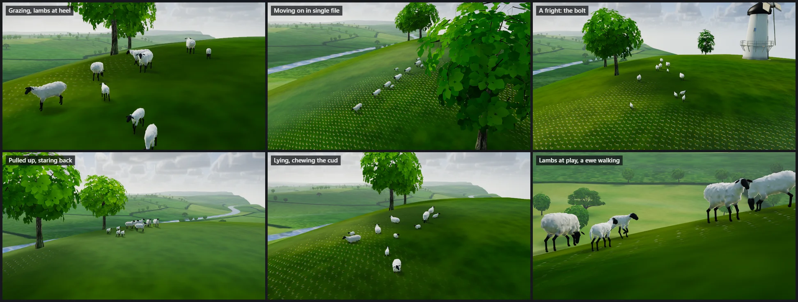

**What they do.** A grazing group's ground drifts slowly over the pasture; each ewe crops her
way after her own place in it, head down, the head working from side to side with a tug at each
bite, stepping on a stride or two at a time, and lifts her head now and then to chew and look
about. Now and then (and at a new level, a group or two) one ewe sets off for fresh grass and the
rest string out behind her in single file along the line she walked, each joining the line where
she meets it. In the warm of the honey afternoon a third of the groups lie down (front knees
first, then the hindquarters, legs tucked, chewing the cud) and get up again hind end first, one
foreleg out, often with a stretch; before the showers they bunch and stand with their backs to
the wind; after the rain they shake the wet out of their fleeces. Lambs keep to their mothers,
suckle (she stands for it and turns her head round to smell them, the lamb's tail going), lie
down at her side, and play: they spring straight up off all four feet (pronking), twist in the
air and kick, butt each other, dash off and back, and the lambs of a group race away over the
hill together and gallop home. A group that ends up out of sight walks back into it.

**What the game does to them.** Each front of wind (two lines or more) reaches each group as it
crosses the valley, so heads come up group by group as it passes and the lambs frisk in it; the
four-line gale bolts whole groups down the wind (they bunch and gallop, pull up, wheel round and
stand staring back the way the fright came, a forefoot stamped, and graze again one by one); the
kite festival sets every group's lambs racing; a pool of sunlight sets the lambs it crosses
gambolling; the end of a run lays them all down and the next run (the mode manager's
`modeStarted`, new `VerdantHillsReactions.onRunStart()`) gets them up; hot play livens the lambs
and makes the ewes warier. Under Reduce motion they never bolt or race: the gale only lifts their
heads.

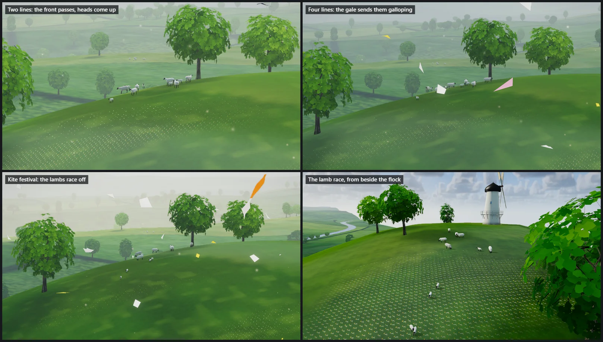

**Where they graze.** `VERDANT_HILLS_FLOCK_HOMES` names nine grounds, nearest-seen first so every
tier keeps the near ones: the windmill's crest west of the mill and the slope in front of it
(right of the board, 200–260 m, a ewe 9–10 px long at 1080p), then the far pastures across the
tarn on the left and out beyond the mill on the right. `verdantHillsSheepSeen()` is the sight test
a sheep must pass: in a 16:9 frame, beside the board card, and a line of sight clear of the land
and, out to 150 m, of the meadow's blades, which are drawn larger the farther they stand (0.85 m ×
(1 + 0.02 × distance)): east of the mill they hide the hill. `createVerdantHillsPasture()` hands
the flock the ground (height, where a sheep may stand, where the lens sees one), each asked of a
small cache. Each ewe is followed in the list by her lambs (singles, and twins for the first ewe
of a group with three lambs or more), so a tier's prefix never keeps a lamb without its mother.

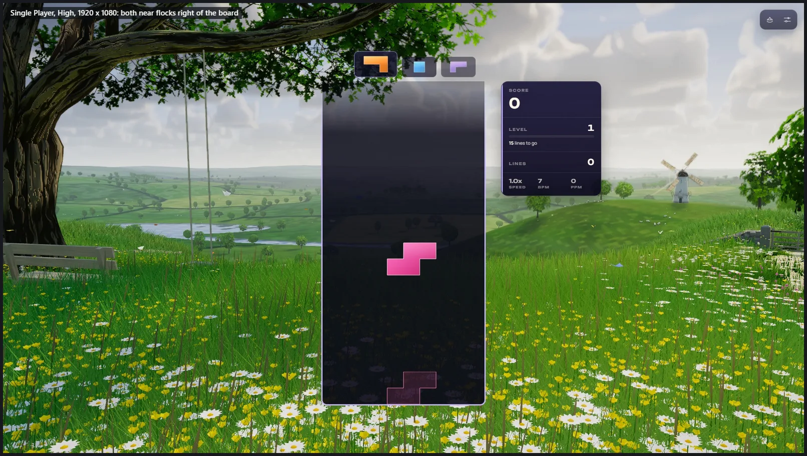

**The animals** (`scripts/blender/verdant_hills_sheep.py`, `scripts/verdant-hills/model-sheep.mjs`).
A black-faced Suffolk-cross ewe (0.72 m at the withers, 1.4 m long; 3 728 triangles, 93 KiB) and
her six-week lamb (long-legged, big-headed, its tail still long; 2 380 triangles, 61 KiB), each a
signed distance field built round the rig's own joints in headless Blender (the Grainfields
horse's meshing): a deep boxy fleece lumpy at two scales so its outline reads as wool, the bare
black Roman-nosed head with long drooping ears, slim black legs with knobbly knees and cloven
hooves. Per vertex: (wool, soil, dark, sky seen). The Node script skins them to the twenty bones
with bands derived from the skeleton's joints and writes `assets/verdant-ewe.glb` and
`assets/verdant-lamb.glb` (deterministic; `node scripts/verdant-hills/model-sheep.mjs
[--animal=ewe|lamb|both] [--preview=<dir>] [--dry]`, about 40 s). They are not part of the
Blender pack's manifest; the still props `sheep_a`/`sheep_b` stay in the pack as the fallback
when the two models cannot be read.

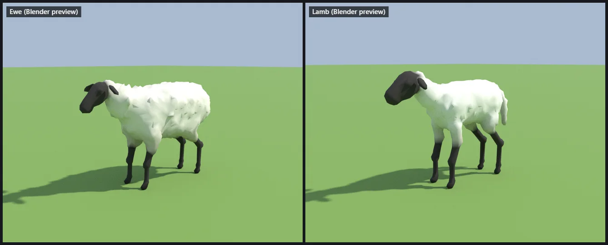

**The bodies** (`verdant-hills-sheep-rig.js`, three-free). Both skeletons are the shared solver's
(`../shared/fox-rig.js`): hooves placed and legs solved to reach them, a back that bends, a head
held level, every pose a blendable spec. The sheep's own:

- **Gaits on one coordinate** (`SHEEP_GAITS`: 0 walk, 1 trot, 2 gallop). The walk is a lateral
  four-beat (left hind, left fore 0.22 on, then the right pair); its forelegs slide 0.28 later into
  the trot's diagonals as it quickens; the gallop lands the hind pair together and the fore pair
  near the half, the back gathering and stretching, all four feet off the grass in the float. The
  phase is distance over stride, so a planted hoof does not slide (a test: under a centimetre a
  stance at the walk). The cannon leans with the leg through each stance, and the body crouches
  just as far as its forelegs need to reach both ends of the stride.
- **The foreleg swings from the shoulder blade.** The first skeleton pivoted the foreleg at the
  point of the shoulder, and a leg standing straight cannot reach a stride's ends: planted hooves
  fell 4–9 cm short and dragged. The `arm` bone now starts at the withers (`armL` at 0.66 m), as a
  sheep's scapula does.
- **Acts** (`SHEEP_ACTS`): Graze (muzzle in the sward, about 5 cm off the ground; a lamb's short
  neck stretches further), Chew, Stare, Stamp, Lie and Rise (one shared lying pose with two dials,
  front and hindquarters, so lying down goes front first and rising hind first through the same
  poses, every hoof on the grass and the belly resting on it), Stretch, Shake, Scratch, Nurse,
  Suckle, Pronk and Twist (leaps: `sheepLeapHeight()` lifts the whole lamb on a parabola) and Butt.
  A change of act starts from a snapshot of the pose it was caught in (`fromSpec`), so nothing
  jumps. On a slope every hoof stands at its own height and the trunk follows the slope part way,
  leaning down a cross-slope (a sign was wrong at first, and the downhill legs fell 5 cm short).

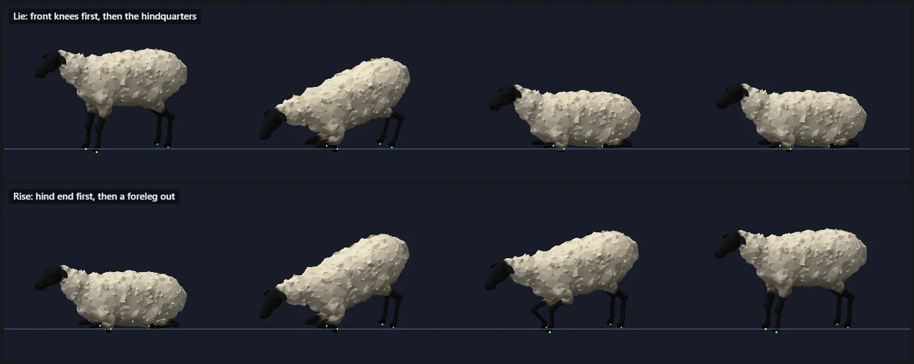

**The mind** (`verdant-hills-flock.js`, `VerdantHillsFlock`, three-free). One seeded generator
stepped in a fixed order (substeps of at most 1/20 s), so the playground's seeks replay the same
flock. Each sheep has a mode (graze, look, walk, lie, rise, stretch, shake, scratch, nurse,
suckle, play, stare, flee, follow, heel, race) that sets a goal, a pace and where it looks; the
body turns at the rate its legs allow (quick on the spot, wide at a gallop), speeds up and pulls up
as an animal does, keeps its room from the others (a staring sheep bears a neighbour rather than
turn its back), and turns away from ground it may not stand on. The act it shows follows from the
mode and the pace it means to go (not the pace it has reached, so no act flickers at a
threshold). Groups keep 30 m apart. A group picking new ground fans its search out from where it
would go until the lens can see the place (a frightened flock ran over the crest out of sight
before). CPU: about 0.35 ms a frame for sixty sheep on the dev laptop, mind and pose solve
together; the worst frame 3 ms when a group chooses new ground.

**Drawn** (`verdant-hills-sheep.js`). One instanced draw per kind. Each frame the flock's
postures go into a float texture, a row a sheep, two texels a bone (its rotation in the world, and
its joint's place with the sheep's size), and the vertex stage skins every instance from its row
with `textureLoad` (texelFetch on the WebGL2 fallback): four bones a vertex, blended. The fleece is
lit by the theme's light rig: wrapped sun, the sky by the bake's sky-seen (on wool only a quarter of
the bake's shade is kept: it was baked standing, and the wool tucked behind a shoulder came out on
the flank as a dark patch when the leg swung), the outline glowing through the fleece against the
sun, cream to clean white from one ewe to the next (a lamb's the cleanest, one black ewe on the
crest), soiled under the belly; faces and legs black. The sheep take only the clouds' shadows: the
static shadow map covers the home hill, and a look-up in it at 250 m printed false shade on the
fleece. Two more texels a row lay each sheep's shadow on the grass: a soft ellipse cast away from
the sun as far as the sheep is tall, darker under the body, drawn a hair toward the eye along each
line of sight so it never fights the ground for depth.

Playground (`effect=verdant-hills`): `flock=move|flee|gust|race|rest|rise|play|shake|stare` at
`flockAt=<s>` (default four seconds before `t`) for `flockGroup=<i>` (default all);
`sheepCam=<group>,<metres>,<azimuth>,<height>,<fov>` follows a group's middle with its own lens;
`sheepLens=<group>,<fov>` looks at it from the game's eye through a long lens. In the page,
`__PLAYGROUND__.flock()` and `forceFlock(kind, group)`. Without a GPU:

    node scripts/fox/preview-fox.mjs --fox=ewe --act=Graze --frames=4
    node scripts/fox/preview-fox.mjs --fox=lamb --gait=4 --frames=8
    node scripts/verdant-hills/model-sheep.mjs --dry --preview=<dir>

Checked in the playground on WebGPU at High and Minimal and on the forced WebGL2 backend (the
game's frame, long lenses from the game's eye, close lenses on every behaviour, the double, four
lines and the festival through the real reaction chain), and in a real Single Player game at
High, 1920 × 1080 (both near flocks right of the board, the west one just under the score card;
a move strung out in file); no WebGPU warning or error in any console. Tests:
`verdant-hills-sheep-rig.test.js` (skeletons, no planted hoof sliding at any gait, reach at every
gait, every act, every slope to 22°), `verdant-hills-flock.test.js` (determinism, grazing, the
file, a front reaching the nearer group first, the bolt and the stare, Reduce motion, the
festival race, rest and rise, the weathers, the real layout on the real pasture),
`verdant-hills-sheep.test.js` (the models on their skeletons, the bone table skinning a vertex to
where the rig puts it, every material built for WGSL and GLSL without a word), and the layout,
asset and homestead tests rewritten for the new flock.

Not done: the flock's shadows are ellipses, not the animals' shapes (at 10 px nobody can tell);
the sheep make no sound (no SFX generation on this machine); lambs do not climb onto their lying
mothers; there is no sheepdog (a gather on a big event would be a lovely next step); portrait
frames do not show the near flocks (the windmill is out of frame there too).

## How it is built

### Trees and built things authored in Blender

`scripts/blender/verdant_hills_assets.py` grows four oaks (an old open-grown oak for the
frame, 15.5 m tall and 22 m across with one long low bough, and three round-crowned field
trees) on the branching library the Fall grove introduced, bakes bark ambient occlusion in
Cycles, renders the far-hill sprite sheet, and builds the tower mill and its four sails, a
section of drystone wall and its pier, the field gate, the bench, three limestone outcrops,
two sheep and a fence post. A tree file holds a bark mesh and a point cloud of *foliage
sites*; the runtime instances shared sprays of real oak-leaf geometry onto them. The props
carry no materials: their vertex colour says what each face is made of (weathered timber,
limewash, tar, drystone, sailcloth, wool, …), and one shader in the theme paints them all.
Details, formats and the regeneration command are in
[`src/themes/verdant-hills/assets/ATTRIBUTION.md`](../src/themes/verdant-hills/assets/ATTRIBUTION.md).
The pack is 2.5 MB with no third-party source and no generative model, and regenerating it
reproduced every file byte for byte.

The generator runs **headless** (`blender --background --factory-startup`); the Blender MCP
session was not used, so nothing in an open Blender was touched.

### Two maps baked ahead of time

`node scripts/verdant-hills/bake-land.mjs` writes what the theme would otherwise work out
every time it starts: `verdant-land.png` (the valley's patchwork at 2 m a texel: hedgerows,
each pasture's tone, still water, and the shade of every tree and hedge beyond the shadow
map) and `verdant-clouds.png` (the cloud field). Both are produced by the theme's own
functions and pinned to them by a test, and the theme makes coarse ones on the spot if a file
is missing. **Re-run the bake after changing the terrain function, the tree layout or the
cloud generator.**

### Runtime modules (`src/themes/verdant-hills/`)

| Module | Owns |
| --- | --- |
| `verdant-hills-theme.js` | Lifecycle, renderer, asset loading, gameplay subscriptions, board tracking. |
| `verdant-hills-assets.js`, `verdant-hills-land.js` | Loading and decoding the GLBs, the sprite sheet and the two baked maps. |
| `verdant-hills-world.js` | Composition root: builds and updates everything below. |
| `verdant-hills-light.js` | The sun, its static shadow map, sky colour, haze, ambient; the cloud field (`cloudHeap`, `cloudSample`, `cloudDensity`, `cloudShadow`); the wind of trees and of the grass, the gust rings, the valley's front and the pool of sunlight; a shared noise texture. |
| `verdant-hills-cloud-volume.js`, `verdant-hills-bakes.js`, `verdant-hills-bake.worker.js` | The cumulus's 3D noise (three-free), and its first-visit bake in a Worker. |
| `verdant-hills-sky.js` | The cumulus march into its own half-resolution target, the dome, the cirrus. |
| `verdant-hills-terrain.js` | The analytic height function (the home hill and its two spurs, the valley, the far ridges, terraces under what stands on the land), the ground mesh and its shader, the path, the patchwork's generator. |
| `verdant-hills-composition.js` | Camera framings, the visibility test, and `VerdantHillsSight`: which ground the lens can see. |
| `verdant-hills-layout.js` | Where every tree, wall section and prop stands, and where the flock grazes (pure, seeded); the sheep's sight test and pasture. |
| `verdant-hills-flora.js`, `verdant-hills-meadow.js` | Grass and flower geometry; planting, and the two shaders that draw all of it. |
| `verdant-hills-trees.js`, `verdant-hills-backdrop.js` | Bark and foliage instancing; the sprite trees of the valley and the far hills. |
| `verdant-hills-homestead.js` | The windmill and its sails, the wall, gate, bench, posts, outcrops and the swing (and the still sheep, when the flock's models are missing). |
| `verdant-hills-sheep-rig.js`, `verdant-hills-flock.js` | The ewe's and the lamb's bodies on the shared quadruped solver (gaits, acts), and the flock's mind (three-free). |
| `verdant-hills-sheep.js` | The flock drawn: two instanced skinned draws from a float texture of bones, and their shadows. |
| `verdant-hills-life.js` | Butterflies and swallows. |
| `verdant-hills-kites.js` | The seven kites, their tails and lines. |
| `verdant-hills-ribbons.js` | The ribbons of wind. |
| `verdant-hills-seed-sim.js`, `verdant-hills-seeds.js` | Seed, chaff, petals and leaves: simulation, and drawing. |
| `verdant-hills-reactions.js` | The event director (pure). |
| `verdant-hills-stage.js`, `verdant-hills-fx-director.js`, `verdant-hills-rings.js` | Board card → world, and cues → ribbons, seed, force fields, gusts, the front and the pool of light. |
| `verdant-hills-post.js` | The light between the clouds, bloom, grade, FXAA; and the call that has the sky march its clouds before each frame. |
| `verdant-hills-quality.js` | One table for everything a tier scales. |

### Techniques (three 0.186.1)

- **One cloud field, used three times.** A small texture of rounded mounds on mounds is the
  whole sky. `cloudDensity()` gives it flat bases and a broad dome over each heap, and lets the
  lobes of a 3D noise volume carve its skin; the sky marches that as a volume into a half-resolution target once a frame (the sky
  is the only thing behind it, so nothing is composited by depth), lighting each sample
  through the cloud toward the sun. `cloudShadow()` projects the same field down the sun's
  rays onto every surface. And the post pipeline marches that shadow function through the
  air, so the valley's haze is bright under a gap and blue under a cloud.
- **The game's own gap in the clouds** is one `vec4` (where, how wide, how open) that all
  three read: the cloud thins, the ground under it takes more than full sun while the rest
  of the valley dims, and its shaft is added to the air.
- **Grass only where it can be seen.** The home hill's brow hides the slope below it.
  `VerdantHillsSight` walks each bearing outward once, keeps the highest sight line, and
  plants only in the stretches that rise above it, spread evenly in the logarithm of
  distance; nothing is drawn where no pixel could show it.
- **A meadow with no CPU in it.** Every clump and flower is an instance whose root and turn
  live on the geometry; the vertex shader stands it up and bends it in the bands of the
  breeze, the rings from the board and the valley's front. A blade the wind lays over shows
  the sky on its back, and the ground shader carries the same bands on beyond the last
  blade, which is what makes the wind visible from the lens to the far hills.
- **Ribbons and kites as rows of a uniform array.** A ribbon is six `vec4`s (start, heading,
  colour, pace, shape, loop axis); its strip is placed on a path with loops by the vertex
  shader. A kite is six more; where it stands is a closed form of time, and its tail and
  line are shaped in the vertex shader. Ribbons are light and leave the depth buffer alone;
  the kites' cloth writes depth, because the post pipeline adds the light of the air along
  each pixel's line of sight and would otherwise give a kite a whole sky's worth and turn it
  pastel.
- **One static shadow map, used everywhere.** Materials stay unlit `MeshBasicNodeMaterial`
  and call a shared `shadow(light)` node; nothing that casts moves under a fixed sun, so the
  map is drawn over the first frames only. Trees and hedges beyond it lay their shade
  through the baked map.
- **Level ground under what people built.** The height function carries terraces for the
  oak, the mill, the gate and the bench; bases are bedded into the ground, and the wall's
  sections are raked to follow it.
- **CPU seed simulation.** A few thousand particles in typed arrays: the same code on both
  backends, in the playground's deterministic `seek`, and in the unit tests.

### Quality tiers

| Tier | Modelled trees | Far trees | Grass clumps | Flowers | Seed pool | Ribbons | Cloud march | Light between clouds | Post |
| --- | --- | --- | --- | --- | --- | --- | --- | --- | --- |
| Extreme | 47 | 900 | 86,000 | 6,000 | 3,600 | 18 | 72 steps, 0.6 scale | 28 steps | on |
| Ultra | 41 | 760 | 72,000 | 5,000 | 3,000 | 16 | 60 steps, 0.5 | 24 steps | on |
| High | 35 | 620 | 58,000 | 4,000 | 2,400 | 14 | 48 steps, 0.5 | 20 steps | on |
| Medium | 27 | 440 | 36,000 | 2,600 | 1,500 | 12 | 30 steps, 0.4 | 12 steps, 0.35 scale | on |
| Low | 19 | 260 | 17,600 | 1,300 | 850 | 12 | 16 steps, 0.33 | warmer haze toward the sun | off |
| Minimal | 15 | 150 | 8,900 | 650 | 450 | 12 | one flat layer in the sky | warmer haze toward the sun | off |

Every field tree stands on every tier: those a tier does not model are drawn as sprites at
the same places, so the baked shadows always have an owner. Low and Minimal draw the same
scene directly with ACES tone mapping and skip limb geometry.

## Verification

All of it on 2026-10-09, on the development laptop (RTX 3070 Laptop GPU, on mains power), with
other sessions working on the same machine.

| Check | Result |
| --- | --- |
| Playground, native WebGPU, 1280 × 720 | 20 fixed-time frames with no console output: idle with and without the board card, lock, hard drop, two lines, four lines at two ages, a held combo, seven kites, the festival, a perfect clear, game over, Medium and Low, portrait (560 × 840), ultrawide (1290 × 540) and the icon lens. An earlier batch covered all six tiers. |
| Playground, WebGL2 backend | High and Minimal with `forceWebGL=1`, no console output. The whole scene and every event were also rendered through the WebGL2 backend on the CPU (SwiftShader) while iterating. |
| The real game, WebGPU, High | Dev server, fresh profile, theme pinned, a single-player game started. Pieces were hard-dropped with the keyboard, so locks, ribbons and kites are the game's own; the two-line, combo and four-line clears were emitted on the game's event bus by the harness, not earned by play. The quality setting was changed to Medium while running (the theme rebuilt), and switching to another theme left no canvas behind. The console held the application's own lifecycle lines and nothing else. |
| Lifecycle validator | `node scripts/validate-all-themes.mjs --theme verdant-hills`: pass, 0 lifecycle failures, 0 console errors, 0 process failures. Its capture is the new `docs/theme-screenshots/verdant-hills.png`. |
| Unit tests | 15 files, 832 tests under `tests/unit/verdant-hills-*.test.js`; the URL-parameter catalog and the theme-registry lifecycle acceptance suites pass with them. |
| Static gates | ESLint on the theme, the effect, the bake script and the tests; lint ratchet; `tsc --noEmit`; TS ratchet; architecture fitness; theme-lifecycle audit; dependency boundaries; release gates; perf-budgets gate; IP strings. The palette gate reports this theme at 0 of 7 (the gate as a whole fails on the base commit as well, on `stillwater`, which this work does not touch). |
| Production build | `npm run build` with the boot-closure guard, and the pages-artifact check. |

| Portrait | Minimal on the WebGL2 backend |
| --- | --- |
| 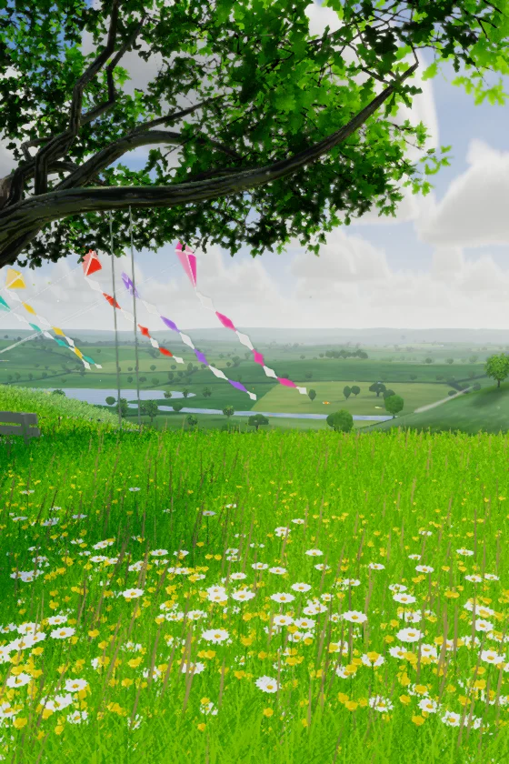 | 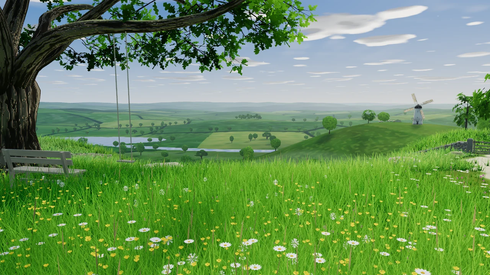 |

**Frame rate: observed, not measured.** In the real game at High in a 1584 × 813 window the
harness read 259 and 302 frames a second with the frame limiter off (two runs) and about 125
with it on. Those are single readings on a busy machine with a dedicated GPU; they say the
theme has headroom there and nothing about an integrated GPU or a phone. No run through the
perf lane has been made.

**Not checked:** integrated GPUs and phones; the multiplayer layouts; a long session in real
time; a game in which the clears were earned by play.

### The icon

`verdant-hills-theme-icon.png` is the centre square of
`playground.html?effect=verdant-hills&orbit=0&hud=0&quality=High&t=16&icon=1&event=double&kites=7&eventAge=2.6`
at 1280 × 720 (the capture is byte-identical from run to run), with a slight lift in saturation
and contrast, baked as a 512 × 512 circle on a transparent ground. `icon=1` is a long lens on
the kites over the valley under the oak's leaves, with the swing hidden so its ropes do not
cross them.

## What was removed

- The previous implementation: the 810-line `verdant-hills-theme.js` (sine-sum terrain,
  crossed-quad grass, five-sphere trees, CPU-moved point particles, a wind-strength uniform
  as the only response to play).
- Nothing else in the repository read it: there were no assets, no CSS and no tests of its
  own.

## Known limits

- Grass, flowers and the terrain are built for the wedge the lens sees (out to an aspect of
  about 2.4:1); they are not meant to be seen from elsewhere.
- The shadow map is static, so swaying crowns, the swing and the kites do not move their
  shadows, and everything beyond the home hill is shaded by the baked map and the clouds.
- The valley's hedgerows are drawn by the ground shader, not modelled. Its water is the sky's
  colour with the far bank's green where the bank would show, not a mirror: no tree, mill
  or kite is reflected as a shape.
- The pool of sunlight is seen at a grazing angle, so on the valley floor it is a bright
  band rather than a disc; the dimming around it and its shaft carry the event.
- Portrait is the landscape world seen from the same spot: the windmill is out of frame.
- Bark, ground, stone and cloth detail are procedural in the shader; there are no texture
  maps beyond the sprite sheet and the two baked maps.
- The far sprites face one camera.
