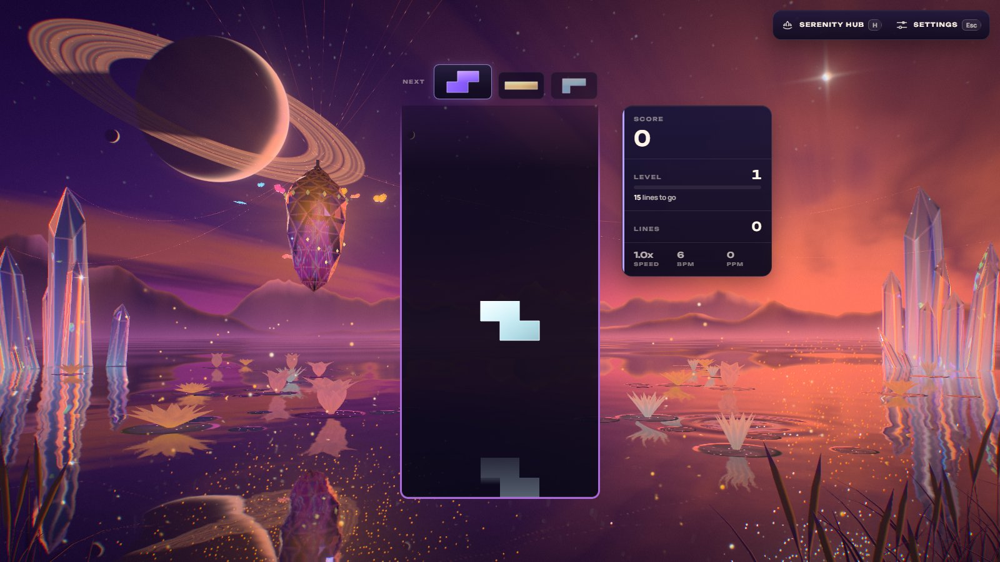
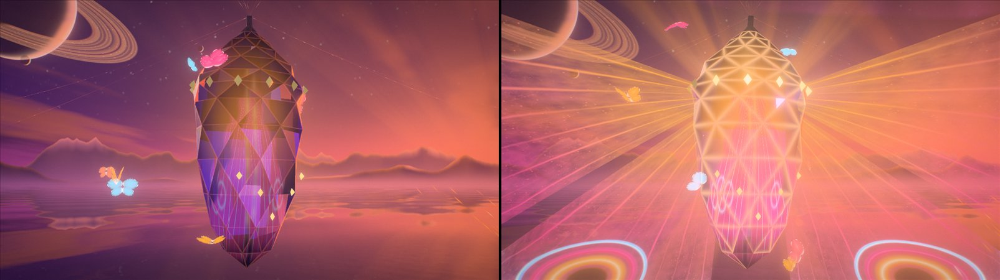
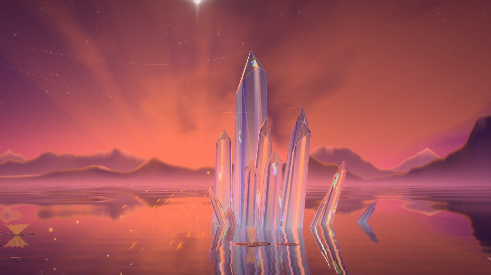
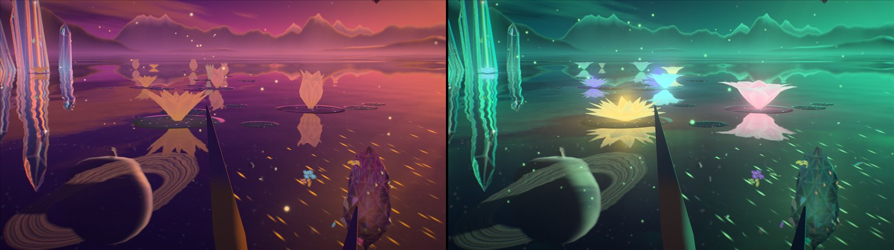
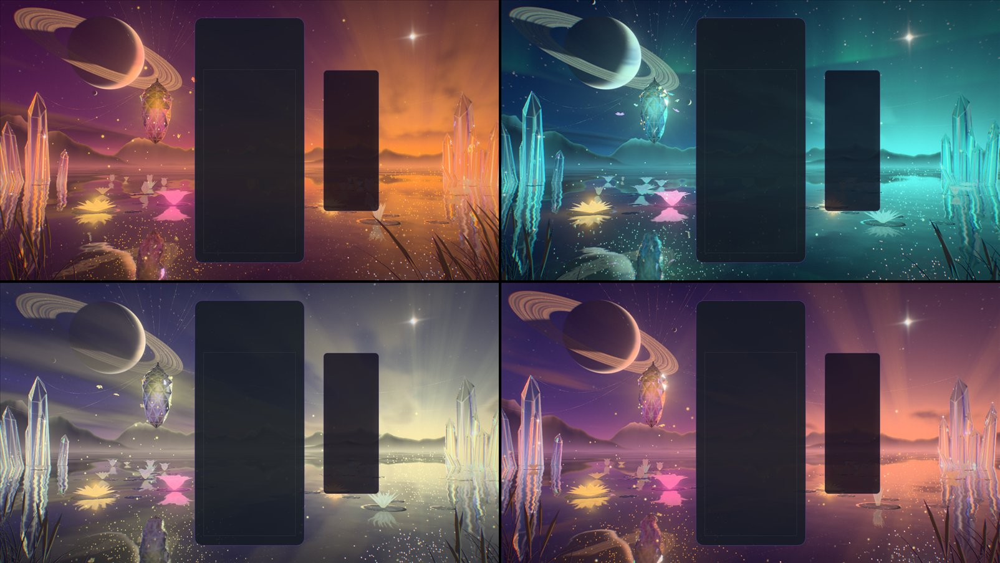
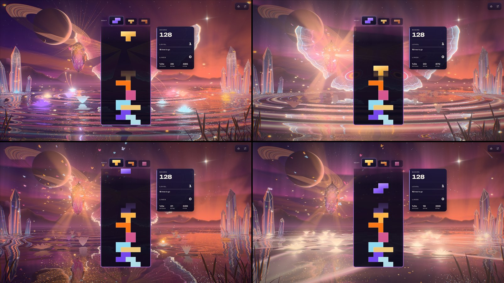

# Vesper Chrysalis: the jewel and the living lake (2026-11-16)

**A record.** The owner asked for Vesper Chrysalis to be audited and lifted until it is one of the
most stunning themes in the game: a jewel-like chrysalis that glows from within and feels alive,
richer light in the sky, crystals that refract and glint, a lake with convincing reflections and
shimmer, an evening that keeps changing, far more variety in the living details (fireflies,
flowers, life on the water, moths round the chrysalis), a distinct effect for every event with the
biggest moments the most spectacular, and the game kept smooth and readable. The design it builds
on is [VESPER_CHRYSALIS_VISUAL_OVERHAUL_2026-10.md](VESPER_CHRYSALIS_VISUAL_OVERHAUL_2026-10.md);
everything there still holds unless this page says otherwise.



## What the audit found

- **The chrysalis was never seen in play.** It hung in the middle of the frame, exactly where the
  board card stands: in a solo game the centrepiece was a dim shape through dark glass. It was also
  a lathe of nine-sided rings with a few soft lights inside, more a lantern than a cut stone.
- **The crystal stands were six-sided prisms that mirrored the sky** and nothing else: no light
  came through them, nothing glinted, and each stand was a row of identical posts.
- **The lilies were one flower twenty times**, shut at rest and opened only by a moth.
- **Fireflies drifted the same way all evening**; no moths or butterflies lived round the
  chrysalis; nothing happened on the lake between events.
- **The sky turned only in colour**: the ringed world, the stars and the clouds stood still all
  hour, and nothing new appeared in it.
- **Every clear looked alike** (blades out of the card, a swell), the twist was a faint prism ring,
  a perfect clear was a four-line clear with more fronts.

## The chrysalis

A teardrop of cut stone hung by its wide end from a short dark horn, with a diadem of gold beads
round its shoulder and five gold spots low on its front
(`buildChrysalisGeometry`, `-relic.js`). Every triangle is a facet, and each does what a facet of
a stone does:

- **It mirrors the evening**: the sky above, the lake below with the lanterns' light coming up
  from it (`vcEvening`), and it flashes when it turns one of the evening's lamps to the eye: the
  last light, the ringed world, the evening star (`vcGemLights`).
- **It lets the eye in.** The ray is bent at the facet, crosses the stone and is thrown back by
  the cut of the far side, twice; the lamps come back split into their colours, and no two cuts
  send back the same share, so some facets stand dark and some blaze, as in a real stone.
- **It shows what is inside**, from that facet's own angle: a light that beats like a heart (two
  beats and a rest, quicker with the chain), a segmented body, and the folded wings with their
  veins and eyes. Each facet sees them at a different depth, so the creature inside is broken into
  panes that slide as the stone turns.
- **A chain cracks it** along its facets from the shoulder outward, the cracks running with molten
  light, and lights the diadem's beads one for every step. However hard it burns it keeps its
  colour: its inner light rolls off instead of clipping to white.

It is never still. It hangs by silk, so it swings a little, turns slowly on its thread, and now and
then what is inside twitches: a wriggle and a swell of light (`poseRelic`, `knock`, `turn`,
`twitchNow`, `-world.js`). A star flashes on any of its larger facets that mirrors a lamp, and the
stars run over it as it turns (`-glints.js`).



**It hangs where it can be seen.** With a board on screen it glides into the open water beside the
card (`perchFor`, `-composition.js`): left of the card in a solo game (the HUD stands to the
right), between the boards in a match, and on an upright phone, where the card fills the width, up
into the strip of sky above the card. The silk follows it; the wings stay rooted behind the board,
so at the height of a chain the board has wings and the chrysalis glows on the left one. The
shafts come from the chrysalis where it hangs; the prism ring of a big clear still starts behind
the board.

## The crystal stands

Each stand is now a cluster grown the way quartz grows: one tall crystal, others leaning out from
its foot, and a litter of small ones at the waterline (`planSpires`). Every crystal is cut askew
(its six shoulders at six heights, so the six facets of its point differ), and all of them are one
merged geometry (`buildSpiresGeometry`, `-shore.js`). Light comes through them: in the middle of a
face the sky behind shows straight through, tinted; toward a face's sides the light leaves by the
next face but one, a 60° prism, so a bright band split into its colours runs down every edge.
Healed cracks inside hold a rainbow when the angle finds them. Stars flash on the facets of the
points and on the faces as the evening's lamps (and a light of each crystal's own that wanders the
sky) cross them, and a chime runs a flare up every crystal from the waterline.



## The lake and its life

- **Three kinds of lily** (`BLOOM_SHAPES`, `-blooms.js`): the lantern lotus (broad cupped petals,
  opens to a bowl), the star lily (many narrow petals, opens flat) and the moon chalice (tall,
  opens only at its curled lip), each with stamens tipped with light. **They keep their own
  hours** (`BLOOM_TIDES`, `bloomTides`): the lotus opens at day's end and first light, the star
  lily through the blue hour, the chalice in the dead of night; open by itself a lily glows faintly
  in its kind's colour, and a moth's light is a lantern on top of that. Each breathes a little, and
  now and then a wave of opening crosses the lake. Loose pads float among them, some turned to
  wine, with dew that holds a point of the evening.
- **Moths of light keep the chrysalis company** (`createFlutter`, `-life.js`): each two hinged
  wings that really beat (snap down, slower lift, a glide now and then), circling at its own
  distance; some settle on the stone and fan their wings, then lift off. More come out by night
  and with every step of a chain, and a chain draws them in close.
- **The fireflies have manners that change with the hour** (`createFireflies`, `-fx.js`): they
  gather into swarms over the lake, flash in step in waves that cross the water, rise in slow
  columns and come back in at the water; a twist draws them into a ring round the chrysalis and a
  blow on the lake throws them outward, and they drift back.
- **The water moves**: a gust crosses the lake as a band of ruffled, glittering water, sharp at its
  leading edge (and bends the reeds as it passes); the chrysalis lays its own path of sparks on the
  water in whatever colour it burns; a fish rises now and then, something skims the water in a row
  of rings.
- **The reeds** are long leaves that bow over and reed-mace with dark velvet heads, lined on the
  sun's side with the last light, in both bottom corners.



## The sky

- **The ringed world turns**: its bands wander and a storm rides in them; two moons ride out past
  the rings in the rings' plane and pass behind the world; grains of ice glint in the rings; and
  its crescent waxes and wanes with the hour.
- **The set sun throws shafts up the sky**, strongest at the ember hour and first light.
- **A river of stars** crosses the sky, and the stars wheel slowly about the pole; a level turns
  them in a rush. **Stars fall** (`createMeteors`, `-sky.js`): one now and then by night, a shower
  for a perfect clear and a level.
- **Clouds** come and go over the hour; their sunward edges are lined with light.
- **The ranges** have lit faces and dark gullies, and snow on the high crests that takes the last
  light.

## The evening never stands still

Three clocks turn it, all pure functions of the time (a seek lands on the same evening):

1. **The hour** (unchanged): an hour every two minutes, a level a step on top; the palette, the
   lilies' tides and **what the evening's life does** (`LIFE_HOURS`, `lifeAt`): how many moths are
   about, the fireflies' manners, the strength of the shafts, how much cloud, the planet's crescent.
2. **Slow swells within the hour**, so no two minutes of one hour look alike.
3. **Happenings of its own**: one in every eight seconds, drawn from the slot's number
   (`runHappenings`, `happen`): a fish rises, something skims the water, a gust crosses the lake, a
   wave of opening runs through the lilies, what is in the chrysalis stirs, a star falls, the
   crystal chimes softly, the fireflies lift off the water. `setHappenings(false)` (and the
   playground's `happen=0`) holds them off for captures of one event.



## Events

Each keeps what it did in the 2026-10 design and adds its own answer; the size of the answer grows
with the size of the moment.

| Gameplay | Now |
| --- | --- |
| Piece lock | As before: a moth in the piece's colour flies to a lily, which opens and keeps the light. |
| Hard drop | Three moths and the strike under the board as before; the blow also throws the fireflies outward, rings the crystal and sets the chrysalis swinging on its thread. |
| One line | The cleared row leaves both edges of the card as streamers of light that bow out over the water and fly home to the chrysalis; it takes them in, glows in their colour and stirs. |
| Two lines | Two pairs of streamers; the crystal chimes and the moths are drawn in. |
| Three lines | Three pairs; a wave of opening runs through every lily on the lake and a few moths leave the chrysalis. |
| Four lines | The hush, the wing beat, the prism ring and the great ring as before; and a cloud of moths hatches out of the chrysalis and spirals over the lake, the blow sets it swinging, every crystal chimes in vesperfire, the fireflies are thrown wide and the lilies open in a wave. |
| T-spin | The chrysalis turns twice round on its thread, stirring a three-armed whirl into the water under it, and the fireflies are drawn into a ring that spins about it. A twist that clears nothing turns it once. |
| Perfect clear | The lake's own: a lotus of light opens on the water in three whorls, one after another, every lily relit, the fireflies rise off the water, and stars fall. |
| Back-to-back | Gold in the wings and the silk as before, and a gold chime through the crystal. |
| Combo | The wings as before; every step also draws the moths in, and more of them come out. |
| Level up | The evening moves on an hour; the stars wheel round, a few fall, and a wave of opening runs through the lilies. |
| Game over | The evening goes to sleep: the chrysalis dims, the moths leave it, the clouds thicken a little. A new run wakes it with a stir. |



## Tiers

Every tier keeps the whole picture and every event (the 2026-10 table still holds, plus):

| | Minimal | Low | Medium | High | Ultra | Extreme |
| --- | --- | --- | --- | --- | --- | --- |
| Loose pads per lily | — | 1 | 2 | 2 | 3 | 3 |
| Chrysalis facets that can flash | 24 | 36 | 56 | 80 | 96 | 110 |
| Crystal glint points kept | ¼ | ⅓ | ½ | all | all | all |
| Moths round the chrysalis / in a burst | 6 / 18 | 8 / 28 | 12 / 44 | 16 / 64 | 20 / 84 | 24 / 110 |
| Fireflies | 36 | 60 | 110 | 160 | 210 | 260 |
| Light split through the crystals | one colour | colours | colours | colours | colours | colours |

## Assets and tools

Nothing is downloaded: every shape is still generated in code. The Blender MCP was offered for the
models and tried first, but Blender was not reachable from this session (the connection timed out),
so the chrysalis, the crystals, the flowers and the moths were designed in code and judged in the
playground with a free camera (`cam=` on the effect). The icon was re-baked from the playground:
`icon=1&iconFov=30&iconPitch=0.06&combo=6&locks=8&happen=0&t=20`, captured square at 840 px,
cropped to 94 % about a point a little above the centre, graded (saturation 1.16, contrast 1.1,
brightness 1.04) and masked to a 512 px disc; it replaces the 2026-10 icon.

## Verification

- Playground captures on WebGPU (the RTX), every one with a clean console: rest with and without
  the board; every event; a chain; the hours at four moments of the clock; close looks at the
  chrysalis, a stand and the lilies; every tier; the WebGL2 backend at High and Minimal; a phone
  frame (390 × 844, Low) at rest and on four lines; an ultrawide frame (1920 × 820).
- The real game (headless Chrome on WebGPU, 1600 × 900, High, 30 fps cap): the theme starts with
  the chrysalis in its place beside the card, takes real hard drops from the keyboard, and answers
  clears, a chain of five, four lines, a twist and a perfect clear driven through its world; no
  console warning or error.
- Unit tests: see the commit; the theme's files were re-pinned to the new design, with new tests
  for the perch, the pose, the happenings, each event's new answer, the lilies' kinds and tides,
  the new parts, and a shader gate (`vesper-chrysalis-shaders.test.js`) that builds every material
  for both backends at the default and the leanest tier.

**Not measured:** GPU time per frame. A timestamp run (old and new interleaved, 30 fps cap) was
started and stopped before it finished; nothing was read from it. What the new design costs: the
chrysalis's fragment shader reads the sky gradient and the lamps several times per pixel (it covers
a small part of the frame), the crystals three to five, and the lake gained two event loops that are skipped
outside their few seconds. The real game's frame pacing looked smooth at 30 fps but that is not an
ADR-0016 reading.

## Open calls for the owner

- **Where the chrysalis hangs.** In a solo game it now hangs in the open water left of the card,
  not in the middle of the frame behind it (where play hid it). The side, its size there and how
  far it keeps from the card are one function (`perchScreenX`, `PERCH_BAND`); the wings stay
  rooted behind the board, so at the height of a chain the light is split between the two.
- **How busy the evening is.** One happening every eight seconds (`HAPPEN_SLOT`) and the moths'
  numbers by the hour (`LIFE_HOURS`) were judged in captures, not in a long play session.
- **GPU time.** Not measured (above). An uncapped timestamp run on the RTX is the owner's call.
- **Blender.** The models were made in code because Blender was unreachable; a Blender pass on
  the chrysalis or the moths is still open if the code-built shapes fall short in play.
- **The icon** was re-baked from the new evening; the 2026-10 one is in git history.

## Reproduce

Playground (private dev server, `maxFps=30`):

```
/playground.html?effect=vesper-chrysalis&t=20&hud=0&quality=High&board=1&locks=6&maxFps=30
  + event=lock|drop|clear|quad|twist|perfect|levelUp|break  eventAge=<s>  lines=<n>
  + level=<n>   combo=<n>   happen=0   forceWebGL=1   reduce=1
  + cam=ex,ey,ez,tx,ty,tz,fov     a free camera, e.g. the chrysalis close:
        cam=0,14,-40,0,16.5,-70,30      (no board: it hangs at rest)
        cam=20,6,-30,62,13,-96,30       the right-hand stand
        cam=-10,3.2,-12,-12.5,0.6,-27.5,32   the nearest lilies
  + ghost=1    the mock board all but invisible (the chrysalis still hangs clear of it)
  + parts=…,glints,flutter,meteors
```
