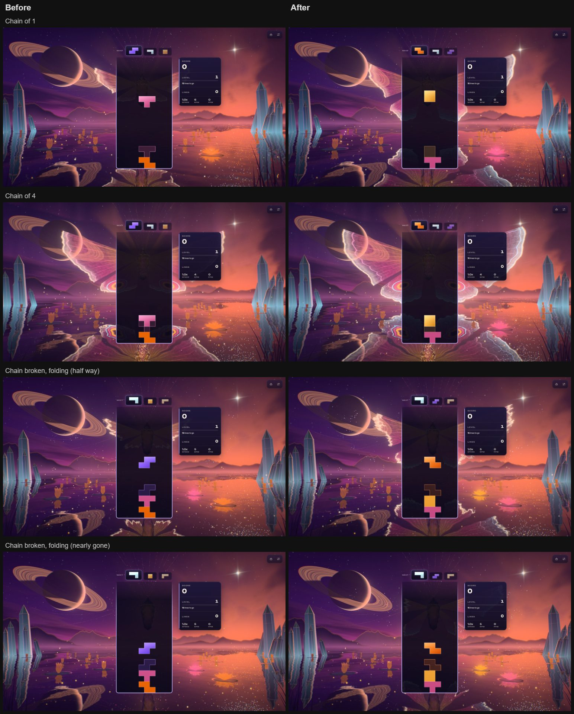

# Vesper Chrysalis: the wings show past the board (2026-10-25)

**A record.** The report: "When playing and having the vesper chrysalis theme, it is hard to see
the folding butterfly behind the game canvas. is this something we can improve?"

## What was wrong

The wings are rooted at the chrysalis's shoulders, and the chrysalis hangs behind the middle of
the board card. A wing is written outward from the root, a step of the span for every clear of
the chain, and when the chain breaks it folds back toward the root at 1/5 of the span a second.
So the first stretch of every wing was always written, and folded, behind the card.

Measured in the real game (1600 × 900, solo): the card covers x 0.40–0.60 of the screen from
y 0.11 down, and the HUD stands just right of it (x 0.62–0.77, y 0.19–0.49). Along the
forewing's rays the card hides roughly the inner half of the wing; behind the HUD on the right
it hides most of the upper forewing.

- A chain of 1–3 (the common ones) showed a thin strip past the card's left edge and almost
  nothing on the right: the right forewing was behind the HUD.
- When a chain of two broke, the front went behind the card after ~0.6 s of a 2.6 s fold: the
  rest of the fold, the part with the burning edge, happened out of sight.

## The fix

The front is now measured from where each ray of the wing comes out from behind the card and
the HUD, not from the root:

- **The cover table** (`-composition.js`, `wingCoverAlong` / `fillWingCover`): every frame the
  wings are out, the world marches 13 rays across each of the four wings through this frame's
  camera, finds where each ray leaves the live card rects (and the HUD beside the card when
  the gap to it is narrower than 0.07 of the screen's height, so a wing is not written into the
  slot between them only to vanish behind the HUD), and writes the `v` of that point into a
  small uniform array (13 × vec4: left fore, right fore, left hind, right hind).
- **The shader** (`-wings.js`) reads the table in the vertex stage (linear between rays) and
  places the front at `cover + front × (1 − cover)`. What the card hides is lit as soon as a
  chain starts (it shows faintly through the card, as before); every step of a chain writes
  wing that can be seen, and the fold runs back to the card's edge in view, embers and all.
- **The scales** (`-world.js`, `emitWingDust`) are thrown from the same remapped fronts, so they
  fly from the visible band and not from behind the board.
- With no board on screen (menus, the playground without `board=1`) the table is zero and the
  wings are exactly what they were. The cover eases in and out with the board (about a third of
  a second) so a front never jumps while wings are out.

The wings' steps (`WING_STEPS`), the fold's pace (`WING_FALL`), the eyes and the full wing are
unchanged: at a full chain the picture is the same.

## How it was checked

- Real game in Electron on the RTX 5080, a private Vite server, a shown off-screen 1600 × 900
  window: start single player, switch to Vesper, freeze gravity, hold a chain through the
  theme's own `reportCombo` (1, 2, 4, 6, 9), then break it and capture the fold at three points.
  Same script before and after. No WebGPU validation errors in the console.
- Unit tests (`vesper-chrysalis-composition.test.js`): no cover without one or with the root
  outside it, the edge found on both sides to within the refinement, a ray wholly behind the
  card, the HUD chained across a narrow slot but not a wide one, the table symmetric about a
  centred card and read back linearly, and `frontPast`. The renderer-free import guard now lets
  the composition import the (three-free) core.
- All 10 Vesper test files pass; lint is clean (the 5 long-line warnings were there before).

## Cost

CPU only while the wings are out: ~0.13 ms a frame on this laptop for the table (4 × 13 rays,
24 steps each plus 6 to refine the edge). GPU: one uniform-array read and a mix per vertex of
the wings' ~3,100 vertices, one more varying; nothing per pixel.

## Not checked

Local multiplayer layouts (the chrysalis is between the boards there, so the table should stay
zero), portrait and phone layouts, the WebGL2 backend, and the integrated GPU.
