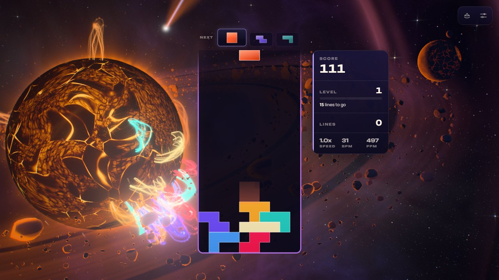
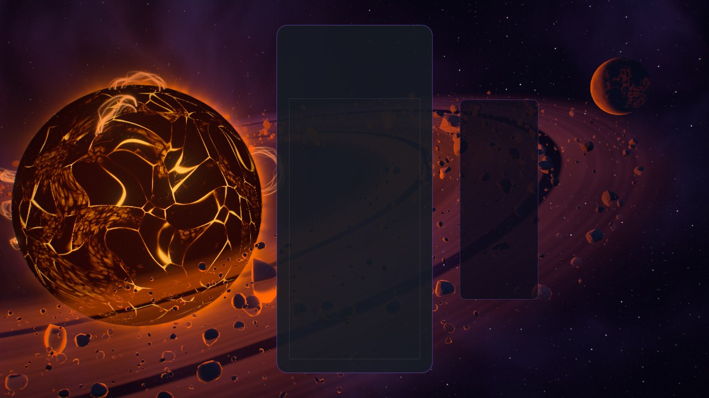
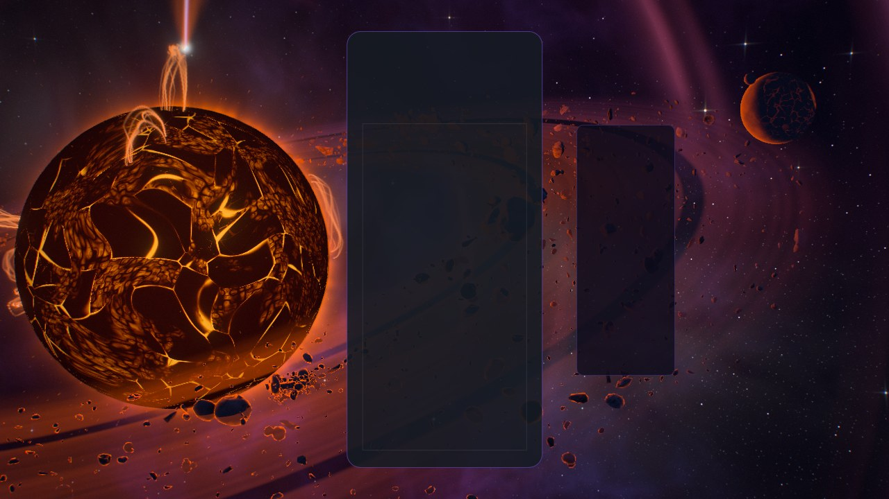
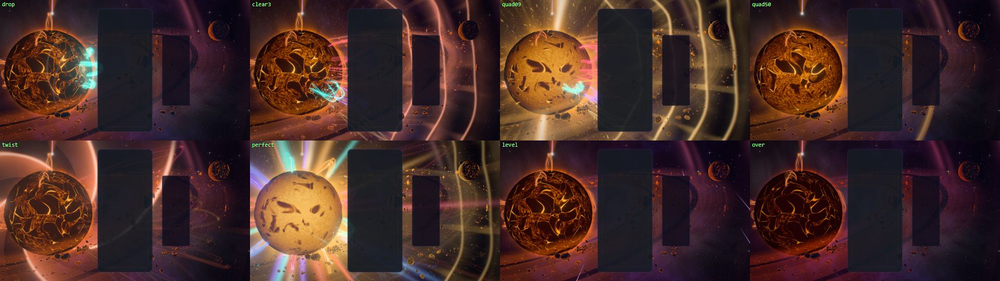
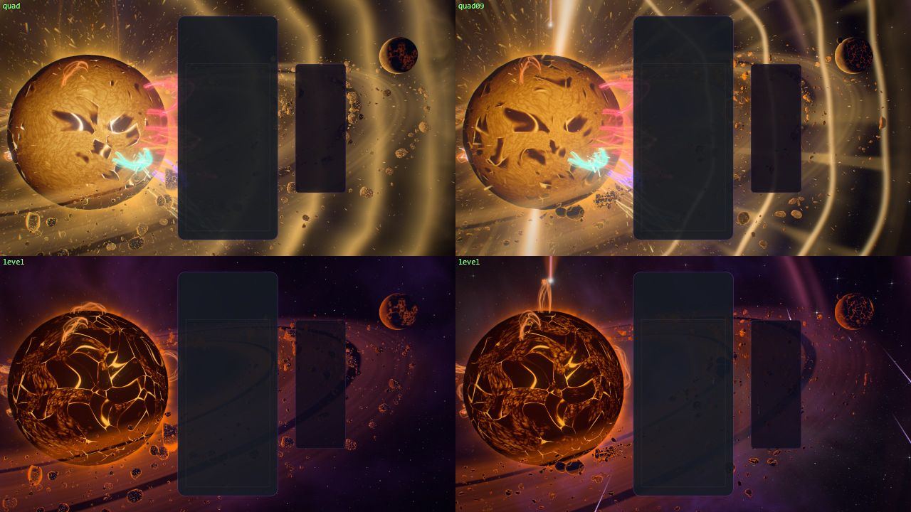
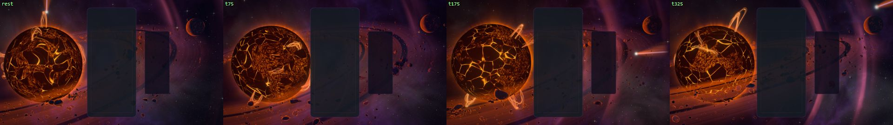
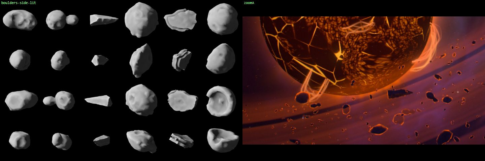

# Void Ember — the living pass (2026-11-16)

Olov asked for an audit of Void Ember and for it to become one of the game's most stunning
themes: everything that makes it up reviewed, what is weak or generic or missing found, the scene
made to change over time, the things that move through it given better designs and more variety
(Blender allowed), and every event given an effect of its own, the biggest the most spectacular,
with play still smooth and easy to read. Earlier work:
[VOID_EMBER_VISUAL_OVERHAUL_2026-10.md](VOID_EMBER_VISUAL_OVERHAUL_2026-10.md) (the rebuild and
the slag pass).

Branch `feature/void-ember-living`. Every state and event was captured from `main` first
(playground, private dev server, headless Chrome on the RTX 5080 Laptop at `maxFps=30`).

## What the audit found

- **Every big event was the same ring.** A clear, four lines, a perfect clear, a twist and a
  level-up all sent a soft, airbrushed shell out of the star; they differed in size and colour.
  A level-up a second in showed next to nothing, and a twist read as a clear.
- **A run's end did nothing.** The theme reset the world to rest the moment the game was over.
- **A hard drop was a lock, three times.**
- **The void was flat.** One purple haze and uniform white dots; nothing in it had depth and
  nothing in it moved.
- **Nothing crossed the scene.** The stones orbit, the star turns once in six minutes and raises
  a loop now and then; a frame at two minutes was the frame at twenty seconds.
- **The stones were one stone.** One mesh a size class (a ball cut by planes), and the fire a
  clear left in them read as orange glitter.
- **A hot star was a biscuit with a face.** Blown up by a chain it went pale cream, and the last
  of its crust stood as two or three dark holes with white rims.
- **The cinder world was a blotched ball**, and an upright phone frame was almost empty sky.

What already worked was kept: the banked coal and its plated crust, the loops that hold each
piece's colour, the comets a lock throws, the heat a chain builds, the belt crossing the star's
face, the five palettes of the void.

| Rest: before | after |
| --- | --- |
|  |  |

## What each event does now

One rule: a shape of its own for each, so no two read alike, and the star's rings kept for
clears alone.

| Event | Its own effect |
| --- | --- |
| Lock | As before: a comet in the piece's colour, a flash and a ripple on the photosphere, a loop that burns in that colour. |
| Hard drop | The heavy comet strikes like a stone into a pool: a crown of fire leaps from the place and the star pulls it back down (sparks under a pull of their own, `aPull`). |
| Clear, 1 to 3 lines | The arc toward the board, one front a line, redrawn: each front a hairline of white-hot light with fingers of shocked plasma behind it, torn along their length, instead of a soft band. The old shells of dust round the star light up one after another as the wave crosses them. |
| Four lines | After the hush, **two jets** leave the star's poles and cross the frame, knots of plasma running out along them; the full shell runs out; and a **new shell of dust** widens round the star and comes to rest among the old ones, gold cooling to crimson over a quarter of a minute. |
| Perfect clear | The **crown**: the corona opens into long thin rays, each in one of the pieces' flame colours, that stand for seconds like the corona of an eclipse; the ring of prominences in those flames; and the shell it leaves is violet. |
| Twist | A **pinwheel**: arms of the star's fire sweep out in an open spiral that turns as it grows, the other way each time. A twist that clears nothing winds a small one. |
| Chain | As before (the ember is blown from a coal to gold), with a deeper gold: see below. |
| Level up | The void answers: beside the palette step and the cold ring, a **shower of falling stars** fans out of one radiant in the colour the void is turning to. |
| Run over | The ember **gutters**: it lets go of everything it holds, a last deep-red ring leaves it, its fire sinks into its cracks and its wind dies. The next run blows it back to life; left alone it finds its own breath again. |

## What changes by itself

Everything below is a function of the world clock, so a seek finds it where it would have been.

| What | How it moves |
| --- | --- |
| The sky | A band of far suns (points, not cloud) crosses the void with dark rifts in it. The band's line stands still in the frame; the sky itself goes round the band's pole once in 90 minutes, so the star clouds, the rifts and the bright stars along it slide past and are new every few minutes. Under an upright phone's card the band passes below the board, where the sky shows. |
| The old shells | Thin, torn, layered shells of dust round the star (what it threw off long ago), warm where its light reaches and the void's own colour further out, creeping outward one place every four minutes. |
| The void's colour | As before: one palette every 80 seconds, there and back; a level adds a step. |
| The star's moods | Its crust swells open and ebbs shut on two periods (about four and nine minutes), and the side where it is thinnest wanders round it, so the face is now mostly plates, now a sea of fire. Hot play takes over. |
| Its prominences | Four kinds instead of one: arcades, tall thin spires, wide low arches and, now and then, a great prominence; each a shade toward gold or crimson. |
| The belt | Its plane rocks a few degrees on two clocks: the near arc crosses the star now low, now high, and the ring opens and closes. Three **families** of stones (a parent boulder and the debris strung out behind it) keep together and come round the near arc every 145, 184 and 214 seconds. |
| The cinder world | Turns once in four minutes and brings its wound round (a basin whose floor never quite cooled); a small **moon** circles it every 96 seconds: across its face, out to one side, behind it. |
| Falling stars | One about every 13 seconds, somewhere new, sometimes two. |
| The wanderer | A **comet** every two and a half minutes on one of six paths, a little different each time, its tails streaming away from the star: dust in the ember's light, gas in the void's. |
| Grazers | While play is easy, a stone leaves the near side of the belt every 40 seconds or so, spirals into the star and marks it. |

## The stones

Six asteroids sculpted by script in Blender (`scripts/blender/void_ember_stones.py`, headless,
about 70 seconds, the same bytes on a second run): an elongated potato with a saddle crater, a
contact binary, a splinter with flat fracture faces, a spinning-top rubble pile, a slab of crust
with a broken layered edge, and a half-shell with one great bowl. Each is written at three
levels (640, 100 and 34 triangles) into `void-ember-stone-models.js` (78.6 KiB of source: Int16
positions, Int8 normals, baked occlusion and crest; no loader, no asset file).

There are still three meshes and three pipelines. A class's models are merged into one geometry
with a model number per vertex; an instance wears one and the vertex stage folds the others onto
its middle, and every instance has its own stretch. Boulders and stones wear all six, gravel two.
The shading uses the baked occlusion and crest (dust on crests, dark rock in crevices), half-way
between the smooth baked normal and the facet's own, keeps the backlit rim, and replaces the
glitter: after a wave the face turned to the star glows like iron cooling, gold to dull red, with
a few fractures alight on the larger stones.

## The star, the gold and the far world

- **A deep gold instead of cream.** Scene-linear (1, 0.6, 0.2) is displayed as (1, 0.8, 0.48): the
  heat ramp's upper stops were two shades paler than they read. They are deeper now, and the
  photosphere's colour stops at a deep gold however bright it burns (`blackbody(min(T, 0.93))`
  times the full glow).
- **Spots instead of holes.** On a blown-up star what is left of the crust is finer (the small
  octaves carry it), has a soft edge and no white seams.
- **The cinder world** has fractures between plates (the star's own baked plates, torn by its
  land's noise), the wound, and its moon.

## Files

| File | Role |
| --- | --- |
| `void-ember-aura.js` (new) | One sheet through the star, with no size while nothing is alive: the jets, the pinwheel, the streamers. |
| `void-ember-visitors.js` (new) | Falling stars (a pool of 48) and the wanderer. |
| `void-ember-stone-models.js` (new, generated) | The six stones at three levels. |
| `void-ember-sky.js` | The band, the turning frame, the bright stars, the old shells and the newest one. |
| `void-ember-fx.js` | The shells' fronts and fingers; a pull on sparks. |
| `void-ember-belt.js` | The stones, their families, the cinder world's wound and moon. |
| `void-ember-star.js` | The moods, the spots, the colour's ceiling. |
| `void-ember-world.js` | The choreography of all of it, the gutter, the visitors' clocks. |
| `void-ember-theme.js` | A run's end and a run's start reach the world. |

Parts grew by `aura`, `meteors`, `wanderer` and `moon` (18 in all; the URL catalogue and its
tests list them). Playground events: `event=lock|drop|clear|quad|twist|spin|perfect|crown|levelUp|over`.

## Tiers

Every tier keeps the whole picture and every event. `skyDeep` is new: Minimal and Low draw the
band and the shells from the dust's own two reads (no more fetches than before); Medium adds the
bright stars; High and up add the dust's fine grain and the shells' own tatters, layers and
creep (three fetches). The aura's noise follows `coronaDetail`.

## Traps worth knowing (also in the skill: gotchas #701, #901, #1404, #1405, #1712–#1714)

- **Shapes, not sizes, tell events apart.** Four first tries failed and each taught something: a
  remnant of ridged fBm round the star was marbled paper over the whole frame (a remnant is one
  more thin shell); a tightly wound spiral reads as rings (an open one, arms drawn as lines of one
  thickness); shell fronts with long radial fingers drew a net (fingers shorter than the gap to the
  next front, torn along their length); scene-linear gold displays as cream (author warm stops by
  their displayed colour).
- **Two faults only the real game showed.** The perfect clear's sink passed the player number into
  what had become a time, so the crown was born at second 0 and never drawn; and the theme reset
  the world before the game-over effect could play. Both are pinned in the theme test now, and an
  events pass is not done without one real run.
- **A layer of sub-pixel stars draws nothing**: the lattice dims a star smaller than a pixel by
  its share of the pixel, so the fine layers that "should" make the band are a fortieth as bright
  at 720p. The band has a lattice of its own sized for a pixel.

## Verification

- **Playground** (private dev server, headless Chrome on the RTX 5080 Laptop, WebGPU, `maxFps=30`,
  `board=1`): rest at 20, 60, 75, 140, 165, 175, 185, 260, 300, 325 and 600 s (the sky's turn, the
  comet's passes, the moon, the belt's rocking); every event at two to four ages (lock, hard drop,
  clears of one, two and three lines, four lines from the hush to 5 s, twist and empty twist,
  perfect clear, crown, level-up, game over) and chains of six and eight; close-ups of the stones,
  the cinder world, the old shells and the band; Minimal, Low and Medium through four lines, a
  perfect clear and a twist; on the final code the WebGL2 backend (`forceWebGL=1`) at High at rest
  with the comet and through four lines, at Low through a perfect clear and at Minimal through a
  twist; an upright 430 × 852 frame at rest, through four lines
  and through a level-up. Every console clean.
- **The real game** (private dev server, private headless Chrome, WebGPU, High, 30 fps): a single
  player run with six real hard drops by key, then on the bus a two-line clear, a chain of six,
  four lines, a twist, a level-up and a perfect clear, then game over. The theme aims at the live
  board, every count advanced as it should, nothing was dropped; the console held only two
  SteamCloud warnings from outside the theme. This run found the crown and game-over faults above.
- **Tests**: `tests/unit/void-ember-living.test.js` (new, 23: the sky's frame and turn, the band's
  place by aspect, the shells' creep, the moods, the belt's rocking, the moon's orbit, each event's
  set piece and that no other event fires it, the shower and its reduced-motion count, the
  meteors' and the wanderer's paths and their replay, grazers, the gutter and its release, a seek
  against a replay), `void-ember-stone-models.test.js` (new: the models decode, their counts and
  bounds per level, the families and their CPU twin), and the theme's other seven files updated
  (the game-over order, the crown's wiring, the parts list, the URL catalogue, the stones' plan and
  shader gate): 322 tests in nine files. Typecheck, the lint and TS ratchets (at baseline),
  dependency boundaries, architecture fitness, the theme lifecycle audit, the perf-budget gate, the
  skill audit and its contract and mirror tests: all pass.

## Cost

GPU time per frame of the whole playground frame (scene and post), RTX 5080 Laptop, WebGPU,
1920 × 1080, `maxFps=30`, timestamp queries, median of 11 to 12 frames over 12 s, old (`main`) and
new served side by side and run alternately:

| State | Old | New |
| --- | ---: | ---: |
| High at rest | 0.52, 0.51 ms | 0.61, 0.62 ms |
| Minimal at rest | 0.15 ms | 0.18 ms |
| Four lines at 0.9 s | 0.65 ms | 0.79 ms |
| Perfect clear at 1.6 s | — | 0.90 ms |

The world's own CPU frame (no renderer, Node, 6,000 frames) is 5 to 9 µs old and new alike within
the noise, and the build's steps take what they did (the stones' models are decoded once a page).

**Not measured: the integrated GPU.** Headless Chrome with `--force_low_power_gpu` still chose the
RTX, and with a forced low-power WebGPU preference it fell back to WebGL2 on an adapter it would
not name; those readings (old and new both between 0.7 and 6 ms, the same state differing threefold
between two runs) say nothing, so they are left out. At rest the new work is the deeper sky and the
stones' extra vertices (about 0.1 ms at High on the RTX together, not split further); in an event
the aura's sheet adds its own while it lives; the lean tiers add a few terms and no fetch to the sky.

## Not done, and open calls

- Not verified: the integrated GPU's cost (above); a physical phone; local multiplayer, Infinity
  and Odyssey layouts in a capture; reduced motion in a capture (it is unit-tested); a session of
  hours. The theme icon and `docs/theme-screenshots/void-ember.png` still show the earlier look.
- Calls for the owner, my own doubts: the perfect clear's rays in the pieces' colours are the
  loudest thing in the theme, on purpose, and could be judged too rainbow; the old shells read pink
  and fairly strong on the violet and garnet palettes; the comet's gas tail takes the palette's
  colour, so on garnet both its tails are red; the families can leave the near arc sparser than it
  was at some moments; the stones' half-faceted shading is visibly low-poly up close (`FACET` in
  `void-ember-belt.js`); the portrait frame got the sky and the visitors but no layout work.
