# Voltage Storm — the collector field

Implemented 2026-10-09 on `feature/voltage-storm-masterpiece`, with Three.js 0.186.1. A
from-scratch rebuild: it replaces the earlier theme in full (a 400-line class that drove the
shared WebGL fluid simulator with white splats on a blue-black ground). Voltage Storm keeps its
identity — thunderheads and white lightning over deep blue, as its icon always showed — and
everything else is new. This document records the shipped design and what was verified. It is a
reference, not a backlog. The living storm pass (2026-11-16, the last section) gave the storm its
own weather, a tiered vault and thirteen kinds of lightning, and rewrote the event language;
where it and the sections before it disagree, it is current.

## The picture

A supercell hangs low over a flooded plain at dusk. Its underside is a ceiling of dark lobes
that grow lighter with distance, because under the cell's far edge a strip of clear sky still
glows cold teal, with rain shafts and the low hills of the far shore standing in it. A few
centimetres of water lie over the plain, so everything stands on its own image. Two rows of
collector towers recede into the strip either side of the board: a lattice mast that narrows as
it climbs, six capacitor rings round its upper third, a toroid electrode on an insulator column,
a finial where lightning strikes, guy wires running into the water. Rain falls through all of
it. Every few seconds the storm flickers on its own: lightning crawls through the cloud, or a
thin bolt comes down far off in the strip. And the storm's light is never still for long: left
alone it drifts round a wheel of six palettes, teal to violet to red to amber to gold to green
and back to teal, one step in about eighty seconds.

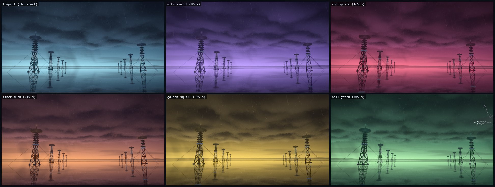

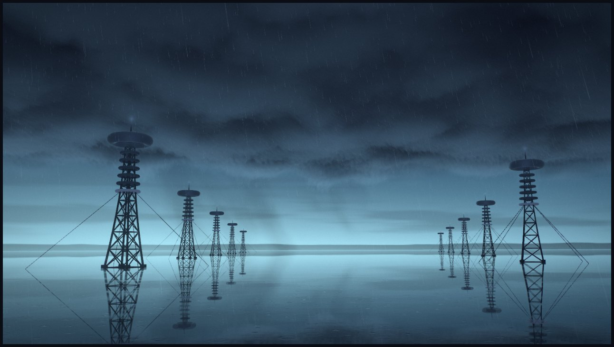

The gameplay card covers the middle of the frame, so the picture is built for what stays
visible: the hero tower stands left of the card with open sky above it for a bolt to cross, a
second tower stands right of the HUD, the others close ranks toward the horizon behind the card.
On an upright phone the two rows stand in the margins either side of the card.

## The one idea

The board charges the towers and the storm answers. A piece's charge leaps to a tower and stays
there as light in the piece's colour; a clear calls lightning down onto the towers that hold the
most. The more the player has charged, the more a clear lets go.

## Event language

| Event | Response |
| --- | --- |
| Piece lock | An arc in the piece's colour leaps from the card's edge, at the piece's own height, to a tower on that side. The tower's rings light in that colour from the bottom up, a pulse climbs them, the electrode flares, sparks fly, a ring in that colour leaves the tower's foot across the water, and the cloud above flickers back. The tower **keeps** the charge (it fades over about half a minute), so the field slowly fills with the colours of the pieces played. |
| Hard drop | The same, harder: a heavier arc with three strokes, a second arc to the next tower, a stronger ring, a camera kick. |
| Line clear | Each cleared row discharges out of an edge of the card as an arc, to either side in turn. A beat later the sky answers: one bolt per line, from the cloud's underside onto the towers holding the most charge. A leader steps down, the return strokes run up the channel, the branches flash once. The struck tower goes white, throws what it held as sparks of that colour and goes dark; the cloud lights from inside round the bolt, the rain lights everywhere at once, a ring crosses the water and the camera shakes. |
| Combo | The storm builds. An arc stands between tower tops for every step of the chain past the first (up to five; the third crosses behind the card from the hero tower to the one on the right), corona burns on every electrode, the storm's own lightning comes several times as often, the rain thickens and leans, the cloud drifts faster. When the chain breaks the storm lets its breath go and the arcs cool. |
| Four lines / perfect clear | The storm holds its breath: every light sinks for a fifth of a second and the rain hangs in the air. Then the rows discharge and a superbolt strikes the hero tower with five return strokes; the four nearest towers are struck in turn; sheet lightning runs out through the cloud as a ring; the picture itself ripples from the strike; lightning crawls across the whole ceiling afterwards. |
| T-spin | The cloud over the hero tower winds up like a mesocyclone and springs back, and an arc climbs the hero's mast. |
| Level up | The storm's light steps one palette on from wherever it has drifted to (tempest, ultraviolet, red sprite, ember dusk, golden squall, hail green, and round again), over a couple of seconds, and the cloud flickers in the light that is coming. |
| Time, with no event at all | The same light drifts by itself: it rests on a palette for about twenty-five seconds, then mixes into the next over about fifty-five. A level's step and the clock's drift add up, so two runs at the same level seldom look the same. |

Combo here is the true consecutive-clear combo (one `ComboTracker` per player in
`VoltageStormDirector`); the bus's `COMBO` event is cascade depth (ADR-0011). With several boards
on screen each board throws its arcs from its own card, outward, and the storm builds to the
longest chain any board is holding.

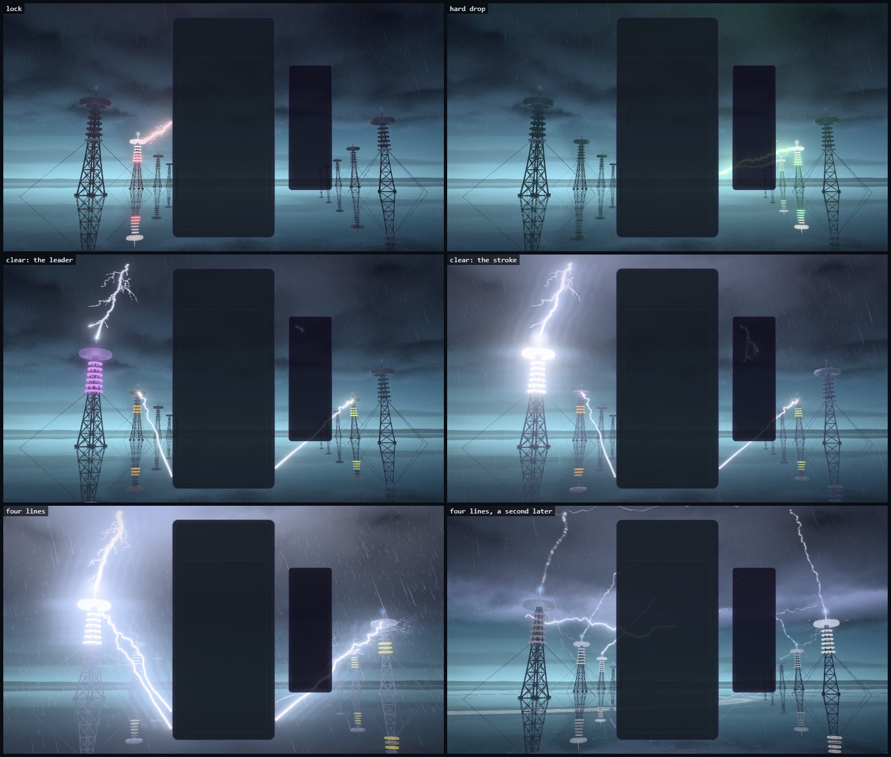

## How it is built

| File | Role |
| --- | --- |
| `voltage-storm-core.js` | Three-free constants and maths: the storm's geometry in metres, the towers' layout for an aspect, how a stroke's light runs in time, how a tower's held charge is carried, the six palettes and the wheel they stand on. |
| `voltage-storm-tsl.js` | Hashes, the two baked noise textures (a 2D field with its own slope, and the cloud's 3D field), the shared uniforms and the event tables, the strokes' light and the water rings as reusable loops. |
| `voltage-storm-sky.js` | The whole sky, painted once per frame into a reduced-resolution target: the clear strip, the far shore, rain shafts, and the cell's underside as a marched slab. |
| `voltage-storm-water.js` | The flooded plain: it mirrors the sky target, and carries wind ripple, raindrop rings and the rings events send across it. |
| `voltage-storm-towers.js` | The tower's geometry (generated, one unit tall, instanced), the towers and their mirror images, the glows on the electrodes. |
| `voltage-storm-bolts.js` | Lightning: one ribbon mesh instanced per bolt slot, shaped in the vertex stage; and the table that owns the slots, each bolt's light in time and the frame's lights. |
| `voltage-storm-fx.js` | Rain and sparks. |
| `voltage-storm-world.js` | Owns the uniforms, the parts, the camera rig, the towers' state and the choreography. Shared with the playground effect, so what is iterated there ships. |
| `voltage-storm-director.js` | Renderer-free: stages bus events per player and resolves one lock and one clear per frame. |
| `voltage-storm-composition.js` | Three-free: reads the live card, board and HUD rects and maps board columns and rows onto the screen. |
| `voltage-storm-post.js` | One scene pass, bloom, and one output pass. |
| `voltage-storm-quality.js` | The six tiers. |
| `voltage-storm-theme.js` | Lifecycle, renderer selection, settings, layout watch, GPU-loss recovery, capture flags. |

Techniques worth knowing before changing it:

- **One node renderer on both backends.** `WebGPURenderer` on WebGPU, its WebGL2 backend
  otherwise (or `?forceWebGL`). Nothing uses compute: every bolt, drop and spark is a closed-form
  function of the clock, so the WebGL2 backend draws the same storm.
- **The sky is painted once, small, and used twice.** A full-screen pass paints the strip, the
  shore and the cloud into a target at a fraction of the screen's size (the cloud is soft). The
  backdrop stretches that target over the frame, and the water looks its mirrored view ray up in
  the same target, so the sky's image in the water costs one fetch.
- **The cloud is a slab, lit by where it hangs.** The view ray walks the lower part of a slab
  whose density comes from one baked 3D noise read (inverted cellular noise on gradient noise:
  masses with lobes hanging from them; a second, finer read adds billows). The strip's light
  reaches in from the cell's edge, so far cloud is lit and the cloud overhead is not, and a lobe
  that hangs low nearby stands dark against the lit cloud behind it. Two taps toward the strip
  give each lobe a lit side. Light confined to a lobe's thin edge was tried first and drew
  contour lines: fourteen steps cannot resolve a thin shell.
- **A stroke is a light inside the cloud.** Each live bolt throws a light with a reach of a few
  hundred metres and an inverse-fourth falloff. In the slab it counts most deep inside, so the
  lobes in front of it are its shadow, and it has a soft ceiling so the cloud beside a stroke
  glows without blanking out. The same lights fall on the towers, the water and (as one value at
  the lens) the rain and the post's iris.
- **A bolt is not stored: it is built.** Every bolt is an instance of one ribbon mesh — a main
  channel, branches, twigs — and the vertex stage builds its shape from the slot's two end points
  and a seed, as piecewise-straight noise at four scales. The wander is ACROSS the view and
  measured as a share of the angle the bolt spans, scaled by each point's distance from the lens:
  measured in metres, an arc that runs from near the lens to a far tower tangled into polygons at
  its near end.
- **A bolt's light in time is worked out on the CPU**, once per frame per live slot: a leader
  that steps down in jumps, return strokes at seeded intervals, branches that only flash on the
  first stroke, the channel cooling into beads. The ribbon carries a hairline white core in a
  halo of the bolt's colour; the bloom adds the rest.
- **The towers are the board's memory.** A tower's charge is one number (the moment it would
  have held exactly one lock's worth), so nothing is written per frame. Its rings fill from the
  bottom in the colour it holds; a strike empties it.
- **Images in the water are geometry.** The towers and the bolts are drawn a second time, turned
  upside down in the vertex stage, over the water, with a shimmer; a bolt that dips under the
  water has no image.
- **The palette is a place on a wheel.** The six palettes are laid out in hue order, so the
  mix between any two neighbours is a clean colour (amber went straight into green at first and
  the whole sky passed through khaki; a golden palette now stands between them). The live
  palette is the wheel's palette at `level − 1 + time / 80 s`. What is eased when a level is
  reached is that PLACE, the short way round, never the colours themselves: a new level's light
  arrives through the same mixes the drift passes, and at rest the palette is a pure function
  of the clock, whatever the frame rate.
- **Closed form first.** Nothing is created at event time: events write numbers into slots and
  preallocated pools, and every delayed consequence (an arc landing, a leader connecting) is a
  dated entry in a queue. `seek(t)` plus a fixed-step replay reproduces any frame.
- **HDR, single output.** The scene is scene-linear. A max-channel knee selects what blooms (no
  MRT); the scene pass is multisampled on the upper tiers because the towers are lattices of thin
  beams. One output pass does the shock ripple, a lens fringe kept under a pixel (wider, it split
  a thin white channel into coloured threads), the calm zones on the card and HUD, bloom, a
  sideways lens streak while a stroke is alight, an iris that closes on a stroke, a
  hue-preserving filmic curve, grade, vignette, grain and dither. `usesMrtScenePass()` is false.
- **No MaterialX noise.** Both noise textures are baked on the CPU when the world is built.

## Tiers

| Tier | Sky target | Steps through the cloud | Billows and light taps | Strokes lit per step | Towers | Mirror images | Rain | Sparks | Bloom, streak | MSAA |
| --- | ---: | ---: | --- | --- | ---: | --- | ---: | ---: | --- | --- |
| Minimal | 30% | 5 | off | once per pixel | 6 | off | 900 | 96 | off | off |
| Low | 36% | 7 | off | once per pixel | 8 | on | 1,800 | 160 | off | off |
| Medium | 42% | 10 | on | once per pixel | 10 | on | 3,600 | 288 | on | off |
| High | 60% | 14 | on | per step | 10 | on | 6,000 | 448 | on | 4× |
| Ultra | 70% | 18 | on | per step | 10 | on | 9,000 | 640 | on | 4× |
| Extreme | 85% | 24 | on | per step | 10 | on | 13,000 | 900 | on | 4× |

Every tier keeps the whole picture and every event. These are allocation budgets, not
measurements of frame rate.

## Assets

None. Everything is generated in code: the towers, the noise, the cloud, the lightning. No model
or texture file is loaded. Blender was offered and not used: what carries the picture is a volume
(the cloud), light in time (the bolts) and a silhouette (the towers), and a tower that is a
lattice of square beams with a torus on top is quicker and smaller as forty lines of code than as
a file.

The theme no longer uses `src/utils/webgl/fluid-simulator.js` (the shared simulator itself was deleted with the Nebula Flow rebuild, 2026-10-11).

## Reproduce

Run `npm run dev:playground`, then:

`/playground.html?effect=voltage-storm&t=20&quality=High&board=1`

Add `event=lock|drop|clear|quad|twist|perfect|levelUp` with `eventAge=<s>`, and `combo=<n>`,
`level=<n>`, `lines=<n>`, `u=<0..1>`, `row=<r>`, `color=<hex>`. `locks=<n>` plays n locks first,
so the towers are holding their charge when the event fires. `demo=1` (without `t`) plays a
looping script. `parts=` draws only the named parts; `falseColor=1` bands the pre-tone-map peak;
`noPost=1` shows the raw scene; `forceWebGL=1` uses the WebGL2 backend; `reduce=1` is reduced
motion; `hud=0` hides the playground's own panel. The storm's own lightning falls on beats of 4.6
seconds, so `t=23.2` and `t=27.8` show it. `t` also sets how far the light has drifted: one
palette every 80 seconds, so `t=85`, `165`, `245`, `325` and `405` rest on the second to the sixth
and `t=40` is half-way from the first to the second. In the game: `?voltageStormTime=`,
`?voltageStormFixedDt=`, `?voltageStormParts=`, `?voltageStormFalseColor=1`.

The theme icon is a frame of the scene through the playground's icon lens (the camera turned to
the hero tower's crown and closed to 30°): the leader of a strike reaching the finial while the
rings still hold their charge, a chain of five standing:

`/playground.html?effect=voltage-storm&t=20&quality=Extreme&icon=1&locks=8&combo=5&event=clear&lines=1&eventAge=0.236&iconFov=30&iconPitch=0.085&iconYaw=-0.03`

captured in an 813 × 813 window (the largest square this laptop's screen allows), cropped to 90%
of the frame round its centre, given a colour lift (contrast 1.3, saturation 1.8, brightness
1.14) and baked as a 512 px circle on a transparent ground. The same file is kept at
`public/assets/themes/voltage-storm-theme-icon.png`.

## Verification

- Unit tests: 226 new tests in six files (core 32; bolts 28; towers, rain, sparks and the noise
  bakes 26; world 59; director 26; theme 55). With the theme-wide tests the change could touch
  (lifecycle audit, dual-state tripwire, portable renderers and context recovery, portrait
  composition, teardown regressions, registry lifecycle acceptance, thumbnails, mobile quality
  and WebGL2 validation, the URL-parameter catalogue, the skill mirror): 51 files, 768 tests, all
  passing (the catalogue test has a 5 s limit of its own and missed it once on the loaded
  machine; it passed on every other run).
- Whole suite, run once while other sessions held the machine, before the light learned to
  drift (the six theme files, the theme-wide set above, the gates and the build were run again
  after it): 752 files, 12,161 tests; 751 files passed. The one that did not (`odyssey-level-briefing`) expects "250,000" and gets
  "250 000" from this machine's Swedish number format, and fails identically on `main`.
- Gates: typecheck; TypeScript ratchet (at baseline); lint ratchet (708 errors against a baseline
  of 807: the new files add none; the baseline was left as it is); theme lifecycle audit;
  dependency boundaries (1,429 modules); architecture fitness (one metric improved, not locked
  in); production build with the boot-closure guard; IP-string gate; Pages artifact check;
  release gates; performance-budget gate — all pass.
- Playground captures on WebGPU (RTX 3070 Laptop): rest with and without the board; a lock and a
  hard drop; the towers holding twelve locks; clears of one, two and three lines, at the leader
  and at the stroke; the four-line hush, superbolt and aftermath at four moments; a perfect
  clear; chains of three, five, seven and eight; a T-spin; the storm's own lightning; the five
  other palettes, and the light at nine moments of its drift; Minimal, Low, Medium, Ultra and
  Extreme; High and Low on the forced WebGL2
  backend; an upright 390 × 844 frame at rest, in a clear, in a chain and through four lines; a
  21:9 and a near-square frame; reduced motion. No console errors or warnings in any of them.
- Most of the look was iterated on the CPU: Electron on SwiftShader runs the same code through
  the WebGL2 backend with no GPU at all (about fifteen seconds a frame at High), so every
  intermediate frame doubled as a check of that backend. The 8-bit sky target that a WebGL2
  context without float colour buffers gets was drawn through a scratch effect and matched the
  half-float frame.
- In the real game (Electron, dev server, single player, themes unlocked with `?unlockAll=1`):
  the theme starts on WebGPU, reads the live board and HUD, takes bus-injected locks, hard
  drops, clears, a chain and four lines, survives a live quality change (High to Medium) and
  lets go of its canvas when another theme takes over; no console errors or warnings. Before the
  last round of fixes the same script also ran clean on the integrated AMD GPU at High and, as a
  check of function only, on the WebGL2 backend on the CPU at Low; those two runs were not
  repeated afterwards.
- A helper agent wrote the theme class, the director and their tests from the Galaxy precedent,
  and a second one wrote the world's tests and reviewed the choreography. Its review found
  faults the captures had not shown, all fixed and covered above: the storm's own lightning and
  every queued consequence (an arc landing, a leader connecting) dated by the frame that noticed
  them instead of their own moment; rings on the water cut off by newer ones (a new ring now
  takes the place of the weakest); standing arcs keeping the previous level's colour; reduced
  motion that still flickered (now one stroke per bolt, steady standing arcs, no lens kick); a
  quality change mid-run dropping the level's light and the clock; a hard cut of the camera and
  the iris when a run ended; the frame's lights chosen by level instead of by what they
  deliver; the crawler pool overrunning in bursts; a leader that went dark for its last step
  before the stroke.

Observed, not measured (whole-game frame rate at 1445 × 813 while other sessions held the
machine, single runs): about 130 fps on the RTX 3070 at High, twice, the second time with the
drifting light (frame interval 7.6 ms median and 8.6 ms at the 99th percentile through the event
script, no frame over 66 ms; an earlier run on a busier machine read 128 fps with 31 ms at the
99th percentile) and about 92 fps on the
integrated AMD GPU at High (run before the last round of fixes, which did not touch what is
drawn).

Not verified: the storm in motion with a human eye — every judgement here was made from still
frames and frame sequences, so the pace of the rain, the flicker of a stroke and the cloud's
drift are tuned by arithmetic, not by watching; GPU cost per tier through the theme perf lane
(ADR-0016); physical phones; local multiplayer, Infinity and Odyssey layouts in a capture (their
routing is unit-tested only; with three or four boards in a row an inner board's arc crosses its
neighbour's card); the repo's lifecycle validator (`scripts/validate-all-themes.mjs` failed every
locked theme when this was written, and was not run; it passes since, see the contrast pass);
the icon on an Odyssey level orb; sessions of several hours. The theme's music is still the
placeholder track.

## Captured previews

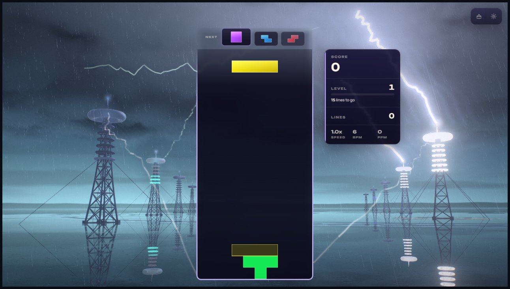

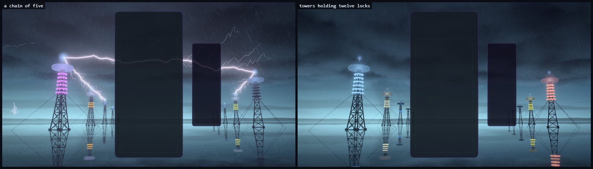

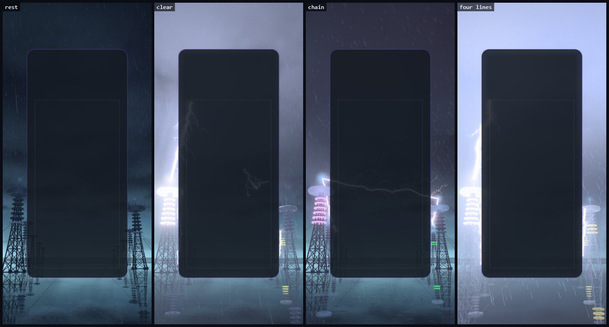

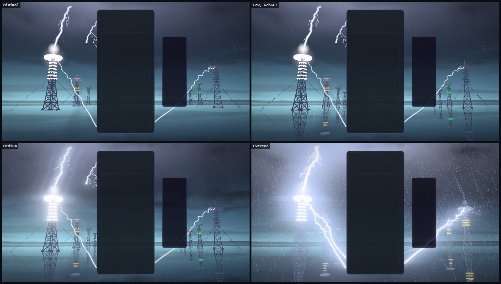

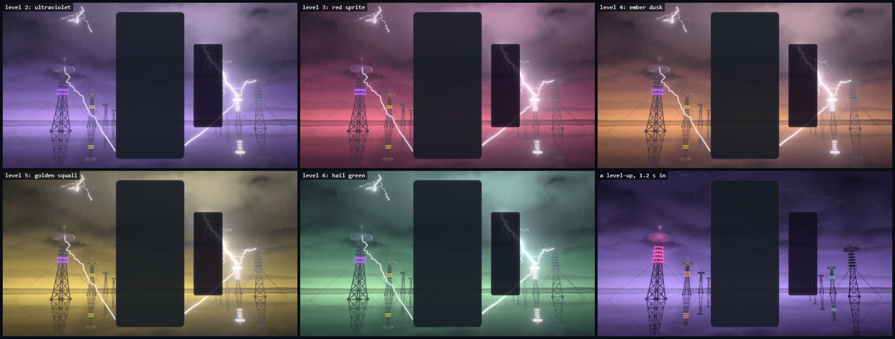

## Contrast pass (2026-10-21)

At rest the storm read as an overcast afternoon: one flat grey-teal from the cloud to the water,
the cloud's lobes smeared into horizontal brush strokes, the towers dead silhouettes between
strokes, and the blacks lifted into a blue veil. This pass deepens the night without touching the
event language, the palettes or the draw list. Before and after, the same frames
(`?effect=voltage-storm&quality=High`, 1600 × 900, WebGPU):

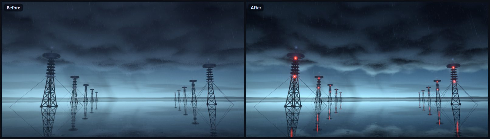

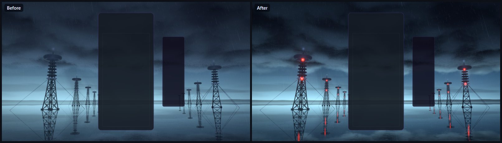

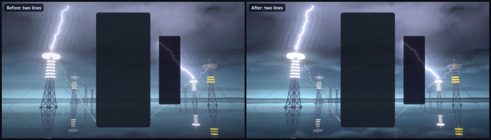

- **The cloud keeps its lobes.** A low ray crosses up to two kilometres of the slab, and fourteen
  steps put a hundred metres of ground between samples: the lobes it passed were smeared along
  it. The step count now follows the ray's run over the ground (about one step per 40 m, up to
  twice the tier's `march`, 1.4× on Low and Minimal), so steep rays cost what they did and only
  the long, low ones take more.
- **The cloud has contrast.** The strip's light on a lobe was a product of five factors, each
  with a high floor (0.3 to 0.6), which together held a lit side within about twice its shadowed
  one. The floors are lower and the side that faces the strip is squared, so the recesses go
  deep, and lobes near the cell's edge catch the strip's own colour (`horizon`) rather than only
  the cloud's rim.
- **The strip has a heart.** Its light gathers into a whiter glow just over the far shore and falls
  off faster above it, and the shore stands as a dark line against it.
- **The towers keep the field alive between strokes.** Two red obstruction beacons per tower
  (under the electrode and at the guys' waist) pulse together about 38 times a minute, the
  lower a beat behind the upper, and lie on the water as streaks broken by the ripple; a strike
  blanks them; the finial carries a faint St Elmo's fire at rest. They are four more instances
  per tower in the glows' existing draw (`BEACON`, `GLOWS_PER_TOWER` in
  `voltage-storm-towers.js`); the two images are left out on the tier that has no tower images
  (Minimal). Under reduced motion or Reduce flashing they burn steady (`u.blink`).
- **The grade** colours the shadows by scaling only (it added a constant, which the sRGB encode
  turned into a blue veil over every black), adds a little contrast round mid-grey with the hue
  kept, and a little more saturation.

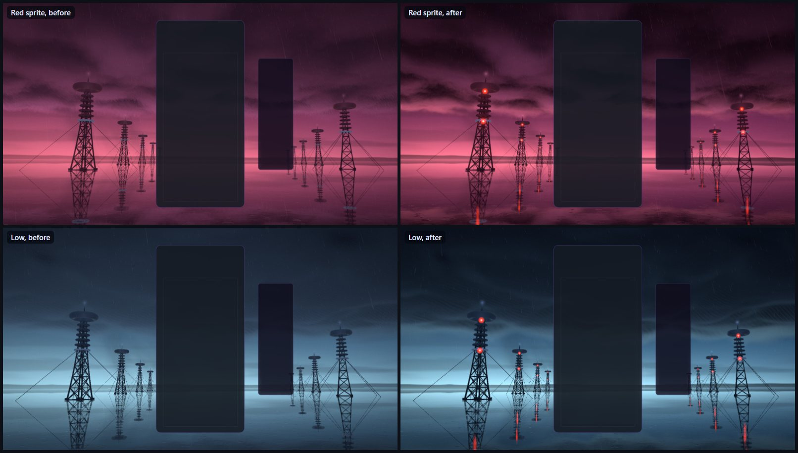

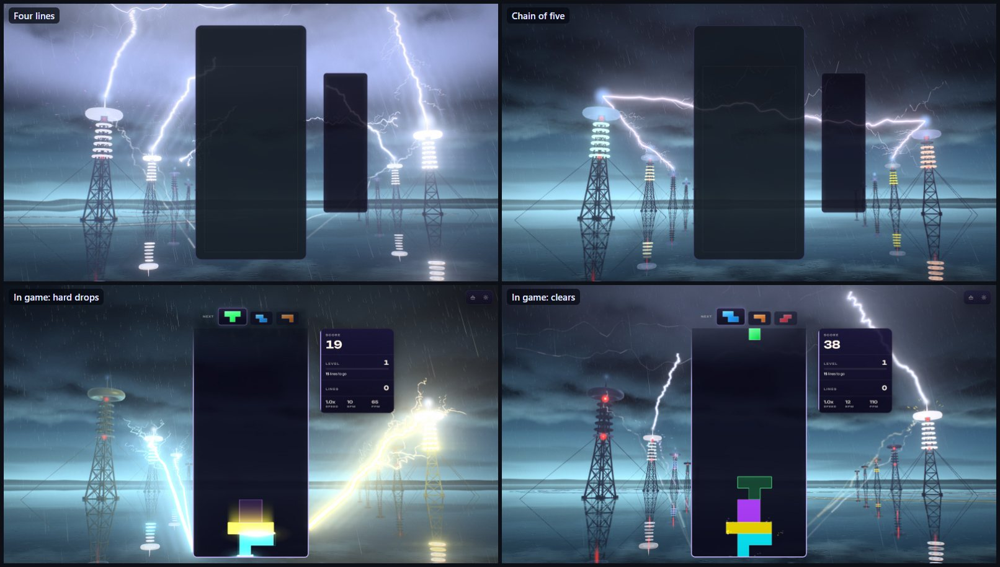

Tried and dropped: the cloud's underside as a height field (each ray marching to where it first
meets a surface of hanging lobes, then bisecting, and shading the lobe it meets as a form). It
gave crisp lobes, but from a lens seven metres over the water every ray meets it at a grazing
angle: fixed steps tunnelled past lobe tips and ruled their edges into stair-step dashes, steps
that followed the ray's run left fewer of them, a search round the closest miss flipped from row
to row into stripes, and jittered steps turned them into a screen-door grain that nothing here
averages away. The forms also read harder and more like folded paper than the soft slab.

Verification:

- `tests/unit/voltage-storm-shaders.test.js` (new) builds every material in the storm, and the
  sky pass (a QuadMesh outside the scene), through the WGSL and GLSL node builders at High, Low
  and Minimal and fails on a warning, a throw, an equal-edge smoothstep, a NaN literal, a
  stringified node, MaterialX noise or an undeclared texture binding (the sky pass is 15 KB of
  WGSL at High). With the theme's eight test files and the Reduce flashing and skill-mirror
  tests: 321 tests, all passing. Lint on the theme and the new test, and the typecheck, pass.
- Playground captures on WebGPU: rest with and without the board (the beacons on and off their
  pulse), a lock, clears of two lines, four lines, a chain of five, the storm's own lightning,
  the red sprite palette, Minimal, Low, Medium, High and Extreme, High and a clear at Low on the
  forced WebGL2 backend, upright 430 × 852 and reduced motion: no console errors or warnings.
- In the game (Electron, private dev server, single player, High, WebGPU): real hard drops from
  the keyboard throw their arcs, clears called through the live world strike the towers, and the
  beacons and their images hold in the solo layout. `scripts/validate-all-themes.mjs --theme
  voltage-storm`: PASS, 0 lifecycle failures, 0 console errors;
  `docs/theme-screenshots/voltage-storm.png` is its capture.
- Cost: the playground's frame rendered 300 times in one task and waited on the queue, eight
  interleaved rounds per arm against the unchanged code, on this laptop's discrete GPU while
  other sessions held it: Low 0.55 ms before and 0.46 ms after, Minimal 0.41 and 0.43 (within
  noise); High was too loaded to read (rounds from 0.86 to 3.3 ms), its best rounds 0.86 and
  0.87 ms. Not measured: the theme perf lane, integrated GPUs, phones.

The theme icon still shows the earlier cloud (it is a close-up of a strike, which this pass did
not change).

## The living storm (2026-11-16)

An audit of the theme against its brief (a storm that is the centrepiece, varied over time, with
lightning of many kinds and an event language whose biggest moments are the most spectacular)
found four things weak:

- **The storm stood still.** Apart from the palette's drift and the charge of play, the cloud
  was the same ceiling at minute one and minute ten: one slab smeared toward the horizon, the
  same rain, the same flicker on the same 4.6 s beat.
- **Lightning was one thing.** Every bolt, from a lock's arc to a superbolt, was the same jagged
  white-cored channel with the same forks; only its length, width and colour changed.
- **The storm's light strobed with its channels.** The light a bolt threw on the cloud, the rain
  and the lens was its channel's brightness, so every return stroke pulsed the whole frame.
- **The far shore was empty** and the strip of clear sky behind it was the same band all the time.

Where this section and the ones above disagree, this one is current.

### The storm

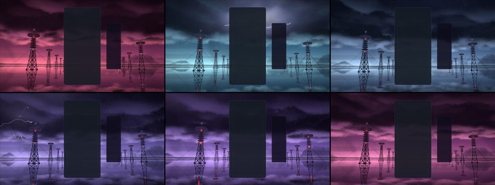

- **A vault, not a ceiling.** The cell's underside steps down in three tiers from a high vault
  over a point behind the lens out to the cell's edge (`vaultBase` in the core, the CPU twin of
  the sky's shader). Seen from the water the storm stands as terraces one behind another, each
  tier's lower lip a fringe of the strip's light. The whole vault turns slowly about its centre,
  a mesocyclone. Every bolt leaves the cloud where the vault actually hangs over its start.
- **Its own weather.** The storm turns once in 176 s through four acts (`stormWeather`): a
  **lull** (the vault lifts, the tiers flatten, the strip opens wide, drizzle, far lightning
  only), a **gathering** (the tiers come down, scud races in under them, the rain thickens), a
  **break** (the tiers at their lowest and fullest, squalls of rain a quarter of a minute apart,
  the cloud alight from inside, lightning on every beat and often half a beat after) and an
  **easing** (the rain thins, spider lightning crawls long across the vault). Each turn has its
  own depth of lull and height of break. Play pushes the weather on top: a quick hand brings the
  break whatever act the clock is in, and when a run ends that weather settles over a few
  seconds. All of it is a pure function of the clock (seeks and frame cuts give the same storm).
- **Scud.** Ragged, soft-edged fragments race under the lowest tier and across it, faster than
  the vault turns; they come in as the storm gathers and are gone in its lull (not on Minimal).
- **Far thunderheads.** Two ranks of towering cumulus stand on the horizon beyond the cell's edge:
  heaps of round domes, lit on the side toward the evening's glow, and now and then one is alight
  from inside, silent at that distance.
- **Rain curtains** walk along the horizon with the wind, take a little of what stands behind
  them into the haze and glow when a bolt is behind them; a heavy storm hangs them thick.
- **Lightning lights the cloud from inside.** A stroke's light in the cloud falls off faster than
  in clear air, deepens in colour the more cloud it crosses (white only at its heart), and is
  dim where the cloud is thick and burns where it is thin, so a strike draws the cloud's build in
  light instead of washing it white.

### Lightning

A bolt is still one instance of the same ribbon built in the vertex stage, but it is now built by
a **style** (`BOLT_STYLE` in the core): how rough its channel is, whether it arches, how much
current its limbs carry, how far they turn, how long they are, how many show, how far its core
keeps its colour. Each bolt also draws its own lot of limbs (which show, where they leave the
channel, how long), so no two forks are alike. The kinds:

| Kind | Where it is seen |
| --- | --- |
| **Fork** | The classic forked strike: a clear's answer, strikes on the open water at the break. |
| **Ribbon** | A strike whose return strokes each stand a little to the side of the last. |
| **Giant** | One thick trunk, hardly a fork, that burns on (a continuing current) instead of flickering out. The superbolt is one. |
| **Hairline** | Far strikes in the clear strip: thin, restless, forked low, reddened by rain and distance. |
| **Spider** | A wide tree that crawls along the vault's underside in plain sight, limb after limb, then lights whole. |
| **Tree** | Upward lightning: a trunk off a tower's finial that forks into the cloud. |
| **Filament** | A lock's charge: a smooth thread of plasma in the piece's colour, arching as it leaps. |
| **Lash** | A hard drop's charge and a clear's row discharge: the thread driven hard, kinked and forked. |
| **Plasma** | A chain's standing arcs: slow, writhing, rising like a Jacob's ladder until they snap and strike again low. |
| **Skitter** | Webs of frantic, flat arcs that run over the water from a struck foot. |
| **Helix** | A twist's arc, wound round the hero's mast. |
| **Streamer** | The brush of fire a finial sends up to meet a leader coming down, and that charged air raises at the break. |
| **In-cloud** | Lightning inside the lobes: no channel, a swell of light that shows the lobes in front of it dark. |

Bolt colours vary too: each strike draws its own place between the palette's bolt and chain
colours and its own heat. The storm's own lightning picks from the kinds by the weather's act
and a roll, so it never does the same thing twice running.

**What a bolt lights rises and falls slowly** (`strokeGlow`): one swell from its first return
stroke, rising over about 70 ms and falling over about 0.3 s, with later strokes adding a little
on top. The channel itself still flickers with every stroke; the cloud, the rain, the towers, the
water and the lens do not. The iris dips less on a stroke than before (the frame-wide exposure
is a flash of its own). The rain takes a stroke's light where each drop is, so a bolt stands in
a halo of lit rain instead of the whole air whitening. A superbolt's thunder is a shell of
pressure that runs out at the speed of sound and shoulders the rain aside as it passes the lens,
and the lens kicks when it arrives, a moment after the light.

### Event language

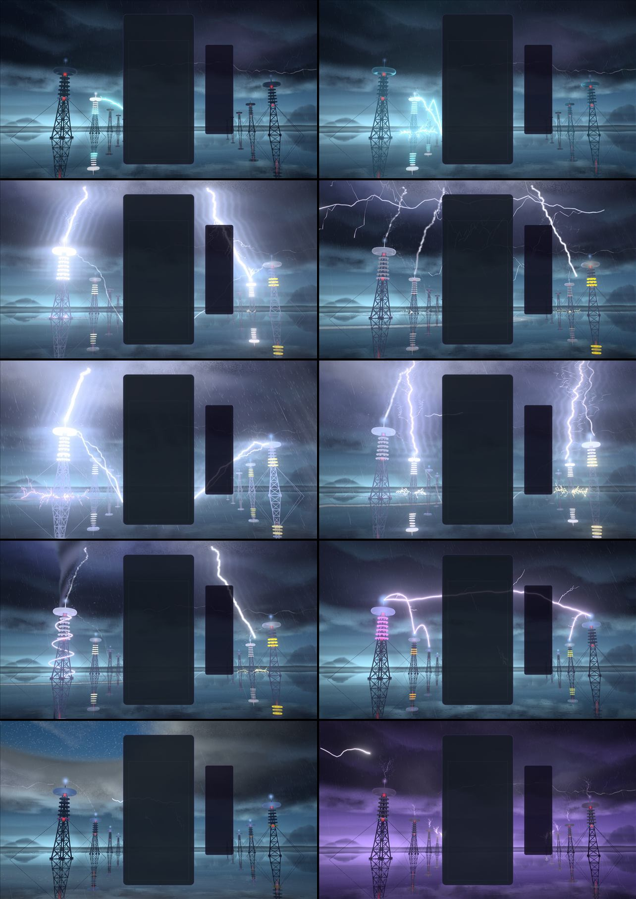

| Event | Response |
| --- | --- |
| Piece lock | A filament in the piece's colour leaps from the card's edge to a tower, which keeps the charge in its rings; now and then the cloud above answers in that colour. An arc from a low row leaves from the water on the row's bearing instead of crossing the foreground. |
| Hard drop | A lash, a second arc to the next tower, and the charge goes to ground: a ring and a web of skittering arcs in the piece's colour run over the water from the tower's foot. |
| Line clear | Each row discharges as a lash; then one strike per line, no two alike (a fork, a ribbon, a giant), each met by a streamer off a near finial; a tower that lets go of a real charge throws it over the water as skittering arcs. Three lines: spider lightning crawls out across the vault afterwards. |
| Four lines | The hush; a giant superbolt onto the hero that burns on; the three nearest towers answer with lightning that climbs, trees forking up into the cloud one after another; sheet lightning, the ripple, thunder through the rain; spider lightning crawls across the vault. |
| Perfect clear | All of four lines, and the storm opens: an eye widens in the vault beside the card and the evening above pours down its walls, the first stars out, while the field sends its charge up into it; then the eye closes. |
| Combo | Standing arcs of plasma between tower tops climb and strike again like Jacob's ladders; corona, rain and wind rise with the chain. |
| T-spin | A funnel winds down out of the cloud toward the hero and a helix of fire climbs the hero's mast to meet it. |
| Level up | Running lights: every tower pulses in turn out along both rows in the coming light, throwing sparks and a streamer; a slow front of that light crosses the whole vault; spider lightning in it crawls after. |
| Time, no event | The weather's turn and the palette's drift, on two clocks that never line up. |

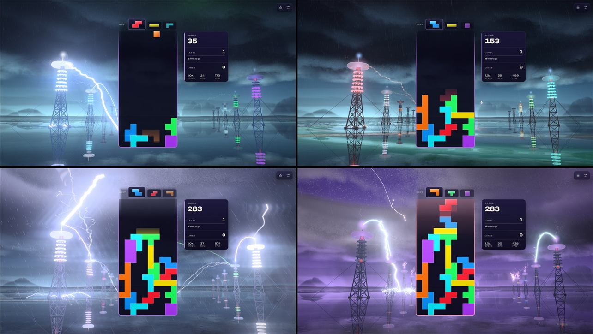

### Tiers, backends and phones

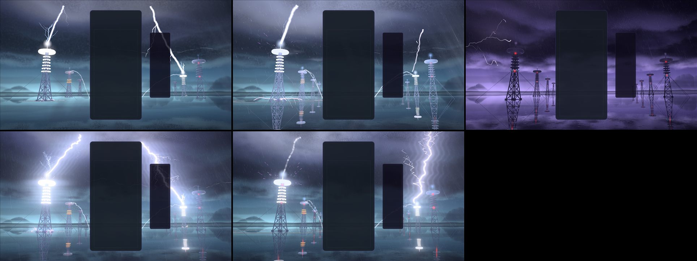

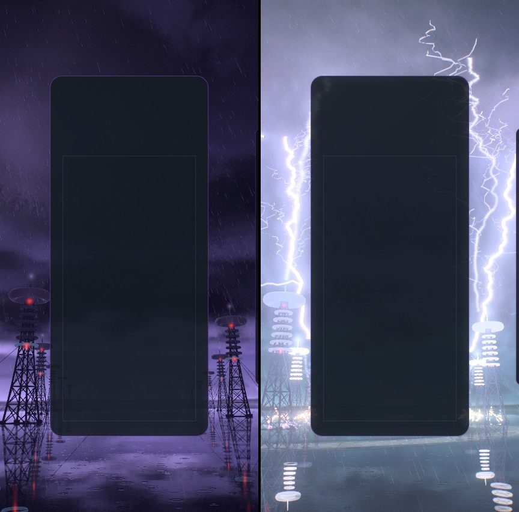

Every tier keeps the vault, the weather, the far thunderheads, the curtains and every kind of
lightning. Minimal leaves out the scud. The tiers that light the cloud once per pixel give a
stroke one even glow, dimmer where the cloud is thick (following the depth there showed the
march's grain); a coarser ribbon carries less of a bolt's finest kinks. Reduced motion and
Reduce flashing keep their rules: one stroke per bolt, no streamers or skittering webs under
reduced motion, standing arcs held still at a steady light, a trace of the sheet's light.

### Faults found and fixed on the way

- Concentric rings over the vault's lit walls: the march's start jitter was interleaved gradient
  noise, a lattice that beats against the step length when nothing averages it over frames. It
  is a per-pixel hash now (skill gotcha #1506). Found by switching the sky's own layers off one
  at a time (`skyLayers=` in the playground).
- Contour lines where neighbouring rays take a different number of steps: the step length is now
  worked from the unrounded count (#1507).
- Scales in lit and edge-on cloud: the coarse 3D noise was creased along its voxel faces; the
  coordinate is eased inside its voxel before the read (`cloudNoiseSmooth`, #1508).
- The storm's light strobing with its channels (#1717), and arcs from low rows ruled across the
  foreground (#1718).

### Not done

Blender was offered and not used: every new thing here is light, cloud or a closed-form shape, and
the towers' silhouette did not need a change. The theme icon still shows the earlier strike. The
music is unchanged.

### Verification

- Playground captures on WebGPU (RTX, 1600 × 900, `maxFps=30`): the weather at six moments of its
  turn and pinned at its lull and break; every event at the moments shown above and more (the
  hush, the superbolt, the trees, the aftermath, the eye opening and closing, a twist's funnel
  rising and falling); Minimal, Low, Medium, High, Extreme; Low and High on the forced WebGL2
  backend; reduced motion; an upright 430 × 852 frame at rest and in four lines. No console
  errors or warnings in any of them.
- In the real game (dev server, headless Chrome on WebGPU, single player, 30 fps): sixteen real
  hard drops from the keyboard threw their arcs and filled the towers, then two lines, a twist,
  four lines, a perfect clear and a level up called on the live world; no console errors (the
  one message was the headless browser refusing to start music without a user gesture).
- Flashing: the frame's mean relative luminance, sampled every frame through the playground's
  36 s scripted play loop (locks, hard drops, a chain of five, four lines, a twist), before and
  after, the new one with the weather pinned to its break. Largest rise within 100 ms: 0.134
  before, 0.140 after (whole frame); 0.238 before, 0.192 after (the upper half, where the sky
  is); largest fall within 100 ms 0.086 before, 0.056 after; brightest frame 0.29 before, 0.25
  after. Opposing changes of 0.10 or more within any one second: at most one pair, before and
  after (WCAG 2.3.1 counts three).
- Cost: GPU time per frame from timestamp queries, at the 30 fps cap, interleaved before and
  after: both at or under about 3.5 ms at the 95th percentile at High, 1600 × 900, but the
  medians swung up to six times between identical runs (the GPU changes clocks at a cap), so the
  two cannot be told apart this way; CPU time per frame is the same (about 1.6 ms median). The sky
  pass does more work than before (taller march, taps per tier, the far thunderheads, curtains,
  scud), so the integrated GPU and the theme perf lane are the checks still owed.
- Tests: the theme's nine test files. A new one, `voltage-storm-weather.test.js`, holds the vault
  (between its tiers everywhere, terraces and never a cliff), the storm's turn (a pure function
  of the clock, its four acts in order, no jumps, a lull and a break of its own every turn, the
  squalls), a bolt's slow light (nothing on its first stroke's instant, never falling a fifth as
  fast as its channel), and the world's weather (at rest as the clock says, pinned, the vault's
  turn, the eye of a perfect clear opening, standing and closing). The others now hold the bolt
  styles and the seven-row table, ribbon lightning's shifted strokes, the light thrown from where
  a bolt asks, four lines' trees, the twist's funnel and helix, a level's running lights, the
  weather's silent and echoed beats and what reduced motion leaves out. The shader gate builds
  every material and the sky pass on both backends at High, Low and Minimal.
