# Winter — fox fires

Implemented 2026-10-09 on `feature/winter-masterpiece`, with Three.js 0.186.1. A from-scratch
rebuild: it replaces the earlier theme in full (the Winter Wonderland playground scene and the
legacy WebGL scene behind `winterLegacy`, their materials and GLSL, the storm director, the
snow simulation, the GPU paw trail, the post pipeline and the TRELLIS conifers). Winter keeps
its identity — a pastel polar twilight, the great moon with its halo, falling snow, an aurora,
wind, and the arctic fox that leaves its tracks across the snow — and everything else is new.
This document records the shipped design and what was verified. It is a reference, not a
backlog. The earlier Winter plans (`WINTER_*_PLAN.md`, `WINTER_AAA_REVIEW_2026-06.md`,
`WINTER_SNOWFLOW_MASTERPLAN_2026-08.md`) describe code that no longer exists.

## The picture

A snowfield at the edge of a frozen lake, in the long twilight of a polar noon. To either side
stand spruces so loaded with rime and snow that each has become a lumpy white figure, dark only
under its boughs: the "snow ghosts" of Lapland's fells. On the left the last light lies rose
along the horizon behind a round fell; on the right the moon stands high, far larger than life,
with its ring of ice-light, and its path lies over the wind-swept ice. Beyond the lake is a
dark shore of wood and the fells behind it. Snow falls. A white fox goes its round over the
snowfield, stops to listen, digs, moves on.

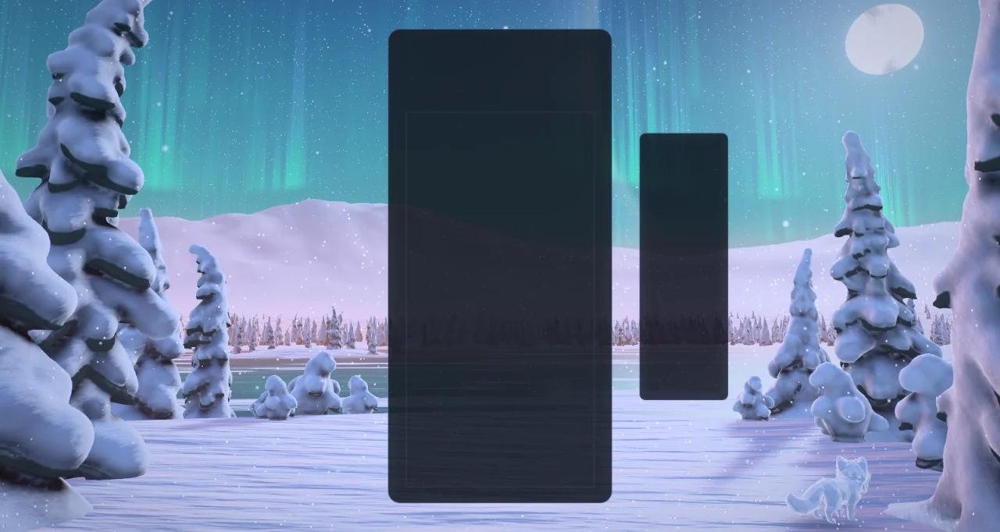

The gameplay card covers the middle of the frame, so the picture is built for what stays
visible: the sentinel spruce and the glow on the left, the stand under the moon on the right,
the sky above, the snow and the fox below.

## The one idea

In the north the aurora has a name that means *fox fires*: an arctic fox runs over the fells,
its tail strikes sparks from the snow, and they burn in the sky. Here the board sets the fox
running. A locking piece becomes sparks in its own colour; the sky draws them up and takes
that colour where they arrive; and how brightly the fires burn — the chain — is the theme's
one dial. Everything else follows from it: how fast the fox runs, how many sheets of aurora
are awake, how far the twilight has turned to night under them, what colour lies on the snow.

## Event language

| Event | Response |
| --- | --- |
| Piece lock | The piece leaves the card's edge, at its own height, as a flash and a handful of sparks in its own colour. The sky draws them up, and where they arrive the fires take that colour and **hold** it (it fades over about half a minute), so the sky slowly fills with the colours played. A ring of lifted powder runs over the snow from under the board, firing the snow's sparkle in that colour as it passes; when it reaches the fox, the fox's tail flicks and strikes sparks of the same colour. |
| Hard drop | The same, harder: more sparks thrown faster, a wider ring, more powder, a camera dip. |
| Line clear | The cleared rows leave the card as blades of light at their own heights and as jets of sparks from both edges. A gust crosses the snowfield from under the board, taking the snowfall with it and driving snakes of spindrift over the snow and the ice. The sky is strummed outward from the board, one sweep of light through every sheet. The fox springs forward. From three lines the gust shakes the framing trees and their loads come down as powder. |
| Combo | The chain is how brightly the fires burn. The fox runs, faster the longer the chain, its coat and tail alight, its prints glowing behind it and a stream of sparks rising from its tail; sheet after sheet of aurora wakes, its rays quicken and its foot turns rose; the twilight deepens to night under it and the stars come out; the snow, the trees and the ice take the fires' colour; diamond dust fills the air and the moon's ring sharpens. When the chain breaks the fires sink and the fox falls back to a trot. |
| Four lines / perfect clear | The night holds its breath: every light sinks for a fifth of a second. Then the fox pounces, a great ring of powder bursts from under the board, the card's shoulders throw fountains of sparks, every framing tree lets its load go — and a fox of light, kilometres long, bounds across the whole sky from the hero fell to the moon, the fires brightening under it as it passes. |
| T-spin | The wind turns on itself: a wheel of sparks spins up round the card. |
| Level up | The hour turns one step on from wherever it stands: five hours, cycled (kaamos, rose noon, blue hour, violet dusk, deep night). The sky is strummed and the fox answers with a shower from its tail. |
| Time alone | The hours also turn by themselves, with nothing played and whatever the level: each rests for about half a minute, then melts into the next over about a minute, and the five come round in eight minutes. |
| Game over | Nothing jumps: the fires sink on their own and the fox curls up in the snow and sleeps. It wakes and stretches when the next run begins. |

Combo here is the true consecutive-clear combo (one `ComboTracker` per player in
`WinterDirector`); the bus's `COMBO` event is cascade depth (ADR-0011). With several boards on
screen each lock leaves its own board, and the fires follow the longest chain any board holds.

The hours are the sky's whole palette (zenith, the pale band, the last light, the haze, the
moon's light, the shadows, the aurora's foot and crown, how many stars show), each with a calm
end and a lit one that the chain mixes between. The clock turns them by itself: an hour rests
for the first 29 s of its 96 s, then eases into the next (`HOUR_PERIOD`, `HOUR_REST` and
`hourDrift` in `winter-core.js`). A level is one step on top of wherever the clock has brought
the sky, so a level-up always shows a new hour, and turning to a new run's first level goes the
short way round the day. The clock's share is a function of the time and nothing else, so a
seek and a replay agree at any frame rate; only a level's step and the chain's heat ease in.
Reduced motion does not slow it: a slow change of colour is not motion. No melt passes
through grey (a test checks every colour of every pair half-way).

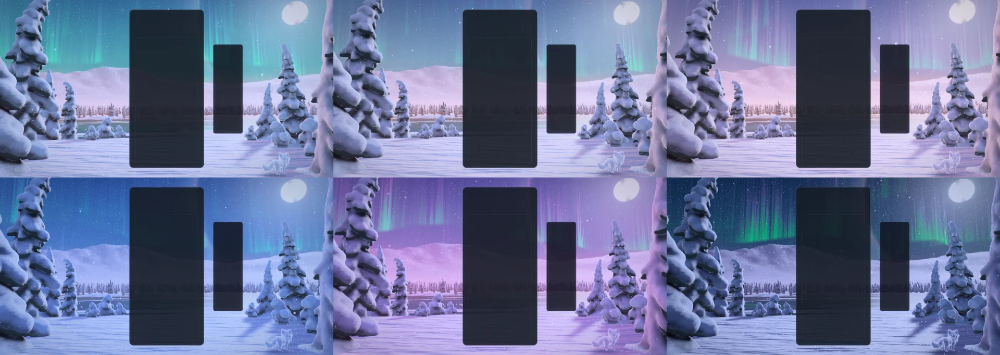

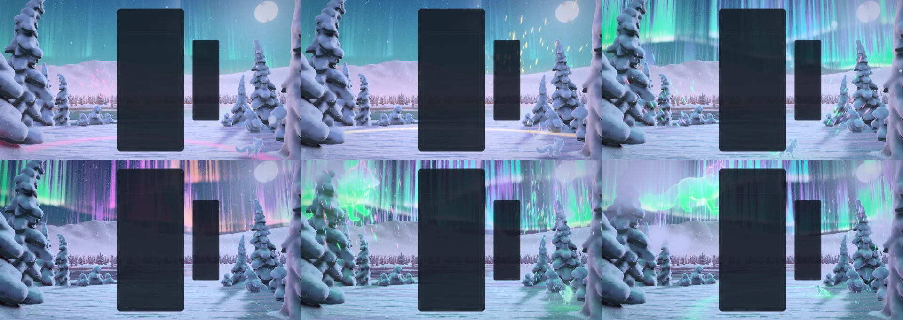

## How it is built

| File | Role |
| --- | --- |
| `winter-core.js` | Three-free constants and maths shared by everything: the plan of the place (snowfield, lake, spits, far shore, fells as one height function), the rest camera, where the moon and the glow stand for an aspect, where every tree is planted, the fox's round, the five hours, gameplay slots and timings. |
| `winter-ghosts.js` | Reads the baked snow ghosts (`assets/snow-ghosts.bin`); generates turned stand-ins when it cannot. |
| `winter-field.js` | The ground as numbers: the fan of quads the eye looks over, and the trees' moon shadows drawn once on the CPU. |
| `winter-tsl.js` | Hashes, the baked noise texture, the shared uniforms, and the light: the sky function, the aurora, the air, the powder rings, the gusts, the shadow lookup. |
| `winter-sky.js` | The dome: gradient and last light, stars, the moon and its seas, the 22° ring with its dogs, the fires. |
| `winter-ground.js` | Snow, ice and fells in one material: sastrugi, the moon's path, sparkle, rock and wood on the fells, the ice's mirror, snow snakes, the rings, the fox's shadow. |
| `winter-trees.js` | The snow ghosts, instanced by kind and level of detail. |
| `winter-snowfall.js` | The snowfall and the diamond dust. |
| `winter-fx.js` | The fox fires' pool (sparks and powder share it), the row beams, the paw prints. |
| `winter-fox-mind.js` | Three-free: the fox's round as the course of the fox mind the themes share (`src/themes/shared/fox-mind.js`: stops and acts, run, dash, pounce, sleep, and the pose that results). |
| `winter-fox-rig.js` | Three-free: the arctic fox's skeleton and paces, on the fox rig the themes share (`src/themes/shared/fox-rig.js`: acts written as blendable numbers, a gait of footfalls, legs solved to their paws, a back that bends). |
| `winter-fox.js` | The fox's two bodies: the animal on the snow under shells of fur, and the fox of light in the sky. |
| `winter-world.js` | Owns the uniforms, the parts, the camera rig and the choreography. Shared with the playground effect, so what is iterated there ships. |
| `winter-director.js` | Renderer-free: stages bus events per player and resolves one lock and one clear per frame. |
| `winter-composition.js` | Three-free: reads the live card, board and HUD rects and maps board columns and rows onto the screen. |
| `winter-post.js` | One scene pass, bloom, and one output pass. |
| `winter-quality.js` | The six tiers. |
| `winter-theme.js` | Lifecycle, renderer selection, settings, layout watch, GPU-loss recovery, capture flags. |
| `scripts/winter/bake-ghosts.mjs` | Grows the trees, meshes them, bakes their shading attributes, writes the asset and its manifest; can ray-cast previews on the CPU. |

Techniques worth knowing before changing it:

- **One node renderer on both backends.** `WebGPURenderer` on WebGPU, its WebGL2 backend
  otherwise (or `?forceWebGL`). No `ShaderMaterial`, no compute.
- **Nothing is lit by a light.** Every material shades itself (`MeshBasicNodeMaterial`) from
  shared uniforms: the moon's direction and colour, the bearing of the twilight, and the sky
  function (`wSky`) that is at once the sky, the colour of distance and what the ice mirrors.
- **A snow ghost is a pile of pillows, so it is modelled as one.** `bake-ghosts.mjs` grows each
  tree as a smooth union of ellipsoids — a rimed stem, whorls of drooping boughs each under its
  pillow with a clump frozen on its tip, a top bowed over by its load — adds lumps of two
  sizes, and meshes the field with naive surface nets. Each vertex keeps the field's gradient
  as its normal and three things read off the field itself: how open it is to the sky (the
  cavities between pillows are dark), whether it is a bough's underside, and how thin the snow
  is there, which is what lets the moon come through the edges. Five kinds, three meshes each.
- **The moon does not move, so its shadows are drawn once.** `bakeMoonShadows` lays every
  tree's mesh flat along the moon's rays into one mask on the CPU and softens it; the snow
  looks it up by world position. No shadow pass, no second render of the trees, and the same
  picture on both backends. It is redrawn only when an upright screen moves the moon.
- **The aurora is geometry met by a ray, not a painted band.** Each sheet hangs over a line on
  the ground and folds sideways as two sines; the view ray is met with it by a three-step
  fixed-point walk. That gives true perspective for nothing: sheets arch down to the horizon
  at their ends, folds foreshorten and brighten where the ray runs along them, rays converge
  overhead. Height above the sheet's foot picks the colour (green, violet crown, a rose hem on
  an energetic sheet). The same function, without its rays, is what the ice mirrors.
- **What the sky holds is six slots.** A lock writes (bearing, arrival time, strength, colour)
  into a ring of uniforms; the aurora tints itself by bearing and decays each slot in closed
  form. The arrival time is when the sparks get there, so cause is seen before effect.
- **Sparkle is laid out even on screen but fixed to the ground.** The grid is bearing × height
  over distance from the RESTING eye, so a glint is a few pixels at any range and does not
  swim when the camera drifts. Most of it lies in the moon's path; a passing ring fires more.
- **Upright screens keep everything.** The moon, the glow, the framing trees and the fox's
  round are laid out in fractions of the frame's half width (`bearingFor`), so a phone held
  upright shows the same picture drawn closer together; between about 10:9 and 2:1 nothing
  moves at all.
- **The fox has a mind without a body.** `FoxMind` is plain numbers stepped with the world's
  fixed step: sparks, prints and reactions never wait for the model, and a seek replays it.
  The rig (`winter-fox-rig.js`, three-free as well) solves that pose into bone rotations every
  frame; the model holds no clips (see *The fox, rebuilt* below).
- **Closed form first.** Snowfall, dust, sparks, powder, rings, gusts and the strum are
  functions of the world clock and event timestamps. Nothing is created at event time: events
  write numbers into ring-buffered uniform slots and preallocated pools. `seek(t)` plus a
  fixed-step replay reproduces any frame.
- **HDR, single output.** The scene is scene-linear; a max-channel knee selects what blooms (no
  MRT), and one output pass does the calm zones on the card and HUD, bloom, the lens's veil
  round the moon, a hue-preserving filmic curve, grade, vignette, grain and dither. The
  aurora's brightest folds are compressed along their own hue before the tone map, so they
  saturate toward green and violet, never to white. `usesMrtScenePass()` is false.
- **No MaterialX noise.** One tileable texture is baked on the CPU (a value, its gradient, a
  second value) with its own mip chain.

## Tiers

| Tier | Ground fan | Aurora sheets | Ice mirrors the fires | Framing trees | Spit / far trees | Shadow map | Snowfall | Dust | Fox fires | Prints | Sparkle | Bloom | Scene MSAA |
| --- | --- | ---: | --- | --- | ---: | ---: | ---: | ---: | ---: | ---: | --- | --- | --- |
| Minimal | 120 × 96 | 2 | no | second mesh | 26 / 160 | 256² | 700 | none | 260 | 48 | off | off | off |
| Low | 150 × 128 | 2 | no | second mesh | 40 / 280 | 512² | 1,300 | 160 | 420 | 72 | on | off | off |
| Medium | 190 × 160 | 3 | yes | full ghost | 56 / 460 | 768² | 2,200 | 320 | 700 | 96 | on | on | off |
| High | 230 × 200 | 3 | yes | full ghost | 70 / 700 | 1024² | 3,400 | 520 | 1,000 | 128 | on | on | 4× |
| Ultra | 270 × 240 | 4 | yes | full ghost | 84 / 900 | 1024² | 4,800 | 800 | 1,400 | 160 | on | on | 4× |
| Extreme | 320 × 280 | 4 | yes | full ghost | 96 / 1,200 | 1536² | 6,400 | 1,200 | 1,900 | 192 | on | on | 4× |

Every tier keeps the whole picture, the fox, the fox of light and every event. These are
allocation budgets, not measurements of frame rate. The fox's coat is 0 / 6 / 10 / 14 / 18 / 24
shells of fur from Minimal to Extreme (Minimal paints the coat on the skin) and the fox of
light wears 0 / 0 / 3 / 5 / 6 / 8 veils.

## Assets

`assets/snow-ghosts.bin` (2.2 MB) is the baked wood: five kinds of snow-loaded spruce (the
sentinel, the matron, the leaner, the gnome and the twins), four meshes each — the full ghost
for the framing trees close by, one for framing trees further off, one for the stands on the
spits and one of about two hundred triangles for the wood on the far shore. It is generated (no
scan, no third-party model); `node scripts/winter/bake-ghosts.mjs` rewrites it and its manifest
in a couple of seconds, the same bytes every time, and `--dry --preview=<dir>` ray-casts every
kind to one PNG on the CPU, which is how the trees were shaped before any shader existed.

`assets/arctic-fox.glb` (1.2 MB) is the theme's own arctic fox (see `assets/ATTRIBUTION.md`):
the mesh kept from the earlier theme, re-rigged by `node scripts/winter/rig-fox.mjs` onto the
21 bones of `winter-fox-rig.js`, its coat painted into its vertex colours, no clips. It loads
off the frame; nothing waits for it.

Everything else is generated in code. Blender was not needed: what makes a snow ghost is a
smooth union of pillows, and a signed-distance bake in Node gives that union exactly, with the
occlusion, the bough mask and the thinness of the snow read off the same field. Removed with
the earlier theme: the TRELLIS conifers (`spruce.glb`, `pine.glb`, `fir.glb` and their `_lod`
copies; the Odyssey keeps its own copies) and the Poly Haven snow textures under
`public/textures/winter/`.

The piece palette changed with the rebuild. The earlier one was seven near-identical ice blues;
since a locking piece now becomes light of its own colour in the sky, the seven are the fires'
own colours on a ground of ice (aurora green, frost white, ice cyan, rose, violet, moon gold,
glacier blue). The palette gate scores it 0 of 7.

## The fox, rebuilt

Later the same day the request was a fox that looks better and moves better. Looking at why it
did not — on the CPU, bone by bone — showed that the model was the limit:

- its ten baked clips could not be trusted. `CurlSleep` and `Dig` *raised* its head (the
  sleeping fox stood with its nose in the air), no clip moved its body, and its legs swung
  like pendulums, so its paws slid over the snow at every pace;
- its head was modelled turned about 32° to its left, so it ran looking sideways;
- its face was two dark dots: it had no nose;
- its skeleton had one bone for the whole back, and legs weighted by distance alone;
- white on white and lit evenly, it was a pale blur at the distance the game keeps.

So the fox was rebuilt from its mesh up, and nothing of it is a recorded clip any more.

**The model** is rigged by `scripts/winter/rig-fox.mjs` (Node, three seconds, the same bytes
every time): the mesh is centred, its head turned to look straight ahead, its facets rounded a
little; it gets the skeleton of `winter-fox-rig.js` — a back of three bones, neck, head, a tail
of four, legs of three, every bone axis-aligned at rest so that a rotation in the model's frame
*is* a pose — with skin weights laid by region; and its coat is painted into its vertex
colours: how far along the tail a vertex is, how long its fur is, how dark it is (nose, eyes,
the hollows of the ears) and how much of the sky it sees (an occlusion bake against the mesh
and the snow it stands on).

**The body** (`src/themes/shared/fox-rig.js`, three-free; `winter-fox-rig.js` is the arctic
fox's skeleton and paces on it). A pose is a *spec*: some forty numbers — hips
and chest lowered; the back arched, bent or twisted; where the head is turned; the tail's
swing, lift and curl; and for each paw where it is, how far its heel is raised and whether the
snow or the body carries it. Any two specs blend, so nothing snaps. The solver puts the middle
of the back in place and turns hips and chest about it, holds the head level against the
trunk's pitch and roll, and solves each leg to its paw (two bones, an elbow that folds back, a
knee that folds forward): a planted paw stays where it was put while the body moves over it.

- *Its gait* is footfalls, not a loop: diagonal pairs at a trot, opening between about 3.3 and
  5 m/s into a gallop — hind pair, then fore pair, the back arching between them. A paw is on
  the snow for exactly as long as the ground it covers, so at a steady pace nothing slides, and
  the body rides lower the longer the step, because short legs reach by crouching.
- *What it does at a stop* is written the same way: looking about; listening with a forepaw
  raised; the leap and nose-dive of its hunt, digging with its rump in the air, shaking the
  snow off; a bow; sitting down with its tail round its feet to watch the sky; curling up nose
  to tail to sleep.

**The mind** (`src/themes/shared/fox-mind.js`; `winter-fox-mind.js` gives it the round as its
course) decides what it did before and hands on more. When it stops it first steps round on
the spot to face the viewer, a few steps to the turn, and only then does something (a hunt it
begins as it stands: the leap carries it where its nose points); what curls to a side — its
body asleep, its tail when it sits — curls toward the viewer; lying down, sitting and getting
up take longer than other changes; it blinks, and it sleeps with its eyes shut. A change of
mind half-way through a change keeps the pose it was in: put to sleep in the middle of
sitting, woken and at once startled, sent leaping again before it has landed, it goes on from
where it is.

**One engine, two themes.** Rig and mind live in `src/themes/shared/` because Sakura
Twilight's two red foxes run on them as well, with their own skeleton and their own course
(`docs/SAKURA_TWILIGHT_OVERHAUL_2026-10.md`). The Winter files bind them to the arctic fox;
stepped side by side with the version from before the move, the bound mind and rig give the
same fox to sixteen decimal places.

**The coat.** Fur is shells: the skinned mesh drawn again in one instanced call on the same
skeleton, each shell a veil as thick as the share of the hairs that reach it. The grain of the
hairs is the world's noise texture, so at the game's distance its mip levels hand back the
hairs' average instead of their sparkle. The scene is lit from behind, so the fox is shaded as
what it is there: the shadow side of a white animal — a shade warmer than the snow, darker
where its own body shuts out the sky — with the moon in the outline of its coat, and it walks
through the trees' shadows as the snow does. In a chain it is that outline and the tail that
burn, not the whole animal.

**Found by measuring.** Two helpers went over the first version — one writing the tests, one
reviewing — by running mind and rig and measuring the largest turn of any bone in one frame.
That found what stills had not: a fox put to sleep in the middle of an act snapped to another
pose and froze half standing (the line "nothing jumps" at game over was not true); a second
change inside a cross-fade dropped the pose it started from; an elbow flipped sides in the bow
(a pole to aim the joint at flips when the leg points along it); legs fell into the gallop in
one frame when the speed jumped; a toe snapped at lift-off when it stepped on the spot; its
hunt's leap went sideways; it swivelled as it woke; an interrupted leap dropped it in one
frame; two of the fur's shells drew nothing. All of these are fixed and pinned by tests.

**Made without the GPU.** `scripts/fox/preview-fox.mjs` skins the model on the CPU with the
theme's own solver and mind and tiles the frames into a PNG (`--act=Sit`, `--gait=1.5`,
`--mind=hunt`, …), and `rig-fox.mjs --preview=<dir>` draws mesh, skeleton, weights and coat.
Every gait and pose was written against those sheets and then checked on the GPU through a
lens on the fox (`foxCam`, `foxAct`).

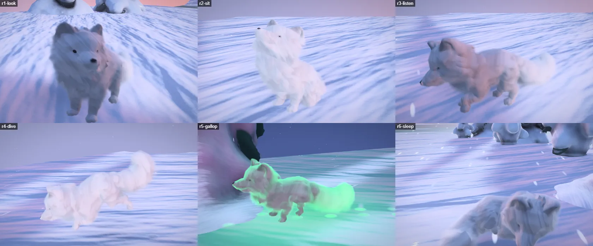

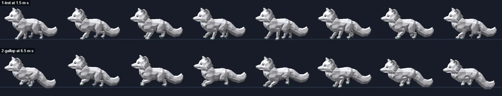

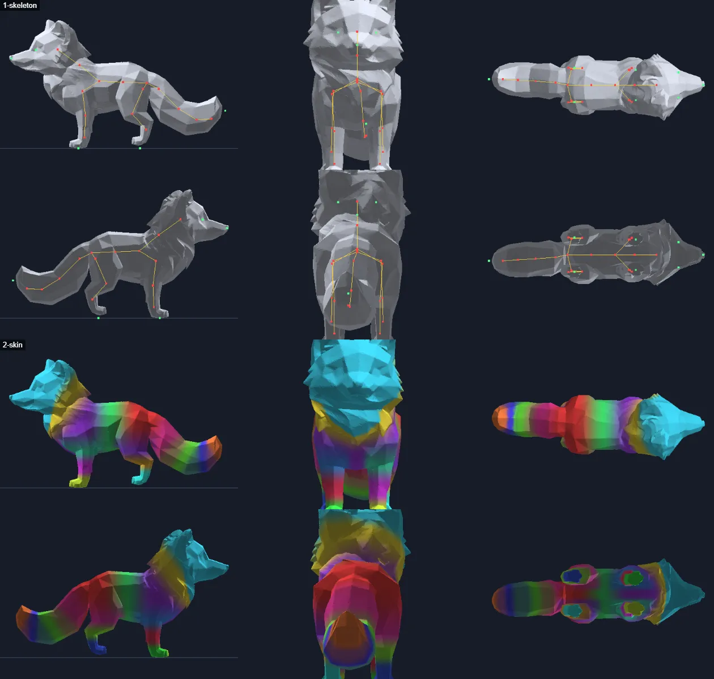

**Remodelled 2026-11-04.** The body is now modelled in Blender round the same joints
(`scripts/blender/winter_arctic_fox.py`, the polar bear's method): round and young, a big head on a
short muzzle, nearly round eyes, soft round ears, a chubby body in a deep ruff, furred paws and a
full brush of a tail, half the triangles of the mesh before it (24 000), symmetric, its tail bones
on the midline. The skeleton's joints and the solver are unchanged, so every gait and act above
carries over; the marks for its nose and eyes moved with the shorter face. The pictures above
show the earlier mesh. `node scripts/winter/rig-fox.mjs --model` makes it, byte for byte.

Not done: it has no ear or jaw bones; a paw that is planted when the pace changes slides a
little until its next step (the gait is a function of how far it has run, not a memory of where
each paw stands); on a curve its planted paws turn with its body; Minimal has no shells; a
third change of act inside one cross-fade (a fifth of a second round a four-line clear can do
it) still drops the oldest of the poses, up to some forty degrees in a leg for a frame while
the night holds its breath.

## Verification

- Unit tests: 390 tests in twelve files (composition 13, director 25, fox mind 53, fox rig 59,
  plan 24, the hours 12, baked asset 13, ground and shadows 11, effects 16, world 47, theme 77,
  and 40 in `winter-shaders.test.js`, which builds every part's material — both of the fox's bodies
  included, on the real model — through three's WGSL and GLSL node builders at High and Minimal
  with no GPU and fails on a throw, a console warning, an `mx_` noise or a `smoothstep` with
  equal edges). The asset tests pin the baked file to its manifest and check that every mesh is
  wound outward; the world tests replay a seek twice and compare the whole state. All pass.
- Whole suite: once, with 120 s timeouts on a build machine other sessions were loading: 754 files,
  12,207 tests; 753 files passed. The one failure, `odyssey-level-briefing.test.js`, expects
  "250,000" and gets "250 000": it formats a number in the machine's locale (sv-SE here) and
  fails the same way on the untouched main checkout.
- Gates: typecheck; lint ratchet (677 errors against a baseline of 807: the new files add none
  and the removed ones took 130 with them); theme lifecycle audit; dependency boundaries (1,406
  modules; the cross-theme baseline is now empty); TypeScript ratchet; architecture fitness;
  performance budgets; production build with the boot-closure guard; IP-string gate; Pages
  artifact check; release gates — all pass. The palette gate fails on `main` and here for the
  same unrelated reason (Stillwater); Winter scores 0/7 on it.
- Playground captures (RTX 3070 Laptop, WebGPU): rest; lock; hard drop; a two-line clear; a
  chain of six with six colours held in the sky; four lines at 1.2 s, 2.6 s and 6 s; a T-spin;
  a perfect clear; the four other hours; an upright 430 × 852 frame at rest and through four
  lines; Minimal, Low and Extreme; Medium on the forced WebGL2 backend; reduced motion; the
  generated stand-in trees without the fox's body. Twenty-seven frames in the last set, none
  with a console error or warning from the page. For the clock's turn of the hours (added the
  same day): nine more frames along one level's clock, each hour at rest and three melts
  half-way, and one with a level on top, again with a clean console.
- WebGL2 without a GPU: the same world on SwiftShader (the renderer's WebGL2 backend on the
  CPU), Low with a chain and High through four lines, with no error from the page.
- In the real game (Electron, dev server, single player, a fresh profile, `?unlockAll=1`): the
  theme starts on WebGPU with the baked ghosts and the fox's body, takes bus-injected locks, a
  hard drop, clears, a chain of four and four lines, puts the fox to sleep at game over,
  survives a live quality change (High to Medium), and lets go of its canvas when Forest takes
  over. No warning or error from the theme in any of three runs.
- A review by a second agent found eight real defects, all fixed and covered by the tests
  above: the sleeping fox got to its feet every 2.7 s (the `CurlSleep` clip is not a held pose
  and was being looped); the turn added to the tail piled up whenever one pose was drawn twice
  (three's mixer only writes a bone whose value changed); one framing spruce stood four metres
  out on the lake's ice; the flash a lock leaves at the card's edge had no size for its first
  tenth of a second; the world drew its shadows for 16:9 before it knew the frame's shape and
  redrew them on every resize event of an upright window; the fox's shared geometry was never
  disposed and the fox of light retired the live fox's material; the far meshes' normals
  opposed their own faces on about one triangle in twenty; a spark's core could go negative
  under MSAA. An earlier pass by the agent that ported the theme class found that a new run
  reset the fox's mind mid-clip.

Observed, not measured: the in-game runs counted 110 to 129 frames a second over four seconds
at High on the RTX at 1584 × 813, with the frame interval's median at 7.7 ms and its 99th
percentile at 16 to 30 ms while events were firing. That figure is close to the window's cap, so
it says only that this configuration did not fall below it. High draws about 590,000 triangles
(Minimal 233,000, Extreme 824,000).

Not verified: GPU cost per tier through the theme perf lane (ADR-0016); an integrated GPU;
physical phones; local multiplayer and Infinity layouts in a capture (their routing is
unit-tested only); the real game in an upright window; the icon on an Odyssey level orb; long
sessions. `docs/theme-screenshots/winter.png` still shows the previous artwork (a fleet capture
writes it). Comments in a few other modules still name files of the earlier Winter theme as
their lineage (`rainbow-terraces`, `void-ember`, the Odyssey forest geometry), and ADR-0015's
third finding still lists the Winter theme as a consumer of the shared mountain language, which
it no longer is (`odyssey-wave46-scope-invariants.test.js` now pins the opposite).

## Reproduce

Run `npm run dev:playground`, then:

`/playground.html?effect=winter&t=20&quality=High&board=1&hud=0`

Add `event=lock|drop|clear|quad|twist|perfect|levelUp|over` with `eventAge=<s>`, and `combo=<n>`,
`level=<n>` (one hour on per level), `lines=<n>`, `u=<0..1>`, `row=<r>`, `color=<hex>`. The
clock turns the hours too: `t=20` is the first hour at rest, `t=62` half-way into the second,
`t=110`, `206`, `302` and `398` the second to the fifth at rest. `locks=<n>`
plays n locks first, so the sky is holding their colours when the event fires. `power=<0..1>`
holds the fires at a charge whatever the combo. `demo=1` (without `t`) plays a looping script.
`parts=` draws only the named parts (`sky, ground, trees, prints, snow, dust, sparks, beams,
fox, spirit`); `falseColor=1` bands the pre-tone-map peak; `noPost=1` shows the raw scene;
`forceWebGL=1` uses the WebGL2 backend; `reduce=1` is reduced motion; `plan=1` draws the
generated stand-in trees instead of the baked ones; `fox=0` leaves the fox without its body;
`foxCam=<metres>` follows the fox with a close lens (`foxCamYaw=<deg>` round it from its front,
or `viewer`; `foxCamFov=<deg>`) and `foxAct=<acts>` with `foxActAge=<s>` stops it and has it do
something (`Sit`, `LookAround`, `Stretch`, `Greet`, `CurlSleep`…, or `hunt`). In
the game: `?winterTime=`, `?winterFixedDt=`, `?winterParts=`, `?winterFalseColor=1`,
`?winterForceWebGL=1`.

The theme icon is the fox of light itself, through the playground's icon lens in the deepest
hour:

`/playground.html?effect=winter&t=20&quality=Extreme&hud=0&level=5&event=quad&eventAge=3.6&icon=1`

(the lens's defaults are `iconFov=30&iconYaw=0.13&iconPitch=0.27`), captured in an 852 × 852
window (the largest square this laptop's screen allows), cropped to 84% of the frame around
(0.56, 0.47), given a colour lift (saturation 1.2, contrast 1.12, brightness 1.05) and baked as
a 512 px circle on a transparent ground. The same file is kept at
`public/assets/themes/winter-theme-icon.png`.

The fox without a GPU (PNG sheets, from the repository root):

    node scripts/fox/preview-fox.mjs --fox=winter --gait=1.5 --frames=8
    node scripts/fox/preview-fox.mjs --fox=winter --act=Sit --frames=8 --yaw=30
    node scripts/fox/preview-fox.mjs --fox=winter --mind=hunt --at=1 --from=1.2 --to=7.6 --frames=16
    node scripts/winter/rig-fox.mjs --dry --preview=<dir>

## Captured previews

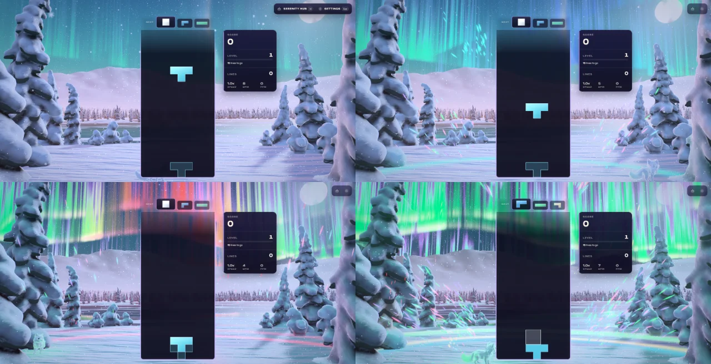

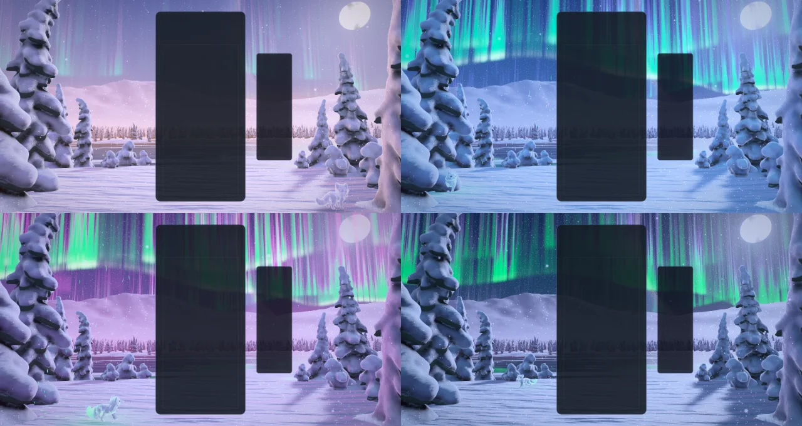

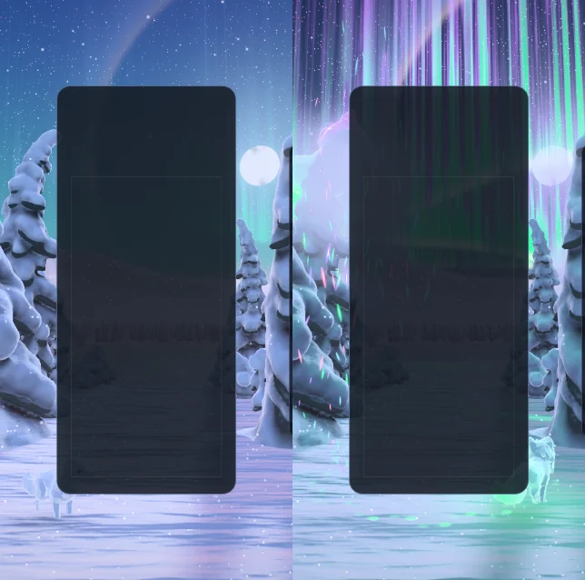

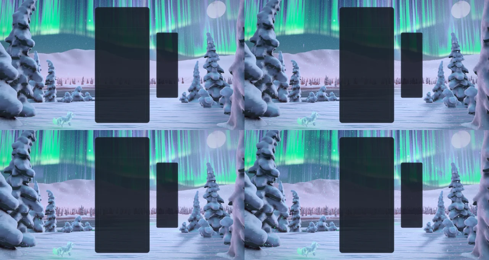

The previews above are the first build. The second pass below changed what they show.

## Second pass (2026-10-21): curtains, a moon with a face, snow, the fox of light

A look pass on top of the fox fires, in the same modules. Every change was iterated in the
playground (`?effect=winter&t=20`, with the new `P.<name>=` overrides of `LOOK` in
`winter-tsl.js`, zoomed crops and the false-colour view) and the result checked in a real Single
Player game at High.

| 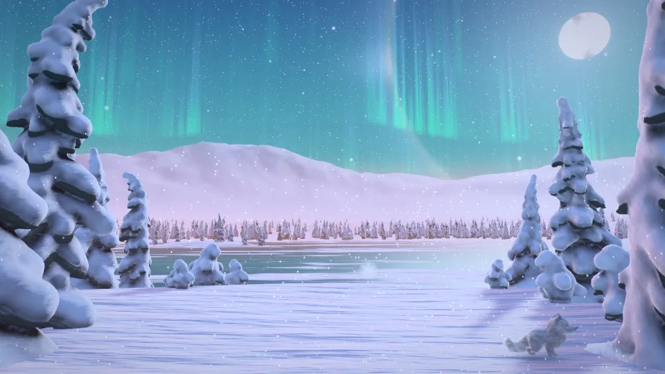 | 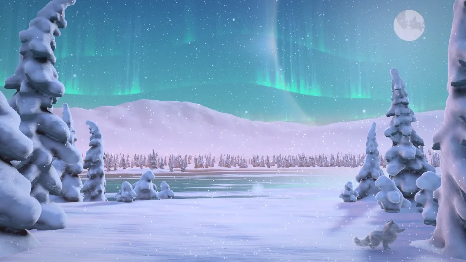 |
| --- | --- |
| 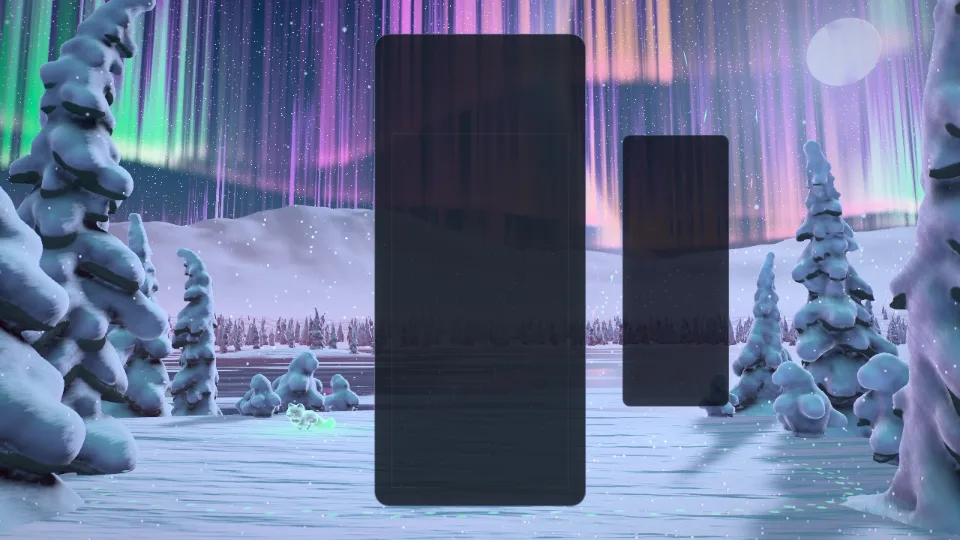 | 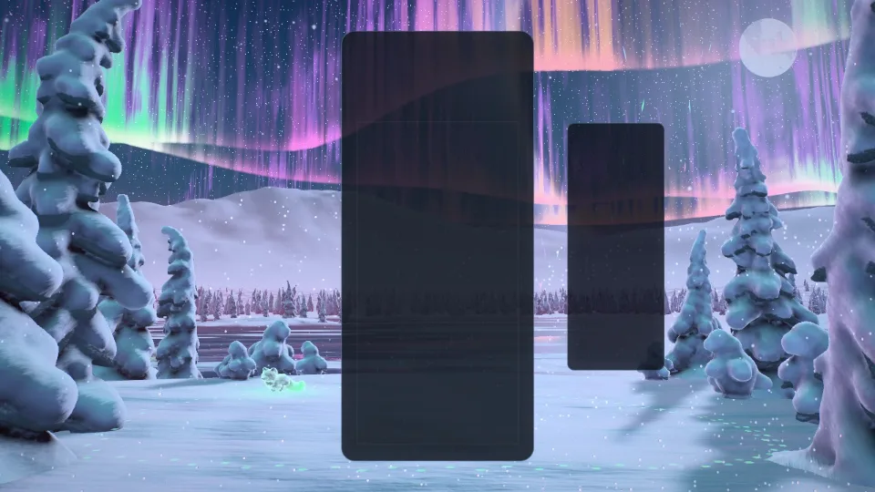 |

| What | Before | After |
| --- | --- | --- |
| **Aurora** (`winter-tsl.js`, `wAurora`) | The rays were on/off strands up to a hundred kilometres tall, so every sheet ran off the top of the frame as an even comb of vertical lines, and in a chain the sky was one wall of stripes. | A curtain switches on sharply at its foot and is brightest just above it (`auroraHem`), so each fold reads as a bright ribbon (rose in a chain) with rays rising from it. The rays are shorter, fade in and out up their length (`auroraRayAlong`), and the sheet glows between them (`auroraRayBase`). |
| **Moon** (`winter-sky.js`) | Laid on the dome, so in the corner of the wide lens it was an egg; its face was a blank disc with two smudges. | Drawn in the lens's image plane, so it is round anywhere in the frame (on an upright screen too). It has a face: dark seas gathered across its northern half with crisp shores, highlands with scattered craters, a young crater's rays low down; a little less bright (`moonGain` 1.6, was 2.3) so the face survives the tone curve. |
| **Snow** (`winter-ground.js`) | The long wind ripple at full strength and a sharp mirror lobe for the moon's path: the foreground read as a lake of wavelets with highlights. | The ripple is a faint grain (`snowRipple` 0.3), broad swells the wind has heaped take its place (`snowSwell`), and the moon's path is a soft broad sheen (`snowSheen`); the sparkle carries the path, as it does on snow. |
| **The fox of light** (`winter-fox.js`) | Each veil showed only its edge, so its eight veils drew eight concentric outlines: a contour map in green, hard to read as a fox. | Each veil glows where it faces the eye and is gone at its own silhouette (`spiritVeil`), so the veils sum to a soft aura round a body whose head, ears, legs and tail read. |
| **Snow ghosts** (`winter-trees.js`) | Under every pillow the boughs were one even near-black crescent: every tree wore the same row of charcoal smiles. | The bough mask is broken up by noise (the snow hangs over the edge in tongues and clumps), the needles take some of the sky's blue in their shade, and rime frosts them in specks. |

| 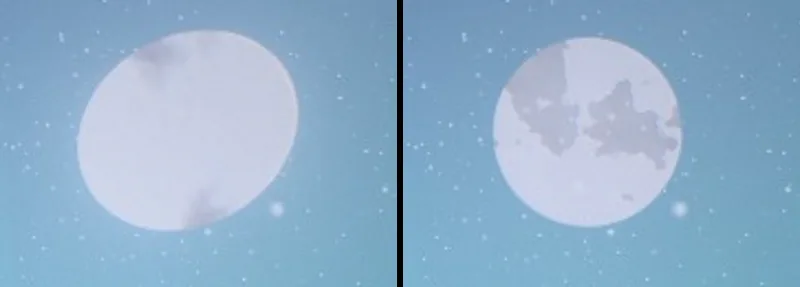 | 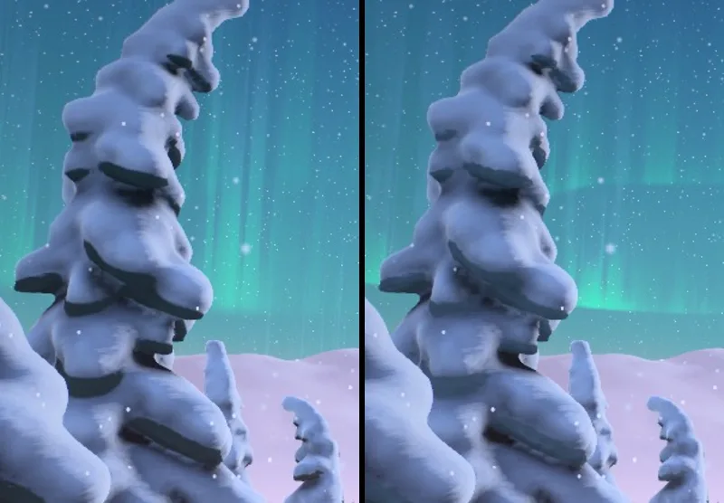 |
| --- | --- |

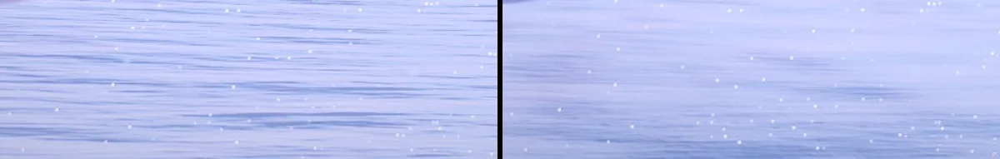

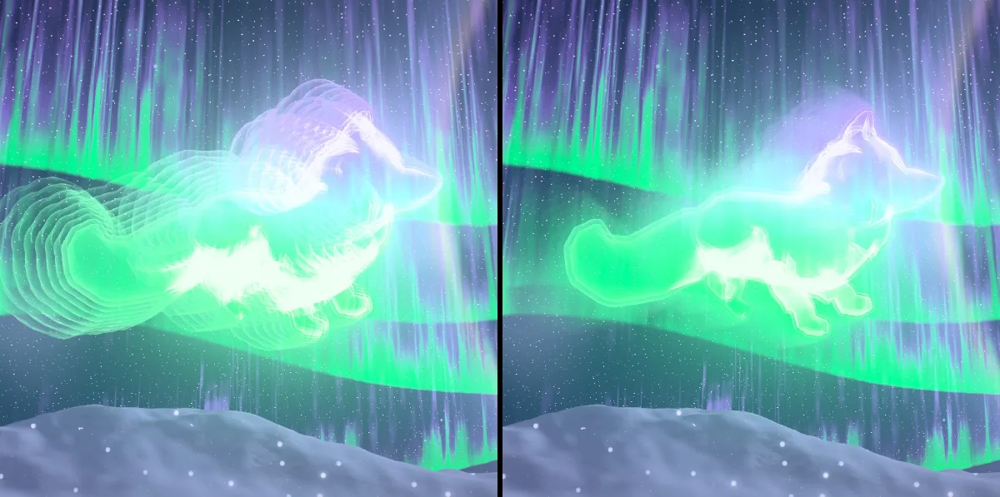

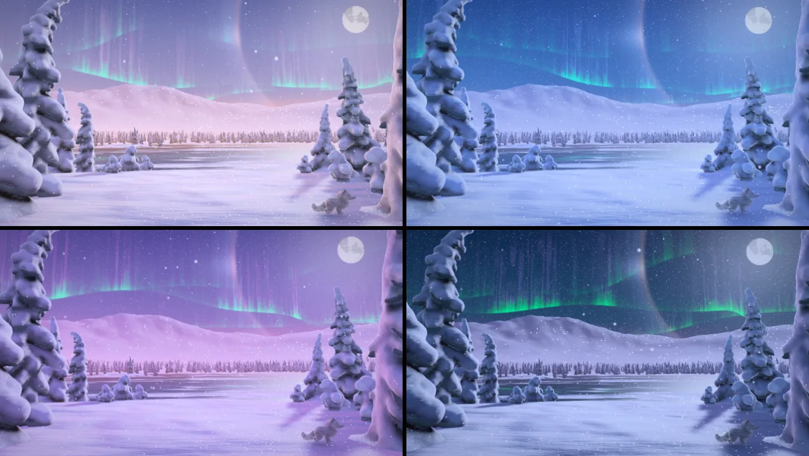

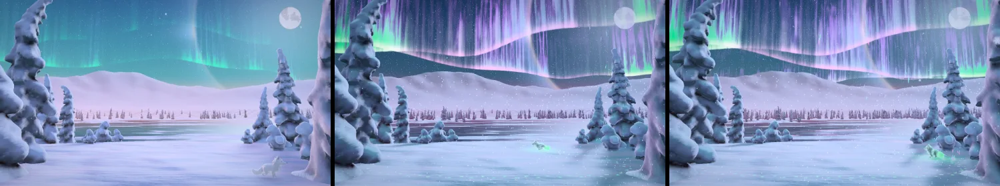

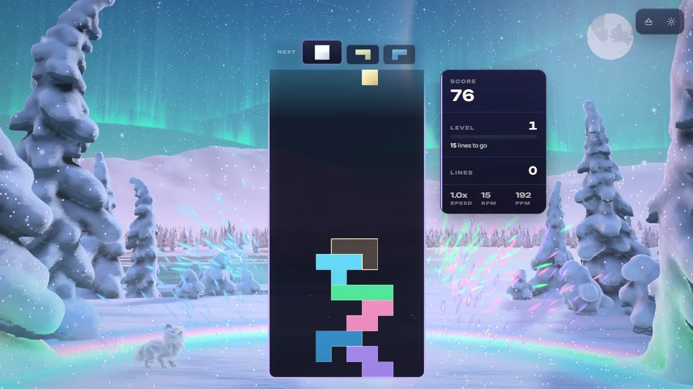

Checked: playground captures on native WebGPU (RTX 5080 Laptop) at High — rest, a lock, a
chain of eight, four lines, a perfect clear, a T-spin, the four other hours, an upright
430 × 852 frame through four lines, reduced motion — and Minimal, Low, Extreme, and Medium on the
forced WebGL2 backend, sixteen frames with no console warning or error; a real Single Player game
at High (the theme running on WebGPU, locks throwing sparks and rings, no warning or error from
the theme); the twelve `tests/unit/winter-*.test.js` suites (390 tests, the shader build test
among them); ESLint adds no finding in the changed files.

Not measured: frame time. The pass adds a few noise reads to the sky, the snow and the trees, and
a crater grid to the moon's disc; the perf lane (ADR-0016) has not been run on it. The theme icon
(the fox of light) still shows the contour-map veils.

## The polar bear (2026-10-26)

The ask: "In the winter theme, would it be possible to add a polar bear modelled and animated in
the background walking in the distant on the ice?" A big male polar bear now walks the frozen lake
forty to a hundred and forty metres out: it comes in from behind the spruces under the moon a few
seconds after the theme starts, ambles over the open ice right of the board, lifts its nose into
the wind, puts it down to the ice, looks round, goes off behind the board and comes back at
another depth, and every few minutes wanders far out over the lake, small in the distance, and
returns. Where the wind has swept the ice bare it walks over its own reflection.

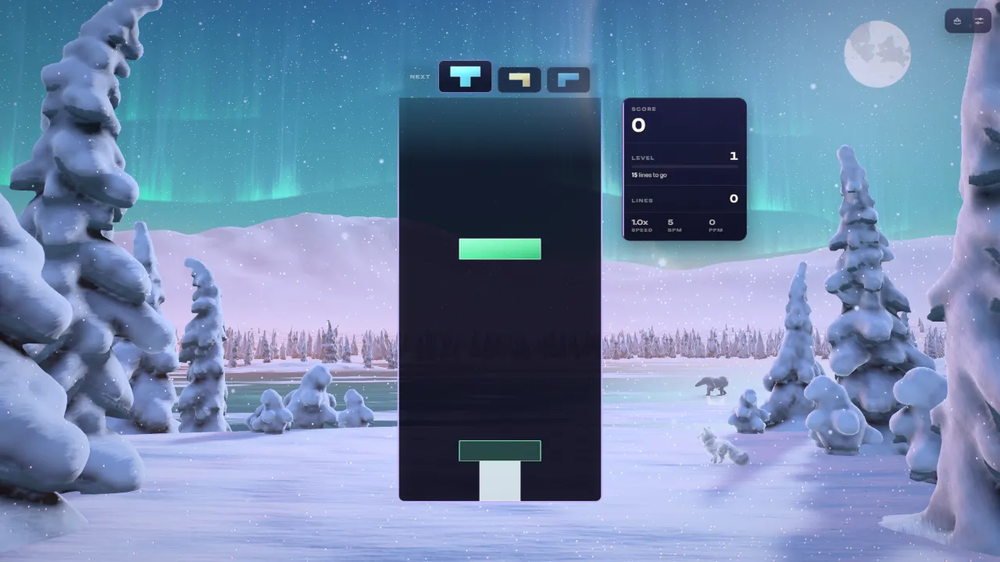

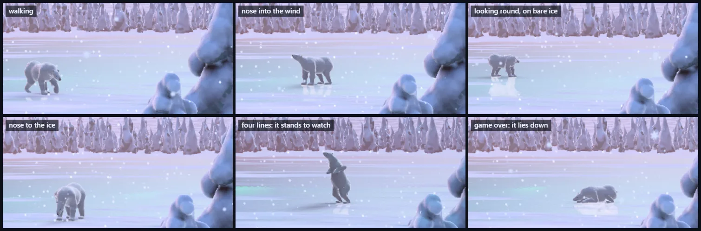

The board reaches it twice. Four lines (and a perfect clear's crown) call the fox of light over
the sky: the bear stands up on its hind legs to watch it go. The run ends: it lies down on the ice,
chin over its paws, and stays down until the next run begins, then gets up and walks on from where
it lay. Each is laid over whatever it was doing; its clock slows to a halt under it and picks up
again after, so nothing jumps and the walk resumes where it left off.

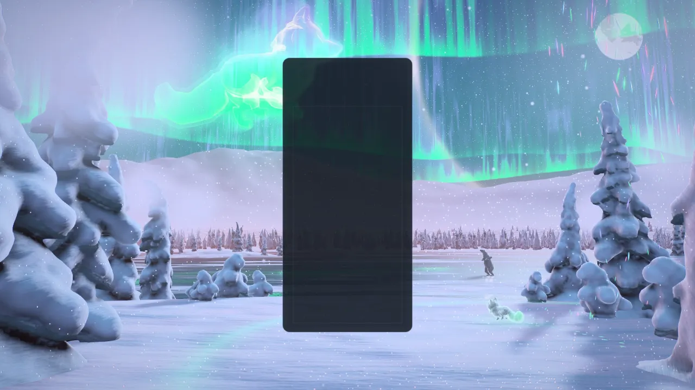

### Where it walks, and why there

The card covers the middle of the lake, and the composition decides the rest. Left of the card
the three small snow ghosts (the two gnomes and the twins, 23–29 m out, 1.5–2.4 m tall) stand
right in front of the ice band: one of them reaches the horizon, so nothing on the ice behind it
shows at any distance, and the other two hide all but the far ice. Right of the card the HUD
stands high in the sky (in the real game; the playground's mock HUD sits lower), and the ice is
open from the card's edge to the spruces under the moon: about 0.22 to 0.45 of the frame's half
width, 9° to 20°. That window is the bear's stage. Every stop of its course is in it (a test pins
that), its turns are laid inside it, and its course crosses land only on the spit tip behind the
spruces on the right, where it cannot be seen. At 16:9 it is in the window about half the time;
the rest it is behind the board or the trees, or far out. The framing trees were not moved.

It is drawn 1.3 × life size (`BEAR_SCALE`), as the fox is drawn 1.5 × (`FOX_SCALE`): at life size,
sixty metres out, it was the fox's size on screen and did not read as a great animal far away. At
1080p it now stands 35–50 px tall in the window.

### How it is built

| File | Role |
| --- | --- |
| `scripts/blender/winter_polar_bear.py` | The model, in headless Blender: a signed distance field of ellipsoids and round cones (the Grainfields horse's meshing, `scripts/blender/grainfields/horse_sdf.py`) built round the rig's own joints. Since the remake (below): the shoulder blades' masses, triceps, loins and haunches; a broad skull with furred cheeks, brow, a muzzle under a Roman bridge, the nose pad and the lower jaw; cupped ears; the point of the elbow, wrist and heel; broad paws with five toe pads and a dark claw from each; locks of hair hanging from the belly, behind the forelegs and down the hind legs; and a coat of clumps combed back over the body and down the legs. Its left half is meshed by surface nets on a 7 mm grid, decimated, cleaned of folds and mirrored (17 862 triangles, 8 931 vertices). Per vertex it bakes the part of the body (body, head, each leg, tail) and the paint: COLOR_0 = (black pads, fur length, black nose/eyes/lips/claws and the shade inside the ears, sky seen, traced through the field). |
| `scripts/winter/model-bear.mjs` | Hands Blender the skeleton as JSON, runs it, skins the mesh to the rig's 29 bones (a leg follows its bones down to the toes with soft joints and hands over to the shoulder blade or the hips over its top, the skin over the shoulder blade, the upper arm and the thigh partly follows the leg, the trunk bends along its four bones, the neck's two bones hand over to the skull, the ears their own, then the weights are relaxed over the surface) and writes `assets/polar-bear.glb` (425 KiB) in the fox's GLB layout. The same Blender and scripts give the same bytes. |
| `winter-bear-rig.js` | Three-free: the skeleton (`BEAR_BONES`, `BEAR_MARKS`) and its own solver (the shared quaternion helpers from `../shared/fox-rig.js`): a pose is a spec of numbers for the trunk, the head and each foot (where the ball of the foot is, its heel, its curl, its turn, the slope under it, whether it bears weight); the solver works out the rest. Also what it does at a stop (`bearAct`). |
| `winter-bear-plan.js` | Three-free: its course (`BEAR_ROUTE`: knots in fractions of the half width and metres, a closed Catmull-Rom curve over the ice) and the timeline of legs and stops along it, and its footsteps (`pawAt`): each paw put down in the world and left there. Where it is, what it does and where its feet are are a function of its clock alone; `BearMind` adds what the board makes it do. |
| `winter-bear.js` | Its body (one skinned mesh, shaded by the theme's own uniforms), its coat (the same body again in shells of fur, half as many as the fox's at each tier) and its image in the ice. |
| `scripts/winter/preview-bear.mjs` | Draws the theme's own mind and body on the CPU, skinned, where it walks in the world, with each paw marked (on the ice or swinging). |

Techniques worth knowing before changing it:

- **A bear walks.** Not the foxes' trot: a four-beat lateral walk (left hind, left fore a fifth
  of a stride later, then the right pair), each paw on the ice two thirds of the stride, the
  forepaw flicked back sole-up as it swings through, the hind foot peeled off heel first, the
  strides a whole number to the lap so its gait comes round with the course. The head is carried
  low and swings to the side of the planted forepaw; the shoulders roll and the long back flexes.
  Since the remake its feet are footsteps in the world, not a cycle laid under the body (see
  below).
- **What it does at a stop** is a spec written as numbers like the foxes' acts: `Sniff` (nose up
  into the wind, in bursts), `Scent` (nose down to the ice, working along it), `Look`, `Stand`,
  `Rear` (up on its hind legs, forepaws hanging before its chest, head lifted to the sky), `Lie`
  (held at `LIE_HOLD`) and `Rise` (Lie run backwards). The board's two are laid over the rest with
  `over`/`overBlend`.
- **Closed form.** The course's timeline is legs (each with a smoothstep ramp up and down,
  integrated exactly) and stops. The board's stops hold its clock with a smoothstep ease whose
  integral is also exact, so a stop in hand is two numbers, and a seek or a replay at any frame
  rate shows the same frame; after a seek it is where a world that ran from the start would have
  it.
- **Its colour.** A cream a shade warmer than the snow, lit as the snow is (the moon wrapped a
  little round the fur, the sky's blue in the sides turned from the moon, the last light, the
  fires overhead, less of everything in its hollows), with its outline lit through the hair
  against the moon, and the air laid over it like everything else.
- **Its image in the ice** is the same skinned body drawn again (one more draw, sharing the
  buffers and the skeleton), mirrored in the plane of the ice and laid flat on it along each line
  of sight in the vertex stage (`vertexNode`): on screen it is where the mirror image is, in depth
  it is three centimetres over the ice, so the shore and the trees hide it as they hide the ice
  and the bear's legs stand in front of it. It takes as much of the ice's mirror as the ground
  gives there: the swept-ice mask (now shared as `wIceSwept` in `winter-tsl.js`, the ground reads
  the same function), the ground's Fresnel, and none on a spit's snow (`u.bearIce`).
- **Its shade on the ice**: a soft shadow cast away from the moon, as long and as wide as the
  world reckons the bear's is for its heading and stance (`u.bearShadow`), and a soft shade under
  its body (`u.bearContact`), both a few operations in the ground's material.

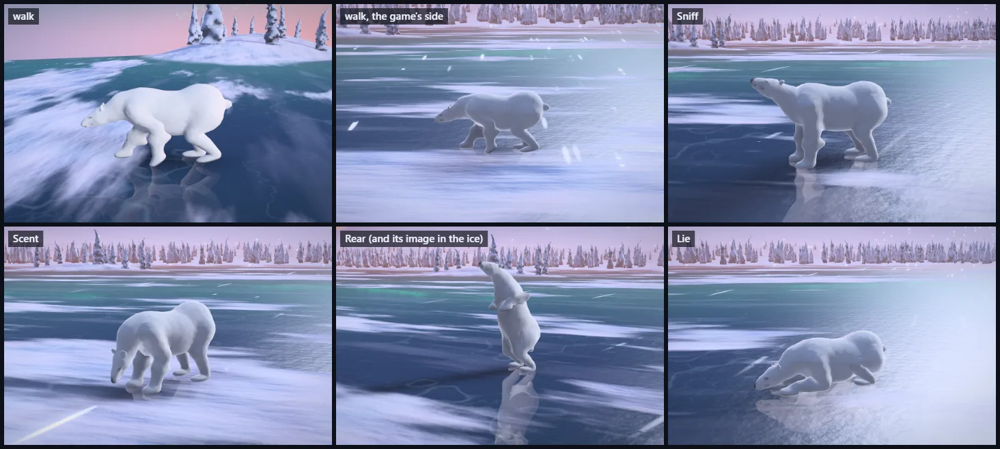

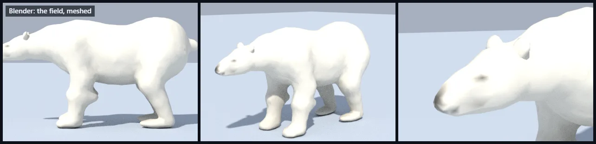

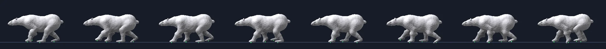

Cost (first version): two skinned draws of 6 400 triangles (the bear and its image) at every
tier, and about twenty operations more per pixel of the ground for its two shades; the plan, the
spec and the solve took about 3 µs a frame on the dev laptop's CPU. Frame time was not measured on
the GPU. The remake's cost is below.

### Verification

Playground captures on WebGPU (the integrated Radeon 610M) at High, Minimal and on the forced
WebGL2 backend, the bear at rest in the game's frame and through a close lens, four lines, the
end of a run, every act; captures of a real Single Player game at High at 1600 × 900 and
1920 × 1080 with the bear placed along its course; no WebGPU warning or error in any console.
`tests/unit/winter-bear.test.js` (22 tests: the skeleton, the asset on it, the walk reaching and
not sliding, every act reaching with its nose out of the ice, the course closed and on ice where
seen, its stops in the window, its arrival in the first seconds, determinism, the board's stops
holding it still and giving it back without a jump); `winter-world.test.js` (the bear walks
without its body, a four makes it rear, game over lays it down, a new run gets it up where it
lay, a seek puts it where the clock has it); `winter-shaders.test.js` builds the bear and its image
for WGSL and GLSL without a word.

To look at it: `/playground.html?effect=winter&t=40&board=1&statsHud=0&hud=0` with
`bearAt=<s>` (where on its course: `8` walking near, `16` Scent, `30` walking on bare ice, `98`
Look, `121` standing, `387` Sniff), `bearAct=rear|lie|rise` with `bearActAge=<s>`,
`bearCam=<metres>` (with `bearCamYaw=<deg>` or `viewer`, `bearCamFov=<deg>`) for a close lens,
`bear=0` to leave it without its body, and the look's numbers `P.bearCoatR/G/B`, `P.bearRim`,
`P.bearShadow`, `P.bearContact`, `P.bearMirror`. In the game,
`serenityBlocks.themeManager.activeTheme.world.bearMind` holds its clock (`offset`). Without a
GPU (clock seconds, from the start of its course):

    node scripts/winter/preview-bear.mjs --from=8 --to=10 --frames=8 --follow
    node scripts/winter/preview-bear.mjs --from=117.6 --to=124.6 --frames=12      stopping and setting off
    node scripts/winter/preview-bear.mjs --from=21 --to=27 --rear=21 --frames=8 --follow
    node scripts/winter/model-bear.mjs --preview=<dir>

Not done: the left-hand window is closed to it by the small snow ghosts in front of the ice
(moving or lowering them would open it, but changes the composition). Where a leg crosses the
body in its mirror image the two are blended twice (the image is drawn without a depth prepass),
which shows only in close-ups. No breath in the cold air.

### Remade: its look and its walk (2026-10-26)

The ask: "We need to improve the look, design and animations of the polarbear to make it move more
natural, smoother, and that it is more beautifully modelled in Blender." The first bear was a
6 400-triangle body on the foxes' solver, its legs a cycle laid under the body; up close it was a
smooth white shape, and its feet slid a little in turns and when it slowed. It is remade end to
end: a new model, a new skeleton and solver, footsteps instead of a cycle, and a coat of fur.

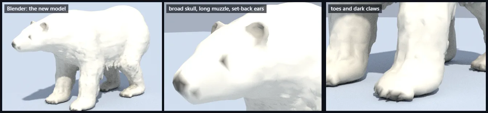

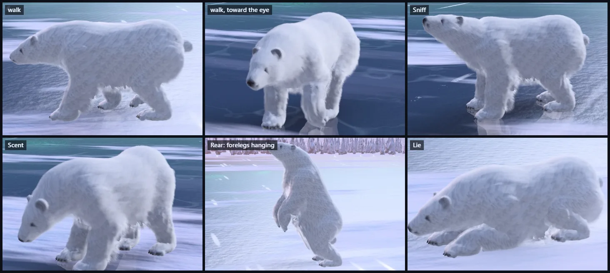

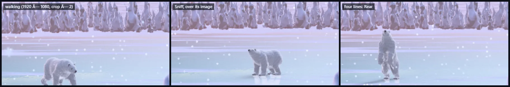

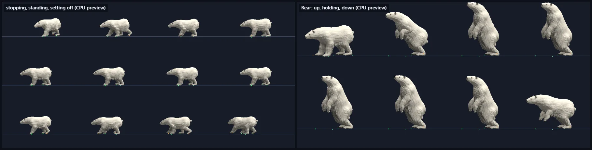

**The model** (`winter_polar_bear.py`, drawn from photographs of polar bears walking on the ice)
has the anatomy the first lacked: the long deep body with the rump a little over the shoulders;
the long thick neck carrying the head low; a broad skull with furred cheeks and a Roman nose
ending in a big black pad; small cupped ears on the sides of the skull; forelegs that are columns
of fur with long hair hanging behind them, ending in great paws turned in with five toe pads and
a dark claw from each; hind legs in "trousers" of long hair over long flat feet; a fringe under
the belly; a coat that lies in soft clumps combed back over the body and down the legs. It is
sampled finer (7 mm, was 1 cm) and kept at 17 862 triangles.

**The skeleton** has 29 bones (was 20): four in the trunk, so the back bends along the path it
walks, rounds and hollows, and the shoulders roll against the hips; two in the neck, so the head
hangs low in a curve, not a kink; shoulder blades that slide forward with a reaching foreleg and
back as it pushes, so the hump of the shoulder rolls; and below each wrist and heel the toes, so a
paw is placed by the ball of the foot, the heel peels up about it while the toes stay flat, and a
swinging forepaw curls and shows its sole.

**Its feet are footsteps** (`pawAt` in `winter-bear-plan.js`). Each paw is put down in the world
and stays exactly where it was put while the body goes over it, through a turn, slowing down,
stopping. It lands where it will stand under the body half-way through its time on the ice, which
the course knows in advance, so as the bear slows its last steps land under it; a paw left far
from where it stands takes one more step to square up once it has stopped. A swing is a smooth
path that leaves and meets the ice at rest, carried high enough that the curled toes clear it.
The rhythm takes short quick steps setting off and coming to a stop (never slow ones) and shorter
steps up or down a slope (by `1 / (1 + 2.4 × gradient)`). All of it is closed form in its clock.

**The body rides the feet.** The shoulders roll and the hips sway over whichever feet are down,
the head swings to the side of the planted forepaw, the hips walk where the chest has been. On a
slope each paw lies along the ground (toes up the rise, not into it), and the body rides the
ground under its feet where that is lower than under its trunk. Two things in the solver keep the
legs smooth: a leg straightens ever more slowly over the last few centimetres of its reach instead
of snapping straight (which flung the elbow 18 cm in a frame), and where a paw that bears weight
still lies beyond easy reach, the chest or the hips sink toward it; a paw comes off its weight as
its heel peels and takes it again as it comes down, so the trunk never lurches when one lifts.

**What it does at a stop** is the same list, but `Rear` now stands like a bear: the forelegs hang
before the belly, elbows down at the sides, the paws dangling from bent wrists (they were folded
back into the chest).

**Its coat.** The same skinned body again in shells of fur, one instanced draw (as the fox's coat
is): half the fox's shells at each tier (High 7, none at Minimal), each a veil as thick as the
share of the hairs that grow that long, combed back and down, a fine grain of strands fixed to
the coat where it was modelled, darker deep in the coat and glowing at the tips against the moon.

**Regressions found and fixed on the way** (each pinned by a test): the squaring-up steps at a
stop kept their times on the first lap's clock, so from the second lap on a foot jumped 20 cm
across the ice in one frame; a leg at the end of its reach popped its elbow; walking up the
spit's 26 % slope a trailing paw hung 12 cm over the snow before it lifted; a hind paw was left a
metre behind on setting off after a long stop; a soft-minimum for the body's height sat 4 cm below
level ice and put the standing acts' paws into it.

Measured over a whole lap (391 s at 60 frames a second) and through the board's stops: every paw
that bears weight within 3 mm of the ground, a planted paw moving less than 1.5 mm from one frame to the next, no toe tip
below the snow, no joint faster than a paw's swing through (12 cm a frame).

Cost now: the body and its image (17 862 triangles each) and, at High, one instanced draw of seven
shells of fur (125 000 triangles); the solve runs one to three passes (the trunk sinking) and the
plan a few dozen evaluations of the ground a frame, still well under a millisecond of CPU. GPU frame
time was not measured.

Verification: playground captures on WebGPU (the integrated Radeon 610M) at High and Minimal and on
the forced WebGL2 backend (walk side and toward the eye, Sniff, Scent, Rear from two sides and as it
goes up, Lie, standing), captures of a real Single Player game at High at 1920 × 1080 (walking,
Sniff, Rear at a four); no WebGPU warning or error in any console. `tests/unit/winter-bear.test.js`
(26 tests: the skeleton and its rest pose, the asset on it with its claws painted, a whole lap of
footsteps reaching the ground, nothing into it, no planted paw sliding and no joint jumping at 60
frames a second through a stop, a set-off and the spit, shorter steps on a slope, every act, the
forelegs hanging in `Rear`, the course and its footsteps closed over a lap, determinism, the
board's stops); `winter-shaders.test.js` builds the bear's coat for WGSL and GLSL at High and
checks it shares the body's buffers and skeleton.

## The bear and the fox wander (2026-10-28)

The ask: "Can we now have the polar bear and arctic fox in the winter theme act a little bit more
random aswell?" The bear walked one route, lap after lap, stopping at the same places; the fox
trotted one round and stopped at its two places, doing one of a few things. Both now wander, and
both stay replayable: every choice comes from their own seeds, so a seek shows the same night.

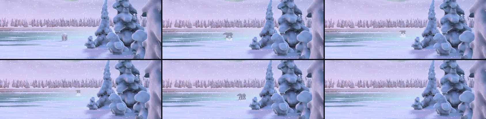

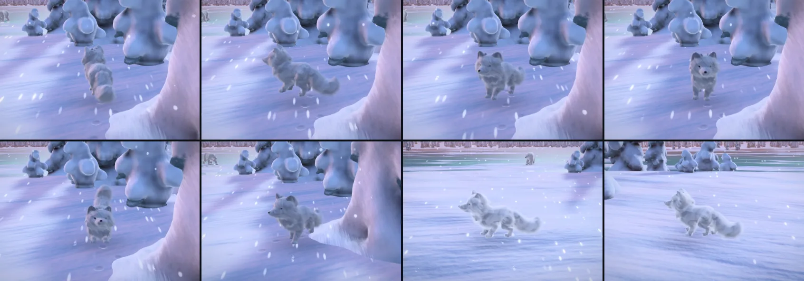

**The bear knows six ways over the ice** (`BEAR_ROUTES` in `winter-bear-plan.js`): its old round,
a close way (its first stop at 47 m), a far one (95 m), one through the middle, a wide one out to
108 m and a slow one that lingers, each with its own stops and pace (150 to 414 s a lap). Every way
sets out from, and comes back to, one place 9° past the frame's right edge at any width, where it
stands a moment, so one way hands over to the next out of sight. There it waits 0 to 70 s (mostly
short) before the next. Which way comes next is drawn by weight from its seed, never the same
twice running. The lap schedule is built lazily from its clock, so its pose is still a function
of that clock alone: a seek far into the night lands where stepping there would, and a change of
width keeps the lap it is on and its place in it.

**The fox wanders its round** (`wander` in `winter-fox-mind.js`, on in the game; the plain round
is what is left for the tests and the playground's own controls):

- It strays either side of its round, up to 0.9 m and differently every lap. On an upright
  screen, where its round is drawn near the eye, it strays less (by the round's own pull,
  `foxRoundPull` in `winter-core.js`). Its stray is fitted, at every place on its round, into the
  room it has each side there: never nearer a framing tree than its round goes (or 2.4 m), never
  further out across the frame than the open snow. Beside a tree it keeps to the far side of its
  round and swings less, eased over a few metres so its path stays smooth.
- Its trot drifts between 0.8 and 1.22 of its pace, quicker when it is restless.
- It stops anywhere on the open snow either side of the board (0.4 to 0.86 of the half width),
  or at one of its two places; it trots on 4 to 26 s between stops (mostly short), less when it
  is restless.
- It has 13 things to do when it stops, by their odds, and what it has just done is less likely.
- Now and then as it pulls up (about one stop in three, never twice within 20 s) it turns right
  round and goes back the way it came: its way turns under it, it steps the half turn round
  toward the viewer first, does what it stopped for and sets off head first the other way.
- How restless it is drifts slowly (Ornstein-Uhlenbeck, 70 s), so it has spells of trotting on
  and spells of stopping often.

The shared fox mind (`shared/fox-mind.js`) gained five hooks for this (`trotAt`, `restFor`,
`chooseStop`, `stopped`, `faceTime`), each defaulting to what it did before with the same random
draws, so Sakura's fox is unchanged.

**Found and fixed on the way:** the stray took the fox 0.95 m from the trunk of the right-hand
leaner, partly behind it (its round passes it at 1.53 m); and on a 430 × 932 screen it carried
the fox out to 1.08 of the half width, out of frame. Both led to the room each side described
above. A first version of that room clamped the stray, which bent its path sharply where the room
on one side was nearly nothing (0.6 rad a metre over its round's own turn); laying the swing
over the room instead keeps it under 0.25. And the playground's seek began only 9 s before the
frame, so `foxTurn` could not show a turn more than 9 s old: it now begins early enough.

Measured over three simulated quarter hours (seeds 0xf0c5, 7, 12345): 30 to 32 stops, every one on
the open snow, on both sides; 9 to 11 turn-backs, 20 to 213 s apart; 11 to 13 kinds of stop; its
trot 1.0 to 1.8 m/s; its heading at most 7.9° a frame; once under way never facing more than 0.6 rad
off its path; never out of frame. The bear over three hours: every way taken, never one twice
running, out of sight between 5 and 40 % of the time, handing over within 5 cm and 0.03 rad of the
next way's start, all out of frame.

Verification: playground captures on WebGPU at High at 1600 × 900 (each of the bear's ways, with a
close up of the close one, the hand-over with no bear in sight, one turn-back frame by frame and
the fox trotting back) and at 430 × 932; no WebGPU warning or error in any console. Not captured in
a real game. `tests/unit/winter-bear.test.js` (26 → 29: the ways meeting out of sight at any
width, another way each lap and never the same twice, still a function of its clock many ways on;
the lake and stop tests now walk every way) and `tests/unit/winter-fox-mind.test.js` (53 → 64:
stops on the open snow on both sides and off its places, the variety of what it does, its spells,
turn-backs with its head first, the way back over the ground it came by, its paces, its stray
against the trees and the frame at four widths, the frame, the same night from the same seed,
a change of width, and the plain fox left as it was). The Winter, Sakura and shared fox suites:
520 tests green.

Later the same day, looking at Sakura's fox, its wandering moved to `../shared/fox-wander.js` so
both foxes share it (what is Winter's own stays here: the framing trees, the frame, the open
snow), and two things changed for both foxes, recorded in SAKURA_TWILIGHT_OVERHAUL_2026-10.md
("It wanders, and its paws hold the ground"): their paws hold the ground where they are put down
(a paw on the ground slid by 1.28 mm a frame at a trot on average, now 0.03), and they turn round
no faster than 2.6 rad/s, a step every 0.8 rad. It also found a fault here: the stray could carry
the fox inside the round's tightest bend by more than the bend's radius, where its way doubled
back and it slid backward while facing forward; inside a bend it now strays no further than half
its radius. The fox's figures above, measured again on the shared code: 30 to 32 stops, 9 to 11
turn-backs, its heading at most 3.0° a frame (was 7.9°), never out of frame.

Playground: `foxTurn=<s>` is new (the fox pulls up and turns back that long before the frame);
`bearAt=<s>` (the bear that far into its own clock) now reaches any of its ways and laps; the
diagnostics name the bear's way (`way: "far#3"`) and the fox's turns and restlessness.

## The night's own clocks, the far range, and events of their own (2026-11-16)

The ask: audit the theme and raise all of it: a landscape with more depth, an aurora, weather and
light that change as you play "so it never looks the same for long", animals with more variety,
and "every event should have its own distinct effect … the biggest moments feeling the most
spectacular", while play stays smooth and easy to read.

### What the audit found

Captured first: the five hours, every event, the lean tier, the WebGL2 backend, an upright frame,
both animals close up and at game size. What worked was kept: the composition, the snow ghosts,
the moon, the hours, the fox fires' idea, the fox of light on four lines. What was weak:

- **The night only changed its colours.** The hours turned, but the aurora was always the same
  bands with rays, the snowfall always the same snowfall, the sky always clear. After one round
  of the hours a player had seen everything the sky does at rest.
- **Lit by play, the aurora was a bar code.** Every ray's height and colour rode on one per-ray
  number, so a chain or a four turned three or four sheets into on/off stripes over the whole
  sky, every other stripe one flat colour from foot to top.
- **Events shared one vocabulary.** A lock, a clear, a twist and a perfect clear were all sparks
  of the same shape, a ring and a strum of the sky. A twist's "wheel of sparks" was not told from
  a clear in a still, and a perfect clear was a four with brighter numbers.
- **The land was flat in depth.** Snowfield, a strip of lake, one tree line, a smooth dune of a
  fell, sky. Nothing stood behind the fells, and the fells themselves had no relief.
- **Nothing happened by itself** but the fox's round and the bear's walk.
- **The animals repeated.** One fox with a trot, a gallop and ten things it does at a stop; one
  bear at one pace with four. See "The animals" below.

### What changed

| What | Before | After |
| --- | --- | --- |
| **The aurora's form** (`winter-weather.js`, `wAurora`) | One form: bands with rays. | Six, turning by their own clock (64 s each, resting 23 s, then melting into the next): bands with rays (the look the theme opens on), quiet arcs, tall rays, deep folded curtains with a bright hem, a corona breaking overhead, patches that pulse. The display also breathes at rest (`auroraSwell`). A chain makes any form more rayed and taller; patches pulse only while the night is quiet. |
| **Lit by play** (`wAurora`) | A wall of stripes. | An energetic sheet fills in between its rays, the colour climbs with the sheet's height (every ray green at its foot, violet at its top), and the highest tops burn the deep red of the highest air. |
| **The corona** (`wCorona`) | None. | When the fires break up overhead their rays converge on one point of the sky. That point stands just over the top of the frame above the board, so the rays fan down both sides of it: a crown over the board. It stands by itself in one of the six forms and at full strength on a perfect clear. |
| **The weather** (`winter-weather.js`) | One: light snowfall under a clear sky. | Five, by their own clock (82 s each): light snowfall (the look the theme opens on), a clear still night with more stars, ice haze (diamond dust in the air, mist in banks on the lake, a ring round the moon, the moon's pillar), a flurry on the wind under cloud (the flakes become streaks), and big slow flakes in still air under a thin veil. The pool of flakes holds a flurry's worth; the weather says how much of it is in the air. |
| **High cloud** (`wVeil`) | None. | Long fibres of thin cloud drift over on some nights: the moon lights them silver, the last light warms them on the horizon, the fires colour them from above; they hide stars sooner than the fires. Under cloud the trees' moon shadows soften. |
| **The ring round the moon** | Lit by play only. | It stands when there is ice in the air (the cloud, the diamond dust), as it does: all but gone on a clear night, plain in the ice haze. Play still lights it further. |
| **The galaxy** (`winter-sky.js`) | None. | A band of points too faint to count rises from the horizon left of the board, with a glow under them and a dark lane; seen in the dark hours and when play brings the night on. |
| **Mist on the lake** (`winter-mist.js`) | A term in the air's haze. | Banks of mist at four depths across the lake, the last behind the first trees of the far shore: the bear walks into them and out, the far shore is seen through them. They take the moon's light, the twilight's on its side, and the fires' colour. |
| **The far range** (`wRange`) | Nothing behind the fells. | Sharp summits behind the round fells, pale in the air: moonlit on the faces turned to the moon, in shade and warmed by the twilight on the others, ribs of rock running down from each top. |
| **The fells** (`winter-ground.js`) | Smooth dunes. | Relief of their own far off (shoulders and gullies the moon rakes across), from two reads of the noise the ground already made. |
| **By itself** (`NowAndThen`) | Nothing. | A shooting star every quarter to three quarters of a minute, a bough that lets its load of snow go, a gust that crosses the snowfield when the wind is up. When each falls is dealt from a seed by its number. |
| **Sparks** (`winter-fx.js`) | Long dashes: confetti. | A hot point with a short tail and a soft halo. |

The three clocks (hours 5 × 96 s, weather 5 × 82 s, forms 6 × 64 s) share no period, so the same
hour meets another weather and another form each time it comes round; all three are back at
their starts together only after more than an hour. Each is a function of the time alone, as the
hours are, so a seek and a replay agree at any frame rate (a test compares a seek with playing
there at 12 and at 60 frames a second).

### Event language, as it now stands

| Event | Its own answer |
| --- | --- |
| Piece lock | (as before) Sparks in the piece's colour go up, the sky takes and holds that colour, a ring of powder runs over the snow and flicks the fox's tail. |
| Hard drop | The same harder, and **a second, tighter ring** runs out inside the first with a crown of powder round where it landed. |
| Line clear | (as before) Blades of light from the cleared rows, a gust, the sky strummed outward, the fox springs; from three lines the trees shed their loads. |
| Chain | (as before) The fires burn brighter sheet after sheet, **and now change shape**: more rayed, taller, deeper folded, filled in between their rays. |
| Four lines | (as before) The hush, the fox's pounce, the fox of light across the whole sky. |
| Twist | **A snow devil** stands up from the snow beside the board on the side the piece went in, a leaning funnel of spindrift five metres tall in the piece's colour, and walks off across the snowfield; over it **the fires are wound into a spiral** of two arms that opens and is gone in a few seconds. A twist that clears nothing raises a smaller one. |
| Perfect clear | **The corona**: the fires break up overhead and their rays stand as a crown over the board; **pillars of light** in the fires' colours stand up one after another along the whole far land; beside what was there (the fox of light, the moon's ring and pillar, every crystal alight). A four alone lights no corona: it is the perfect clear's own. |
| Level up | **A shower of nine shooting stars** falls out of one point just over the frame, on one side of the sky one level and on the other the next; the hour turns one step (as before). |
| Game over | The fires sink and the fox sleeps (as before), and **the night closes in**: the snow falls thicker in bigger flakes, the wind dies, cloud draws over. A new run opens it again from where it stands. |

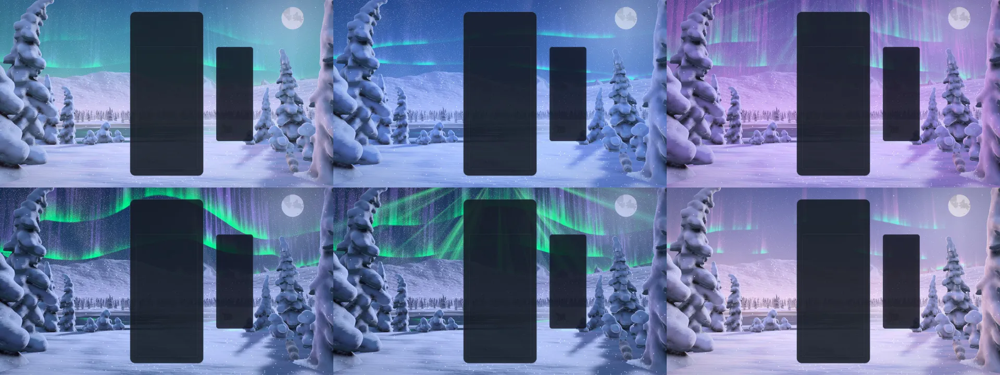

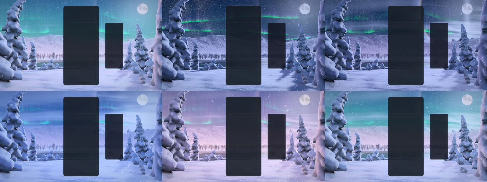

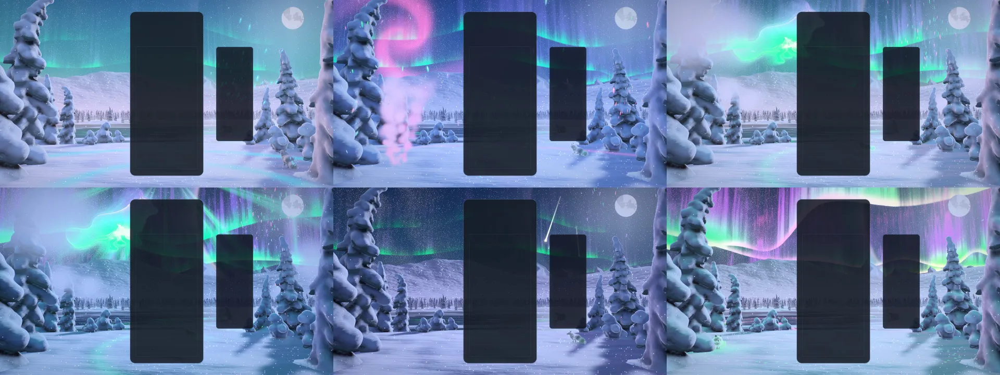

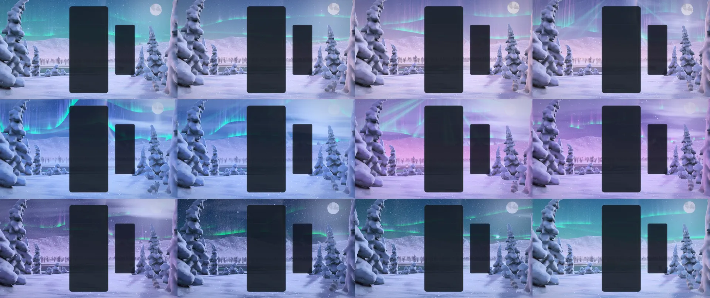

### How it is built

- `winter-weather.js` (three-free): the two tables and their clocks (`clockDrift` is the hours'
  rest-then-melt for any period), the display's breathing, and `NowAndThen`, a stream of moments
  whose nth gap is dealt from a seed by n.
- The world mixes each table at its clock's phase every frame and writes `u.form`, `u.form2`,
  `u.weather`, `u.weather2` and `u.air`; `holdWeather` and `holdForm` hold either for a capture.
- The sky branches out what only some of it needs (`If`): the moon's face is worked out on the
  moon, the corona, the spiral, the pillars and the cloud only while there is any, the far range
  only under its tallest summit. The colour the fires have at a bearing (six slots) is worked out
  once and handed to the aurora and the corona.
- The far range is painted in the sky, not ground: two rows of hashed summits with straight
  flanks give the crest with no texture read, one slow noise read bends the bearing so no flank
  is a ruled line, and the ribs are read in the fan about each summit. A noise-profile skyline
  read as a striped ice wall and bare hashed summits as pyramids before this (skill gotcha #1600).
- Shooting stars (`winter-meteors.js`), the snow devil (`winter-devil.js`) and the mist
  (`winter-mist.js`) are pools drawn always and closed form in the time since they were thrown,
  like the sparks: nothing is created at event time.

### Tiers

| Tier | Galaxy | Cloud's second read | Mist banks | Snow devil sprites | Flakes in the pool |
| --- | --- | --- | ---: | ---: | ---: |
| Minimal | no | no | 2 | 90 | 1,120 |
| Low | yes | no | 3 | 130 | 2,080 |
| Medium | yes | yes | 4 | 180 | 3,520 |
| High | yes | yes | 4 | 240 | 5,440 |
| Ultra | yes | yes | 4 | 300 | 7,680 |
| Extreme | yes | yes | 4 | 380 | 10,240 |

Every tier keeps every form, every weather and every event. The sky's fragment stage is 40.8 KiB
of WGSL and 43.8 KiB of GLSL at High against the 48 KiB gate (it was 22 and 24): anything more in
the sky must share work first.

### Reproduce

`/playground.html?effect=winter&t=20&quality=High&board=1&hud=0` with, new: `form=bands|arcs|rays|
curtains|corona|pulsing`, `weather=snowfall|clear|ice-haze|flurry|soft-flakes` (or a number of
steps into the round: `weather=1.5` is half-way from clear to ice haze), `event=spin` (a twist
that cleared nothing), and `P.<name>=` for the new look numbers (`auroraFill`, `auroraRedTop`,
`coronaGain`, `veilSilver`, `milkyWay`, `rangeBase`, `rangeRise`, `rangeAir`, `fellRelief`).
`event=twist` and `event=spin` now lock a piece first (the whirl takes its colour and its side);
`event=perfect` sends the clear and then the crown, as the game does. `parts=` knows `meteors`,
`mist` and `devil`.

### The animals

Over a ten-minute session the fox showed one trot, one gallop and the same handful of stops, and
the bear the same big male at one pace doing four things. Both were reworked in their own
worktrees and folded in here.

**The arctic fox** (`winter-fox-life.js`, `winter-fox-rig.js`, `winter-fox.js`):

- **Paces at rest.** Beside the trot it walks slowly with its nose to the snow, lopes, and bounds
  through the snow in arcs; a spell of each (`FOX_PACES`), more of the quick ones when it is
  restless. The chain's run and gallop are as before.
- **Things of its own at a stop** (acts in `winter-fox-rig.js`): it scratches behind an ear with a
  hind paw, rolls on its back in the snow, lies like a sphinx with its head up, stands up on its
  hind legs to see further, goes round after its tail, leaps high for a mouse and misses (and
  tilts its head after), bows and tears round in a circle. What it chooses leans on the night:
  under a strong aurora it sits and watches more, after a chain it lies down.
- **Board answers of its own:** a twist, a leap with a turn in it; a new level, it stops and looks
  up at the falling stars; a perfect clear, three bounces on stiff legs once its pounce is over.
  A shooting star by itself makes it look up at where it fell.
- **Its look.** The Blender model and the coat were reworked for definition that survives at game
  size: a line of mouth and rims round the eyes, darker inner ears, a lighter muzzle, fur that
  flows along the body. It stays round and cute.
- **A second fox** (`winter-fox-visitor.js`): a "blue" arctic fox (the charcoal winter coat, one of
  `FOX_COATS`) with its own mind and seed, on a lane across the back of the snowfield that leaves
  the frame at both ends. Over a night one sees one fox, then two, then one; it keeps off the fox
  and each looks over at the other. It is drawn in 0.4 of the fox's shells, and only on tiers where
  that comes to four or more (Medium and up).

**The polar bear** (`winter-bear-plan.js`, `winter-bear-rig.js`, `winter-bear.js`):

- **Who walks each lap** is dealt from its seed: the big male, a smaller and slimmer female, or a
  female with her **cub** (`assets/polar-bear-cub.glb`: the same field with a cub's proportions,
  a big head and ears, a short muzzle, thick legs, a deeper coat, on the same skeleton). The cub
  keeps beside and behind her, pulls up after her when she stops and does something of its own,
  dawdles, stops to look at something, and runs to catch up. The cub is drawn on every tier that
  gives the bear a coat (all but Minimal).
- **What it does at its stops,** about a dozen things, never the same at two stops running: sits
  back on its haunches like a great dog, lies down sphinx-like to rest, rolls on its back with its
  paws in the air and shakes itself off, the seal-hole hunt (still over a spot, then up and down
  on its forepaws, nose in), digs at the ice, stretches, stands up to scent the wind, besides the
  sniffing and looking it did.
- **Paces per stretch:** a slow amble with its head low and swinging, its walk, a brisk walk, and
  rarely a short rolling lope (the hind feet one after the other, then the forefeet, then a moment
  off the ice).
- **Board answers:** four lines, it stands up to watch the fox of light (as before); a perfect
  clear, it stands up, then sits down where it stood and watches the sky; a level, it lifts its
  head into the wind; a twist, its head snaps round to the board; the run's end, it lies down (as
  before). A cub does what its mother does, a beat later.
- **Its look:** a black nose pad, dark eyes and lips, the shade inside the ears, and claws and pads
  that show as a paw lifts; the face and paws are kept finer when the mesh is decimated.

Playground, new for the animals: `foxAct=` also takes `Scratch`, `SnowBath`, `Sphinx`,
`StandTall`, `TailChase`, `PlayBow`, `MouseLeap`, `HeadTilt`, `SkyGaze`, `Twirl`, `Pronk` (`miss`,
`zoom`); `foxDo=twirl|gaze|rejoice`; `foxPace=walk|trot|lope|bound`; `visitor=<s>` with
`foxWho=visitor`; `bearLap=<n>`, `bearCast=male|female|family`, `bearDo=<act>`,
`bearCubDo=<act>`, `bearPace=amble|brisk|lope`, `bearSeed=<n>`, `bearAct=wonder|scent|glance`,
`bearCamOn=cub`, `bearCamAim=head`.

### Verification

- Tests: `tests/unit/winter-weather.test.js` (new, 23), `winter-fox-life.test.js` and
  `winter-fox-visitor.test.js` (new), the bear's suite (57, mother and cub), and every Winter,
  shared-fox and Sakura-fox file: 628 tests, all green. The whole unit suite on the branch: 25,061
  passed; the four failures are this machine's known ones (two `250 000` locale tests,
  `tts-recorder-e2e`'s symlink, and `capture-process-cleanup`, which passes alone).
- Gates: typecheck, ESLint (no errors in the changed files), lint ratchet, TypeScript ratchet,
  architecture fitness, dependency boundaries, theme lifecycle audit, performance budgets, the
  skill's audit and mirror tests.
- Pictures (private Vite, headless Chrome on the RTX at 30 fps): every form and weather, every
  event, the lowest tier, Medium on the forced WebGL2 backend with a twist, an upright 430 × 852
  frame, both foxes and the bear family at game size, and close-ups of each new act; no console
  warning or error in any. A real Single Player run with real key presses ran the theme on WebGPU
  with no warning from it.
- Cost: GPU time per frame at 1920 × 1080, High, capped at 30 fps: 0.86 ms against main's 0.84 ms
  at rest (0.83 / 0.87 with a chain of eight, 0.86 / 0.82 in the ice haze, 0.34 / 0.33 at Minimal).

**Open, not fixed:** once a lap the cub's left forepaw overreaches as it comes down (for three
frames its landing spot is up to 25 mm, in model metres, beyond the leg's reach, so it touches
down short and slides a centimetre and a half into place). At its screen size (20 to 40 px) it
cannot be seen; its test allows that much for the cub and no more. Retuning the cub's stride
table (planned in its mother's measure) is the fix. The visitor fox is not in the shader gate on
its own (its coat changes only constants in the fox's graph, which the gate builds); its WebGL2
frame is clean. The theme icon and `docs/theme-screenshots/winter.png` still show the earlier look.

## The trees sway, and the bear opens on a lap of its own (2026-11-17)

The asks: "can we have the trees swaying a bit", and "the polar bear can start with a random round
so it feels varied when we start the theme and when the theme is active".

**The snow ghosts sway** (`winter-trees.js`, `SWAY`). Each tree rocks slowly at its own phase and
pace, the taller the slower (a 10 m spruce once in about five seconds, a gnome a metre and a half
tall in two), bending as the square of how far up it is, so its foot stands still. It leans a
little further with the wind as the weather blows harder (a flurry more than a still night), and
gives as a gust reaches it: a clear's gust bends the trees away from the board one after another
as it crosses the snowfield, as their loads come down. At rest the tallest spruce's top moves
about 6 px either way at 720p; the strongest gust (four lines) moves it under 45 cm. Each tree
carries its height, phase and place in one instanced attribute (`aTree`), each vertex how far up
it is (`aSway`); the offset is added in the vertex stage on the world's own sway clock
(`u.sway`), so a seek shows the same frame. Reduced motion runs it at 0.3 the pace and 0.4 the
reach. The moon shadows, baked once, do not sway: at this reach it does not show.

**The bear's opening** (`winter-bear-plan.js` `open`, `winter-world.js`). In the game every start
of the theme deals the bear a fresh seed with an open opening: its first lap is any of its six
ways, walked by the big male, the female or the mother with her cub, by the same weights as every
later lap. Before, the first lap was always the big male on his round, and with the shipped seed
the first cub came seven and a half minutes in. A capture, or a world given a seed, keeps the old
opening so frames still compare. Two real-game starts opened as the male on his round and as the
female on the wide way.

Playground: `still=1` holds the camera at its rest pose, so what moves is the world (how the sway
was judged: two frames 2.8 s apart, differenced).

Tests: `tests/unit/winter-sway-opening.test.js` (the bend from foot to top, every tree's own
numbers, the sway clock under seek, reduced motion and a new run, the reach; the closed and the
open opening, a fresh seed per start and the fixed one for captures).

## The foxes roam: no ring under them (2026-11-21)

The ask: "it feels like one of the arctic foxes just running in circles, this must be much more
varied and random and better implemented, it should feel real and random and varied but with a
thought."

It was. The fox walked one closed round, 42 m long, 9.8 to 20.5 m from the eye, and only strayed
0.9 m either side of it, so lap after lap it went the same way over the same snow (over a quarter
hour it was on ground it had already covered, going the same way, nine tenths of the time). Its
play was a bow and a tear round a perfect circle. The visitor's way was a loop too: across the
back of the snowfield, left to right, out of the frame and round behind the viewer, so it always
crossed the same way on nearly the same line.

**What the fox does now** (`winter-fox-roam.js`, `RoamingFoxMind`; the game's fox). It goes round
no ring: it sets out to do something, goes there by a way it lays as it goes, does it, and decides
what next. What it sets out to do (`FOX_ERRANDS`) follows what it wants:

- **Hungry** (its hunger rises over minutes; a catch takes most of it away), it forages, casting
  to and fro with its nose to the snow across its way to a place, and stops there to listen; or
  it hears something further off, goes near and creeps the last two metres.
- **What follows what** (`FOX_FOLLOW`): after a miss it tries again a step or two on (55 %);
  after a catch it carries it off a few metres and digs it in (40 %); having listened, it often
  heard something and stalks it (45 %).
- **It works one side of the board a while,** then crosses to the other for fresh snow, at a trot
  or, further and when restless, a lope or bounds; sometimes going straight on into the next
  thing without a stop.
- **It goes up to where it sees far** (higher ground, further out) and sits or gazes, more under a
  strong aurora; **rests** (more when the chain has tired it, and the longer it has been on its
  feet); **grooms** (scratches, rolls, chases its tail); **plays** (a bow and a romp: three to five
  quick dashes this way and that, swerving back the other way more often than not, skidding to a
  stop on the open snow; never round a ring).
- **It watches what it notices:** the world tells it where the other fox is and where the bear is
  while it is in sight on the ice (`notice`), and now and then (not twice within 90 s) it goes
  over to the edge of its snow nearest it and stands up or sits and looks at it.
- **When it stops it turns where it stands** to wherever it goes next (pulling up first, stepping
  a big turn round no faster than a few steps carry it), so it often sets off another way than
  it came. Where it means to go lies behind it while it is under way, it pulls up and turns there
  rather than looping round.
- **Its leaps are seen side on:** a hunt's way goes on across the viewer's line of sight for a
  metre and a half, and the leap goes along it (every one of 67 to 74 leaps in four simulated
  quarter hours, against about a third facing away before this was added).
- **At a run** (the chain, a dash) it goes nowhere in particular: it races about its snow making
  for one place and then another (so it cuts across the middle and back), looks a turn ahead,
  swings away from the frame's edge and the trees toward whichever way is open (keeping to the
  way it began to swing, so it never dithers into a corner), and slows to take a tight turn
  (`cornerSpeed`: what its way just ahead allows at 16 m/s² across it).

**Where it goes** (`FoxTrail`, `winter-fox-trail.js`; `steerTo`): its way is laid only a few
metres ahead of it, by a walker steered toward each place it has in mind, turning no tighter than a
fox turns at that pace (`FOX_STEER`), wavering a little, never nearer a framing tree than 1.6 m
nor further out than its band of snow (`snowRange`: 9.3 to 20.8 m from the eye as planned, drawn
nearer on an upright screen by the round's old pull; inside 0.9 of the half width, 0.78 on an
upright screen near the eye, where the flat reckoning of a fraction understates how far out a
place shows). A place it could only reach by going round and round is no place to go: the walker
gives up and it tries another, bears off and comes round, or (hemmed in) pulls up and turns.

**Where it stops is where it is seen.** On the open snow beside the board (0.4 to 0.86 of the half
width), and since the world knows where the card and the HUD are, it tells both foxes
(`showFoxes` in `winter-world.js`, `setSight`): a place counts only if most of a fox standing
there would show, beside the card and in the frame, at the camera's rest pose. A way that ends
short of its place out of sight makes no stop there.

**The visitor** (`winter-fox-visitor.js`) is the same mind on the back of the snowfield (18.5 to
25 m, 3.5 m inland). It comes in from beyond either side of the frame (by a way it can be seen to
take all the way in), works the back of the snowfield for 18 to 70 s (forages, hunts, crosses,
sits and looks; no romp), and leaves by the far side or back the way it came, out of sight, and
is away 15 to 90 s. It keeps off the fox as before; kept waiting, it goes back the way it came,
and if there is no room behind it, back out of the frame.

**What is gone:** the fox's ring as the game's course (`FoxMind` on its round stays as the plain
fox for the tests and captures that pin an act), its stray (`fox-wander.js`'s `foxWalk` is
Sakura's now), its circles (`withLoops`), and the visitor's lane (`VISITOR_WAY`, `visitorWay`).

Measured in node over simulated quarter hours (seeds 0xf0c5, 7, 12345), the old fox against the
new: snow covered 74 to 91 m² against 154 to 169; the share of its way going over snow it had gone
over the same way 20 s and more before, 0.90 against 0.26 to 0.33; stops 28 to 38 against 61 to
66; stops on the other side of the board from the one before, 0.54 to 0.59 against 0.18 to 0.25.
At a run for two minutes: 80 m² against 96 to 115, and the sideways pull at most 56 m/s² against
23. Over every width (16:9, 4:3, 1:1, 21:9, 430 × 932), at rest and at a run: never out of frame
(at most 0.89 of the half width, 0.78 upright), never nearer a framing tree than 1.6 m (2.2 m at a
run); the visitor never nearer than 1.36 m. Paws on the snow slide 0.06 to 0.08 mm a frame on
average (0.02 to 0.03 before: it now steps round on the spot at most stops, and its romp ends in
a skid that is meant to slide); the worst single frame 12 to 20 mm (36 to 43 before). Its way is
never run past.

Verification: films in the playground (a private Vite and headless Chrome, WebGPU on the RTX, 30
fps), a frame every few seconds with the fox's own diagnostics: 1280 × 720 with the board for
95 s (rolling in the snow, crossing to stand up and look about, casting nose down, a pounce and a
dig, loping off; the visitor in from the right, hunting, sitting, leaving by the far side), a
chain at power 0.7 (racing over both sides and the middle, its sparks trailing), and 430 × 932
with the board (stops beside the card on both sides, on screen in every frame). No console warning
or error in any. Not run in the real game. Tests: `winter-fox-mind.test.js` (the roaming fox: no
ring, stops on the open snow, one side a while, a reason for what it does, turning where it stands,
the frame and the trees at four widths at rest and at a run, its run, the same night from the same
seed, a change of width, turning back when asked, watching what it notices),
`winter-fox-life.test.js` (its paces by what it is about, its romp), `winter-fox-visitor.test.js`
(in and out by either side), `winter-world.test.js` (where the foxes are seen); 638 tests in the
Winter, shared-fox and Sakura files, all green. Gates: typecheck, lint and TypeScript ratchets,
architecture fitness, dependency boundaries, theme lifecycle audit, IP strings, performance
budgets, release gates, the build and its boot closure.

Playground: `foxTurn=<s>` now has the fox pull up and go back the way it came; `foxAct=zoom` is a
bow and a romp; `visitor=<s>` brings the visitor in from beyond the left; the diagnostics name each
fox's errand (`fox.errand`, `visitor.errand`).

**Open:** on a phone the card leaves little snow beside it, so the fox stops with a little of
itself behind the card's edge at times. The fox walks more than it used to (casting and creeping
are at a walk); if it should trot more, `FOX_ERRANDS` and `travelPace` are where. Not yet seen in
a real game session.
