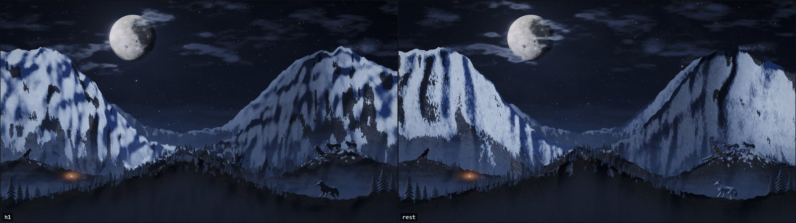
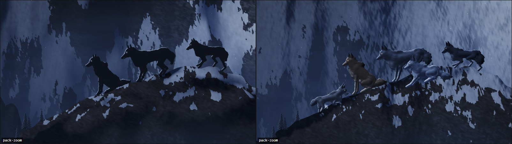
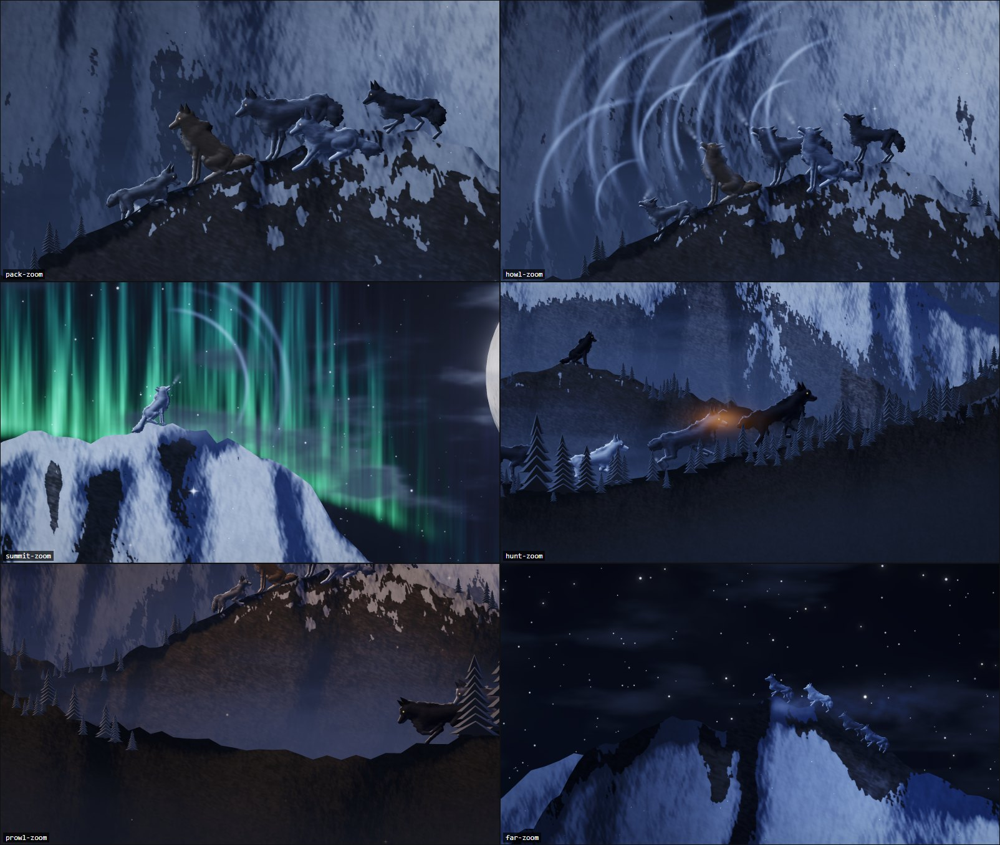
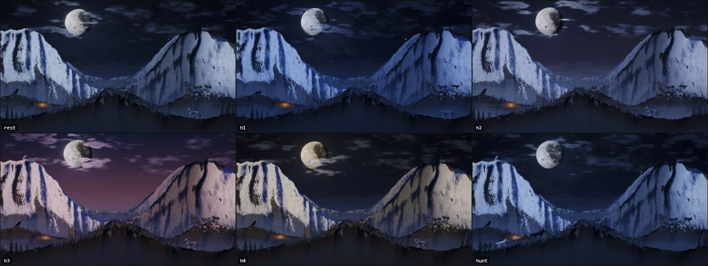
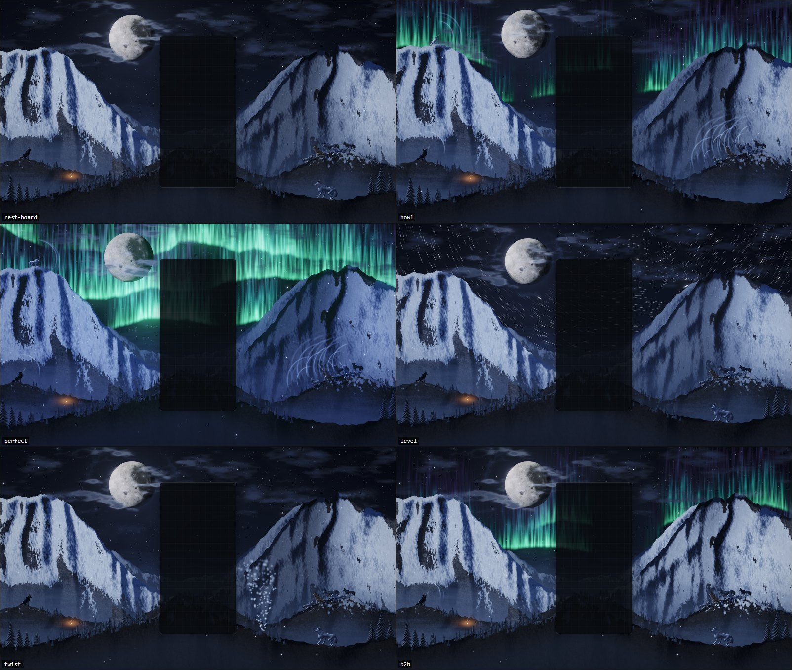
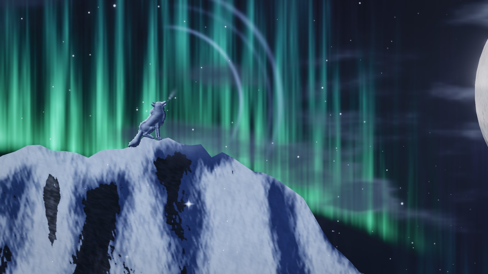
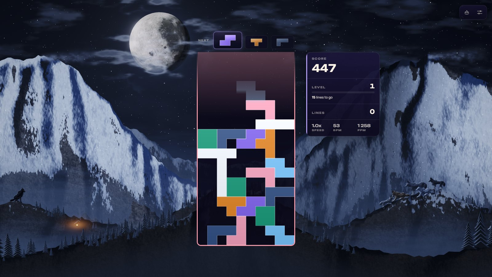
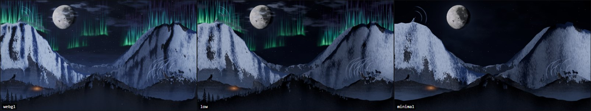

# Wolfhour — the masterpiece pass (2026-11-16)

Olov asked for a thorough audit of Wolfhour and for it to become one of the game's most stunning
themes: the background, colours, light, animation, UI, the wolves and every event; a night that
keeps changing as you play; much better wolves with far more variety in how they look, move and
behave (prowling, running, howling, packs of different sizes); every event its own mark, the
biggest ones the most spectacular; smooth and readable throughout.

Branch `feature/wolfhour-masterpiece`. Earlier passes: [the moonlit night](../reports/wolfhour-moonlit-night/README.md),
[the wolves come alive](../reports/wolfhour-wolves-alive/README.md),
[the hours of the night](THEME_MOOD_CLOCKS_2026-10.md). Every hour and every event was captured on
`main` first (playground and the real game, private dev server, headless Chrome on the RTX at
`maxFps=30`).

Before (main, left) and after (right), the same moment:

The pack, before and after:

## What the audit found

- **The wolves were dark cut-outs.** One flat near-black coat (`0.0045, 0.006, 0.0105`) with a
  hairline of rim: no volume, no markings, every wolf the same animal. At close range the capsule
  rig read as a sausage dog: thick legs of one radius, a short snout, small ears, a thin tail.
  Each wolf had its own material (five pipelines-worth of identical shaders).
- **Little variety in what they did.** Five wolves, all fixed in place but the scout, which walked
  the same path every 96 s. Nothing ran, nothing prowled, no group ever crossed the frame.
- **The mountains were camouflage.** The snow/rock split came from isotropic noise blotches, so
  the two great walls looked mottled rather than carved: no ribs, no gullies, no fall line.
- **The events were the old cosmic theme's.** A lock was a puff of white star-burst sprites, a clear
  a pale beam and a grey smear across half a range, a chain a fog-white "rift" over the right massif
  (`combo-0300`: the right half of the frame went milky). They had nothing to do with a moonlit
  valley, and in the real game they hid the wolves.
- **The pieces were seven silvers** within ΔE 5 of each other (I `#ddeeff` … J `#708090`): hard to
  tell apart on the board, and nothing of the valley in them.
- **The night changed only its colours.** The five hours tinted the light, but the weather, the sky
  and what lived in it were the same all night.

## What changed

### The wolves

- **One material for every wolf** (`wolfhour-wolf-material.js`). The rig's capsules now carry a
  depth toward the viewer, a coat tone and a fur length (`CAPSULE_STRIDE` 12, `CAPSULE_COUNT` 28).
  They live in one float table (a `DataTexture` read with `textureLoad`, the same on WebGPU and
  WebGL2), a row per wolf; the row is the mesh's own number (`uniform().onObjectUpdate`). The
  shader still unions the capsules into one outline, and now also takes, under each pixel, the
  nearest capsule's rounded surface as a smooth maximum: a depth and a normal. So the body has
  volume: the moon lights back, head and shoulders, the belly keeps the snow's bounce, far legs
  stand back in the dusk, and the coat's three colours follow the tones (dark saddle, grey flanks,
  pale legs, cheeks and chin). The outline frays into tufts that lie back along the body where the
  fur is long (ruff, britches, brush) and stays clean on the legs and the muzzle.
- **A truer anatomy** (`wolfhour-wolf-rig.js`): slimmer legs, a deeper chest and a brisket, a lean
  loin, a longer lower neck, tall pointed ears, a cheek ruff, a three-part brush with a dark tip, a
  shorter, deeper muzzle. `WOLF_SHAPE` builds each wolf its own way (girth, ruff, brush, ears, legs,
  head, muzzle) without moving a joint.
- **Coats and builds** (`wolfhour-wolf-coats.js`): timber, black, white, tawny, silver, smoke and
  ash, as albedos lit in the scene's own moonlight (a white wolf's back is as bright as the snow it
  stands on). The pack wears five different coats; travellers are dealt coats and builds per visit.
- **Gaits**: walk, trot, a low **prowl**, and two gallops, **lope** and **run**, with the bound and
  the rock of a gallop (the hind paws strike, then the fore, then the wolf is in the air). A
  standing body now sinks onto its legs when a paw is out of reach (a long stride, a bound, a paw
  down a slope) instead of a leg being drawn out (the old rig stretched lower legs by up to 4.5
  units on a downhill trot).
- **The pack at home** is five: the lead (big grey), the sitter (old tawny), the young wolf (smoke),
  and new, the **mate** (silver) lying on the near face of the spur, and the **yearling** (ash, all
  ears and paws) that cannot keep still: it plays, digs, listens, stretches, and turns round to the
  moon to howl. Low keeps four, Minimal three.
- **Travellers** (`wolfhour-wolf-travel.js`, pure functions of time):
  - the **foreground ridge** gets a visit every 48 s; every other one is the scout's, the rest are
    drawn (never the same kind twice running): a **hunt** (four or five wolves loping across the
    whole frame in file), a **prowl** (two wolves stalking in low, freezing with a paw raised,
    creeping, then breaking into a run), a **pair** (one stops to look at you, then lopes to catch
    up), a **chase** (two yearlings bounding flat out, tails up) and a **lone wolf** that walks in,
    sits down and howls by itself, twice, then trots off;
  - a **far file** of four or five small wolves trots up the right massif's skyline and over it;
  - the **white wolf** comes up over the left summit beside the moon, stands, sits, howls on its
    own and goes; a four-line clear, a perfect clear or a fever calls it up at once.
  - Running wolves kick snow up behind them and leave their breath behind them.
- Narrow screens keep the scout's visits only (the ridge is too steep to cross), and no far file.

### The valley

- **Mountains carved down the fall line** (`wolfhour-landscape-bake.js`, `fallLineRelief`): great
  buttresses with sharp crests and broad flanks, flutes between them, a fine ribbing, now and then a
  band of cliff across. Snow lies in the gullies and on the faces that lean back; the steep flanks
  and scoured crests show the rock, more of it lower down and on reaches the wind has stripped; the
  snow line runs far down the gullies in tongues. A steeper moonlight ramp splits every rib into a
  lit flank and a shaded one.
- **The night's weather by the hour** (`wolfhour-night-director.js`, `WOLFHOUR_WEATHER`): clear and
  still under the silver moon; a low ribbon of northern lights and glittering air at deep midnight
  (with the star band at its clearest); snow in the wolf's hour; flakes on the wind in the
  alpenglow; gold dust under the hunter's moon. Each breathes on its own slow beat.
- **The pieces** wear the valley's colours (`wolfhour-tetrominos.js`): moon silver, northern-lights
  green, the hut's ember, dusk violet, ice blue, alpenglow rose, granite blue. Every pair stays
  ΔE > 16 to full, protan, deutan and tritan sight (the test pins it); the palette gate reads 0/7
  in the usual bands.

### Every event its own mark

Accumulating (`shared/swell.js`): fast play lifts a light, it never restarts one.

| Event | What the night does |
| --- | --- |
| Lock | A ring of sparkle runs out over the snow from where the piece came down. |
| Hard drop | The same, stronger and wider, with the gust off the summits. |
| 1 line | A band of moonlight sweeps across the ranges, left to right, lifting the mist as it passes. The pack turns to look at you. |
| 2 lines | Two bands, the second coming back the other way. |
| 3 lines | And a ribbon of northern lights low over the far range. |
| 4 lines | The **howl**: the pack (and the scout, if it stands at its lookout) howls one after another; arcs of pale light leave every muzzle and widen toward the moon (`wolfhour-voices.js`); the northern lights hang their curtains for as long as the howl lasts; the air glitters; the white wolf comes up onto the summit and howls with them; the wolf across the valley answers. |
| Chain | Every step past the second feeds the lights a little more (and the young wolf bows). |
| Twist | A **snow devil**: the loose snow beside the board whirls up into a turning column that climbs and thins (`wolfhour-snow.js`); a breath of diamond dust. |
| Back to back | The answer: the far wolf howls alone, a band of moonlight comes back from the right, the lights flicker up. |
| Perfect clear | The crown: the northern lights over the whole sky, the air full of diamond dust, the white wolf on the summit, a hunt loping across the foreground ridge, and the howl. |
| Level up | An hour passes in a breath: the stars wheel about their pole and streak, the cloud is swept on, a hunt lopes across the ridge, and the night eases an hour on. |
| Fever | The lights and the glitter stay up while it lasts, the pack howls in chorus, the white wolf stays. |
| Run over | The night settles under falling snow, until the next run's first piece. |

The old star bursts, beams, rifts and waves are not built wherever the node materials run (their
pools are empty); the meteors, the moon's corona rings and the halo stay.

In the real game (a 75-second run with real key presses, the new piece palette):

## Tiers and backends

- **Minimal**: no aurora, no snow, no far file, three wolves at home, one ridge wolf; the arcs and
  the white wolf remain.
- **Low**: two aurora curtains, fewer flakes and crystals, four at home.
- WebGL2 matches WebGPU (one integer-fetch loop over the table on both; the shader test builds every
  new material to WGSL and GLSL at High and Low).
- **Reduce motion**: no travellers, no stars wheeling, bands of moonlight brighten the ranges in
  place instead of travelling, arcs come half as often and widen slower; a wolf that would turn
  round to the moon to howl faces it from the start.

## Cost

Playground at 1600 × 900, High, the RTX at the 30 fps cap: CPU p50 1.8 → 2.2 ms per frame at rest,
2.1 ms with the aurora, snow, dust, arcs and a perfect clear all on; GPU timestamp p50 0.17 → 0.20
ms at rest, 0.22 ms with everything on. Low with everything on: CPU 1.8 ms, GPU 0.16 ms. All wolves
are one pipeline; the aurora, arcs, snow, dust and devil are parked (not drawn) while idle and are
warmed with the theme's other parked effects.

## Traps (new gotcha rows #1403, #1710)

- **Rays in noise are rain unless they are wide.** The first aurora read as a curtain of falling
  rain: the ray read was at 0.005/unit, a few pixels per streak at 1600 px. Half the frequency and
  a bright hem along the foot made it read as light.
- **A self-lit creature in a self-shaded world glows** unless its key light is the world's: the first
  GPU port lit the wolves at moonlight 1.0 while the snow's lit colour is 0.27/0.33/0.47, and the
  silver scout shone like a ghost. Coats are albedos, and the key light is the terrain's lit snow.
- **A body standing on IK legs needs a sink**, or a stride longer than the leg reaches draws the
  lower leg out (tests pinned the bone lengths and caught it). Sink only while standing: applied
  while lying down it popped the mate's legs by 8 units a frame.
- **`sample()` returns one kept object**: a test that keeps a reading to compare with a later one
  must copy it.

## Verification

- `tests/unit/wolfhour-night.test.js` (new, 41 tests): visits, itineraries, the hunt, the prowl,
  the lone howl, the far file, the white wolf, coats and builds, the piece palette under four kinds
  of sight, every gait inside the quad with every bone its own length on four grounds, the gallop's
  bound and rock, builds that move no joint, the director's answers by event size, sweeps, ripples,
  accumulation, the wheel and Reduce motion, the run's-end snow, one material and one table, the
  pack at home, the howl's voices, the ridge's visits and the dash, the far file and the summoned
  white wolf, no traveller jumping a frame, the aurora, arcs and snow by tier, and every new
  material built to WGSL and GLSL with no warning and no unassigned read.
- All 12 Wolfhour test files: 205 tests pass. Typecheck clean, lint ratchet at baseline, the TS
  ratchet locks in three new `@ts-check` files, palette gate and URL catalog pass.
- Captures: playground (every event, every hour, zoomed wolves and travellers, WebGL2, Low,
  Minimal, portrait) and the real game (every event fired through the theme's handlers, and real
  runs played with key presses): zero GPU validation errors or console errors (the game's own
  SteamCloud warnings aside).

## Playground

`effect=wolfhour` takes `event=lock|drop|clear|double|triple|howl|combo|crash|twist|b2b|perfect|level|over|dash|summon`
with `eventAge`, and `aurora=`, `reach=`, `snow=`, `dust=`, `wind=` to hold the weather. Travellers
on the schedule: the hunt at `t≈68-80`, the far file at `t≈100-115`, the white wolf at `t≈47-84`,
a chase at `t≈162`, a prowl at `t≈354`, the lone wolf at `t≈450`. Zoom with
`zoom=<k>&zoomX=<x>&zoomY=<y>` (pack near `612, -176`, summit near `-640, 300`).

## Open calls (my own, if asked)

- The aurora is green-to-violet, the classic look; a whiter, colder one would sit closer to the
  silver moon.
- The arcs of the howl are a stylisation; plain breath alone would be more literal.
- The pieces now carry colour where they were silver: the board reads far better, but it is a
  change of character.
- The white wolf and the far file are small at 16:9 by design; they are discoveries, not events.
- The wolves were redesigned in the capsule rig and the CPU preview (`wolf-preview.mjs`-style),
  not modelled in Blender: the shader's smooth union keeps them one silhouette at every size, which
  a mesh would not.
